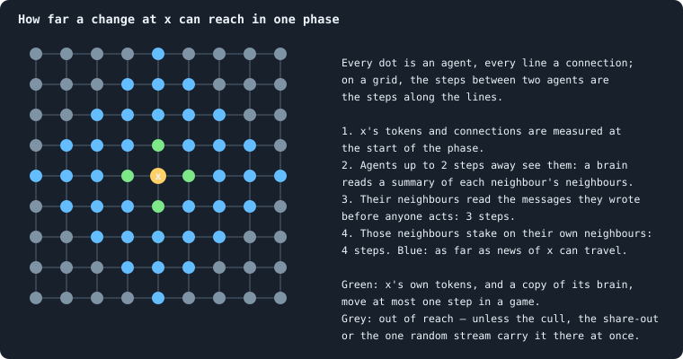

# How far does a difference travel?

> [!question] Questions of this page
> - If two worlds are the same but for one [token](the-world.md#agents-and-tokens "The one thing of value in a world: every agent holds a whole number of them, and their total never changes."), where, and how fast, do
>   they come to differ?
> - How far can news travel through a world in one phase, by its rules, and
>   which rules let it go further?
> - Does a small difference grow until the two worlds have nothing in common,
>   or does it die away?

## In short

Take two copies of a world, and in one of them move a single token from an
[agent](the-world.md#agents-and-tokens "One member of a world: it lives on a node of the network, holds tokens and has a brain that takes all its decisions.") to its [neighbour](the-world.md#the-network "An agent joined to another by a connection."). Where the twins come to differ, phase after phase,
shows how far news travels in a world, and whether a small change grows or
fades. By the rules, a difference can travel at most four steps a phase, three
in worlds without the look that only talks: a world's speed of light. But only
once the cull, the [share-out](gains-and-losses.md#gains-losses-and-the-share-out "How a cleanup deals the tokens of the dead out among the living: in the baseline, each token to a survivor drawn at random.") and the one random stream are local, and only 4
of the 24 shortlisted worlds of round 3 have no other rule that breaks the
bound. The plan is thirty twin trials on each of three candidate worlds, under
three conditions, with heat spreading on the same network as the test of the
measurement. The draft thesis: under local rules the bound is never broken,
and the difference does not die away but spreads, more slowly than the bound
allows, until it holds a tenth of the world or more.

## Two worlds and a butterfly

The meteorologist Edward Lorenz once restarted a weather model from numbers
printed to three decimals instead of six. Before long, its weather had nothing
in common with the first run's. A simple model of the air, he showed, can
depend that much on where it starts (Lorenz 1963). A difference too small to
notice grows until it is everything: the butterfly effect.

The same can be asked of any system that changes by rules, and it is asked of
networks of switches that switch each other on and off (Kauffman 1969). Run
two copies that differ in one switch, and count how many switches differ
later. In an *ordered* network the difference dies away, and the copies become
the same again. In a *chaotic* one it spreads, until a fixed share of the
switches differ. Between the two, at a critical point, it spreads like an
avalanche, sometimes small and sometimes vast. This is **damage spreading**
(Derrida and Weisbuch 1986).

For a world of Graph of Life it is two questions in one.

- **How far *can* a difference go?** Local rules set a bound. Nothing in a
  world can carry news faster than its rules carry it: a world has a speed of
  light, and a difference stays inside its **light cone**
  ([A speed limit](physical-inspiration.md#a-speed-limit)). This needs no
  relativity. In a lattice of quantum spins that only feel their neighbours,
  a change spreads no faster than a fixed speed set by the rules; only a
  trace that shrinks exponentially leaks beyond it (Lieb and Robinson 1972).
- **How far *does* it go?** Inside the cone, a difference may grow, or die,
  or spread at a speed of its own. The speed at which a chaotic difference
  actually spreads can be well below the bound; physicists call it the
  butterfly velocity (Roberts, Stanford and Susskind 2015).

## How far a difference can go in one phase

Follow a difference at one agent, *x*, through one phase of the [engine](the-lab.md "The program that runs an experiment's plan as runs, each on a frozen copy of the engine, the code that plays a world.")
(`GraphOfLifeSimple.py`):

1. **The look.** Before anyone acts, every agent's inputs are measured: its
   own tokens and links, each neighbour's, and six numbers each that sum up
   the tokens and the links of each neighbour's neighbours
   ([What a brain sees](brain-inputs.md)). A [brain](the-brain.md "The neural network each agent decides with: inputs about itself and its neighbours, outputs that become its decisions.") sees two steps away, so
   every agent within two steps of *x* sees *x* change.
2. **The look that only talks.** In [B1](b1-and-b2.md "The first baseline: the algorithm exactly as a new run is offered it."), and in every world of round 3 that
   did not switch it off ([`message_prepass`](settings.md#message_prepass)),
   every agent looks once only to write [messages](messages.md "Numbers an agent writes to itself and to each neighbour every phase, which their brains read."), and the messages are
   delivered before anyone acts. A message written from a look two steps deep
   is read by the writer's neighbours: three steps.
3. **Acting.** An agent stakes on its own node and its neighbours'. It has its
   child next to itself, joined to itself or to its neighbours, and may hand
   the child some of its links. It gives to a neighbour, pays a link's upkeep,
   takes a neighbour as a mate. Everything it does lands on itself or a
   neighbour: four steps.
4. **The outcome.** A node goes to one of the agents that staked on it, itself
   or a neighbour, with a copy of the winner's brain. A link lapses by what
   crossed it. An agent starves on its own node. All of it lies inside the four
   steps.

So news of *x* travels at most **four steps a phase**, eight an [iteration](one-iteration.md "One step of a world's time: a phase of reproduction, then a phase of the game.").
Without the look that only talks, the messages an agent reads were written in
the phase before, and the bound is **three steps a phase**, six an iteration.

Matter is slower than news, as in physics. A token moves at most one step a
[game](one-iteration.md#phase-2-the-game "The second phase of an iteration: every agent stakes all its tokens on its own node and its neighbours', and every node goes to someone."), since a stake goes only to a neighbour's node. A brain moves at most one
step a game, since a node is taken only by a neighbour. A child is born next
to its parent.

Two parts of the engine work in turn rather than all at once, and so can carry
a difference a little further than the four steps. Payments (gifts, a
link's upkeep, a mate's share of a child) are made one payer after another,
each from what the payer holds after the payments before it, so a change can
run down a chain of payers in one phase. And the deaths of a [cleanup](one-iteration.md#cleanup "The end of every phase: only the largest connected piece of the network lives on, and the tokens of the dead are shared out.") are
mended one after another ([`mend_on_death`](settings.md#mend_on_death)), so a
change can cross a cluster of agents that die together. Both are local, and
both could be made to happen at once.

### Rules that let a difference go further

Some rules reach further than a step, and with them a world has no speed of
light at all:

| rule | why it reaches further | how far in one phase |
|---|---|---|
| the cull | whether a piece lives depends on the size of every other piece | the whole world |
| the share-out, unless [estates](estate.md "The tokens a dead agent leaves, and who gets them.") go to the children or the nearest living | every survivor's share depends on the whole pool | the whole world |
| the one random stream | one more draw shifts every later draw | the whole world |
| tokens that are no one's estate: upkeep paid into the estate, a life bought, tokens created | dealt out over everyone | the whole world |
| estates to the dead agent's children | a child may have moved anywhere since it was born | as far as the children are |
| estates to the nearest living | an estate crosses the whole of a dying region, and goes to the parent if it finds no way out | across a dying region, or to the parent anywhere |
| a search that jumps or reaches ([`link_search`](settings.md#link_search)) | a link to an agent as many steps away as the searcher's tokens pay for | as far as its tokens |
| a scout that walks | the scout reports from where it stands, and the link is made there | as far as the scout has walked, a step an iteration |
| a mate who must have a child ([`mix_mates`](settings.md#mix_mates) `parents`) | whether a neighbour may be a mate depends on whether its child lives, wherever the child is | as far as the child is |
| stakes placed in rounds ([`allocation`](settings.md#allocation)) | before each token an agent reads the board of its neighbours' nodes again: about two steps a round, and a game has as many rounds as its richest agent has tokens | the whole world |

The last is the strangest: under stakes placed in rounds, how fast news
travels in a game is set by the wealth of the richest agent.

### Which candidates could keep a cone

Round 3 drew most of these rules at random. The table reads each world of the
shortlist of [Candidates for open-ended evolution](candidates-for-open-ended-evolution.md#the-shortlist):
how far a difference could go in a phase once the cull, the share-out and the
one random stream are local, as [Local rules only](local-rules-only.md) plans.

<!-- table localrules/cone -->
| world | talks before it acts | search | stakes placed | estates of the dead go | upkeep into the estate | how far a difference can go in a phase, once the three rules are local |
|---|---|---|---|---|---|---|
| [s3042](run:B1-30000-b82ad0-s3042) | no | jump | all at once | evenly over all | no | none: a search that jumps, a mate's child, wherever it is |
| [s4006](run:B1-30000-8526cf-s4006) | no | off | strongest first | to the poorest | yes | none: stakes placed in rounds, upkeep paid into the estate |
| [s3018](run:B1-30000-af1e28-s3018) | yes | reach | all at once | to the dead's children | no | none: a search that reaches, a mate's child, wherever it is |
| [s3080](run:B1-30000-625bc7-s3080) | yes | jump | all at once | to the dead's children | no | none: a search that jumps |
| [s3057](run:B1-30000-38aee9-s3057) | yes | reach | all at once | to the newborns | no | none: a search that reaches, a mate's child, wherever it is |
| [s4002](run:B1-30000-5379e2-s4002) | yes | reach | weakest first | to the parents | no | none: stakes placed in rounds, a search that reaches, a mate's child, wherever it is |
| [s3008](run:B1-30000-e19f2d-s3008) | no | jump | all at once | to the newborns | no | none: a search that jumps |
| [s3024](run:B1-30000-f05874-s3024) | no | off | all at once | to the poorest | no | 3 steps |
| [s3022](run:B1-30000-298337-s3022) | no | walk | all at once | evenly over all | no | none: a scout that walks |
| [s3051](run:B1-30000-b5a76a-s3051) | yes | walk | all at once | to the dead's children | yes | none: a scout that walks, upkeep paid into the estate |
| [s4008](run:B1-30000-1cfaa4-s4008) | no | off | weakest first | to the parents | no | none: stakes placed in rounds |
| [s3054](run:B1-30000-d9254e-s3054) | yes | walk | all at once | to the parents | no | none: a scout that walks |
| [s3087](run:B1-30000-363694-s3087) | no | jump | all at once | to the parents | yes | none: a search that jumps, upkeep paid into the estate |
| [s3004](run:B1-30000-7d5208-s3004) | no | off | all at once | evenly over all | no | 3 steps |
| [s3023](run:B1-30000-b0f6e3-s3023) | yes | off | all at once | to the parents | no | 4 steps |
| [s3058](run:B1-30000-4108dd-s3058) | no | walk | all at once | to the dead's children | no | none: a scout that walks |
| [s3045](run:B1-30000-f6d23f-s3045) | no | walk | all at once | to the parents | no | none: a scout that walks |
| [s3019](run:B1-30000-b1209a-s3019) | yes | reach | all at once | to the dead's children | no | none: a search that reaches |
| [s3026](run:B1-30000-d6955f-s3026) | yes | off | all at once | to the newborns | no | 4 steps |
| [s3016](run:B1-30000-b23381-s3016) | no | reach | all at once | to the dead's children | yes | none: a search that reaches, upkeep paid into the estate |
| [s3030](run:B1-30000-90fc91-s3030) | yes | off | all at once | to the poorest | yes | none: upkeep paid into the estate |
| [s3095](run:B1-30000-3e5856-s3095) | no | walk | all at once | to the newborns | no | none: a scout that walks |
| [s3094](run:B1-30000-4ac946-s3094) | yes | jump | all at once | to the poorest | yes | none: a search that jumps, upkeep paid into the estate |
| [s4004](run:B1-30000-17ac6e-s4004) | yes | walk | weakest first | to the newborns | no | none: stakes placed in rounds, a scout that walks, a mate's child, wherever it is |
<!-- /table -->

Four of the 24 would keep a cone: seeds 3026 and 3023 at four steps a phase,
and seeds 3004 and 3024 at three. Seventeen search for strangers, four place
their stakes in rounds, five may take only mates with a living child, and six
pay upkeep into the estate; many do more than one.

## Why local rules come first

Under the rules as round 3 played them, a difference is everywhere at once.

- **The one stream.** The twins draw the same random numbers until one of them
  draws once more, or once less: a birth in one twin and not the other, or a
  tie that needs breaking in only one. From that draw on, every later number
  differs, for every agent after it in the order of ids and in every phase
  after it ([Seeds and the random stream](random-numbers.md)).
- **The cull.** If a border goes quiet in one twin and not in the other, a
  whole region dies in one twin only, however far it reaches
  ([How a world breaks](how-a-world-breaks.md)).
- **The share-out.** A different pool, or a different number of survivors,
  changes every survivor's share.

So the twins of this page are played in the local world of
[Local rules only](local-rules-only.md), where every agent draws from a stream
of its own, pieces live on, and estates flow to the nearest living.

## The experiment

### Worlds and kept states

The trials are made on three of round 3's candidate worlds. Seed 3026, the
round's most evolving world, keeps a cone of four steps a phase. Seed 3004,
which barely culls, keeps one of three: it has no look that only talks. In
seed 3080 agents jump to strangers, so the bound should break there, and the
trials must see it break.

Every run of round 3 kept its whole world every 250 iterations
([`archive_every`](settings.md#archive_every)). The trials start from six of
these kept states, at iterations 500, 1,000, 1,500, 2,000, 2,500 and 3,000,
five trials from each: thirty trials a world and condition.

### One trial

- From a kept state, two twins are made. In the second, one token moves from
  an agent holding at least two to one of its neighbours, both drawn by the
  trial's own random numbers. The world's total stays the same: no
  conservation law can tell the twins apart.
- Both are played in lockstep for 200 iterations under the same rules, and
  compared after every phase.
- The first twin is the same for every trial from one state, so it is played
  only once.

### Three conditions

1. **One stream, as round 3 played it.** Five trials of 20 iterations a world.
   The difference is expected everywhere within a few phases: this is why the
   other two conditions exist, measured.
2. **Streams of their own**, with the cull and the share-out as the world has
   them. The bound holds except where those two carry a difference: the trials
   count how often they do, and how far.
3. **The local world.** The bound must hold without exception.

### What is compared

- **Who is who.** Agents are matched across the twins by their names, which
  under local rules come from their ancestry
  ([Random streams of their own](local-rules-only.md#random-streams-of-their-own)),
  not from the order of their births.
- **What differs.** For each agent: whether it lives; its tokens; its links;
  its brain, by its weights rather than its [genotype](genotype.md "The identity of a brain: a number that a copy keeps and a change replaces, and that remembers the genotype it came from.")'s number; and the
  messages it writes.
- **Reach and damage.** The *reach* of the difference is every agent at which
  any number differs, messages included. The *damage* is every agent whose
  tokens, links, brain or life differ: what damage spreading counts.
- **The cone check.** After every phase, every agent that differs must lie
  within four steps (three in seed 3004) of an agent that differed after the
  phase before, in either twin's network as it stood when the phase began. A
  child born in the phase counts as standing one step beyond its parent.
  Every exception is kept, with its cause.
- **The front.** The largest and the [median](median-and-quantiles.md "The middle value: half of the numbers lie below it and half above.") distance, in the network as it
  stands, from where the token was moved to the damaged agents; and the
  iteration at which the front first reaches each distance, which gives its
  speed.
- **The size.** How many agents are damaged, and what share of the world; how
  many tokens are displaced (half the sum of the differences); how many nodes
  hold different brains.
- **The fate.** Healed, the twins identical again; still spreading; or spread
  through the whole world.

### Two controls

- **Nothing moved.** Twins with no token moved must stay identical for all 200
  iterations. If they do not, the world is not decided by its seed and its
  state alone under the new streams, and the trials of that world are void
  ([Is a run reproducible?](is-a-run-reproducible.md)).
- **Heat on the same network.** A process whose answer is known, measured the
  same way. Freeze the network of the kept state, and let every agent split
  what it holds evenly over itself and its neighbours, again and again: each
  time, one step of the heat equation
  ([Agents as little calculators](physical-inspiration.md#agents-as-little-calculators)).
  In real numbers, a difference at one agent reaches exactly the agents *t*
  steps away after *t* steps: a front of one step a step, behind which the
  difference fades as a random walker spreads. In whole tokens, split by the
  [largest remainder](largest-remainder.md), a moved token stays two defects of
  one token, one too many and one too few, which wander until they meet and
  cancel. The measurement must find a front of exactly one step a step in the
  first, and two walkers in the second.

## What we expect

The bound should hold without exception in the local world. It follows from
what an agent reads and where it acts, and the trials test whether this page
has read the engine right.

Inside the bound, we expect the difference to spread rather than die away.

- **One token is a large change for a poor agent.** In round 3's runs, from
  iteration 500 on, the median agent of seed 3026 held 9 tokens, of seed 3004
  11, and of seed 3080 9.
- **Decisions are made in whole steps.** An agent stakes everything on one
  node or spreads its stake; it has a child or it does not; the largest stake
  takes a node. A small change can tip any of them.
- **A node taken copies a different brain**, which decides differently from
  then on.
- **Round 3's brains pass on what they see.** Their hidden layers are tanh,
  and three of them pass on about 0.45 of a change in what a brain sees,
  where B1's five sigmoid layers pass on about 0.0006
  ([`hidden_activation`](settings.md#hidden_activation)).

Against this: the game spreads tokens as heat spreads, and heat forgets. In
whole tokens, the one too many and the one too few can meet and cancel. And a
hidden unit far out on its S-shaped curve passes on almost nothing of a change,
so the reach may stop short of the cone.

> [!quote] Draft thesis (to be fixed before any run)
> **The claim.** In a world whose rules are local, a difference of one token never outruns its cone. In round 3's candidate worlds it does not die away either: it spreads as a front well inside the cone, at a speed of its own, until it holds a large part of the world. In the sense of damage spreading, the worlds are chaotic.
>
> **Why it would be so.** The cone follows from the engine: a brain reads two steps away, a message carries what it read one step further, and an agent acts on its own node and its neighbours', four steps a phase in all, three without the look that only talks. Inside it, one token is a large change: the median agent of seeds 3026 and 3004 held 9 and 11 tokens in round 3. An agent's decisions are made in whole steps — everything on one node or a spread stake, a child or none, the largest stake takes the node — so a small change tips some of them, and a node taken copies a different brain, which decides differently from then on. Round 3's tanh brains pass on about half of a change in what they see. Against this, the game spreads tokens as heat spreads, and heat forgets; a token too many and a token too few can meet and cancel.
>
> **It holds if:** in the local world, in both seed 3026 and seed 3004, all three hold. (1) Not one agent in any trial differs outside the cone: four steps a phase in seed 3026, three in seed 3004. (2) In at least 20 of the 30 trials the damage is still there after 200 iterations and holds at least a tenth of the agents. (3) The median over the trials of the front's speed, from 10 to 50 iterations after the move, lies between half a step and four steps an iteration, well inside the eight and the six the cones allow. The controls must behave: heat's front moves exactly one step a step, and twins with nothing moved stay identical.
>
> **It fails if:** any agent of the local world differs outside its cone: then an agent reads or acts further than this page found, or a global rule is left. Or the twins heal, becoming identical again, in more than half the trials of a world: the worlds are ordered. Or after 200 iterations the damage stays within ten steps of where the token was moved in more than half the trials: the difference stays put. A control that fails voids the trials of its world.

## What has to be built first

1. **The local world** of [Local rules only](local-rules-only.md): streams of
   their own, with names made from an agent's ancestry; pieces that live on;
   estates to the nearest living. Without streams of their own the experiment
   measures nothing but the first extra draw.
2. **Payments and mending at once**, as options: each payer pays from what it
   held before any payment of the phase, and the deaths of a cleanup are
   mended from the network as it stood before any of them. Without them the
   cone is exact only up to chains of payers and clusters of the dying, which
   the trials would then count as known exceptions.
3. **A twin trial in the lab.** It opens a kept state, makes the twins, moves
   the token, and plays the twins side by side in one process, the first twin
   once for the five trials of a state. After every phase it compares them,
   and writes a line: the reach and the damage, their sizes, the front, the
   cone check and every exception with its cause. A trial stops when the twins
   heal or after 200 iterations.
4. **The heat control**: the same comparison on a frozen network, in real
   numbers and in whole tokens.
5. **In the viewer**, if wanted: a world with its damage marked, phase after
   phase, so that the author can watch a difference spread.

## What it would cost

Each world and condition takes six kept states, each with one first twin and
five second twins, for 200 iterations: 7,200 iterations of a world. In round 3
seed 3026 took about 1.9 seconds an iteration, seed 3004 0.8 and seed 3080 1.0.
Conditions 2 and 3 on the three worlds then take about 15 worker-hours, and
perhaps a fifth more for comparing: about six hours on the lab's three
workers. Condition 1 takes minutes. Six worlds held in one process need about
5 GB, since seed 3026's run never used more than 0.8 GB. The records are a
line a phase a trial: tens of megabytes.

## Choices for the author

1. **The worlds:** seeds 3026 and 3004, with seed 3080 to show the bound
   broken; or all four that keep a cone, adding seeds 3023 and 3024.
2. **The difference:** a token moved, as proposed; a token added, which breaks
   conservation; one weight of one brain changed, which asks how far the
   effect of a [mutation](mutation.md "A random change to a brain, made with a set probability when it is copied, and in B1 also after every game: a changed brain is a new genotype.") travels; or one link removed.
3. **Messages:** counted in the reach only, as proposed, or in the damage too.
4. **Payments and mending in turn:** made to happen at once, or counted as
   known exceptions.
5. **The kept states:** from round 3's runs, played with the one stream; or
   from the local world's own runs of Local rules only, which have lived under
   the local rules for thousands of iterations.
6. **The trials:** thirty a world and condition, 200 iterations each, or
   fewer and longer.

## Where to go next

- [Local rules only](local-rules-only.md): the local world these twins are
  played in, and what round 3 already says about it.
- [A source and a sink](a-source-and-a-sink.md): a world with a flow running
  through it, planned on the same local world.
- [Physical inspiration](physical-inspiration.md#a-speed-limit): the speed
  limit, and the rules that break it.
- [Is a run reproducible?](is-a-run-reproducible.md): twins with nothing moved,
  as the notebook first tested them.

## How this was made

No run of this experiment exists. The bound of four steps a phase was read
from the engine (`GraphOfLifeSimple.py`: the features measured once a phase,
the look that only talks, the [loops](bridges.md#loops "A path through the network that comes back to where it started without using a connection twice.") of both phases, the cleanup), as
[Physical inspiration](physical-inspiration.md#a-speed-limit) first drew it.
The table of the shortlist reads each world's drawn settings from
`research/screen/health.json` and the shortlist from
`research/screen/candidates.json`; the holdings and the time an iteration
come from the worlds' own statistics (`stats.jsonl`). To make the table
again: `python3 book_figures.py localrules` (`book_chapters/localrules.py`).
The working notes are in `research/Plans.md`, under *How far does a difference
travel?*.

## References

- Derrida, B. and Weisbuch, G. (1986). Evolution of overlaps between configurations in random Boolean networks. *Journal de Physique* 47, 1297–1303.
- Kauffman, S. A. (1969). Metabolic stability and epigenesis in randomly constructed genetic nets. *Journal of Theoretical Biology* 22, 437–467.
- Lieb, E. H. and Robinson, D. W. (1972). The finite group velocity of quantum spin systems. *Communications in Mathematical Physics* 28, 251–257.
- Lorenz, E. N. (1963). Deterministic nonperiodic flow. *Journal of the Atmospheric Sciences* 20, 130–141.
- Roberts, D. A., Stanford, D. and Susskind, L. (2015). Localized shocks. *Journal of High Energy Physics* 2015(3), 51.

<!-- turns -->
---

← [Local rules only](local-rules-only.md) · [Space and dimension](../README.md#space-and-dimension) · [A source and a sink](a-source-and-a-sink.md) →

**Also about:** [Changing the rules](../README.md#changing-the-rules).

> [!info]- Pages that link here (3)
> [Physical inspiration](physical-inspiration.md) · [Local rules only](local-rules-only.md) · [A source and a sink](a-source-and-a-sink.md)
<!-- /turns -->
