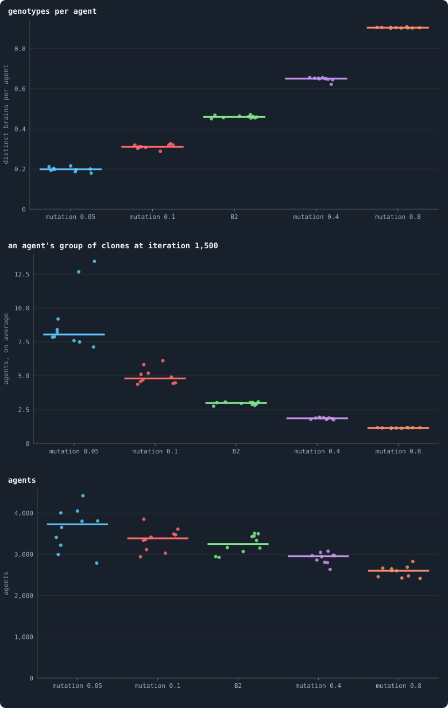
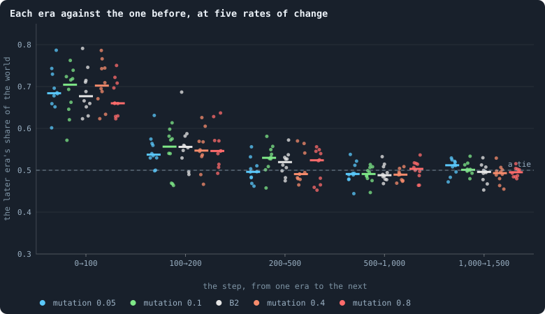
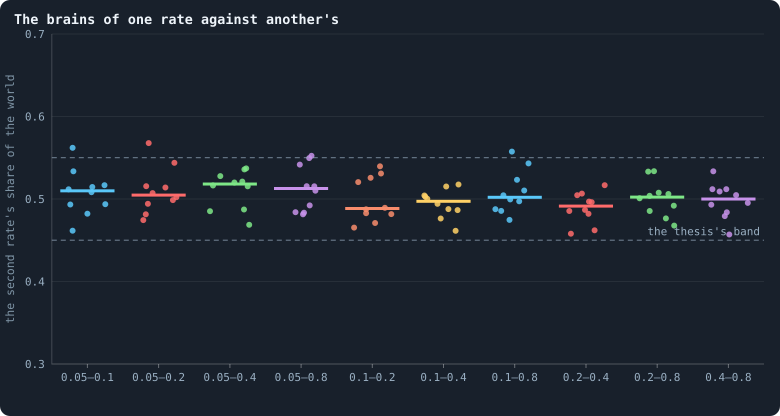

# How fast should brains change?

> [!question] Questions of this chapter
> - Does the rate at which brains change decide where evolution stops, or
>   only how soon it gets there?
> - Is there a rate past which selection can no longer keep what it has found?
> - What does the rate do to a world — to how many kinds of brain it holds, and
>   how often its nodes change hands?

<!-- experiment E09 -->

## Why ask

Evolution needs **variation** ([Chapter 1](what-this-notebook-is-about.md)).
In B2 a brain changes only when it is copied — into a newborn, or into a node
its owner has just won — and then with probability *p* = 0.2
([How a brain changes](mutation.md);
[`mutate_on_replication`](settings.md#mutate_on_replication)). One
copy in five is a new genotype. Is that a lot or a little?

[Chapter 50](why-evolution-stops.md) proposed that evolution stops because
the game has an answer: a contest for nodes is best played at random, and
once a population plays it well, nothing better exists to be selected. That
reading makes a prediction about *p*. Theory offers three pictures of what the
rate of change can do:

1. **Selection finds the answer.** If one way of playing is best, any world
   that varies enough to find it ends up there, however fast it varies: the
   rate of change decides how soon a world arrives, not where.
2. **Mutation–selection balance** (Haldane 1927). Changes are blind, so they
   keep breaking what selection has built, and selection keeps repairing it.
   How much is broken at any moment rises with how often things break: the
   brains of a faster-changing world are a little worse, the more the faster.
3. **An error threshold** (Eigen 1971; Eigen and Schuster 1977). Past a
   critical rate, a well-adapted type melts into a cloud of variants faster
   than selection can favour it, and what was learned is lost all at once.
   Below the threshold little changes; above it, everything does.

If the game has an answer, the first picture should hold over a wide range of
rates. If evolution stops for another reason — because damage keeps pace with
repair — the second or third should.

> [!info] Added later: the game is not solved
> Since this was written, Experiment 16 showed that the brains of iteration
> 2,000 are a little *worse* than those of iteration 500 in nine of ten B2
> worlds ([Chapter 50](why-evolution-stops.md#what-the-twenty-worlds-did)),
> and a strategy written by hand took half of one of those worlds
> ([Chapter 51](strategies-written-by-hand.md)). Both speak against the
> first picture and for the second: what the brains could do is not what they
> end up doing, and damage seems to keep pace with repair. The thesis below
> was written before either result and is kept as it was.

## Why the question moved

This experiment was first planned on the baseline B1, to ask whether three
births per hundred agents is a rate selection finds or the churn of
mutation. Two pilots at 10,000 tokens (seed 1, 600 iterations) pointed to
churn: births per hundred agents were 2.0 at *p* = 0.05, 2.9 at the baseline's
0.2 and 8.0 at 0.8, and genotypes per agent 0.32, 0.60 and 0.98 — a
mutation–selection balance, in a world whose brains are nearly blind.

In B2 that test is gone. Every agent dies at age 100, so births are held at
one in a hundred agents per iteration whatever the brains want
([Chapter 49](who-dies-and-why.md)). What the rate of change can still
move is how good the brains become — and that is the question Part V needs
answered.

## How the rates are compared

Five rates, each double the one before: *p* = 0.05, 0.1, 0.2 (B2), 0.4 and
0.8 — from one copy in twenty changed to four in five. Each is run with ten
seeds at 10,000 tokens for 1,500 iterations, archiving the whole world every
100. Worlds with the same seed start from the same founders, the same brains
and the same ring; they part at the first copy one of them changes and the
other does not.

Two kinds of contest are played, both as in
[Chapter 46](how-to-tell-a-world-that-keeps-evolving.md) — a world whose
agents each get a brain from one side or the other by a coin, mutation off,
twenty iterations, and the share each side holds at the end:

- **Across rates.** For each seed and each pair of rates, the brains of
  iteration 1,500 of one rate play those of the other, once in each rate's
  world at iteration 1,500. Ten pairs, ten seeds, two worlds: 200 contests.
  Under the first picture every pair ties; under the second the slower rate
  wins, the more the further apart; under the third the fastest rate loses to
  all the others.
- **Within a rate.** Each world plays its own eras, as in [Chapter 46](how-to-tell-a-world-that-keeps-evolving.md) — to see
  when each rate stops, and whether the slowest has stopped at all by
  iteration 1,500.

Beside them, the world statistics of every run: agents, births, genotypes per
agent, and the share of nodes kept by their own agent in a game.

## The thesis

<!-- thesis E09 -->
> [!quote] The thesis of Experiment 9, written down before any of its runs existed
> **The claim.** How fast brains change decides how soon evolution stops, not where. In B2 at 10,000 tokens, with brains changed only when they are copied, the brains of iteration 1,500 tie whatever the rate of change they evolved under: for every pair of the mutation probabilities 0.05, 0.1, 0.2, 0.4 and 0.8, the brains of one rate hold between 45% and 55% of a world contested with the other's, in the median seed. And every rate has stopped by then: the brains of iteration 1,500 hold between 45% and 55% against those of iteration 1,000 of the same world.
>
> **Why it would be so.** Chapter 53 reads the end of evolution as the end of a game: a contest for nodes has a best way to play — be unpredictable — and once a population plays it, nothing better exists to be selected. If that is right, every world that varies enough to find it ends in the same place, and the rate of change only sets how fast it gets there (selection finds the answer). The two other pictures of Chapter 43 predict otherwise: in a mutation-selection balance (Haldane 1927) the brains of a faster-changing world carry more damage at any moment and lose to those of a slower one, the more the faster; past an error threshold (Eigen 1971) the fastest world loses what it learned altogether. No pilot has varied the rate in B2. In B1 two pilots at 10,000 tokens (seed 1, 600 iterations) found births of 2.0, 2.9 and 8.0 per hundred agents at 0.05, 0.2 and 0.8 — a balance in a world whose brains are nearly blind. In B2 births are held at one in a hundred by old age (Chapter 52), so the question moves from how often agents breed to how good their brains become.
>
> **It holds if:** For each of the ten pairs of rates, in each seed, the brains of iteration 1,500 of one rate play those of the other twice — once in each rate's world of that seed at iteration 1,500 (gol_tournament.contest); a pair's score is the mean share of the second rate's brains; the median over the ten seeds lies between 0.45 and 0.55 for all ten pairs. And in each of the five conditions, the median world's score of iteration 1,500 against iteration 1,000 (two contests) lies between 0.45 and 0.55.
>
> **It fails if:** A pair of rates outside 0.45 to 0.55 in the median seed: the rate of change decides how good the brains become — by damage that grows with the rate if the slower rate wins, by too little variation if the faster wins. Or a condition still improving after iteration 1,000 (above 0.55): that rate has not stopped.
<!-- /thesis -->

("Chapter 53", "Chapter 43" and "Chapter 52" in the thesis are today's [Chapter 50](why-evolution-stops.md), this chapter, and [Chapter 49](who-dies-and-why.md): the chapters were renumbered on 2026-10-14 and again on 2026-10-15.)

## The runs

<!-- runs E09 -->
> [!info] The runs behind this chapter
> **50 runs.** Every condition below is run once for every seed (1 to 10), for 1,500 iterations — or until its world dies out. Every setting is that of the baseline **B2** (a world that cannot break) unless the condition changes it.
>
> - **mutation 0.05** — changes `mutation_probability` = 0.05; 10,000 tokens. Runs `B2-10000-bf74a9-s001` … `B2-10000-bf74a9-s010`.
> - **mutation 0.1** — changes `mutation_probability` = 0.1; 10,000 tokens. Runs `B2-10000-87318c-s001` … `B2-10000-87318c-s010`.
> - **B2** — changes nothing: B2 as it is; 10,000 tokens. Runs `B2-10000-s001` … `B2-10000-s010`.
> - **mutation 0.4** — changes `mutation_probability` = 0.4; 10,000 tokens. Runs `B2-10000-56c74d-s001` … `B2-10000-56c74d-s010`.
> - **mutation 0.8** — changes `mutation_probability` = 0.8; 10,000 tokens. Runs `B2-10000-fe3009-s001` … `B2-10000-fe3009-s010`.
>
> To make these runs again: `python3 gol_lab.py run E09`, or ▶ in the Book tab of a computer running `gol_server.py`. Each run writes its settings, seed and engine version beside its frames, in `GraphOfLifeRuns/<run>/meta.json` and `provenance.json`.

> [!info]- Every setting of these runs
> | setting | mutation 0.05 | mutation 0.1 | B2 | mutation 0.4 | mutation 0.8 | what it is |
> |---|---|---|---|---|---|---|
> | [`total_tokens`](../notes/settings.md#total_tokens) | 10,000 | 10,000 | 10,000 | 10,000 | 10,000 | The number of tokens in the world, *T*. It never changes during a run. |
> | [`n_nodes`](../notes/settings.md#n_nodes) | 0 | 0 | 0 | 0 | 0 | How many founders the world starts with. 0 means one founder per hundred tokens: *n* = ⌊*T* / 100⌋. |
> | [`k_neighbors`](../notes/settings.md#k_neighbors) | 0 | 0 | 0 | 0 | 0 | How many neighbours each founder starts with in the ring. 0 means *k* = max(⌊*n* / 100⌋, 5); an odd *k* is wired as *k* − 1. |
> | [`rewire_p`](../notes/settings.md#rewire_p) | 0.2 | 0.2 | 0.2 | 0.2 | 0.2 | In the starting ring, the probability that a connection is moved to a founder chosen at random (Watts–Strogatz). |
> | [`hidden_layers`](../notes/settings.md#hidden_layers) | 16 | 16 | 16 | 16 | 16 | The widths of the brain's hidden layers, in order from input to output. |
> | [`brain_kind`](../notes/settings.md#brain_kind) | float16 | float16 | float16 | float16 | float16 | How weights are stored: `float` (64-bit), `float16` (16-bit, computed in 64-bit) or `binary` (−1, 0, +1). |
> | [`brain_bits`](../notes/settings.md#brain_bits) | 16 | 16 | 16 | 16 | 16 | Only for binary brains: how many input rows encode one number. Unused by float and float16 brains. |
> | [`message_amount`](../notes/settings.md#message_amount) | 8 | 8 | 8 | 8 | 8 | How many numbers one message holds. Each agent sends one message to itself and one to each neighbour, every phase. |
> | [`random_input_amount`](../notes/settings.md#random_input_amount) | 5 | 5 | 5 | 5 | 5 | How many random numbers, drawn uniformly from −2 to 2, a brain reads per neighbour, every time it looks. |
> | [`exchange_messages`](../notes/settings.md#exchange_messages) | on | on | on | on | on | Whether agents send and read messages at all. |
> | [`message_prepass`](../notes/settings.md#message_prepass) | off | off | off | off | off | Whether every phase begins with an extra look in which agents only write messages, so the look that acts reads messages written this phase. |
> | [`allow_handover`](../notes/settings.md#allow_handover) | off | off | off | off | off | Whether a parent may move some of its own connections to its newborn child. |
> | [`allow_revolutions`](../notes/settings.md#allow_revolutions) | on | on | on | on | on | Whether a coalition of smaller stakers can take a node from its largest staker (see the note *How a coalition takes a node*). |
> | [`allow_gifting`](../notes/settings.md#allow_gifting) | off | off | off | off | off | Whether agents may give tokens to neighbours during reproduction. Off in every run of this book. |
> | [`random_decisions`](../notes/settings.md#random_decisions) | off | off | off | off | off | The control: every number a brain would produce is replaced by a random draw from the standard normal distribution. |
> | [`prune_after`](../notes/settings.md#prune_after) | blotto | blotto | blotto | blotto | blotto | After which phase connections that carried no tokens are cut: `blotto` (the game), `reproduction`, or `both`. |
> | [`inactive_window`](../notes/settings.md#inactive_window) | phase | phase | phase | phase | phase | How long a connection may go unused: `phase` means it must carry tokens in the phase being judged; `iteration` allows the two last phases. |
> | [`redistribution`](../notes/settings.md#redistribution) | uniform | uniform | uniform | uniform | uniform | How the tokens of removed agents are shared: `uniform` gives every survivor the same chance at each token; `by_tokens` weights by what a survivor holds; `poorest` raises the poorest to one common level first; `newborns` gives them to this iteration's children, `parents` to their parents, once per child (both `uniform` in an iteration without births); `children` leaves each dead agent's estate to its own living children (`uniform` where there are none). |
> | [`tokens_created_per_phase`](../notes/settings.md#tokens_created_per_phase) | 0 | 0 | 0 | 0 | 0 | Tokens added to the world at every cleanup. 0 keeps the supply fixed. |
> | [`mutate_on_replication`](../notes/settings.md#mutate_on_replication) | on | on | on | on | on | Whether a brain changes only when it is copied — into a newborn, or into a node its owner has just won — instead of also after every game, wherever it sits. |
> | [`incumbency`](../notes/settings.md#incumbency) | 1.5 | 1.5 | 1.5 | 1.5 | 1.5 | How many times over an agent's stake on its own node counts when the game decides who takes the node. 1 is the old rule. |
> | [`birth_links`](../notes/settings.md#birth_links) | 2 | 2 | 2 | 2 | 2 | How many of its parent's neighbours a newborn is joined to, drawn at random, besides its parent itself; 0 leaves every link to the brain's choice. |
> | [`mend_on_death`](../notes/settings.md#mend_on_death) | on | on | on | on | on | Whether the neighbours of an agent that dies are joined up where its death would leave them in separate pieces. |
> | [`prune_needs`](../notes/settings.md#prune_needs) | 2 | 2 | 2 | 2 | 2 | How many neighbours the two ends of an unused connection must share for it to be cut; 0 cuts every unused connection. |
> | [`valence`](../notes/settings.md#valence) | 8 | 8 | 8 | 8 | 8 | The most connections an agent's brain may choose to hold (0 = no limit). An agent at its limit cannot have a child. |
> | [`keep_home`](../notes/settings.md#keep_home) | 0.3 | 0.3 | 0.3 | 0.3 | 0.3 | The share of an agent's tokens — rounded up, never less than one — that stays on its own node whatever its brain says; a parent also keeps one. 0 is the old rule. |
> | [`max_age`](../notes/settings.md#max_age) | 100 | 100 | 100 | 100 | 100 | The age at which an agent dies (0 = never); its tokens are shared out like those of any other dead agent. |
> | [`buy_life`](../notes/settings.md#buy_life) | off | off | off | off | off | Whether an agent that has reached max_age may live on by paying one token an iteration into the estate of the dead — never its last, so one with a single token left dies. Needs max_age. |
> | [`min_child`](../notes/settings.md#min_child) | 10 | 10 | 10 | 10 | 10 | The fewest tokens a child can be born with; a parent that would give less has no child. |
> | [`child_floor`](../notes/settings.md#child_floor) | fixed | fixed | fixed | fixed | fixed | The least a child may start with: min_child alone (fixed), or also the median holding of its parent's neighbours (neighbours), so that a world grows only as rich as it is. |
> | [`mix_at_birth`](../notes/settings.md#mix_at_birth) | off | off | off | off | off | Whether a newborn's brain is its parent's mixed with a mate's — one of the parent's neighbours, drawn at random — each hidden unit whole from one or the other by an even chance, before it mutates; off, a newborn has a copy of its parent's brain. |
> | [`mix_mates`](../notes/settings.md#mix_mates) | any | any | any | any | any | Under mix_at_birth, who may be the mate: any neighbour of the parent, or only parents — a neighbour with a living child of its own (with none, the newborn's brain is a copy). |
> | [`self_message`](../notes/settings.md#self_message) | own | own | own | own | own | What an agent writes to itself, which each neighbour reads: what its own column says (own), or the largest, number by number, of what it writes to anyone (largest), so that news one column marks reaches every neighbour. |
> | [`link_search`](../notes/settings.md#link_search) | off | off | off | off | off | Whether an agent may reach beyond its neighbours to propose a link: off; jump, a walk as many steps long as the tokens it spends in one iteration, with a link proposed where it ends; walk, a scout that goes one step further in every iteration it pays for; or reach, a jump whose steps are free, as many as the tokens it holds would pay for. A paid step costs one token, paid to the agent it enters, and never the last. |
> | [`link_steering`](../notes/settings.md#link_steering) | random | random | random | random | random | Which way each step of a search goes: to a neighbour drawn at random, or to the one the searcher would most like a link with (looking). |
> | [`link_consent`](../notes/settings.md#link_consent) | mutual | mutual | mutual | mutual | mutual | Who has to agree to a link a search proposes: both ends (mutual), or only the one who proposes (forced). Nobody at its valence gets a new link either way. |
> | [`proto`](../notes/settings.md#proto) | none | none | none | none | none | Rules first played in the pilots' prototype, by name: came_from and helped_by (an input row each), contest = lottery, pool by genotype or family, kin_sense, tag_rate, mate_pays, grow, unit_token, link_token. Empty in every run but those that ask for one; only the prototype's world plays them (see the settings note). |
> | [`mutation_probability`](../notes/settings.md#mutation_probability) | **0.05** | **0.1** | 0.2 | **0.4** | **0.8** | The probability that a brain changes when it is copied to a child, and again, for every brain, after every game. |
> | [`mutation_noise_std`](../notes/settings.md#mutation_noise_std) | 0.2 | 0.2 | 0.2 | 0.2 | 0.2 | How large a change to one weight is: a normal draw with standard deviation this times 1/√(fan-in) of its layer. |
> | [`mutation_sparsity`](../notes/settings.md#mutation_sparsity) | 0.1 | 0.1 | 0.1 | 0.1 | 0.1 | The share of a brain's numbers a change touches; also the probability, for each weight matrix and bias vector, of a rarer reset that redraws that share of it. |
> | [`extinction_threshold`](../notes/settings.md#extinction_threshold) | 20 | 20 | 20 | 20 | 20 | A run stops, as extinct, when an iteration ends (after its game) with this many agents or fewer. |
> | seeds | 1 to 10 | 1 to 10 | 1 to 10 | 1 to 10 | 1 to 10 | one run per seed |
> | iterations | 1,500 | 1,500 | 1,500 | 1,500 | 1,500 | how far each run goes, unless its world dies first |
>
> A value in **bold** differs from the baseline B2.
<!-- /runs -->

## What the fifty worlds did

All fifty worlds lived to iteration 1,500, and none came near dying out.

<!-- figure rates/worlds -->

**What the rate of change does to a world.** One dot per world, the bar the median of ten. Genotypes and agents: the mean over iterations 500 to 1,500. Groups of clones: in the world of iteration 1,500, neighbours that carry the same brain joined together, the size of an agent's group averaged over agents.

> [!example]- How to make this figure
> **Runs.** The 50 runs of Experiment 9 — B2 at 10,000 tokens, seeds 1 to 10, with the probability that a brain changes when it is copied at 0.05, 0.1, 0.2 (B2 itself, `B2-10000-s001` … `-s010`, shared with Experiment 16), 0.4 and 0.8, run to iteration 1,500 at least with a whole world archived every 100. They are made with `python3 gol_lab.py run E09`; every setting is listed in the box under the thesis.
>
> **Data.** From each run's `GraphOfLifeRuns/<run>/stats.jsonl`, which holds one row per recorded phase: `phase` 1 is the world just after reproduction, `phase` 2 just after the game, and every statistic is a field of the row (see [What a run records](../notes/frames-and-stats.md)) and the archive of iteration 1,500.
>
> 1. For every run take the rows with `phase` = 2 and 500 ≤ `iteration` ≤ 1,500 and average `distinctBrains` / `nodes` and `nodes`.
> 2. Load the world of iteration 1,500 (`gol_store.load_archive`), join every two neighbours with the same `brain_ids` into one group, and average over agents the size of the group each belongs to (`rates.clones`).
>
> **To make it again:** `python3 book_figures.py rates`.
<!-- /figure -->

**The rate shapes a world's genes, not its play.** The faster brains change,
the more kinds of brain a world holds. There were 0.20 genotypes per agent at
*p* = 0.05, then 0.31, 0.46 (B2), 0.65 and 0.90 at *p* = 0.8, where nearly
every agent carries a brain of its own. Groups of clones shrink to match:
neighbours that carry the same brain formed groups of about 8 agents on
average at the slowest rate and 1.2 at the fastest. Births stayed at one agent in a
hundred an iteration at every rate, since the age limit sets them, and so
did the share of agents that kept their own node in a game, 0.91 to 0.92.

The worlds differ in one more way. The faster brains change, the fewer agents
a world holds: 3,730 in the median world at *p* = 0.05, 3,250 in B2 and 2,600
at *p* = 0.8. The extra agents of a slowly changing world are poor ones. At
0.05 and 0.1 half of all agents or more held a single token, against a median of 1.6
at 0.4 and 2 at 0.8, while inequality, by its Gini coefficient, was 0.50 to
0.52 at every rate. Why a world of fast change keeps fewer poor agents alive
is not measured here.

<!-- figure rates/steps -->

**Each era against the one before, at five rates of change.** One dot per world: the later era's share of the agents, the mean of its two contests with the era before, one in each era's world. The bars are the medians of each rate's ten worlds.

> [!example]- How to make this figure
> **Runs.** The 50 runs of Experiment 9 — B2 at 10,000 tokens, seeds 1 to 10, with the probability that a brain changes when it is copied at 0.05, 0.1, 0.2 (B2 itself, `B2-10000-s001` … `-s010`, shared with Experiment 16), 0.4 and 0.8, run to iteration 1,500 at least with a whole world archived every 100. They are made with `python3 gol_lab.py run E09`; every setting is listed in the box under the thesis.
>
> **Data.** From each run's archive, `GraphOfLifeRuns/<run>/archive/world_<iteration>.npz`, kept every 100 iterations.
>
> 1. For each world, play each of the eras 0, 100, 200, 500, 1,000 and 1,500 against the one before it, once in each era's world (`gol_tournament.play` with `against="previous"`, 20 iterations, a coin per agent), and average each pair's two shares.
>
> **To make it again:** `python3 book_figures.py rates`.
<!-- /figure -->

**Every rate stops at the same time.** In every condition the brains of
iteration 100 beat the founders clearly, with step scores of 0.66 to 0.70 in
the median world. The brains of 200 beat those of 100 a little, 0.54 to 0.56.
From iteration 500 on, every rate ties with itself. The step from 500 to
1,000 had medians of 0.49 to 0.50, and the step from 1,000 to 1,500 0.49 to
0.51. Even at the slowest rate, where one copy in twenty is changed, nothing
was being gained after iteration 500. In single worlds, iteration 1,500
against 1,000 lay between 0.45 and 0.53.

<!-- figure rates/cross -->

**The brains of one rate against another's.** Each column is a pair of rates of change, written lower–higher; each dot one seed: the share of a world the brains of iteration 1,500 of the higher rate held against those of the lower, the mean of two contests, one in each rate's world. The bar is the median seed; the dashed lines the band of the thesis.

> [!example]- How to make this figure
> **Runs.** The 50 runs of Experiment 9 — B2 at 10,000 tokens, seeds 1 to 10, with the probability that a brain changes when it is copied at 0.05, 0.1, 0.2 (B2 itself, `B2-10000-s001` … `-s010`, shared with Experiment 16), 0.4 and 0.8, run to iteration 1,500 at least with a whole world archived every 100. They are made with `python3 gol_lab.py run E09`; every setting is listed in the box under the thesis.
>
> **Data.** From each run's archive, `GraphOfLifeRuns/<run>/archive/world_<iteration>.npz`, kept every 100 iterations.
>
> 1. For each seed and each pair of rates, take the worlds of both rates at iteration 1,500. Play two contests, one in each of the two worlds: every agent gets a brain drawn at random from the agents of one rate's world or of the other's, a coin each, mutation is switched off, and 20 iterations are played (`gol_tournament.contest`, brains from two runs).
> 2. The higher rate's score is its share of the agents at the end, averaged over the two.
>
> **To make it again:** `python3 book_figures.py rates`.
<!-- /figure -->

**No rate's brains beat another's.** For every pair of rates the median seed
lay between 0.49 and 0.52: the brains of a world that changes sixteen times as
often as another are as good as its. Averaged over all four of its opponents,
each rate held between 0.49 and 0.51 of a contested world. The slowest rate
was the weakest by a hair, at 0.49, and the steepest gap between two rates in
any single seed was 0.57.

## The verdict

> [!warning] Added later: these contests were 20 iterations long
> Every tournament in this chapter was played with contests of 20 iterations.
> In B2's worlds such contests miss what pays off over an agent's life of 100
> iterations: in contests of 100 the brains of iteration 2,000 beat those of
> 500 (0.73) where in contests of 20 they tied
> ([Chapter 50](why-evolution-stops.md#would-we-notice-if-it-went-on)). Where
> this chapter says that evolution stops, read: it stops *as far as a short
> contest can see*.
>
> Played a lifetime long (T = 100, once in each era's world; five seeds of each
> rate, `research/oee/checks/lab_rejudge_worlds.txt`), the brains of iteration
> 1,000 beat those of 500 in every world at every rate: 0.74 at a chance of
> change of 0.05, 0.67 at 0.1, 0.68 at B2's own 0.2 (ten worlds), 0.67 at 0.4
> and 0.64 at 0.8 (the medians). From 1,000 to 1,500 they still won in every
> world, by less — and by less the faster brains change: 0.70, 0.65, 0.62, 0.56
> and 0.59. So evolution does not stop at any rate, and the rate does not decide
> whether it goes on; but the slowest change keeps the largest late steps, the
> opposite of what more variation to choose from would give.

The thesis holds on both counts. For all ten pairs of rates the median
seed's score lay between 0.45 and 0.55 (0.49 to 0.52), and in all five
conditions the median world's score of iteration 1,500 against 1,000 did too
(0.49 to 0.51). The rate at which brains change does not decide where
evolution stops in B2. It did not decide how soon either, though the thesis
claimed it would: every rate stopped between iterations 200 and 500.

## What it teaches

**Of the three pictures, only the first fits.** A mutation–selection balance
would have made the brains of a fast-changing world worse, the faster the
worse, and they were not. An error threshold would have made the fastest rate
lose all it had learned, and at four copies in five changed it lost nothing.
Every rate ended in the same place, as picture 1 says a world does when
selection finds the answer.

**But the place is not the answer.** [Chapter 51](strategies-written-by-hand.md)
showed that better play exists in these very worlds. So what every rate
reaches is the best that this search can find, not the best there is. That is
a statement about the search, and the rate of change is the first thing about
the search one would turn. Turned sixteenfold, it changed nothing.

**More variation did not help, and neither did larger families.** A fast rate
offers evolution many more variants to choose from; a slow rate makes groups
of clones eight agents strong, a crowd of the kind the raiders needed. Neither
found better play. The limit is not the supply of variation. It is that the
better play needs several new things at once, which no single change makes
([Chapter 51](strategies-written-by-hand.md#what-it-teaches)).

**The thesis was right for the wrong reason.** It was written to test Chapter
50's reading, that the game has an answer and evolution finds it. The ties it
predicted came, but the reading has since fallen: the brains roll dice no game
asks for, and hand-written teams beat them. The rate of change is not what
keeps evolution from going on.

<!-- turns -->
---

← [Chapter 51 · Strategies written by hand](51-strategies-written-by-hand.md) · [Contents](../README.md) · [Chapter 54 · The switches the world was built with](54-the-switches-the-world-was-built-with.md) →
<!-- /turns -->
