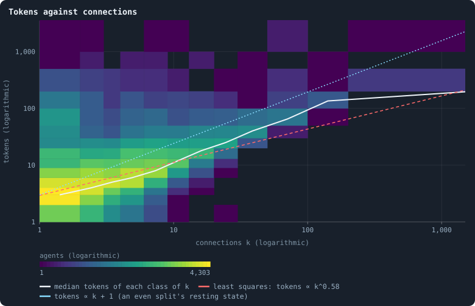
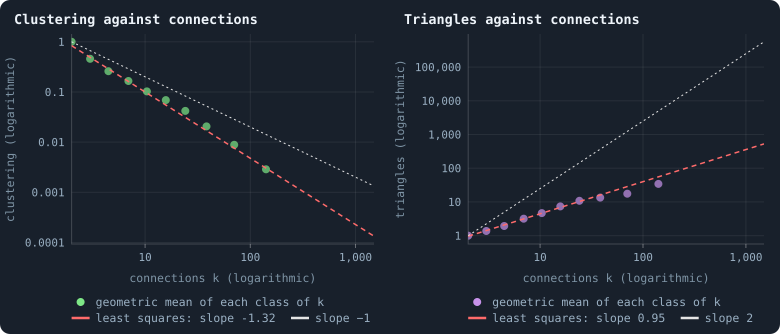
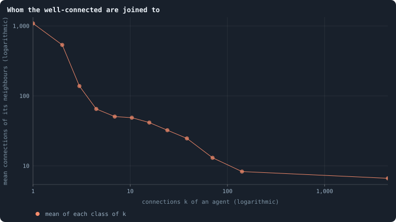
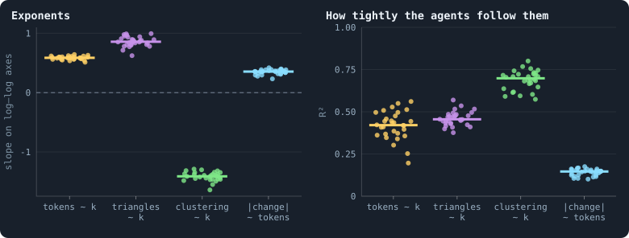

# How properties scale together

> [!question] Questions of this page
> - How do an [agent](the-world.md#agents-and-tokens "One member of a world: it lives on a node of the network, holds tokens and has a brain that takes all its decisions.")'s [tokens](the-world.md#agents-and-tokens "The one thing of value in a world: every agent holds a whole number of them, and their total never changes.") grow with its [connections](the-world.md#the-network "A link between two agents of the network: they are neighbours, and can stake on each other's nodes.")? Is that the resting
>   state of the [even split](even-split.md "What the rules do when a brain scores no candidate above zero: the stake is spread evenly.")
>   ([Where tokens flow](where-the-tokens-flow.md#the-game-as-a-random-walk))?
> - How closely knit is the neighbourhood of a well-connected agent?
> - To whom are the well-connected joined?
> - Does the size of an agent's gains and losses grow with its wealth?

## In short

On average, agents hold tokens in proportion to their connections plus one:
the resting state of the even split. The exponent that least squares fits to
this, 0.58, is no law; it says only that most agents have one or two
connections. Triangles grow in proportion to connections, and leaves hang on
[hubs](stars-and-hubs.md "An agent joined to far more agents than most; a star is a world held together by a single hub."): the network is a hierarchy of stars, built by children joining their
parents' [neighbours](the-world.md#the-network "An agent joined to another by a connection."). How much an agent's tokens change in a [game](one-iteration.md#phase-2-the-game "The second phase of an iteration: every agent stakes all its tokens on its own node and its neighbours', and every node goes to someone.") follows its
wealth only loosely. All four relations are nearly the same in every world:
they belong to the rules, not to what the [brains](the-brain.md "The neural network each agent decides with: inputs about itself and its neighbours, outputs that become its decisions.") compute.

## Four relations

Does an agent with ten times the connections hold ten times the tokens? Plot
every agent as a dot, its connections across and its tokens up. Use
logarithmic axes, on which each step multiplies by the same factor
([Logarithmic axes and power laws](correlation.md#logarithmic-axes-and-power-laws)). If tokens grew as a
power of connections, *y* ≈ *a xᵇ*, the dots would gather around a straight
line of slope *b*. That slope is the **exponent**. An exponent of 1 means in
proportion; one of 0.5 means that ten times the connections bring about three
times the tokens.

An agent has more such properties. Besides tokens and connections, there are
its triangles, how closely knit its neighbourhood is, and how much its tokens
change in a game. Every 25 [iterations](one-iteration.md "One step of a world's time: a phase of reproduction, then a phase of the game."), the viewer fits four **scaling
relations** between them by least squares on the logarithms of all agents
([Scaling relations](degree.md#scaling-relations-between-agents-properties)). This page shows the agents behind
the four fits. And it finds that one of the exponents means something quite
different from what it seems to say.

The worlds are the thirty [B1](b1-and-b2.md "The first baseline: the algorithm exactly as a new run is offered it.") worlds of 100,000 tokens of Experiment 10
([Thirty worlds](a-worlds-life.md#thirty-worlds)). The pictures show every
agent alive after the last game of each world. Single worlds are measured
every 25 iterations over their [settled life](median-and-quantiles.md#the-settled-life-of-a-world "A world from iteration 500 to its end, after its youth, where it is measured."). The page was first written from
the thirty worlds of 10,000 tokens; where those differ, their numbers are
given beside.

## Tokens and connections

<!-- figure scaling/tokens-degree -->

**Tokens against connections.** Every agent alive after the last game of the 30 worlds (394,056 agents), counted in cells of connections k and tokens, both in classes of growing width; a cell's colour is how many agents it holds, on a logarithmic scale. White: the median tokens in each class of k. Red: the straight line least squares fits through ln(tokens) against ln(k) over all agents ([Scaling relations](degree.md#scaling-relations-between-agents-properties)). Cyan: tokens proportional to k + 1, through the median at k = 1 — where an even split of every stake would leave the tokens on a network that held still ([Where the tokens flow](where-the-tokens-flow.md)).

> [!example]- How to make this figure
> **Runs.** The 30 baseline runs `B1-100000-s001` … `B1-100000-s030`: the baseline B1 at 100,000 tokens, seeds 1 to 30, 1,500 iterations each (every setting is listed in [Thirty worlds](a-worlds-life.md#thirty-worlds)). They are made with `python3 gol_lab.py run E10`.
>
> **Data.** From each run's frames, `GraphOfLifeRuns/<run>/frames/`, read with `gol_store.read_frame(run, index)`; frame `2·t` is iteration *t* after reproduction and frame `2·t + 1` after the game.
>
> 1. Read frame `2999` of every run: each agent's tokens and its connections in `edges`.
> 2. Count the agents in each cell of the classes shown; colour by the count.
> 3. Fit ln(tokens) = a + b·ln(k) by least squares over all agents (the viewer's `tokensVsDegree` does this for one frame).
>
> **To make it again:** `python3 book_figures.py scaling`.
<!-- /figure -->

The cells show the 394,056 agents alive after the last game of the thirty
worlds. Tokens rise with connections, with a wide scatter: in every class of
connections, the agents' tokens span two decades, a factor of a hundred. Least
squares through all of them gives **tokens ∝ k^0.58**. In single worlds,
measured every 25 iterations over the settled life, it gives 0.59 (0.51 to
0.64), with R² = 0.42. That is as at 10,000 tokens (0.58 over all agents
together, 0.61 in single worlds). Ten times the connections, about four times
the tokens?

Now compare the white line, the [median](median-and-quantiles.md "The middle value: half of the numbers lie below it and half above.") of each class, with the cyan line:
tokens in proportion to *k* + 1. From about five connections on, the two run
parallel. Why *k* + 1? An agent with *k* connections has *k* + 1 [candidates](one-iteration.md#phase-1-reproduction "An agent itself and each of its neighbours, the ones its brain looks at when it decides."):
its own node and its neighbours' nodes. Under the even split, a game moves
tokens like a random walk
([Where tokens flow](where-the-tokens-flow.md#the-game-as-a-random-walk)).

Think of the tokens as water in tanks joined by pipes, each agent's tank as
wide as its number of candidates. The water settles at one level everywhere,
so a tank twice as wide holds twice as much. In the same way, the walk comes
to rest when every agent holds the same number of tokens for each of its
candidates:

$$
\frac{\tau_u}{k_u + 1} = \frac{T}{\sum_v (k_v + 1)} \quad \text{for every agent } u .
$$

Here τᵤ is what agent *u* holds, *k*ᵤ its connections, and *T* all the tokens
of the world. The left side is *u*'s tokens per candidate; the right side is
the same number for everyone. So count tokens per candidate, τ/(*k* + 1), in
each class:

| connections | 1 | 2 | 3–4 | 5–9 | 10–49 | 50+ |
|---|---|---|---|---|---|---|
| median tokens per candidate | 1.5 | 1.33 | 1.2 | 1.1 | 1.0 | 1.0 |
| mean tokens per candidate | 2.28 | 1.86 | 1.68 | 1.50 | 1.43 | 1.51 |

At rest, every agent would hold *T* / Σ(*k* + 1) = 1.70 tokens per candidate.
The means lie around that value in every class, from one connection to
hundreds. The medians lie a little below it, from 1.5 down to 1.0. **On
average, agents of every class hold about the resting state's share.** An
agent with one connection rests at about 3.4 tokens, and a hub with a hundred
connections at about 170.

Then why does the fit say 0.58 and not 1? Because *k* + 1 is not a power of
*k*, and most agents have one or two connections. Between *k* = 1 and *k* = 2,
*k* + 1 grows from 2 to 3: by a factor of 1.5 where *k* doubles. That is a
local exponent of ln 1.5 / ln 2 = 0.58. Least squares counts every agent once,
and 230,000 of the 394,056 have one or two connections. Even if every agent
held **exactly** its resting share, least squares over these agents would
report an exponent of **0.73**.

The rest of the gap, from 0.73 down to 0.58, is the poorly connected holding a
little more per candidate than the well connected. The median agent with one
connection holds 1.5 tokens per candidate, one with five to nine connections
1.1, and one with ten or more 1.0.

This is the most useful lesson of the page. **An exponent fitted to a relation
that is not a power law reports where most of the points are**, not a law.
Here the law is simple, tokens in proportion to connections plus one, and the
exponent 0.6 is what it looks like through a log–log fit.

## How closely knit a neighbourhood is

Among your friends, how many are friends with each other? In a village, most;
in a big city, few. The **clustering coefficient** of an agent with *k* ≥ 2
neighbours asks the same. It is the share of the *k*(*k* − 1)/2 pairs of its
neighbours that are joined to each other ([Clustering](degree.md#clustering)). Each
joined pair makes a triangle with the agent, and these are its **triangles**.

<!-- figure scaling/clustering-triangles -->

**How an agent's neighbourhood closes, by its connections.** Agents alive after the last game of the 30 worlds, in classes of their connections k. Left: the geometric mean (the mean of the logarithms, turned back) of the clustering coefficient — the share of pairs of an agent's neighbours that are joined to each other — of the agents with k ≥ 2 and clustering above 0. Right: the geometric mean of the number of triangles an agent is a corner of, over the agents in at least one. Red: least squares on the logarithms of all those agents (not of the class means); grey: the slopes −1 and 2 for comparison.

> [!example]- How to make this figure
> **Runs.** The 30 baseline runs `B1-100000-s001` … `B1-100000-s030`: the baseline B1 at 100,000 tokens, seeds 1 to 30, 1,500 iterations each (every setting is listed in [Thirty worlds](a-worlds-life.md#thirty-worlds)). They are made with `python3 gol_lab.py run E10`.
>
> **Data.** From each run's frames, `GraphOfLifeRuns/<run>/frames/`, read with `gol_store.read_frame(run, index)`; frame `2·t` is iteration *t* after reproduction and frame `2·t + 1` after the game.
>
> 1. Read frame `2999` of every run; for every agent count its triangles: pairs of its neighbours that are joined.
> 2. Clustering of an agent with k ≥ 2 neighbours = triangles / (k(k − 1)/2).
> 3. Average ln(y) by class of k and turn it back for the dots; fit ln(y) on ln(k) over the agents with y > 0 for the red lines (`clusteringVsDegree`, `trianglesVsDegree` in the viewer).
>
> **To make it again:** `python3 book_figures.py scaling`.
<!-- /figure -->

Triangles grow about **in proportion** to connections: slope 0.99 pooled, 0.86
in single worlds. That is far below the slope 2 of a neighbourhood wired at
random. There, the pairs of neighbours, and so the expected triangles, grow as
*k*². So clustering falls steeply: slope −1.28 pooled, −1.41 in single worlds
(R² = 0.70), as at 10,000 tokens. For agents with more than a hundred
connections, the typical share of joined neighbour pairs is a few in a
thousand.

With triangles in proportion to *k*, clustering should fall as 1/*k*. Why does
the fit say −1.28? For the reason the tokens' exponent was low. The pairs,
*k*(*k* − 1)/2, are not a power of *k* either. From two connections to three
they triple, where *k*² would grow only 2.25 times. Over the agents of the fit
they grow as *k* to the power 2.27, and 0.99 − 2.27 = −1.28.

A clustering that falls as 1/*k* is the signature Ravasz and Barabási (2003)
gave for **hierarchical** networks: small, tight groups inside larger, looser
ones. The rules suggest how it comes about here. A hub gains connections
through the children of its neighbours
([Who gains and who loses](how-agents-have-children.md#who-gains-and-who-loses)).
A child born to a neighbour *v* of the hub *h*, and joined to both *v* and
*h*, closes the triangle (child, *v*, *h*). So each connection a hub gains
this way comes with about one triangle: triangles in proportion to
connections, and clustering falling as 1/*k*.

## Whom the well-connected are joined to

In a star, one agent at the centre is joined to many leaves, agents with a
single connection, and each leaf to the centre alone. A leaf's one neighbour
is then the best-connected agent there is, and the centre's neighbours have
one connection each. How close are the worlds to that?

<!-- figure scaling/neighbours -->

**Whom the well-connected are joined to.** For the agents alive after the last game of the 30 worlds, in classes of their connections k: the mean, over the class, of the average number of connections of an agent's neighbours. A falling line means the well-connected are joined mostly to the poorly connected ([Assortativity](degree.md#assortativity)).

> [!example]- How to make this figure
> **Runs.** The 30 baseline runs `B1-100000-s001` … `B1-100000-s030`: the baseline B1 at 100,000 tokens, seeds 1 to 30, 1,500 iterations each (every setting is listed in [Thirty worlds](a-worlds-life.md#thirty-worlds)). They are made with `python3 gol_lab.py run E10`.
>
> **Data.** From each run's frames, `GraphOfLifeRuns/<run>/frames/`, read with `gol_store.read_frame(run, index)`; frame `2·t` is iteration *t* after reproduction and frame `2·t + 1` after the game.
>
> 1. Read frame `2999` of every run; for every agent, the mean degree of its neighbours.
> 2. Average by class of the agent's own degree.
>
> **To make it again:** `python3 book_figures.py scaling`.
<!-- /figure -->

An agent with one connection is, on average, joined to an agent with about
**1,090** connections. With two connections, its neighbours have 540 on
average; with three, 140; from four to fifty, about 25 to 65. The neighbours
of hubs with a hundred connections or more have 7 to 8. The very large
averages of the leaves come from the stars, whose centres hold thousands of
leaves each ([Stars](the-largest-and-the-smallest.md#stars)). At 10,000 tokens
a leaf's neighbour had 163 connections on average. **Leaves hang on hubs, and
hubs are surrounded by leaves**: the world is built of stars.

There is a single number for this, the **assortativity** *r*: the correlation
of the connections at the two ends of a connection
([Assortativity](degree.md#assortativity)). It is −0.07 in the median world, and from
−0.47 to +0.02 across the thirty (−0.11 at 10,000 tokens). That is mildly
negative. And as the note explains, a world with a few large hubs comes out
negative anyway. It has too few hubs for its hubs to be joined to. The curve
says far more than the number.

## Gains, losses and wealth

The fourth relation asks whether the size of an agent's change in a game,
|Δ|, grows with the tokens τ it holds. Think of firms: if every firm risked
the same fraction of its size, a firm ten times as large would gain or lose
ten times as much. That is Gibrat's law of proportionate growth (Gibrat 1931),
|Δ| ∝ τ. The viewer fits it over the agents whose tokens changed in the game,
against what they hold after it.

<!-- figure scaling/exponents -->

**Four scaling relations in the 30 worlds.** One dot per world: its mean, over the measurements every 25 iterations from 500 on, of four slopes fitted by least squares on the logarithms of the agents of a frame, and of their R². Tokens and triangles against connections, clustering against connections, and the size of an agent's change in tokens over the game against the tokens it holds ([Scaling relations](degree.md#scaling-relations-between-agents-properties)).

> [!example]- How to make this figure
> **Runs.** The 30 baseline runs `B1-100000-s001` … `B1-100000-s030`: the baseline B1 at 100,000 tokens, seeds 1 to 30, 1,500 iterations each (every setting is listed in [Thirty worlds](a-worlds-life.md#thirty-worlds)). They are made with `python3 gol_lab.py run E10`.
>
> **Data.** From each run's `GraphOfLifeRuns/<run>/stats.jsonl`, which holds one row per recorded phase: `phase` 1 is the world just after reproduction, `phase` 2 just after the game, and every statistic is a field of the row (see [What a run records](frames-and-stats.md)).
>
> 1. Average `tokensVsDegree`, `trianglesVsDegree`, `clusteringVsDegree` and `changeVsTokens`, and the same with `R2` appended, over the rows with `phase` = 2 and 500 ≤ `iteration` ≤ 1,499.
> 2. One dot per run, a bar at the median.
>
> **To make it again:** `python3 book_figures.py scaling`.
<!-- /figure -->

In the worlds, |Δ| ∝ τ^0.35 with R² = 0.15. Read the R² first: wealth explains
only 15% of the variance in how much an agent's tokens change. Most of it is
something else: where the agent is, what its neighbours stake. The exponent,
like the tokens' above, is set by the crowd of poor agents. A change is a
whole number of at least one token. So among agents holding 1 to 5 tokens, |Δ|
cannot shrink with τ, and the line is flattened.

The other three relations of the figure are those above, world by world. The
dots lie close together: tokens 0.51 to 0.64, triangles 0.62 to 0.99,
clustering −1.64 to −1.29. The fourth, for the change in a game, lies between
0.23 and 0.42 in every world. These relations are not chance outcomes of a
world's history.

## What we learned

- **The even split's resting state describes wealth.** Across three decades of
  connections, agents hold on average about 1.7 tokens for each of their
  candidates, the median agent a little less. The famous-looking exponent 0.6
  is that law seen through a log–log fit.
- **The network is a hierarchy of stars.** Triangles grow with connections,
  clustering falls about as 1/*k*, and leaves hang on hubs. Copying
  neighbourhoods at birth explains all three.
- **These relations belong to the rules.** They are nearly the same in every
  world. And they follow from two mechanisms, splitting stakes evenly and
  joining children to their parents' neighbours, that say nothing about what a
  brain computes. Structure that the rules alone fix is not where to look for
  evolution;
  [What the measurements say about open-ended evolution](what-the-baseline-world-is.md#what-the-measurements-say-about-open-ended-evolution)
  asks where to look instead.

## Where to go next

- [Where tokens flow](where-the-tokens-flow.md#the-game-as-a-random-walk): the
  game as a random walk of tokens, and its resting state.
- [Gains and losses](gains-and-losses.md#how-a-rich-agent-drains-back): how a
  rich agent with few connections drains back to its resting share.
- [How births build the network](how-agents-have-children.md#how-the-network-grows):
  how agents gain connections and lose them.
- [Power laws, real and apparent](power-laws-real-and-apparent.md): when a
  straight line on logarithmic axes is a law, and when it is not.

## How this was made

Every figure of this page reads the thirty runs of Experiment 10, listed
below. They are worlds of the [baseline](b1-and-b2.md "The stated rules an experiment starts from and changes one thing of: B1 or B2.") B1 at 100,000 tokens, [seeds](random-numbers.md "The number that fixes every random choice of a run: the same settings and the same seed make the same world.") 1 to 30,
run for 1,500 iterations each. The command `python3 gol_lab.py run E10` makes
them. The pictures of single agents read each world's frame after its last
game. The exponents of single worlds are the viewer's, every 25 iterations
from iteration 500 on. The numbers at 10,000 tokens come from the 26 worlds of
Experiment 2 that lived to the end (`python3 gol_lab.py run E02`).

The command `python3 book_figures.py scaling` draws every figure of this page,
and writes its numbers to `book/results/scaling.json`. Each figure says,
folded beneath it, which runs it reads and how.

### The runs of Experiment 10

<!-- runs E10 -->
> [!info]- The runs behind this page
> **30 runs.** Every condition below is run once for every seed (1 to 30), for 1,500 iterations — or until its world dies out. Every setting is that of the baseline **B1** (the algorithm exactly as a new run is offered it) unless the condition changes it.
>
> - **baseline** — changes nothing: B1 as it is; 100,000 tokens. Runs `B1-100000-s001` … `B1-100000-s030`.
>
> To make these runs again: `python3 gol_lab.py run E10`, or ▶ in the Research Notebook tab of a computer running `gol_server.py`. Each run writes its settings, seed and engine version beside its frames, in `GraphOfLifeRuns/<run>/meta.json` and `provenance.json`.

> [!info]- Every setting of these runs
> | setting | baseline | what it is |
> |---|---|---|
> | [`total_tokens`](settings.md#total_tokens) | 100,000 | The number of tokens in the world, *T*. It never changes during a run. |
> | [`n_nodes`](settings.md#n_nodes) | 0 | How many founders the world starts with. 0 means one founder per hundred tokens: *n* = ⌊*T* / 100⌋. |
> | [`k_neighbors`](settings.md#k_neighbors) | 0 | How many neighbours each founder starts with in the ring. 0 means *k* = max(⌊*n* / 100⌋, 5); an odd *k* is wired as *k* − 1. |
> | [`rewire_p`](settings.md#rewire_p) | 0.2 | In the starting ring, the probability that a connection is moved to a founder chosen at random (Watts–Strogatz). |
> | [`hidden_layers`](settings.md#hidden_layers) | 50, 45, 40, 35, 30 | The widths of the brain's hidden layers, in order from input to output. |
> | [`brain_kind`](settings.md#brain_kind) | float16 | How weights are stored: `float` (64-bit), `float16` (16-bit, computed in 64-bit) or `binary` (−1, 0, +1). |
> | [`brain_bits`](settings.md#brain_bits) | 16 | Only for binary brains: how many input rows encode one number. Unused by float and float16 brains. |
> | [`message_amount`](settings.md#message_amount) | 30 | How many numbers one message holds. Each agent sends one message to itself and one to each neighbour, every phase. |
> | [`random_input_amount`](settings.md#random_input_amount) | 5 | How many random numbers, drawn uniformly from −2 to 2, a brain reads per neighbour, every time it looks. |
> | [`exchange_messages`](settings.md#exchange_messages) | on | Whether agents send and read messages at all. |
> | [`message_prepass`](settings.md#message_prepass) | on | Whether every phase begins with an extra look in which agents only write messages, so the look that acts reads messages written this phase. |
> | [`allow_handover`](settings.md#allow_handover) | on | Whether a parent may move some of its own connections to its newborn child. |
> | [`allow_revolutions`](settings.md#allow_revolutions) | on | Whether a coalition of smaller stakers can take a node from its largest staker (see the note *How a coalition takes a node*). |
> | [`allow_gifting`](settings.md#allow_gifting) | off | Whether agents may give tokens to neighbours during reproduction. Off in both baselines; on in a few pilots, in Experiment 24 and in half the worlds of the screen. |
> | [`random_decisions`](settings.md#random_decisions) | off | The control: every number a brain would produce is replaced by a random draw from the standard normal distribution. |
> | [`prune_after`](settings.md#prune_after) | blotto | After which phase connections that carried no tokens are cut: `blotto` (the game), `reproduction`, or `both`. |
> | [`inactive_window`](settings.md#inactive_window) | phase | How long a connection may go unused: `phase` means it must carry tokens in the phase being judged; `iteration` allows the two last phases. |
> | [`redistribution`](settings.md#redistribution) | uniform | How the tokens of removed agents are shared: `uniform` gives every survivor the same chance at each token; `by_tokens` weights by what a survivor holds; `poorest` raises the poorest to one common level first; `newborns` gives them to this iteration's children, `parents` to their parents, once per child (both `uniform` in an iteration without births); `children` leaves each dead agent's estate to its own living children (`uniform` where there are none). |
> | [`tokens_created_per_phase`](settings.md#tokens_created_per_phase) | 0 | Tokens added to the world at every cleanup. 0 keeps the supply fixed. |
> | [`mutate_on_replication`](settings.md#mutate_on_replication) | off | Whether a brain changes only when it is copied — into a newborn, or into a node its owner has just won — instead of also after every game, wherever it sits. |
> | [`incumbency`](settings.md#incumbency) | 1.0 | How many times over an agent's stake on its own node counts when the game decides who takes the node. 1 is the old rule. |
> | [`birth_links`](settings.md#birth_links) | 0 | How many of its parent's neighbours a newborn is joined to, drawn at random, besides its parent itself; 0 leaves every link to the brain's choice. |
> | [`mend_on_death`](settings.md#mend_on_death) | off | Whether the neighbours of an agent that dies are joined up where its death would leave them in separate pieces. |
> | [`prune_needs`](settings.md#prune_needs) | 0 | How many neighbours the two ends of an unused connection must share for it to be cut; 0 cuts every unused connection. |
> | [`valence`](settings.md#valence) | 0 | The most connections an agent's brain may choose to hold (0 = no limit). An agent at its limit cannot have a child. |
> | [`keep_home`](settings.md#keep_home) | 0.0 | The share of an agent's tokens — rounded up, never less than one — that stays on its own node whatever its brain says; a parent also keeps one. 0 is the old rule. |
> | [`max_age`](settings.md#max_age) | 0 | The age at which an agent dies (0 = never); its tokens are shared out like those of any other dead agent. |
> | [`buy_life`](settings.md#buy_life) | off | Whether an agent that has reached max_age may live on by paying one token an iteration into the estate of the dead — never its last, so one with a single token left dies. Needs max_age. |
> | [`min_child`](settings.md#min_child) | 1 | The fewest tokens a child can be born with; a parent that would give less has no child. |
> | [`child_floor`](settings.md#child_floor) | fixed | The least a child may start with: min_child alone (fixed), or also the median holding of its parent's neighbours (neighbours), so that a world grows only as rich as it is. |
> | [`mix_at_birth`](settings.md#mix_at_birth) | off | Whether a newborn's brain is its parent's mixed with a mate's — one of the parent's neighbours, drawn at random — each hidden unit whole from one or the other by an even chance, before it mutates; off, a newborn has a copy of its parent's brain. |
> | [`mix_mates`](settings.md#mix_mates) | any | Under mix_at_birth, who may be the mate: any neighbour of the parent, or only parents — a neighbour with a living child of its own (with none, the newborn's brain is a copy). |
> | [`self_message`](settings.md#self_message) | own | What an agent writes to itself, which each neighbour reads: what its own column says (own), or the largest, number by number, of what it writes to anyone (largest), so that news one column marks reaches every neighbour. |
> | [`link_search`](settings.md#link_search) | off | Whether an agent may reach beyond its neighbours to propose a link: off; jump, a walk as many steps long as the tokens it spends in one iteration, with a link proposed where it ends; walk, a scout that goes one step further in every iteration it pays for; or reach, a jump whose steps are free, as many as the tokens it holds would pay for. A paid step costs one token, paid to the agent it enters, and never the last. |
> | [`link_steering`](settings.md#link_steering) | random | Which way each step of a search goes: to a neighbour drawn at random, or to the one the searcher would most like a link with (looking). |
> | [`link_consent`](settings.md#link_consent) | mutual | Who has to agree to a link a search proposes: both ends (mutual), or only the one who proposes (forced). Nobody at its valence gets a new link either way. |
> | [`proto`](settings.md#proto) | none | Rules first played in the pilots' prototype, by name: came_from and helped_by (an input row each), contest = lottery, pool by genotype or family, kin_sense, tag_rate, mate_pays, grow, unit_token, link_token. Empty in every run but those that ask for one; only the prototype's world plays them (see the settings note). |
> | [`mutation_probability`](settings.md#mutation_probability) | 0.2 | The probability that a brain changes when it is copied to a child, and again, for every brain, after every game. |
> | [`mutation_noise_std`](settings.md#mutation_noise_std) | 0.2 | How large a change to one weight is: a normal draw with standard deviation this times 1/√(fan-in) of its layer. |
> | [`mutation_sparsity`](settings.md#mutation_sparsity) | 0.1 | The share of a brain's numbers a change touches; also the probability, for each weight matrix and bias vector, of a rarer reset that redraws that share of it. |
> | [`extinction_threshold`](settings.md#extinction_threshold) | 20 | A run stops, as extinct, when an iteration ends (after its game) with this many agents or fewer. |
> | seeds | 1 to 30 | one run per seed |
> | iterations | 1,500 | how far each run goes, unless its world dies first |
>
> A value in **bold** differs from the baseline B1.
<!-- /runs -->

## How our view changed

- **14 October 2026.** A pass through the whole notebook corrected one
  statement. [Tokens and connections](#tokens-and-connections) had said that
  the typical agent holds about the resting state's share, 1.7 tokens per
  candidate. It is the mean of every class that lies near that share. The
  median agent holds a little less: from 1.5 tokens per candidate at one
  connection down to 1.0 at ten or more.
- **24 October 2026.** When the page was rewritten in plain words, its numbers
  were checked against the results its figures are drawn from
  (`book/results/scaling.json`). The same section had said that the median
  agent holds 1.0 token per candidate from five connections on. With five to
  nine connections it holds 1.1, as its own table shows, and 1.0 from ten on.
  The sentence was left from the worlds of 10,000 tokens, where agents with
  five to nine connections held 1.0.

<!-- turns -->
---

← [Power laws, real and apparent, and how to fit one](power-laws-real-and-apparent.md) · [The shape and health of the network](../README.md#the-shape-and-health-of-the-network) · [How a world breaks](how-a-world-breaks.md) →

> [!info]- Pages that link here (11)
> [What B1 is, and what stood in its way](what-the-baseline-world-is.md) · [Births, deaths and ages](births-deaths-and-ages.md) · [How unequal is a world, and who stays rich](where-do-the-tokens-go.md) · [Gains and losses: who gains, who loses, and the share-out](gains-and-losses.md) · [The even split](even-split.md) · [Where tokens flow](where-the-tokens-flow.md) · [The shape of the network](what-shape-does-the-network-take.md) · [Power laws, real and apparent, and how to fit one](power-laws-real-and-apparent.md) · [An agent's connections: degree, clustering, assortativity, attachment and scaling](degree.md) · [Like next to like: how alike agents are at a distance](like-next-to-like.md) · [Two numbers together: correlation, a fitted line and logarithmic axes](correlation.md)
<!-- /turns -->
