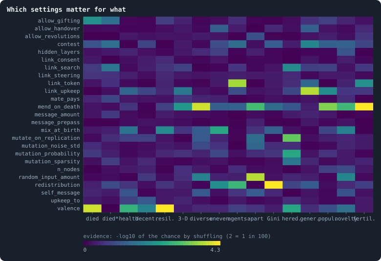
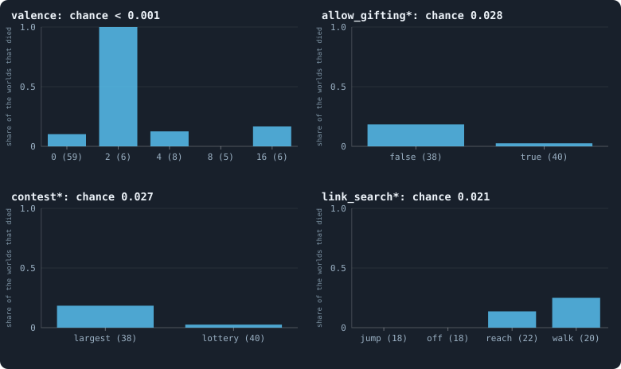
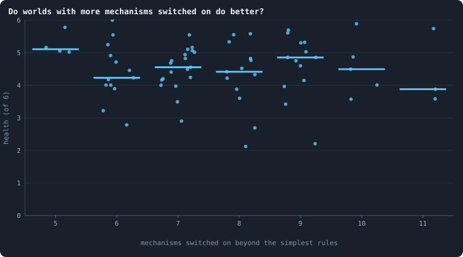

# How the drawn settings shape a world

> [!question] Questions of this page
> - Which of the settings drawn at random decide whether a world lives, and how healthy it grows?
> - Which values, or pairs of values, could be set aside in the next round?
> - Do worlds with fewer mechanisms switched on do worse, or better?

## In short

Round 3 drew every setting of every world at random, each on its own, so each
setting can be judged alone: are the worlds drawn with one value different from
those drawn with another, by more than chance would make them? Shuffling gives
the answer. Of 25 settings, a few clearly matter. A cap of two links kills
every world it is drawn in, and caps of four and eight make worlds fragile.
Gifts keep worlds alive: 2 of 41 worlds with gifts died, against 12 of 43
without. Mending deaths makes [agents](the-world.md#agents-and-tokens "One member of a world: it lives on a node of the network, holds tokens and has a brain that takes all its decisions.") act differently, and random numbers in the
[brains](the-brain.md "The neural network each agent decides with: inputs about itself and its neighbours, outputs that become its decisions.") drown their differences. Mixing brains at birth, and [estates](estate.md "The tokens a dead agent leaves, and who gets them.") given to
the poorest, make worlds more even. Most settings show no effect we can see,
and worlds with fewer mechanisms switched on are no less healthy. For evolution, [mutation](mutation.md "A random change to a brain, made with a set probability when it is copied, and in B1 also after every game: a changed brain is a new genotype.") only at
birth, and rare, makes children like their parents; mending deaths keeps three
times as many lines of descent alive and lets them reach new behaviour.

## Why one setting can be looked at alone

In round 3 every setting of every world was drawn at random, each on its own
([How a world's settings are drawn](a-screen-of-random-worlds.md#how-a-worlds-settings-are-drawn)).
So the worlds drawn with gifts and the worlds drawn without them differ in
every *other* setting by chance alone: about as many of each have the lottery,
[messages](messages.md "Numbers an agent writes to itself and to each neighbour every phase, which their brains read.") or a search. If the worlds with gifts die less often, more than chance
would make likely, the gifts are the reason.

This is the logic of a randomised trial in medicine, and it is why the screen
draws its worlds at random. No model of how the settings work together is
needed to see what each does on its own. The price is chance: with 84 worlds,
a value drawn in eight of them can look good or bad by luck. So every
comparison on this page says how likely luck alone would be to make it.

Only Experiment 40's 84 worlds are compared, each a draw of its own. The
eight draws played a [token](the-world.md#agents-and-tokens "The one thing of value in a world: every agent holds a whole number of them, and their total never changes.") at a time (Experiments 41 and 42) were each played
twice, so they are looked at apart, [at the end](#a-token-at-a-time).

## How a setting is tested

For every setting and every outcome of the worlds:
- for **whether a world died**, we count the deaths under each value;
- for **a number** (a living world's [health](which-worlds-are-healthy.md),
  each of its criteria, its size, how differently its agents act, how much
  children act like their parents, ...), we take its [median](median-and-quantiles.md "The middle value: half of the numbers lie below it and half above.") under each value.

Then the outcome is **shuffled** among the worlds, 20,000 times, as if the
setting had nothing to do with it. Each shuffle keeps how many worlds had each
value and hands the outcomes out at random. The **chance** of a difference is
the share of shuffles in which the values differ at least as much as they do in
the real worlds: a [permutation test](bootstrap.md#permutation-tests). The
difference is measured by the chi-square statistic for deaths, and by the
Kruskal-Wallis statistic of the ranks for numbers. A chance of 0.01 means one
shuffle in a hundred does as well by luck alone.

Many settings are tested on many outcomes, so a few small chances turn up by
luck. Every test therefore also has a **false discovery rate**: among all the
settings tested on that outcome, how often a result this strong would be a
false alarm (the rule of Benjamini and Hochberg, 1995). We call a result a
**finding** only when that rate is below 0.1. Every test also gives its
**size**: the share of the outcome's spread that the setting's values account
for, from 0 (none) to 1 (all of it).

**An example.** Of the 41 worlds drawn with gifts, 2 died; of the 43 drawn
without, 12. Shuffle the 14 deaths at random among the 84 worlds, keeping 41
worlds in one group and 43 in the other, and count how often the two groups
end up at least this far apart: about 140 times in 20,000 shuffles, a chance of
0.007. But 25 settings were tested on deaths, so a chance that small could turn
up by luck in one of them. The false discovery rate says how likely that is
here: 0.09, below 0.1, so it counts as a finding. Gifts or none account for a
tenth of the spread of deaths across the worlds (a size of 0.10).

## Which settings matter for what

<!-- figure settingseffects/matrix -->

**Which settings matter for what.** Each row is a drawn setting, each column an outcome of the worlds; a cell is bright where the worlds drawn with the setting's different values differ in that outcome more than shuffling the outcome among the worlds would make them differ. Its brightness is how unlikely that is by chance: 1 for a chance of 1 in 10, 2 for 1 in 100, 4.3 for none in 20,000 shuffles. Many cells are tested, so a few are bright by luck alone: the table below gives each its false discovery rate. Whether a world died is tested over all of them; every other outcome over the living. A blank cell was not tested (a setting that cannot matter there, or too few worlds). The columns: died, died; died*, died, valence 2 aside; health, health (the proposal); decent., decentralised; resil., resilient; 3-D, almost three-dimensional; diverse, diverse; uneven, not too even; agents, agents (log10 of the median); apart, same-position share; Gini, Gini of the tokens; hered., heredity index; gener., generations; popul., effective population (log10); novelty, late novelty of the line of descent; fertil., fertility passed on.

> [!example]- How to make this figure
> **Runs.** Experiment 40's 84 worlds, each with its settings drawn at random by the screen's second sampler (30,000 tokens, 3,000 iterations); 14 died and 70 lived to the end
>
> **Data.** From each world's drawn settings (its plan, `book/experiments/E40.json`, drawn by `gol_screen.py`), and its outcomes: whether it died, and, for the living, its health and numbers (`research/screen/health.json`) and its dossier (`GraphOfLifeRuns/.pilots/screen/candidates/<run>.json`), tested by `research/screen/effects.py` into `research/screen/effects.json`.
>
> 1. For each setting, the worlds where it can matter (as the sampler draws it), grouped by its value.
> 2. Died: the chi-square statistic of the deaths across the groups; numbers: the Kruskal-Wallis statistic of their ranks.
> 3. The share of 20,000 shuffles of the outcome among the worlds whose statistic is at least as large (seed 11): the chance.
> 4. The false discovery rate of each chance among all settings tested on that outcome (Benjamini-Hochberg).
>
> **To make it again:** `python3 book_figures.py settingseffects`.
<!-- /figure -->

The findings, every one with a false discovery rate below 0.1:

<!-- table settingseffects/found -->
| outcome | setting | chance by shuffling | false discovery rate | by value: the share that died, or the median (worlds) |
|---|---|---|---|---|
| died | [`valence`](settings.md#valence) | 0.0001 | 0.002 | 0: 0.10 (59); 16: 0.17 (6); 2: 1.00 (6); 4: 0.12 (8); 8: 0.00 (5) |
| died | [`allow_gifting`](settings.md#allow_gifting) | 0.0069 | 0.086 | false: 0.28 (43); true: 0.05 (41) |
| health (the proposal) | [`valence`](settings.md#valence) | 0.0017 | 0.042 | 0: 4.21 (53); 16: 4.79 (5); 4: 3.47 (7); 8: 3.75 (5) |
| resilient | [`valence`](settings.md#valence) | 0.0000 | 0.001 | 0: 0.91 (53); 16: 0.98 (5); 4: 0.31 (7); 8: 0.51 (5) |
| diverse | [`mend_on_death`](settings.md#mend_on_death) | 0.0001 | 0.002 | false: 0.55 (28); true: 1.00 (42) |
| not too even | [`mix_at_birth`](settings.md#mix_at_birth) | 0.0027 | 0.067 | false: 1.00 (49); true: 0.87 (21) |
| not too even | [`redistribution`](settings.md#redistribution) | 0.0072 | 0.091 | children: 0.96 (13); local: 1.00 (9); newborns: 1.00 (10); parents: 0.95 (9); poorest: 0.80 (24); uniform: 0.91 (5) |
| agents (log10 of the median) | [`link_token`](settings.md#link_token) | 0.0002 | 0.005 | false: 3.80 (37); true: 3.47 (33) |
| agents (log10 of the median) | [`redistribution`](settings.md#redistribution) | 0.0013 | 0.017 | children: 3.40 (13); local: 3.54 (9); newborns: 3.53 (10); parents: 3.52 (9); poorest: 3.82 (24); uniform: 3.77 (5) |
| same-position share | [`random_input_amount`](settings.md#random_input_amount) | 0.0001 | 0.004 | 0: 0.98 (10); 10: 0.27 (19); 2: 0.49 (21); 5: 0.50 (20) |
| same-position share | [`mend_on_death`](settings.md#mend_on_death) | 0.0010 | 0.013 | false: 0.29 (28); true: 0.60 (42) |
| Gini of the tokens | [`redistribution`](settings.md#redistribution) | 0.0000 | 0.001 | children: 0.45 (13); local: 0.53 (9); newborns: 0.44 (10); parents: 0.42 (9); poorest: 0.32 (24); uniform: 0.36 (5) |
| heredity index | [`mutate_on_replication`](settings.md#mutate_on_replication) | 0.0005 | 0.014 | false: 0.34 (41); true: 0.61 (29) |
| heredity index | [`mutation_probability`](settings.md#mutation_probability) | 0.0026 | 0.023 | 0.1: 0.83 (5); 0.2: 0.45 (52); 0.4: 0.48 (6); 0.8: 0.16 (7) |
| heredity index | [`valence`](settings.md#valence) | 0.0028 | 0.023 | 0: 0.35 (53); 16: 0.41 (5); 4: 0.67 (7); 8: 0.58 (5) |
| heredity index | [`link_search`](settings.md#link_search) | 0.0089 | 0.056 | jump: 0.56 (18); off: 0.54 (18); reach: 0.20 (19); walk: 0.44 (15) |
| generations | [`link_upkeep`](settings.md#link_upkeep) | 0.0001 | 0.004 | off: 386.50 (27); paid_only: 1236.53 (21); paid_or_used: 807.03 (22) |
| effective population (log10) | [`mend_on_death`](settings.md#mend_on_death) | 0.0003 | 0.009 | false: 1.04 (28); true: 1.55 (42) |
| late novelty of the line of descent | [`mend_on_death`](settings.md#mend_on_death) | 0.0012 | 0.031 | false: 0.05 (28); true: 0.09 (42) |
| late novelty of the line of descent | [`random_input_amount`](settings.md#random_input_amount) | 0.0101 | 0.100 | 0: 0.08 (10); 10: 0.05 (19); 2: 0.08 (21); 5: 0.09 (20) |
| late novelty of the line of descent | [`mix_at_birth`](settings.md#mix_at_birth) | 0.0119 | 0.100 | false: 0.08 (49); true: 0.06 (21) |
| fertility passed on | [`mend_on_death`](settings.md#mend_on_death) | 0.0000 | 0.001 | false: 0.28 (28); true: 0.07 (42) |
| fertility passed on | [`link_token`](settings.md#link_token) | 0.0071 | 0.089 | false: 0.20 (37); true: 0.08 (33) |
<!-- /table -->

Most of the map is dark. In 84 worlds most settings made no difference that
chance could not also have made, on any outcome. The few bright cells are the
findings in the table, and the sections below take them one by one: what keeps
a world alive, and what makes a living one healthy.

## What decides whether a world lives

Of Experiment 40's 84 worlds, 14 died
([what became of them](a-screen-of-random-worlds.md#what-round-3-found)).

<!-- figure settingseffects/deaths -->

**Which worlds died.** For four settings, the share of Experiment 40's worlds drawn with each value that died; the number in brackets is how many worlds had that value. A cap of two links killed every world it was drawn in, so the three charts marked * leave those six worlds out. Each title gives the chance of differences this large by shuffling the deaths among the worlds.

> [!example]- How to make this figure
> **Runs.** Experiment 40's 84 worlds, each with its settings drawn at random by the screen's second sampler (30,000 tokens, 3,000 iterations); 14 died and 70 lived to the end
>
> **Data.** From each world's drawn settings (its plan, `book/experiments/E40.json`, drawn by `gol_screen.py`), and its outcomes: whether it died, and, for the living, its health and numbers (`research/screen/health.json`) and its dossier (`GraphOfLifeRuns/.pilots/screen/candidates/<run>.json`), tested by `research/screen/effects.py` into `research/screen/effects.json`.
>
> 1. For each value, the deaths over the worlds drawn with it.
> 2. The chance: the share of 20,000 shuffles of the deaths with a chi-square statistic at least as large.
>
> **To make it again:** `python3 book_figures.py settingseffects`.
<!-- /figure -->

**A cap of two links kills.** All six worlds drawn with
[`valence`](settings.md#valence) 2 died, all within 214 [iterations](one-iteration.md "One step of a world's time: a phase of reproduction, then a phase of the game."); of the
other 78, eight died. Hardly a shuffle in 20,000 made the values differ as
much (chance 0.0001, false discovery rate 0.002). The reason is in the rule: an
agent may hold at most two links, so the network can only be chains and rings,
and an agent at its cap cannot have a child. Six worlds are fewer than the ten
the author's rule asks before a value is set aside, but here the rule itself
says why every such world must die.

**Gifts keep worlds alive.** Of the 41 worlds that allowed gifts
([`allow_gifting`](settings.md#allow_gifting)), 2 died; of the 43 that did not,
12 (chance 0.007, false discovery rate 0.09: a finding). Five of the six
worlds capped at two links happened to allow no gifts, so part of this is the
cap. With those six set aside, 1 of 40 worlds with gifts died and 7 of 38
without (chance 0.028, false discovery rate 0.23): weaker, but the same way.

**The other deaths came where agents can search far, the largest stake wins
and nobody gives.** With the six capped worlds set aside, each of three
settings goes with deaths on its own, none strongly enough to be a finding
(each has a false discovery rate of 0.23):
- a search that walks or reaches ([`link_search`](settings.md#link_search)):
  8 of 42 worlds died, against none of the 36 that search by jumps or not at
  all;
- no gifts: 7 of 38 died, against 1 of 40;
- the largest stake wins ([`contest`](settings.md#contest)): 7 of 38 died,
  against 1 of 40 under the lottery.

All eight of these deaths had a far search. Twelve worlds had all three
values together, and six of them died, against two of the other 66: all three
kingdoms that withered, two of the four crashes and one boom that bust. Drawn at random, twelve
worlds would hold six of the eight deaths by a chance of about one in 10,000.
But this combination was found by looking at the deaths first, so its chance
says less than it seems to. It is a guess to test in the next round, not a
finding. The picture it suggests: a rich agent that can reach far, wins every
contest it stakes most on, and never has to give, takes over the world and
then rules a world too poor to last.

## What decides how healthy a living world grows

Experiment 40's 70 living worlds have a median
[health](which-worlds-are-healthy.md) of 4.11 of 5. Five things make a
difference, each clearly beyond chance:

1. **A cap of four or eight links makes a world sick.** The living worlds
   capped at 4 links have a median health of 3.47, those capped at 8 a median
   of 3.75, against 4.21 with no cap and 4.79 with a cap of 16 (chance 0.002,
   false discovery rate 0.04). The cap hurts resilience most: a median score
   of 0.31 at 4 links and 0.51 at 8, against 0.91 with no cap (false discovery
   rate 0.001). An agent at its cap can neither take a new link nor have a
   child, so where many agents sit at their cap, [loops](bridges.md#loops "A path through the network that comes back to where it started without using a connection twice.") are few and single
   agents hold whole parts of the world together. The author never liked the
   cap (it limits by rule what the brains should decide), and a cap of 16
   seldom binds.
2. **Mixing brains at birth makes worlds less resilient and more even.** With
   mixing the median health is 3.84, without it 4.30 (chance 0.024, false
   discovery rate 0.29: indicative). In the criteria: not too even, 0.87
   against 1.00 (false discovery rate 0.07, a finding), and resilient, 0.56
   against 0.92 (0.11).
3. **Mending deaths makes the agents act differently.** With
   [`mend_on_death`](settings.md#mend_on_death) the diverse criterion's median
   is 1.00, without it 0.55 (false discovery rate 0.002). The difference is in
   the [same-position share](what-makes-a-world-interesting.md#the-same-position-share "Of two agents put in the same situation, how often they stake their tokens measurably differently."): 0.60 with mending, 0.29 without (0.01). Why is not
   yet clear. One guess: without mending, a death that would cut the network in
   two kills everything on the far side of it at once, so whole families vanish
   together and the living descend from fewer lines.
4. **Estates given to the poorest make worlds even and crowded.** The [Gini](gini-coefficient.md "How unequally tokens are held: 0 if every agent holds as many, near 1 if one holds nearly all.") of
   the tokens has a median of 0.32 where the estate goes to the poorest, 0.36
   where it is shared uniformly, and 0.42 to 0.53 under the other four ways
   (false discovery rate 0.001). Raising the poorest keeps many poor agents
   alive: these worlds hold a median of about 6,600 agents, against 2,500
   where the estate goes to the dead agent's children (0.02).
5. **Noise drowns what makes agents different.** The same-position share has a
   median of 0.98 in worlds whose brains read no random numbers, about 0.5 with
   2 or 5 of them, and 0.27 with 10 (false discovery rate 0.004). The measure
   counts only differences larger than a brain's own noise. With ten random
   numbers for every [neighbour](the-world.md#the-network "An agent joined to another by a connection."), an agent's stakes are mostly noise, and two
   agents act no more differently than one agent twice.

One more changes a world's size without changing its health: a token in every
link ([`link_token`](settings.md#link_token)) halves the number of agents, from
a median of about 6,300 to 2,950 (false discovery rate 0.005). A link that
costs a token leaves fewer tokens for agents.

## What decides how a world evolves

The same tests, on what each living world's dossier says of evolution in it
([Candidates for open-ended evolution](candidates-for-open-ended-evolution.md#how-each-pillar-is-read)):
how much children act like their parents, how many generations it lived, how
many lines of descent it keeps (its effective population), and how far its
line of descent keeps moving into new behaviour.

- **Mutation decides heredity, as it should.** Where brains change only when
  they are copied ([`mutate_on_replication`](settings.md#mutate_on_replication)),
  children act more like their parents: a median heredity index of 0.61,
  against 0.34 where every brain also changes after every [game](one-iteration.md#phase-2-the-game "The second phase of an iteration: every agent stakes all its tokens on its own node and its neighbours', and every node goes to someone.") (false discovery
  rate 0.01). The more often a brain mutates, the less a child is like its
  parent: 0.83 at a mutation probability of 0.1, 0.16 at 0.8 (0.02). Worlds
  that search by reaching far pass on less too (0.20, against about 0.55 where
  agents do not search or jump; 0.06).
- **Paying for links speeds up the generations.** Where links are kept only if
  paid for, a world lives a median of 1,237 generations in its 3,000
  iterations; where use keeps them too, 807; with no upkeep, 387 (false
  discovery rate 0.004). Upkeep costs tokens, so agents die sooner, and are
  replaced sooner.
- **Mending deaths keeps lines alive, and keeps them moving.** With mending, a
  world's effective population has a median of about 35, without it about 11
  (false discovery rate 0.009); and its line of descent reaches nearly twice as
  far into new behaviour in its late [eras](eras-and-contests.md "Brains of a world at two moments, its eras, played against each other: do the later ones win?") (0.09 against 0.05 above the noise;
  0.03).
  This fits the guess above: without mending, whole families die at once.

- **Fertility runs in families almost everywhere, least where deaths are
  mended.** In 65 of round 3's 72 candidate worlds
  ([Candidates for open-ended evolution](candidates-for-open-ended-evolution.md#how-each-pillar-is-read)),
  a parent's number of children
  says clearly more of its children's than chance would (a median of 0.18
  above chance in the [correlation](correlation.md "Whether two quantities go up and down together, from −1 to 1.")). Where deaths are mended, it says much less:
  0.07 above chance, against 0.28 without mending (false discovery rate 0.001).
  So mending is a trade-off for evolution: it keeps more lines alive and their
  behaviour more varied, but fewer families out-breed the rest. A token in
  every link weakens it too (0.08 against 0.20; 0.09).

## Combinations

Settings were drawn one at a time, but they act together. Two searches look
for combinations.

**Pairs that die.** For every pair of drawn values, the worlds that had both,
and how many of them died, with the six worlds capped at two links set aside.
The table lists the pairs whose worlds died more often than either value's
worlds alone. None is a finding (the smallest false discovery rate is 0.24),
but they agree with each other and with the
[deaths above](#what-decides-whether-a-world-lives): most pairs hold one of
"no gifts" and "the largest stake wins", or a search that walks, reaches or
steers at random.

**A tree of health.** The living worlds are split, step by step, by the one
drawn value that best divides them into a healthier and a sicker group, so
long as each group keeps six worlds at least. Its first steps:
- estates given to the poorest: 24 worlds with a mean health of 3.68; among
  them, links kept only if paid for, 8 worlds at 3.07, and of the other 16,
  those that do not mend deaths, 9 at 3.73;
- of the other 46 worlds (a mean of 4.21), a cap of 4 links: 6 worlds at 3.42;
- the 40 left have a mean of 4.33, and the 22 of them that start with one
  [founder](starting-ring.md "One of the agents a world starts with, each holding the same tokens, on a ring with a few shortcuts.") per 50 or per 200 tokens (not per 100), 4.49: the healthiest group
  the tree finds.

A tree this small also splits on chance: the first steps agree with the tests
above, and the last (the number of founders) is no finding.

## Fewer mechanisms, worse worlds?

<!-- figure settingseffects/simplicity -->

**Do worlds with more mechanisms switched on do better?** Each dot is a living world of Experiment 40, placed by how many of 14 mechanisms it switches on beyond the simplest rules (no messages, no noise inputs, the largest stake wins, no coalitions, no handing over, no gifts, no mending, no mixing, estates shared uniformly, no search, no cap on links, no token in links, no upkeep) and by its health; the bar is the median. Rank correlation -0.15.

> [!example]- How to make this figure
> **Runs.** Experiment 40's 84 worlds, each with its settings drawn at random by the screen's second sampler (30,000 tokens, 3,000 iterations); 14 died and 70 lived to the end
>
> **Data.** From each world's drawn settings (its plan, `book/experiments/E40.json`, drawn by `gol_screen.py`), and its outcomes: whether it died, and, for the living, its health and numbers (`research/screen/health.json`) and its dossier (`GraphOfLifeRuns/.pilots/screen/candidates/<run>.json`), tested by `research/screen/effects.py` into `research/screen/effects.json`.
>
> 1. Count each world's drawn values that differ from `SIMPLEST` in effects.py.
> 2. Plot against its health; the Spearman correlation of the two.
>
> **To make it again:** `python3 book_figures.py settingseffects`.
<!-- /figure -->

The author prefers simple rules with clear mechanisms. Do worlds with fewer
mechanisms switched on pay for it? They do not. Counting fourteen mechanisms
(messages, noise, the lottery, [coalitions](revolution.md "A node taken by stakers who each marked part of their stake revolutionary and together staked more than the largest single stake."), handing over, gifts, mending,
mixing, estates other than uniform, search, a cap on links, a token in every
link, upkeep, and a game in rounds), the drawn worlds switched on 5 to 11. The
four worlds with only 5 have a mean health of 4.62, and the rank correlation
of mechanisms with health is −0.15: if anything, more mechanisms go with a
little less health. No mechanism is needed for a [healthy world](what-makes-a-world-interesting.md "A world that meets all six criteria of the screen of random worlds; an interesting one is alive and misses only a few (at most two, provisionally, from round 3).") in round 3; a
few ([above](#what-decides-how-healthy-a-living-world-grows)) do harm.

## A token at a time

Eight draws were played twice, with the game's stakes placed a token at a time
([Round 3, a token at a time](a-screen-of-random-worlds.md#round-3-a-token-at-a-time)):
weakest first (Experiment 41) and strongest first (Experiment 42). Each cell
is the world's health, or when it died:

<!-- table settingseffects/allocation -->
| draw | weakest first | strongest first |
|---|---|---|
| s4001 | died at 144 | died at 387 |
| s4002 | 5.00 | 4.70 |
| s4003 | 4.63 | 4.62 |
| s4004 | 4.40 | 4.41 |
| s4005 | died at 230 | 4.39 |
| s4006 | died at 1,445 | 4.51 |
| s4007 | 4.16 | 4.17 |
| s4008 | 4.99 | 4.73 |
<!-- /table -->

- **The order changed little in the worlds that lived.** In the five draws
  that lived both ways, the two worlds' health differs by 0.02 to 0.38.
- **Weakest first lost two worlds that strongest first kept.** Draws 4005 and
  4006 died weakest first and lived strongest first; draw 4001 died both ways.
  So three of eight died weakest first and one strongest first. But two
  draws that died one way only are far too few to say which order is safer:
  a fair coin lands the same side twice in a row one time in two.
- **These worlds cannot yet be compared with Experiment 40's.** They are other
  draws, and lucky ones: six of the eight play the lottery, and six allow
  gifts, the two values that go with living in Experiment 40. That they lived
  and grew healthy says nothing yet about placing tokens one at a time. The
  same eight draws played with every token placed at once would tell
  ([What could be played next](candidates-for-open-ended-evolution.md#what-could-be-played-next)).

## What could be set aside, and what could be simplified

Three kinds of change could make the next round of random worlds sharper.
Each is the author's to decide.

**Values to set aside.**
- *A cap of two links.* Every one of the six worlds drawn with it died, and
  the rule itself says why. The author's rule asks ten worlds before a value
  is set aside; here the reason is in the rule, not in the count.
- *Caps of four and eight links.* They do not kill, but they leave the least
  resilient worlds of the round, and the author dislikes a cap on links in any
  case: it limits by rule what the brains should decide. A cap of 16 seldom
  binds. Dropping the cap altogether would make the next round simpler too.

**A combination to test, or to avoid.** Worlds that search far, let the largest
stake win and allow no gifts died in six cases of twelve. The next round can
draw these values as before, to see whether the combination kills again, or
set it aside to spend its worlds elsewhere.

**Settings to fix at their simplest.** These settings showed no sign of an
effect on any outcome: no test of them had a chance below 0.05.

<!-- table settingseffects/quiet -->
| setting | its smallest chance on any outcome | on which |
|---|---|---|
| [`message_prepass`](settings.md#message_prepass) | 0.39 | same-position share |
| [`link_consent`](settings.md#link_consent) | 0.30 | resilient |
| [`link_steering`](settings.md#link_steering) | 0.21 | died |
| [`message_amount`](settings.md#message_amount) | 0.19 | died, valence 2 aside |
| [`mate_pays`](settings.md#mate_pays) | 0.13 | died, valence 2 aside |
| [`n_nodes`](settings.md#n_nodes) | 0.11 | late novelty of the line of descent |
| [`allow_revolutions`](settings.md#allow_revolutions) | 0.09 | same-position share |
| [`hidden_layers`](settings.md#hidden_layers) | 0.08 | late novelty of the line of descent |
| [`upkeep_to`](settings.md#upkeep_to) | 0.06 | decentralised |
| [`self_message`](settings.md#self_message) | 0.06 | same-position share |
| [`allow_handover`](settings.md#allow_handover) | 0.05 | generations |
<!-- /table -->

Fixing each at its simplest value would leave fewer settings to draw, and
simpler worlds. Two cautions. In 84 worlds a small effect can hide: quiet is
not proof of none. And some of these settings open channels that may matter
only over far longer runs than ours, messages above all
([What a world's rules make possible](candidates-for-open-ended-evolution.md#what-a-worlds-rules-make-possible)).

## Every setting, in numbers

<!-- table settingseffects/all -->
| setting | died, by value | chance | median health of the living, by value | chance |
|---|---|---|---|---|
| [`allow_gifting`](settings.md#allow_gifting) | false: 12/43; true: 2/41 | 0.007 | false: 4.16; true: 4.01 | 0.842 |
| [`allow_handover`](settings.md#allow_handover) | false: 7/37; true: 7/47 | 0.767 | false: 4.04; true: 4.18 | 0.911 |
| [`allow_revolutions`](settings.md#allow_revolutions) | false: 4/18; true: 6/23 | 1.000 | false: 4.16; true: 4.39 | 0.516 |
| [`contest`](settings.md#contest) | largest: 10/41; lottery: 4/43 | 0.081 | largest: 4.21; lottery: 4.06 | 0.961 |
| [`hidden_layers`](settings.md#hidden_layers) | [16, 16, 16, 16, 16]: 1/11; [16, 16, 16, 16]: 3/9; [16, 16, 16]: 0/10; [32, 32, 32, 32, 32]: 3/10; [32, 32, 32, 32]: 1/6; [32, 32, 32]: 1/5; [50, 50, 50, 50, 50]: 3/15; [50, 50, 50, 50]: 1/5; [50, 50, 50]: 1/13 | 0.621 | [16, 16, 16, 16, 16]: 4.20; [16, 16, 16, 16]: 3.53; [16, 16, 16]: 4.17; [32, 32, 32, 32, 32]: 4.44; [32, 32, 32, 32]: 3.85; [32, 32, 32]: 3.88; [50, 50, 50, 50, 50]: 4.49; [50, 50, 50, 50]: 4.43; [50, 50, 50]: 3.93 | 0.365 |
| [`link_consent`](settings.md#link_consent) | forced: 5/32; mutual: 8/33 | 0.535 | forced: 4.12; mutual: 4.21 | 0.651 |
| [`link_search`](settings.md#link_search) | jump: 2/20; off: 1/19; reach: 5/24; walk: 6/21 | 0.183 | jump: 4.07; off: 4.04; reach: 4.21; walk: 4.12 | 0.765 |
| [`link_steering`](settings.md#link_steering) | looking: 4/32; random: 9/33 | 0.214 | looking: 4.14; random: 4.26 | 0.430 |
| [`link_token`](settings.md#link_token) | false: 6/43; true: 8/41 | 0.570 | false: 4.16; true: 4.10 | 0.768 |
| [`link_upkeep`](settings.md#link_upkeep) | off: 5/32; paid_only: 4/25; paid_or_used: 5/27 | 1.000 | off: 4.30; paid_only: 3.78; paid_or_used: 4.32 | 0.041 |
| [`mate_pays`](settings.md#mate_pays) | false: 5/16; true: 1/11 | 0.346 | false: 3.75; true: 3.90 | 0.511 |
| [`mend_on_death`](settings.md#mend_on_death) | false: 7/35; true: 7/49 | 0.559 | false: 4.06; true: 4.17 | 0.216 |
| [`message_amount`](settings.md#message_amount) | 0: 1/4; 16: 2/17; 30: 4/21; 4: 6/25; 8: 1/17 | 0.583 | 0: 3.84; 16: 3.96; 30: 4.41; 4: 4.10; 8: 4.23 | 0.714 |
| [`message_prepass`](settings.md#message_prepass) | false: 5/32; true: 8/48 | 1.000 | false: 4.25; true: 4.05 | 0.724 |
| [`mix_at_birth`](settings.md#mix_at_birth) | false: 8/57; true: 6/27 | 0.533 | false: 4.30; true: 3.84 | 0.023 |
| [`mutate_on_replication`](settings.md#mutate_on_replication) | false: 7/48; true: 7/36 | 0.773 | false: 4.21; true: 4.01 | 0.149 |
| [`mutation_noise_std`](settings.md#mutation_noise_std) | 0.1: 0/12; 0.2: 11/59; 0.4: 3/13 | 0.279 | 0.1: 4.07; 0.2: 4.13; 0.4: 4.25 | 0.791 |
| [`mutation_probability`](settings.md#mutation_probability) | 0.1: 0/5; 0.2: 14/66; 0.4: 0/6; 0.8: 0/7 | 0.192 | 0.1: 3.53; 0.2: 4.11; 0.4: 3.99; 0.8: 4.25 | 0.792 |
| [`mutation_sparsity`](settings.md#mutation_sparsity) | 0.05: 2/8; 0.1: 11/66; 0.3: 1/10 | 0.669 | 0.05: 3.96; 0.1: 4.16; 0.3: 4.21 | 0.570 |
| [`n_nodes`](settings.md#n_nodes) | 0: 6/33; 150: 5/30; 600: 3/21 | 1.000 | 0: 3.96; 150: 4.24; 600: 4.31 | 0.472 |
| [`random_input_amount`](settings.md#random_input_amount) | 0: 2/12; 10: 3/22; 2: 6/27; 5: 3/23 | 0.847 | 0: 4.23; 10: 3.95; 2: 4.16; 5: 4.21 | 0.942 |
| [`redistribution`](settings.md#redistribution) | children: 3/16; local: 4/13; newborns: 0/10; parents: 2/11; poorest: 3/27; uniform: 2/7 | 0.397 | children: 4.39; local: 4.30; newborns: 4.15; parents: 4.44; poorest: 3.85; uniform: 4.54 | 0.218 |
| [`self_message`](settings.md#self_message) | largest: 7/31; own: 6/49 | 0.356 | largest: 3.85; own: 4.39 | 0.073 |
| [`upkeep_to`](settings.md#upkeep_to) | end: 6/27; estate: 3/25 | 0.467 | end: 4.01; estate: 3.84 | 0.148 |
| [`valence`](settings.md#valence) | 0: 6/59; 16: 1/6; 2: 6/6; 4: 1/8; 8: 0/5 | 0.000 | 0: 4.21; 16: 4.79; 4: 3.47; 8: 3.75 | 0.002 |
<!-- /table -->

## What we learned

- **A cap of two links kills, and caps of four or eight make worlds fragile.**
  All six worlds capped at two died within 214 iterations; the living worlds
  capped at four or eight are the least resilient of the round.
- **Gifts keep worlds alive.** Two of 41 worlds with gifts died, against 12 of
  43 without. The other deaths came where agents search far, the largest stake
  wins and nobody gives: a combination to test, not yet a finding.
- **Mending deaths, and brains without noise, make agents act differently.**
  Noise inputs drown the differences between agents; mending raises them.
- **Mixing brains at birth makes worlds less resilient and more even;** estates
  given to the poorest make them even and crowded; a token in every link
  halves them.
- **Most settings show no effect we can see**, and worlds with fewer mechanisms
  switched on are no less healthy.
- **The order of the stakes changed little** in the eight draws played a token
  at a time, and those draws were too lucky to compare with the rest.
- **Mending deaths keeps evolution broad:** more diverse behaviour, three
  times as many lines of descent, and more new behaviour, but fertility runs
  less in its families. Mutation only at birth, and rare, makes children like
  their parents.

## Where to go next

- [Which worlds are healthy? A proposed order](which-worlds-are-healthy.md):
  the health every comparison here reads.
- [Candidates for open-ended evolution](candidates-for-open-ended-evolution.md):
  the living worlds read for heredity, selection and change.
- [A screen of random worlds](a-screen-of-random-worlds.md): how the settings
  are drawn.
- [Settings](settings.md): what every setting does.

## How this was made

The worlds are Experiment 40's 84 runs and the 16 of Experiments 41 and 42,
listed with every setting on the page
[A screen of random worlds](a-screen-of-random-worlds.md). A world's drawn
values are read from its plan, as the sampler drew them
(`gol_screen.py`, sampler 2), and its outcomes from
`research/screen/health.json` (its health), from its dossier
(`GraphOfLifeRuns/.pilots/screen/candidates/<run>.json`: heredity, generations,
effective population, novelty) and from its families
(`.pilots/screen/families/<run>.json`).

`python3 research/screen/effects.py` runs every test and writes
`research/screen/effects.json`: 20,000 shuffles a test, drawn from a generator
seeded with 11, so the chances are the same every time. A setting is tested
only among the worlds where the sampler lets it matter. The pairs of values are
tried where at least four worlds had both, and the tree of health splits no
group below six worlds, at most three times. `python3 book_figures.py
settingseffects` draws this page.
