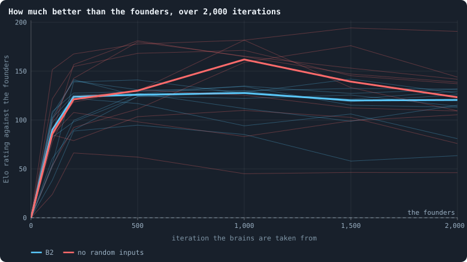
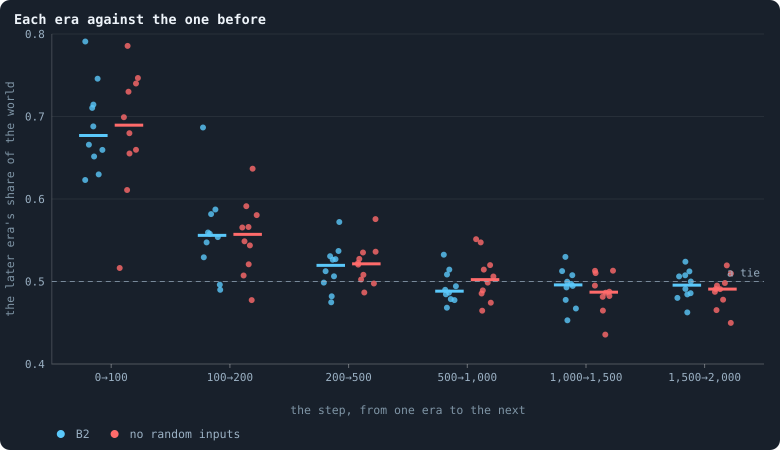
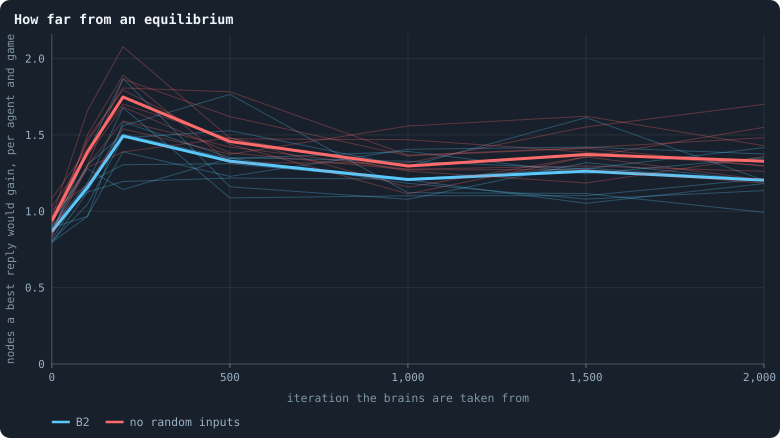

# Does evolution keep going?

> [!question] Questions of this page
> - What would it look like if evolution in a Graph of Life world kept going?
>   Why is a number that keeps rising no proof of it?
> - How can a world that has stopped evolving be told from one that keeps
>   changing but stays in place, as in a race where everybody runs?
> - What does it mean, in numbers, for a world's network to hold: to be
>   resilient, decentralised, and neither a tree nor complete?
> - Do the [baselines](b1-and-b2.md "The stated rules an experiment starts from and changes one thing of: B1 or B2.") keep improving: [B1](b1-and-b2.md "The first baseline: the algorithm exactly as a new run is offered it."), whose [brains](the-brain.md "The neural network each agent decides with: inputs about itself and its neighbours, outputs that become its decisions.") are nearly blind, and
>   [B2](b1-and-b2.md "The second baseline: B1 with the rules that keep its network from breaking and its agents from staking or breeding themselves to death."), a world that cannot break and whose brains can see?
> - Why does evolution slow down, and would we notice if it went on?

## In short

Evolution keeps going if a world's brains keep beating their own past. So the
notebook plays the brains of two moments of one world against each other, and
holds the world's network to a health bar. B1, the first baseline, learns what
it can in its first 50 to 100 [iterations](one-iteration.md "One step of a world's time: a phase of reproduction, then a phase of the game."), and then only ties with its past
(Experiment 12). In B2, a world that cannot break, evolution goes on, more and
more slowly, for thousands of iterations (Experiment 16). Contests as long as
an [agent](the-world.md#agents-and-tokens "One member of a world: it lives on a node of the network, holds tokens and has a brain that takes all its decisions.")'s life show this; contests of 20 iterations had missed it and seen a
tie. What holds evolution back is the search, not the [game](one-iteration.md#phase-2-the-game "The second phase of an iteration: every agent stakes all its tokens on its own node and its neighbours', and every node goes to someone."): a strategy written
by hand took half of one evolved world.

## How to tell a world that keeps evolving

<!-- experiment E12 -->

The notebook began by watching the baseline and changing it one rule at a
time. Then it turned the question round. Instead of asking what the rules do,
it asked which rules would make evolution **open-ended**, and set out to build
them. But first it needed a yardstick: a way to know when a world gets there.
This section builds the yardstick, and reads the first baseline, B1, with it
(Experiment 12).

### The goal: evolution that keeps going

The author set the goal in three parts:

- **A statistic that keeps rising** as the iterations go on. Any number will
  do that says evolution is still producing something. It might be the size
  of what agents organise into, or how long they live. It might be how much
  of the [token](the-world.md#agents-and-tokens "The one thing of value in a world: every agent holds a whole number of them, and their total never changes.") flow goes round in circles ([Lightning](token-flow.md#lightning-tokens-that-go-round)), or
  something nobody has thought of yet. It may rise ever more slowly, as a
  logarithm does. A finite world has finitely many things it can become, so
  with finite tokens the number has a ceiling. But the ceiling should move up
  with the tokens: a world many orders of magnitude larger should keep the
  number rising for that much longer.
- **A network that holds.** It is neither a tree nor complete. It is large,
  resilient and decentralised, close to three-dimensional, with few single
  points of failure. None of this is imposed: the rules make it as the world
  goes.
- **Local rules.** An agent acts on itself and its [neighbours](the-world.md#the-network "An agent joined to another by a connection."). A rule may let
  an agent reach further, to look for a new partner, say. But it must charge a
  price in tokens that limits how far.

This section is about the first two: how to know when we are there. The pages
on [changing the rules](../README.md#changing-the-rules) build towards it.

### Numbers that rise and mean nothing

Many numbers rise in any world, evolving or not. Four kinds deserve a warning,
because each looks like the thing we want.

1. **Records.** Think of the longest life ever lived, the largest family ever
   seen, or the longest loop of tokens ever peeled. Each is the largest value
   a fluctuating number has taken so far. A record keeps rising in a world that
   does not change at all, simply because the world keeps drawing new values.
   When a number keeps being drawn from the same distribution, and very large
   values are rare, its record grows like the logarithm of time. So a record
   that rises like a logarithm is exactly what a world standing still makes.
2. **Counts.** [Genotypes](genotype.md "The identity of a brain: a number that a copy keeps and a change replaces, and that remembers the genotype it came from.") ever made, [mutations](mutation.md "A random change to a brain, made with a set probability when it is copied, and in B1 also after every game: a changed brain is a new genotype.") since the [founders](starting-ring.md "One of the agents a world starts with, each holding the same tokens, on a ring with a few shortcuts."), iterations
   of a [lineage](genotype.md#families "A line of descent: the agents whose genotypes go back to one ancestor."): anything that only adds. A count rises in a straight line at
   the rate things happen, whether anything is selected or not. Biology calls
   this the molecular clock.
3. **The left wall.** Take a trait that cannot fall below a floor, such as a
   brain's number of units or a memory's length. Let it change by small random
   steps. On average it drifts upwards, because every step down from the floor
   is refused and every step up is taken. The mean rises, and nothing selected
   it. Gould's drunkard, who cannot fall through the wall he leans on, ends up
   in the gutter anyway.
4. **The first boom.** Everything a world does in its first hundred iterations
   is a world settling
   ([The first hundred iterations](a-worlds-life.md#the-first-hundred-iterations)).
   Numbers climb because the founders were unlike what the world becomes, and
   then they stop.

So a rising number is evidence only against a **null**: the same number in a
world where nothing is selected. For a trait, the null can be built into the
world. Give every agent a **shadow** trait, inherited and changed exactly as
the real one, but read by nothing. Whatever the real trait does beyond its
shadow, selection did. [Bedau and Packard](the-ideas-this-builds-on.md) built
whole worlds of shadows for this. For a world as a whole the null is harder,
and the rest of this section is about it.

### Playing against the past

A world whose statistics have settled may be **finished**: evolution found
what it could and stopped. Or it may be **running in place**: every line of
descent changing, each answering the others, none getting ahead, as the Red
Queen told Alice. Inside one moment the two look the same. Between moments
they do not. A world still improving makes brains that beat their own
ancestors. A world running in place makes brains that only tie with them, or
beat them on one day and lose on the next.

So the brains of two moments are made to play each other. Picture the brains
of an earlier moment brought back, to compete with today's for the same world.
The brains of one moment are an **era**, and a match between two eras is a
**contest**. Playing every pair of a set of eras is a **cross-time
tournament** (Cliff and Miller 1995). Stanley and Miikkulainen (2004) counted
how many times in a run a new champion beat every champion before it. Miconi
(2009) separates the kinds of progress such tournaments can show.
[Eras and contests](eras-and-contests.md) explains contests in full. Here a
contest goes like this:

1. Take the world as it stood at one archived moment: its network, its
   tokens, the ages of its agents. A run keeps such worlds when it is made
   with [`archive_every`](settings.md#archive_every).
2. Give every agent a brain drawn at random from the agents of one era, A, or
   of another, B: a coin each. Clear the [messages](messages.md) in flight, so
   that neither side is primed.
3. Switch mutation off, so that no brain can change and every copy of a brain
   keeps the era it came from. Let the world play twenty iterations under its
   own rules.
4. The **score** of B is the share of the agents carrying a B brain at the
   end. A score of 0.5 is a tie; above it, B's brains spread at A's expense.

Every pair of eras plays twice, once in each era's world, so that neither
plays only at home. A score is a share, so it can be read as odds: the chance
that a B brain beats an A brain. From the odds, one **rating** per era is
fitted to every contest at once. This is the model of Bradley and Terry, which
chess calls **Elo**. The founders are rated 0. An era rated +200 beats them
about three times in four, and one rated +400 ten times in eleven.

The rating against the founders rises in every world that learns anything at
all. The question is what it does after. A world still improving keeps rating
each era above the one before. A world that has stopped rates them all alike,
however far apart they are. Of the four warnings above, this answers the last
three. A tournament counts nothing, and it has no floor to lean on. It plays
the settled world against its own past, not against its boom.

A contest must last as long as what it judges. Twenty iterations is long
enough for most of a B1 world to change hands. It is not long enough for an
agent of B2 to live its life, since there everyone dies at age 100. And what
evolution improves there may pay off only over a whole life. Until 15 October
2026 every contest of this notebook lasted 20 iterations. Since then, B2's
worlds are also judged in contests a [lifetime](age-and-lifetime.md "How many iterations an agent lives, from its birth to its death.") long, of 100 iterations
([Would we notice if it went on?](#would-we-notice-if-it-went-on)).

### The network that holds, in numbers

The second half of the goal is a property of the network. Every part of it can
be measured on a single [frame](frames-and-stats.md), one snapshot of a whole
world. The **health bar** asks seven things of the network, each with a line
to meet. [The health bar](health-bar.md) explains why each one is there.

| what is asked | measured as | bar |
|---|---|---|
| one world | the pieces the cull leaves | always one |
| not a tree | share of agents in the [2-core](bridges.md#core-trees-and-leaves) — on a loop, or between loops | 0.8 or more |
| few single points of failure | the largest share of the agents one agent's loss would cut off (`worst_node_cut_share`) | 2% or less |
| | the same for one [connection](the-world.md#the-network "A link between two agents of the network: they are neighbours, and can stake on each other's nodes.") ([cut risk](bridges.md#cut-risk)) | 1% or less |
| decentralised | the share of the others the best-connected agent is joined to | 5% or less |
| neither a tree nor complete | connections per agent | 3 to 12 |
| about three-dimensional | the [dimension of ball growth](ball-dimension-and-curvature.md) | 2.3 to 4 |

B1 does not pass it. A pilot is a world made by hand to see whether an idea is
worth an experiment ([Pilot worlds](the-lab.md#pilot-worlds)). Take a pilot of B1 at
5,000 tokens ([seed](random-numbers.md "The number that fixes every random choice of a run: the same settings and the same seed make the same world.") 1, iterations 200 to 999). There 59% of the agents sat in
the 2-core, and the rest hung in trees. One connection could cut off 8% of the
world. The best-connected agent was joined to 8% of the others, and there were
3.3 connections per agent. Its dimension, 2.7, was fine.

### A first reading: the baseline

The same pilot played its eras against each other: the brains of iterations 0
(the founders), 100, 200, … 600, two contests per pair.

- Against the founders, the brains of iteration 100 held 74% of a contested
  world. Those of iterations 200 to 600 held 77% to 90%. The world had learned
  something, and learned it fast.
- From iteration 200 on, every pair of eras scored between 45% and 59%, with a
  [median](median-and-quantiles.md "The middle value: half of the numbers lie below it and half above.") of exactly 50%. As ratings against the founders: +283 at iteration
  100, then +320 to +345 for every era from 200 to 600.

One world says that the baseline learns what it learns in about two hundred
iterations, and then stops. Experiment 12 asks ten.

### The thesis of Experiment 12

We expected the ten worlds to say what the pilot said: the brains learn
something early, and then stop. If so, the brains of iteration 300 should
still beat the founders clearly. And those of iteration 1,000 should do no
better than those of 300. The thesis put this in numbers before any of the
runs existed:

<!-- thesis E12 -->
> [!quote] The thesis of Experiment 12, written down before any of its runs existed
> **The claim.** The baseline stops improving within a few hundred iterations. Played against the brains of their own world's iteration 300, the brains of iteration 1,000 hold between 45% and 55% of a contested world: no better and no worse. The brains of iteration 300 have learned something all the same: against the founders' brains they hold more than 60%.
>
> **Why it would be so.** A world whose statistics have settled may be finished, or may be running in place — every lineage changing, none getting ahead, as in a Red Queen race. Nothing measured inside one moment tells the two apart; playing the brains of two moments against each other does (Cliff and Miller 1995). A pilot of the same world (seed 1, 5,000 tokens, eras every 100 iterations to 600, two contests per pair): against the founders, the brains of iteration 100 held 74% and those of iterations 200 to 600 held 77–90%; every pair of eras from iteration 200 on scored between 45% and 59% (median 50%). As Elo ratings against the founders: +283 at iteration 100, then +320 to +345 to iteration 600.
>
> **It holds if:** Over the ten worlds, the median world's score of the brains of iteration 1,000 against those of iteration 300 — the mean of its two contests, one in each era's world — lies between 0.45 and 0.55, and the median world's score of the brains of iteration 300 against the founders' is above 0.6.
>
> **It fails if:** The median world's score of iteration 1,000 against iteration 300 is above 0.55: the baseline keeps improving. Or the score of iteration 300 against the founders is 0.6 or less: there was nothing to learn, or it was not learned.
<!-- /thesis -->

### What the ten worlds did

The experiment played every pair of the eras 0, 50, 100, 200, 300, 500, 700
and 1,000. Each pair was played twice in each of the ten worlds, once in each
era's world. That made 560 contests in all, each twenty iterations long.

<!-- figure yardstick/elo -->

**How much better than the founders.** Each grey line is one world; the blue line is the median of the ten at each era. A rating says how often an era's brains beat the founders': +200 is about three contests in four, +400 ten in eleven. The ratings are fitted to every contest between every pair of eras, so each point leans on the others.

> [!example]- How to make this figure
> **Runs.** The 10 runs of Experiment 12 — B1 at 5,000 tokens, seeds 1 to 10, 1,000 iterations, a whole world archived every 50 — `B1-5000-s001` … `-s010`. They are made with `python3 gol_lab.py run E12`; every setting is listed in the box of the runs behind this page.
>
> **Data.** From each run's archive, `GraphOfLifeRuns/<run>/archive/world_<iteration>.npz`: the whole world as a checkpoint writes it, kept every 50 iterations.
>
> 1. For every pair of the eras 0, 50, 100, 200, 300, 500, 700, 1000 play two contests, one in each era's world: give every agent a brain drawn at random from one era or the other, a coin each, clear the messages, switch mutation off and run 20 iterations (`gol_tournament.contest`). The later era's score is the share of agents carrying one of its brains at the end.
> 2. Read every score *p* as odds, log(*p* / (1 − *p*)), after keeping it between 0.02 and 0.98, and find one rating per era — the founders' at 0 — that fits them best by least squares, the later era's rating minus the earlier's for each contest (`gol_tournament.ratings`). Multiply by 400 / ln 10 for Elo points.
> 3. Draw each world's ratings, and the median world at each era.
>
> **To make it again:** `python3 book_figures.py yardstick`.
<!-- /figure -->

**Every world learned, and learned fast.** By iteration 50 the brains of every
world beat their founders, with a rating of +207 to +465, and +361 in the
median world. There the brains of iteration 50 held 0.90 of a world contested
with the founders' brains: about nine-tenths. By iteration 100 the median world
stood at +400. This is the first boom of
[The first hundred iterations](a-worlds-life.md#the-first-hundred-iterations),
seen from the brains' side. Whatever the founders do that does not pay, the
first few dozen games remove.

**And then nothing.** From iteration 50 to iteration 1,000 the median world's
rating stays between +358 and +411, and no world's line climbs. Fit a straight
line to each world's ratings from iteration 50 on. In the median world it falls
by 0.8 points per hundred iterations, and in every world it lies between −4 and
+2 points per hundred. Each era also tied with the era just before it. In the
median world, each era scored 0.47 to 0.52 against the one before, for every
step from iteration 50 to iteration 1,000. The step from the founders to
iteration 50 had scored 0.90.

<!-- figure yardstick/pairs -->

**Every era against every earlier one.** Each square is one pair of eras: the share of a contested world the later era's brains held, in the median world. 0.5 is a tie. The left column is every era against the founders; in a world still improving the shares would grow the further a square is from the diagonal, in every column.

> [!example]- How to make this figure
> **Runs.** The 10 runs of Experiment 12 — B1 at 5,000 tokens, seeds 1 to 10, 1,000 iterations, a whole world archived every 50 — `B1-5000-s001` … `-s010`. They are made with `python3 gol_lab.py run E12`; every setting is listed in the box of the runs behind this page.
>
> **Data.** From each run's archive, `GraphOfLifeRuns/<run>/archive/world_<iteration>.npz`: the whole world as a checkpoint writes it, kept every 50 iterations.
>
> 1. For every pair of the eras 0, 50, 100, 200, 300, 500, 700, 1000 play two contests, one in each era's world: give every agent a brain drawn at random from one era or the other, a coin each, clear the messages, switch mutation off and run 20 iterations (`gol_tournament.contest`). The later era's score is the share of agents carrying one of its brains at the end.
> 2. For each world and each pair, average its two contests.
> 3. Take the median over the ten worlds, and colour the pair's square by it.
>
> **To make it again:** `python3 book_figures.py yardstick`.
<!-- /figure -->

The same holds in every pair. Whichever two eras from iteration 50 on are
played against each other, the median world's score lies between 0.46 and
0.58. It is never far from a tie, and it does not grow as the eras move apart.
A world still improving would rate its iteration 1,000 well above its
iteration 100. These worlds rate them the same.

### The verdict of Experiment 12

The thesis asked two things of the median world. Against the brains of
iteration 300, those of iteration 1,000 should hold between 0.45 and 0.55.
They held **0.483**: 0.39 to 0.57 in the ten worlds, between 0.45 and 0.55 in
five, below in four and above in one. Against the founders, the brains of
iteration 300 should hold more than 0.6. They held **0.899** (0.77 to 0.97).
**The thesis holds.** If anything, it was too generous to the baseline. B1
learns what it learns in fifty to a hundred iterations, not a few hundred, and
then stops.

Longer contests agree. Contests of 100 iterations were played once in each
era's world. In the median world, the brains of iteration 1,000 held 0.49 of
the world against those of 500, and 0.56 against those of 300. They scatter
more than B2's lifetime contests do ([below](#would-we-notice-if-it-went-on)):
from 0.31 to 0.77 against 500, above 0.6 in three worlds and below 0.4 in two.
Eras played against themselves held 0.48 to 0.58. So in B1 evolution stops
within a few hundred iterations, whichever length of contest asks.

### Finished, or running in place?

A tie between two eras has two readings. The world may have **finished**: it
found what it could, and nothing is left to find. Or it may be **running in
place**. Then each era beats the one before at what the one before did, and
loses to the one before that. No era gets ahead of all of them.

The step scores already argue against the second. An era that answered its
predecessor would beat it, and the eras here tie with their predecessors too.
A **dominance tournament** asks the question directly (Stanley and
Miikkulainen, 2004). The founders are the first champion. Each later era, in
order, becomes a champion if it beats *every* champion before it by a margin.
Here the margin is a mean score above 0.55 (`gol_tournament.dominance`). A
world that keeps making better brains keeps crowning champions. A world
running in place, or finished, stops.

In every world the brains of iteration 50 beat the founders and became the
second champion. After that, seven worlds crowned one more, two worlds two
more, and one world none. That is just what chance crowns. A contest is noisy.
The two contests of a pair differ so much that one contest's share spreads by
about 0.12 around the pair's true score. The mean of two spreads by about
0.08. So an era no better than that of iteration 50 still beats every champion
by more than 0.55 now and then.

How often? Simulate 20,000 tournaments with that spread. In each, every era
after 50 is exactly as good as the era of 50, and the founders lose every
contest. The number of champions was 2 in 15% of them, 3 in 66%, 4 in 19% and
5 in 0.7%. The ten worlds had 2 once, 3 seven times and 4 twice. Nothing in
the ten worlds is better than its iteration 50 by more than chance can make it
look.

> [!example]- The null of the dominance tournament, to run yourself
> Read every E12 tournament, take the spread *σ* of one contest's share around
> its pair's mean from the difference of the pair's two contests (as the
> standard deviation of the differences divided by √2), then play 20,000
> tournaments with the same eras and two contests per pair: a later era's
> share against the founders 0.95, every other share 0.5 + *σ* times a
> standard normal draw, kept between 0 and 1; count the champions with
> `gol_tournament.dominance`. The script is `research/oee/champion_null.py`.

### What it means for the search

The yardstick works. It separates the first boom, which every world has, from
what comes after, which B1 does not have. Elo against the founders alone would
have shown a rise. The eras played against each other show that the rise was
all in the first fifty iterations.

Why does B1 stop so soon? The study of the baseline answered half of it. Its
brains are nearly blind ([What the brains are like](what-the-brains-are-like.md)),
so evolution can only set constants, and a few constants are quickly set.
Brains that see are the obvious next step. The next section asks whether
evolution keeps going once brains can see.

## Why evolution stops

<!-- experiment E16 -->

B1's evolution stops early because its brains are nearly blind
([above](#what-it-means-for-the-search)). When brains were given sight, the
worlds broke. So a world was built in which brains can see without the world
breaking: **B2**, the second baseline.
[Building B2: a world that cannot break](a-world-that-cannot-break.md) tells
how, from [Brains that see, and worlds that break](a-world-that-cannot-break.md#brains-that-see-and-worlds-that-break)
to [Who dies, and why](a-world-that-cannot-break.md#who-dies-and-why). The
question now is the one B2 was built for: in such a world, does evolution keep
going?

### What the pilots tried

Before the experiment, pilots tried changes that should give evolution more to
work with: memory, larger brains, a reward for cooperating, hidden
information. Every pilot below played its eras against each other as
[above](#playing-against-the-past): the brains of iterations 0, 100, 200, 500
and 1,000, two contests per pair. The table gives the rating of each era
against the founders, and the **step score**: each era against the one before
it. A world still improving keeps its step scores above one half.

| the world (pilot) | rating against the founders | step scores after iteration 100 |
|---|---|---|
| B1, the baseline (5,000 tokens) | +283 at 100, then +320 to +345 to 600 | 0.45–0.59 |
| B2's rules, the last token kept (5,000) | +133 at 100, then +137 to +171 to 1,000 | a plateau from 200 |
| the same, with brains that can grow | +113 to +130 throughout | a plateau from 100 |
| 30% kept at home, memory of the last game's stakes (3,000) | +176 to +210 from 100 | 0.44–0.54 |
| … and a memory of six games, with brains that can grow | +87 to +246 | 0.48–0.69 |
| … and a yield on stakes returned (3,000) | +161 to +212 from 100 | 0.43–0.76 |
| … and fog: neighbours' tokens hidden (3,000) | +43 to +100 | 0.53–0.63 |
| … with support stakes (5,000) | +155, +194, +319, +337 (seed 1); +332 to +368 from 100 (seed 2) | 0.59–0.72; 0.47–0.52 |
| … without random inputs (5,000) | +134 at 100, then +166 to +184 | 0.49–0.63 |

Two lines stand out, and neither survives a second look. One world with
support stakes kept beating its predecessors to iteration 1,000, but its twin
seed stopped at once. And the worlds with hidden information kept their step
scores a little above a half because they barely evolved at all. With
neighbours' tokens hidden, attacks stopped: 0.2 to 0.4% of the nodes changed
hands in a game. With the attacks, nearly every copying of a brain stopped,
and so nearly every mutation.

Two more things were measured along the way.

**Brains that can grow did not grow for a reason.** A brain that can grow gains
or loses a hidden unit by mutation. It also carries a *shadow*, a size
inherited and mutated exactly like the real one but used by nothing
([a null](#numbers-that-rise-and-mean-nothing)). Take four worlds without
handover, where a parent cannot pass some of its connections to its newborn.
In them the real size followed its shadow. What rose, rose because a size
cannot fall below its floor, the left wall, and not because larger brains
won.

**Support was given up.** A stake marked as support adds to its target's
defence instead of contesting the node. It is a gift, since the tokens go to
the node's owner. And it buys nothing that a [home stake](how-the-game-is-played.md#staking-at-home-and-keeping-ones-node) would
not buy better. A home stake counts one and a half times, and support only
once. Evolution gave it up: support fell from 200–300 tokens a game to about
20 by iteration 600.

### Does the game have an answer?

Why should every world stop? Before Experiment 16, one answer looked likely.
It starts from the game an agent plays
([How the game is played](how-the-game-is-played.md)). An agent divides its
tokens between its own node and its neighbours' nodes, and each node goes to
whoever stakes most on it. That is very nearly the oldest game in game theory
with a name of its own: **Colonel Blotto** (Borel, 1921). Two colonels divide
their soldiers between battlefields, and each battlefield goes to whoever
sends more.

Blotto has a peculiar property: **no division is best.** Take three
battlefields and six soldiers each, and count the fields each side wins:

- (3, 3, 0) beats the even division (2, 2, 2) — it wins the first two fields;
- (4, 0, 2) beats (3, 3, 0) — the first and the third;
- (1, 1, 4) beats (4, 0, 2) — the second and the third;
- and the even division (2, 2, 2) beats (1, 1, 4) — the first and the second.

The beatings go round in a circle, and there is no way out of it. Whatever
division a colonel picks, some other division beats it, so a colonel who is
predictable is beaten. The best a colonel can do is to be **unpredictable**: to draw a division at
random from a well-chosen distribution, so that no opponent can aim at it. For two colonels such a *mixed strategy* exists, and
against it no other strategy does better (Gross and Wagner, 1950; Roberson,
2006). The agents' game is not exactly Blotto. It has many players, a node
goes with every token staked on it, and the network decides where the
battlefields are. But the circle is the same: a predictable agent is one its
neighbours can aim at.

Evolution seemed to find that. In pilot worlds under B2's rules, the brains'
decisions were probed input by input. Take an evolved agent with at least
three tokens to divide, redraw one kind of its inputs, and see whether its
division changes. Redrawing its **random inputs** changed 25 to 58% of the
divisions. Redrawing its own state changed 2 to 7%, and the neighbour's state
4 to 23%. The messages it read changed 2 to 23%, and its memory of the last
game's stakes 11 to 24%. The evolved brains seemed to use their random inputs
as dice. And once a population plays a good mixed strategy, there is nothing
left to select: a better strategy against it does not exist.

That was the reading this page proposed, and Experiment 16 was planned to test
it. The game has an answer, evolution finds it in a few hundred iterations,
and then it stops. It stops not because the brains are too simple to do
better, but because there is no better to do. The reading would explain why
more memory, larger brains or hidden information changed little. Each gives a
brain more to compute *with*, but the game asks for nothing that needs it.
Taking the dice away did not help either (the last line of the table).
Presumably a brain without random inputs can read randomness off a world that
is noisy enough.

Later tests did not support this reading, although Experiment 16's thesis,
that evolution stops, held in the contests it was judged by. Founder brains,
which no selection has touched, change their stakes just as often when their
random inputs are redrawn. In a lottery contest, where dice are worthless,
evolved brains use them as much. And a strategy written by hand took half of
one of these worlds.
[What the probes say about why](#what-the-probes-say-about-why) tells the
story.

### Room to go on

If the contest for nodes had an answer, evolution would need a game without
one. Games without a final answer are games whose payoffs depend on what the
others have become. The richest kind are those in which agents can do better
*together*. Then whom to trust, whom to join and how to coordinate become
questions whose answers change as the population changes.

Two things the pilots tried were meant to be such games. Both lacked the one
thing cooperation needs, a **surplus**. Support counted less than a home
stake. The yield on returned stakes went to whoever had most partners, so it
built [stars](stars-and-hubs.md) rather than partnerships. What a surplus
could look like is the subject of [Alliances](another-game.md#alliances), and other
contests are that of [Another game](another-game.md).

### The thesis of Experiment 16

Experiment 16 tests the claim in the world built for it: B2 at 10,000 tokens,
ten seeds, 2,000 iterations. A whole world is archived every 100 iterations.
Ten more worlds, on the same seeds, run without random inputs. Its tournaments
play the eras 0, 100, 200, 500, 1,000, 1,500 and 2,000.

We expected B2 to stop as every pilot had, within a few hundred iterations,
and to stop with or without its dice. In contests of 20 iterations, as the
yardstick then played them, the brains of iteration 2,000 should tie with those
of iteration 500. The thesis was written down before any of the runs existed:

<!-- thesis E16 -->
> [!quote] The thesis of Experiment 16, written down before any of its runs existed
> **The claim.** A world that cannot break still stops improving. In B2 the brains of iteration 2,000 hold between 45% and 55% of a contested world against those of iteration 500, in the median world of ten; and taking the random inputs away does not change that.
>
> **Why it would be so.** In every pilot the cross-time tournament of Chapter [49](how-to-tell-a-world-that-keeps-evolving.md) flattened within a few hundred iterations: the baseline at +320 to +345 from iteration 200, a B2-like world at +160 to +170 from 200 to 1,000, one with 30% kept at home at +162 to +180 from 50 to 800. Redrawing an evolved agent's random inputs changed 25–58% of its stakes, its neighbour's state 4–23%, its own 2–7%: what evolution found is a way to be unpredictable, which is the best play in a Colonel Blotto contest and cannot be bettered. Without random inputs a pilot flattened all the same (+141 to +188 from 50 to 1,000).
>
> **It holds if:** In the median world of the ten B2 worlds, and again of the ten without random inputs, the score of iteration 2,000 against iteration 500 — the mean of its two contests — lies between 0.45 and 0.55.
>
> **It fails if:** Above 0.55 in either condition's median world: evolution in that world does not stop by iteration 500.
>
> *Written while the notebook still numbered its chapters: each number is a link to the page it meant that day.*
<!-- /thesis -->

### What the twenty worlds did

All twenty worlds lived their 2,000 iterations. In contests of 20 iterations,
every one improved at first, and none went on improving.

<!-- figure stopping/elo -->

**How much better than the founders, over 2,000 iterations.** Thin lines are single worlds, thick ones the median world of each condition.

> [!example]- How to make this figure
> **Runs.** The 20 runs of Experiment 16 — B2 at 10,000 tokens, seeds 1 to 10, 2,000 iterations, a whole world archived every 100 — with and without the random inputs. They are made with `python3 gol_lab.py run E16`.
>
> **Data.** From each run's archive, `GraphOfLifeRuns/<run>/archive/world_<iteration>.npz`: the whole world as a checkpoint writes it, kept every 100 iterations.
>
> 1. For every pair of the eras 0, 100, 200, 500, 1000, 1500, 2000 play two contests, one in each era's world (`gol_tournament.contest`), and fit one rating per era (`gol_tournament.ratings`).
>
> **To make it again:** `python3 book_figures.py stopping`.
<!-- /figure -->

<!-- figure stopping/steps -->

**Each era against the one before.** One dot per world: the later era's share of the agents, the mean of its two contests with the era before, one in each era's world. The bars are the medians. The contests of the yardstick last 20 iterations; the third colour is the same steps of B2 in contests of 100 iterations, an agent's life.

> [!example]- How to make this figure
> **Runs.** The 20 runs of Experiment 16 — B2 at 10,000 tokens, seeds 1 to 10, 2,000 iterations, a whole world archived every 100 — with and without the random inputs. They are made with `python3 gol_lab.py run E16`.
>
> **Data.** From each run's archive, `GraphOfLifeRuns/<run>/archive/world_<iteration>.npz`: the whole world as a checkpoint writes it, kept every 100 iterations.
>
> 1. Of the contests of the figure above, take those between consecutive eras and average each pair's two.
> 2. For the contests a lifetime long: the same pairs of eras of the ten B2 worlds, played with T = 100, once in each era's world, seed 17 (`python3 research/oee/checks/long_contests.py --T 100 --pairs 0:100,100:200,200:500,500:1000,1000:1500,1500:2000,1000:2000 --out GraphOfLifeRuns/.pilots/long_steps.json`).
>
> **To make it again:** `python3 book_figures.py stopping`.
<!-- /figure -->

**The first hundred iterations do almost everything.** Against the founders,
the brains of iteration 100 held 0.68 of a contested world in the median B2
world, and 0.69 without random inputs. A little more came between iterations
100 and 200: the step score there was 0.56 in both conditions. From 200 to 500
it was 0.52, and after that came a tie. The steps from 500 to 2,000 scored
0.49, 0.50 and 0.50 in B2, and 0.50, 0.49 and 0.49 without random inputs. In
ratings, the median B2 world stood at +90 at iteration 100, +124 at 200 and
+126 at 500. It stood at +128 at 1,000, and +120 at 1,500 and 2,000. Without
random inputs it stood at +86, +121, +130, +162, +139 and +123.

The third colour of the figure *Each era against the one before* was added
later. It shows the same steps in contests a lifetime long, 100 iterations.
None of them is a tie
([Would we notice if it went on?](#would-we-notice-if-it-went-on)).

**In short contests, later is a little worse.** In the median B2 world, the
brains of iteration 2,000 held 0.482 of a world against those of iteration 500
(0.471 to 0.502). They held less than half in nine of the ten worlds. Without
random inputs the median was 0.477 (0.452 to 0.519), less than half in seven.
The loss is small, about two points in a hundred, but it is nearly always a
loss. At first this looked like a world slipping back. Its brains seemed worn
down by mutation faster than selection could repair them, once there was
little left to select for. Contests a lifetime long tell another story: the
later brains start a little behind, and overtake over a life.

**The dominance tournament agrees.** It crowns the founders, the brains of
iteration 100, and one or two later eras in every world. The last era crowned
was iteration 200 in four of the ten B2 worlds, 500 in three, 1,000 in two and
2,000 in one. Without random inputs it was 100, 200, 500 or 1,000. Contests in
worlds of 10,000 tokens are less noisy than those of Experiment 12, at 5,000.
One contest's share varies around its pair's mean by about 0.05, against 0.12
there. If every era after the founders were equally good, a tournament of
these seven eras would crown 2.3 champions on average. The worlds crowned 3.2.
The difference fits the real step from iteration 100 to 200; it needs no later
one.

### The verdict of Experiment 16

**The thesis holds.** In the median world the brains of iteration 2,000 held
0.482 of a world contested with those of iteration 500, and 0.477 without
random inputs. Both lie inside 0.45 to 0.55. In contests of 20 iterations, a
world that cannot break stops improving within its first few hundred
iterations. Taking the random inputs away does not change that.

The verdict stands, but the reading does not. A contest of 20 iterations
cannot see what pays off over an agent's life of 100. In contests of 100
iterations the brains of iteration 2,000 beat those of 500 in all ten worlds
(0.73), and those of 200 (0.82). Evolution did not stop at iteration 200 to
500. It went on improving what a short contest cannot show.

### Would we notice if it went on?

A tie with the past is what a world that has stopped looks like. Before
believing that these worlds have stopped, it is fair to ask what the yardstick
would miss. The author of the simulation asked exactly that, and there are at
least four ways it could.

**Improvement too slow to see.** One contest's share varies by about 0.046
around the mean of its pair. So a single world's two contests pin a score to
within about 0.03. And the ten worlds agree with each other closely. The
median score of iteration 2,000 against 500 is 0.482, with a standard error of
0.005. Even the top of its 95% range, 0.492, lies below a tie. So in contests
of 20 iterations these worlds did not improve between iterations 500 and
2,000, not even slowly. They lost a little. What happens after iteration 2,000
this experiment alone cannot say.

**Change that goes round in circles.** In a *Red Queen* race every era would be
adapted to its own world. It would win at home and lose away, while no era was
better than another overall. The contests are played once in each era's world,
so this would show as a home advantage of the later era. There is none. For
pairs from iteration 200 on, the later era's share at home minus its share
away averaged −0.006. It was positive in 46 of 100 pairs.

**Traits a short contest cannot show.** A contest lasts 20 iterations, and an
agent lives 100. What a brain does for its children over a whole life barely
shows in 20 iterations. So the late eras were played again in contests five
times as long, 100 iterations, once in each era's world.

The answer is unambiguous. In contests of 100 iterations, the brains of
iteration 2,000 held 0.73 of the world against those of 500 in the median
world. They held more than half in all ten worlds. They held 0.70 in iteration
500's world and 0.77 in their own. Against the brains of iteration 200 they
held 0.82, and those of 200 held 0.75 against those of 100. Two controls make
sure the contest is fair. The brains of iteration 2,000 played against
themselves held 0.48 (0.44 to 0.54), a tie. With the labels swapped, so that
the brains of 500 counted as the later era, those of 500 held 0.26 against
those of 2,000.

So the twenty worlds did not stop evolving at iteration 200 or 500. In a
contest of 20 iterations the later brains start a little behind (0.48). Over a
life they overtake. What evolution kept improving pays off slowly. The
yardstick's contests of 20 iterations
([How to tell a world that keeps evolving](#how-to-tell-a-world-that-keeps-evolving))
were too short to see it.

Played step by step, a lifetime long, every era beats the one before it in all
ten worlds. This is the third colour of the figure *Each era against the one
before* above. Iteration 100 holds 0.79 of the world against the founders, 200
holds 0.75 against 100, and 500 holds 0.79 against 200. From there each 500
iterations win a little less: 0.68 for 1,000 against 500, 0.62 for 1,500
against 1,000, and 0.60 for 2,000 against 1,500. Even there the lowest world
is still at 0.52. The contests of 20 iterations see a tie from iteration 500
on. The contests of 100 see evolution going on all the way, more slowly as it
goes.

How far it goes was measured by going on. Experiment 16's B2 worlds were
played on from iteration 2,000 to 10,000 under the same rules, exactly as the
[lab](the-lab.md) would have run them (`research/oee/pilots/run.py --from`).
The eras of three of them were played against each other the same way. All
three kept improving to iteration 5,000: the brains of 5,000 held 0.69, 0.59
and 0.63 of the world against those of 2,000. After that the gains all but stopped. The
brains of 10,000 held 0.51, 0.57 and 0.55 against those of 5,000. That is
inside or at the edge of the 0.44 to 0.58 that eras reach against themselves.
Against those of 2,000 they held 0.61, 0.62 and 0.65, no more than the brains
of 5,000 had. Up to iteration 2,000, each 500 iterations won a step of 0.6 to
0.7. The 5,000 iterations from 5,000 to 10,000 together won less than one such
step. Evolution in B2 slows towards a plateau.

Whether the plateau is where it ends is still open for B2. The same three
worlds were begun on the way to iteration 50,000, but they were stopped at
12,000 ([Every simulation](every-simulation.md)). The longest worlds the
notebook has are two B2 worlds with brains mixed at birth, played to 50,000.
There evolution climbed for about 20,000 to 25,000 iterations, then stopped
climbing and wandered ([Every era against three](every-era-against-three.md)).

**Distance to the best play.** A tie between eras says nothing about how good
both are. [Exploitability](eras-and-contests.md#exploitability) measures that from outside. For
each agent it asks how much more the agent would hold after a game if it alone
played its best reply to everyone else. At an equilibrium, where nobody gains
by changing only its own play, the answer would be zero.

<!-- figure stopping/exploit -->

**How far from an equilibrium.** For a sample of up to 300 agents with at least three tokens: how many more nodes each would hold after one game with its best reply to everyone else's play than with its own, averaged. Zero would be an equilibrium. Thin lines are single worlds, thick ones the median world of each condition.

> [!example]- How to make this figure
> **Runs.** The 20 runs of Experiment 16 — B2 at 10,000 tokens, seeds 1 to 10, 2,000 iterations, a whole world archived every 100 — with and without the random inputs. They are made with `python3 gol_lab.py run E16`.
>
> **Data.** From each run's archive, `GraphOfLifeRuns/<run>/archive/world_<iteration>.npz`: the whole world as a checkpoint writes it, kept every 100 iterations.
>
> 1. Load the world of each era, play one whole iteration (reproduction, then a game) so that its messages are fresh, and draw the random inputs eight times; for each draw, turn every agent's brain outputs into stakes as the engine does (`research/oee/checks/exploitability.py`).
> 2. Score a way of staking by the nodes an agent holds after the game (its own, and every neighbour's it takes), everyone else as drawn and each node decided by the engine's rule, averaged over the eight draws.
> 3. An agent's best reply is the best of: everything at home; for each draw, the cheapest stakes that keep its node and then take the cheapest neighbours (one token above the largest rival offer), or that only take them; or its own stakes of each draw. Its exploitability is the best reply's score minus its own; average over the agents (see [Exploitability](eras-and-contests.md#exploitability)).
>
> **To make it again:** `python3 book_figures.py stopping`.
<!-- /figure -->

The founders could have gained 0.87 nodes a game by their best replies, in the
median B2 world. The brains of iteration 200 could have gained 1.49, and those
of 1,000 to 2,000 about 1.2. At iteration 2,000, 87% of agents could have held
at least half a node more. Evolution made the brains better at holding what
they have: 1.23 nodes a game at iteration 100, against the founders' 1.00. But
it did not move them towards an equilibrium. It moved them away from one, and
from iteration 1,000 on they stayed where they were. Without random inputs the
picture is the same, with a peak of 1.75 at iteration 200 and 1.33 at 2,000.

### What the probes say about why

Why does a short contest see evolution stop so soon, and why does it slow even
a lifetime long? The reason this page first gave was that evolution finds the
best play, and the best play is to roll dice. It did not survive the tests
that came after it. What the probes below say about the dice and the senses
holds for the brains as they are. Evolution goes on improving them, more
slowly as it goes.

**The dice were there from the start.** Redraw the random inputs of a
*founder*, a brain no selection has touched, and its division of stakes
changes in 49 to 66% of agents. Redrawing them in evolved brains changes 38 to
59%. Evolution did not find the dice; random brains already roll them. What
evolution does is turn the senses down. In all but one of the worlds probed,
sensitivity to an agent's own state falls from 14–22% to 1–9%. Sensitivity to
the neighbour's state falls from 13–20% to 5–10%, and to messages from 34–48%
to 11–20%. The exception is a world that pooled the stakes of kin
(`research/oee/pilots/sense.py`; `LOG.md`, *The dice were there from the
start*). And in a contest where dice are worthless, a lottery, evolved brains
roll them as much as under Blotto ([Another game](another-game.md)).
Redrawing them changes 48 to 67% of the divisions there, against 59% in the
same world under Blotto, both without [revolutions](revolution.md). The
brains keep the founders' dice because nothing selects against them, not
because the game rewards them.

**The game is not solved.** One strategy written by hand, the raider, stakes
what it can on the poorest neighbour it is sure to take. Otherwise it keeps
everything at home. It took half of the B2 world of seed 2 from a patch of 5% in 300
iterations. It, or its cousin the factory, took 40 to 62% of three of the ten
worlds ([Strategies written by hand](strategies-written-by-hand.md)). The
residents were the very brains of iteration 2,000 played here. So there is
better play than the play these worlds end with, and evolution does not reach
it, or does not keep it.

That changes the question. Evolution in B2 levels off not because the game has
run out of answers, but because the search has. Other pages ask what holds the
search back. Experiment 9 changed how often a copied brain changes, from one
copy in twenty to four in five
([How fast should brains change?](how-fast-should-brains-change.md)). The rate
did not decide whether evolution goes on: a lifetime long, it went on at every
rate. How large brains should be is the subject of *How big should a brain
be?*, a page still to be written. What the game asks of them is the subject of
[The switches the world was built with](the-switches-the-world-was-built-with.md)
and [Another game](another-game.md). What they could do together is that of
[Alliances](another-game.md#alliances).

## What we learned

- **A rising number proves nothing by itself.** Records, counts, a trait that
  leans on a floor, and a young world settling all rise where nothing is
  selected. Evolution keeps going when later brains keep beating the earlier
  brains of their own world.
- **A contest must last as long as what it judges.** Twenty iterations is
  enough in B1. In B2, where every agent dies at age 100, a contest must last
  a life.
- **B1 stops.** Its brains learn what they can in 50 to 100 iterations. After
  that later eras tie with earlier ones, in contests of 20 iterations and of
  100. No world crowns more champions than chance does. Its network fails the
  health bar too.
- **B2 slows; it does not stop.** Contests of 20 iterations saw a tie from
  iteration 500 on. Contests a lifetime long see every step won to iteration
  2,000, by less and less, and little gained after iteration 5,000.
- **The search runs out, not the game.** Founder brains already roll the dice
  that evolved brains roll. A strategy written by hand took half of an evolved
  world. And evolution moved the brains away from an equilibrium, not towards
  one.

## Where to go next

- [Eras and contests: does a world keep getting better?](eras-and-contests.md):
  contests, ratings and lifetime contests, in full.
- [Every era against three](every-era-against-three.md): in the longest
  worlds, has evolution stopped climbing, or does it go round in circles?
- [Strategies written by hand](strategies-written-by-hand.md): better play
  exists in the very worlds of Experiment 16.
- [How fast should brains change?](how-fast-should-brains-change.md):
  Experiment 9 turns the rate at which brains change sixteenfold.

## How this was made

The runs behind this page, how many and with which seeds, and every setting
they were made with.

### The runs of Experiment 12

<!-- runs E12 -->
> [!info]- The runs behind this page
> **10 runs.** Every condition below is run once for every seed (1 to 10), for 1,000 iterations — or until its world dies out. Every setting is that of the baseline **B1** (the algorithm exactly as a new run is offered it) unless the condition changes it.
>
> - **baseline** — changes nothing: B1 as it is; 5,000 tokens. Runs `B1-5000-s001` … `B1-5000-s010`.
>
> To make these runs again: `python3 gol_lab.py run E12`, or ▶ in the Research Notebook tab of a computer running `gol_server.py`. Each run writes its settings, seed and engine version beside its frames, in `GraphOfLifeRuns/<run>/meta.json` and `provenance.json`.

> [!info]- Every setting of these runs
> | setting | baseline | what it is |
> |---|---|---|
> | [`total_tokens`](settings.md#total_tokens) | 5,000 | The number of tokens in the world, *T*. It never changes during a run. |
> | [`n_nodes`](settings.md#n_nodes) | 0 | How many founders the world starts with. 0 means one founder per hundred tokens: *n* = ⌊*T* / 100⌋. |
> | [`k_neighbors`](settings.md#k_neighbors) | 0 | How many neighbours each founder starts with in the ring. 0 means *k* = max(⌊*n* / 100⌋, 5); an odd *k* is wired as *k* − 1. |
> | [`rewire_p`](settings.md#rewire_p) | 0.2 | In the starting ring, the probability that a connection is moved to a founder chosen at random (Watts–Strogatz). |
> | [`hidden_layers`](settings.md#hidden_layers) | 50, 45, 40, 35, 30 | The widths of the brain's hidden layers, in order from input to output. |
> | [`brain_kind`](settings.md#brain_kind) | float16 | How weights are stored: `float` (64-bit), `float16` (16-bit, computed in 64-bit) or `binary` (−1, 0, +1). |
> | [`brain_bits`](settings.md#brain_bits) | 16 | Only for binary brains: how many input rows encode one number. Unused by float and float16 brains. |
> | [`message_amount`](settings.md#message_amount) | 30 | How many numbers one message holds. Each agent sends one message to itself and one to each neighbour, every phase. |
> | [`random_input_amount`](settings.md#random_input_amount) | 5 | How many random numbers, drawn uniformly from −2 to 2, a brain reads per neighbour, every time it looks. |
> | [`exchange_messages`](settings.md#exchange_messages) | on | Whether agents send and read messages at all. |
> | [`message_prepass`](settings.md#message_prepass) | on | Whether every phase begins with an extra look in which agents only write messages, so the look that acts reads messages written this phase. |
> | [`allow_handover`](settings.md#allow_handover) | on | Whether a parent may move some of its own connections to its newborn child. |
> | [`allow_revolutions`](settings.md#allow_revolutions) | on | Whether a coalition of smaller stakers can take a node from its largest staker (see the note *How a coalition takes a node*). |
> | [`allow_gifting`](settings.md#allow_gifting) | off | Whether agents may give tokens to neighbours during reproduction. Off in both baselines; on in a few pilots, in Experiment 24 and in half the worlds of the screen. |
> | [`random_decisions`](settings.md#random_decisions) | off | The control: every number a brain would produce is replaced by a random draw from the standard normal distribution. |
> | [`prune_after`](settings.md#prune_after) | blotto | After which phase connections that carried no tokens are cut: `blotto` (the game), `reproduction`, or `both`. |
> | [`inactive_window`](settings.md#inactive_window) | phase | How long a connection may go unused: `phase` means it must carry tokens in the phase being judged; `iteration` allows the two last phases. |
> | [`redistribution`](settings.md#redistribution) | uniform | How the tokens of removed agents are shared: `uniform` gives every survivor the same chance at each token; `by_tokens` weights by what a survivor holds; `poorest` raises the poorest to one common level first; `newborns` gives them to this iteration's children, `parents` to their parents, once per child (both `uniform` in an iteration without births); `children` leaves each dead agent's estate to its own living children (`uniform` where there are none). |
> | [`tokens_created_per_phase`](settings.md#tokens_created_per_phase) | 0 | Tokens added to the world at every cleanup. 0 keeps the supply fixed. |
> | [`mutate_on_replication`](settings.md#mutate_on_replication) | off | Whether a brain changes only when it is copied — into a newborn, or into a node its owner has just won — instead of also after every game, wherever it sits. |
> | [`incumbency`](settings.md#incumbency) | 1.0 | How many times over an agent's stake on its own node counts when the game decides who takes the node. 1 is the old rule. |
> | [`birth_links`](settings.md#birth_links) | 0 | How many of its parent's neighbours a newborn is joined to, drawn at random, besides its parent itself; 0 leaves every link to the brain's choice. |
> | [`mend_on_death`](settings.md#mend_on_death) | off | Whether the neighbours of an agent that dies are joined up where its death would leave them in separate pieces. |
> | [`prune_needs`](settings.md#prune_needs) | 0 | How many neighbours the two ends of an unused connection must share for it to be cut; 0 cuts every unused connection. |
> | [`valence`](settings.md#valence) | 0 | The most connections an agent's brain may choose to hold (0 = no limit). An agent at its limit cannot have a child. |
> | [`keep_home`](settings.md#keep_home) | 0.0 | The share of an agent's tokens — rounded up, never less than one — that stays on its own node whatever its brain says; a parent also keeps one. 0 is the old rule. |
> | [`max_age`](settings.md#max_age) | 0 | The age at which an agent dies (0 = never); its tokens are shared out like those of any other dead agent. |
> | [`buy_life`](settings.md#buy_life) | off | Whether an agent that has reached max_age may live on by paying one token an iteration into the estate of the dead — never its last, so one with a single token left dies. Needs max_age. |
> | [`min_child`](settings.md#min_child) | 1 | The fewest tokens a child can be born with; a parent that would give less has no child. |
> | [`child_floor`](settings.md#child_floor) | fixed | The least a child may start with: min_child alone (fixed), or also the median holding of its parent's neighbours (neighbours), so that a world grows only as rich as it is. |
> | [`mix_at_birth`](settings.md#mix_at_birth) | off | Whether a newborn's brain is its parent's mixed with a mate's — one of the parent's neighbours, drawn at random — each hidden unit whole from one or the other by an even chance, before it mutates; off, a newborn has a copy of its parent's brain. |
> | [`mix_mates`](settings.md#mix_mates) | any | Under mix_at_birth, who may be the mate: any neighbour of the parent, or only parents — a neighbour with a living child of its own (with none, the newborn's brain is a copy). |
> | [`self_message`](settings.md#self_message) | own | What an agent writes to itself, which each neighbour reads: what its own column says (own), or the largest, number by number, of what it writes to anyone (largest), so that news one column marks reaches every neighbour. |
> | [`link_search`](settings.md#link_search) | off | Whether an agent may reach beyond its neighbours to propose a link: off; jump, a walk as many steps long as the tokens it spends in one iteration, with a link proposed where it ends; walk, a scout that goes one step further in every iteration it pays for; or reach, a jump whose steps are free, as many as the tokens it holds would pay for. A paid step costs one token, paid to the agent it enters, and never the last. |
> | [`link_steering`](settings.md#link_steering) | random | Which way each step of a search goes: to a neighbour drawn at random, or to the one the searcher would most like a link with (looking). |
> | [`link_consent`](settings.md#link_consent) | mutual | Who has to agree to a link a search proposes: both ends (mutual), or only the one who proposes (forced). Nobody at its valence gets a new link either way. |
> | [`proto`](settings.md#proto) | none | Rules first played in the pilots' prototype, by name: came_from and helped_by (an input row each), contest = lottery, pool by genotype or family, kin_sense, tag_rate, mate_pays, grow, unit_token, link_token. Empty in every run but those that ask for one; only the prototype's world plays them (see the settings note). |
> | [`mutation_probability`](settings.md#mutation_probability) | 0.2 | The probability that a brain changes when it is copied to a child, and again, for every brain, after every game. |
> | [`mutation_noise_std`](settings.md#mutation_noise_std) | 0.2 | How large a change to one weight is: a normal draw with standard deviation this times 1/√(fan-in) of its layer. |
> | [`mutation_sparsity`](settings.md#mutation_sparsity) | 0.1 | The share of a brain's numbers a change touches; also the probability, for each weight matrix and bias vector, of a rarer reset that redraws that share of it. |
> | [`extinction_threshold`](settings.md#extinction_threshold) | 20 | A run stops, as extinct, when an iteration ends (after its game) with this many agents or fewer. |
> | seeds | 1 to 10 | one run per seed |
> | iterations | 1,000 | how far each run goes, unless its world dies first |
>
> A value in **bold** differs from the baseline B1.
<!-- /runs -->

### The runs of Experiment 16

<!-- runs E16 -->
> [!info]- The runs behind this page
> **20 runs.** Every condition below is run once for every seed (1 to 10), for 2,000 iterations — or until its world dies out. Every setting is that of the baseline **B2** (a world that cannot break) unless the condition changes it.
>
> - **B2** — changes nothing: B2 as it is; 10,000 tokens. Runs `B2-10000-s001` … `B2-10000-s010`.
> - **no random inputs** — changes `random_input_amount` = 0; 10,000 tokens. Runs `B2-10000-bad270-s001` … `B2-10000-bad270-s010`.
>
> To make these runs again: `python3 gol_lab.py run E16`, or ▶ in the Research Notebook tab of a computer running `gol_server.py`. Each run writes its settings, seed and engine version beside its frames, in `GraphOfLifeRuns/<run>/meta.json` and `provenance.json`.

> [!info]- Every setting of these runs
> | setting | B2 | no random inputs | what it is |
> |---|---|---|---|
> | [`total_tokens`](settings.md#total_tokens) | 10,000 | 10,000 | The number of tokens in the world, *T*. It never changes during a run. |
> | [`n_nodes`](settings.md#n_nodes) | 0 | 0 | How many founders the world starts with. 0 means one founder per hundred tokens: *n* = ⌊*T* / 100⌋. |
> | [`k_neighbors`](settings.md#k_neighbors) | 0 | 0 | How many neighbours each founder starts with in the ring. 0 means *k* = max(⌊*n* / 100⌋, 5); an odd *k* is wired as *k* − 1. |
> | [`rewire_p`](settings.md#rewire_p) | 0.2 | 0.2 | In the starting ring, the probability that a connection is moved to a founder chosen at random (Watts–Strogatz). |
> | [`hidden_layers`](settings.md#hidden_layers) | 16 | 16 | The widths of the brain's hidden layers, in order from input to output. |
> | [`brain_kind`](settings.md#brain_kind) | float16 | float16 | How weights are stored: `float` (64-bit), `float16` (16-bit, computed in 64-bit) or `binary` (−1, 0, +1). |
> | [`brain_bits`](settings.md#brain_bits) | 16 | 16 | Only for binary brains: how many input rows encode one number. Unused by float and float16 brains. |
> | [`message_amount`](settings.md#message_amount) | 8 | 8 | How many numbers one message holds. Each agent sends one message to itself and one to each neighbour, every phase. |
> | [`random_input_amount`](settings.md#random_input_amount) | 5 | **0** | How many random numbers, drawn uniformly from −2 to 2, a brain reads per neighbour, every time it looks. |
> | [`exchange_messages`](settings.md#exchange_messages) | on | on | Whether agents send and read messages at all. |
> | [`message_prepass`](settings.md#message_prepass) | off | off | Whether every phase begins with an extra look in which agents only write messages, so the look that acts reads messages written this phase. |
> | [`allow_handover`](settings.md#allow_handover) | off | off | Whether a parent may move some of its own connections to its newborn child. |
> | [`allow_revolutions`](settings.md#allow_revolutions) | on | on | Whether a coalition of smaller stakers can take a node from its largest staker (see the note *How a coalition takes a node*). |
> | [`allow_gifting`](settings.md#allow_gifting) | off | off | Whether agents may give tokens to neighbours during reproduction. Off in both baselines; on in a few pilots, in Experiment 24 and in half the worlds of the screen. |
> | [`random_decisions`](settings.md#random_decisions) | off | off | The control: every number a brain would produce is replaced by a random draw from the standard normal distribution. |
> | [`prune_after`](settings.md#prune_after) | blotto | blotto | After which phase connections that carried no tokens are cut: `blotto` (the game), `reproduction`, or `both`. |
> | [`inactive_window`](settings.md#inactive_window) | phase | phase | How long a connection may go unused: `phase` means it must carry tokens in the phase being judged; `iteration` allows the two last phases. |
> | [`redistribution`](settings.md#redistribution) | uniform | uniform | How the tokens of removed agents are shared: `uniform` gives every survivor the same chance at each token; `by_tokens` weights by what a survivor holds; `poorest` raises the poorest to one common level first; `newborns` gives them to this iteration's children, `parents` to their parents, once per child (both `uniform` in an iteration without births); `children` leaves each dead agent's estate to its own living children (`uniform` where there are none). |
> | [`tokens_created_per_phase`](settings.md#tokens_created_per_phase) | 0 | 0 | Tokens added to the world at every cleanup. 0 keeps the supply fixed. |
> | [`mutate_on_replication`](settings.md#mutate_on_replication) | on | on | Whether a brain changes only when it is copied — into a newborn, or into a node its owner has just won — instead of also after every game, wherever it sits. |
> | [`incumbency`](settings.md#incumbency) | 1.5 | 1.5 | How many times over an agent's stake on its own node counts when the game decides who takes the node. 1 is the old rule. |
> | [`birth_links`](settings.md#birth_links) | 2 | 2 | How many of its parent's neighbours a newborn is joined to, drawn at random, besides its parent itself; 0 leaves every link to the brain's choice. |
> | [`mend_on_death`](settings.md#mend_on_death) | on | on | Whether the neighbours of an agent that dies are joined up where its death would leave them in separate pieces. |
> | [`prune_needs`](settings.md#prune_needs) | 2 | 2 | How many neighbours the two ends of an unused connection must share for it to be cut; 0 cuts every unused connection. |
> | [`valence`](settings.md#valence) | 8 | 8 | The most connections an agent's brain may choose to hold (0 = no limit). An agent at its limit cannot have a child. |
> | [`keep_home`](settings.md#keep_home) | 0.3 | 0.3 | The share of an agent's tokens — rounded up, never less than one — that stays on its own node whatever its brain says; a parent also keeps one. 0 is the old rule. |
> | [`max_age`](settings.md#max_age) | 100 | 100 | The age at which an agent dies (0 = never); its tokens are shared out like those of any other dead agent. |
> | [`buy_life`](settings.md#buy_life) | off | off | Whether an agent that has reached max_age may live on by paying one token an iteration into the estate of the dead — never its last, so one with a single token left dies. Needs max_age. |
> | [`min_child`](settings.md#min_child) | 10 | 10 | The fewest tokens a child can be born with; a parent that would give less has no child. |
> | [`child_floor`](settings.md#child_floor) | fixed | fixed | The least a child may start with: min_child alone (fixed), or also the median holding of its parent's neighbours (neighbours), so that a world grows only as rich as it is. |
> | [`mix_at_birth`](settings.md#mix_at_birth) | off | off | Whether a newborn's brain is its parent's mixed with a mate's — one of the parent's neighbours, drawn at random — each hidden unit whole from one or the other by an even chance, before it mutates; off, a newborn has a copy of its parent's brain. |
> | [`mix_mates`](settings.md#mix_mates) | any | any | Under mix_at_birth, who may be the mate: any neighbour of the parent, or only parents — a neighbour with a living child of its own (with none, the newborn's brain is a copy). |
> | [`self_message`](settings.md#self_message) | own | own | What an agent writes to itself, which each neighbour reads: what its own column says (own), or the largest, number by number, of what it writes to anyone (largest), so that news one column marks reaches every neighbour. |
> | [`link_search`](settings.md#link_search) | off | off | Whether an agent may reach beyond its neighbours to propose a link: off; jump, a walk as many steps long as the tokens it spends in one iteration, with a link proposed where it ends; walk, a scout that goes one step further in every iteration it pays for; or reach, a jump whose steps are free, as many as the tokens it holds would pay for. A paid step costs one token, paid to the agent it enters, and never the last. |
> | [`link_steering`](settings.md#link_steering) | random | random | Which way each step of a search goes: to a neighbour drawn at random, or to the one the searcher would most like a link with (looking). |
> | [`link_consent`](settings.md#link_consent) | mutual | mutual | Who has to agree to a link a search proposes: both ends (mutual), or only the one who proposes (forced). Nobody at its valence gets a new link either way. |
> | [`proto`](settings.md#proto) | none | none | Rules first played in the pilots' prototype, by name: came_from and helped_by (an input row each), contest = lottery, pool by genotype or family, kin_sense, tag_rate, mate_pays, grow, unit_token, link_token. Empty in every run but those that ask for one; only the prototype's world plays them (see the settings note). |
> | [`mutation_probability`](settings.md#mutation_probability) | 0.2 | 0.2 | The probability that a brain changes when it is copied to a child, and again, for every brain, after every game. |
> | [`mutation_noise_std`](settings.md#mutation_noise_std) | 0.2 | 0.2 | How large a change to one weight is: a normal draw with standard deviation this times 1/√(fan-in) of its layer. |
> | [`mutation_sparsity`](settings.md#mutation_sparsity) | 0.1 | 0.1 | The share of a brain's numbers a change touches; also the probability, for each weight matrix and bias vector, of a rarer reset that redraws that share of it. |
> | [`extinction_threshold`](settings.md#extinction_threshold) | 20 | 20 | A run stops, as extinct, when an iteration ends (after its game) with this many agents or fewer. |
> | seeds | 1 to 10 | 1 to 10 | one run per seed |
> | iterations | 2,000 | 2,000 | how far each run goes, unless its world dies first |
>
> A value in **bold** differs from the baseline B2.
<!-- /runs -->

## How our view changed

- **15 October 2026.** Until then, every contest of this notebook lasted 20
  iterations, and a tie in such contests was read as a world that had stopped
  evolving. When Experiment 16 was analysed that morning, this page concluded
  that B2, like B1, stops improving within its first few hundred iterations.
  It read B2's later brains as a little worse, worn down by mutation. The same
  day, contests a lifetime long, 100 iterations, showed that B2 had not
  stopped. The brains of iteration 2,000 beat those of 500 in all ten worlds
  (0.73). Every era beat the one before it, by less and less. In B1 the longer
  contests agree with the short ones
  ([Would we notice if it went on?](#would-we-notice-if-it-went-on)).
- **15 October 2026.** From 14 October, this page explained the end of
  evolution by the game. A Colonel Blotto contest is best played at random.
  The evolved brains had found that, using their random inputs as dice, and no
  better play was left to find. Tests of 15 October overturned this. Founder
  brains roll the dice as often, and evolved brains keep rolling them in a
  lottery contest, where dice are worthless. A strategy written by hand took
  half of an evolved world. The search runs out, not the game
  ([What the probes say about why](#what-the-probes-say-about-why);
  [Strategies written by hand](strategies-written-by-hand.md)).
- **23 October 2026.** From 15 October, this page said that three of B2's
  worlds were being played on to iteration 50,000. They were to show whether
  the plateau is where evolution ends. They were stopped at iteration 12,000
  ([Every simulation](every-simulation.md)), so for B2 the question is still
  open ([Would we notice if it went on?](#would-we-notice-if-it-went-on)).

<!-- turns -->
---

← [Eras, contests and invasions: does a world keep getting better?](eras-and-contests.md) · [Does evolution keep going?](../README.md#does-evolution-keep-going) · [How fast should brains change?](how-fast-should-brains-change.md) →

**Also about:** [Looking for a healthy, rich world](../README.md#looking-for-a-healthy-rich-world).

> [!info]- Pages that link here (49)
> [What this notebook is about](what-this-notebook-is-about.md) · [The ideas this builds on](the-ideas-this-builds-on.md) · [The brain](the-brain.md) · [Questioning the mechanics](questioning-the-mechanics.md) · [Every setting](settings.md) · [How a brain changes](mutation.md) · [B1 and B2: the two baselines](b1-and-b2.md) · [What B1 is, and what stood in its way](what-the-baseline-world-is.md) · [The life of a B1 world](a-worlds-life.md) · [Building B2: a world that cannot break](a-world-that-cannot-break.md) · [Births, deaths and ages](births-deaths-and-ages.md) · [How unequal is a world, and who stays rich](where-do-the-tokens-go.md) · [How the game is played: what agents stake, and who wins the nodes](how-the-game-is-played.md) · [Where tokens flow](where-the-tokens-flow.md) · [Flow modules: the groups tokens stay in](flow-modules.md) · [Measuring the flow: token flow, lightning and circulation](token-flow.md) · [How a world breaks](how-a-world-breaks.md) · [Stars and hubs](stars-and-hubs.md) · [How alike the agents are](how-alike-the-agents-are.md) · [Genotypes and lineages](genotypes-and-lineages.md) · [What the brains are like](what-the-brains-are-like.md) · [What agents say to each other](what-agents-say-to-each-other.md) · [How different are the agents?](how-different-are-the-agents.md) · [Eras, contests and invasions: does a world keep getting better?](eras-and-contests.md) · [How fast should brains change?](how-fast-should-brains-change.md) · [A hundred thousand iterations](a-hundred-thousand-iterations.md) · [What would count as open-ended evolution](open-ended-test.md) · [Can a strategy written by hand beat evolution?](strategies-written-by-hand.md) · [What a brain can compute](what-a-brain-can-compute.md) · [Who helps whom](who-helps-whom.md) · [Do agents cooperate? Help, kin and partners](do-agents-cooperate.md) · [Other contests: a lottery, and alliances](another-game.md) · [Gliders, and who helps whom](gliders-and-who-helps-whom.md) · [Rules in company](rules-in-company.md) · [Revolutions, handover and gifts: the switches the world was built with](the-switches-the-world-was-built-with.md) · [Rules without numbers](rules-without-numbers.md) · [Who inherits?](who-inherits.md) · [Brains mixed at birth, units that cost, an eye for raids on kin](mixed-brains-costly-units.md) · [Eight switches at once, and how sixteen worlds can test them](eight-switches-at-once.md) · [Healthy and rich](healthy-and-rich.md) · [What makes a world interesting](what-makes-a-world-interesting.md) · [The health bar](health-bar.md) · [Brains mixed at birth, in long worlds](mixed-at-birth-ten-long-worlds.md) · [Who may be a mate](mixed-at-birth-with-parents-as-mates.md) · [A screen of random worlds](a-screen-of-random-worlds.md) · [Every world side by side](every-world-side-by-side.md) · [The lab, the engine and pilots](the-lab.md) · [What goes with what](what-goes-with-what.md) · [Every simulation: what was run, and what was measured](every-simulation.md)
<!-- /turns -->
