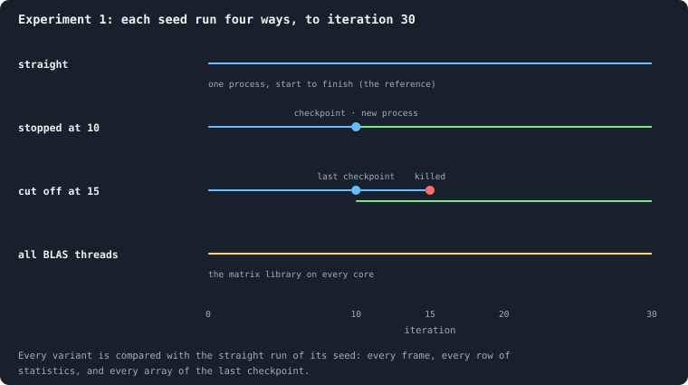

# Is a run reproducible?

> [!question] Questions of this page
> - Does the same seed always give the same world, frame for frame?
> - Does stopping a run and continuing it later, in a new process, change it?
> - Does a crash, after which the run is resumed from its last save, change it?
> - Does the number of processor threads the matrix library uses change it?

## In short

Every comparison in this notebook assumes that a run is decided by its
settings and its seed alone. Experiment 1 tested this on three seeds, each
run four ways to [iteration](one-iteration.md "One step of a world's time: a phase of reproduction, then a phase of the game.") 30. Stopping a run and continuing it in a new
process, or crashing it and resuming it, changed nothing, bit for bit.
Letting the matrix library use every processor core changed the last bits of
a few numbers, though not one decision in 150 iterations. So every run in
this notebook uses one thread, and on the same kind of computer it can be
made again exactly.

## Why it matters

Every later page compares worlds: many seeds against many, one setting
against another. That only means something if a world is decided by its
settings and its seed, and by **nothing else**. Not by when it was stopped
and continued, not by a crash, and not by which computer, or how many
processor cores, ran it.

## Why it could be true

A computer program that uses random numbers can still be exactly repeatable.
Think of a pseudo-random generator as a very long book of random-looking
digits: whoever starts on the same page reads the same digits. A run is
repeatable if three things hold.

1. **Every random number comes from a seeded stream.** A pseudo-random
   generator produces a fixed sequence of numbers from its starting value,
   the seed. In Graph of Life every world owns its own generator, started
   from its seed, and draws everything from it
   ([Seeds and the random stream](rules-in-detail.md#seeds-and-the-random-stream)).
2. **Everything is done in a fixed order.** [Agents](the-world.md#agents-and-tokens "One member of a world: it lives on a node of the network, holds tokens and has a brain that takes all its decisions.") act in increasing order of
   id, and [neighbours](the-world.md#the-network "An agent joined to another by a connection.") are listed in increasing order of id. Messages are held
   back in an outbox and delivered together once every agent has written. That
   happens after the look that only talks, and again at the end of the phase.
   So no agent reads a message another agent wrote a moment earlier in the
   same look.
3. **A saved world is the whole world.** To stop a run and continue it later,
   the program saves a **checkpoint**. It holds every agent's [tokens](the-world.md#agents-and-tokens "The one thing of value in a world: every agent holds a whole number of them, and their total never changes."), [brain](the-brain.md "The neural network each agent decides with: inputs about itself and its neighbours, outputs that become its decisions.")
   weights, [genotype](measuring-evolution.md#genotypes-families-and-the-common-ancestor "The identity of a brain: a number that a copy keeps and a change replaces, and that remembers the genotype it came from.") and age. It holds every [connection](the-world.md#the-network "A link between two agents of the network: they are neighbours, and can stake on each other's nodes."), and when it last
   carried tokens, and every message in flight. And it holds the state of the
   random generator. A run continued from a checkpoint first deletes any
   frames recorded after it (the pictures of the world it writes after every
   phase). Then it lives those iterations again.

What these do not cover is arithmetic itself. Adding real numbers on a
computer is not associative. That is, (*a* + *b*) + *c* can differ from
*a* + (*b* + *c*) in its last bit, because each sum is rounded. For example,
(0.1 + 0.2) + 0.3 gives 0.6000000000000001 on a computer, but
0.1 + (0.2 + 0.3) gives 0.6. A brain adds up thousands of products. The
library that multiplies matrices (BLAS) may split such a sum over several
processor cores, as several threads of work. Then the order of the additions,
and so the last bit of the result, depends on how many cores it uses.

## The experiment

Each of three seeds is run four ways, each to iteration 30:

- **straight**: in one process, from start to finish. This is the reference.
- **stopped at 10**: stopped at iteration 10, saved, and continued in a *new*
  process from the checkpoint on disk.
- **cut off at 15**: the process is killed at iteration 15 without saving, as
  if the power went. Its last checkpoint is from iteration 10, so it resumes
  from there and lives iterations 10 to 15 a second time.
- **all BLAS threads**: the matrix library may use every core. Every other
  run in this notebook uses exactly one.

Each variant is compared with the straight run of the same seed:

- all 60 frames, written out as text with their keys sorted, so that two
  identical frames give identical text;
- all 60 rows of statistics;
- every one of the 29 arrays of the final checkpoint, including the random
  generator's state and the messages in flight.

The files themselves cannot be compared byte by byte, because compressed
files carry the time they were written.

<!-- runs E01 -->
> [!info]- The runs behind this page
> **12 runs.** Every condition below is run once for every seed (1 to 3), for 30 iterations — or until its world dies out. Every setting is that of the baseline **B1** (the algorithm exactly as a new run is offered it) unless the condition changes it ([At a glance](settings.md#at-a-glance)).
>
> - **straight** — changes nothing: B1 as it is; 10,000 tokens. Runs `B1-10000-s001-straight` … `B1-10000-s003-straight`.
> - **stopped at 10** — changes nothing: B1 as it is; 10,000 tokens. Runs `B1-10000-s001-stopped-at-10` … `B1-10000-s003-stopped-at-10`.
> - **cut off at 15** — changes nothing: B1 as it is; 10,000 tokens. Runs `B1-10000-s001-cut-off-at-15` … `B1-10000-s003-cut-off-at-15`.
> - **all BLAS threads** — changes nothing: B1 as it is; 10,000 tokens. Runs `B1-10000-s001-all-blas-threads` … `B1-10000-s003-all-blas-threads`.
>
> To make these runs again: `python3 gol_lab.py run E01`, or ▶ in the Research Notebook tab of a computer running `gol_server.py`. Each run writes its settings, seed and engine version beside its frames, in `GraphOfLifeRuns/<run>/meta.json` and `provenance.json`.
<!-- /runs -->

We expected all four ways to give the same run, bit for bit, with every core
at work too. The reason was the first and the third condition above. Every
random draw comes from the world's own stream, and a checkpoint saves that
stream with everything else. So a resumed run should live its lost iterations
again exactly as before. The thesis says so; it is quoted word for word, as
it was written down before any of the runs existed:

<!-- thesis E01 -->
> [!quote] The thesis of Experiment 1, written down before any of its runs existed
> **The claim.** A run is decided by its settings and its seed, and by nothing else. Run it again, stop it and load it again in a new process, cut it off without warning and resume it, or let the matrix library use as many threads as it likes: every frame and the final state come out the same, bit for bit.
>
> **Why it would be so.** Every random draw a world makes comes from its own stream, seeded from the seed, and a checkpoint stores that stream with everything else the world is. A resumed run deletes whatever was recorded after its checkpoint and lives those iterations again.
>
> **It holds if:** Every frame of every variant is identical to the reference run with the same seed, and so are the statistics recorded from them and the final checkpoints, array for array, the random stream included.
>
> **It fails if:** Anything differs anywhere. Then a result cannot be reproduced from its seed, and nothing later in this book can be trusted until that is fixed.
<!-- /thesis -->

## What happened

**Stopping and crashing change nothing.** For all three seeds, the run stopped
at 10 and the run cut off at 15 recorded exactly what the straight run
recorded. Every frame, every row and every array was the same. Their records
also show what they went through. The stopped runs were made in two processes,
iterations 0 to 10 and 10 to 30. So were the cut-off runs: the first process
ended at iteration 15 without a checkpoint, and the second started again from
iteration 10.

**Threads change the last digits.** On all cores, seed 1 was identical to its
reference. Seeds 2 and 3 recorded the same 60 frames and the same 60 rows:
every agent, token, connection and decision. But their final checkpoints
differed in one array, the messages in flight. The numbers agents had just
written to each other differed in their last bits.

Run again on all cores, seed 2 gave exactly what it had given on all cores the
first time. Run again on one core, it gave exactly what it gave on one. So
each thread count is repeatable, but the two do not give the same run. Over
150 iterations, seeds 2 and 3 on one core and on all cores still never
recorded a different frame. A last-bit difference in a message had not yet
changed a single decision. Nothing guarantees it never will. A decision that
hangs on a comparison of two nearly equal numbers can flip.

**Made again from nothing.** Some hours later, all twelve runs were made
again from their settings and seeds, each in a fresh process and an empty
folder. Compared frame by frame and row by row, every one was identical.

**Two simulations in one program.** Before this experiment, all worlds in one
program drew their random numbers from numpy's single shared stream. And
starting a world reset that stream for all of them. The server runs
simulations side by side in one program. So two simulations running at the
same time disturbed each other, and neither could be made again from its
seed. Giving every world a stream of its own fixed it. A world on its own
draws the same numbers as before, so its results did not change.

By its own rule — anything differing anywhere refutes it — the thesis is
**refuted**. But only the number of threads refutes it, and only in the
last bits of numbers that had changed no decision in 150 iterations. For
stopping, continuing and crashing, it holds exactly.

## What we learned

- **A run is decided by its settings and its seed**, given one thread for the
  matrix library, which every run in this notebook uses.
- **Stopping it, continuing it or crashing it changes nothing.** So the lab
  can pause and resume runs freely. And every difference between two runs in
  later pages comes from what was changed, not from how they were run.
- **Other machines may round differently.** A different processor or library
  version can round a sum differently, just as a different number of threads
  does. So every run records its Python, numpy, networkx and BLAS versions,
  its processor and its instruction set. The lab refuses to continue a run
  under different ones.
- **The browser is not expected to agree.** The version of the program that
  runs in a web page uses other builds of numpy and networkx. It is not
  expected to give the same runs.

## Where to go next

- [Seeds and the random stream](rules-in-detail.md#seeds-and-the-random-stream): how one number fixes
  every random choice of a run.
- [The lab, the engine and pilots](runs-and-records.md#the-lab-the-engine-and-pilots): how runs are made, paused and
  resumed.
- [Every setting](settings.md): the numbers and switches that, with the seed,
  fix a run.

## How this was made

- **Runs:** 12 — `B1-10000-s001-straight` … `-s003-straight`, each also as
  `-stopped-at-10`, `-cut-off-at-15` and `-all-blas-threads`.
- **Engine:** snapshot `f39288e90b003df0`, commit `ccba58f`.
- **Made again:** all 12, with `python3 gol_lab.py verify E01 --runs 12 --iterations 30`,
  on engines `f39288e90b003df0` and `f820369a1583af53`: identical.
- **Environment:** Python 3.12.3, numpy 2.5.1, networkx 3.6.1, OpenBLAS
  (scipy-openblas 0.3.33), Intel Core Ultra 7 258V, numpy dispatch AVX2.
- **Results:** `book/results/E01.json`, made with `python3 gol_lab.py analyse E01`.
- **Tests:** `tests/test_engine.py` and `tests/test_lab.py` hold these
  checks: two worlds in turn, two runs in two threads, and a stop and resume.
  They also hold a run cut between checkpoints, a worker terminated mid-run,
  and the server keeping the matrix library to one thread.

<!-- turns -->
---

← [Questioning the mechanics](questioning-the-mechanics.md) · [How the simulation works](../README.md#how-the-simulation-works) · [Every setting](settings.md) →

**Also about:** [Methods and statistics](../README.md#methods-and-statistics).

> [!info]- Pages that link here (10)
> [What this notebook is about](what-this-notebook-is-about.md) · [How this notebook is written](how-this-notebook-is-written.md) · [The world: tokens, agents and a network](the-world.md) · [The rules in detail](rules-in-detail.md) · [How far does a difference travel?](how-far-does-a-difference-travel.md) · [Do the brains matter?](do-the-brains-matter.md) · [Brains replaced by their average](brains-replaced-by-their-average.md) · [How runs are made, recorded and costed](runs-and-records.md) · [Every simulation: what was run, and what was measured](every-simulation.md) · [What B1 is, and what stood in its way](what-the-baseline-world-is.md)
<!-- /turns -->
