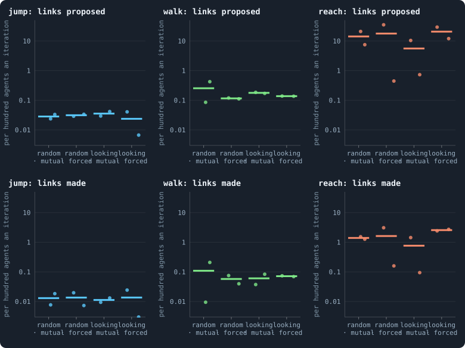
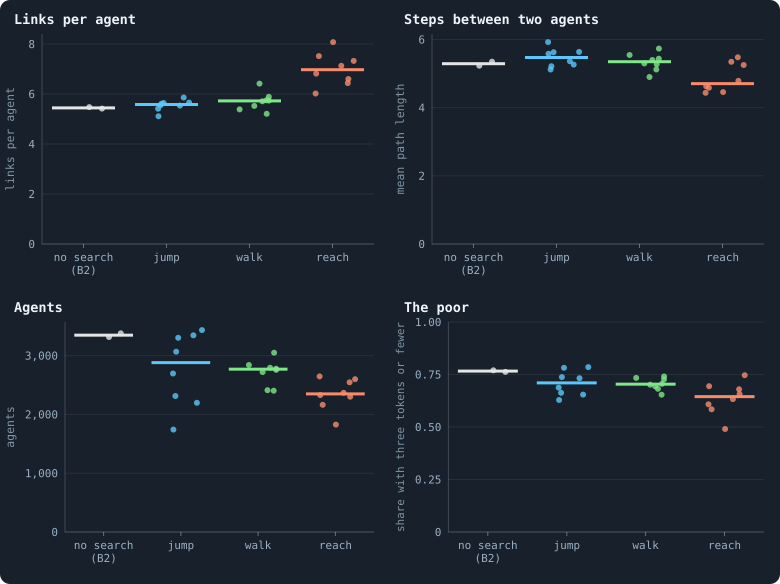
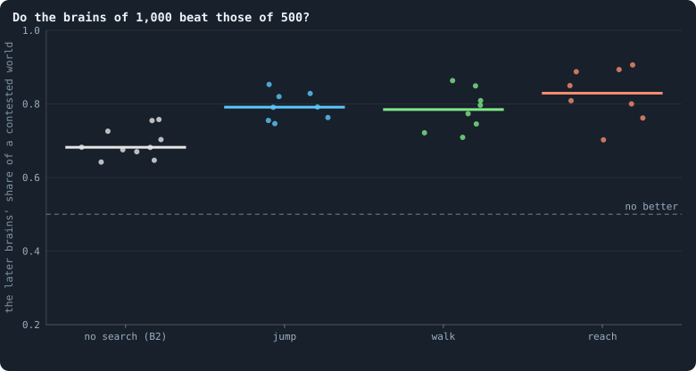

# Links to strangers

> [!question] Questions of this page
> - If an [agent](the-world.md#agents-and-tokens "One member of a world: it lives on a node of the network, holds tokens and has a brain that takes all its decisions.") can reach past its [neighbours](the-world.md#the-network "An agent joined to another by a connection.") and propose a link to someone it
>   does not know, does it?
> - Who does it reach, and what does that do to the network, to the riches of
>   the world, to evolution?

In every world of the notebook so far an agent could only link to agents it was
already near: its parent and its parent's neighbours at birth, and the
neighbours of its neighbours when it chose links of its own. A world built that
way grows like a crystal, outward from where it began. The author asked for a
way out: an agent that can go looking for a stranger, by a jump or by walking
step by step, at random or by looking where it is going, and that can propose
a link or force one.

## What was built

Three settings of the [engine](the-lab.md "The program that runs an experiment's plan as runs, each on a frozen copy of the engine, the code that plays a world."), all off unless a run turns them on
([`link_search`](settings.md#link_search),
[`link_steering`](settings.md#link_steering),
[`link_consent`](settings.md#link_consent)). After a reproduction
phase, an agent's [brain](the-brain.md "The neural network each agent decides with: inputs about itself and its neighbours, outputs that become its decisions.") says how many of its [tokens](the-world.md#agents-and-tokens "The one thing of value in a world: every agent holds a whole number of them, and their total never changes.") it spends on a search:

| search | what the agent does |
|---|---|
| **jump** | a walk as many steps long as the tokens it spends, all in one [iteration](one-iteration.md "One step of a world's time: a phase of reproduction, then a phase of the game."); a link is proposed where the walk ends, if it ends at a stranger |
| **walk** | a scout that goes one step further in every iteration the agent pays for, and proposes where it stands when that is a stranger |
| **reach** | a jump whose steps are free, as many as the tokens it holds would pay for |

A paid step costs one token, paid to the agent the step enters; nobody pays
its last token. Each step goes to a neighbour drawn at random, or, **looking**,
to the one the searcher would most like a link with. A proposal becomes a link
if both ends agree (**mutual**) or if the proposer alone wants it
(**forced**); nobody at its valence of eight links gets a new one either way.

## The worlds

Batch K: [B2](b1-and-b2.md "The second baseline: B1 with the rules that keep its network from breaking and its agents from staking or breeding themselves to death.") at 10,000 tokens with every search, every steering and every
consent — twelve kinds of world — [seeds](random-numbers.md "The number that fixes every random choice of a run: the same settings and the same seed make the same world.") 1 and 2, 1,000 iterations, as [pilot](pilot-worlds.md "A world made by hand to see whether an idea is worth an experiment, without a thesis or many seeds.")
worlds. The control is B2 itself with the same seeds (`P/B2-s1`, `-s2`, the
lab's Experiment 16 worlds again, game for game). From each world's
checkpoint at iteration 1,000, fifty more [games](one-iteration.md#phase-2-the-game "The second phase of an iteration: every agent stakes all its tokens on its own node and its neighbours', and every node goes to someone.") were played and recorded, and
every proposal in them counted (`research/oee/checks/k_links.py`).

## Do they search?

<!-- figure strangers/use -->

**How much the agents search.** Each dot is a world, read over 50 games played on from its checkpoint at iteration 1,000: above, the links its agents proposed to strangers; below, those that were made; per hundred agents an iteration, on a logarithmic axis (a world with none is drawn at the bottom). Jump: a walk as many steps long as the tokens an agent spends on it; walk: a scout one step further each iteration it is paid for; reach: as many free steps as the tokens held would pay. Each column of a panel is a steering (random, or looking for the best liked) and a consent (both ends agree, or only the one who proposes).

> [!example]- How to make this figure
> **Runs.** Batch K's 24 pilot worlds — B2 at 10,000 tokens with `link_search` = jump, walk or reach, `link_steering` = random or looking and `link_consent` = mutual or forced, seeds 1 and 2, 1,000 iterations (`GraphOfLifeRuns/.pilots/K/`, `research/oee/pilots/make_jobs_TU.py`) — and B2 itself with the same seeds (`P/B2-s1`, `-s2`).
>
> **Data.** From `GraphOfLifeRuns/.pilots/k_links.json` (`research/oee/checks/k_links.py`).
>
> 1. Play each world on for 50 games from its checkpoint at 1,000, recording them in the lab's form.
> 2. Count the proposals in each reproduction phase and those that made a link, per agent that faced the phase.
>
> **To make it again:** `python3 book_figures.py strangers`.
<!-- /figure -->

**When a search costs tokens, hardly anyone pays for it.** In the worlds with a
jump, 0.01 to 0.04 proposals were made per hundred agents an iteration; with a
walk, 0.1 to 0.4 — in a world of 3,000 agents, one proposal every few
iterations. **When it is free, they reach all the time**: up to 35 proposals
per hundred agents an iteration, and 0.1 to 3 new links. Most proposals fail —
7% to 36% of the reach worlds' become links — because the other end says no
or is already at its valence. How a search steers, and whether a link needs
both ends' consent, matters less than the seed of the world.

**And the strangers are near.** The [median](median-and-quantiles.md "The middle value: half of the numbers lie below it and half above.") proposal, in every world, goes to an
agent two or three steps away — a neighbour's neighbour, or one step beyond.
No proposal in any world went twenty steps or more. A search walks the
network as it is, and a short walk on a network where every agent has five or
six links rarely leaves the neighbourhood.

## What it does to a world

<!-- figure strangers/network -->

**What a search does to a world.** Each dot is a world: grey, B2 itself; the others, the eight worlds of each search (two steerings, two consents, two seeds). Links per agent and the mean path length are means of the network measures every 50 iterations from 500 to 1,000; agents too; the poor are the share of the agents holding three tokens or fewer at 1,000.

> [!example]- How to make this figure
> **Runs.** Batch K's 24 pilot worlds — B2 at 10,000 tokens with `link_search` = jump, walk or reach, `link_steering` = random or looking and `link_consent` = mutual or forced, seeds 1 and 2, 1,000 iterations (`GraphOfLifeRuns/.pilots/K/`, `research/oee/pilots/make_jobs_TU.py`) — and B2 itself with the same seeds (`P/B2-s1`, `-s2`).
>
> **Data.** From Each world's `series.jsonl` and its checkpoint at 1,000 (`GraphOfLifeRuns/.pilots/k_links.json`).
>
> 1. Average the network rows of iterations 500 to 1,000.
> 2. Count the agents with three tokens or fewer in the checkpoint at 1,000.
>
> **To make it again:** `python3 book_figures.py strangers`.
<!-- /figure -->

- **More links, shorter paths — with the free reach.** Its worlds hold 6.0 to
  8.1 links per agent against B2's 5.4 to 5.5, and two agents are 4.4 to 5.5
  steps apart against 5.2 to 5.4. The paid searches leave both as they were.
- **The [dimension](ball-dimension-and-curvature.md "How fast the number of agents within a distance grows with the distance: as its square in a plane, its cube in space.") does not change.** It stays at 3.8 to 4.6 in every searching
  world, B2's own range: links to friends of friends make the network denser
  where it already is, not wider.
- **Smaller worlds, a little richer.** Every kind of searching world holds
  fewer agents than B2's — a median of about 2,900 with a jump, 2,800 with a
  walk, 2,350 with the reach, against 3,350 — and fewer of them are poor: 49% to
  79% at three tokens or fewer, against 76% and 77%. The worlds of the paid
  searches shrink although their agents hardly propose anything. Two things
  could do it: their brains have two more outputs to set, and a walk that ends
  where its agent proposes nothing has still paid every step — a token to each
  agent it entered — so a paid search moves tokens about even when it makes no
  link. This batch does not tell which.

## Does evolution go on?

<!-- figure strangers/evolution -->

**Do the brains of 1,000 beat those of 500?** Each dot is a world: the share of a world its brains of iteration 1,000 hold after 100 iterations against those of 500, the mean of two contests, one in each era's world. B2: Experiment 16's ten worlds.

> [!example]- How to make this figure
> **Runs.** Batch K's 24 pilot worlds — B2 at 10,000 tokens with `link_search` = jump, walk or reach, `link_steering` = random or looking and `link_consent` = mutual or forced, seeds 1 and 2, 1,000 iterations (`GraphOfLifeRuns/.pilots/K/`, `research/oee/pilots/make_jobs_TU.py`) — and B2 itself with the same seeds (`P/B2-s1`, `-s2`). B2: Experiment 16's ten runs.
>
> **Data.** From `GraphOfLifeRuns/.pilots/batch_K_T100.json` and `long_steps.json`.
>
> 1. Seat the brains of the two eras on alternate agents of each era's world and play 100 iterations (`research/oee/checks/rejudge.py`).
> 2. Count the agents the later era's brains hold, as a share of all.
>
> **To make it again:** `python3 book_figures.py strangers`.
<!-- /figure -->

**Yes, and faster than in B2.** In every one of the 24 worlds the brains of
iteration 1,000 took more than half of a contested world from those of 500,
over an agent's [lifetime](age-and-lifetime.md "How many iterations an agent lives, from its birth to its death.") — 70% to 91% — where B2's took 68% in the median of
its ten lab worlds. The median world with a jump took 79%, with a walk 78%,
with the reach 83%. And it hardly matters how much the agents searched: the
worlds of the paid searches, whose agents almost never propose a link, evolve
as fast as those of the free one. What every searching world has is a smaller
size and two more outputs for its brains to set. The mixed worlds of
[Mixed at birth: ten long worlds](mixed-at-birth-ten-long-worlds.md#does-evolution-go-on),
smaller still, took 84%; whether smaller worlds evolve faster, or a contest in
a smaller world gives a later brain more room to win, this batch cannot say.

## What it teaches

- **Given a way to reach strangers, agents reach their neighbours'
  neighbours.** Nothing in the game rewards a far link over a near one, and a
  search that walks the network finds what is near.
- **A paid search is not worth its tokens** — to these brains, at this
  length of evolution. The free one is used, and changes the network locally.
- **Every searching world evolves faster than B2**, whether its agents search
  or not; what they share is a smaller world and more for a brain to set.
- **Locality survives.** For the notebook's other aim, a network that behaves like
  space ([How many dimensions does a world have?](how-many-dimensions-does-a-world-have.md)),
  far links would be the danger: a few shortcuts make a world small and its
  dimension high. Searching agents do not make them, and their worlds keep
  B2's dimension. A search that goes further than a walk from home — to an
  agent drawn from the whole world, say — would be the test of whether the
  game itself keeps space local; no setting offers one yet.

**Related notes:** [Every setting](settings.md#link_search) ·
[How many dimensions does a world have?](how-many-dimensions-does-a-world-have.md) ·
[Mixed at birth: ten long worlds](mixed-at-birth-ten-long-worlds.md) ·
[Healthy and rich](healthy-and-rich.md)

<!-- turns -->
---

← [Brains mixed at birth, units that cost, an eye for raids on kin](mixed-brains-costly-units.md) · [Changing the rules](../README.md#changing-the-rules) · [Brains mixed at birth, with every other rule](mixing-with-every-other-rule.md) →

**Also about:** [The shape and health of the network](../README.md#the-shape-and-health-of-the-network).

> [!info]- Pages that link here (2)
> [The candidates, played on](the-candidates-played-on.md) · [Every simulation: what was run, and what was measured](every-simulation.md)
<!-- /turns -->
