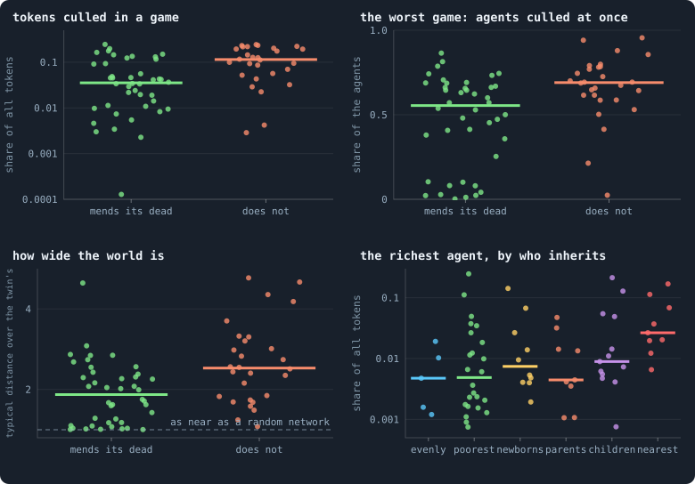

# Local rules only

> [!question] Questions of this page
> - Which rules of a world act on all of it at once, and why does that matter?
> - What would each of them be if it could act only where it is?
> - What did round 3 of the screen of random worlds already show about two
>   local rules it drew: mending a death, and estates that flow to the nearest
>   living?
> - How would the three local rules be tried on round 3's best worlds, and
>   what do we expect?

## In short

Almost every rule of Graph of Life acts only where it is, but three act on a
whole world at once: the cull, the [share-out](gains-and-losses.md#gains-losses-and-the-share-out "How a cleanup deals the tokens of the dead out among the living: in the baseline, each token to a survivor drawn at random.") and the one random stream. This
page plans to make each of them local, one at a time, on six of round 3's
candidate worlds, each against its own run. Round 3 already drew two local
rules. Mending a death cut the [tokens](the-world.md#agents-and-tokens "The one thing of value in a world: every agent holds a whole number of them, and their total never changes.") a game culls from 11.4% to 3.5%, but not
the big breaks, and it folded the worlds; estates that flow to the nearest
living pooled wealth, so that the richest [agent](the-world.md#agents-and-tokens "One member of a world: it lives on a node of the network, holds tokens and has a brain that takes all its decisions.") held 2.7% of all tokens against
0.6%. The draft thesis expects random streams of their own to change nothing,
local estates to make worlds more unequal, and pieces that live on to break
round 3's worlds into islands, since nothing can ever join two pieces again.

## Three rules that act on a whole world

Think of a town whose houses are joined by roads. Most of what happens in it
is a street's business: you trade with your [neighbours](the-world.md#the-network "An agent joined to another by a connection."), and your children
build next door. Three of its rules are not like that.

- **The cull.** Every evening, every house that no road joins to the largest
  part of the town is pulled down, with everyone in it, however well they
  were doing.
- **The share-out.** The belongings of everyone who died that day go into one
  pot, and are dealt out by lottery among everyone left, near or far.
- **The one die.** The town has a single die. Whoever needs a chance throws
  it, in a fixed order. If one person throws once more, everyone after them
  throws different numbers.

Graph of Life has exactly these three rules. Every phase of an iteration ends
with a cleanup ([One iteration, step by step](one-iteration.md#cleanup)).
Agents with no tokens starve, and under [`max_age`](settings.md#max_age) the
old die. Of what is left, only the largest connected piece of the network
lives on: every agent outside it is culled. The tokens of the dead are pooled
and dealt out by the rule [`redistribution`](settings.md#redistribution) names.
And every random number a world uses comes from one stream, in a fixed order
([Seeds and the random stream](random-numbers.md#the-two-streams-of-a-run)).

Everything else is local. An agent's [brain](the-brain.md "The neural network each agent decides with: inputs about itself and its neighbours, outputs that become its decisions.") reads its own node, its
neighbours, a summary of each neighbour's neighbours, and the [messages](messages.md "Numbers an agent writes to itself and to each neighbour every phase, which their brains read.") they
wrote. It acts on its own node and its neighbours' nodes.

Why do the three matter?

- **For physics.** Under local rules nothing can travel faster than a few
  [connections](the-world.md#the-network "A link between two agents of the network: they are neighbours, and can stake on each other's nodes.") a phase: a world has a speed of light
  ([A speed limit](physical-inspiration.md#a-speed-limit)). The three rules
  carry news of a change everywhere at once
  ([Where the speed limit is broken](physical-inspiration.md#where-the-speed-limit-is-broken)).
  With them, a light cone cannot even be measured
  ([How far does a difference travel?](how-far-does-a-difference-travel.md)).
- **For evolution.** The cull kills a region because it lost its way to the
  rest, whatever its brains did ([How a world breaks](how-a-world-breaks.md)).
  It also forbids a world to split into populations that go their own ways,
  which is how most new species begin (Mayr 1942;
  [One rule reaches across the world](questioning-the-mechanics.md#one-rule-reaches-across-the-world)).
  The share-out pays everyone for nothing they did
  ([The share-out lottery](questioning-the-mechanics.md#the-share-out-lottery)).

## The local version of each

### Pieces live on

A piece that loses its last link to the rest becomes a world of its own,
with the tokens it holds. It plays on as before.

There is no space between two pieces. In Graph of Life, space *is* the network
([Space made of relations](physical-inspiration.md#space-made-of-relations)):
two pieces are not far apart, they share nothing at all. And every link is
made inside a neighbourhood. A child is joined to its parent and its parent's
neighbours; a search for strangers walks along links
([Links to strangers](links-to-strangers.md)). So two pieces can never be
joined again. A split is for ever, like two universes that can no longer send
each other a signal.

One kind of piece needs a rule of its own: a newborn left with no link, one
that chose none and was handed none by its parent. Today the cleanup at the
end of the phase it was born in culls it at once, and its tokens are shared
out. If pieces lived on, it would live alone for ever: an agent with no
neighbour stakes everything on its own node, so it can never starve. So the
local rule has a second half. **A child that would have no link is not born,
and the tokens meant for it stay with its parent.** Nothing else about birth
changes.

### Estates to the nearest living

This rule exists already: [`redistribution`](settings.md#redistribution)
`local`, added on 24 October 2026 at the author's request. Picture water
running downhill. An estate flows from the dead agent to its neighbours one
step nearer the living, split evenly, and on until it reaches them. The
network counts as it stood before the phase's links lapsed, so a piece cut off
whole flows out across the link it lost.

Three parts of it still reach further than a step:

- the estate of a culled piece crosses the whole piece in one cleanup,
  however large the piece is;
- an estate with no way to the living goes to the dead agent's parent,
  wherever that parent is;
- tokens that are no one's estate — upkeep paid into the estate, a life
  bought, tokens created — are dealt out over everyone, as under `uniform`.

With pieces that live on, the first is gone, because nobody is culled. In
round 3's worlds almost nothing else is left to share: no agent dies of age,
and the starved hold nothing, so every token a cleanup shared out was a culled
agent's ([Few tokens culled](which-worlds-are-healthy.md#few-tokens-culled)).
In a local world without old age, who inherits hardly matters any more.

### Random streams of their own

[Seeds and the random stream](random-numbers.md) pictures a run's random
numbers as a vast book of random digits, which the world reads from its first
page on, one draw after another. A **counter-based** generator lets every
reader open the book at an address of its own (Salmon, Moraes, Dror and Shaw
2011). The *n*-th number that agent *a* draws, in phase *p* of iteration *t*,
for purpose *k*, is a fixed function of the seed and those five numbers. A run
is still decided by its seed alone. But one more draw by one agent changes no
other agent's numbers.

The address needs the agent's name, and names must be local too. Today a
newborn takes the next free number, so one more birth anywhere renames every
later newborn, everywhere, and moves its address. So a newborn would be named
from its parent's name and the iteration it is born in; a parent has at most
one child a phase. A node keeps its name when it is taken, as it keeps its id
today.

This rule changes nothing in what a world is, only which random numbers it
happens to draw. It is what twin worlds need: with one stream, two worlds that
differ in one detail differ everywhere from the first extra draw.

### A second road: pieces that never form

[B2](b1-and-b2.md) took another road: rules under which no piece separates at
all ([Worlds that cannot break](how-a-world-breaks.md#worlds-that-cannot-break)).
A death is mended ([`mend_on_death`](settings.md#mend_on_death)): the dead
agent's former neighbours are joined up in a ring. An unused link lapses only
where its two ends share neighbours ([`prune_needs`](settings.md#prune_needs)).
And a newborn is always joined to its parent
([`birth_links`](settings.md#birth_links)). The cull then has nothing left to
do, and a rule that never acts reaches nowhere. In the ten B2 worlds of
Experiment 14, not one agent was cut off from iteration 200 to 1,000.

But B2's worlds fold into near small worlds, in which everyone is a few steps
from everyone. Each mended death joins agents that were two steps apart
([What folds a world](how-many-dimensions-does-a-world-have.md#what-folds-a-world)).
So the two roads trade: pieces that live on keep a world's room but let it fall
apart; pieces that never form keep it whole but fold it. This page plans the
first road. The second is one of the choices left to the author.

## What round 3 already shows

Round 3 of the screen of random worlds drew every setting of a world at
random, among them who inherits and whether deaths are mended
([A screen of random worlds](a-screen-of-random-worlds.md)). Experiment 40
played 84 such worlds of 30,000 tokens for 3,000 iterations, and 70 lived to
the end. Each setting was drawn on its own, so the worlds drawn with one value
and those drawn with another differ in everything else only by chance
([How a setting is tested](how-the-drawn-settings-shape-a-world.md#how-a-setting-is-tested)).
Experiments 41 and 42 play eight of the same draws twice, so they are left
out here.

<!-- figure localrules/roundthree -->

**What round 3 says about a local repair and a local share-out.** Each dot is one of the 70 worlds of Experiment 40 that lived to the end of their 3,000 iterations, read from iteration 100 on; the short bar is the median of a column. Top left, on a logarithmic axis: the share of all the world's tokens a game culls, the tokens of agents cut off from the largest piece of the network, for the worlds drawn with mending (a dying agent's former neighbours joined up again in a ring) and those without. Top right: the most of its agents a single game culled. Bottom left: how wide the world is, its typical distance over that of a random network with the same links (on the dashed line, no wider than one). Bottom right, on a logarithmic axis: what the richest agent holds, by where each world's rule sends the tokens of the dead: evenly over all, to the poorest, to this iteration's newborns, to their parents, to the dead agent's own children, or to the nearest living. Every other setting of each world was drawn at random too, so each column mixes many kinds of world.

> [!example]- How to make this figure
> **Runs.** the worlds of round 3 of the screen of random worlds that lived to the end of their 3,000 iterations (Experiment 40: 30,000 tokens, every setting drawn at random)
>
> **Data.** From each world's averages over iterations 100 to the end, `research/screen/health.json` (from the screen's readings, `research/screen/measures.py`), and each run's own statistics, `GraphOfLifeRuns/<run>/stats.jsonl` (`nodes_before`, `starved`, `orphaned`).
>
> 1. Read each living world's averages from `health.json`: `culled_tokens` (the share of all tokens a game's cleanup shares out, every one a culled agent's), `width` and `richest`.
> 2. From its `stats.jsonl`, for every game from iteration 100 on, `orphaned` over `nodes_before`: the share of the agents the game culled. Keep the largest.
> 3. Group the worlds by their drawn `mend_on_death`, and by `redistribution`.
> 4. One dot per world; the bar is the median.
>
> **To make it again:** `python3 book_figures.py localrules`.
<!-- /figure -->

### Mending: a third of the culls, not none

Of the 84 worlds, 49 were drawn with mending, and 42 of them lived.

- **Fewer culls.** A world that mends culls a [median](median-and-quantiles.md "The middle value: half of the numbers lie below it and half above.") of 3.5% of its tokens in
  a game, against 11.4% for one that does not, and 4.9% of its agents
  against 13.5%. Differences as large turn up in about 1 shuffle in 2,000 of
  the worlds' numbers, and the false discovery rate over every setting tested
  is 0.012.
- **But not the big breaks.** In the median world that mends, the worst
  single game still culled 55% of its agents, against 69% without mending.
  Mending keeps a *death* from splitting a world. An unused link that lapses
  can still cut one in two, and round 3 never drew the rule that stops it,
  `prune_needs`.
- **As many deaths, of another kind.** Agents die as often in both: 0.42 and
  0.40 deaths per agent an iteration, culled or starved. With mending, the
  cull makes 32% of those deaths, against 57%; the rest starve.
- **A folded world.** The worlds that mend are narrower: their typical
  distance is 1.87 times their [random twin](random-twin.md)'s, against 2.53
  (a chance of 0.001 by a [permutation test](bootstrap.md#permutation-tests "Whether a difference could be chance, found by shuffling which world belongs to which condition.") of our own). Their criterion
  *almost three-dimensional* scores 0.45 against 0.56 (a false discovery rate
  of 0.19). B2 found the same: a death mended in a ring joins agents that were
  two steps apart.
- **More unequal, and smaller.** A median [Gini](gini-coefficient.md "How unequally tokens are held: 0 if every agent holds as many, near 1 if one holds nearly all.") of 0.45 against 0.37, and
  3,530 agents against 5,440 (false discovery rates of 0.36 and 0.27: hints).
  Fewer culls means fewer estates passing from the dead to the living, and an
  estate shared out levels a world
  ([The estate of the dead](estate.md#what-happens-at-a-death)).
- **Healthier, and evolving in other ways.** Health by the product is 0.43
  against 0.37 (a false discovery rate of 0.19). Agents in the same situation
  act more differently: a [same-position share](what-makes-a-world-interesting.md#the-same-position-share)
  of 0.60 against 0.29 (a false discovery rate of 0.009). The
  [effective population](candidates-for-open-ended-evolution.md#how-each-pillar-is-read)
  is 36 against 11 (0.010), and the main line of descent reaches further into
  new behaviour, 0.086 against 0.050 (0.04). But having children runs in
  families far less: 0.07 against 0.28 (0.001).
- **No fewer deaths of worlds.** 7 of the 49 worlds that mend died, and 7 of
  the 35 that do not.

So a local repair takes about two thirds off what the cull removes. On its
own, it cannot make the cull idle.

### Estates to the nearest living: wealth pools

Of the 84 worlds, 13 were drawn with estates that flow to the nearest living.
Nine lived. One of the four that died was also capped at two links an agent,
under which all six such worlds died.

- **The most unequal worlds of the round.** Their median Gini is 0.53, the
  highest of the six ways estates were shared: 0.32 to the poorest, 0.36 evenly
  over all, 0.42 to the parents, 0.44 to the newborns, 0.45 to the dead
  agent's children. Differences this large among the six would turn up in
  about 1 shuffle in 10,000 (a false discovery rate of 0.002). Their richest
  agent holds 2.7% of all tokens, against 0.6% in the other 61 living worlds
  (a chance of 0.004).
- **Why, perhaps.** The rule sends a culled branch's whole estate across the
  link it lost, to the agents on the other side of the border. A branch's
  wealth lands in a few hands at once. That is a reading of the rule, not yet
  a measurement.
- **No fewer culls.** 2.9% of the tokens in a game, against 5.6%: within
  chance (0.14). The share-out does not change what is cut off, only where its
  tokens go.
- **A slower world.** 0.22 deaths per agent an iteration against 0.43, and
  0.23 births against 0.56 (chances of about 0.05).
- **Folded, perhaps.** A ball [dimension](ball-dimension-and-curvature.md) of
  4.1 against 3.0, and a width of 1.49 against 2.16, but both within chance
  (0.16 and 0.30). Five of the nine also reach for strangers, a search that
  costs nothing and tends to fold a world
  ([What a world's rules make possible](candidates-for-open-ended-evolution.md#what-a-worlds-rules-make-possible)).
  Among the worlds that reach, those with local estates are the folded ones
  (4.3 against 3.0, in 5 worlds against 14); among those that jump they are
  not (2.8 against 3.0, in 3 against 15). Indicative only.
- **Health:** 0.47 by the product, the second of the six rules after estates
  shared evenly (0.52, in only five worlds). The six differ with a chance of
  0.014 (a false discovery rate of 0.12).

### What round 3 cannot say

Round 3 never let a piece live on, and never gave an agent a stream of its
own. Its local share-out always lived beside the cull, whose estates it
carried. And it never drew mending together with the rule for lapses. Every
comparison above is between worlds that differ in many settings at once. The
experiment below changes one rule of one world, and keeps everything else.

## The experiment

### Six worlds

The worlds are six of the 24 on the shortlist of
[Candidates for open-ended evolution](candidates-for-open-ended-evolution.md#the-shortlist),
each with its own drawn settings and its own seed. Seed 3042 is the healthiest
by the product of health's six criteria; seeds 3018, 3080 and 3057 come third
to fifth. Seed 3026 evolves the most, with some of the simplest rules of the
round. Seed 3004 culls only 0.3% of its tokens a game, the second least of
the shortlist: if the local rules change any world little, it is this one.

<!-- table localrules/candidates -->
| world | health's place (product) | estates of the dead go | mends its dead | search | tokens culled a game | worst game culled | agents | hours for 3,000 iterations |
|---|---|---|---|---|---|---|---|---|
| [s3042](run:B1-30000-b82ad0-s3042) | 1 | evenly over all | yes | jump | 5.6% | 53% | 11,604 | 9.4 |
| [s3018](run:B1-30000-af1e28-s3018) | 3 | to the dead's children | yes | reach | 4.2% | 47% | 3,021 | 3.8 |
| [s3080](run:B1-30000-625bc7-s3080) | 4 | to the dead's children | yes | jump | 1.9% | 60% | 1,900 | 0.8 |
| [s3057](run:B1-30000-38aee9-s3057) | 5 | to the newborns | no | reach | 12.7% | 66% | 5,010 | 2.5 |
| [s3026](run:B1-30000-d6955f-s3026) | 27 | to the newborns | yes | off | 12.4% | 63% | 1,876 | 1.6 |
| [s3004](run:B1-30000-7d5208-s3004) | 16 | evenly over all | yes | off | 0.3% | 41% | 1,610 | 0.6 |
<!-- /table -->

Each world's control is its own run of round 3, already played: the same
settings, seed and tokens, with the new rules off. A new rule is off unless a
plan turns it on, and the [engine](the-lab.md "The program that runs an experiment's plan as runs, each on a frozen copy of the engine, the code that plays a world.")'s tests prove that an old world is then
played exactly as before.

### Four conditions, one change each

Each world is played again at 30,000 tokens for 3,000 iterations, recorded as
round 3 recorded it, once under each condition:

1. **Random streams of their own.** Only how chance is drawn changes; every
   rule stays as it was.
2. **Estates to the nearest living**, with the cull as it is. This needs
   nothing built: `redistribution` set to `local`.
3. **Pieces live on**, and a child with no link is not born.
4. **All three: the local world.** This is the world
   [How far does a difference travel?](how-far-does-a-difference-travel.md)
   and [A source and a sink](a-source-and-a-sink.md) are planned on.

### What is measured

- **Health**, by its six criteria, and its place among round 3's worlds
  ([Which worlds are healthy?](which-worlds-are-healthy.md)).
- **Size, wealth and lives:** agents, the Gini coefficient, the richest
  agent's share, births, and deaths by starving and by the cull.
- **Space:** the dimension and the width.
- **Evolution:** generations, the heredity index, effective population and
  late novelty, as the candidates were read.
- **Pieces**, under conditions 3 and 4: how many there are, the share of the
  agents and of the tokens outside the largest, how large each grows and how
  long it lasts, and the tokens that leave the largest piece in a game (what
  the cull took before, measured the same way). And whether separated pieces
  evolve apart: of two agents in the same situation, one from each piece, how
  often they act differently, against two from the same piece.

Many measures assume a world of one piece: its width and dimension, its
distances, its cuts, its [2-core](bridges.md#core-trees-and-leaves "What is left of a network when agents with one connection or none are peeled away again and again: the agents on loops or between them."), and when it counts as dead. Under pieces that
live on, each is taken on every piece apart, and given for the largest piece
and as an average over pieces, weighted by their agents. A world ends when its
largest piece falls to 20 agents.

## What we expect

**Random streams of their own** should change nothing but the luck of the
draw. The numbers are as random as before, only drawn from other addresses.
Each world then lives another of the histories its rules allow, as with
another seed.

**Estates to the nearest living** should make every world more unequal, as
they did in round 3, while leaving its culls as they were.

**Pieces that live on** should break every world apart, and for good. A piece
can never be joined again, and in round 3's worlds a piece that holds a token
can never die: nobody dies of age, and an agent alone cannot starve. The six
worlds culled 0.3% to 12.7% of their tokens in a game. Each such game would
leave a piece behind, and its tokens with it; nothing brings them back. Against
this: the regions that break off are the poorest
([Poverty disconnects](how-a-world-breaks.md#poverty-disconnects)). Once they
are gone, the largest piece may hold together better than before.

**All three together** should do what pieces that live on do.

> [!quote] Draft thesis (to be fixed before any run)
> **The claim.** Each of the three rules made local changes round 3's candidate worlds in its own way. Random streams of their own change nothing but the luck of the draw. Estates that flow to the nearest living make the worlds more unequal and cull no less. Pieces that live on break the worlds into islands: within 1,000 iterations the largest piece of most worlds holds less than half of all tokens. All three together do as pieces that live on do.
>
> **Why it would be so.** A counter-based stream draws numbers as random as the one stream, only from other addresses, so a world lives another of the histories its rules allow. In round 3, the 9 living worlds drawn with estates to the nearest living had a median Gini of 0.53, the highest of six rules (about 1 in 10,000 by chance), and a richest agent with 2.7% of all tokens against 0.6%, while culling no less (2.9% of the tokens a game against 5.6%). A piece that separates can never be joined again, since every link is made inside a neighbourhood; and in these worlds no agent dies of age and an agent alone cannot starve, so a piece holding a token lives for ever. The six worlds culled 0.3% to 12.7% of their tokens in a game, and each such game would leave a piece behind with its tokens. Against this, the regions that break off are the poorest, and the largest piece may hold together better once they are gone.
>
> **It holds if:** against each world's own run of round 3, from iteration 100 to 3,000: (1) with streams of their own, health by the product moves by less than the median difference between the two seeds of one setting in Experiment 43, in at least five of the six worlds; (2) with local estates, the Gini coefficient and the richest agent's share both rise, and the share of tokens culled in a game does not fall by more than a third, in at least five of the six; (3) with pieces that live on, the largest piece holds less than half of all tokens by iteration 1,000 in at least five of the six; (4) with all three, the same as (3).
>
> **It fails if:** (1) streams of their own move health by more than that difference in three worlds or more: then the stream shapes worlds, or the build changed a rule; (2) local estates leave the Gini coefficient as it was, or lower it, in three worlds or more; (3) or (4) the largest piece still holds more than half of all tokens at iteration 3,000 in three worlds or more. Six worlds are few: either way the result is indicative.

## What has to be built first

None of the three is in the engine, apart from local estates, and the names
must be chosen with care: `local_rules` is reserved, in
`research/strains.md`, for agents that change their own rules.

1. **Random streams of their own**, a new setting with the one stream as its
   default.
   - Every draw comes from a counter-based generator (Philox, as numpy has
     it, or a hash computed for every agent at once). Its key is the seed;
     the name of the agent, node or link the draw is for; the iteration; the
     phase; what the draw is for; and its place in line.
   - Names become local: a newborn's is made from its parent's name and the
     iteration, a [genotype](genotype.md "The identity of a brain: a number that a copy keeps and a change replaces, and that remembers the genotype it came from.")'s from the node it is made on. The ids the viewer
     reads stay whole numbers below 2⁵³, the largest JavaScript holds exactly,
     and a clash of two names is checked for.
   - A checkpoint no longer needs the stream's state, only the seed.
   - Tests: under the old default every world is played bit for bit as
     before; a seed gives the same run twice; a run resumed from a checkpoint
     is the same run; and twins with nothing moved stay identical.
   - Its price: on the lab's machine, on 9 November 2026 while Experiment 43
     ran, a new Philox generator for each draw of ten numbers took 25 µs,
     against 8 µs for the same draw from the one stream; a hash computed in
     one go for 20,000 agents took 1.4 µs an agent. How much that adds to a
     run depends on how often a world draws; the lab's estimate before ▶ will
     say.
2. **Pieces that live on**, a new setting with the cull as its default.
   - No piece is culled, and a child with no link is not born, its tokens left
     with its parent.
   - Every phase's statistics gain the number of pieces, the agents and tokens
     of the largest, and the tokens that leave it.
   - Every measure of shape is taken on each piece, as above, and a world ends
     when its largest piece falls to its [extinction](extinction.md "A world's end before its last iteration: it has dropped to its threshold of agents or fewer.") threshold.
   - The viewer draws the pieces apart.
   - Tests: under the default nothing changes; the tokens of every piece add
     up in every phase; no link ever joins two pieces.
3. **The local world**: both, with local estates. In a world that is local
   to the end, local estates' two global fallbacks need a home of their own:
   an estate with no living neighbour could stay on its node as a fossil that
   no one can win, or go to the parent as now; and upkeep must not be paid
   into the estate. Neither arises in the six worlds as drawn: none pays
   upkeep into the estate, and none lets agents die of age.
4. **The lab**: plans that name the new settings, and the controls taken from
   round 3's runs.

## What it would cost

In round 3 the six worlds took 18.7 hours of one worker for their 3,000
iterations: seed 3042, with 11,600 agents, took 9.4 of them, and seed 3004
0.6. The four conditions take about 75 worker-hours, a little more than a day
on the lab's three workers. The controls exist already. The six runs of a
condition fill about 14 GB of disk, 7.6 GB of it seed 3042's.

Pieces that live on may cost more. Islands never die, and every agent in them
still looks and stakes in every phase. The lab's estimate before ▶ will say.

Condition 2, estates to the nearest living, needs nothing built. It could be
played today, for about 19 worker-hours.

## Choices for the author

1. **Which road for the cull:** pieces that live on, as planned here; pieces
   that never form, by B2's three rules; or both, as conditions side by side.
2. **A child with no link:** not born, as proposed; always joined to its
   parent, as in B2, which adds a link; or left to live alone.
3. **The worlds:** all six, or fewer. Seed 3042 alone costs half a condition.
4. **The seeds:** each world's own round-3 seed, whose control is played; or
   the two seeds of Experiment 43 at 50,000 tokens and 5,000 iterations, whose
   controls are being played now: twice the worlds, at more than twice the
   cost each.
5. **Play condition 2 first,** since it needs nothing built.
6. **Where an estate with no living neighbour goes** in the local world.
7. **The names** of the new settings.

## What we learned

- **Three rules act on a whole world at once:** the cull, the share-out and
  the one random stream. Each has a local version, and only local estates
  exist so far.
- **Mending took about two thirds off what the cull removes, not all of it.**
  In round 3 the worlds that mend culled 3.5% of their tokens in a game against
  11.4%, but the worst game of the median one still culled 55% of its agents.
  A link that lapses can still cut a world in two.
- **Mending traded culls for starving, and room for resilience.** Agents died
  as often, 0.42 against 0.40 deaths per agent an iteration, and the worlds
  were narrower: 1.87 times their random twin's typical distance, against
  2.53.
- **Estates that flow to the nearest living pooled wealth.** A median Gini of
  0.53, the highest of six rules, and a richest agent holding 2.7% of all
  tokens against 0.6%.
- **A split is for ever in a world that is only a network.** No rule can join
  two pieces again. That is what the plan expects to break worlds apart when
  pieces live on.

## Where to go next

- [How far does a difference travel?](how-far-does-a-difference-travel.md):
  the light cone of a world, measured, once its rules are local.
- [A source and a sink](a-source-and-a-sink.md): a world with a flow running
  through it, planned on the local world of this page.
- [Physical inspiration](physical-inspiration.md#where-the-speed-limit-is-broken):
  why physics asks for local rules.
- [How a world breaks](how-a-world-breaks.md): what the cull removes, and
  where.

## How this was made

No run of this experiment exists. The numbers of round 3 come from
Experiment 40's 84 worlds, through their averages from iteration 100 on in
`research/screen/health.json`, their own statistics (`stats.jsonl`: the
starved and the culled of every phase), and the permutation tests of
`research/screen/effects.py` (`research/screen/effects.json`), with their
false discovery rates. Where effects.py did not test a measure (the worst
game, deaths, width, dimension, the richest agent's share), the page's own
code tests it the same way: the Kruskal–Wallis statistic over 20,000 shuffles
of the worlds' numbers. Those chances are single tests, with no false
discovery rate. The cost of each world is the time its round-3 run recorded,
and the price of a draw was measured on the lab's machine on 9 November 2026.

To draw the figure and the tables again: `python3 book_figures.py localrules`
(`book_chapters/localrules.py`). The working notes are in `research/Plans.md`,
under *Local rules only*.

## References

- Mayr, E. (1942). *Systematics and the Origin of Species*. New York: Columbia University Press.
- Salmon, J. K., Moraes, M. A., Dror, R. O. and Shaw, D. E. (2011). Parallel random numbers: as easy as 1, 2, 3. *Proceedings of the International Conference for High Performance Computing, Networking, Storage and Analysis (SC11)*.

<!-- turns -->
---

← [Which properties have no scale?](which-properties-have-no-scale.md) · [Space and dimension](../README.md#space-and-dimension) · [How far does a difference travel?](how-far-does-a-difference-travel.md) →

**Also about:** [Changing the rules](../README.md#changing-the-rules).

> [!info]- Pages that link here (7)
> [Questioning the mechanics](questioning-the-mechanics.md) · [What B1 is, and what stood in its way](what-the-baseline-world-is.md) · [How a world breaks](how-a-world-breaks.md) · [Physical inspiration](physical-inspiration.md) · [Which properties have no scale?](which-properties-have-no-scale.md) · [How far does a difference travel?](how-far-does-a-difference-travel.md) · [A source and a sink](a-source-and-a-sink.md)
<!-- /turns -->
