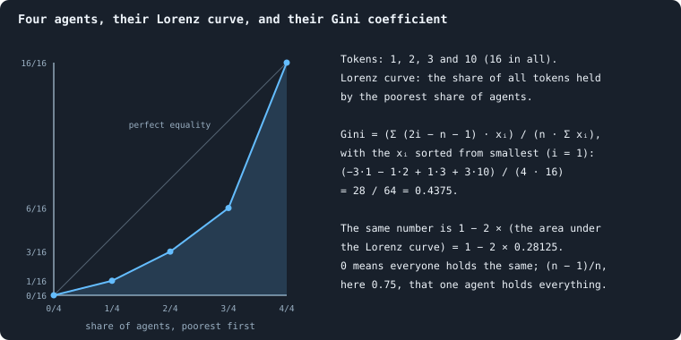

# Measuring tokens: inequality and flow

> [!question] Questions of this page
> - How unequal is a world, measured in four ways?
> - What does the game do when a brain scores no candidate above zero?
> - Where do the [tokens](the-world.md#agents-and-tokens "The one thing of value in a world: every agent holds a whole number of them, and their total never changes.") flow, and do they go round?

## In short

How the notebook measures who holds the tokens and where they go: the Gini coefficient and its companions, what the game does when a brain scores nothing, and the flow of tokens along the [connections](the-world.md#the-network "A link between two agents of the network: they are neighbours, and can stake on each other's nodes.").

Its sections:

- [Measuring inequality: the Gini coefficient, the richest tenth and entropy](#measuring-inequality-the-gini-coefficient-the-richest-tenth-and-entropy)
- [The even split](#the-even-split): when a brain scores no candidate above zero
- [Measuring the flow: token flow and circulation](#measuring-the-flow-token-flow-and-circulation)

## Measuring inequality: the Gini coefficient, the richest tenth and entropy

Three kinds of number say how unequally a world's tokens are held, recorded
after every phase:

- the **Gini coefficient**, which sums up the whole Lorenz curve in one
  number, and the **richest tenth's share**, one point of that curve;
- the **mean, median, richest and poorest**, which describe the [agents](the-world.md#agents-and-tokens "One member of a world: it lives on a node of the network, holds tokens and has a brain that takes all its decisions.")
  directly;
- **entropy** and **evenness**, which say how evenly anything is spread,
  connections and [genotypes](measuring-evolution.md#genotypes-families-and-the-common-ancestor "The identity of a brain: a number that a copy keeps and a change replaces, and that remembers the genotype it came from.") too.

In a settled B1 world of 100,000 tokens the Gini is about 0.47, and the
richest tenth hold about 42% of all tokens. Whether the same agents stay rich,
their **mobility**, was measured only by studies now in the Archive
([Mobility](measures-of-the-archived-studies.md#mobility)).

### The Gini coefficient and the Lorenz curve

How unequal is the wealth of a world? The founders start equal; later, some
agents hold one token and some hold thousands. Two standard tools measure
this: the **Lorenz curve**, a picture, and the **Gini coefficient**, one
number (Lorenz 1905; Gini 1912).

#### The Lorenz curve

Line the agents up from the poorest to the richest, and walk along the line,
adding up their tokens as you go. After each agent, note how far along the
line you are, and what share of all tokens you have counted so far. Joined
up, these points are the Lorenz curve.

Precisely: sort the *n* agents from poorest to richest,
*x*₍₁₎ ≤ *x*₍₂₎ ≤ … ≤ *x*₍ₙ₎. Let *S* = Σ *x*₍ᵢ₎ be all their tokens; in a
world of *T* tokens, *S* = *T*. For every *i*, mark the point

$$
\left( \frac{i}{n},\ \frac{x_{(1)} + \dots + x_{(i)}}{S} \right):
$$

the share of agents counted from the poorest, against the share of all tokens
they hold. Join the points, starting at (0, 0). The curve ends at (1, 1).

- If everyone holds the same, the poorest *i*/*n* of the agents hold *i*/*n*
  of the tokens: the curve is the **diagonal**.
- The more unequal the world, the further the curve **sags** below the
  diagonal. If one agent holds everything, it runs along the bottom and
  jumps to 1 at the end.

#### The Gini coefficient

The Gini coefficient turns the sag into one number. It is the area between
the diagonal and the Lorenz curve, divided by the whole area under the
diagonal (which is ½):

$$
G = \frac{A}{A + B} = 1 - 2B ,
$$

where *A* is the area between the diagonal and the curve and *B* the area
under the curve. It is 0 when everyone holds the same, and (*n* − 1)/*n* —
almost 1 — when one agent holds everything.

For sorted values it can be computed directly. The agent in place *i* counts
with the weight 2*i* − *n* − 1: negative in the poorer half, positive in the
richer. The weights add up to zero, so a world of equals scores 0:

$$
G = \frac{\sum_{i=1}^{n} (2i - n - 1)\, x_{(i)}}{n \sum_{i=1}^{n} x_{(i)}} .
$$

The drawing works out both ways for four agents holding 1, 2, 3 and 10
tokens.

#### What a Gini value means

A second, equivalent definition makes values easier to read. *G* is half the
**mean absolute difference** between two agents, relative to the mean:

$$
G = \frac{1}{2\bar x} \cdot \frac{1}{n^2} \sum_{i=1}^{n} \sum_{j=1}^{n} \lvert x_i - x_j \rvert .
$$

So a Gini of 0.5 says that two agents picked at random differ, on average, by
as much as the average agent holds. (They are picked independently, so the
same agent may be picked twice.)

Chance alone leaves a world unequal. A random exchange of tokens would leave
a Gini of (*m* − 1)/(2*m* − 1), with *m* tokens per agent on average. That is
0.40 at three tokens per agent, and 0.46 at seven
([Too even, not too poor](building-b2-and-the-search-for-a-healthy-rich-world.md#too-even-not-too-poor-healthy-and-rich)).

#### The Gini coefficient: a worked example

Five agents with 1, 1, 2, 4 and 12 tokens: *n* = 5, *S* = 20.

| *i* | *x*₍ᵢ₎ | 2*i* − *n* − 1 | product |
|---|---|---|---|
| 1 | 1 | −4 | −4 |
| 2 | 1 | −2 | −2 |
| 3 | 2 | 0 | 0 |
| 4 | 4 | 2 | 8 |
| 5 | 12 | 4 | 48 |
| | | sum | 50 |

*G* = 50 / (5 · 20) = **0.5**.

Check with the second definition. The mean is 4. The sum of |*xᵢ* − *xⱼ*|
over all 25 ordered pairs is 100, so two agents differ by 100/25 = 4 tokens
on average. That is as much as the average agent holds, and indeed
4/(2 · 4) = 0.5. ✓

The Lorenz points are (0.2, 0.05), (0.4, 0.10), (0.6, 0.20), (0.8, 0.40)
and (1, 1). The poorest 80% hold 40% of the tokens, and the richest agent
holds 60%.

#### Where the Gini coefficient is used

`_gini(values)` in `gol_series.py` computes
(*n* + 1 − 2 Σᵢ *C*ᵢ / *C*ₙ) / *n*. Here *C*ᵢ = *x*₍₁₎ + … + *x*₍ᵢ₎ are the
running sums of the sorted values. It is the same number as the formula
above, rearranged, and it is recorded as `gini` after every phase.

In a settled B1 world of 100,000 tokens the Gini stays near 0.47, between
0.40 and 0.55 across the thirty worlds
([Inequality over time](b1-lives-and-wealth.md#inequality-over-time)).

<!-- used the-gini-coefficient-and-the-lorenz-curve -->
- [A screen of random worlds](a-screen-of-random-worlds.md#what-round-3-found)
- [How the drawn settings shape a world](how-the-drawn-settings-shape-a-world.md#what-decides-how-healthy-a-living-world-grows)
- [A hundred thousand iterations](a-hundred-thousand-iterations.md#experiment-11-as-planned-on-9-october-2026)
- [What keeps wealth spread?](what-keeps-wealth-spread.md#the-question)
- [Local rules only](local-rules-only.md#in-short)
- [Do the brains matter?](do-the-brains-matter.md#where-the-worlds-settle)
- [Brains replaced by their average](brains-replaced-by-their-average.md#what-the-brains-of-round-3-are-like)
- [How fast should brains change?](how-fast-should-brains-change.md#what-the-fifty-worlds-did)

> [!info]- And in the Archive (2)
> [What B1 is, and what stood in its way](what-the-baseline-world-is.md#the-record) · [B1: the network, size and scaling](b1-the-network-size-and-scaling.md#is-a-big-world-the-same-kind-of-world)
<!-- /used -->

### The richest tenth's share

A second, plainer measure of inequality than the Gini coefficient: **what
share of all tokens do the richest ten percent of agents hold?** If everyone
held the same, it would be 10%.

#### The richest tenth: definition

With *n* agents, the richest tenth is the top

$$
m = \max\bigl(1,\ \lfloor 0.1\,n + 0.5 \rfloor\bigr)
$$

agents — a tenth of *n*, rounded to the nearest whole number (halves rounded
up), and at least one. Sort the agents' tokens from largest to smallest and
add up the first *m* (square brackets count from the richest):

$$
\text{topDecileShare} = \frac{x_{[1]} + x_{[2]} + \dots + x_{[m]}}{S},
$$

where *S* is all the tokens. Recorded as `topDecileShare` after every phase.

#### The richest tenth: an example

Twelve agents: 0.1 · 12 + 0.5 = 1.7, so *m* = 1: the share of the single
richest agent. Fifteen agents: 2.0, so *m* = 2. With 1,300 agents, *m* = 130.

For the five agents of the
[Gini example](#the-gini-coefficient-a-worked-example), 0.1 · 5 + 0.5 = 1,
so *m* = 1 again. Their richest tenth is the agent with 12 of the 20
tokens, and it holds 60%.

#### The richest tenth and the Lorenz curve

The richest tenth hold 1 minus what the poorest 90% hold. That is one minus
the height of the [Lorenz curve](#the-lorenz-curve) at 0.9, up to the
rounding of *m*.

In a settled B1 world of 100,000 tokens the richest tenth hold about 42% of
all tokens. Between worlds it ranges from 33% to 50%
([Inequality over time](b1-lives-and-wealth.md#inequality-over-time)).

### Tokens per agent: mean, median, extremes

Four simple numbers describe how the tokens of a world are held, after every
phase. The viewer shows them in its *General* section, beside the Gini
coefficient, the richest tenth's share, and the token entropy and evenness.

#### The four numbers

For the *n* agents alive, holding τ₁, …, τₙ tokens, with *T* = Σ τᵢ:

| statistic | field | definition |
|---|---|---|
| mean tokens | `meanTokens` | *T* / *n* |
| median tokens | `medianTokens` | the middle value of the sorted τᵢ ([Median](statistics.md#many-worlds-at-once-the-median-bands-the-settled-life-and-the-spread)) |
| richest | `maxTokens` | max τᵢ |
| poorest | `minTokens` | min τᵢ |

With an even number of agents, the median is halfway between the two middle
values.

#### What each of the four says

- **The mean is not about wealth at all.** Tokens are conserved, so *T* is
  the same after every phase, and the mean is *T* divided by the number of
  agents. It rises when agents die and falls when they are born. A world
  holds 10,000 tokens unless its plan names another size. The thirty B1
  worlds of Experiment 10, which most measurements of B1 read, hold 100,000
  ([Thirty worlds](b1-lives-and-wealth.md#thirty-worlds)). A settled B1 world has
  a mean of about 7 at 100,000 tokens, 9 at 10,000. B2's worlds hold only
  about three tokens per agent
  ([Too even, not too poor](building-b2-and-the-search-for-a-healthy-rich-world.md#too-even-not-too-poor-healthy-and-rich)).
- **The median is the typical agent.** About 4.5 in a settled B1 world of
  100,000 tokens (5 at 10,000 tokens). The gap between mean and median is
  itself a reading of inequality. A few rich agents pull the mean up, and
  leave the median where it is.
- **The richest** is a reading of how far concentration goes. In a settled
  B1 world of 100,000 tokens the richest agent holds about 2% of all tokens,
  some 2,100. At 10,000 tokens it holds about 7%, some 690, over the same
  iterations, 500 to 1,499. Over those worlds' longer settled life, to
  iteration 2,999, it holds about 8%, some 800
  ([Inequality over time](b1-lives-and-wealth.md#inequality-over-time)).
- **The poorest is almost always 1.** An agent left with 0 tokens is removed
  by the cleanup at the end of the phase. So the poorest survivor holds at
  least 1 ([Births and the four ways to die](measuring-lives.md#births-and-the-four-ways-to-die)).
  Averaged over the settled life, the poorest agent of the median B1 world
  holds 1.001 tokens
  ([The largest, over a world's life](b1-lives-and-wealth.md#the-largest-over-a-worlds-life)).

#### Tokens per agent: an example

Five agents with 1, 2, 2, 5 and 40 tokens: the mean is 50/5 = 10, the median
2, the richest 40, the poorest 1. The richest holds 80% of everything; the
mean is five times the median.

### Entropy and evenness

How evenly is something shared out — tokens over agents, agents over
genotypes, agents over numbers of connections? **Shannon entropy** answers
with one number, measured in **bits** (Shannon 1948). This section explains
it from the beginning, then the two numbers built on it that the notebook
uses: **evenness** and the **effective number**.

#### Entropy: how many yes-or-no questions?

Suppose you pick one item at random and want to find out which category it
belongs to by asking yes-or-no questions. If there are 8 equally common
categories, 3 questions always suffice: 8 = 2³. Is it in the first four? Is
it in the first two of those? Is it the first of those two? If one category
holds almost everything, you need almost no questions — the answer is nearly
certain.

Entropy measures the average number of questions a clever questioner needs.
When every share is a half, a quarter, an eighth and so on, it is exactly
that number. Otherwise it is a floor. No questioner needs fewer on average,
and asking about many picks at once comes as close to it as you like.
Entropy is large when things are spread evenly over many categories, and
small when they are concentrated.

#### Entropy: the definition

If the categories have shares *p*₁, …, *p*_k (each ≥ 0, adding up to 1), the
entropy is

$$
H = -\sum_{i=1}^{k} p_i \log_2 p_i \qquad (\text{with } 0 \log_2 0 = 0) .
$$

In words: singling out a category that holds a share *p* takes about
log₂ (1/*p*) questions, one for a half and two for a quarter. *H* is the
average of that over the categories, each weighted by its share.

- *H* = 0 when one share is 1 and the rest are 0: no uncertainty.
- *H* = log₂ *k* when every share is 1/*k*: the most uncertainty *k*
  categories allow.

**Example.** Shares (½, ¼, ¼): *H* = −(½·log₂ ½ + ¼·log₂ ¼ + ¼·log₂ ¼) =
½·1 + ¼·2 + ¼·2 = 1.5 bits. A questioner asks first about the large
category and then, if need be, which of the other two: 1.5 questions on
average. Three equal shares would give log₂ 3 ≈ 1.585. One pick at a time,
no questioner gets that low: the best needs 5/3 ≈ 1.67 questions on average.

#### Three uses of entropy in Graph of Life

| what is shared | the shares *pᵢ* | the field | its ceiling |
|---|---|---|---|
| tokens over agents | τᵢ / *T*, one per agent | `tokenEntropy` | log₂ *n* (*n* agents) |
| agents over degrees | share of agents with exactly *d* connections, one per *d* that occurs | `degreeEntropy` | log₂ (number of distinct degrees) |
| agents over genotypes | share of agents carrying genotype *g*, one per genotype | (computed for [How even is a world?](b1-lives-and-wealth.md#how-even-is-a-world)) | log₂ *n* |

For tokens the question is: *if you pick one token at random, whose is it?*

#### Evenness

Entropy grows with the number of categories, so the entropy of a world of
2,000 agents cannot be compared with one of 1,000. Dividing by the ceiling
removes that:

$$
J = \frac{H}{H_{\max}} ,
$$

between 0 and 1 — **Pielou's evenness** (Pielou 1966). `tokenEvenness` is
`tokenEntropy` / log₂ *n*; `degreeEvenness` is `degreeEntropy` divided by
log₂ of the number of distinct degrees.

In a settled B1 world of 100,000 tokens the token evenness is 0.91. The
degree evenness is only 0.47. Agents pile up on a few numbers of
connections, while hubs add rare numbers that raise the ceiling
([How even is a world?](b1-lives-and-wealth.md#how-even-is-a-world)).

#### The effective number

$$
N_{\text{eff}} = 2^{H}
$$

is the number of **equally common** categories that would have the same
entropy. Shares (½, ¼, ¼) have *N*_eff = 2^1.5 ≈ 2.83: as diverse as 2.83
equal categories. Ecologists call this a Hill number (Hill 1973; Jost 2006).
It is the most readable form of entropy, because it is in the units of the
things counted. For tokens, *N*_eff is the number of agents who, holding
equal shares, would spread the tokens as evenly as they are spread.

The tokens of a settled B1 world are as even as if 47% of its agents held
them in equal shares
([Effective numbers](b1-lives-and-wealth.md#effective-numbers)). The
[diversity score](measuring-health.md#the-diversity-score) reads three of its four spreads in the
same way.

#### Entropy and the Gini coefficient

Both measure how unequally tokens are held, but they weigh differently. The
[Gini coefficient](#the-gini-coefficient-and-the-lorenz-curve) is about
differences between agents. Entropy is about the logarithms of shares, so it
is more sensitive to the many small holdings, and less to the few large ones.
Two worlds with the same Gini can have different evenness. Across 1,200
looks at thirty B1 worlds the two correlate at −0.72. But they do not lie on
one curve
([Two measures of the same inequality](b1-lives-and-wealth.md#two-measures-of-the-same-inequality)).

#### Entropy in the code

`_shannon(counts)` in `gol_series.py` computes it, from the token counts and
from the histogram of degrees. Both entropies, and both evenness values, are
recorded after every phase.

## The even split

In every [game](one-iteration.md#phase-2-the-game) an agent stakes all its
tokens on its own node and its [neighbours](the-world.md#the-network "An agent joined to another by a connection.")' nodes, guided by its
[brain](the-brain.md)'s score for each. When a brain that spreads its stake
scores every node at zero or below, the rules split the tokens evenly: the
**even split**. It is common in the
[baseline B1](b1-and-b2.md#b1-the-rules-as-they-were-built). A
game played this way moves tokens like a lazy random walk, which comes to rest
with every agent holding tokens in proportion to its connections plus one.

### The rule

An agent with τ tokens and *d* neighbours has *d* + 1
[candidates](one-iteration.md#phase-1-reproduction): its own node first, then
its neighbours' nodes. Its brain gives each a stake score, and either goes
**all in**, every token on the candidate it scores highest, or **spreads**,
splitting the tokens in proportion to the scores, negative ones counted as
zero.

A spread needs at least one score above zero. If every score is zero or below,
the τ tokens are split evenly
([Splitting tokens into whole numbers](rules-in-detail.md#splitting-tokens-into-whole-numbers)):

1. every candidate gets ⌊τ / (*d* + 1)⌋ tokens;
2. the tokens left over, fewer than *d* + 1, go one each down the list of
   candidates. Their remainders are all equal, so the order of the list
   decides, and the agent's own node is first
   ([Where the tokens flow](b1-the-game-and-its-flows.md#how-widely-agents-stake)).

Whole tokens tilt the split towards home: with 3 tokens and one neighbour, an
agent stakes 2 at home and 1 on the neighbour
([Zero scores, and ties](rules-in-detail.md#zero-scores-and-ties)). The share staked at
home, by [degree](measuring-networks.md#an-agents-connections-degree-and-clustering), in the thirty baseline worlds of 100,000 tokens of
Experiment 10 ([Thirty worlds](b1-lives-and-wealth.md#thirty-worlds)):

| connections | 1 | 2 | 3–4 | 5–9 | 10–49 | 50+ |
|---|---|---|---|---|---|---|
| even split in fractions, 1/(*d* + 1) | 50% | 33% | 23% | 14% | 7% | 1.2% |
| even split in whole tokens | 60% | 44% | 34% | 23% | 13% | 3.0% |
| what the agents really staked | 58% | 40% | 28% | 19% | 10% | 2.8% |

### How often it happens

Evolved brains in B1 spread in 98% of cases. In the median world of the thirty,
**42%** of the agents score every candidate at zero or below and so get the even
split (the worlds range from 13% to 98%; at 10,000 tokens the median world has
58%). Fresh founders' brains, given the same inputs, do so 49% of the time:
selection did not make it. The other agents split nearly evenly too, because
their nearly blind brains give all candidates almost the same score
([What the brains are like](what-the-brains-are-like.md#what-evolution-changed)).

In [B2](b1-and-b2.md#b2-a-world-that-cannot-break), where nearly every agent goes all in
(spreading in 0.1–4% of cases), the even split hardly arises
([How different are the agents?](b1-brains-lineages-and-messages.md#how-different-are-the-agents)).

### A lazy random walk

Think of one token of an agent that splits evenly. It goes to each of the
*d* + 1 candidate nodes with the same chance, 1/(*d* + 1), and stays with the
node it lands on, whoever wins it. Game after game, that is a **random walk**:
at each step a token stays where it is or moves to a neighbour. The walk is
*lazy* because staying is one of the choices.

How close is the real game?
[Where the tokens flow](b1-the-game-and-its-flows.md#the-game-as-a-random-walk)
compares, agent by agent, the balance an exact even split would give with the
real one. In the 23 worlds without a
[star](measuring-networks.md#stars-and-hubs), the real balances follow the even split's with a
slope of 0.94, and it accounts for 45% of their variance
([Fitting a straight line, and R²](statistics.md#fitting-a-straight-line)); at 10,000 tokens, 0.94
and 46%. With the seven stars, 0.65 and 34%: the rounding of whole tokens,
small at one leaf, piles up at a star's centre.

### The resting state

A random walk on a fixed network is at rest when, across every connection, as
many tokens go one way as the other. With π(*u*) the share of tokens at *u*:

$$
\frac{\pi(u)}{d_u + 1} = \frac{\pi(v)}{d_v + 1} \quad \text{for every connection } \{u, v\} .
$$

That holds when π(*u*) is proportional to *d*ᵤ + 1. With *T* tokens in all,

$$
\tau_u = T \cdot \frac{d_u + 1}{\sum_v (d_v + 1)} ,
$$

so every agent holds the same number of tokens for each of its candidates. The
worlds come close. Among the 394,056 agents alive after the last game of the
thirty, rest would mean 1.70 tokens per candidate; the mean of each class runs
from 2.28 for agents with one connection to 1.43–1.51 for those with ten or
more ([How properties scale together](b1-the-network-size-and-scaling.md#tokens-and-connections)).
The network keeps changing under the tokens, so no world is ever quite at rest.

### Where it is used

<!-- used the-even-split -->
- [One iteration, step by step](one-iteration.md#three-tools-used-everywhere)
- [Questioning the mechanics](questioning-the-mechanics.md#what-we-learned)
- [The rules in detail](rules-in-detail.md#zero-scores-and-ties)
- [Measuring a network: connections, hubs, distances and cuts](measuring-networks.md#where-degree-is-used)
- [Physical inspiration](physical-inspiration.md#agents-as-little-calculators)
- [Particles: patterns that outlast what carries them](particles.md#how-a-ring-is-seen)
- [What the brains are like](what-the-brains-are-like.md#what-evolution-changed)

> [!info]- And in the Archive (4)
> [What B1 is, and what stood in its way](what-the-baseline-world-is.md#a-world-of-attack) · [B1: the game and its flows](b1-the-game-and-its-flows.md#the-picture) · [B1: the network, size and scaling](b1-the-network-size-and-scaling.md#b1-the-network-size-and-scaling) · [B1: brains, lineages and messages](b1-brains-lineages-and-messages.md#what-the-pages-found)
<!-- /used -->

## Measuring the flow: token flow and circulation

In every game, the tokens an agent stakes on a neighbour's node flow along
the connection between them: that is the **token flow**. Once each pair's two
directions cancel, what is left is the **net flow**. Over a stretch of games,
the net flow splits exactly into a part that runs downhill and a
**circulation** that goes round. How much of a single game's flow goes round,
its **lightning**, was measured only by studies now in the Archive
([Lightning](measures-of-the-archived-studies.md#lightning-tokens-that-go-round)).
Who trades with whom, game after game, is read as **flow modules**
([Flow modules and the map equation](#flow-modules-and-the-map-equation)).

### Token flow

A stake of agent *u* on a
neighbour *v*'s node is a **flow** of tokens from *u* to *v*. Whatever happens
to the node, those tokens end the game at *v*'s node. A stake on one's own
node moves nothing, and the measures of flow leave it out. The viewer shows
them in its *Game (Blotto)* section ([What a run records](runs-and-records.md#what-a-run-records)).

#### The flow of a game

Write *a*(*u* → *v*) for the tokens *u* staked on neighbour *v*'s node. The
first five fields below measure the flow itself. The last three say how the
agents staked, and which connections the game cut.

| field | definition |
|---|---|
| `totalFlow` | Σ over all *u* ≠ *v* of *a*(*u* → *v*): every token staked on a neighbour |
| `meanEdgeFlow` | the mean, over the connections that carried anything, of *a*(*u* → *v*) + *a*(*v* → *u*) |
| `maxEdgeFlow` | the largest such sum on one connection |
| `netFlowShare` | the share of `totalFlow` left after cancelling each pair's two directions against each other ([below](#cancelling-the-net-flow)) |
| `flowImbalance` | the share of `totalFlow` that must flow one way ([The ceiling: what conservation forbids](measures-of-the-archived-studies.md#the-ceiling-what-conservation-forbids)) |
| `spreadShare` | the share of the agents that staked who spread their tokens rather than going all in ([What a brain says](rules-in-detail.md#what-a-brain-says)) |
| `revoltShare` | the share of all staked tokens, home stakes included, marked revolutionary ([How a coalition takes a node](rules-in-detail.md#how-a-coalition-takes-a-node)) |
| `prunedEdges` | the connections cut at the end of the game because nothing crossed them ([Why flow matters](#why-flow-matters)) |

A run records the first three and the last three after every game. The
other two, `netFlowShare` and `flowImbalance`, are worked out with the loops
of [Lightning](measures-of-the-archived-studies.md#lightning-tokens-that-go-round), after the games of every
25th iteration.

**Example.** Three agents, A, B and C, are joined in a triangle. In one game,
A stakes 3 tokens on B's node, B stakes 3 on C's and 2 on A's, and C stakes 3
on A's. Everything else they hold, they stake on their own nodes. Then
`totalFlow` is 3 + 3 + 2 + 3 = 11 tokens. The connection A–B carried
3 + 2 = 5 tokens, and B–C and C–A carried 3 each. So `meanEdgeFlow` is 11/3,
about 3.7, and `maxEdgeFlow` is 5.

#### Cancelling: the net flow

Say *u* puts 5 tokens on *v*'s node, and *v* puts 3 on *u*'s. Then 3 tokens
went each way and cancel: the **net** flow is 2 from *u* to *v*. Doing this for
every pair gives a flow in which every connection carries tokens in at most
one direction:

$$
\text{net}(u, v) = \max\bigl(0,\ a(u \to v) - a(v \to u)\bigr) .
$$

In words: the net flow from *u* to *v* is what *u* sent *v* minus what *v*
sent back. It is nothing if *v* sent back as much or more. Then
`netFlowShare` = Σ net / `totalFlow`. It is 1 when nothing is returned and 0
when every stake is matched exactly by one coming back. Cancelling changes no
agent's balance: it removes equal amounts going both ways.

In the example, the 3 and the 2 on A–B cancel to 1 from A to B. The net flow
is 1 + 3 + 3 = 7 tokens, and `netFlowShare` is 7/11, about 0.64.

The same cancelling over a stretch of games gives the net flow of the
stretch. [Flows that go round](#flows-that-go-round) splits it in two.

#### Why flow matters

Two rules make the flow matter:

- In B1, a connection across which **no** tokens flow in a game is cut at
  its end ([`prune_after`](settings.md#prune_after),
  [`inactive_window`](settings.md#inactive_window)). In B2 it is cut only if
  its two ends share at least two neighbours
  ([`prune_needs`](settings.md#prune_needs)), so no cut can split a world.
- When the game is decided, a node holds **exactly** the tokens staked on it,
  whoever wins it.

So the flow decides which connections survive, and how the tokens are
reshuffled.

#### Where token flow is used

A settled B1 world of 100,000 tokens keeps 30% of its tokens at home in a
game, and about 71% cross a connection. In B2 almost nothing cancels
([The budget of a game](b1-the-game-and-its-flows.md#the-budget-of-a-game-where-tokens-flow)).

<!-- used token-flow -->
- [Does evolution keep going?](how-to-tell-a-world-that-keeps-evolving.md#the-goal-evolution-that-keeps-going)
- [Can a strategy written by hand beat evolution?](strategies-written-by-hand.md#is-evolutions-play-the-best-there-is)

> [!info]- And in the Archive (1)
> [Measures of the archived studies](measures-of-the-archived-studies.md#loops-of-flow)
<!-- /used -->

### Flows that go round

Tokens move over the network every game: an agent's stake on a neighbour's
node goes to that node, whoever takes it. Add up what each connection carried
each way over a stretch of games. Then every connection has a
[net flow](#cancelling-the-net-flow): the tokens that went one way minus
those that came back. Picture water on a hillside. Some of it runs downhill,
from high ground to low; some turns in eddies, which have no top and no
bottom. This section shows how a flow splits into those two parts. It also
shows how to tell whether a world's flow goes round more than chance would
make it.

#### Two kinds of flow

Write the net flow on the connection from agent $u$ to agent $v$ as
$F_{uv}$, with $F_{vu} = -F_{uv}$. Two kinds of flow cannot be mistaken for
each other.

A **gradient** flow runs downhill along a *pressure* $\varphi$, one number per
agent:

$$F_{uv} = \varphi_u - \varphi_v .$$

In words: the flow from $u$ to $v$ is how much higher $u$'s pressure is than
$v$'s. Tokens leave the high agents and arrive at the low ones. Round any loop
of the network a gradient flow adds up to nothing, since the differences
cancel:
$(\varphi_a - \varphi_b) + (\varphi_b - \varphi_c) + (\varphi_c - \varphi_a) = 0$.

A **circulation** is the opposite: at every agent as much arrives as leaves,
so it has no sources and no sinks. It can only go round loops, and a network
without loops (a tree) carries none.

Every flow on a network is the sum of exactly one gradient flow and exactly
one circulation. The two are perpendicular: their **energies** add up to the
flow's. A flow's energy is the sum of its squared values over the
connections. This is the discrete **Helmholtz–Hodge decomposition**. Jiang,
Lim, Yao and Ye (2011) use it to rank from pairwise comparisons. Candogan,
Menache, Ozdaglar and Parrilo (2011) use it to split games into their
potential and cyclic parts.

The gradient part is found by least squares: the pressure that explains as
much of the flow as possible. That means solving one linear system with the
network's Laplacian. That matrix holds each agent's number of connections on
its diagonal, and −1 wherever two agents are joined. The circulation is what
is left over. The **circulation share** is the circulation's energy as a
fraction of the flow's.

#### A worked example

Four agents: a triangle $A, B, C$ and a fourth, $D$, hanging off $C$. Over some
games, net 3 tokens went from $A$ to $B$, 3 from $B$ to $C$, 1 from $C$ to $A$,
and 2 from $C$ to $D$.

The connection $C$–$D$ lies on no loop, so its flow can only be gradient: all 2
tokens of it. Round the triangle the flow adds up to $3 + 3 + 1 = 7$ in the
direction $A \to B \to C \to A$. The circulation takes a third of that loop
sum to each of the loop's three connections, $7/3 \approx 2.33$ round the loop. The
gradient keeps the rest: $3 - 7/3 = 2/3$ from $A$ to $B$, $2/3$ from $B$ to $C$
and $1 - 7/3 = -4/3$ from $C$ to $A$, that is $4/3$ from $A$ to $C$. Round the
triangle the gradient adds up to $2/3 + 2/3 - 4/3 = 0$, as it must. It comes
from the pressure $\varphi_A > \varphi_B > \varphi_C > \varphi_D$, with steps
of $2/3$, $2/3$ and $2$.

The energies: the flow's is $3^2 + 3^2 + 1^2 + 2^2 = 23$; the circulation's is
$3 \cdot (7/3)^2 = 49/3$; the gradient's is $(2/3)^2 + (2/3)^2 + (4/3)^2 + 2^2 = 20/3$.
They add up, $49/3 + 20/3 = 23$, and the circulation share is
$49/69 \approx 0.71$.

#### Against what?

A share of 0.71 means nothing without a level to compare it with, and two
are used.

**The random level.** Suppose every connection carried a flow of the same
size, in a random direction. Then the expected circulation share is the
network's number of independent loops, its cycle rank
([Loops](measuring-networks.md#loops)), as a share of its connections:

$$\frac{E - N + C}{E},$$

with $E$ connections, $N$ agents and $C$ separate pieces. In the example
$E = 4$, $N = 4$, $C = 1$: a quarter. On a tree it is zero; the more loops,
the higher.

**The sign-flip level.** Real connections carry very different amounts, and a
connection that carries much counts for much. The fairer level keeps each
connection's amount and throws only its direction at random. Its expectation
is

$$\frac{\sum_e P_{ee} F_e^2}{\sum_e F_e^2}.$$

Here $P_{ee}$ is how much of a unit flow on connection $e$ alone is
circulation. It is one third for each side of the triangle, and zero for the
bridge $C$–$D$. In words: each connection's energy, weighted by how much of a flow
on it alone would go round, as a share of the whole energy. In the example it
is $(9 + 9 + 1)/3/23 = 19/69 \approx 0.28$. Averaging over all sixteen ways of
flipping the four directions gives the same. In a world it is estimated by
flipping the directions at random a few times: four, in
[Gliders, and who helps whom](cooperation-help-and-gliders.md#where-the-tokens-go).

The example's 0.71 is far above both levels: its flow goes round. A share
*below* the sign-flip level means the opposite. The flow's directions line up
downhill more than chance: tokens run from some agents to others.

#### Does a ring last?

A ring that is there in one stretch of games and gone in the next is an
accident of those games. A ring that **persists** is a structure. Split the
flow of two consecutive stretches, 50 games each in
[Gliders, and who helps whom](cooperation-help-and-gliders.md#gliders-and-who-helps-whom). Then, over the
connections both stretches used, take the correlation of their circulations,
and of their gradient parts. A correlation near zero means each stretch's
rings are new. A positive one means rings or slopes that come back on the
same connections.

#### Where circulation is used

`research/oee/checks/circulation.py` does all of the above for a lab run's
recorded games. It splits the whole flow, and two parts of it separately.
**Gifts** are stakes that did not take their target, so their tokens went to
whoever held it. **Takeovers** are stakes that took it. Gifts going round
would be generalised reciprocity: every agent gives to one and receives from
another. Bronisław Malinowski described the classic case in *Argonauts of the
Western Pacific* (1922): the Kula ring, whose armshells and necklaces pass
from island to island.

<!-- used flows-that-go-round -->
- [Particles: patterns that outlast what carries them](particles.md#how-a-ring-is-seen)

> [!info]- And in the Archive (3)
> [B1: the game and its flows](b1-the-game-and-its-flows.md#do-tokens-go-round) · [Cooperation, help and gliders (side study)](cooperation-help-and-gliders.md#what-helping-is-here) · [Measures of the archived studies](measures-of-the-archived-studies.md#the-net-version)
<!-- /used -->

#### What it can and cannot say

A flow added up over a stretch of games forgets *when* tokens moved. The
network it lives on is every connection that carried anything in that
stretch, though not all of them existed at once.

Two-way traffic on one connection, $u$ to $v$ and $v$ to $u$, cancels in the
net flow and is invisible here. Direct give-and-take between two agents has
to be looked for in the gross flows ([Token flow](#token-flow)).

And a long route through the network counts largely as circulation, even if
it never closes. One token carried along a route of $L$ connections from $a$
to $b$ has energy $L$. Think of every connection as a wire of resistance 1.
Then the token's gradient part is the electrical current from $a$ to $b$,
spread over every way between them. Its energy is the effective resistance
between $a$ and $b$, which on a network with many loops is far less than $L$.
The rest is circulation. So coherent routes, not only closed rings, raise the share.

### Flow modules and the map equation

Which agents belong together? There are many ways to ask: agents joined to
each other, agents related to each other — or agents **between whom the
tokens actually go**. A flow module is a group of the third kind. Picture a
token wandering the flow from agent to agent: a flow module is a set of agents
it tends to stay inside. This section explains how such groups are found,
followed through time and checked against chance. The Research tab's *Flow
modules* view draws them for any run, and the study of B1's and B2's worlds
([Flow modules in the worlds](b1-the-game-and-its-flows.md#flow-modules-in-the-worlds))
uses the same program (`web/js/flowmodules.js`, run through
`tools/flowmodules_cli.js`).

#### The flow of one game

In every game, each agent splits its tokens over its own node and its
neighbours' nodes ([How the game is played](b1-the-game-and-its-flows.md#how-the-game-is-played-what-agents-stake-and-who-wins-the-nodes)). A
token staked on a neighbour's node **flows** along the connection between
them ([Token flow](#token-flow)). Add up, for each pair of
neighbours, the tokens that crossed between them in either direction. That
sum is the weight of their connection in this game, and the game becomes a
weighted network: the **flow**. Tokens an agent keeps on its own node say
nothing about whom it is grouped with, so they are left out.

#### Describing a walk in as few bits as possible

Think of street names. Many towns have a Station Road, and nobody is
confused: you name the town only when you travel to another one. So a
street's name can be short, because it has to be unique only within its town.

The map equation (Rosvall and Bergstrom, 2008) does the same with the flow.
Imagine a walker that steps along the weighted connections for ever, choosing
each step in proportion to the weights. It spends a share p_a of its time at
agent a. To write down where it goes, you could give every agent a code word
and write one word per step. Groups can do better:

- give every group a name;
- give every agent a short code word that has to be unique only *within* its
  group, so that other groups can use it again;
- write the group's name only when the walk enters it.

If the walk lingers in groups, with many steps inside and few between, group
names are rarely needed. Then the description is shorter than the plain one.
Its length per step is

$$
L = q \log_2 q \;-\; 2\sum_i q_i \log_2 q_i \;-\; \sum_a p_a \log_2 p_a \;+\; \sum_i (q_i + p_i)\log_2 (q_i + p_i)
$$

with p_i the share of time inside group i, q_i the share of steps that leave
it, and q the sum of the q_i. In words: the first term and half of the second
are the cost of group names, paid each time the walk moves into a group. The
rest is the cost of naming the agents within their groups, with one more word
to say that the walk leaves. The best grouping is the one with the smallest
L. One group holding everyone describes the walk with no structure at all, in
L₀ bits a step, and

$$
\text{compression} = \frac{L_0 - L}{L_0}
$$

says how much the groups shorten the description: 0 for flow with no group
structure, and more the more the flow keeps to groups.

**An example.** Four agents form two pairs, A–B and C–D, and tokens cross
only within each pair. The walker spends a quarter of its time at each agent.
Without groups, naming one agent of four takes 2 bits a step. With the two
pairs as groups, naming one agent of two takes 1 bit. No group's name is ever
needed, because the walk never leaves its pair. So L₀ = 2, L = 1, and the
compression is (2 − 1)/2 = 0.5. With more pairs L₀ grows while L stays at
1 bit, so flow made of many separate pairs compresses far more.

#### Finding the groups

Trying every grouping is impossible, so the program starts with every agent
alone. It takes the agents one at a time, in a shuffled but fixed order. Each
moves into whichever of its partners' groups shortens L most, or stays if none
does. The program goes round again until no move helps, twelve times at most.
This is the local-moving step of the Louvain method (Blondel and others,
2008). The result is a good
grouping, not always the best.

#### Following groups through time

A group of one game and a group of the next are taken to be **the same
module** when they share enough agents. Their overlap is the Jaccard index:
the agents they share, divided by the agents in either. "Enough" can be
decided in two ways:

- **above a floor**: the best overlaps first, each module used once, and none
  below 0.3. This is the view's default, which you can move, and the rule of
  the study.
- **mutually best**: of the pairs above the floor, only those in which each
  module is the other's best overlap. With the floor at 0, this matches at
  any overlap at all.

A small module can be "followed" on very little: two modules of two agents
that share one agent overlap by a third. A B2 agent that stakes on a
neighbour at all puts its whole stake on one. So B2's flow is made mostly of
pairs, and there a matching at any overlap follows chains of chance. The
notebook therefore matches above the floor, and checks the result against
chance (below).

A module is known by its overlap, not by its members. So it can keep going
while its agents change, as a town keeps its name while its people change.
Its **turnover** is the share of its agents in a game that were not in it the
game before. The change has two sources, and the difference matters:

- **regeneration**: newcomers that were born, and members that died. The
  module makes and loses its own agents, and the pattern outlives every one of
  them, as a town lasts through its births and deaths.
- **exchange**: newcomers that were alive before, in another module or in
  none, and members that left while still alive. The agents were there all
  along, and the border moved, as when people move between neighbouring
  towns.

#### Checking against chance

Flow on any network has some group structure, because neighbours trade with
neighbours. So each measure is set beside a **null**: the same measure with
one thing shuffled at random and the rest kept. Three nulls answer three
questions.

- **Is there group structure at all?** The same game's flow is **rewired**.
  Every token that crossed a connection is cut into two halves, one at each
  end, and the halves are paired again at random. Every agent keeps how much
  flow it sends and receives; whom it trades with is shuffled. A real module
  structure compresses the flow better than the rewired one does.
- **Is the structure the network's, or the agents'?** Rewired tokens cross
  between agents that are not neighbours, which no token can. The fair
  yardstick, **partners dealt**, keeps the network and deals every agent's
  stakes among its own neighbours at random. Why it is fair is told in
  [What the network makes, and what the agents make](b1-the-game-and-its-flows.md#what-the-network-makes-and-what-the-agents-make).
- **Do modules last longer than chance?** The rewired flow cannot say: its
  modules are pairs and threes, which "live" long on single shared agents.
  Instead each game's own modules are kept, with their sizes, and their
  agents are dealt among them at random, game by game: **members dealt**.
  Followed the same way, they show what following finds when nothing but the
  sizes carries over.

Two more measures complete the set. One needs no following at all, and the
other asks what following finds:

- **Kept together**: of two agents in one module, the share still in one
  module so many games later. Beside it stands the same share with the later
  game's agents dealt at random: what chance alone keeps together.
- **Outlasting**: of the modules followed for many games, the share in which
  none of the first members is left at the end. That is the sense in which a
  group can outlast its members.

#### Where flow modules are used

<!-- used flow-modules-and-the-map-equation -->
- [Particles: patterns that outlast what carries them](particles.md#how-long-the-carriers-last)
- [Every simulation: what was run, and what was measured](every-simulation.md#what-was-measured-on-what)

> [!info]- And in the Archive (2)
> [What B1 is, and what stood in its way](what-the-baseline-world-is.md#where-the-world-stands-on-the-ladder) · [B1: the game and its flows](b1-the-game-and-its-flows.md#flow-modules-the-groups-tokens-stay-in)
<!-- /used -->

## Where to go next

- [How unequal is a world, and who stays rich](b1-lives-and-wealth.md#how-unequal-is-a-world-and-who-stays-rich):
  each of these measures, read in thirty B1 worlds.
- [Effective numbers: how many kinds there really are](statistics.md#effective-numbers-how-many-kinds):
  the effective number beside other ways of counting kinds.
- [What a run records](runs-and-records.md#what-a-run-records): every number recorded after a
  phase, these among them.
- [Splitting tokens into whole numbers](rules-in-detail.md#splitting-tokens-into-whole-numbers): the rounding.
- [Where the tokens flow](b1-the-game-and-its-flows.md#where-tokens-flow): the random walk, measured.
- [What the brains are like](what-the-brains-are-like.md): why brains score
  alike.
- [Stars and hubs](measuring-networks.md#stars-and-hubs): where the walk fits worst.
- [Gliders, and who helps whom](cooperation-help-and-gliders.md#where-the-tokens-go):
  the flow of fifty games split exactly, gifts and takeovers apart.
- [Flow modules: the groups tokens stay in](b1-the-game-and-its-flows.md#flow-modules-the-groups-tokens-stay-in): who trades with
  whom, and for how long.
- [Where tokens go](b1-the-game-and-its-flows.md#where-tokens-go): every measure of the flow in the
  notebook, side by side.

## How our view changed

- *Measuring inequality: the Gini coefficient, the richest tenth, entropy and mobility*:
  - **24 October 2026.** When four short pages became this one, two statements
    were made exact.
    - The page on entropy said that entropy *is* the average number of
      questions an optimal questioner needs. That holds only when every share
      is a half, a quarter, an eighth and so on. For three equal shares the
      best questioner needs 5/3 ≈ 1.67 questions per pick, against an entropy
      of 1.585 bits
      ([Entropy: how many yes-or-no questions?](#entropy-how-many-yes-or-no-questions)).
    - The page on tokens per agent gave its numbers for "a settled baseline
      world". It was written when B1 was the only baseline, and the numbers
      are B1's. B2's worlds hold only about three tokens per agent
      ([What each of the four says](#what-each-of-the-four-says)).
  - **24 October 2026.** This page called the line of evenness "B2's least
    even world". It is B2's most even world, the one with the lowest Gini
    ([What makes a world interesting](measuring-health.md#how-our-view-changed)).
- *Measuring the flow: token flow, lightning and circulation*:
  - **14 October 2026.** From 8 October, the note on lightning described the
    greedy peel's last step as "Repeat until no loop can be found from any
    start". A pass through the whole notebook corrected it from the code
    (`gol_lightning.py`). The peel gives an agent up as soon as one walk from
    it ends without closing a loop. So loops can be left in the flow. Only the
    description changed: the code, and every number it gave, did not.
  - **24 October 2026.** When the three notes became one page, their statements
    were checked against the code. The note on token flow said that a stake on
    one's own node is left out of every statistic in its table. The statistic
    `revoltShare` counts it: it is the share of all staked tokens, home stakes
    included, that are marked revolutionary (`gol_series.py`).
- **12 November 2026.** Moved to [Measures of the archived
  studies](measures-of-the-archived-studies.md): two sections that only pages of
  the Archive use: mobility and lightning. The two family headings that named
  them name what is left.
- **12 November 2026.** [Flow modules and the map equation](#flow-modules-and-the-map-equation)
  moved here from [B1: the game and its flows](b1-the-game-and-its-flows.md), the
  method beside the other measures of the flow; the results it gave in B1's and
  B2's worlds stay there, in the Archive.

## References

- Blondel, V. D., Guillaume, J.-L., Lambiotte, R. and Lefebvre, E. (2008).
  Fast unfolding of communities in large networks. *Journal of Statistical
  Mechanics: Theory and Experiment*, P10008.
- Gini, C. (1912). *Variabilità e mutabilità*. Bologna: Tipografia di Paolo
  Cuppini.
- Hill, M. O. (1973). Diversity and evenness: a unifying notation and its
  consequences. *Ecology* 54, 427–432.
- Jost, L. (2006). Entropy and diversity. *Oikos* 113, 363–375.
- Lorenz, M. O. (1905). Methods of measuring the concentration of wealth.
  *Publications of the American Statistical Association* 9, 209–219.
- Pielou, E. C. (1966). The measurement of diversity in different types of
  biological collections. *Journal of Theoretical Biology* 13, 131–144.
- Rosvall, M. and Bergstrom, C. T. (2008). Maps of random walks on complex
  networks reveal community structure. *Proceedings of the National Academy
  of Sciences* 105, 1118–1123.
- Shannon, C. E. (1948). A mathematical theory of communication. *Bell System
  Technical Journal* 27, 379–423 and 623–656.

<!-- turns -->
---

← [Measuring lives: births, deaths, ages and estates](measuring-lives.md) · [Reference: the rules and measures in detail](../README.md#reference-the-rules-and-measures-in-detail) · [Measuring a network: connections, hubs, distances and cuts](measuring-networks.md) →

**Also about:** [Wealth: who holds the tokens](../README.md#wealth-who-holds-the-tokens), [Methods and statistics](../README.md#methods-and-statistics), [Brains: what they are, and whether they matter](../README.md#brains-what-they-are-and-whether-they-matter).

> [!info]- Pages that link here (21)
> [The ideas this builds on](the-ideas-this-builds-on.md) · [One iteration, step by step](one-iteration.md) · [Glossary](glossary.md) · [The rules in detail](rules-in-detail.md) · [Measuring lives: births, deaths, ages and estates](measuring-lives.md) · [What keeps wealth spread?](what-keeps-wealth-spread.md) · [Measuring a network: connections, hubs, distances and cuts](measuring-networks.md) · [Physical inspiration](physical-inspiration.md) · [Particles: patterns that outlast what carries them](particles.md) · [Measuring evolution: genotypes, eras and the open-ended test](measuring-evolution.md) · [Measuring health: criteria, the health bar and diversity](measuring-health.md) · [How runs are made, recorded and costed](runs-and-records.md) · [Statistics: the tools of the notebook](statistics.md) · [B1: lives and wealth](b1-lives-and-wealth.md) · [B1: the game and its flows](b1-the-game-and-its-flows.md) · [Building B2, and the search for a healthy, rich world](building-b2-and-the-search-for-a-healthy-rich-world.md) · [Rounds 1 and 2 of the screen, and the criteria they were judged by](rounds-1-and-2-of-the-screen.md) · [What the switches did in pilots (indicative)](what-the-switches-did-in-pilots.md) · [Cooperation, help and gliders (side study)](cooperation-help-and-gliders.md) · [Measures, atlases and assembly (side studies)](measures-atlases-and-assembly.md) · [Measures of the archived studies](measures-of-the-archived-studies.md)
<!-- /turns -->
