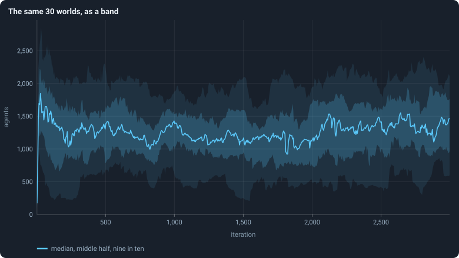

# Many worlds at once: the median, bands, the settled life and the spread

> [!question] Questions of this page
> - How does the notebook sum up thirty worlds in a few numbers?
> - What do the line and the shaded bands of a figure show?
> - Why is a world measured from [iteration](one-iteration.md "One step of a world's time: a phase of reproduction, then a phase of the game.") 500 on, and not at its end?
> - How different are worlds that differ only in their [seed](random-numbers.md "The number that fixes every random choice of a run: the same settings and the same seed make the same world.")?

## In short

The notebook rarely looks at one world. It runs thirty, with different
seeds, and sums them up in four steps. The **median** and other
**quantiles** describe a set of numbers without letting one extreme decide.
A **band** draws thirty worlds through time as one line and two shaded
regions. A world's **settled life**, from iteration 500 to its end, gives it
one number per statistic. And the **spread** says how far the worlds' numbers
lie from each other, as a share of their mean.

## Median and quantiles

The notebook describes sets of numbers, such as thirty worlds' sizes or a
million [lifetimes](age-and-lifetime.md "How many iterations an agent lives, from its birth to its death."), by a few **quantiles** rather than by their mean alone.

### The median

Sort the numbers. The **median** is the one in the middle: half of the
numbers are at or below it, and half at or above. With an even count, it is
the average of the two middle ones.

The median of 3, 9, 1, 4 and 100 is 4. The mean is 23.4, pulled up by the
single 100. That is why the notebook prefers the median for "the typical
world": one extreme world cannot move it far.

### Quantiles

The **quantile** *Q*(*q*), for a share *q* between 0 and 1, is the value
below which a share *q* of the numbers lie. *Q*(0.5) is the median.
*Q*(0.25) and *Q*(0.75) are the **quartiles**, a quarter and three quarters
of the way up. *Q*(0.05) and *Q*(0.95) cut off the lowest and the highest
twentieth. The 25th **percentile** is the same thing as *Q*(0.25).

### Exactly how

Sort *n* numbers from the smallest, *x*₀ ≤ *x*₁ ≤ … ≤ *x*ₙ₋₁, counting
from 0. The quantile is read at the position *h* = (*n* − 1)·*q*. Where *h*
falls between two numbers, it is read on the straight line between them:

$$
Q(q) = x_{\lfloor h \rfloor} + \bigl(h - \lfloor h \rfloor\bigr)\,\bigl(x_{\lfloor h \rfloor + 1} - x_{\lfloor h \rfloor}\bigr) .
$$

In words: start at the number just below position *h*. Then go part of the
way to the next number: as far as *h* goes past the lower position. This is the default of
numpy's `quantile`; statisticians call it "type 7". Every quantile in this
notebook is computed so. So are the six quantiles of a neighbourhood that a
[brain](the-brain.md "The neural network each agent decides with: inputs about itself and its neighbours, outputs that become its decisions.") reads ([What a brain sees](brain-inputs.md)).

**Example.** Take the five numbers 1, 3, 4, 9, 100. *Q*(0.25) is at
*h* = 1, so it is 3. The median is at *h* = 2, so it is 4. *Q*(0.9) is at
*h* = 3.6, so it is 9 + 0.6·(100 − 9) = 63.6.

### The middle half and nine in ten

Two ranges appear in almost every figure:

- **the middle half**, from *Q*(0.25) to *Q*(0.75): half of the values lie
  in it;
- **nine in ten**, from *Q*(0.05) to *Q*(0.95): 90% of the values lie in it.

With thirty worlds, nine in ten leaves out the lowest one or two and the
highest one or two.

## Bands: many worlds in one figure

Thirty worlds, each with a value at each of 3,000 iterations, drawn as thirty
lines, are a tangle nobody can read. So the notebook draws them as a
**band**: a line for the typical world, and shaded regions for how far the
others spread around it.

### How a band is made

Take a statistic and a set of runs: say, the number of [agents](the-world.md#agents-and-tokens "One member of a world: it lives on a node of the network, holds tokens and has a brain that takes all its decisions.") after every
[game](one-iteration.md#phase-2-the-game "The second phase of an iteration: every agent stakes all its tokens on its own node and its neighbours', and every node goes to someone.") in the 30 [baseline](b1-and-b2.md "The stated rules an experiment starts from and changes one thing of: B1 or B2.") runs.

1. **Stretches.** Cut the iterations into up to 600 stretches of equal
   length. A statistic measured every iteration over 3,000 iterations gets 600
   stretches of 5 iterations (0–4, 5–9, …). A graph statistic, measured only
   every 25 iterations, gets 120 stretches of 25. A stretch is never shorter
   than the spacing of the measurements, so none is left empty.
2. **One value per world and stretch.** For each world, take the mean of the
   statistic over the iterations of the stretch at which it was measured.
3. **Across the worlds.** In each stretch, take the
   [quantiles](#quantiles) of those values over the worlds that have one. A
   world that died has none after its death.
   - The **line** is the median, *Q*(0.5).
   - The **darker band** runs from *Q*(0.25) to *Q*(0.75): the middle half of
     the worlds.
   - The **paler band** runs from *Q*(0.05) to *Q*(0.95): nine worlds in ten.
4. **Draw** the line and the bands at the middle of each stretch.

In the code, this is `bands` in `gol_analysis.py`.

### How to read one

- The line is the **typical world**, not any single world. No world need
  follow it.
- A **narrow band** means that the worlds agree at that moment; a wide one
  that they differ.
- A band says nothing about how a single world moves through time. A world
  near the top of the band at one moment can be near the bottom later. To show
  single worlds, the notebook draws them separately, as in
  [The life of a B1 world](a-worlds-life.md).
- After a world dies, the band is made of fewer worlds. In the baseline of
  10,000 [tokens](the-world.md#agents-and-tokens "The one thing of value in a world: every agent holds a whole number of them, and their total never changes."), four of thirty died, and its last thousand iterations are
  bands of 26. In the baseline of 100,000 tokens, none died.

## The settled life of a world

To compare worlds, such as thirty seeds or two conditions, each world has to
be summed up in one number per statistic. Where does it settle? This is the
rule the notebook uses, and why.

### The rule

> A world's level for a statistic is its **mean over iterations 500 to the
> end of the run** (2,999 for the baseline runs), over the rows of the phase
> the statistic belongs to. Only worlds that lived to the end are measured
> this way; worlds that died are counted apart.

For the baseline runs of 10,000 tokens, that is the mean over 2,500 game
rows. For a graph statistic, measured every 25 iterations, it is the mean
over 100. The runs of 100,000 tokens end at iteration 1,499, so their settled
life is 1,000 iterations long.

### Why from iteration 500?

A world's first few hundred iterations are unlike the rest of its life. It
starts with a boom and a crash
([The first hundred iterations](a-worlds-life.md#the-first-hundred-iterations)).
Its births, deaths and structure take hundreds of iterations to settle into
the ranges they keep
([Births, deaths and ages](births-deaths-and-ages.md)). Averaging the youth
in would mix two different things.

### Why a long mean, and not the end?

A single world does not settle at one level. It **wanders**, up and down over
hundreds of iterations ([The life of a B1 world](a-worlds-life.md)). Where it
stands at iteration 2,999, or over its last few hundred iterations, is
wherever the wander happens to have taken it. A mean over 2,500 iterations
averages much of the wander away. So it says more about the world, and less
about the moment.

[How much does the seed decide?](how-much-does-the-seed-decide.md) measures
how much. Measured over their last 100 iterations, the worlds' sizes differ by
a third of the mean. Measured over their settled life, they differ by a
sixth.

Pages written before this rule, the first analyses of Experiments 2 to 6,
used the last fifth of a run: iterations 2,400 to 2,999. Where this notebook
checks a thesis that was written with the last fifth in mind, it says so.

### Why not the worlds that died?

A world that dies did not end up anywhere: the last part of its life is its
dying. Its mean would mix a settled world with a collapse. So the dead are
reported beside the living, as an outcome of their own: how many died, and
when ([When a world ends](extinction.md)).

## Spread between worlds

How different are worlds that differ only in their seed? The notebook answers
with one number per statistic: the **coefficient of variation** of the
worlds' levels, which it calls the **spread** *c*.

### The definition of the spread

Measure each of *N* worlds by its level, *x*₁, …, *x*_N
([The settled life of a world](#the-settled-life-of-a-world)). Their mean and
their standard deviation are

$$
\bar x = \frac{1}{N}\sum_{i=1}^{N} x_i ,
\qquad
s = \sqrt{\frac{1}{N-1}\sum_{i=1}^{N} (x_i - \bar x)^2 } .
$$

In words: the mean is the average level, and the standard deviation is the
typical distance of a level from that mean. Dividing by *N* − 1 rather than
*N* makes *s*² an unbiased estimate of the variance of the population the
worlds are drawn from. The spread is

$$
c = \frac{s}{\bar x} .
$$

It has no unit. A spread of 0.17 says that the worlds typically lie about 17%
of the mean away from the mean, whatever the statistic is measured in. That
is what lets the notebook compare the spread of the number of agents with the
spread of the [Gini coefficient](gini-coefficient.md "How unequally tokens are held: 0 if every agent holds as many, near 1 if one holds nearly all.").

### An example of the spread

Five worlds settle at 1,000, 1,200, 1,300, 1,400 and 1,600 agents. The mean
is 1,300. The deviations are −300, −100, 0, 100 and 300, and their squares
add up to 200,000. Divided by 4, that is 50,000, so *s* = √50,000 ≈ 224. So
*c* = 224/1,300 ≈ 0.17.

### A picture of the spread

The notebook's "dot columns" show the same thing without summing it up. Each
world is a dot at its level divided by the mean of all worlds. So 1 is the
average world, and a column's height shows the spread
([How much does the seed decide?](how-much-does-the-seed-decide.md)).

### What the spread is used for

- To say how much the seed decides
  ([How much does the seed decide?](how-much-does-the-seed-decide.md)).
- To work out how many seeds an experiment needs: the number grows with *c*²
  ([How many seeds an experiment needs](seeds-needed.md)).

## Where to go next

- [How much does the seed decide?](how-much-does-the-seed-decide.md): the
  spread of thirty worlds, statistic by statistic.
- [The life of a B1 world](a-worlds-life.md): bands at work, and single
  worlds drawn one by one.
- [How many seeds an experiment needs](seeds-needed.md): what the spread
  means for planning an experiment.
- [The bootstrap](bootstrap.md): how sure a median of thirty worlds is.

<!-- turns -->
---

← [Pilot worlds](pilot-worlds.md) · [Methods and statistics](../README.md#methods-and-statistics) · [Correlation](correlation.md) →

> [!info]- Pages that link here (19)
> [Glossary](glossary.md) · [How this notebook is written](how-this-notebook-is-written.md) · [What a brain sees](brain-inputs.md) · [When a world ends](extinction.md) · [B1 and B2: the two baselines](b1-and-b2.md) · [What B1 is, and what stood in its way](what-the-baseline-world-is.md) · [The life of a B1 world](a-worlds-life.md) · [How much does the seed decide?](how-much-does-the-seed-decide.md) · [Measuring inequality: the Gini coefficient, the richest tenth, entropy](gini-coefficient.md) · [How the game is played: what agents stake, and who wins the nodes](how-the-game-is-played.md) · [The shape of the network](what-shape-does-the-network-take.md) · [An agent's connections: degree, clustering, assortativity, attachment and scaling](degree.md) · [Stars and hubs](stars-and-hubs.md) · [Do the brains matter?](do-the-brains-matter.md) · [Every world side by side](every-world-side-by-side.md) · [How worlds are measured](how-worlds-are-measured.md) · [Autocorrelation: how long a world remembers](autocorrelation.md) · [The bootstrap](bootstrap.md) · [How many seeds an experiment needs](seeds-needed.md)
<!-- /turns -->
