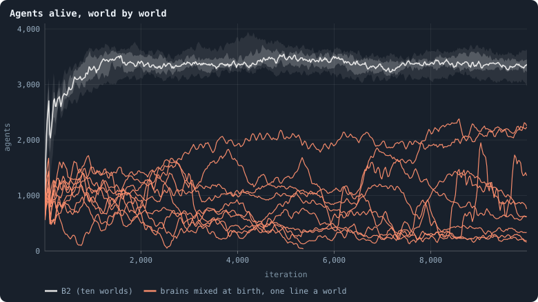
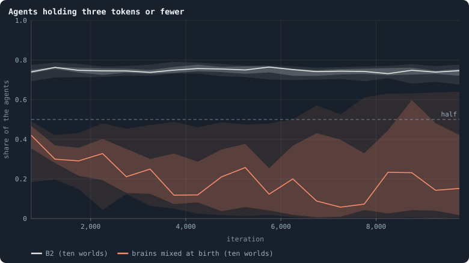
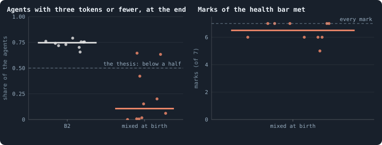
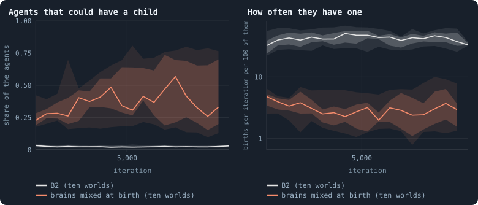
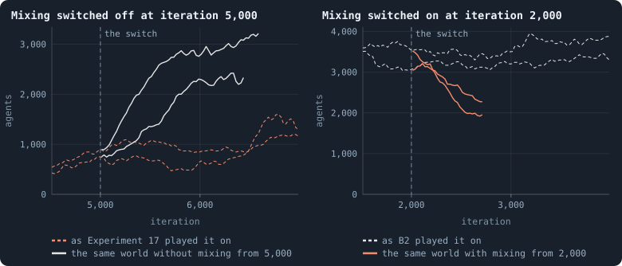
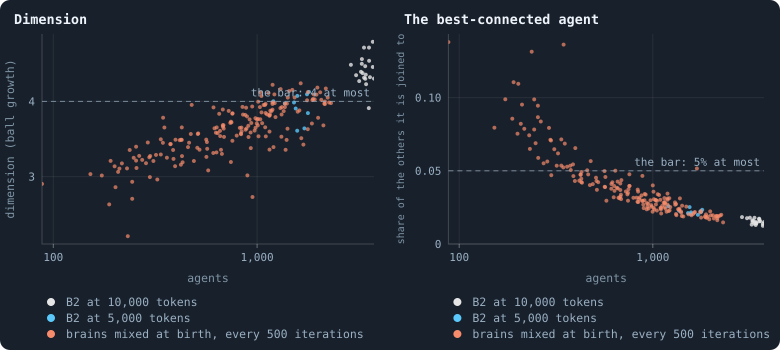
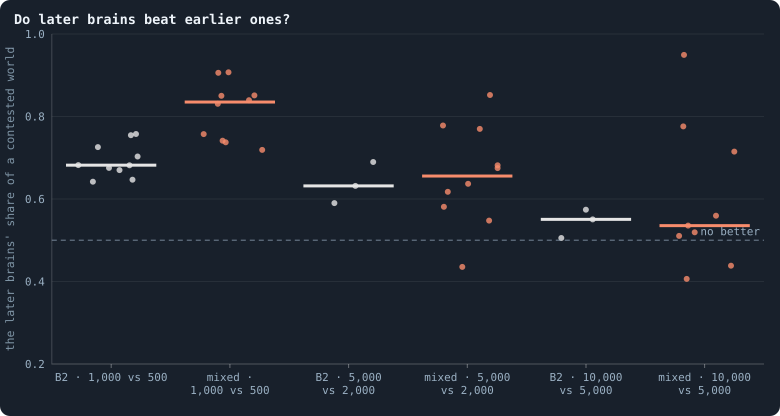

# Mixed at birth: ten long worlds

> [!question] Questions of this page
> - Do [brains](the-brain.md "The neural network each agent decides with: inputs about itself and its neighbours, outputs that become its decisions.") mixed at birth keep a world healthy and rich for 10,000
>   [iterations](one-iteration.md "One step of a world's time: a phase of reproduction, then a phase of the game."), or was that the luck of a few [pilot](pilot-worlds.md "A world made by hand to see whether an idea is worth an experiment, without a thesis or many seeds.") worlds?
> - What does a world of mixed brains look like after a long life: how many
>   [agents](the-world.md#agents-and-tokens "One member of a world: it lives on a node of the network, holds tokens and has a brain that takes all its decisions."), how rich, how well knit?

<!-- experiment E17 -->

## Why ask

[Healthy and rich](healthy-and-rich.md) read every world the notebook has made
against the author's picture of a world that might keep evolving: a network
that is decentralised, resilient and nearly three-dimensional, and agents that
differ in almost every statistic. [B2](b1-and-b2.md "The second baseline: B1 with the rules that keep its network from breaking and its agents from staking or breeding themselves to death.")'s worlds have the network but not the
agents — three in four hold three [tokens](the-world.md#agents-and-tokens "The one thing of value in a world: every agent holds a whole number of them, and their total never changes.") or fewer. The worlds that came closest
were those whose **brains are mixed at birth**
([Brains mixed at birth, units that cost, an eye for raids on kin](mixed-brains-costly-units.md)): a newborn's brain is its
parent's, with each hidden unit, by an even chance, taken whole from the brain
of one of the parent's [neighbours](the-world.md#the-network "An agent joined to another by a connection.") instead.

Those were pilots: two worlds of batch Q, mixing combined with other rules in
the batches after it, and the two worlds of batch Q played on
([Healthy and rich](healthy-and-rich.md#candidates-and-long-runs)). Mixing is
now a setting of the [engine](the-lab.md "The program that runs an experiment's plan as runs, each on a frozen copy of the engine, the code that plays a world."), [`mix_at_birth`](settings.md#mix_at_birth),
off unless a run turns it on, so the lab can run it, and for longer than any
B2 world has lived in the lab: 10,000 iterations, five times Experiment 16.

## What the pilots found

When this plan was written (16 October 2026), each world read at the
iteration named as [Healthy and rich](healthy-and-rich.md) reads every world:

| world | iteration | agents | [median](median-and-quantiles.md "The middle value: half of the numbers lie below it and half above.") tokens | 3 tokens or fewer | marks of the [health bar](health-bar.md "The seven marks a world's network must meet to count as healthy: one piece, mostly on loops, no fatal cut, no hub, three to twelve links per agent, a dimension of 2.3 to 4.") (of 7) | [dimension](ball-dimension-and-curvature.md "How fast the number of agents within a distance grows with the distance: as its square in a plane, its cube in space.") |
|---|---|---|---|---|---|---|
| B2, ten worlds (Experiment 16) | 2,000 | 3,064–3,699 | 1–2 | 70–78% | 6 (one world 7) | 3.9–4.8 |
| the same worlds played on (pilots) | 9,500–10,000 | 2,887–3,661 | 1–2 | 66–79% | 6 | 4.3–4.5 |
| mixed, [seed](random-numbers.md "The number that fixes every random choice of a run: the same settings and the same seed make the same world.") 1 (batch Q) | 2,000 | 908 | 5 | 37% | 7 | 3.5 |
| mixed, seed 2 (batch Q) | 2,000 | 659 | 11 | 20% | 7 | 3.5 |
| seed 1, played on | 2,500 | 1,380 | 3 | 52% | 7 | 3.4 |
| … and on | 5,500 | 1,037 | 6 | 38% | 7 | 3.8 |
| seed 2, played on | 4,500 | 514 | 13 | 15% | 7 | 3.6 |
| … and on | 7,500 | 883 | 8 | 19% | 7 | 3.9 |
| mixed, with gifts (batch T) | 1,000 | 1,541 | 4 | 39% | 6 | 4.1 |
| mixed, [estates](estate.md "The tokens a dead agent leaves, and who gets them.") by wealth (batch Y) | 1,000 | 445 | 8 | 31% | 6 | 3.4 |

Two things stand out. A mixed world is a quarter to a third of B2's size for
the same tokens, so each agent holds more, and the plain mixed worlds meet the
one mark B2 misses: a dimension below 4. And the two long runs do not go the
same way: one swung towards B2 at 2,500 iterations and came back, the other
grew richer and smaller to 4,500 and then larger again. Two worlds cannot say
which is the rule.

## The experiment

Experiment 17 runs B2 at 10,000 tokens with brains mixed at birth, ten seeds,
for 10,000 iterations each, recording as the lab records every run, the graph
statistics every 25 iterations and a whole world every 500 — for contests
between [eras](eras-and-contests.md "Brains of a world at two moments, its eras, played against each other: do the later ones win?"), and for reading each world at any of those moments as [Healthy and rich](healthy-and-rich.md)
reads them. B2's own worlds are not run again: Experiment 16 ran them to
2,000 iterations, and their continuations to 10,000 are the comparison.

A lab run records every [game](one-iteration.md#phase-2-the-game "The second phase of an iteration: every agent stakes all its tokens on its own node and its neighbours', and every node goes to someone."), so the ten runs will take about 9 GB of disk;
mixed worlds are small, so each costs less time than a B2 world of the same
length.

## The thesis

<!-- thesis E17 -->
> [!quote] The thesis of Experiment 17, written down before any of its runs existed
> **The claim.** Brains mixed at birth keep a world healthy and make it rich over a long life. In B2 with every newborn's brain mixed from its parent's and a neighbour's, at iteration 10,000, fewer than half the agents hold three tokens or fewer in the median world of ten, where three in four do in B2; and at least seven of the ten worlds meet every mark of the health bar.
>
> **Why it would be so.** In the pilots, the worlds whose brains were mixed at birth came closest of all to a world that is healthy and whose agents differ ([Meta X](healthy-and-rich.md)). The two worlds of batch Q and their continuations meet every mark of the health bar, at a dimension of 3.4 to 3.9, with 15% to 52% of their agents at three tokens or fewer: 37% and 20% at 2,000 iterations, 38% and 19% at 5,500 and 7,500. Mixed with gifts as well, 39%, and with estates shared by wealth, 31%, at 1,000 iterations, with six marks each. B2's own worlds hold 70% to 78% of their agents at three tokens or fewer at 2,000 iterations (Experiment 16) and 66% to 79% at 9,500 to 10,000 (the same worlds played on as pilots), and nine in ten of them meet six marks: their dimension is 4.2 to 4.8, above the bar's 4. A mixed world is a quarter to a third of B2's size, so its agents hold more each, and a unit of a brain that works can spread from one line to another. But one of the two continuations swung back towards B2's poverty at 2,500 iterations, half its agents at three tokens or fewer, before it recovered: it may not last.
>
> **It holds if:** At iteration 10,000, each world read from its last checkpoint as research/atlas/profile.py reads every world ([Meta X](healthy-and-rich.md)): the median of the ten worlds' shares of agents holding three tokens or fewer is below 0.5, and at least seven of the ten worlds meet all seven marks of Chapter [46](how-to-tell-a-world-that-keeps-evolving.md)'s health bar — one piece, a 2-core of at least 0.8, no agent whose loss cuts off more than 2% of the others, no link more than 1%, no agent joined to more than 5% of the others, 3 to 12 links per agent, a dimension of 2.3 to 4.
>
> **It fails if:** A median share of 0.5 or more, or fewer than seven worlds meeting every mark: mixing at birth does not keep a world rich and healthy over a long life.
>
> *Written while the notebook still numbered its chapters: each number is a link to the page it meant that day.*
<!-- /thesis -->

## The runs

<!-- runs E17 -->
> [!info] The runs behind this page
> **10 runs.** Every condition below is run once for every seed (1 to 10), for 10,000 iterations — or until its world dies out. Every setting is that of the baseline **B2** (a world that cannot break) unless the condition changes it.
>
> - **mixed at birth** — changes `mix_at_birth` = on; 10,000 tokens. Runs `B2-10000-4af4a3-s001` … `B2-10000-4af4a3-s010`.
>
> To make these runs again: `python3 gol_lab.py run E17`, or ▶ in the Research Notebook tab of a computer running `gol_server.py`. Each run writes its settings, seed and engine version beside its frames, in `GraphOfLifeRuns/<run>/meta.json` and `provenance.json`.

> [!info]- Every setting of these runs
> | setting | mixed at birth | what it is |
> |---|---|---|
> | [`total_tokens`](settings.md#total_tokens) | 10,000 | The number of tokens in the world, *T*. It never changes during a run. |
> | [`n_nodes`](settings.md#n_nodes) | 0 | How many founders the world starts with. 0 means one founder per hundred tokens: *n* = ⌊*T* / 100⌋. |
> | [`k_neighbors`](settings.md#k_neighbors) | 0 | How many neighbours each founder starts with in the ring. 0 means *k* = max(⌊*n* / 100⌋, 5); an odd *k* is wired as *k* − 1. |
> | [`rewire_p`](settings.md#rewire_p) | 0.2 | In the starting ring, the probability that a connection is moved to a founder chosen at random (Watts–Strogatz). |
> | [`hidden_layers`](settings.md#hidden_layers) | 16 | The widths of the brain's hidden layers, in order from input to output. |
> | [`brain_kind`](settings.md#brain_kind) | float16 | How weights are stored: `float` (64-bit), `float16` (16-bit, computed in 64-bit) or `binary` (−1, 0, +1). |
> | [`brain_bits`](settings.md#brain_bits) | 16 | Only for binary brains: how many input rows encode one number. Unused by float and float16 brains. |
> | [`message_amount`](settings.md#message_amount) | 8 | How many numbers one message holds. Each agent sends one message to itself and one to each neighbour, every phase. |
> | [`random_input_amount`](settings.md#random_input_amount) | 5 | How many random numbers, drawn uniformly from −2 to 2, a brain reads per neighbour, every time it looks. |
> | [`exchange_messages`](settings.md#exchange_messages) | on | Whether agents send and read messages at all. |
> | [`message_prepass`](settings.md#message_prepass) | off | Whether every phase begins with an extra look in which agents only write messages, so the look that acts reads messages written this phase. |
> | [`allow_handover`](settings.md#allow_handover) | off | Whether a parent may move some of its own connections to its newborn child. |
> | [`allow_revolutions`](settings.md#allow_revolutions) | on | Whether a coalition of smaller stakers can take a node from its largest staker (see the note *How a coalition takes a node*). |
> | [`allow_gifting`](settings.md#allow_gifting) | off | Whether agents may give tokens to neighbours during reproduction. Off in every run of this book. |
> | [`random_decisions`](settings.md#random_decisions) | off | The control: every number a brain would produce is replaced by a random draw from the standard normal distribution. |
> | [`prune_after`](settings.md#prune_after) | blotto | After which phase connections that carried no tokens are cut: `blotto` (the game), `reproduction`, or `both`. |
> | [`inactive_window`](settings.md#inactive_window) | phase | How long a connection may go unused: `phase` means it must carry tokens in the phase being judged; `iteration` allows the two last phases. |
> | [`redistribution`](settings.md#redistribution) | uniform | How the tokens of removed agents are shared: `uniform` gives every survivor the same chance at each token; `by_tokens` weights by what a survivor holds; `poorest` raises the poorest to one common level first; `newborns` gives them to this iteration's children, `parents` to their parents, once per child (both `uniform` in an iteration without births); `children` leaves each dead agent's estate to its own living children (`uniform` where there are none). |
> | [`tokens_created_per_phase`](settings.md#tokens_created_per_phase) | 0 | Tokens added to the world at every cleanup. 0 keeps the supply fixed. |
> | [`mutate_on_replication`](settings.md#mutate_on_replication) | on | Whether a brain changes only when it is copied — into a newborn, or into a node its owner has just won — instead of also after every game, wherever it sits. |
> | [`incumbency`](settings.md#incumbency) | 1.5 | How many times over an agent's stake on its own node counts when the game decides who takes the node. 1 is the old rule. |
> | [`birth_links`](settings.md#birth_links) | 2 | How many of its parent's neighbours a newborn is joined to, drawn at random, besides its parent itself; 0 leaves every link to the brain's choice. |
> | [`mend_on_death`](settings.md#mend_on_death) | on | Whether the neighbours of an agent that dies are joined up where its death would leave them in separate pieces. |
> | [`prune_needs`](settings.md#prune_needs) | 2 | How many neighbours the two ends of an unused connection must share for it to be cut; 0 cuts every unused connection. |
> | [`valence`](settings.md#valence) | 8 | The most connections an agent's brain may choose to hold (0 = no limit). An agent at its limit cannot have a child. |
> | [`keep_home`](settings.md#keep_home) | 0.3 | The share of an agent's tokens — rounded up, never less than one — that stays on its own node whatever its brain says; a parent also keeps one. 0 is the old rule. |
> | [`max_age`](settings.md#max_age) | 100 | The age at which an agent dies (0 = never); its tokens are shared out like those of any other dead agent. |
> | [`buy_life`](settings.md#buy_life) | off | Whether an agent that has reached max_age may live on by paying one token an iteration into the estate of the dead — never its last, so one with a single token left dies. Needs max_age. |
> | [`min_child`](settings.md#min_child) | 10 | The fewest tokens a child can be born with; a parent that would give less has no child. |
> | [`child_floor`](settings.md#child_floor) | fixed | The least a child may start with: min_child alone (fixed), or also the median holding of its parent's neighbours (neighbours), so that a world grows only as rich as it is. |
> | [`mix_at_birth`](settings.md#mix_at_birth) | **on** | Whether a newborn's brain is its parent's mixed with a mate's — one of the parent's neighbours, drawn at random — each hidden unit whole from one or the other by an even chance, before it mutates; off, a newborn has a copy of its parent's brain. |
> | [`mix_mates`](settings.md#mix_mates) | any | Under mix_at_birth, who may be the mate: any neighbour of the parent, or only parents — a neighbour with a living child of its own (with none, the newborn's brain is a copy). |
> | [`self_message`](settings.md#self_message) | own | What an agent writes to itself, which each neighbour reads: what its own column says (own), or the largest, number by number, of what it writes to anyone (largest), so that news one column marks reaches every neighbour. |
> | [`link_search`](settings.md#link_search) | off | Whether an agent may reach beyond its neighbours to propose a link: off; jump, a walk as many steps long as the tokens it spends in one iteration, with a link proposed where it ends; walk, a scout that goes one step further in every iteration it pays for; or reach, a jump whose steps are free, as many as the tokens it holds would pay for. A paid step costs one token, paid to the agent it enters, and never the last. |
> | [`link_steering`](settings.md#link_steering) | random | Which way each step of a search goes: to a neighbour drawn at random, or to the one the searcher would most like a link with (looking). |
> | [`link_consent`](settings.md#link_consent) | mutual | Who has to agree to a link a search proposes: both ends (mutual), or only the one who proposes (forced). Nobody at its valence gets a new link either way. |
> | [`proto`](settings.md#proto) | none | Rules first played in the pilots' prototype, by name: came_from and helped_by (an input row each), contest = lottery, pool by genotype or family, kin_sense, tag_rate, mate_pays, grow, unit_token, link_token. Empty in every run but those that ask for one; only the prototype's world plays them (see the settings note). |
> | [`mutation_probability`](settings.md#mutation_probability) | 0.2 | The probability that a brain changes when it is copied to a child, and again, for every brain, after every game. |
> | [`mutation_noise_std`](settings.md#mutation_noise_std) | 0.2 | How large a change to one weight is: a normal draw with standard deviation this times 1/√(fan-in) of its layer. |
> | [`mutation_sparsity`](settings.md#mutation_sparsity) | 0.1 | The share of a brain's numbers a change touches; also the probability, for each weight matrix and bias vector, of a rarer reset that redraws that share of it. |
> | [`extinction_threshold`](settings.md#extinction_threshold) | 20 | A run stops, as extinct, when an iteration ends (after its game) with this many agents or fewer. |
> | seeds | 1 to 10 | one run per seed |
> | iterations | 10,000 | how far each run goes, unless its world dies first |
>
> A value in **bold** differs from the baseline B2.
<!-- /runs -->

## What the ten worlds did

<!-- figure mixedlong/sizes -->

**Agents alive, world by world.** Each orange line is one world of Experiment 17, its agents after each game (means over 25 iterations); the grey band is B2's ten worlds — their median, middle half and nine in ten. B2's worlds keep their size; the mixed ones swing between a few hundred and two thousand agents, and one died out at iteration 5,376.

> [!example]- How to make this figure
> **Runs.** The ten runs of Experiment 17 — B2 at 10,000 tokens with brains mixed at birth, seeds 1 to 10, 10,000 iterations (`python3 gol_lab.py run E17`) — and B2 itself: Experiment 16's ten worlds to 2,000 iterations and the same worlds played on to 10,000 as pilots (`GraphOfLifeRuns/.pilots/L/B2-long-s001` … `s010`).
>
> **Data.** From Each run's `stats.jsonl` (the lab's runs) and `series.jsonl` (B2's continuations).
>
> 1. Read the agents after each game (`nodes`, phase 2).
> 2. For B2, join each lab world (to 2,000) to its continuation (2,000 to 10,000).
>
> **To make it again:** `python3 book_figures.py mixedlong`.
<!-- /figure -->

B2's worlds fill up within 1,500 iterations to some 3,000 to 3,700 agents and
stay there. The mixed worlds never settle. Each wanders, over thousands of
iterations, between a few hundred agents and two thousand: seed 3 fell to 40
agents at iteration 2,543 and came back to more than 800; seed 6 fell to 91
and ended near 2,000. Seed 9 grew to 1,424 agents at iteration 2,592, then
shrank for nearly three thousand iterations, and died out at 5,376, when 20
agents were left — the lab stops a world there.

<!-- figure mixedlong/poor -->

**Agents holding three tokens or fewer.** Each band is ten worlds — the median, the middle half and nine in ten — every 500 iterations: the share of their agents holding one, two or three tokens. A world that died out leaves the band when it does.

> [!example]- How to make this figure
> **Runs.** The ten runs of Experiment 17 — B2 at 10,000 tokens with brains mixed at birth, seeds 1 to 10, 10,000 iterations (`python3 gol_lab.py run E17`) — and B2 itself: Experiment 16's ten worlds to 2,000 iterations and the same worlds played on to 10,000 as pilots (`GraphOfLifeRuns/.pilots/L/B2-long-s001` … `s010`).
>
> **Data.** From Each run's whole worlds: the lab's archives (`archive/world_<iteration>.npz`) and the continuations' checkpoints (`ckpt_<iteration>.npz`).
>
> 1. Read every agent's tokens in each whole world kept at a multiple of 500 iterations.
> 2. Count those holding three or fewer, as a share of all.
>
> **To make it again:** `python3 book_figures.py mixedlong`.
<!-- /figure -->

The riches go with the size. In B2 three agents in four hold three tokens or
fewer at every moment of the 10,000 iterations. In the mixed worlds that share
falls from about 40% at iteration 1,000 to between 5% and 25% in the median
world after 3,000 — but the worlds spread from none to two thirds. With the
tokens fixed, a world's riches *are* its size: 152 agents share 10,000 tokens
at 66 each, 2,257 agents at 4.4.

## The verdict

<!-- figure mixedlong/verdict -->

**Experiment 17 at iteration 10,000.** Each dot is a world at its last checkpoint, read as [Healthy and rich](healthy-and-rich.md) reads every world. Left: the share of its agents holding three tokens or fewer, B2's ten worlds at 10,000 iterations beside the mixed ones. Right: how many of the seven marks of [How to tell a world that keeps evolving](how-to-tell-a-world-that-keeps-evolving.md)'s health bar each mixed world meets; the world that died out is read at its last checkpoint, with 20 agents.

> [!example]- How to make this figure
> **Runs.** The ten runs of Experiment 17 — B2 at 10,000 tokens with brains mixed at birth, seeds 1 to 10, 10,000 iterations (`python3 gol_lab.py run E17`) — and B2 itself: Experiment 16's ten worlds to 2,000 iterations and the same worlds played on to 10,000 as pilots (`GraphOfLifeRuns/.pilots/L/B2-long-s001` … `s010`).
>
> **Data.** From Each run's last checkpoint (`checkpoint.npz`; B2's continuations' `ckpt_010000.npz`) (`GraphOfLifeRuns/.pilots/e17_profile.json`).
>
> 1. Count the agents holding three tokens or fewer, as a share of all.
> 2. Measure the seven marks as `research/atlas/profile.py` does.
>
> **To make it again:** `python3 book_figures.py mixedlong`.
<!-- /figure -->

The thesis asked two things of the worlds at iteration 10,000, and got one.

- **Rich: yes, by far.** In the median world 11% of the agents hold three
  tokens or fewer, against the thesis's limit of a half; B2's worlds hold 66%
  to 79%. Seven of the ten are below 25%. The two exceptions, seeds 1 and 5,
  at 65% and 63%, are the two largest worlds, with 2,221 and 2,257 agents.
- **Healthy: five worlds of ten, where seven were needed.** Seeds 2, 4, 5, 6
  and 10 meet every mark. Three small worlds miss one mark, the [hub](stars-and-hubs.md "An agent joined to far more agents than most; a star is a world held together by a single hub."): in seed
  3's 152 agents the best-connected agent is joined to 12 others, 7.9% of the
  world; in seed 8's 173, to 17 (9.9%); in seed 7's 346, to 47 (13.6%). Seed 1
  misses the dimension by a hair, 4.05 against the bar's 4. Seed 9 died out.

**Strictly, the thesis is refuted.** And yet five worlds of ten meet every
mark, where none of B2's ten does at 10,000 iterations: each of them misses
the dimension, at 4.3 to 4.5.

## Why a mixed world is rich

<!-- figure mixedlong/breeding -->

**Who could have a child, and who has one.** Left: the share of the agents that could have a child — 11 tokens or more, since a child takes at least 10 and the parent keeps one, and fewer than 8 links. Right: the births of the next 50 iterations, per iteration, per hundred such agents, on a logarithmic axis. Each band is ten worlds every 500 iterations — the median, the middle half and nine in ten; B2's ten worlds are Experiment 16's to 2,000 iterations and the same worlds played on after.

> [!example]- How to make this figure
> **Runs.** The ten runs of Experiment 17 — B2 at 10,000 tokens with brains mixed at birth, seeds 1 to 10, 10,000 iterations (`python3 gol_lab.py run E17`) — and B2 itself: Experiment 16's ten worlds to 2,000 iterations and the same worlds played on to 10,000 as pilots (`GraphOfLifeRuns/.pilots/L/B2-long-s001` … `s010`).
>
> **Data.** From Each world kept whole every 500 iterations, and each run's births (`research/oee/checks/e17_breeding.py`, `GraphOfLifeRuns/.pilots/e17_breeding.json`).
>
> 1. In each whole world, count the agents with 11 tokens or more and fewer than 8 links.
> 2. Read the births of the 50 reproduction phases that follow, from the run's record.
> 3. Divide their mean per iteration by the agents counted.
>
> **To make it again:** `python3 book_figures.py mixedlong`.
<!-- /figure -->

In every world of both kinds, an agent lives out its hundred iterations:
almost nobody dies young. A world's agents divided by its births per
iteration, which is how long its agents live on average, is 100 in the median
stretch of 500 iterations, in B2 and in the mixed worlds alike. And every
world replaces itself one for one, a birth per hundred agents per iteration.
So a world's size is not set by death. It is set by who has children.

A child takes at least 10 tokens and its parent keeps one, and an agent at its
valence of 8 links cannot have one. In B2, 1% to 6% of the agents hold 11
tokens or more with fewer than 8 links — the agents that *could* have a child
— and they have one at a median rate of 42 per hundred per iteration: an
agent that can afford a child has it within two or three iterations. In the
mixed worlds a third of the agents could have a child (8% to 89%), and they
have one at a median rate of 3 per hundred per iteration, about fourteen times
less often.

That is why a mixed world is rich. B2's agents have a child as soon as they
can afford one, so the world fills up until hardly anyone can: tokens go into
children as fast as they come. The mixed worlds' agents put children off, so
a mixed world settles where many could have a child and few do, and each
agent holds more.

And it is why the size drifts. How eagerly an agent breeds is a matter of its
brain. Where the brains are eager, a world grows until few are able; where they
are reluctant, it shrinks until many are. The mixed worlds' eagerness wanders,
from under 1 to 10 per hundred, and the size follows it: across the 181
moments, the two go together with a [correlation](correlation.md "Whether two quantities go up and down together, from −1 to 1.") of 0.87, on logarithms. B2's
brains are eager in every world at every moment.

Why should mixing make agents put children off? A brain spreads in two
ways: by its agent's children, and by every node its agent takes in the game,
which gets a copy of the winner's brain. Taking nodes is by far the main way.
In the mixed worlds 7.7 nodes per hundred agents change hands in the median
iteration (3 to 18), in B2's 5.6 (4 to 11), against one birth. Where brains are
mixed at birth, a child carries only about half of its parent's brain, while a
node taken carries all of it. A brain that spends its tokens on children
spreads less of itself than one that stakes them on its neighbours' nodes, so
selection — which keeps working in these worlds, as the contests below show —
may come to favour putting children off. It is not simply that the reluctant
fight more, though: within the mixed worlds, the share of nodes that change
hands does not rise as a world grows small and rich (a correlation of −0.08
with its size).

<!-- figure mixedlong/switch -->

**Mixing switched at a moment.** Each solid line is a world played on as a pilot from the moment the lab had kept it whole, with mixing at birth switched; each dashed line is the same world played on unchanged — the lab's own run of Experiment 17, or B2's continuation. Agents after each game, means over 25 iterations. Batch SW: mixing off in the five worlds of Experiment 17 that met every mark, at iteration 5,000; on in five of B2's worlds, at 2,000.

> [!example]- How to make this figure
> **Runs.** The ten runs of Experiment 17 — B2 at 10,000 tokens with brains mixed at birth, seeds 1 to 10, 10,000 iterations (`python3 gol_lab.py run E17`) — and B2 itself: Experiment 16's ten worlds to 2,000 iterations and the same worlds played on to 10,000 as pilots (`GraphOfLifeRuns/.pilots/L/B2-long-s001` … `s010`). Batch SW: `GraphOfLifeRuns/.pilots/SW/mixoff-sNNN` and `mixon-sNNN` (`research/oee/pilots/make_jobs_TU.py`).
>
> **Data.** From Each pilot's `series.jsonl`; the lab runs' `stats.jsonl`.
>
> 1. Start from the lab's whole world at the moment (`run.py --from RUN:ITERATION --set mix_at_birth=…`) and play 2,000 iterations.
> 2. Read the agents after each game in the pilot and in the run it was taken from.
>
> **To make it again:** `python3 book_figures.py mixedlong`.
<!-- /figure -->

Whatever the way, the switch says that mixing is what does it. Batch SW took
worlds from the lab at a moment and played them on for 2,000 iterations with
the rule switched, and all ten went the way the rule says:

- **Without mixing from iteration 5,000**, all five of these worlds grew: from
  893, 744, 2,039, 395 and 1,325 agents to 3,341, 2,797, 3,243, 2,137 and
  2,082, on their way to B2's size, while the same worlds with mixing stayed
  where they were.
- **With mixing from iteration 2,000**, all five of B2's worlds shrank: from
  3,064 to 3,535 agents to between 1,422 and 2,156 — and one, seed 4, to 81,
  nearly dying out — while the same worlds without it stayed above 3,000.

How eagerly the able breed moved first. Without mixing, it rose in four of the
five worlds from 1.5–7 births per hundred per iteration to 14–35 within 1,500
iterations (in seed 10 from 5 to 10 and back to 5); with mixing, in B2's worlds,
it fell from 26–51 to 4–10. A rule that only five generations of agents have
lived under sets how eagerly they breed, and the size of the world follows.

## The marks a world misses

<!-- figure mixedlong/size -->

**The marks a world misses, against its size.** Each orange dot is a world of Experiment 17 at one of the moments it was kept whole, every 500 iterations; each grey dot a world of B2 at 10,000 tokens — Experiment 16's ten at 2,000 iterations, and the same worlds played on, at 10,000 or more — and each blue one a world of B2 at 5,000 tokens, Experiment 14's ten at 1,000 iterations. Across, on a logarithmic axis: the agents alive. Left: the dimension the network shows by ball growth; right: the share of the others the best-connected agent is joined to.

> [!example]- How to make this figure
> **Runs.** The ten runs of Experiment 17 — B2 at 10,000 tokens with brains mixed at birth, seeds 1 to 10, 10,000 iterations (`python3 gol_lab.py run E17`) — and B2 itself: Experiment 16's ten worlds to 2,000 iterations and the same worlds played on to 10,000 as pilots (`GraphOfLifeRuns/.pilots/L/B2-long-s001` … `s010`). B2 at 5,000 tokens: Experiment 14's ten runs (`B2-5000-s001` … `s010`).
>
> **Data.** From `GraphOfLifeRuns/.pilots/e17_health.json` (`research/oee/checks/e17_health.py`) and `GraphOfLifeRuns/.pilots/atlas/profile.json`.
>
> 1. Read each whole world as `research/atlas/profile.py` reads every world: the dimension by ball growth, the best-connected agent's links over the others.
> 2. Set each against the number of agents alive.
>
> **To make it again:** `python3 book_figures.py mixedlong`.
<!-- /figure -->

Read every 500 iterations, the ten worlds met every mark at 125 of their 190
moments, two in three. They missed only two marks (and one other once), and
each follows the world's size:

- **Small worlds miss the hub.** Below 300 agents, 96% of the moments: a
  best-connected agent with 12 to 47 links is more than 5% of a small world.
- **Large worlds miss the dimension.** The dimension the network shows by
  ball growth rises with the number of agents (a correlation of 0.78 with its
  logarithm), and above 1,500 agents it is near 4 or above.

Worlds of 600 to 1,000 agents met every mark at 98% of their moments.

B2 follows the same rule. Its worlds of 10,000 tokens hold 3,000 to 3,700
agents, and all but one miss the dimension, at 4.2 to 4.8. Its worlds of 5,000 tokens
([Experiment 14](a-world-that-cannot-break.md)) hold 1,200 to 1,800, and
six of the ten meet every mark — as poor as ever, three agents in four at
three tokens or fewer.

So half of what the thesis asked, every mark of the health bar, was a
question of size: mixing makes a world smaller, and at that size a network of
B2's kind meets the bar. What mixing changes that size does not change is how
rich the agents are: B2's worlds of 5,000 tokens are as poor as those of
10,000. (The dimension of [B1](b1-and-b2.md "The first baseline: the algorithm exactly as a new run is offered it.")'s worlds does not grow with their size: from 40
agents to 70,000 it stays between about 2.5 and 4. The rise belongs to B2's
kind of network, not to the measure.)

> [!info] Added later (2026-10-17)
> [What folds a world](what-folds-a-world.md) finds why: B2's kind of network is
> nearly a small world, with no dimension of its own to show — every B2
> world starts as a space and folds once its first generation dies, each
> death mended with a ring of links. A larger world then reads a larger
> dimension off the same few steps.

> [!info] Added later (2026-10-17, [Who inherits?](who-inherits.md))
> "B2's kind of network" says too much. The rise holds for B2 itself, at
> 5,000 and 10,000 tokens, and for its mixed worlds; other rules move the
> dimension at any size. B2 with the estate of the dead left to the newborns,
> or to the parents, holds more than 5,000 agents at a dimension of 3.4 to 3.9
> and meets every mark ([Who inherits?](who-inherits.md#healthy-and-diverse)).

## Does evolution go on?

<!-- figure mixedlong/evolution -->

**Do later brains beat earlier ones?** Each dot is a world: the share of a world the later era's brains hold after 100 iterations against the earlier era's, the mean of two contests, one in each era's world; the bar is the median world. Orange: the mixed worlds of Experiment 17; grey: B2 — its ten worlds for 1,000 against 500, three of their continuations for the later pairs.

> [!example]- How to make this figure
> **Runs.** The ten runs of Experiment 17 — B2 at 10,000 tokens with brains mixed at birth, seeds 1 to 10, 10,000 iterations (`python3 gol_lab.py run E17`) — and B2 itself: Experiment 16's ten worlds to 2,000 iterations and the same worlds played on to 10,000 as pilots (`GraphOfLifeRuns/.pilots/L/B2-long-s001` … `s010`).
>
> **Data.** From Each run's whole worlds every 500 iterations (`GraphOfLifeRuns/.pilots/e17_T100.json`, `long_steps.json`, `long_rejudge_T100.json`).
>
> 1. Seat the brains of the two eras on alternate agents of each era's world and play it on for 100 iterations, an agent's lifetime (`research/oee/checks/rejudge.py`).
> 2. Count the agents the later era's brains hold at the end, as a share of all.
>
> **To make it again:** `python3 book_figures.py mixedlong`.
<!-- /figure -->

Yes, and at first faster than in B2. In each world the brains of a later
moment met those of an earlier one over an agent's [lifetime](age-and-lifetime.md "How many iterations an agent lives, from its birth to its death."), 100 iterations,
once in each era's world, as
[Why evolution stops](why-evolution-stops.md#would-we-notice-if-it-went-on) did for
B2; a newborn whose brain is mixed counts for its parent's era. The brains of
iteration 1,000 took 84% of a contested world from those of 500 in the median
world, and more than half in every one of the ten (72% to 91%), where B2's
took 68%. Those of 5,000 took 66% from those of 2,000 (B2: 63%, in three
worlds), and those of 10,000 took 54% from those of 5,000 (B2: 55%), more than
half in seven worlds of nine.

So mixing does not stop evolution. The steps shrink with time as they do in
B2, and the first ones are larger. The worlds differ more, though: from 41% to
95% for the last pair. One world's step is uncertain on its own, since a
contest of two eras varies by about a tenth from one play to the next (an era
of seed 4 played against itself gave 40% and 64%); the median of ten is not.

## What it teaches

- **A rich world, here, is a small one.** The tokens are fixed, so how rich
  the agents are is how few they are. Mixing brains at birth made the worlds
  rich by making their agents slow to have children: in B2 an agent that can
  afford a child has one within two or three iterations, in a mixed world
  after thirty or so. Switch mixing off and the riches go within a thousand
  iterations; switch it on in B2 and its worlds shrink at once, one of them
  nearly to nothing.
- **Nothing holds the size.** How eagerly agents breed drifts as their brains
  change, and the size, the riches and the marks of health drift with it; one
  world of ten shrank until it died. The riches of a world that keeps evolving
  would need something to hold them: a rule (batch M tries the engine's), or
  something the agents keep up themselves.
- **Evolution goes on all the same.** Mixing does not stop selection: later
  brains beat earlier ones as they do in B2, and by more at first.
- **Two marks of the health bar measure size.** In B2's kind of network the
  dimension fails a large world and the hub a small one. Networks are best
  compared at one size.
- **A count has to follow every way its labels are made.** The lab's contests
  told the two eras apart by the number each brain carries. Mixing makes new
  brains even where [mutation](mutation.md "A random change to a brain, made with a set probability when it is copied, and in B1 also after every game: a changed brain is a new genotype.") is switched off, and the numbers they drew
  counted for the earlier era, so the first count of these contests said that
  evolution stops in mixed worlds. Counted by the parent's era, it goes on.

## What comes next

- **[Experiment 18](five-mixed-worlds-fifty-thousand-iterations.md)**
  plays the five worlds that met every mark on to 50,000 iterations: is their
  health a state they keep, or one their drifting size passes through?
- **Batch M** tries each rule of the engine that might hold a mixed world's
  size: the estates of the dead to the newborns, to the parents or to the
  poorest, half of an agent's tokens kept at home, links to strangers, and a
  slower change of brains.
- Not yet read: the kinds of behaviour of
  [How different are the agents?](how-different-are-the-agents.md), the [flow modules](map-equation.md "A group of agents that a token, following the flow, tends to stay inside.") of
  [Flow modules: the groups tokens stay in](flow-modules.md) and the [circulation](circulation.md "The part of a flow that goes round in loops, as against the part that runs from sources to sinks.") of
  [Gliders, and who helps whom](gliders-and-who-helps-whom.md), which mixing doubled in the
  pilots.

**Related notes:** [Every setting](settings.md#mix_at_birth) ·
[How to tell a world that keeps evolving](how-to-tell-a-world-that-keeps-evolving.md) ·
[Brains mixed at birth, units that cost, an eye for raids on kin](mixed-brains-costly-units.md) ·
[Healthy and rich](healthy-and-rich.md)

<!-- turns -->
---

← [The diversity score](diversity-score.md) · [Looking for a healthy, rich world](../README.md#looking-for-a-healthy-rich-world) · [Five mixed worlds, fifty thousand iterations](five-mixed-worlds-fifty-thousand-iterations.md) →

> [!info]- Pages that link here (13)
> [Who dies, and why](who-dies-and-why.md) · [What folds a world](what-folds-a-world.md) · [What holds a world's size](what-holds-a-worlds-size.md) · [Who inherits?](who-inherits.md) · [Links to strangers](links-to-strangers.md) · [Brains mixed at birth, with every other rule](mixing-with-every-other-rule.md) · [Healthy and rich](healthy-and-rich.md) · [The health bar](health-bar.md) · [Five mixed worlds, fifty thousand iterations](five-mixed-worlds-fifty-thousand-iterations.md) · [Mixed at birth, with parents as mates](mixed-at-birth-with-parents-as-mates.md) · [The candidates, played on](the-candidates-played-on.md) · [Five more seeds for the rules that held](five-more-seeds-for-the-rules-that-held.md) · [Every simulation: what was run, and what was measured](every-simulation.md)
<!-- /turns -->
