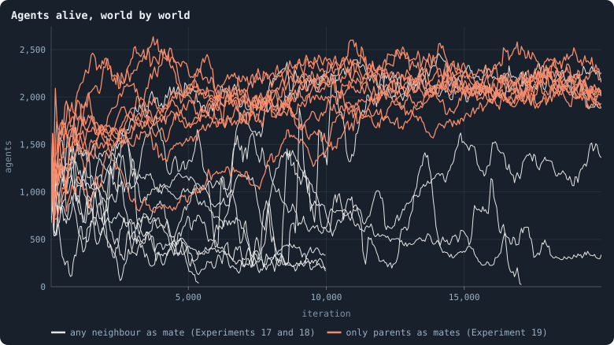
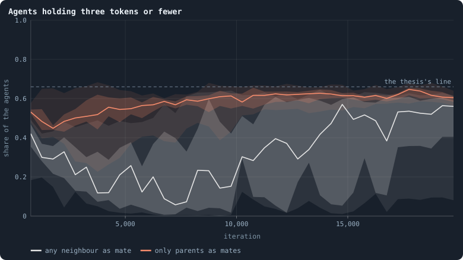
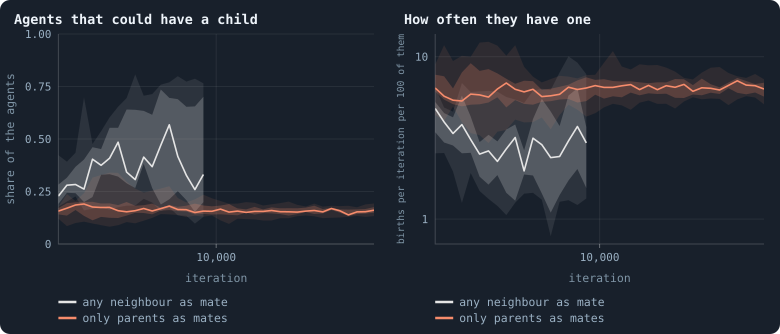
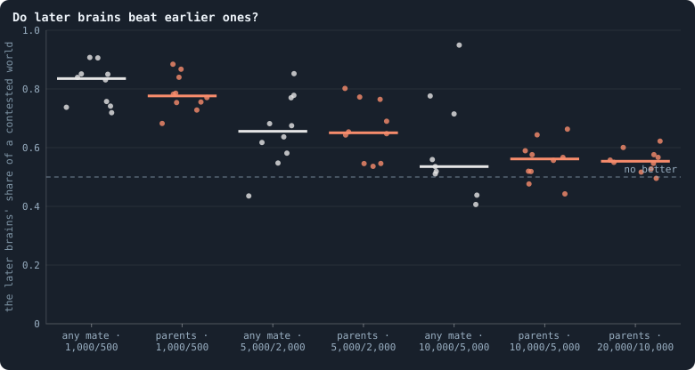
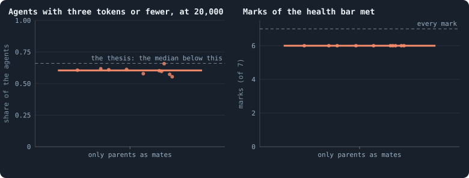

# Who may be a mate

> [!question] Questions of this page
> - Worlds whose [brains](the-brain.md "The neural network each agent decides with: inputs about itself and its neighbours, outputs that become its decisions.") are mixed at birth die out because their [agents](the-world.md#agents-and-tokens "One member of a world: it lives on a node of the network, holds tokens and has a brain that takes all its decisions.") stop
>   having children. Is that because a mate spreads its brain for free?
> - If only an agent with a living child of its own may be a mate, does a
>   mixed world stay alive — and stay rich?
> - If the mate pays the child as much as the parent does, does a mixed world
>   hold its size more steadily?
> - Can the [lab](the-lab.md "The program that runs an experiment's plan as runs, each on a frozen copy of the engine, the code that plays a world.") play again, game for game, two [pilot](the-lab.md#pilot-worlds "A world made by hand to see whether an idea is worth an experiment, without a thesis or many seeds.") worlds that were stopped
>   on 18 October 2026?

## In short

When brains are mixed at birth, a child's brain is half its parent's and half
a mate's, but only the parent pays for the child. Such worlds are rich and
diverse, yet their size drifts, and some die out: their agents stop having
children, perhaps because the mate rides free. With only parents as mates
(Experiment 19), all ten worlds lived to 20,000 [iterations](one-iteration.md "One step of a world's time: a phase of reproduction, then a phase of the game."), at about 2,000
agents each. But six in ten of their agents hold three [tokens](the-world.md#agents-and-tokens "The one thing of value in a world: every agent holds a whole number of them, and their total never changes.") or fewer: life
and riches pull apart. With a mate that pays as much as the parent
(Experiment 22), all four worlds held their size more steadily than with a
free one. Both ways of ending the free ride steady a mixed world; neither
unfolds its network into a space.

## Mixed at birth, with parents as mates

<!-- experiment E19 -->

In [B2](b1-and-b2.md "The second baseline: B1 with the rules that keep its network from breaking and its agents from staking or breeding themselves to death."), the notebook's second [baseline](b1-and-b2.md "The stated rules an experiment starts from and changes one thing of: B1 or B2."), a newborn gets a copy of its parent's
brain, sometimes slightly changed. With brains **mixed at birth**
([`mix_at_birth`](settings.md#mix_at_birth)), a newborn has, in a sense, two
parents. Each hidden unit of its brain, one of the brain's inner neurons,
comes whole from its parent or from a **mate**, by an even chance. The mate
is one of the parent's [neighbours](the-world.md#the-network "An agent joined to another by a connection."), drawn at random. Yet only the parent pays:
every token the child starts with comes from the parent.

Brains mixed at birth made the richest healthy worlds the notebook had found
([Mixed at birth: ten long worlds](mixed-at-birth-ten-long-worlds.md),
Experiment 17). They also made mortal ones. Of the five that met every mark at
10,000 iterations, three died out before 40,000
([Five mixed worlds, fifty thousand iterations](mixed-at-birth-ten-long-worlds.md#five-mixed-worlds-fifty-thousand-iterations),
Experiment 18). Each died the same way. In B2 every agent lives its hundred
iterations and then dies of age. So a world must see one birth per hundred
agents in every iteration to keep its size. These worlds fell below that line
and stayed below, though many of their agents could have afforded a child.

[What holds a world's size](what-holds-a-worlds-size.md) offers a reason: a
**free ride**. A newborn's mixed brain is half its parent's and half its
mate's, yet the mate pays nothing for the child. So an agent that never breeds
still spreads its brain, through other agents' children. The parent pays the
whole price for half a brain's worth of offspring. Selection then rewards
keeping tokens over spending them on children. And nothing stops that
reluctance at the point where the world can no longer replace its dead.

If that is the reason, it can be taken away. Let only a parent — a neighbour
with a living child of its own — be a mate. Then being a mate is no free ride
for an agent that never breeds.

### What the pilots found

The engine's setting [`mix_mates`](settings.md#mix_mates) = `parents` does
this. A parent with no such neighbour gives its newborn a copy of its own
brain. Four pilot worlds of batch MP played it, [seeds](random-numbers.md "The number that fixes every random choice of a run: the same settings and the same seed make the same world.") 1 to 4. A pilot is a
world made by hand, to see whether an idea is worth an experiment. Each was
set beside Experiment 17's mixed world of the same seed, where any neighbour
may be the mate. The table reads each pair of worlds in three ways:

- **How poor:** the share of agents holding three tokens or fewer, whom we
  call *poor*.
- **How eager:** the births per hundred *able* agents in an iteration. An
  agent is able to have a child when it holds 11 tokens or more and has fewer
  than 8 links. A child takes at least 10 tokens and its parent keeps one,
  and an agent at its limit of 8 links cannot have a child.
- **How steady:** the spread of the logarithm of a world's size, from
  iteration 500 to 5,000. It is the standard deviation of the natural
  logarithm of the number of agents. The logarithm makes it a spread in
  proportion: 0.1 means the size strays by about a tenth, 0.6 by nearly a
  factor of two.

In each cell the world with any mate comes first, the world with parents as
mates second:

| seed | agents at 5,000, any mate / parents | 3 tokens or fewer at 5,000 | births per hundred able agents an iteration | spread of the logarithm of the size, 500 to 5,000 |
|---|---|---|---|---|
| 1 | 1,117 / 1,531 | 35% / 38% | 3.3 / 4.7 | 0.19 / 0.09 |
| 2 | 893 / 932 | 31% / 23% | 2.1 / 3.5 | 0.34 / 0.29 |
| 3 | 285 / 1,709 | 6% / 49% | 2.9 / 5.3 | 0.63 / 0.25 |
| 4 | 744 / 1,983 | 38% / 54% | 4.3 / 7.5 | 0.47 / 0.12 |

With parents as mates, the agents bred more eagerly in every world, and every
world held its size more steadily. But the eagerness rose only by about a
half. Three of the four worlds ended poorer than Experiment 17's world of the
same seed, their *twin*. And one still fell from 2,000 agents to 900. Taking
the free mate away does what the reason says it should. Whether it does
enough to keep a world alive over many thousands of iterations, four pilots
of 5,000 iterations cannot say.

### Experiment 19 and its thesis

Experiment 19 runs B2 at 10,000 tokens with brains mixed at birth and parents
as mates. It plays ten seeds for 20,000 iterations each. That is twice as
long as Experiment 17, and long enough for the deaths of Experiment 18 to have
begun. Like every run of the lab, it records the graph statistics every 25
iterations and a whole world every 500. So each world can be read at any of
those moments as [Healthy and rich](healthy-and-rich.md) reads every world.
And its brains of one moment, or [era](eras-and-contests.md "Brains of a world at two moments, its eras, played against each other: do the later ones win?"), can be played against those of another.
Experiment 17's ten worlds, with any neighbour as a mate, are the comparison.

We expected parents as mates to keep every mixed world alive. If the free
ride makes agents reluctant to breed, ending it should keep births above the
line that replaces the dead. We also expected the worlds to stay richer than
B2's. They might be less rich than mixed worlds with a free mate, as three of
the four pilots warned. So the thesis asks two things. No world may die out.
And at iteration 20,000, the [median](median-and-quantiles.md "The middle value: half of the numbers lie below it and half above.") world's share of poor agents must be below
0.66. That is the share in the least poor of B2's ten worlds, at 10,000
iterations.

<!-- thesis E19 -->
> [!quote] The thesis of Experiment 19, written down before any of its runs existed
> **The claim.** Mixed worlds die out because a mate spreads its brain for free. When only a neighbour with a living child of its own may be a mate, a world whose brains are mixed at birth does not breed itself to death: of ten worlds played for 20,000 iterations, none dies out, and the median world ends richer than any of B2's.
>
> **Why it would be so.** In Experiment 17 one mixed world of ten died out by iteration 10,000, and in Experiment 18 three of the five that had met every mark died out between 17,078 and 37,722: births fell below the one per hundred agents an iteration that replaces the dead, while a third to three quarters of the agents could have had a child. A mate passes half of its brain to a child it pays nothing for, so an agent that never breeds still spreads through other agents' children, and selection rewards keeping tokens over spending them on children ([Meta XI](what-holds-a-worlds-size.md)). With only parents as mates (batch MP: four pilot worlds, seeds 1 to 4, 5,000 iterations), the agents that could have a child had one at 3.5 to 7.5 per hundred an iteration, against 2.1 to 4.3 in Experiment 17's worlds of the same seeds; each world held its size more steadily than its twin (the spread of the logarithm of its size over iterations 500 to 5,000: 0.09, 0.29, 0.25 and 0.12, against 0.19, 0.34, 0.63 and 0.47), at 760 to 2,200 agents, and 23% to 54% of its agents held three tokens or fewer at 5,000, against 66% to 79% in B2. But one pilot world fell from 2,000 agents to 900, the eagerness rose only a little, and three of the four ended poorer than their twins: the free mate may be one cause among others, and taking it away costs some riches.
>
> **It holds if:** No world of the ten ends before iteration 20,000 (the lab stops a world when 20 agents or fewer are left), and at iteration 20,000 the median of the ten worlds' shares of agents holding three tokens or fewer is below 0.66 — the least of B2's ten worlds at 10,000 iterations.
>
> **It fails if:** A world dies out, or the median share is 0.66 or more: taking away the free mate does not keep a mixed world alive and rich.
>
> *Written while the notebook still numbered its chapters: each number is a link to the page it meant that day.*
<!-- /thesis -->

### What the ten worlds did

<!-- figure mixparents/sizes -->

**Agents alive, world by world.** Each line is one world, its agents after each game (means over 50 iterations). Orange: the ten worlds of Experiment 19, whose mates are drawn only among neighbours with a living child; grey: Experiment 17's ten, any neighbour a mate, to 10,000 iterations, and the five of them Experiment 18 played on.

> [!example]- How to make this figure
> **Runs.** The ten runs of Experiment 19 — B2 at 10,000 tokens with brains mixed at birth and the mate drawn only among neighbours with a living child (`mix_mates` = `parents`), seeds 1 to 10, 20,000 iterations (`python3 gol_lab.py run E19`) — beside Experiment 17's ten runs with any neighbour as mate, to 10,000 iterations, and the five of them Experiment 18 played on, read to 20,000.
>
> **Data.** From each run's `stats.jsonl`.
>
> 1. Read the agents after each game (`nodes`, phase 2).
> 2. Average over stretches of 50 iterations.
>
> **To make it again:** `python3 book_figures.py mixparents`.
<!-- /figure -->

**Every world lived, and settled.** None of the ten came near dying out. After
their first 2,000 iterations they held between 760 and 2,670 agents. From
iteration 15,000 on, each held 2,030 to 2,350 on average. Experiment 17's
worlds, with any neighbour as a mate, wandered between 20 and 2,500 agents.
Two of them had died out by iteration 20,000: one before 10,000, and one of
the five that Experiment 18 played on.

Two grey lines run with the orange ones from 10,000 on. They are the two
worlds of Experiment 18 that lived to 50,000. By 20,000 they held 2,170 and
1,880 agents, 62% and 54% of them poor: where these ten are. Parents as mates
bring every world, and soon, to where only the survivors of Experiment 18
arrived.

<!-- figure mixparents/poor -->

**Agents holding three tokens or fewer.** Each band is the worlds of one experiment — the median, the middle half and nine in ten — every 500 iterations: the share of their agents holding one, two or three tokens. Grey: Experiment 17's ten worlds to 10,000, and the five Experiment 18 played on; a world that died out leaves the band when it does.

> [!example]- How to make this figure
> **Runs.** The ten runs of Experiment 19 — B2 at 10,000 tokens with brains mixed at birth and the mate drawn only among neighbours with a living child (`mix_mates` = `parents`), seeds 1 to 10, 20,000 iterations (`python3 gol_lab.py run E19`) — beside Experiment 17's ten runs with any neighbour as mate, to 10,000 iterations, and the five of them Experiment 18 played on, read to 20,000.
>
> **Data.** From each run's whole worlds kept every 500 iterations (`archive/world_<iteration>.npz`).
>
> 1. Read every agent's tokens in each whole world.
> 2. Count those holding three or fewer, as a share of all.
>
> **To make it again:** `python3 book_figures.py mixparents`.
<!-- /figure -->

**Six in ten are poor.** At iteration 20,000, 55% to 66% of each world's
agents hold three tokens or fewer. That is richer than any of B2's worlds: the
least poor of its ten held 66% at 10,000 iterations. But it is far poorer than
Experiment 17's mixed worlds: at 10,000, the median of the nine that lived
held 15%. Only the poorest two of those were as poor.

**As diverse as mixed worlds.** The [diversity score](diversity-score.md "How much the agents of a world differ, in one number from 0 to 1: in tokens, links, ages and genotypes.") says in one number, from
0 to 1, how much a world's agents differ: in tokens, links, ages and
[genotypes](genotype.md "The identity of a brain: a number that a copy keeps and a change replaces, and that remembers the genotype it came from."). At 20,000 it is 0.59 in the median world (0.52 to 0.69). That is
as high as in Experiment 17's worlds at 10,000 (0.58), and above B2's ten
worlds played on to 10,000 (0.49). Part of it is built in: every mixed birth
makes a new genotype
([Brains mixed at birth, with every other rule](mixing-with-every-other-rule.md)).

<!-- figure mixparents/breeding -->

**Who could have a child, and who has one.** Left: the share of the agents that could have a child — 11 tokens or more and fewer than 8 links. Right: the births of the next 50 iterations, per iteration, per hundred such agents, on a logarithmic axis. Each band is an experiment's worlds every 500 iterations — the median, the middle half and nine in ten.

> [!example]- How to make this figure
> **Runs.** The ten runs of Experiment 19 — B2 at 10,000 tokens with brains mixed at birth and the mate drawn only among neighbours with a living child (`mix_mates` = `parents`), seeds 1 to 10, 20,000 iterations (`python3 gol_lab.py run E19`) — beside Experiment 17's ten runs with any neighbour as mate, to 10,000 iterations, and the five of them Experiment 18 played on, read to 20,000.
>
> **Data.** From each world kept whole every 500 iterations, and each run's births (`research/oee/checks/e17_breeding.py`, `GraphOfLifeRuns/.pilots/e17_breeding.json` and `e19_breeding.json`).
>
> 1. In each whole world, count the agents with 11 tokens or more and fewer than 8 links.
> 2. Read the births of the 50 reproduction phases that follow.
> 3. Divide their mean per iteration by the agents counted.
>
> **To make it again:** `python3 book_figures.py mixparents`.
<!-- /figure -->

**More eager, fewer able.** Over the first 10,000 iterations, an able agent
with parents as mates had a child 6.0 times per hundred in an iteration. That
is the median of every world and moment kept. With any mate it was 3.0: the
rise the pilots showed. Over the next 10,000 iterations it was 6.5. And the
eager fill their world. At the median moment only a sixth of the agents could
afford a child, against a third with any mate. This is the rule of
[What holds a world's size](what-holds-a-worlds-size.md) at work. How eagerly
agents breed sets how full a world becomes, and a full world is a poor one.

<!-- figure mixparents/evolution -->

**Do later brains beat earlier ones?** Each dot is a world: the share of a world the later era's brains hold after 100 iterations against the earlier era's, the mean of two contests, one in each era's world; the bar is the median world. 1,000/500: the brains of iteration 1,000 against those of 500. Orange: Experiment 19; grey: Experiment 17, any neighbour a mate.

> [!example]- How to make this figure
> **Runs.** The ten runs of Experiment 19 — B2 at 10,000 tokens with brains mixed at birth and the mate drawn only among neighbours with a living child (`mix_mates` = `parents`), seeds 1 to 10, 20,000 iterations (`python3 gol_lab.py run E19`) — beside Experiment 17's ten runs with any neighbour as mate, to 10,000 iterations, and the five of them Experiment 18 played on, read to 20,000.
>
> **Data.** From each run's whole worlds (`GraphOfLifeRuns/.pilots/e19_T100.json` and `e17_T100.json`).
>
> 1. Seat the brains of the two eras on alternate agents of each era's world and play it on for 100 iterations (`research/oee/checks/rejudge.py`).
> 2. Count the agents the later era's brains hold at the end, as a share of all.
>
> **To make it again:** `python3 book_figures.py mixparents`.
<!-- /figure -->

**Evolution goes on, as it did with any mate.** To see whether brains still
improve, the brains of a later era meet those of an earlier one. They are
seated on alternate agents of a world and played for a [lifetime](age-and-lifetime.md "How many iterations an agent lives, from its birth to its death."), 100
iterations. If the later brains then hold more than half the world, they are
better. The brains of 1,000 beat those of 500 in every world (a median of
0.78 of a contested world, against 0.84 with any mate). Those of 5,000 beat
those of 2,000 in every world (0.65, against 0.66). Those of 10,000 beat those
of 5,000 in eight of the ten (0.56, against 0.54). And those of 20,000 beat
those of 10,000 in nine, the tenth all but tied at 0.495 (a median of 0.55).
Evolution is slowing, but not stopping.

### The verdict: alive, but six in ten poor

<!-- figure mixparents/verdict -->

**Experiment 19 at iteration 20,000.** Each dot is a world at iteration 20,000, read from the whole world kept then. Left: the share of its agents holding three tokens or fewer; the thesis asked that the median of the ten be below 0.66, the least of B2's ten worlds at 10,000 iterations. Right: how many of the seven marks of [How to tell a world that keeps evolving](how-to-tell-a-world-that-keeps-evolving.md)'s health bar each world meets.

> [!example]- How to make this figure
> **Runs.** The ten runs of Experiment 19 — B2 at 10,000 tokens with brains mixed at birth and the mate drawn only among neighbours with a living child (`mix_mates` = `parents`), seeds 1 to 10, 20,000 iterations (`python3 gol_lab.py run E19`) — beside Experiment 17's ten runs with any neighbour as mate, to 10,000 iterations, and the five of them Experiment 18 played on, read to 20,000.
>
> **Data.** From each run's whole world kept at 20,000 (`archive/world_020000.npz`) and `GraphOfLifeRuns/.pilots/e19_health.json` (`research/oee/checks/e17_health.py --family B2-10000-bcc1bc`).
>
> 1. Count the agents holding three tokens or fewer, as a share of all.
> 2. Measure the seven marks as `research/atlas/profile.py` does.
>
> **To make it again:** `python3 book_figures.py mixparents`.
<!-- /figure -->

**The thesis holds.** No world ended before iteration 20,000. At 20,000 the
median world holds 60% of its agents at three tokens or fewer, below the line
of 0.66.

Every world meets six of the seven marks of the [health bar](health-bar.md "The seven marks a world's network must meet to count as healthy: one piece, mostly on loops, no fatal cut, no hub, three to twelve links per agent, a dimension of 2.3 to 4."), the marks a
network must meet to count as healthy. It did so at every moment kept from
500 on, and met all seven at nearly a quarter of them. The one it misses is
the one B2's own worlds miss: a [dimension](ball-dimension-and-curvature.md "How fast the number of agents within a distance grows with the distance: as its square in a plane, its cube in space.") between 2.3 and 4. These worlds read
4.1 to 4.3. Like B2's, they are folded: nearly small worlds, in which everyone
is a few steps from everyone, not spaces
([What folds a world](how-many-dimensions-does-a-world-have.md#what-folds-a-world)).

Two things the thesis did not ask should be said beside it. Experiment 18's
worlds died between iterations 17,078 and 37,722. So 20,000 iterations cover
only the start of the span in which mixed worlds died. But none of these ten
shows what came before those deaths: a world that shrinks while many of its
agents could breed. And the riches the thesis's line asked for are B2's
riches, not mixing's. These worlds are richer than any of B2's, not rich.

Parents as mates are one way to end the free ride. The next section tries the
other.

## A mate that pays its share

<!-- experiment E22 -->

Brains mixed at birth make worlds rich and diverse, and then let them drift.
Their size wanders, many shrink to a few hundred agents, and some die out
([Five mixed worlds, fifty thousand iterations](mixed-at-birth-ten-long-worlds.md#five-mixed-worlds-fifty-thousand-iterations)).
[What holds a world's size](what-holds-a-worlds-size.md) traced this to the
price of a child. A world's size is set by how eagerly its agents breed, and
in a mixed world being a mate is free.

It proposed two ways to end the free ride. The first, mates only among the
parents, is [Experiment 19](#mixed-at-birth-with-parents-as-mates): every
world lived and held about 2,000 agents. The second is a **mate that pays its
share**, the rule this section tests. The mate gives the child as many tokens
as the parent does, as far as it can and never its last. It is one of the
rules first played in the pilots' prototype, `mate_pays` (the setting
[`proto`](settings.md#proto)). One thing pushes the other way: a child that
two pay for is cheaper to each of them.

Two pilot worlds of this rule (batch MPay, seeds 1 and 2) stopped when the
computer was restarted on 18 October 2026. The last whole worlds they had kept
were those of iterations 1,000 and 1,500. The lab now plays the prototype's
rules itself, so it starts them again from the beginning. Its first two worlds
should be the pilots' worlds again, game for game.

### Experiment 22 and its thesis

Experiment 22 plays the paying mate in B2 at 10,000 tokens, with brains mixed
at birth: four seeds, for 5,000 iterations each. Experiment 17's worlds of
the same seeds, whose mates pay nothing, are the comparison.

We expected the paying mate to steady a mixed world, as parents as mates had.
With no free ride, reluctance should no longer pay, and we expected that to
outweigh the cheaper child. We also expected the lab to play the two stopped
pilots exactly again, since the same settings and the same seed make the same
world. So the thesis asks three things:
- at least three of the four worlds steadier than their Experiment 17 world;
- no world down to 20 agents;
- the first two worlds the same as the pilots, game for game.

<!-- thesis E22 -->
> [!quote] The thesis of Experiment 22, written down before any of its runs existed
> **The claim.** A mate that pays its share holds a mixed world's size more steadily. In four worlds of B2 with brains mixed at birth, where the mate pays the child as many tokens as the parent gives, as far as it can and never its last, the spread of the logarithm of the number of agents from iteration 500 to 5,000 is smaller than in Experiment 17's world of the same seed, where the mate pays nothing, in at least three of the four, and no world falls to 20 agents. And the lab plays the two pilots of this rule that were stopped on 18 October 2026 as they went, game for game, as far as they got.
>
> **Why it would be so.** A mixed world's size drifts, because being a mate is free: an agent that never breeds still spreads half its brain through other agents' children, and how eagerly agents breed sets a world's size ([Meta XI](what-holds-a-worlds-size.md)). A mate that pays ends the free ride, though a child that two pay for is cheaper to each, which pushes the other way. [Meta XI](what-holds-a-worlds-size.md) proposed it and nothing tested it: its pilots (batch MPay) were stopped at iterations 1,000 and 1,500 when the computer was restarted. Mates among the parents only, the other way to end the free ride, held four pilot worlds steadier than Experiment 17's and kept all ten worlds of Experiment 19 alive.
>
> **It holds if:** In at least three of the four seeds the standard deviation of the logarithm of the agents after each game, from 500 to 5,000, is below that of Experiment 17's world of the same seed; no world falls to 20 agents or fewer; and the worlds of seeds 1 and 2 match the pilots' agents and links after every game to 1,000 and 1,500.
>
> **It fails if:** Two or fewer are steadier than their Experiment 17 world, a world falls to 20 agents or fewer, or a world differs from its pilot.
>
> *Written while the notebook still numbered its chapters: each number is a link to the page it meant that day.*
<!-- /thesis -->

### What the four worlds did

**The lab plays the stopped pilots as they went.** The worlds of seeds 1 and
2 matched the pilots' agents and links after every [game](one-iteration.md#phase-2-the-game "The second phase of an iteration: every agent stakes all its tokens on its own node and its neighbours', and every node goes to someone."). They did so as far as
the pilots had gone: 1,311 and 1,719 iterations.

<!-- figure matepays/sizes -->

**Agents alive, with a mate that pays and with a free mate.** Each line is one world, its agents after each game in means over 50 iterations, on a logarithmic axis. Orange: brains mixed at birth with a mate that pays the child as much as the parent (seeds 1 to 4); grey: Experiment 17's worlds of the same seeds, whose mates pay nothing.

> [!example]- How to make this figure
> **Runs.** Experiment 22's four runs (`python3 gol_lab.py run E22`): B2 at 10,000 tokens with brains mixed at birth and the pilots' rule `mate_pays`, seeds 1 to 4, to 5,000 iterations, played by the research prototype in the lab (`B2-10000-8ff8c5-s001` … `-s004`); against Experiment 17's runs of the same seeds (`B2-10000-4af4a3-s001` … `-s004`), mixing with a mate that pays nothing.
>
> **Data.** From the pilots' `series.jsonl` and the lab runs' `stats.jsonl`.
>
> 1. Read the agents after each game: a pilot's row of each iteration, a lab run's row of phase 2.
> 2. Average over stretches of 50 iterations.
>
> **To make it again:** `python3 book_figures.py matepays`.
<!-- /figure -->

**A mate that pays holds a mixed world's size.** From iteration 500 to 5,000,
measured as for [the pilots of parents as mates](#what-the-pilots-found):

| seed | spread of the logarithm of the agents, paying mate | free mate | fewest agents, paying mate | free mate |
|---|---|---|---|---|
| 1 | 0.12 | 0.19 | 1,685 | 648 |
| 2 | 0.09 | 0.34 | 1,414 | 245 |
| 3 | 0.16 | 0.63 | 1,127 | 40 |
| 4 | 0.12 | 0.47 | 1,012 | 316 |

Every world with a paying mate was steadier than Experiment 17's world of the
same seed, and none came near dying out. Their medians were 1,394 to 2,048
agents. The free mates' worlds wandered between 40 and 1,700, around medians
of 586 to 1,051.

**Healthy and diverse, but folded.** At 5,000 iterations, read as every world
is read:
- **Marks:** six or seven of the health bar.
- **Diversity:** scores of 0.52 to 0.64, against B2's median at 5,000 of
  0.49.
- **Width:** 1.16 to 1.28. A world's [random twin](random-twin.md "A network with the same agents and as many links each, wired at random: what a world would be if it were no space at all.") has the same agents, with
  as many links each, wired at random. A typical agent here needs only 1.16 to
  1.28 times as many steps to reach half its world as in that twin. A space
  needs at least 1.5 times as many. These are folded small worlds, as
  Experiment 19's are.
- **[Evenness](gini-coefficient.md#entropy-and-evenness "How evenly something is shared out among the agents, from all in one place to spread perfectly evenly."):** a [Gini coefficient](gini-coefficient.md "How unequally tokens are held: 0 if every agent holds as many, near 1 if one holds nearly all.") of the tokens of 0.43 to 0.48. A Gini is 0
  if every agent holds as many, and near 1 if one holds nearly all. That is
  about as even as B2's most even world (0.46).

### The verdict: steadier in all four seeds

**The thesis holds.**
- All four worlds were steadier than their Experiment 17 world.
- None fell to 20 agents.
- The lab's worlds of seeds 1 and 2 are the stopped pilots, game for game.

## What we learned

- **The free ride was the cause.** Two ways of ending it both steady a mixed
  world. With only parents as mates, able agents breed twice as eagerly as
  with any mate. None of ten worlds bred itself towards its end in 20,000
  iterations. With a mate that pays, all four worlds held their size more
  steadily than with a free mate.
- **But reluctance was also what made mixed worlds rich.** With parents as
  mates the eager fill their world to about 2,000 agents, six in ten of them
  poor. Its network becomes B2's: six marks of the health bar, and folded,
  with a dimension reading above four. Yet its agents still differ as much as
  in Experiment 17's worlds. Life and riches pull apart again.
- **A child that two pay for is cheaper to each, and the world fills more.**
  The paying mates' worlds held more agents than the free mates' worlds of the
  same seeds. So paying for a child raises how many children there are; it
  does not lower it.
- **What [What holds a world's size](what-holds-a-worlds-size.md) asked for is
  still missing.** It is a pull that makes having a child pay more when few
  have them, and less when many do. Parents as mates raise eagerness
  everywhere, at every size, and so set the world at one size: larger than
  mixing's, smaller than B2's.
- **Steady is not yet a space.** The worlds of both rules are folded. Room is
  the one thing the steadiest mixed worlds still lack
  ([Room for the steadiest world](room-for-the-steadiest-world.md)).

## Where to go next

- [What holds a world's size](what-holds-a-worlds-size.md): why how eagerly
  agents breed sets a world's size, and the other rules tried to hold a mixed
  world's.
- [Five mixed worlds, fifty thousand iterations](mixed-at-birth-ten-long-worlds.md#five-mixed-worlds-fifty-thousand-iterations):
  how mixed worlds with a free mate bred themselves to death.
- [Room for the steadiest world](room-for-the-steadiest-world.md): Experiment
  19's world given room, and what each way of giving it costs.
- [Mixed at birth: ten long worlds](mixed-at-birth-ten-long-worlds.md):
  Experiment 17, the worlds with a free mate that both experiments are
  compared with.

## How this was made

### The runs of Experiment 19

<!-- runs E19 -->
> [!info]- The runs behind this page
> **10 runs.** Every condition below is run once for every seed (1 to 10), for 20,000 iterations — or until its world dies out. Every setting is that of the baseline **B2** (a world that cannot break) unless the condition changes it.
>
> - **mixed at birth, parents as mates** — changes `mix_at_birth` = on, `mix_mates` = parents; 10,000 tokens. Runs `B2-10000-bcc1bc-s001` … `B2-10000-bcc1bc-s010`.
>
> To make these runs again: `python3 gol_lab.py run E19`, or ▶ in the Research Notebook tab of a computer running `gol_server.py`. Each run writes its settings, seed and engine version beside its frames, in `GraphOfLifeRuns/<run>/meta.json` and `provenance.json`.

> [!info]- Every setting of these runs
> | setting | mixed at birth, parents as mates | what it is |
> |---|---|---|
> | [`total_tokens`](settings.md#total_tokens) | 10,000 | The number of tokens in the world, *T*. It never changes during a run. |
> | [`n_nodes`](settings.md#n_nodes) | 0 | How many founders the world starts with. 0 means one founder per hundred tokens: *n* = ⌊*T* / 100⌋. |
> | [`k_neighbors`](settings.md#k_neighbors) | 0 | How many neighbours each founder starts with in the ring. 0 means *k* = max(⌊*n* / 100⌋, 5); an odd *k* is wired as *k* − 1. |
> | [`rewire_p`](settings.md#rewire_p) | 0.2 | In the starting ring, the probability that a connection is moved to a founder chosen at random (Watts–Strogatz). |
> | [`hidden_layers`](settings.md#hidden_layers) | 16 | The widths of the brain's hidden layers, in order from input to output. |
> | [`hidden_activation`](settings.md#hidden_activation) | sigmoid | The curve each hidden unit applies to its sum: `sigmoid`, which passes on at most a quarter of a change, so that deep brains barely respond to what they see, or `tanh`, the same S-shape centred on zero, through which a change still passes in several layers. |
> | [`brain_kind`](settings.md#brain_kind) | float16 | How weights are stored: `float` (64-bit), `float16` (16-bit, computed in 64-bit) or `binary` (−1, 0, +1). |
> | [`brain_bits`](settings.md#brain_bits) | 16 | Only for binary brains: how many input rows encode one number. Unused by float and float16 brains. |
> | [`message_amount`](settings.md#message_amount) | 8 | How many numbers one message holds. Each agent sends one message to itself and one to each neighbour, every phase. |
> | [`random_input_amount`](settings.md#random_input_amount) | 5 | How many random numbers, drawn uniformly from −2 to 2, a brain reads per neighbour, every time it looks. |
> | [`exchange_messages`](settings.md#exchange_messages) | on | Whether agents send and read messages at all. |
> | [`message_prepass`](settings.md#message_prepass) | off | Whether every phase begins with an extra look in which agents only write messages, so the look that acts reads messages written this phase. |
> | [`allow_handover`](settings.md#allow_handover) | off | Whether a parent may move some of its own connections to its newborn child. |
> | [`allow_revolutions`](settings.md#allow_revolutions) | on | Whether a coalition of smaller stakers can take a node from its largest staker (see the note *How a coalition takes a node*). |
> | [`contest`](settings.md#contest) | largest | Who takes a contested node: the `largest` stake as the game weighs it, or a staker drawn by `lottery` with a chance in proportion to its stake (needs revolutions off). |
> | [`allow_gifting`](settings.md#allow_gifting) | off | Whether agents may give tokens to neighbours during reproduction. Off in both baselines; on in a few pilots, in Experiment 24 and in half the worlds of the screen. |
> | [`random_decisions`](settings.md#random_decisions) | off | The control: every number a brain would produce is replaced by a random draw from the standard normal distribution. |
> | [`prune_after`](settings.md#prune_after) | blotto | After which phase connections that carried no tokens are cut: `blotto` (the game), `reproduction`, or `both`. |
> | [`inactive_window`](settings.md#inactive_window) | phase | How long a connection may go unused: `phase` means it must carry tokens in the phase being judged; `iteration` allows the two last phases. |
> | [`redistribution`](settings.md#redistribution) | uniform | How the tokens of removed agents are shared: `uniform` gives every survivor the same chance at each token; `by_tokens` weights by what a survivor holds; `poorest` raises the poorest to one common level first; `newborns` gives them to this iteration's children, `parents` to their parents, once per child (both `uniform` in an iteration without births); `children` leaves each dead agent's estate to its own living children (`uniform` where there are none); `local` lets each estate flow through the network to the nearest living agents, split evenly at every step. |
> | [`tokens_created_per_phase`](settings.md#tokens_created_per_phase) | 0 | Tokens added to the world at every cleanup. 0 keeps the supply fixed. |
> | [`mutate_on_replication`](settings.md#mutate_on_replication) | on | Whether a brain changes only when it is copied — into a newborn, or into a node its owner has just won — instead of also after every game, wherever it sits. |
> | [`incumbency`](settings.md#incumbency) | 1.5 | How many times over an agent's stake on its own node counts when the game decides who takes the node. 1 is the old rule. |
> | [`birth_links`](settings.md#birth_links) | 2 | How many of its parent's neighbours a newborn is joined to, drawn at random, besides its parent itself; 0 leaves every link to the brain's choice. |
> | [`mend_on_death`](settings.md#mend_on_death) | on | Whether the neighbours of an agent that dies are joined up where its death would leave them in separate pieces. |
> | [`prune_needs`](settings.md#prune_needs) | 2 | How many neighbours the two ends of an unused connection must share for it to be cut; 0 cuts every unused connection. |
> | [`valence`](settings.md#valence) | 8 | The most connections an agent's brain may choose to hold (0 = no limit). An agent at its limit cannot have a child. |
> | [`link_token`](settings.md#link_token) | off | Whether every link holds one token: its maker pays for it, a lapsing link gives it back to one of its ends, and a link of a dead agent to the end that lives on, so the links can never outnumber the tokens. |
> | [`link_upkeep`](settings.md#link_upkeep) | off | Whether an agent may pay a token an iteration to keep a link, each brain deciding for each neighbour: `paid_or_used` keeps a link that was paid for or used, `paid_only` only one that was paid for; `off`, only use keeps a link. |
> | [`upkeep_to`](settings.md#upkeep_to) | end | Where a link's upkeep goes: to the link's other end (`end`), or into the estate of the dead (`estate`), shared out by the world's redistribution rule. |
> | [`keep_home`](settings.md#keep_home) | 0.3 | The share of an agent's tokens — rounded up, never less than one — that stays on its own node whatever its brain says; a parent also keeps one. 0 is the old rule. |
> | [`max_age`](settings.md#max_age) | 100 | The age at which an agent dies (0 = never); its tokens are shared out like those of any other dead agent. |
> | [`buy_life`](settings.md#buy_life) | off | Whether an agent that has reached max_age may live on by paying one token an iteration into the estate of the dead — never its last, so one with a single token left dies. Needs max_age. |
> | [`min_child`](settings.md#min_child) | 10 | The fewest tokens a child can be born with; a parent that would give less has no child. |
> | [`child_floor`](settings.md#child_floor) | fixed | The least a child may start with: min_child alone (fixed), or also the median holding of its parent's neighbours (neighbours), so that a world grows only as rich as it is. |
> | [`mix_at_birth`](settings.md#mix_at_birth) | **on** | Whether a newborn's brain is its parent's mixed with a mate's — one of the parent's neighbours, drawn at random — each hidden unit whole from one or the other by an even chance, before it mutates; off, a newborn has a copy of its parent's brain. |
> | [`mix_mates`](settings.md#mix_mates) | **parents** | Under mix_at_birth, who may be the mate: any neighbour of the parent, or only parents — a neighbour with a living child of its own (with none, the newborn's brain is a copy). |
> | [`mate_pays`](settings.md#mate_pays) | off | Under mix_at_birth, whether the mate pays the child as many tokens as the parent gave it, as far as it can and never its last. |
> | [`self_message`](settings.md#self_message) | own | What an agent writes to itself, which each neighbour reads: what its own column says (own), or the largest, number by number, of what it writes to anyone (largest), so that news one column marks reaches every neighbour. |
> | [`link_search`](settings.md#link_search) | off | Whether an agent may reach beyond its neighbours to propose a link: off; jump, a walk as many steps long as the tokens it spends in one iteration, with a link proposed where it ends; walk, a scout that goes one step further in every iteration it pays for; or reach, a jump whose steps are free, as many as the tokens it holds would pay for. A paid step costs one token, paid to the agent it enters, and never the last. |
> | [`link_steering`](settings.md#link_steering) | random | Which way each step of a search goes: to a neighbour drawn at random, or to the one the searcher would most like a link with (looking). |
> | [`link_consent`](settings.md#link_consent) | mutual | Who has to agree to a link a search proposes: both ends (mutual), or only the one who proposes (forced). Nobody at its valence gets a new link either way. |
> | [`proto`](settings.md#proto) | none | Rules first played in the pilots' prototype, by name: came_from and helped_by (an input row each), contest = lottery, pool by genotype or family, kin_sense, tag_rate, mate_pays, grow, unit_token, link_token. Empty in every run but those that ask for one; only the prototype's world plays them (see the settings note). |
> | [`mutation_probability`](settings.md#mutation_probability) | 0.2 | The probability that a brain changes when it is copied to a child, and again, for every brain, after every game. |
> | [`mutation_noise_std`](settings.md#mutation_noise_std) | 0.2 | How large a change to one weight is: a normal draw with standard deviation this times 1/√(fan-in) of its layer. |
> | [`mutation_sparsity`](settings.md#mutation_sparsity) | 0.1 | The share of a brain's numbers a change touches; also the probability, for each weight matrix and bias vector, of a rarer reset that redraws that share of it. |
> | [`extinction_threshold`](settings.md#extinction_threshold) | 20 | A run stops, as extinct, when an iteration ends (after its game) with this many agents or fewer. |
> | seeds | 1 to 10 | one run per seed |
> | iterations | 20,000 | how far each run goes, unless its world dies first |
>
> A value in **bold** differs from the baseline B2.
<!-- /runs -->

### The runs of Experiment 22

<!-- runs E22 -->
> [!info]- The runs behind this page
> **4 runs.** Every condition below is run once for every seed (1 to 4), for 5,000 iterations — or until its world dies out. Every setting is that of the baseline **B2** (a world that cannot break) unless the condition changes it.
>
> - **mixed at birth, the mate pays** — changes `mix_at_birth` = on, `extinction_threshold` = 0, `proto` = mate_pays; 10,000 tokens. Runs `B2-10000-8ff8c5-s001` … `B2-10000-8ff8c5-s004`.
>
> To make these runs again: `python3 gol_lab.py run E22`, or ▶ in the Research Notebook tab of a computer running `gol_server.py`. Each run writes its settings, seed and engine version beside its frames, in `GraphOfLifeRuns/<run>/meta.json` and `provenance.json`.
>
> Runs that ask for the pilots' rules are played by the research prototype, frozen beside the engine (`gol_pilot.py`): they keep no frames, but one row of the world's statistics every iteration (`series.jsonl`) and a whole world at every checkpoint.

> [!info]- Every setting of these runs
> | setting | mixed at birth, the mate pays | what it is |
> |---|---|---|
> | [`total_tokens`](settings.md#total_tokens) | 10,000 | The number of tokens in the world, *T*. It never changes during a run. |
> | [`n_nodes`](settings.md#n_nodes) | 0 | How many founders the world starts with. 0 means one founder per hundred tokens: *n* = ⌊*T* / 100⌋. |
> | [`k_neighbors`](settings.md#k_neighbors) | 0 | How many neighbours each founder starts with in the ring. 0 means *k* = max(⌊*n* / 100⌋, 5); an odd *k* is wired as *k* − 1. |
> | [`rewire_p`](settings.md#rewire_p) | 0.2 | In the starting ring, the probability that a connection is moved to a founder chosen at random (Watts–Strogatz). |
> | [`hidden_layers`](settings.md#hidden_layers) | 16 | The widths of the brain's hidden layers, in order from input to output. |
> | [`hidden_activation`](settings.md#hidden_activation) | sigmoid | The curve each hidden unit applies to its sum: `sigmoid`, which passes on at most a quarter of a change, so that deep brains barely respond to what they see, or `tanh`, the same S-shape centred on zero, through which a change still passes in several layers. |
> | [`brain_kind`](settings.md#brain_kind) | float16 | How weights are stored: `float` (64-bit), `float16` (16-bit, computed in 64-bit) or `binary` (−1, 0, +1). |
> | [`brain_bits`](settings.md#brain_bits) | 16 | Only for binary brains: how many input rows encode one number. Unused by float and float16 brains. |
> | [`message_amount`](settings.md#message_amount) | 8 | How many numbers one message holds. Each agent sends one message to itself and one to each neighbour, every phase. |
> | [`random_input_amount`](settings.md#random_input_amount) | 5 | How many random numbers, drawn uniformly from −2 to 2, a brain reads per neighbour, every time it looks. |
> | [`exchange_messages`](settings.md#exchange_messages) | on | Whether agents send and read messages at all. |
> | [`message_prepass`](settings.md#message_prepass) | off | Whether every phase begins with an extra look in which agents only write messages, so the look that acts reads messages written this phase. |
> | [`allow_handover`](settings.md#allow_handover) | off | Whether a parent may move some of its own connections to its newborn child. |
> | [`allow_revolutions`](settings.md#allow_revolutions) | on | Whether a coalition of smaller stakers can take a node from its largest staker (see the note *How a coalition takes a node*). |
> | [`contest`](settings.md#contest) | largest | Who takes a contested node: the `largest` stake as the game weighs it, or a staker drawn by `lottery` with a chance in proportion to its stake (needs revolutions off). |
> | [`allow_gifting`](settings.md#allow_gifting) | off | Whether agents may give tokens to neighbours during reproduction. Off in both baselines; on in a few pilots, in Experiment 24 and in half the worlds of the screen. |
> | [`random_decisions`](settings.md#random_decisions) | off | The control: every number a brain would produce is replaced by a random draw from the standard normal distribution. |
> | [`prune_after`](settings.md#prune_after) | blotto | After which phase connections that carried no tokens are cut: `blotto` (the game), `reproduction`, or `both`. |
> | [`inactive_window`](settings.md#inactive_window) | phase | How long a connection may go unused: `phase` means it must carry tokens in the phase being judged; `iteration` allows the two last phases. |
> | [`redistribution`](settings.md#redistribution) | uniform | How the tokens of removed agents are shared: `uniform` gives every survivor the same chance at each token; `by_tokens` weights by what a survivor holds; `poorest` raises the poorest to one common level first; `newborns` gives them to this iteration's children, `parents` to their parents, once per child (both `uniform` in an iteration without births); `children` leaves each dead agent's estate to its own living children (`uniform` where there are none); `local` lets each estate flow through the network to the nearest living agents, split evenly at every step. |
> | [`tokens_created_per_phase`](settings.md#tokens_created_per_phase) | 0 | Tokens added to the world at every cleanup. 0 keeps the supply fixed. |
> | [`mutate_on_replication`](settings.md#mutate_on_replication) | on | Whether a brain changes only when it is copied — into a newborn, or into a node its owner has just won — instead of also after every game, wherever it sits. |
> | [`incumbency`](settings.md#incumbency) | 1.5 | How many times over an agent's stake on its own node counts when the game decides who takes the node. 1 is the old rule. |
> | [`birth_links`](settings.md#birth_links) | 2 | How many of its parent's neighbours a newborn is joined to, drawn at random, besides its parent itself; 0 leaves every link to the brain's choice. |
> | [`mend_on_death`](settings.md#mend_on_death) | on | Whether the neighbours of an agent that dies are joined up where its death would leave them in separate pieces. |
> | [`prune_needs`](settings.md#prune_needs) | 2 | How many neighbours the two ends of an unused connection must share for it to be cut; 0 cuts every unused connection. |
> | [`valence`](settings.md#valence) | 8 | The most connections an agent's brain may choose to hold (0 = no limit). An agent at its limit cannot have a child. |
> | [`link_token`](settings.md#link_token) | off | Whether every link holds one token: its maker pays for it, a lapsing link gives it back to one of its ends, and a link of a dead agent to the end that lives on, so the links can never outnumber the tokens. |
> | [`link_upkeep`](settings.md#link_upkeep) | off | Whether an agent may pay a token an iteration to keep a link, each brain deciding for each neighbour: `paid_or_used` keeps a link that was paid for or used, `paid_only` only one that was paid for; `off`, only use keeps a link. |
> | [`upkeep_to`](settings.md#upkeep_to) | end | Where a link's upkeep goes: to the link's other end (`end`), or into the estate of the dead (`estate`), shared out by the world's redistribution rule. |
> | [`keep_home`](settings.md#keep_home) | 0.3 | The share of an agent's tokens — rounded up, never less than one — that stays on its own node whatever its brain says; a parent also keeps one. 0 is the old rule. |
> | [`max_age`](settings.md#max_age) | 100 | The age at which an agent dies (0 = never); its tokens are shared out like those of any other dead agent. |
> | [`buy_life`](settings.md#buy_life) | off | Whether an agent that has reached max_age may live on by paying one token an iteration into the estate of the dead — never its last, so one with a single token left dies. Needs max_age. |
> | [`min_child`](settings.md#min_child) | 10 | The fewest tokens a child can be born with; a parent that would give less has no child. |
> | [`child_floor`](settings.md#child_floor) | fixed | The least a child may start with: min_child alone (fixed), or also the median holding of its parent's neighbours (neighbours), so that a world grows only as rich as it is. |
> | [`mix_at_birth`](settings.md#mix_at_birth) | **on** | Whether a newborn's brain is its parent's mixed with a mate's — one of the parent's neighbours, drawn at random — each hidden unit whole from one or the other by an even chance, before it mutates; off, a newborn has a copy of its parent's brain. |
> | [`mix_mates`](settings.md#mix_mates) | any | Under mix_at_birth, who may be the mate: any neighbour of the parent, or only parents — a neighbour with a living child of its own (with none, the newborn's brain is a copy). |
> | [`mate_pays`](settings.md#mate_pays) | off | Under mix_at_birth, whether the mate pays the child as many tokens as the parent gave it, as far as it can and never its last. |
> | [`self_message`](settings.md#self_message) | own | What an agent writes to itself, which each neighbour reads: what its own column says (own), or the largest, number by number, of what it writes to anyone (largest), so that news one column marks reaches every neighbour. |
> | [`link_search`](settings.md#link_search) | off | Whether an agent may reach beyond its neighbours to propose a link: off; jump, a walk as many steps long as the tokens it spends in one iteration, with a link proposed where it ends; walk, a scout that goes one step further in every iteration it pays for; or reach, a jump whose steps are free, as many as the tokens it holds would pay for. A paid step costs one token, paid to the agent it enters, and never the last. |
> | [`link_steering`](settings.md#link_steering) | random | Which way each step of a search goes: to a neighbour drawn at random, or to the one the searcher would most like a link with (looking). |
> | [`link_consent`](settings.md#link_consent) | mutual | Who has to agree to a link a search proposes: both ends (mutual), or only the one who proposes (forced). Nobody at its valence gets a new link either way. |
> | [`proto`](settings.md#proto) | **mate_pays** | Rules first played in the pilots' prototype, by name: came_from and helped_by (an input row each), contest = lottery, pool by genotype or family, kin_sense, tag_rate, mate_pays, grow, unit_token, link_token. Empty in every run but those that ask for one; only the prototype's world plays them (see the settings note). |
> | [`mutation_probability`](settings.md#mutation_probability) | 0.2 | The probability that a brain changes when it is copied to a child, and again, for every brain, after every game. |
> | [`mutation_noise_std`](settings.md#mutation_noise_std) | 0.2 | How large a change to one weight is: a normal draw with standard deviation this times 1/√(fan-in) of its layer. |
> | [`mutation_sparsity`](settings.md#mutation_sparsity) | 0.1 | The share of a brain's numbers a change touches; also the probability, for each weight matrix and bias vector, of a rarer reset that redraws that share of it. |
> | [`extinction_threshold`](settings.md#extinction_threshold) | **0** | A run stops, as extinct, when an iteration ends (after its game) with this many agents or fewer. |
> | seeds | 1 to 4 | one run per seed |
> | iterations | 5,000 | how far each run goes, unless its world dies first |
>
> A value in **bold** differs from the baseline B2.
<!-- /runs -->

## How our view changed

- **20 October 2026.** From 19 October, this page said that the pilots of a
  paying mate had been stopped at iterations 1,000 and 1,500. Experiment 22's
  thesis says so too. When the lab played them again, they turned out to have
  gone 1,311 and 1,719 iterations. Their last whole worlds kept were only
  those of iterations 1,000 and 1,500
  ([What the four worlds did](#what-the-four-worlds-did)).
- **23 October 2026.** From 19 October, this page said that a paying mate had
  been tried in four pilot worlds. It had been tried in two, seeds 1 and 2, as
  Experiment 22's thesis says and as
  [Every simulation](every-simulation.md) lists them.
- **24 October 2026.** This page called the line of evenness "B2's least
  even world". It is B2's most even world, the one with the lowest Gini
  ([What makes a world interesting](what-makes-a-world-interesting.md#how-our-view-changed)).

<!-- turns -->
---

← [Brains mixed at birth, in long worlds](mixed-at-birth-ten-long-worlds.md) · [Looking for a healthy, rich world](../README.md#looking-for-a-healthy-rich-world) · [The candidates, played on and played again](the-candidates-played-on.md) →

> [!info]- Pages that link here (7)
> [Every setting](settings.md) · [What holds a world's size](what-holds-a-worlds-size.md) · [Rules in company](rules-in-company.md) · [Brains mixed at birth, in long worlds](mixed-at-birth-ten-long-worlds.md) · [The candidates, played on and played again](the-candidates-played-on.md) · [Room and riches for the steadiest world](room-for-the-steadiest-world.md) · [Every simulation: what was run, and what was measured](every-simulation.md)
<!-- /turns -->
