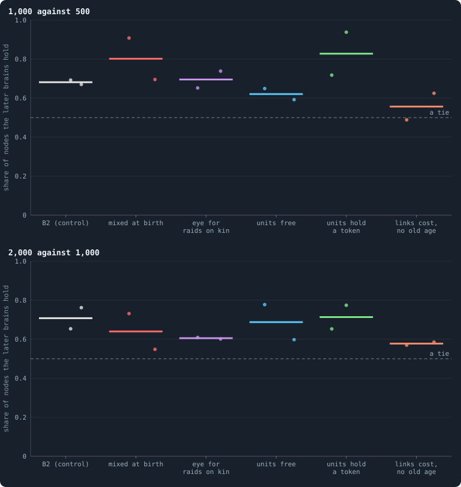
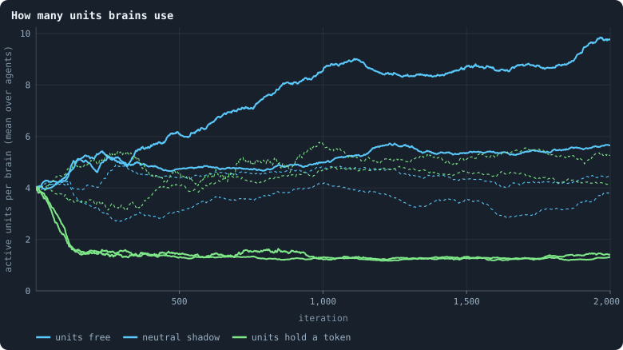

# Brains mixed at birth, units that cost, an eye for raids on kin

> [!question] Questions of this page
> - If a newborn's brain is mixed from its parent's and a neighbour's, the way
>   sexual reproduction mixes genes, does evolution find more?
> - If every unit of a brain has to hold one of its agent's tokens, how large do
>   brains become, and does evolution go on?
> - Does an input that says *this neighbour took a node from my own kind*
>   change who attacks whom?
> - And what becomes of a world where every link holds a token and nobody dies
>   of age?

[Why evolution stops](why-evolution-stops.md) asked why evolution slows down in these
worlds, and the lifetime contests of
[The switches the world was built with](the-switches-the-world-was-built-with.md) showed that in B2's family of worlds it does not quite stop: brains of 1,000
iterations still beat those of 500 two times out of three. This page tries
three more changes, each aimed at a different part of how evolution works:

- **how variation is made** — brains mixed at birth;
- **what a brain costs** — every active unit holds a token;
- **what an agent can see** — an input for raids on its own kind.

## What was built

Every world is B2 at 10,000 tokens (Experiment 16's settings), played for
2,000 iterations, two seeds each, as pilot worlds (research/oee/pilots,
`jobs_Q.txt`):

| switch | what it does | compared with |
|---|---|---|
| `mix` | A newborn's brain is mixed from its parent's and a mate's — a neighbour of the parent, drawn at random. Each hidden unit (its incoming weights, its bias and its outgoing weights together) and each output bias comes from one or the other, with an even chance. The mixture is a new genotype, then mutated as any copy is. | B2 |
| `took_kin` | One more input per neighbour: did it, in the last game, take a node held by an agent of my genotype? | B2 |
| `unit_token` | Brains that can grow (up to 32 hidden units, switched on and off by mutation), where every active unit holds one of its agent's tokens. A unit switched on is paid for, one switched off pays its token back, and what an agent cannot pay for stays off. | the same growable brains with units free |
| `link_token`, no old age | Every link holds a token, paid by whoever makes it; no cap on links (valence 0) and no age limit. | — |

Each is judged as [The switches the world was built with](the-switches-the-world-was-built-with.md)
judged the switches, by **lifetime contests**: the brains of a later moment
against those of an earlier one, half and half on the same world, for 100
iterations, once in each moment's world. If the later brains hold more than
half of the nodes at the end, evolution went somewhere between the two
moments.

<!-- figure ideas/contests -->

**Does evolution go on?** Lifetime contests (T = 100 iterations): the brains of a later moment against those of an earlier one, half and half on the same world, in each moment's world; the share of nodes the later brains hold, averaged over the two. Above a half the later brains are better. Each dot is a world.

> [!example]- How to make this figure
> **Runs.** Pilot worlds of 10,000 tokens with B2's settings, two seeds each, 2,000 iterations (`GraphOfLifeRuns/.pilots/Q/`, `research/oee/pilots/jobs_Q.txt`): `mix`, `took_kin`, growable brains (`brain_kind = grow`, up to 32 units) with units free and with `unit_token`, and `link_token` with `valence = 0` and `max_age = 0`; the control is batch P's B2 worlds of the same settings and seeds.
>
> **Data.** From `GraphOfLifeRuns/.pilots/batch_Q_T100.json`, `batch_P_T100.json` (`research/oee/checks/rejudge.py --T 100`).
>
> 1. Play each pair of moments for 100 iterations in each moment's world; average.
>
> **To make it again:** `python3 book_figures.py ideas`.
<!-- /figure -->

## Brains mixed at birth

Mixing changes the worlds first. They are a quarter of B2's size (750–980
agents against 3,200–3,650), with twice B2's conquest (10–13 nodes taken per
100 agents a game against about 6), and more of what is taken goes round:
the circulating share of the takeovers' flow over fifty games
([Gliders, and who helps whom](gliders-and-who-helps-whom.md)) is 0.63–0.64 against
0.49–0.51 for its sign-flip null, where B2 has 0.39–0.42 against 0.34–0.35.

And evolution goes on, in one world strongly. In the first world the brains of
1,000 hold nine tenths of the nodes against those of 500 (0.91), and those of
2,000 three quarters against those of 1,000 (0.73) — the largest steps of any
pilot world so far. The second world moves like B2 (0.70, then 0.55; B2
0.67–0.69, then 0.65–0.76).

> [!warning] A first count was wrong
> The first time these contests were counted, mixed worlds came out the other
> way: later brains *lost*. The cause was in how a contest tells the two sides
> apart. It labels each brain by a number: the earlier moment's below a
> million, the later one's above. A brain copied without change keeps its
> parent's number, so children belong to their parent's side. But a mixed brain
> is a new genotype and draws a fresh number, which in these worlds is always
> below a million: every child born during a contest was counted for the
> *earlier* side, whoever its parent was. The contest now follows a new brain's
> ancestry back to the brain it was copied from (`tourney.contest`), and all of
> the mixed worlds were judged again. No other contest was touched: without
> mutation, mixing is the only way a new number appears during one.

Why would mixing help? A mixed child inherits whole units from two unrelated
brains. A unit that does something useful can spread through the population
without carrying the rest of the brain it arose in, and two useful units that
arose in different lineages can meet in one child. That is the classical
argument for sex. Here it is a hypothesis: two seeds, small and combative
worlds, and no test yet of which of these does the work.

## Units that hold a token

Where units are free, brains grow. Over 2,000 iterations the mean number of
active units rose from 4 to 5.6 in one world and to 9.8 in the other, the
second far above the **neutral shadow** — a unit that mutates like the others
but does nothing, which shows where the count would drift if selection did
not care (3.9 there). So in a world where it costs nothing, a larger brain is
selected for.

<!-- figure ideas/units -->

**How many units brains use.** Growable brains of up to 32 hidden units, where switching a unit on is free (blue) and where every active unit holds one of its agent's tokens (green). The dashed lines are each world's neutral shadow: the same count for a unit that mutates but does nothing, which is where the number would sit if selection did not care.

> [!example]- How to make this figure
> **Runs.** Pilot worlds of 10,000 tokens with B2's settings, two seeds each, 2,000 iterations (`GraphOfLifeRuns/.pilots/Q/`, `research/oee/pilots/jobs_Q.txt`): `mix`, `took_kin`, growable brains (`brain_kind = grow`, up to 32 units) with units free and with `unit_token`, and `link_token` with `valence = 0` and `max_age = 0`; the control is batch P's B2 worlds of the same settings and seeds.
>
> **Data.** From each world's `series.jsonl` (`activeMean`, `shadowMean`).
>
> 1. Read the mean number of active units, and of the shadow's, every 50 iterations.
>
> **To make it again:** `python3 book_figures.py ideas`.
<!-- /figure -->

Where every unit holds a token, brains shrink: from 4 units to about 1.3
within 200 iterations, and they stay there, far below their shadow (4.1 and
5.3). A unit is worth less than the token it holds. The worlds are smaller
(1,150–1,440 agents), and yet from 500 to 1,000 their evolution is stronger
than that of the same brains with free units: the brains of 1,000 hold 0.72 and
0.94 of the nodes against those of 500, where free units give 0.59 and 0.65.
From 1,000 to 2,000 the two are alike (0.65 and 0.77 against 0.60 and 0.78),
and like B2.

A brain of one or two units is a very small target for mutation: almost every
change touches something that matters. That may be why selection keeps finding
improvements; it is a guess to test, not a finding.

## An eye for raids on kin

The input changed nothing that was measured. The worlds are B2's size
(3,540–3,560 agents), evolution goes on at B2's pace (0.65–0.74 from 500 to
1,000, 0.60–0.61 from 1,000 to 2,000, against 0.67–0.69 and 0.65–0.76), and
help between neighbours stays at B2's level. Like the inputs of
[Gliders, and who helps whom](gliders-and-who-helps-whom.md), it tells an agent something its
rules give it no reason to act on.

## Links that hold a token, and nobody dies of age

With a token in every link and no age limit, the worlds froze. After the first
few hundred iterations births and deaths nearly stopped — some 250–300 births
in the next 1,700 iterations, in worlds of 1,600–1,900 agents — and at 2,000
iterations the mean age is about 1,600. Conquest almost stopped (0.1–0.6 nodes
taken per 100 agents a game), and the contests are near a tie or a little above
(0.49–0.63, the mean of each pair of moments), since the only way a brain can
spread is to take a node. The network is fine — one piece, nothing cut off,
6.1–6.9 links per agent — but little happens in it. With the age limit, the same
rule keeps a healthy world whose evolution goes on more strongly than B2's
(the brains of 1,000 hold 0.83 and 0.93 of the nodes against those of 500;
[Rules without numbers](rules-without-numbers.md)).

## What this says

- **Three changes gave the largest steps of evolution yet: mixing brains at
  birth (in one of two worlds, at every step), making units cost a token (in
  both worlds, from 500 to 1,000), and making links hold a token (in both
  worlds, at both steps; [Rules without numbers](rules-without-numbers.md)).** All three
  change how variation is made or what structure costs — what a mutation can
  reach, what a unit or a link has to earn — not what agents see. None is yet
  shown to keep evolution going longer than B2 does.
- **A cost turns size into a choice.** Free units grow beyond their neutral
  drift; units that cost a token shrink to almost nothing. Neither rule needs a
  number for the size of a brain.
- **Information alone changes nothing**, here as in [Gliders, and who helps whom](gliders-and-who-helps-whom.md): an input is
  only as useful as the rules make acting on it.
- **A world without death freezes**, even with a healthy network: turnover is
  what selection works on.
- Two seeds each are pilots. Mixing and costly units are candidates for an
  experiment of ten worlds, run longer, beside B2.

**Related notes:** [How a brain changes](mutation.md) ·
[Genotypes and the family tree](genotype.md) ·
[The invasion test](invasion-test.md) ·
[What the brains are like](what-the-brains-are-like.md) ·
[Why evolution stops](why-evolution-stops.md) ·
[The switches the world was built with](the-switches-the-world-was-built-with.md)

<!-- turns -->
---

← [Who inherits?](who-inherits.md) · [Changing the rules](../README.md#changing-the-rules) · [Links to strangers](links-to-strangers.md) →

**Also about:** [Brains, and how alike agents are](../README.md#brains-and-how-alike-agents-are).

> [!info]- Pages that link here (9)
> [Every setting](settings.md) · [Flow modules: the groups tokens stay in](flow-modules.md) · [How alike the agents are](how-alike-the-agents-are.md) · [Rules without numbers](rules-without-numbers.md) · [Brains mixed at birth, with every other rule](mixing-with-every-other-rule.md) · [Eight switches at once](eight-switches-at-once.md) · [Healthy and rich](healthy-and-rich.md) · [Mixed at birth: ten long worlds](mixed-at-birth-ten-long-worlds.md) · [Every simulation: what was run, and what was measured](every-simulation.md)
<!-- /turns -->
