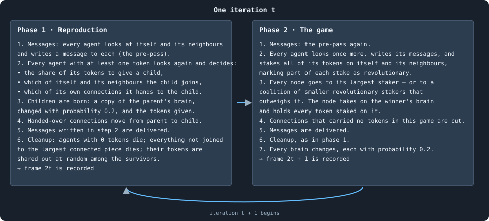
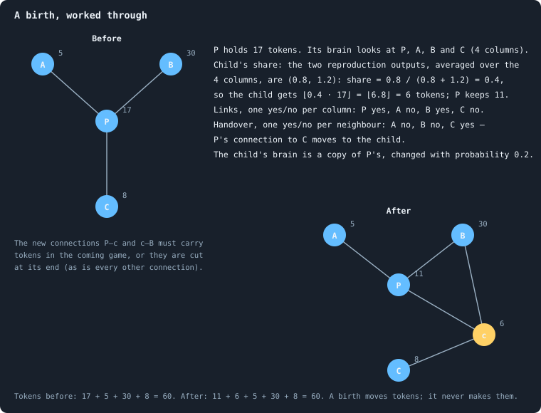
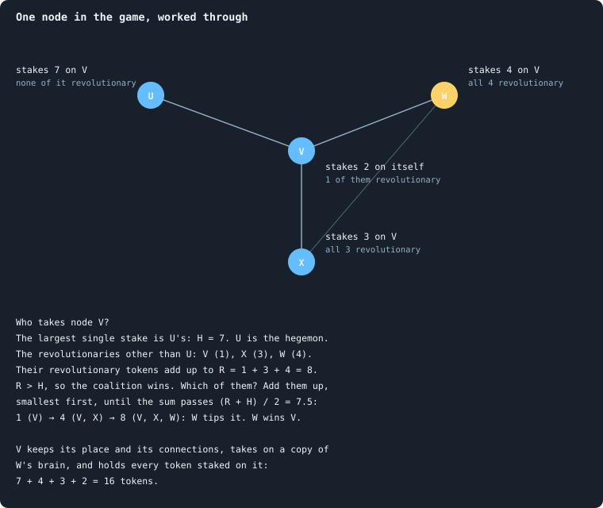
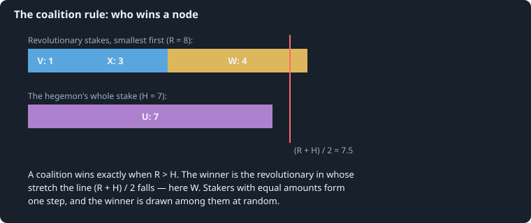
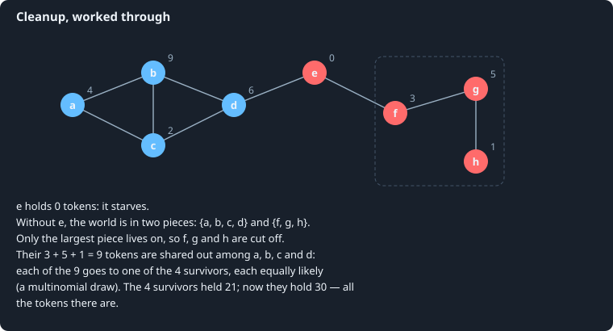
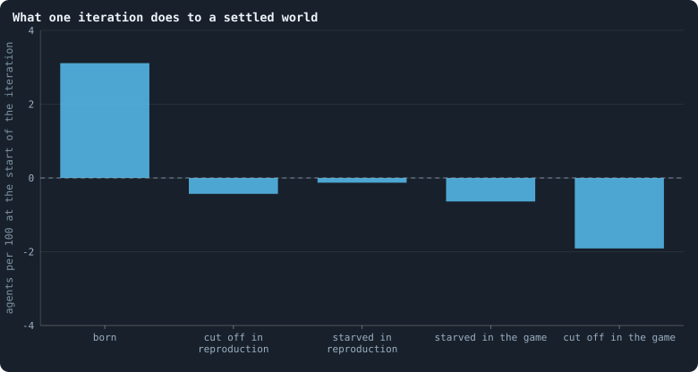

# One iteration, step by step

> [!question] Questions of this page
> - In what order does everything happen in one iteration?
> - How exactly does a decision of the brain turn into [tokens](the-world.md#agents-and-tokens "The one thing of value in a world: every agent holds a whole number of them, and their total never changes.") moved,
>   children born and [nodes](the-world.md#agents-and-tokens "One member of a world: it lives on a node of the network, holds tokens and has a brain that takes all its decisions.") won?
> - Why does the number of tokens never change?
> - What does one iteration do, on average, to a settled world?

## In short

An iteration is one step of a world's time: first reproduction, then the
game. In reproduction, agents give part of their tokens to children, who join
their neighbourhood. In the game, every agent stakes all its tokens on itself
and its [neighbours](the-world.md#the-network "An agent joined to another by a connection."); each node goes to its largest staker or to a coalition.
After each phase, a cleanup removes agents without tokens and every piece cut
off from the rest, and shares out their tokens. In a settled world one
iteration replaces about three agents in a hundred, while more than half of
the nodes take on another agent's brain.

## The picture

Think of an iteration as one round of a board game that every agent plays at
once. First, each agent may split off a child: it gives the child some of its
tokens, and the child takes a new place nearby. Then every agent bets all its
tokens on the places around it, its own included. Each place goes to the
biggest bet, or to a group of smaller bets that band together. The place
keeps every token bet on it, and the winner's brain is copied into it. After
each of the two moves the board is tidied: whoever holds nothing, or is no
longer connected to the main board, leaves it.

Time in a world advances in **iterations**, *t* = 0, 1, 2, …. Every iteration
has two phases: first **reproduction**, then **the game**. This page goes
through both in the exact order the program runs them. Where the brain is
asked for a decision, this page only says *which* decision and how its answer
is used. [The brain](the-brain.md) says how the brain arrives at it.

## Three tools used everywhere

A brain speaks in real numbers, such as 0.73 or −1.4. But the world deals in
whole tokens and plain yes-or-no answers. Three small rules translate the one
into the other. Each has a page of its own, with examples.

**A share from two numbers.** Many decisions come out of the brain as a pair
of real numbers (*a*, *b*), to be turned into a share between 0 and 1.
Negative values count as zero, and the share is *a*'s part of the total
([The share function f(a, b)](share-function.md)):

$$
f(a, b) = \frac{\max(a, 0)}{\max(a, 0) + \max(b, 0)}, \qquad f(a, b) = \tfrac12 \ \text{ if } a \le 0 \text{ and } b \le 0 .
$$

If both numbers are zero or less, the share is one half. For example,
*f*(0.8, 1.2) = 0.8 / 2 = 0.4, *f*(3, −1) = 1 and *f*(−2, −5) = ½.

**A yes-or-no decision, read as the brain chooses.** A yes-or-no decision
comes out of the brain as two pairs. The first, (*y*, *n*), says how strongly
the brain says yes and no. The second, (*m*₁, *m*₂), says how it wants the
first pair read. If *m*₁ > *m*₂, the answer is yes with probability
*f*(*y*, *n*). Otherwise the larger of *y* and *n* wins outright, and an
exact tie is decided by a fair coin
([A yes-or-no decision](binary-decision.md)). Say (*y*, *n*) = (0.8, 1.2).
Read as a probability, the answer is yes four times in ten; read sharply, it
is always no.

**Splitting whole tokens.** Tokens often have to be split among the
**candidates**, the agent itself and its neighbours, in proportion to scores.
Negative scores count as zero. If no score is above zero, the tokens are
split evenly over all the candidates. In a settled world, about half of all
agents stake that way ([What the brains are like](what-the-brains-are-like.md)).
Every candidate first gets its exact share rounded down. The tokens left over
then go one each to the candidates that lost the most in the rounding: the
*largest-remainder* method. No token is lost or made
([Splitting tokens into whole numbers](largest-remainder.md)).

For example, split 11 tokens by the scores (2, 1, −0.5, 0.5). The negative
score counts as 0, so the scores add up to 3.5, and the exact shares are
6.29, 3.14, 0 and 1.57. Rounded down they are 6, 3, 0 and 1, which make 10.
The one token left goes to the last candidate, which lost the most (0.57).
So splitting 11 tokens by the scores (2, 1, −0.5, 0.5) gives (6, 3, 0, 2).

## Phase 1: reproduction

In reproduction, an agent may split itself in two. It gives some of its
tokens to a child, who appears on a new node with a copy of its brain. The
parent chooses whom the child is joined to, and may hand it some of its own
[connections](the-world.md#the-network "A link between two agents of the network: they are neighbours, and can stake on each other's nodes."). The picture works one birth through by hand:

Exactly, the phase runs in six steps.

1. **Measure.** The tokens and [degree](degree.md "The number of an agent's connections: how many neighbours it has.") of every agent, and the summaries of
   every neighbourhood, are measured once, now. Every decision in this phase
   reads these numbers. So the order in which agents act does not change what
   they see.
2. **Everyone speaks.** Every agent looks at its candidates — itself and its
   neighbours, in increasing order of id — and writes a message to each. A
   message is a list of numbers that the other's brain will read. The
   messages are delivered before anyone acts ([Messages](messages.md)).
3. **Every agent with tokens decides.** The agents are taken one at a time,
   in increasing order of id. Agent *u*, holding τ(*u*) ≥ 1 tokens, looks at
   its candidates again. Its brain gives one column of outputs per candidate
   ([What a brain says](brain-outputs.md)). From them:
   - **How much to give a child.** The two child-share outputs are averaged
     over all of *u*'s columns, giving (*ā*, *b̄*). The child gets the share
     *f*(*ā*, *b̄*) of the parent's tokens, rounded down:
     $c = \lfloor f(\bar a, \bar b) \cdot \tau(u) \rfloor$ tokens. A parent
     of 17 tokens with averages (0.8, 1.2) gives ⌊0.4 · 17⌋ = 6. If *c* = 0,
     there is no child, and *u* is done.
   - **The child is born.** It gets a new node and the next unused id, and
     holds *c* tokens; the parent keeps τ(*u*) − *c*. The child's brain is a
     copy of the parent's, which then changes with probability 0.2
     ([How a brain changes](mutation.md)). A changed brain is a new [genotype](genotype.md "The identity of a brain: a number that a brain keeps until it changes, and that records whose copy it was."):
     a new identity, passed on to its copies.
   - **Whom the child joins.** For each candidate, the parent itself
     included, a yes-or-no decision: join the child to it or not. These
     connections are made at once.
   - **Which connections to hand over.** For each neighbour *v* of the
     parent, a yes-or-no decision: give the connection {*u*, *v*} to the
     child. These are noted, not yet done.
4. **Handovers.** After every agent has decided, each noted connection moves:
   {*u*, *v*} is removed, and {child, *v*} added unless the child is already
   joined to *v*. The moves are made in the order the parents acted. If both
   ends of a connection handed it over, only the first move happens: by the
   second, the connection is gone.
5. **Messages** written in step 3 are delivered.
6. **Cleanup** (below).

Children born in this phase do not reproduce in it themselves. The list of
agents in step 3 is made before the first child is born. Nor does any agent
find them among its candidates, which were measured in step 1.

Two kinds of death follow from this phase. A child joined to nobody is not
part of the world's network. The cleanup removes it at once, and shares its
tokens out among the survivors. And a parent that gave all its tokens
(*f* = 1) is left with none, and starves in the same cleanup.

## Phase 2: the game

In the game, every node is up for grabs. Every agent stakes all its tokens on
its own node and its neighbours' nodes. Each node goes to whoever staked most
on it, unless smaller stakers band together against that one. The winner's
brain is copied into the node, and the node keeps every token staked on it,
the losers' too. The picture works one node through by hand:

Exactly, the phase runs in nine steps.

1. **Measure**, as in phase 1.
2. **Everyone speaks**, as in phase 1.
3. **Everyone stakes.** Every agent looks at its candidates once more, and
   writes its messages again. If it holds τ(*u*) ≥ 1 tokens, it stakes
   **all** of them on its candidates. Its brain gives one **stake score** per
   candidate, and a pair, averaged over its columns, that says how to use the
   scores:
   - *spread* (if the pair's first number is larger): the τ(*u*) tokens are
     split in proportion to the scores, by largest remainder;
   - *all in* (otherwise): all τ(*u*) tokens go to the candidate with the
     highest score (the first one in candidate order, if several tie).

   For each candidate that receives *a* > 0 tokens, a further pair of outputs
   gives a share *f*. Of the *a* tokens, ⌊*f* · *a*⌋ are marked
   **revolutionary**: they can count for a coalition against the largest
   staker.
4. **Every node goes to someone.** For each node *v*, collect every stake
   placed on it, including its own agent's. Let *H* be the largest single
   stake, and *h* the agent who made it: the **hegemon**. A tie is broken at
   random. Let the **coalition** be every other staker who marked part of its
   stake on *v* revolutionary, and *R* the sum of those revolutionary parts.
   The coalition wins when its revolutionary tokens together outweigh the
   hegemon's whole stake:

   $$
   \text{the coalition wins} \iff R > H .
   $$

   Its winning member is then found like this. Sort the coalition from the
   smallest revolutionary part to the largest, and add the parts up in that
   order. The winner is the member at whose part the running sum first
   exceeds (*R* + *H*)/2. Members with equal parts are added together, and
   one of them is drawn at random. If the coalition does not win, the hegemon
   does. [How a coalition takes a node](revolution.md) derives this rule from
   the program's and works an example.

   Whoever wins, two things happen to node *v*. It takes on a **copy of the
   winner's brain**, and it holds **every token staked on it**: the
   winner's, the losers', its own. The node keeps its id and its age; only
   its brain changes. A node on which nobody staked anything is left with no
   tokens, and starves in the cleanup.
5. **Unused connections are cut.** A connection across which no tokens were
   staked in this game, in either direction, is removed. So a connection a
   newborn got in phase 1 survives only if it carries tokens now.
6. **Messages** are delivered.
7. **Cleanup** (below).
8. **Change.** Every brain in the world changes with probability 0.2,
   independently, brain by brain ([How a brain changes](mutation.md)).
9. **Forgetting.** Messages to or from anyone who is no longer a neighbour
   are deleted.

Here is step 4 for the node of the picture above. The hegemon staked *H* = 7.
The coalition's revolutionary parts are 1, 3 and 4, so *R* = 8 > 7. The
running sum goes 1, 4, 8, and first passes (8 + 7)/2 = 7.5 at the largest
part, 4, whose staker takes the node:

The game is a version of **Colonel Blotto** (Borel 1921). In that game,
players spread a fixed force over several battlefields, and each battlefield
goes to whoever committed more to it. Here every node is a battlefield, and
every agent a player who can only reach its own neighbourhood. Winning a
battlefield wins its tokens and plants the winner's brain there.
[The ideas this builds on](the-ideas-this-builds-on.md) says more.

## Cleanup

After each phase, the world tidies itself up. Whoever has nothing left dies,
and so does every part of the network that has come loose from the main
piece. Whatever the dead held is dealt out to the living. The picture works
one cleanup through by hand:

Exactly, the cleanup has three steps.

1. **Starvation.** Every agent holding no tokens dies.
2. **Cut off.** Of the network that remains, only the **largest connected
   piece** survives. Every agent that cannot reach it along connections dies.
3. **Sharing out.** All tokens held by the agents who died are pooled; only
   the cut-off ones hold any. They are dealt out among the survivors, each
   token to a survivor chosen uniformly at random. This is one multinomial
   draw: as if every token were thrown, blindly, into one of the survivors'
   purses.

If an iteration ends, after its game, with 20 agents or fewer, the world
counts as **extinct**. Then the run stops ([When a world ends](extinction.md)).

[Births and the four ways to die](births-and-deaths.md) sums up who dies
where: starved or cut off, after reproduction or after the game.

## Why the tokens add up

The total *T* never changes, and the reason can be checked rule by rule:

- A birth moves *c* tokens from parent to child.
- In the game, every agent stakes exactly its τ(*u*) tokens: the
  largest-remainder split loses none, and all-in puts all on one. Every
  staked token lands on exactly one node, which keeps it. So the tokens held
  after the game are a rearrangement of those staked.
- The cleanup gives every token of the dead to a survivor.

So after every phase, Σ τ(*u*) = *T*.

## What an iteration does, on average

Once a world has settled, from about iteration 500 on
([A world's life](a-worlds-life.md)), how many agents does one iteration add
and remove? Here is the average over iterations 500 to 2,999 of the 26
[baseline](b1-and-b2.md "The stated rules an experiment starts from and changes one thing of: B1 or B2.") worlds that lived that long. It is counted per hundred agents alive
at the start of the phase:

<!-- figure iteration/flows -->

**What one iteration does to a settled world.** Agents added (above zero) and removed (below), per 100 agents alive at the start of an iteration, averaged over iterations 500 to 2,999 of the 26 worlds that lived to the end, pooled: every iteration of every world counts once. The bars add up to 0.00: the population hardly changes from one iteration to the next, while about three in a hundred agents are replaced.

> [!example]- How to make this figure
> **Runs.** The 26 surviving ones of the 30 baseline runs `B1-10000-s001` … `B1-10000-s030`: the baseline B1 at 10,000 tokens, seeds 1 to 30, 3,000 iterations each (every setting is listed in [A world's life](a-worlds-life.md)). They are made with `python3 gol_lab.py run E02`.
>
> **Data.** From each run's `GraphOfLifeRuns/<run>/stats.jsonl`, which holds one row per recorded phase: `phase` 1 is the world just after reproduction, `phase` 2 just after the game, and every statistic is a field of the row (see [What a run records](frames-and-stats.md)).
>
> 1. For every iteration 500 ≤ t ≤ 2,999 of every run, take from the row with `phase` = 1: `nodes_before`, `births`, `orphaned`, `starved`; from the row with `phase` = 2: `starved`, `orphaned`.
> 2. Sum each over all iterations and runs; divide by the sum of `nodes_before` of the rows with `phase` = 1, and multiply by 100.
>
> **To make it again:** `python3 book_figures.py iteration`.
<!-- /figure -->

Of every 100 agents alive at the start of an iteration, about 3.1 have a
child that is born. About as many die:

- 0.4 are cut off during reproduction, most of them newborns joined to no
  one;
- 0.1 are parents that gave everything;
- 0.6 starve in the game: no one, not even they themselves, staked a token on
  their node;
- 1.9 are cut off in the game, when the connections that held their part of
  the network were cut.

So the population hardly moves from one iteration to the next, while three in
a hundred of its members are replaced.

But the game changes far more than that. In a settled baseline world, only
about 45% of agents keep their node through a game. The rest take on another
agent's brain ([How the game is played](how-the-game-is-played.md)). The
members of a world stay; their brains are replaced all the time.

## Where to go next

- [The brain](the-brain.md): how the brain arrives at each decision.
- [How a coalition takes a node](revolution.md): the coalition rule, derived
  and worked through.
- [Births and the four ways to die](births-and-deaths.md): who dies where,
  and how often.
- [How the game is played](how-the-game-is-played.md): what the baseline's
  brains actually stake.

<!-- turns -->
---

← [The world: tokens, agents and a network](the-world.md) · [How the simulation works](../README.md#how-the-simulation-works) · [The brain](the-brain.md) →

> [!info]- Pages that link here (40)
> [What this notebook is about](what-this-notebook-is-about.md) · [Glossary](glossary.md) · [The ideas this builds on](the-ideas-this-builds-on.md) · [The world: tokens, agents and a network](the-world.md) · [The brain](the-brain.md) · [Questioning the mechanics](questioning-the-mechanics.md) · [Every setting](settings.md) · [The share function f(a, b)](share-function.md) · [A yes-or-no decision](binary-decision.md) · [Splitting tokens into whole numbers](largest-remainder.md) · [What a brain says](brain-outputs.md) · [Messages](messages.md) · [How a coalition takes a node](revolution.md) · [When a world ends](extinction.md) · [B1 and B2: the two baselines](b1-and-b2.md) · [What B1 is, and what stood in its way](what-the-baseline-world-is.md) · [The life of a B1 world](a-worlds-life.md) · [Building B2: a world that cannot break](a-world-that-cannot-break.md) · [Births, deaths and ages](births-deaths-and-ages.md) · [How births build the network](how-agents-have-children.md) · [Births and the four ways to die](births-and-deaths.md) · [The estate of the dead](estate.md) · [Reproduction statistics](reproduction-statistics.md) · [Gains and losses](gains-and-losses.md) · [How the game is played](how-the-game-is-played.md) · [The even split](even-split.md) · [Staking at home, and keeping one's node](home-stake.md) · [Token flow](token-flow.md) · [What shape does the network take?](what-shape-does-the-network-take.md) · [How a world breaks](how-a-world-breaks.md) · [Core, trees and leaves](core-trees-leaves.md) · [Cut risk](cut-risk.md) · [Physical inspiration](physical-inspiration.md) · [Worlds of many sizes](how-does-a-worlds-size-follow-its-tokens.md) · [Do the brains matter?](do-the-brains-matter.md) · [How a signal fades through layers](vanishing-signal.md) · [Eras and contests: does a world keep getting better?](eras-and-contests.md) · [Help](help.md) · [The health bar](health-bar.md) · [The lab, the engine and pilots](the-lab.md)
<!-- /turns -->
