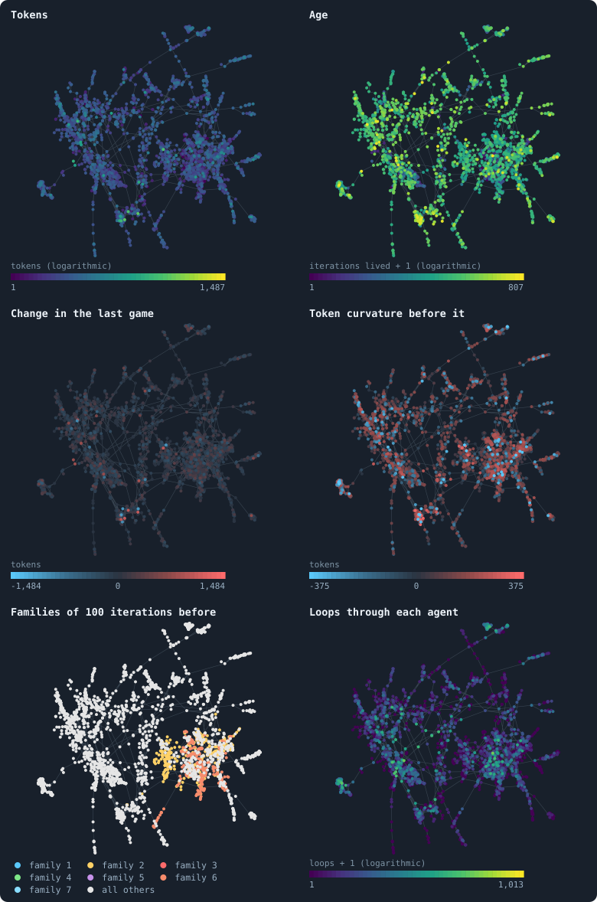
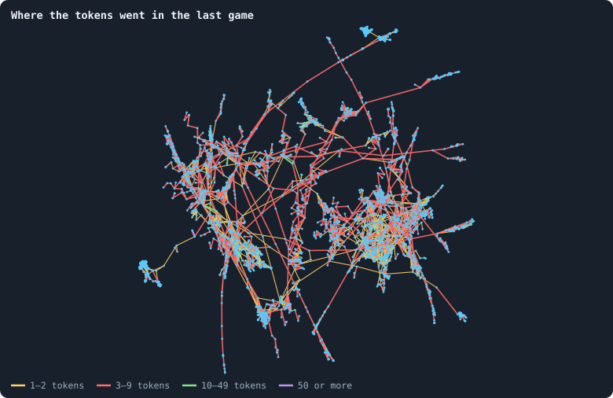

# One world, many colours

Statistics average. A picture does not: it shows **where** things are — which
[agents](the-world.md#agents-and-tokens "One member of a world: it lives on a node of the network, holds tokens and has a brain that takes all its decisions.") are rich, which are old, which belong together. The viewer draws a
world as dots and lines and can colour them by any quantity it measures
([What the viewer can colour by](viewer-colours.md)). This page
takes one world, the world of [seed](random-numbers.md "The number that fixes every random choice of a run: the same settings and the same seed make the same world.") 1 after its last [game](one-iteration.md#phase-2-the-game "The second phase of an iteration: every agent stakes all its tokens on its own node and its neighbours', and every node goes to someone."), draws a piece of
it once, and colours that one drawing six ways, then its [connections](the-world.md#the-network "A link between two agents of the network: they are neighbours, and can stake on each other's nodes.") by the
[tokens](the-world.md#agents-and-tokens "The one thing of value in a world: every agent holds a whole number of them, and their total never changes.") that crossed them. Each picture is read for what it shows, and for the questions
it raises.

> [!question] Questions of this page
> - How is a network drawn, and what does the position of a dot mean?
> - Where in a world are the rich, the old, the gaining, the hills and the
>   valleys of wealth?
> - Do the descendants of one ancestor live together?
> - Which connections carry the tokens?

The world is one of the thirty of 100,000 tokens of [Thirty worlds](thirty-worlds.md).

<!-- runs E10 -->
> [!info]- The runs behind this page
> **30 runs.** Every condition below is run once for every seed (1 to 30), for 1,500 iterations — or until its world dies out. Every setting is that of the baseline **B1** (the algorithm exactly as a new run is offered it) unless the condition changes it.
>
> - **baseline** — changes nothing: B1 as it is; 100,000 tokens. Runs `B1-100000-s001` … `B1-100000-s030`.
>
> To make these runs again: `python3 gol_lab.py run E10`, or ▶ in the Research Notebook tab of a computer running `gol_server.py`. Each run writes its settings, seed and engine version beside its frames, in `GraphOfLifeRuns/<run>/meta.json` and `provenance.json`.

> [!info]- Every setting of these runs
> | setting | baseline | what it is |
> |---|---|---|
> | [`total_tokens`](settings.md#total_tokens) | 100,000 | The number of tokens in the world, *T*. It never changes during a run. |
> | [`n_nodes`](settings.md#n_nodes) | 0 | How many founders the world starts with. 0 means one founder per hundred tokens: *n* = ⌊*T* / 100⌋. |
> | [`k_neighbors`](settings.md#k_neighbors) | 0 | How many neighbours each founder starts with in the ring. 0 means *k* = max(⌊*n* / 100⌋, 5); an odd *k* is wired as *k* − 1. |
> | [`rewire_p`](settings.md#rewire_p) | 0.2 | In the starting ring, the probability that a connection is moved to a founder chosen at random (Watts–Strogatz). |
> | [`hidden_layers`](settings.md#hidden_layers) | 50, 45, 40, 35, 30 | The widths of the brain's hidden layers, in order from input to output. |
> | [`brain_kind`](settings.md#brain_kind) | float16 | How weights are stored: `float` (64-bit), `float16` (16-bit, computed in 64-bit) or `binary` (−1, 0, +1). |
> | [`brain_bits`](settings.md#brain_bits) | 16 | Only for binary brains: how many input rows encode one number. Unused by float and float16 brains. |
> | [`message_amount`](settings.md#message_amount) | 30 | How many numbers one message holds. Each agent sends one message to itself and one to each neighbour, every phase. |
> | [`random_input_amount`](settings.md#random_input_amount) | 5 | How many random numbers, drawn uniformly from −2 to 2, a brain reads per neighbour, every time it looks. |
> | [`exchange_messages`](settings.md#exchange_messages) | on | Whether agents send and read messages at all. |
> | [`message_prepass`](settings.md#message_prepass) | on | Whether every phase begins with an extra look in which agents only write messages, so the look that acts reads messages written this phase. |
> | [`allow_handover`](settings.md#allow_handover) | on | Whether a parent may move some of its own connections to its newborn child. |
> | [`allow_revolutions`](settings.md#allow_revolutions) | on | Whether a coalition of smaller stakers can take a node from its largest staker (see the note *How a coalition takes a node*). |
> | [`allow_gifting`](settings.md#allow_gifting) | off | Whether agents may give tokens to neighbours during reproduction. Off in both baselines; on in a few pilots, in Experiment 24 and in half the worlds of the screen. |
> | [`random_decisions`](settings.md#random_decisions) | off | The control: every number a brain would produce is replaced by a random draw from the standard normal distribution. |
> | [`prune_after`](settings.md#prune_after) | blotto | After which phase connections that carried no tokens are cut: `blotto` (the game), `reproduction`, or `both`. |
> | [`inactive_window`](settings.md#inactive_window) | phase | How long a connection may go unused: `phase` means it must carry tokens in the phase being judged; `iteration` allows the two last phases. |
> | [`redistribution`](settings.md#redistribution) | uniform | How the tokens of removed agents are shared: `uniform` gives every survivor the same chance at each token; `by_tokens` weights by what a survivor holds; `poorest` raises the poorest to one common level first; `newborns` gives them to this iteration's children, `parents` to their parents, once per child (both `uniform` in an iteration without births); `children` leaves each dead agent's estate to its own living children (`uniform` where there are none). |
> | [`tokens_created_per_phase`](settings.md#tokens_created_per_phase) | 0 | Tokens added to the world at every cleanup. 0 keeps the supply fixed. |
> | [`mutate_on_replication`](settings.md#mutate_on_replication) | off | Whether a brain changes only when it is copied — into a newborn, or into a node its owner has just won — instead of also after every game, wherever it sits. |
> | [`incumbency`](settings.md#incumbency) | 1.0 | How many times over an agent's stake on its own node counts when the game decides who takes the node. 1 is the old rule. |
> | [`birth_links`](settings.md#birth_links) | 0 | How many of its parent's neighbours a newborn is joined to, drawn at random, besides its parent itself; 0 leaves every link to the brain's choice. |
> | [`mend_on_death`](settings.md#mend_on_death) | off | Whether the neighbours of an agent that dies are joined up where its death would leave them in separate pieces. |
> | [`prune_needs`](settings.md#prune_needs) | 0 | How many neighbours the two ends of an unused connection must share for it to be cut; 0 cuts every unused connection. |
> | [`valence`](settings.md#valence) | 0 | The most connections an agent's brain may choose to hold (0 = no limit). An agent at its limit cannot have a child. |
> | [`keep_home`](settings.md#keep_home) | 0.0 | The share of an agent's tokens — rounded up, never less than one — that stays on its own node whatever its brain says; a parent also keeps one. 0 is the old rule. |
> | [`max_age`](settings.md#max_age) | 0 | The age at which an agent dies (0 = never); its tokens are shared out like those of any other dead agent. |
> | [`buy_life`](settings.md#buy_life) | off | Whether an agent that has reached max_age may live on by paying one token an iteration into the estate of the dead — never its last, so one with a single token left dies. Needs max_age. |
> | [`min_child`](settings.md#min_child) | 1 | The fewest tokens a child can be born with; a parent that would give less has no child. |
> | [`child_floor`](settings.md#child_floor) | fixed | The least a child may start with: min_child alone (fixed), or also the median holding of its parent's neighbours (neighbours), so that a world grows only as rich as it is. |
> | [`mix_at_birth`](settings.md#mix_at_birth) | off | Whether a newborn's brain is its parent's mixed with a mate's — one of the parent's neighbours, drawn at random — each hidden unit whole from one or the other by an even chance, before it mutates; off, a newborn has a copy of its parent's brain. |
> | [`mix_mates`](settings.md#mix_mates) | any | Under mix_at_birth, who may be the mate: any neighbour of the parent, or only parents — a neighbour with a living child of its own (with none, the newborn's brain is a copy). |
> | [`self_message`](settings.md#self_message) | own | What an agent writes to itself, which each neighbour reads: what its own column says (own), or the largest, number by number, of what it writes to anyone (largest), so that news one column marks reaches every neighbour. |
> | [`link_search`](settings.md#link_search) | off | Whether an agent may reach beyond its neighbours to propose a link: off; jump, a walk as many steps long as the tokens it spends in one iteration, with a link proposed where it ends; walk, a scout that goes one step further in every iteration it pays for; or reach, a jump whose steps are free, as many as the tokens it holds would pay for. A paid step costs one token, paid to the agent it enters, and never the last. |
> | [`link_steering`](settings.md#link_steering) | random | Which way each step of a search goes: to a neighbour drawn at random, or to the one the searcher would most like a link with (looking). |
> | [`link_consent`](settings.md#link_consent) | mutual | Who has to agree to a link a search proposes: both ends (mutual), or only the one who proposes (forced). Nobody at its valence gets a new link either way. |
> | [`proto`](settings.md#proto) | none | Rules first played in the pilots' prototype, by name: came_from and helped_by (an input row each), contest = lottery, pool by genotype or family, kin_sense, tag_rate, mate_pays, grow, unit_token, link_token. Empty in every run but those that ask for one; only the prototype's world plays them (see the settings note). |
> | [`mutation_probability`](settings.md#mutation_probability) | 0.2 | The probability that a brain changes when it is copied to a child, and again, for every brain, after every game. |
> | [`mutation_noise_std`](settings.md#mutation_noise_std) | 0.2 | How large a change to one weight is: a normal draw with standard deviation this times 1/√(fan-in) of its layer. |
> | [`mutation_sparsity`](settings.md#mutation_sparsity) | 0.1 | The share of a brain's numbers a change touches; also the probability, for each weight matrix and bias vector, of a rarer reset that redraws that share of it. |
> | [`extinction_threshold`](settings.md#extinction_threshold) | 20 | A run stops, as extinct, when an iteration ends (after its game) with this many agents or fewer. |
> | seeds | 1 to 30 | one run per seed |
> | iterations | 1,500 | how far each run goes, unless its world dies first |
>
> A value in **bold** differs from the baseline B1.
<!-- /runs -->

## How a network is drawn

A network has no positions; a drawing has to invent them. The usual way is a
**force-directed layout**: every connection pulls its two agents together like
a spring, every pair of agents pushes apart like charges, and the dots are
moved step by step until the forces balance. The pictures here use
ForceAtlas2 (Jacomy, Venturini, Heymann and Bastian 2014), with a fixed seed so
that it can be made again; the viewer does the same thing live, in three
dimensions.

Reading such a drawing needs one rule: **only closeness means anything.**
Agents joined to each other, or to the same [neighbours](the-world.md#the-network "An agent joined to another by a connection."), end up close; a tight
group of mutual connections becomes a clump; a chain becomes an arm. Left and
right, up and down mean nothing — rotate the picture and it says the same.

## Six views of one world

<!-- figure colours/six-views -->

**The world of seed 1 after its last game, six ways.** The world with seed 1 after the game of iteration 1,499, the 2,495 of its 14,870 agents within 25 steps of agent 660,973, the oldest, 806 iterations old — a piece, since a world this large is a tangle when drawn whole: every agent drawn is a dot, every connection between two of them a faint line, and the dots sit in the same places in all six pictures (a ForceAtlas2 layout, seed 1, which pulls joined agents together). Each picture colours the dots by one of the quantities the viewer offers ([What the viewer can colour by](viewer-colours.md)): tokens and age on logarithmic scales; the change of tokens in the last game and the token curvature at its start on a signed scale, blue below zero, red above, dark at zero (both stretched logarithmically, the curvature cut at its 1st and 99th percentile); the family — which of the genotypes alive 100 iterations earlier each agent's genotype descends from, the seven largest in colour; and how many loops of a breadth-first cycle basis pass through each agent.

> [!example]- How to make this figure
> **Runs.** `B1-100000-s001`.
>
> **Data.** From each run's frames, `GraphOfLifeRuns/<run>/frames/`, read with `gol_store.read_frame(run, index)`; frame `2·t` is iteration *t* after reproduction and frame `2·t + 1` after the game.
>
> 1. Read frames `2998` (start of the last game) and `2999` (after it): `ids`, `tokens`, `ages`, `delta`, `brain_ids`, `edges`.
> 2. Curvature: in frame 2998, Σ over neighbours of (their tokens − own tokens).
> 3. Families: read frames 2799 to 2999, note each genotype's parent, and climb from each living genotype to one alive after the game of iteration 1,399.
> 4. Loops: as in [The geometry of a world](the-geometry-of-a-world.md).
> 5. Which agents are drawn: as in [What shape does the network take?](what-shape-does-the-network-take.md) (`book_chapters.society.shown`).
> 6. Lay out with `networkx.forceatlas2_layout(G, max_iter=200, seed=1)` and colour.
>
> **To make it again:** `python3 book_figures.py colours`.
<!-- /figure -->

A world of 14,870 agents drawn whole is a tangle, so the pictures hold a
piece of it: the 2,495 agents within 25 steps of its oldest agent, in the
same places in every picture. What each colouring shows:

- **Tokens.** The rich are scattered: a bright dot here and there, in clumps
  and on arms. No region holds the wealth. The richest agent drawn holds 1,487
  tokens.
- **Age.** Old and young are mixed, but not at random: here and there a
  clump of agents is old together — up to 806 [iterations](one-iteration.md "One step of a world's time: a phase of reproduction, then a phase of the game.") — beside a clump of
  young ones. That is what [Like next to like](like-next-to-like.md) measured:
  ages are alike over two or three steps, as cohorts that arrived and live
  together. (At 10,000 tokens the oldest sat far out on the arms of the
  drawing, and the clumps around the [hubs](stars-and-hubs.md "An agent joined to far more agents than most; a star is a world held together by a single hub.") were younger; one picture is not a
  proof either way.)
- **Change in the last game.** Almost everything is dark: most agents ended the
  game with what they had or close to it ([Gains and losses](gains-and-losses.md)).
  The few bright dots are the big winners and losers of the game.
- **[Token curvature](token-curvature.md "How much richer an agent's neighbourhood is than the agent itself.") before the game.** Blue dots are richer than their
  neighbourhood (hills), red dots poorer (valleys). The hubs are blue, and the
  clump around the largest hub is red: every agent there is poorer than its
  rich neighbour. The landscape of wealth is a set of peaks with valleys
  around them — and tokens flow downhill, from the peaks into the valleys
  ([Gains and losses](gains-and-losses.md)).
- **Families.** Each agent is coloured by the [genotype](genotype.md "The identity of a brain: a number that a brain keeps until it changes, and that records whose copy it was."), among those alive 100
  iterations earlier, from which its own genotype descends
  ([Families](families.md)). The seven largest families of the whole
  world hold 344, 333, 314, 290, 285, 245 and 244 agents — 2,055 of 14,870;
  the other 12,815 belong to smaller ones. (At 10,000 tokens the seven largest
  held 1,040 of 1,336.) And the families **live together**: three of the
  seven fill one region at the lower right of the piece, and the rest of it
  belongs to many smaller families. A family is a region — a small one in a
  large world, where many more lines live side by side
  ([Worlds of 100,000 tokens](worlds-of-100000-tokens.md)).
- **[Loops](loops.md "A path through the network that comes back to where it started without using a connection twice.").** The clumps around hubs carry the loops — up to 1,012 of the
  world's 11,297 independent loops pass through one agent — and the arms carry
  none ([The geometry of a world](the-geometry-of-a-world.md)).

## Where the tokens went

<!-- figure colours/flows -->

**Where the tokens went in the last game.** The same world and layout; every connection is coloured by how many tokens crossed it in the last game, in both directions together, and drawn the wider the more crossed. Every connection that is left carried at least one token — the others were cut at the end of the game. Agents are small dots.

> [!example]- How to make this figure
> **Runs.** `B1-100000-s001`.
>
> **Data.** From each run's frames, `GraphOfLifeRuns/<run>/frames/`, read with `gol_store.read_frame(run, index)`; frame `2·t` is iteration *t* after reproduction and frame `2·t + 1` after the game.
>
> 1. In frame `2999`, read `decisions.allocations`: for every agent and target ≠ itself, add the `alloc` to the connection between them.
> 2. Colour each connection of `edges` by its class.
>
> **To make it again:** `python3 book_figures.py colours`.
<!-- /figure -->

Every connection left after the game carried at least one token across it —
the others were cut. Of the 4,139 connections drawn, **2,311 carried only one
or two tokens**, both directions together; 1,812 carried 3 to 9; 7 carried 10
to 49; 9 carried 50 or more. Almost every connection of the world is kept
alive at a low price, a few tokens a game
([How a world breaks](how-a-world-breaks.md)). (In the world of 10,000 tokens drawn
in the first edition, 2,145 of 2,447 carried one or two; [What crosses a connection](what-crosses-a-connection.md)
counts every connection of every world.) The traffic of a world is thin and
everywhere, not heavy on a few roads.

## Reading pictures well

Five cautions, which apply to every picture the viewer draws:

- **The layout is one of many.** A different seed gives a different drawing of
  the same network. Clumps and arms are real; their places are not.
- **Colours are relative to the [frame](frames-and-stats.md "A whole world as a run records it after one phase: every agent, its tokens and connections.").** A colour scale runs from the frame's
  smallest value to its largest (or is centred on zero for signed quantities),
  so the same colour can mean different values in different frames. Read the
  legend.
- **Logarithmic colour scales** spread out the small values. On a linear
  scale, a world with one agent at 1,487 tokens would show everyone else as the
  same dark colour.
- **A piece is not the whole.** A drawing of the agents near one agent shows
  that neighbourhood; another piece of the same world could look different.
- **A picture is one moment.** It suggests; a statistic over many moments and
  many worlds decides.

## What this means

- **Families live together.** Descent is regional: a line of [brains](the-brain.md "The neural network each agent decides with: inputs about itself and its neighbours, outputs that become its decisions.") holds a
  part of the world, not scattered agents. Spatial structure like this is what
  kin selection and network reciprocity need ([Do agents cooperate?](do-agents-cooperate.md)
  asks whether it is used).
- **Wealth is a landscape of peaks and valleys,** peaks at the hubs.
- **Connections are kept near their minimum price,** a few tokens a game.
- **Pictures raise questions.** Two from this page: where do the old live —
  at the edges, as a picture at 10,000 tokens suggested, or in cohorts, as
  this one does? And do families always occupy regions? The second is
  measured in the next page.

To make every figure of this page: `python3 book_figures.py colours`.

<!-- turns -->
---

← [How worlds are measured](how-worlds-are-measured.md) · [Methods and statistics](../README.md#methods-and-statistics) · [What a simulation costs](what-a-simulation-costs.md) →

> [!info]- Pages that link here (5)
> [Physical inspiration](physical-inspiration.md) · [Like next to like](like-next-to-like.md) · [What the measurements say about open-ended evolution](what-the-measurements-say-about-open-ended-evolution.md) · [Do agents cooperate?](do-agents-cooperate.md) · [What the viewer can colour by](viewer-colours.md)
<!-- /turns -->
