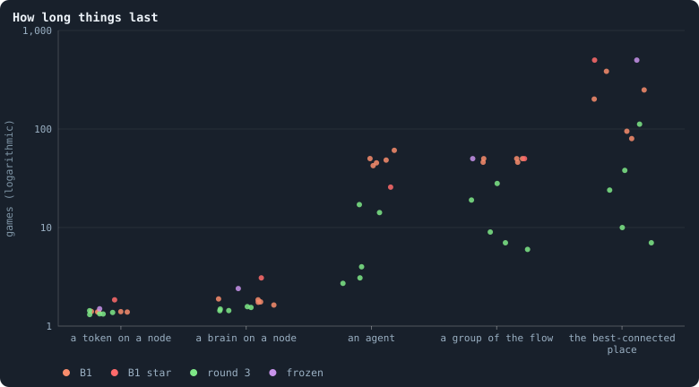
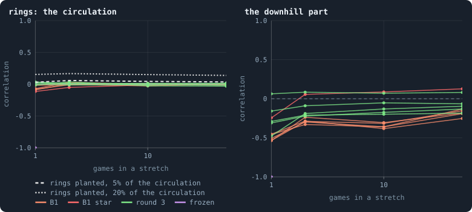
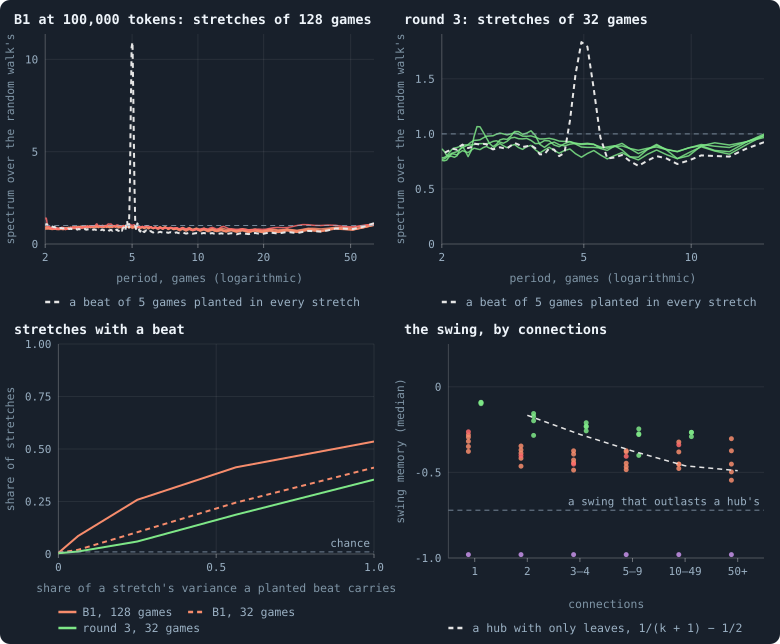
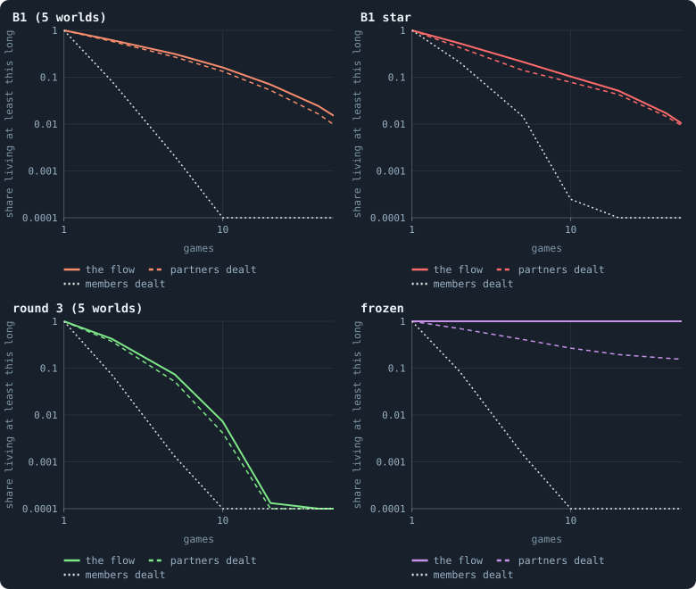
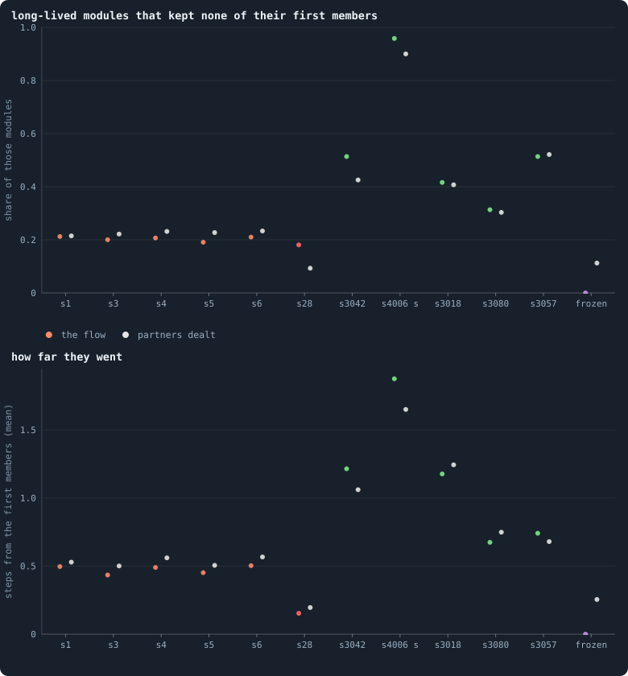

# Particles: patterns that outlast what carries them

> [!question] Questions of this page
> - Does anything in these worlds keep its identity, [game](one-iteration.md#phase-2-the-game "The second phase of an iteration: every agent stakes all its tokens on its own node and its neighbours', and every node goes to someone.") after game, while
>   the [agents](the-world.md#agents-and-tokens "One member of a world: it lives on a node of the network, holds tokens and has a brain that takes all its decisions."), [tokens](the-world.md#agents-and-tokens "The one thing of value in a world: every agent holds a whole number of them, and their total never changes.") and [brains](the-brain.md "The neural network each agent decides with: inputs about itself and its neighbours, outputs that become its decisions.") that carry it are replaced, as a glider in
>   Conway's Game of Life outlives its cells?
> - How can such a pattern be told apart from chance on a network that
>   changes every game, and would the tests find one if it were there?
> - The healthiest worlds of round 3 replace their agents within a few
>   [iterations](one-iteration.md "One step of a world's time: a phase of reproduction, then a phase of the game."). Does anything in them last longer than its agents?
> - What would a particle mean for the physics aim, and for open-ended
>   evolution?

## In short

We looked for particles, patterns that keep their identity while what carries
them is replaced, in twelve worlds (five of [B1](b1-and-b2.md "The first baseline: the algorithm exactly as a new run is offered it.") at 100,000 tokens and its
largest [star](measuring-networks.md#stars-and-hubs "An agent joined to far more agents than most; a star is a world held together by a single hub."), the five healthiest worlds of round 3, and a world that froze),
with three detectors, each set beside a null and tried on a pattern known to
be there. No ring of tokens lasts: the circulation of one stretch of games
correlates with the next's at about 0 (−0.05 to 0.04), where rings planted to
carry a twentieth of it give 0.04 to 0.06. No agent's tokens keep a rhythm
beyond a random walk's, and their two-game swing dies away as the even split
makes it. Groups of the flow do outlast their members, in round 3's
healthiest worlds by several times the lives of their agents, but they last
nearly as long when every agent's partners are dealt at random, and they stay
where they began: they are the network's regions, not things the agents hold
together. Only the frozen world keeps its patterns for ever, as a crystal
that ticks with a period of two games and in which nothing is replaced.

## A particle, in a world like this

Stand by a river and watch a whirlpool in it. The water in the whirlpool is
never the same for more than a moment, yet the whirlpool stays, and may
drift slowly downstream. Or watch a wave cross the sea: the water only rises
and falls where it is, and the wave travels on. In Conway's Game of Life
(Gardner 1970) the same thing happens on a grid. A glider is five live cells
that rebuild themselves one cell further on every four generations. The cells
are born and die, and the glider goes on
([Patterns that outlast their parts](cooperation-help-and-gliders.md#patterns-that-outlast-their-parts)).

That is what a particle would be in Graph of Life: a **pattern that keeps
its identity while what carries it is replaced**. Three things carry
everything in a world, and each of them changes all the time:

- **tokens**, which leave the node they are on in most games;
- **brains**, which are copied into a node by whoever takes it;
- **agents**, each on its own node, which are born and die.

A pattern made of them is particle-like if it passes three tests. It lasts
much longer than any of its carriers stays in it. It lasts longer than chance
would make a pattern of its kind last. And, to be a particle rather than a
place, it can move.

[Physical inspiration](physical-inspiration.md#particles-stable-things-in-a-restless-world)
names what to look for: tokens bound in rings, a beat, and groups that
outlast their members. The plan adds groups that move. This page builds a
detector for each. Every detector is set beside a **null**, the same measure
on something that has no particle by construction, so that "lasts" means
"lasts longer than chance". And every detector is tried on a **positive
control**, a pattern we know is there, so that "nothing found" means "nothing
there", not "a test that cannot see".

The answers so far were negative, but partial. No ring of tokens lasted fifty
games in the worlds of 10,000 tokens, and chains of takeovers wander like a
drunkard ([Gliders, and who helps whom](cooperation-help-and-gliders.md#gliders-and-who-helps-whom)). A
star's centre is a place handed from parent to child
([How a star is handed down](b1-lives-and-wealth.md#how-a-star-is-handed-down)).
Groups of the flow are the network's regions
([Flow modules](b1-the-game-and-its-flows.md#flow-modules-the-groups-tokens-stay-in)). This page asks the question again of the
largest worlds of the first [baseline](b1-and-b2.md "The stated rules an experiment starts from and changes one thing of: B1 or B2.") and of the healthiest worlds found
since, with detectors that come with their own controls.

## Twelve worlds, read game by game

A particle is a thing in time. To see one, a world has to be read game after
game, with every stake of every agent, and each detector needs hundreds of
games in a row. So this page reads a few worlds carefully rather than many in
passing: twelve worlds, each over the last 500 games of its run.

- **B1 at 100,000 tokens** (Experiment 10, iterations 1,000 to 1,499). Its
  thirty worlds all play the same game, apart from their stars
  ([Do the worlds agree?](b1-the-game-and-its-flows.md#do-the-worlds-agree)).
  So five stand for them: the first five [seeds](rules-in-detail.md#seeds-and-the-random-stream "The number that fixes every random choice of a run: the same settings and the same seed make the same world.") whose world is not held
  together by one hub, 1, 3, 4, 5 and 6. Beside them stands the largest star,
  seed 28, whose centre was joined to three agents in four in the games read
  ([Stars](b1-lives-and-wealth.md#stars)).
- **The five healthiest worlds of round 3**, by the product of their six
  criteria ([Which worlds are healthy?](which-worlds-are-healthy.md)): s3042,
  s4006 played strongest first, s3018, s3080 and s3057, each of 30,000 tokens
  with its own [settings](settings.md "One number or switch of a run's rules, fixed before it starts.") drawn at random, read over iterations 2,500 to 2,999.
  Four of them allow gifts and mend the network round the dead, four let
  agents look for strangers to link to, and three give a node to one of its
  stakers by lot, with chances in proportion to the stakes. They are the
  notebook's best hopes for a world that keeps evolving, and they are very
  unlike B1: in three of them an agent lives a few games, not a few dozen.
- **A world that froze** (Experiment 7, seed 2, iterations 2,500 to 2,999).
  Its brains never change. Nobody in it has been born since iteration 95, or
  has died: 1,420 agents play the same two games over and over, and every
  agent holds the same tokens as two games before. It is the positive control
  for every detector at once, a world in which every pattern lasts.

All the measures below come from one reading of each world's record
([How this was made](#how-this-was-made)).

## How long the carriers last

Before asking whether a pattern outlasts its carriers, measure the carriers.
How long does a token stay on one node, a brain on one node, an agent in the
world?

<!-- figure particles/clocks -->

**How long things last.** Each dot is a world, read over the last 500 games of its run. A token on a node: how many games a token stays on the node it is on, on average, from the share of all tokens staked at home. A brain on a node: how many games a node goes, on average, before a neighbour takes it and its brain is copied in. An agent: how long an agent lives, the agents alive over the newcomers a game (no dot for the frozen world, in which nobody is born or dies). A group of the flow: of the flow modules of the last 50 games, the life that one in a hundred reaches or passes (50 at most, the games followed). The best-connected place: the longest run of games in which the best-connected agent stayed the same or was a child of the one before (500 at most). B1: five worlds of B1 at 100,000 tokens; B1 star: its largest star; round 3: the five healthiest worlds of round 3; frozen: a world whose brains never change.

> [!example]- How to make this figure
> **Runs.** Twelve worlds, each read over the last 500 games of its run. Five worlds of B1 at 100,000 tokens (Experiment 10: `B1-100000-s001`, `B1-100000-s003`, `B1-100000-s004`, `B1-100000-s005` and `B1-100000-s006`, the first five seeds whose world is not held together by one hub) and its largest star (`B1-100000-s028`), iterations 1,000 to 1,499. The five healthiest worlds of round 3 by the product ([Which worlds are healthy?](which-worlds-are-healthy.md); Experiments 40 and 42: `B1-30000-b82ad0-s3042`, `B1-30000-8526cf-s4006`, `B1-30000-af1e28-s3018`, `B1-30000-625bc7-s3080` and `B1-30000-38aee9-s3057`), 30,000 tokens, iterations 2,500 to 2,999. And a world whose brains never change and which froze long before its end (Experiment 7, `B1-10000-a8525d-s002`), iterations 2,500 to 2,999.
>
> **Data.** From each run's frames, read once by `particles_pass` in `book_chapters/particles.py` (every game's `decisions.allocations` and `decisions.winners`, and the agents, tokens, connections and parents after it) and kept in `GraphOfLifeRuns/.book/<run>.particles.json`.
>
> 1. A token: 1/(1 − h), with h the share of all tokens staked in the games that went to the staker's own node.
> 2. A brain: the nodes on which anyone staked over those taken by a neighbour.
> 3. An agent: the mean number of agents after a game over the mean number that were not alive after the game before (Little's law).
> 4. A group: flow modules followed as on [Flow modules](b1-the-game-and-its-flows.md#following-groups-through-time) (web/js/flowmodules.js through tools/flowmodules_cli.js); the 99th percentile of their lives.
> 5. A place: after every game the agent with the most connections; a dynasty goes on while the next one is the same agent or its child.
>
> **To make it again:** `python3 book_figures.py particles`.
<!-- /figure -->

**Every carrier turns over within a few games, but the agents of B1.** In B1,
about seven tokens in ten leave their node in every game, so a token stays on
one node for 1.4 games on average. A node keeps its brain for 1.8 games
before a [neighbour](the-world.md#the-network "An agent joined to another by a connection.") takes it and copies its own brain in. An agent lives about
48 games (42 to 61 in the five worlds; 26 in the star). In round 3's
healthiest worlds everything turns over faster still. A token stays on a node
for 1.3 games, a brain for 1.5, and an agent lives 2.7 to 17 games: in s3042,
the healthiest of all, three.

Against these clocks, two kinds of pattern last far longer. One flow module,
a group of the flow, in a hundred is followed for 46 games or more in B1's
worlds (50 is all the games followed), and for 6 to 28 in round 3's, while its
tokens and brains turn over every game or two. And the best-connected place
of a world is handed on, from an agent to itself or to its child, for 80 to
385 games at the longest in B1's five worlds, and through all 500 games read
in the star. So patterns that outlast their carriers exist. The rest of this
page asks whether they are more than chance, or the network itself, would
make, and whether any of them moves.

## Rings: do tokens go round the same loop?

Picture a ring of agents, each passing tokens to the next, game after game:
a Kula ring, in which armshells and necklaces travelled round the Trobriand
Islands for generations (Malinowski 1922). The tokens in it would be
**bound**: they would keep coming back instead of spreading out over the
world, and the ring would last while the tokens in it changed.

### How a ring is seen

Add up, over a stretch of games, the tokens each [connection](the-world.md#the-network "A link between two agents of the network: they are neighbours, and can stake on each other's nodes.") carried one way,
minus what came back: the connection's [net flow](measuring-tokens.md#measuring-the-flow-token-flow-lightning-and-circulation). Every net
flow splits exactly into two parts
([Flows that go round](measuring-tokens.md#flows-that-go-round); Jiang, Lim, Yao
and Ye 2011). One runs **downhill**, from some agents to others, as if each
agent stood at a height. The other goes **round [loops](measuring-networks.md#loops "A path through the network that comes back to where it started without using a connection twice.")**: the circulation. A
ring of tokens is circulation, and a ring that lasts is circulation that comes
back on the same connections in the next stretch.

So the detector is a correlation. Split the net flow of two stretches in a
row, and over the connections both used, correlate the circulation of the
first with that of the second. Near 0, each stretch's rings are new. Near 1, they are the same
rings. The stretches are 1, 2, 10 and 50 games long. A ring that lasts a few
games is not averaged away in the short ones, and one that lasts long stands
out of the noise in the long ones.

- **The null** is 0: two stretches whose rings have nothing to do with each
  other.
- **The positive control** is a set of rings planted in the record. On the
  connections two stretches share, take triangles and squares, one
  connection in fifty, and add the same ring to both stretches: tokens going
  round each loop, so strong that the rings carry 5%, or 20%, of the first
  stretch's circulation there. That is a ring that lasts exactly as long as
  its connections do. If nothing else carried over, the correlation would
  then be about 0.05, or 0.17.
- **The frozen world** is the control in which everything lasts.

<!-- figure particles/rings -->

**Do tokens go round the same loops?** The net flow of a stretch of games (what each connection carried one way, minus what came back) is split into a part that runs downhill and a part that goes round loops, the circulation. Left: the correlation of the circulation of one stretch with that of the next, over the connections both used; a ring that lasts gives two stretches the same circulation, and a correlation near 1. Each line is a world (orange: B1; red: its largest star; green: round 3; violet: the frozen world, whose circulation turns round every game, and whose net flow over any even number of games is nothing at all). Grey: the median of the eleven worlds that are not frozen, with rings planted on triangles and squares of the connections both stretches used, the same rings in both, carrying 5% or 20% of the circulation there. Right: the same for the downhill part. A swing of the flow back and forth from one game to the next shows at one game, below 0, and cancels in the stretches of an even number of games.

> [!example]- How to make this figure
> **Runs.** Twelve worlds, each read over the last 500 games of its run. Five worlds of B1 at 100,000 tokens (Experiment 10: `B1-100000-s001`, `B1-100000-s003`, `B1-100000-s004`, `B1-100000-s005` and `B1-100000-s006`, the first five seeds whose world is not held together by one hub) and its largest star (`B1-100000-s028`), iterations 1,000 to 1,499. The five healthiest worlds of round 3 by the product ([Which worlds are healthy?](which-worlds-are-healthy.md); Experiments 40 and 42: `B1-30000-b82ad0-s3042`, `B1-30000-8526cf-s4006`, `B1-30000-af1e28-s3018`, `B1-30000-625bc7-s3080` and `B1-30000-38aee9-s3057`), 30,000 tokens, iterations 2,500 to 2,999. And a world whose brains never change and which froze long before its end (Experiment 7, `B1-10000-a8525d-s002`), iterations 2,500 to 2,999.
>
> **Data.** From each run's frames, read once by `particles_pass` in `book_chapters/particles.py` (every game's `decisions.allocations` and `decisions.winners`, and the agents, tokens, connections and parents after it) and kept in `GraphOfLifeRuns/.book/<run>.particles.json`.
>
> 1. For every game, the tokens each agent staked on each neighbour's node.
> 2. Add them up over stretches of 1, 2, 10 and 50 games, one way minus the other: the net flow of each connection (from the first game read, at most 101 stretches in a row).
> 3. Find the potential that explains as much of the net flow as possible as running downhill (least squares, by conjugate gradients on the network's Laplacian, after pruning dead-end branches, on which no flow goes round); the circulation is the rest ([Flows that go round](measuring-tokens.md#flows-that-go-round)).
> 4. Correlate each stretch's circulation, and its downhill part, with the next stretch's, over the connections both used; take the median over the pairs of stretches.
> 5. Positive control: on the connections two stretches share, loops of three or four connections running along 2% of them, each connection used once; the same ring on each loop in both stretches, as strong as makes the rings carry 5% or 20% of the first stretch's circulation on those connections (sum of squares); the same correlation. Rings that last, and nothing else, would give about 0.05 and 0.17.
>
> **To make it again:** `python3 book_figures.py particles`.
<!-- /figure -->

**No ring lasts.** In every world but the frozen one, the circulation of one
stretch has nothing to do with the next's. Over stretches of 2, 10 and 50
games, the median correlation of the eleven worlds is 0.006, −0.002 and
−0.001, and no world is further from 0 than 0.05. The planted rings show what
a lasting ring would have looked like: 0.06 for rings carrying a twentieth of
the circulation, 0.17 for rings carrying a fifth (the median of the worlds,
over two games). A twentieth would have stood out in the worlds taken
together, a fifth in every single world. In round 3's worlds the connections
themselves hardly last: in s3042, only 13% of the connections two games used
are used in the next two, and 0.6% from one stretch of fifty games to the
next. A ring there could live no longer than its connections, and none lives
even that long: 0.01 over two games, in round 3's median world.

Over a single game the correlation is below 0, −0.07 in B1's median world:
the flow swings back and forth from one game to the next, as the even split
overshoots on hubs and their leaves. The swing is plainer still in the
downhill part, −0.51. Over two games it cancels, and what is left still turns
back: what runs downhill in one stretch runs back up in the next (−0.29 over
two games, −0.36 over ten). That is the even split pulling tokens back to
their resting share, in proportion to their connections plus one
([The resting state](measuring-tokens.md#the-resting-state)). It is the opposite of
a ring. Only in the star does the downhill part last a little (0.06 over two
games, 0.13 over fifty), as its leaves keep paying into one centre. (In the
worlds of 10,000 tokens, the downhill part of the gifts alone, the stakes
that took no node, lasts as well:
[Where the tokens go](cooperation-help-and-gliders.md#where-the-tokens-go).)

In the frozen world the circulation of each game is the exact reverse of the
one before, a correlation of −1. Over any even number of games, every token
that crossed a connection has come back, and the net flow is nothing at all.
The detector sees this perfectly regular pattern at once. But its tokens go
nowhere: it is a swing, not a ring.

## Beats: does anything keep a rhythm?

A pendulum swings with a period of its own. A dog on a long leash wanders
too, but with no favourite period: it drifts off a little, is pulled back,
drifts off again. A **beat** is the first kind of motion: a pattern with a
rhythm, local in the network, that comes back game after game. It could be an
agent whose tokens rise and fall every seven games, or a group whose tokens
slosh round it.

### How a beat is seen

Follow one agent's tokens after every game of a stretch of its life, and take
the [power spectrum](statistics.md#the-power-spectrum-of-a-time-series)
of that series: how much of its ups and downs happen at each period. A beat
is a period that holds more than its share.

More than what share? Tokens move almost as a random walk does
([The game as a random walk](b1-the-game-and-its-flows.md#the-game-as-a-random-walk)),
and a random walk held near a level, the dog on the leash, has a spectrum of
its own. An agent's tokens have two such memories at once. They drift
slowly, as its connections change. And they swing from one game to the next,
where the even split overshoots: tokens slosh from a hub to its leaves and
back ([A two-game rhythm](b1-lives-and-wealth.md#a-two-game-rhythm)). A
memory says how much of a departure from the level is left a game later:
near 1 for the slow drift, below 0 for the swing, whose sign flips every
game. In the median stretch of 128 games of B1's worlds, the slow memory is
0.86 and the swing memory −0.39.

A random walk with two memories *a* and *b*, taken a game at a time, has the
spectrum

$$
S(f) = \frac{\sigma^2}{\left|1 - a\, e^{-2\pi i f}\right|^2 \left|1 - b\, e^{-2\pi i f}\right|^2} ,
$$

with *f* the frequency, one over the period in games, and σ² the part of the
variance the memories do not explain. It is high at the longest periods, or
at two games, or both, and never higher anywhere in between. It is the
Ornstein–Uhlenbeck process of
[Reading the slope](statistics.md#reading-the-slope), twice over, in
steps of one game. Its two memories are fitted to each stretch from the
stretch's correlations with itself one and two games on, by the equations of
Yule (1927) and Walker (1931). Where those would make the two memories a
damped rhythm of their own, the nearest pair of plain memories is taken
instead, so that no rhythm is put into the yardstick.

So the detector divides each stretch's spectrum by the spectrum of its own
random walk. Without a beat, the quotient wobbles around 1 at every period. A
beat stands up out of it, between three games and half the stretch. How far
it must stand up is set by chance: 200,000 random walks of the same length,
with two memories drawn at random and fitted in the same way, give the
highest quotient that one stretch in a hundred reaches. A real stretch above
it is flagged. Without beats, about one stretch in a hundred is flagged
anyway.

### The two-game swing

The swing itself cannot stand up out of the quotient: a random walk with a
memory near −1 *is* a swing of two games. So the swing is read from its
memory instead. How hard can the even split make tokens swing? For a hub
whose *k* neighbours are leaves,
[A two-game rhythm](b1-lives-and-wealth.md#a-two-game-rhythm) works it
out: every departure from rest is multiplied, game by game, by
1/(*k* + 1) − 1/2. That is never below −1/2: of a swing, at most half is left
a game later. A swing memory far below −1/2 is a swing that dies away more
slowly than any hub's: perhaps a beat of two games. "Far" is 2.5 times the
scatter of a memory fitted to *S* games, about 1/√*S*: below −0.72 for
stretches of 128 games. Denser shapes can swing harder under the even split
too. Two hubs that share many leaves swing at about −2/3, so a stretch below
the line is a suspect, not yet a beat.

### The controls

- **Planted beats, one a stretch.** Into every real stretch, add a sine wave
  of a period drawn between 3 games and half the stretch, with a strength
  that gives it a sixteenth, a quarter, nine sixteenths or all of the
  stretch's variance, and test again.
- **One planted beat for all.** Add to every stretch a weak sine of five
  games, with a sixteenth of its variance. Each stretch alone could hardly
  show it. Averaged over thousands of stretches, it should stand out: a beat
  shared by many agents is what this test is best at.
- **The frozen world**, in which every agent whose tokens change at all
  swings back and forth in a cycle of two games, for ever.

<!-- figure particles/beats -->

**Does anything keep a rhythm?** Top: the spectrum of agents' tokens, game by game, divided by the spectrum of a random walk with the same two memories, one slow and one that swings back and forth, fitted to each stretch; averaged over all the stretches of a world, at periods from two games to half a stretch (anything slower is a trend inside the stretch). Flat means no rhythm beyond the random walk's. Each line is a world (orange: B1; red: its largest star; green: the round-3 worlds with at least 100 stretches). Dashed grey: the same with a weak beat of 5 games planted in every stretch, carrying a sixteenth of its variance (the median of the worlds). Bottom left: the share of stretches with a peak, at a period from 3 games to half the stretch, that a random walk makes less than once in a hundred; at 0, the real stretches; further right, with a beat of a random period planted in each, carrying that share of its variance (the median of the worlds). Bottom right: the swing memory of agents' tokens, by their connections: how much of a swing is left a game later, with its sign (stretches of 128 games; 32 in round 3, drawn a little to the right); one dot per world and class, the median. Dashed: what the even split leaves of a swing between a hub and its leaves alone; below the dotted line, a swing that lasts longer than any such hub's.

> [!example]- How to make this figure
> **Runs.** Twelve worlds, each read over the last 500 games of its run. Five worlds of B1 at 100,000 tokens (Experiment 10: `B1-100000-s001`, `B1-100000-s003`, `B1-100000-s004`, `B1-100000-s005` and `B1-100000-s006`, the first five seeds whose world is not held together by one hub) and its largest star (`B1-100000-s028`), iterations 1,000 to 1,499. The five healthiest worlds of round 3 by the product ([Which worlds are healthy?](which-worlds-are-healthy.md); Experiments 40 and 42: `B1-30000-b82ad0-s3042`, `B1-30000-8526cf-s4006`, `B1-30000-af1e28-s3018`, `B1-30000-625bc7-s3080` and `B1-30000-38aee9-s3057`), 30,000 tokens, iterations 2,500 to 2,999. And a world whose brains never change and which froze long before its end (Experiment 7, `B1-10000-a8525d-s002`), iterations 2,500 to 2,999.
>
> **Data.** From each run's frames, read once by `particles_pass` in `book_chapters/particles.py` (every game's `decisions.allocations` and `decisions.winners`, and the agents, tokens, connections and parents after it) and kept in `GraphOfLifeRuns/.book/<run>.particles.json`.
>
> 1. For every agent, its tokens after every game it was alive in the games read.
> 2. Cut each agent's life into stretches of 32 and of 128 games, back to back; leave out the stretches in which its tokens never change.
> 3. For each stretch, its correlations with itself one and two games on, r1 and r2; the AR(2) process they give (Yule and Walker), with real roots a ≥ b, the slow memory and the swing memory (where the roots would be complex, the nearest pair of equal real roots); its spectrum σ² / (|1 − a e^(−2πif)|² |1 − b e^(−2πif)|²), scaled to the stretch's variance; and the periodogram, on a grid 4 times finer than the stretch's own frequencies.
> 4. Chance: 200,000 random walks of each length with two memories drawn from −0.95 to 0.95, fitted the same way; in each bin of the two fitted memories, the highest ratio of periodogram to spectrum, at periods from 3 games to half the stretch, that one in a hundred reaches. A real stretch whose highest ratio is above it is flagged.
> 5. Positive controls: a sine of a period drawn between 3 games and half the stretch, at a random phase, added to every stretch with the share 1/16, 1/4, 9/16 or 1 of its variance, and the stretches flagged again; and a sine of 5 games with 1/16 of the variance added to every stretch, averaged as the real ones.
> 6. The two-game swing: a swing memory b below −1/2 − 2.5/√S. Its chance: 20,000 random walks with slow memory 0.85, 0.5 or 0 and swing memory −1/2, and with 0.85 and −2/3, fitted the same way, and the share of them below the line.
>
> **To make it again:** `python3 book_figures.py particles`.
<!-- /figure -->

**No agent keeps a rhythm.** In B1's median world, 0.58% of the stretches of
32 games and 0.59% of those of 128 are flagged (0.40% to 1.1% in the five
worlds), about as many as chance flags, or fewer. The tokens of an agent and
its neighbours together, a small region, are flagged less often still: 0.31%
and 0.05%. Averaged over a world's stretches, the quotient is flat, between
0.6 and 1.1 at every period from three games to half a stretch (top of the
figure). The weak beat planted in every stretch stands out of it at 2.0 in
stretches of 32 games and at 11 in stretches of 128. A rhythm shared by many
agents, even one carrying a sixteenth of their ups and downs, would not have
been missed.

One count stands out: in the star, 4.2% of the stretches of 32 games of an
agent with its neighbours are flagged. But nearly all of them are leaves of
the one centre, and a leaf's neighbourhood is that centre, whose tokens are
nearly all of it. So they are a few windows of one series, counted once for
every leaf alive in them. The centre's own tokens are flagged in none of its
27 stretches.

A rhythm of a single agent is harder to see. Of the beats planted one a
stretch, the test finds 42% of those that carry as much variance as the
stretch itself in stretches of 32 games, and 54% in stretches of 128 (bottom
left). So a lone agent with a weak beat could hide. Thousands with one could
not.

In round 3 most agents do not live long enough to be read at all. In s4006 no
agent lives 32 games in the 500 read, and s3042 and s3057 have only 266 and
1,076 stretches of that length. Where there are enough, the picture is B1's:
0.37% to 0.47% of the stretches of 32 games are flagged, and the quotient is
as flat.

**The two-game swing dies away.** The swing memory of B1's median stretch of
128 games is −0.39: of a swing, less than half is left a game later, as a hub
with leaves makes it. Hubs swing a little harder than leaves, from −0.32 for
agents with one connection to −0.45 for those with ten or more (bottom
right), near the −0.46 to −0.49 that the even split gives a hub of ten to a
hundred leaves; an agent with few connections swings with the hubs it is
joined to. A few stretches in a hundred, 2.4% in B1's median world (1.9% to
6.0%), fall below the line of a swing that outlasts a hub's. Random walks
that swing as hubs with leaves alone do, at −1/2, fall there by chance in at
most 0.8% of stretches, and those that swing as two hubs sharing many leaves
do, at −2/3, in 12%. So these are the even split on denser shapes, or
something more. Either way, they too die away: at −0.72, a fifth of a swing is
left after five games. In the frozen world, every stretch whose tokens change
at all is below the line, at −0.97 (2,100 stretches of 32 games): a swing
that never dies. The detector finds it in all of them.

## Groups that outlast their members

A town keeps its name while its people are born, die and move away. A group
of agents could do the same: hold together while its members come and go.
That is the third rung of the notebook's ladder, P3, an organisation
([A ladder of four steps](what-this-notebook-is-about.md#a-ladder-of-four-steps)),
and the plainest kind of particle.

### How a group is seen

The groups are the **flow modules** of each game: sets of agents that a token
wandering the flow tends to stay inside, found by the map equation of Rosvall
and Bergstrom (2008) ([Flow modules](b1-the-game-and-its-flows.md#flow-modules-the-groups-tokens-stay-in)). A module of one game
and a module of the next are the same module if they share enough members,
at least 0.3 of the agents in either. So a module can go on while its members
change, one by one, and even when none of the agents it began with is left.

Two nulls say what lasting means:

- **Members dealt**: the real modules, with their agents dealt among them at
  random in every game. Only their sizes carry over, so what they last is
  what chance overlaps make last.
- **Partners dealt**: every agent's stakes on its neighbours dealt among the
  same neighbours at random. The network stays, and every agent's amounts;
  only the agents' choice of whom to stake on is undone. Modules that last as
  long here are the network's own regions.

A group of the agents' own would outlast both. The **frozen world** is the
positive control: its agents repeat the same two games for ever, and every one
of its modules should last all fifty games read.

<!-- figure particles/groups -->

**Groups that last.** Of all the flow modules of the last 50 games of each world, the share followed for at least so many games (the median of each kind's worlds; logarithmic axes, a share of 0 drawn at the bottom). The flow: as it was. Partners dealt: the same games with every agent's stakes on its neighbours dealt among the same neighbours at random, which keeps the network and undoes the agents' choice of whom to stake on. Members dealt: the real modules with their agents dealt among them at random, game by game, which keeps only their sizes. B1: five worlds of B1 at 100,000 tokens; B1 star: its largest star; round 3: the five healthiest worlds of round 3; frozen: a world whose brains never change, the positive control, whose modules all last.

> [!example]- How to make this figure
> **Runs.** Twelve worlds, each read over the last 500 games of its run. Five worlds of B1 at 100,000 tokens (Experiment 10: `B1-100000-s001`, `B1-100000-s003`, `B1-100000-s004`, `B1-100000-s005` and `B1-100000-s006`, the first five seeds whose world is not held together by one hub) and its largest star (`B1-100000-s028`), iterations 1,000 to 1,499. The five healthiest worlds of round 3 by the product ([Which worlds are healthy?](which-worlds-are-healthy.md); Experiments 40 and 42: `B1-30000-b82ad0-s3042`, `B1-30000-8526cf-s4006`, `B1-30000-af1e28-s3018`, `B1-30000-625bc7-s3080` and `B1-30000-38aee9-s3057`), 30,000 tokens, iterations 2,500 to 2,999. And a world whose brains never change and which froze long before its end (Experiment 7, `B1-10000-a8525d-s002`), iterations 2,500 to 2,999.
>
> **Data.** From each run's frames, read once by `particles_pass` in `book_chapters/particles.py` (every game's `decisions.allocations` and `decisions.winners`, and the agents, tokens, connections and parents after it) and kept in `GraphOfLifeRuns/.book/<run>.particles.json`.
>
> 1. For each of the last 50 games, the flow between each pair of neighbours: the tokens staked either way.
> 2. Group the agents by the map equation (web/js/flowmodules.js, through tools/flowmodules_cli.js) and follow the groups from game to game: best overlap first, each used once, none below 0.3 of the members two modules share ([Flow modules](b1-the-game-and-its-flows.md#following-groups-through-time)).
> 3. Do the same with every agent's stakes on its neighbours dealt among them at random (`--neighbours 1`) and with each game's agents dealt among modules of its sizes (`--shuffle 1`).
> 4. The share of modules followed for at least so many games; the median of each kind's worlds.
>
> **To make it again:** `python3 book_figures.py particles`.
<!-- /figure -->

**Groups last, as the network's regions do.** In B1's median world, 16% of
the modules of the fifty games are followed for ten games or more, and 2.4%
for forty. Members dealt at random make none that last ten: B1's modules are
no accident of their sizes. But partners dealt make nearly as many, 13% and
1.6%. Agents that keep favouring the same neighbours add about a fifth to the
modules that last ten games; the network's regions make the rest, as
[Flow modules](b1-the-game-and-its-flows.md#how-long-modules-live) found in two worlds of
the same experiment, five hundred games earlier. The star is no different:
10% of its modules last ten games, 8% with partners dealt.

In round 3's healthiest worlds the modules are smaller, pairs and threes in
the healthiest, and they last less long: 0.7% are followed for ten games or
more in the median world (from 0.03% in s4006 to 11% in s3080), 0.4% with
partners dealt, none with members dealt. But measured against their agents,
they last far longer than B1's. In s3042, where an agent lives three games, a
module is followed for up to 23 games. Half of those followed ten games or
more end with none of the agents they began with, and half of a module's new
members were born since the game before. Such a module renews itself from
births, as a town does. With partners dealt, it is the same: 43% of the
long-lived modules renew themselves completely in the median world, against
51%, and the agents' own choices add a few such modules more, as in B1, but
none that lives longer.

In the frozen world every module lasts all fifty games, and none changes a
member. The detector does see a group that holds together, when there is one.

### Does a group move?

A glider's cells are replaced and the glider moves on. A module whose members
are all replaced could likewise end up somewhere else. For every module
followed ten games or more, take its members in its first game and in its
last. Each last member that was not alive in the first game stands where its
nearest forebear alive then stood: a child joins its parent's neighbourhood.
Then count the steps, through the network of the first game, from the first
members to the last. A module that stayed in its place is 0 or 1 step from
where it began. One that travelled is further.

<!-- figure particles/drift -->

**Groups that outlast their members, and whether they move.** Of the flow modules of the last 50 games followed for 10 games or more, in each world (the worlds' short names; B1 at 100,000 tokens, its star s28, the five round-3 worlds, and the frozen world). Top: the share whose members at the end included none of those it began with. Bottom: how far its last members stood from its first when it began, in steps through the network of its first game; a member born since stands where its nearest forebear alive then stood; the median over the last members, averaged over the modules. Coloured: the flow as it was; grey: with every agent's partners dealt at random among its neighbours, the network's own regions.

> [!example]- How to make this figure
> **Runs.** Twelve worlds, each read over the last 500 games of its run. Five worlds of B1 at 100,000 tokens (Experiment 10: `B1-100000-s001`, `B1-100000-s003`, `B1-100000-s004`, `B1-100000-s005` and `B1-100000-s006`, the first five seeds whose world is not held together by one hub) and its largest star (`B1-100000-s028`), iterations 1,000 to 1,499. The five healthiest worlds of round 3 by the product ([Which worlds are healthy?](which-worlds-are-healthy.md); Experiments 40 and 42: `B1-30000-b82ad0-s3042`, `B1-30000-8526cf-s4006`, `B1-30000-af1e28-s3018`, `B1-30000-625bc7-s3080` and `B1-30000-38aee9-s3057`), 30,000 tokens, iterations 2,500 to 2,999. And a world whose brains never change and which froze long before its end (Experiment 7, `B1-10000-a8525d-s002`), iterations 2,500 to 2,999.
>
> **Data.** From each run's frames, read once by `particles_pass` in `book_chapters/particles.py` (every game's `decisions.allocations` and `decisions.winners`, and the agents, tokens, connections and parents after it) and kept in `GraphOfLifeRuns/.book/<run>.particles.json`.
>
> 1. Follow the flow modules of the last 50 games as for the figure above, the real ones and those of the flow with partners dealt.
> 2. For every module followed 10 games or more: its members in the first game and in the last.
> 3. Renewed: none of the first members is among the last.
> 4. Moved: each last member, or its nearest forebear that was alive in the module's first game (parents from the frames' `parent_ids`); its steps to the nearest first member on the network that game's stakes ran on; the median over the last members; the mean over the modules.
>
> **To make it again:** `python3 book_figures.py particles`.
<!-- /figure -->

**Groups that renew themselves stay where they are.** Of B1's modules
followed ten games or more, 21% end with none of the agents they began with
(the median world), and as many with partners dealt, 23%. Their last members,
or the forebears of those, stood 0.49 steps from the first members on
average. Those that renewed themselves completely stood 1.7 steps away: about
the width of a module of four agents, which takes in its neighbours as it
loses members. With partners dealt: 0.53 and 1.8.

In round 3, where half the long-lived modules renew themselves completely,
they do not travel either. Their last members stood 1.2 steps from where they
began, 1.1 with partners dealt (the median world); those renewed completely,
1.8 steps.

A module is a place in the network that keeps its name while agents pass
through it: a town, not a glider.

## Every world

Every world's numbers, side by side; each world's name opens it in the
viewer. An agent lives: the agents alive over the newcomers of a game. A
token stays, a brain stays: on one node, in games. Rings: the median
correlation of the circulation of two games with that of the next two.
Beats: the share of the stretches of 32 games flagged, of how many there
were. Modules: the share followed for ten games or more, in the flow as it
was, with partners dealt and with members dealt; and of those followed ten
games or more, the share that kept none of their first members, and how many
steps they moved.

<!-- table particles/worlds -->
| world | kind | agents | an agent lives, games | a token stays, games | a brain stays, games | rings: what the next two games repeat | beats flagged, stretches of 32 | modules living 10+ games: flow / partners dealt / members dealt | of those, renewed: flow / partners | of those, steps moved: flow / partners |
|---|---|---|---|---|---|---|---|---|---|---|
| [s1](run:B1-100000-s001) | B1 | 16,694 | 45.4 | 1.39 | 1.76 | -0.009 | 0.6% of 200,017 | 14.3% / 11.3% / 0.0% | 21.2% / 21.5% | 0.50 / 0.53 |
| [s3](run:B1-100000-s003) | B1 | 12,164 | 42.5 | 1.40 | 1.74 | 0.029 | 0.6% of 143,609 | 16.5% / 13.7% / 0.0% | 20.0% / 22.2% | 0.43 / 0.50 |
| [s4](run:B1-100000-s004) | B1 | 13,604 | 60.8 | 1.39 | 1.63 | 0.009 | 0.7% of 171,411 | 16.2% / 13.3% / 0.0% | 20.7% / 23.2% | 0.49 / 0.56 |
| [s5](run:B1-100000-s005) | B1 | 10,908 | 48.3 | 1.41 | 1.89 | 0.006 | 0.5% of 132,570 | 17.8% / 13.3% / 0.0% | 19.1% / 22.7% | 0.45 / 0.51 |
| [s6](run:B1-100000-s006) | B1 | 15,987 | 50.1 | 1.39 | 1.85 | -0.004 | 0.4% of 191,752 | 15.0% / 11.6% / 0.0% | 21.0% / 23.3% | 0.50 / 0.57 |
| [s28](run:B1-100000-s028) | B1 star | 17,814 | 25.7 | 1.84 | 3.08 | -0.051 | 0.3% of 200,672 | 10.3% / 7.8% / 0.0% | 18.1% / 9.3% | 0.15 / 0.20 |
| [s3042](run:B1-30000-b82ad0-s3042) | round 3 | 11,450 | 3.1 | 1.33 | 1.44 | 0.010 | 0.4% of 266 | 0.3% / 0.2% / 0.0% | 51.4% / 42.5% | 1.21 / 1.06 |
| [s4006 s](run:B1-30000-8526cf-s4006) | round 3 | 6,995 | 2.7 | 1.43 | 1.58 | -0.013 | — of 0 | 0.0% / 0.0% / 0.0% | 95.8% / 90.0% | 1.88 / 1.65 |
| [s3018](run:B1-30000-af1e28-s3018) | round 3 | 3,390 | 14.2 | 1.33 | 1.43 | 0.009 | 0.4% of 20,287 | 6.4% / 5.3% / 0.0% | 41.6% / 40.7% | 1.18 / 1.24 |
| [s3080](run:B1-30000-625bc7-s3080) | round 3 | 2,112 | 17.1 | 1.38 | 1.54 | 0.037 | 0.5% of 15,938 | 11.3% / 9.8% / 0.0% | 31.3% / 30.3% | 0.67 / 0.75 |
| [s3057](run:B1-30000-38aee9-s3057) | round 3 | 4,677 | 4.0 | 1.31 | 1.49 | 0.006 | 0.4% of 1,076 | 0.7% / 0.4% / 0.0% | 51.4% / 52.1% | 0.74 / 0.68 |
| [frozen](run:B1-10000-a8525d-s002) | frozen | 1,420 | — | 1.50 | 2.40 | — | 0.0% of 2,100 | 100.0% / 26.7% / 0.0% | 0.0% / 11.2% | 0.00 / 0.25 |
<!-- /table -->

Read down the columns, the worlds differ most in their clocks: an agent of
B1 lives 42 to 61 games, one of round 3's healthiest worlds 2.7 to 17, and the
frozen world's agents never die. And they agree in everything else. In none of the eleven worlds that do not stand
still does a ring last, does a rhythm stand out, or do modules outlast the
network's regions by much or go anywhere.

## What it means

### For the physics aim

A whirlpool, a soliton or a particle lasts because something holds it
together against the spreading that would otherwise smooth it away: a force,
a nonlinearity, or a flow that keeps feeding it. The game of these worlds has
none of these. In B1 it is, game by game, a step of the heat equation, and the
heat equation forgets
([Heat, not waves](physical-inspiration.md#heat-not-waves)). The measurements
here are what it gives. Every ring of the flow is new in the next stretch, the
two-game swing is the overshoot of a step too large and dies away at the rate
the even split sets, and no rhythm stands above a random walk's: the waves
that page asked for are not there, in single agents or in small regions.

What lasts is the network: places such as a star's centre, and regions in
which tokens circulate. In the language of the physics aim, the worlds have a
space, and the space has a shape that lasts longer than anything moving in
it, but nothing moves in it that keeps its form. The frozen world shows the
other way a pattern can last here: by nothing changing at all. It is a
crystal that ticks with a period of two games, and it is no more a particle
than a stone is.

A particle would need something that binds. Three places to look next:

- **Stakes that do not spread.** In [B2](b1-and-b2.md "The second baseline: B1 with the rules that keep its network from breaking and its agents from staking or breeding themselves to death.") nearly every agent stakes all in, so
  tokens travel in bundles, the puffers of
  [Gliders, and who helps whom](cooperation-help-and-gliders.md#puffers-in-b2-gliders-in-b1).
  The detectors of this page, run on B2's worlds, would show whether a bundle
  can outlast the agents that carry it.
- **A flow through the world.** Order that feeds on a flow, like the
  convection cells of a pan of oil heated from below, needs a source and a
  sink: the planned study *A source and a sink*.
- **Local rules.** The share-out of the dead and the single random stream
  still reach across a whole world at once
  ([What this asks of the notebook](physical-inspiration.md#what-this-asks-of-the-notebook)).
  A thing that keeps its form while it moves needs a world in which what
  happens here depends only on what is near.

### For open-ended evolution

Selection can act on anything that lasts long enough, varies, and whose
variants last or spread differently. Agents are such units. A group that
outlasts its members could be one more, above them: the step from cells to
organisms that Maynard Smith and Szathmáry (1995) call a major transition.

These worlds have groups that outlast their members. In round 3's healthiest
worlds, whose agents live a few games, a module can be followed several
times as long as its agents live, renewing itself from births as it goes. But
they are regions of the network. They last nearly as long when every agent's partners
are dealt at random, and they stay where they began. A region is where
connections happen to run. It does nothing its members do not do, and it
carries nothing they could pass on, so it has no traits of its own for
selection to act on. The ladder's third rung, P3, an organisation, is not
reached in any of the twelve worlds. Nor is a particle, the physics aim's
first win. The two are one question
([What we learned](physical-inspiration.md#what-we-learned)), and here they
have one answer.

A group of the agents' own needs a rule that makes staying together pay,
which none of these worlds has
([What would have to change](cooperation-help-and-gliders.md#what-would-have-to-change)).
The detectors of this page are ready for one: a world with such a rule should
show modules that outlast partners dealt, and perhaps modules that move.

## What we learned

- **Nothing in twelve worlds behaves like a particle.** Three detectors, each
  beside its null and each shown a pattern known to be there, find no
  pattern that outlasts its carriers by more than the network makes it, and
  none that moves.
- **No ring of tokens lasts.** The circulation of one stretch of games is new
  in the next, over 2 to 50 games, where rings carrying a twentieth of it
  would have shown. What turns back is the flow itself: a swing from one game
  to the next, and a slower return of tokens to their resting share.
- **No rhythm stands above a random walk's.** Fewer stretches than chance
  are flagged, and a weak beat shared by many agents would have stood out
  many times over. The two-game swing of hubs and leaves dies away within a
  game or two, as the even split makes it.
- **Groups outlast their members as regions do.** Flow modules live far
  longer than tokens, brains and, in round 3, agents: there half of those
  followed ten games end with none of the agents they began with. But they
  live nearly as long with partners dealt at random, and they stay where they
  began.
- **What lasts entirely is a crystal.** The world whose brains never change
  froze into a cycle of two games. Every detector finds its patterns, but
  nothing in it is replaced: the same agents swing the same tokens and brains
  back and forth for ever.
- **For [open-ended evolution](measuring-evolution.md#what-would-count-as-open-ended-evolution "Evolution that keeps producing new things without end, not only up to a plateau.")**, there is no unit above the agent for
  selection to act on: P3, an organisation, is not reached. A group of the
  agents' own needs a rule that makes staying together pay, and the
  detectors of this page are ready to tell one from the network's regions.

## Where to go next

- [Physical inspiration](physical-inspiration.md#particles-stable-things-in-a-restless-world):
  the physics aim, and why a particle would be a win for both aims.
- [Flow modules: the groups tokens stay in](b1-the-game-and-its-flows.md#flow-modules-the-groups-tokens-stay-in): the groups
  followed here, in 183 worlds of every kind.
- [Gliders, and who helps whom](cooperation-help-and-gliders.md#gliders-and-who-helps-whom): packets of
  tokens and brain that move, and the rings of the worlds of 10,000 tokens.
- [Who helps whom](cooperation-help-and-gliders.md#who-helps-whom): why nothing in the game rewards
  keeping a partner, and what would have to change.

## How this was made

The page reads twelve worlds, each over the last 500 games of its run:

- B1 at 100,000 tokens (Experiment 10, iterations 1,000 to 1,499):
  `B1-100000-s001`, `-s003`, `-s004`, `-s005` and `-s006`, the first five
  seeds whose best-connected agent is joined to less than a tenth of the
  world, and `B1-100000-s028`, the largest star;
- the five healthiest worlds of round 3 by the product (iterations 2,500 to
  2,999): `B1-30000-b82ad0-s3042`, `B1-30000-8526cf-s4006` (played strongest
  first), `B1-30000-af1e28-s3018`, `B1-30000-625bc7-s3080` and
  `B1-30000-38aee9-s3057`, whose names begin with "B1" only because a drawn
  world's settings are kept as changes from B1's rules (every setting is
  listed in [A screen of random worlds](a-screen-of-random-worlds.md));
- the control, `B1-10000-a8525d-s002` (Experiment 7, brains that never
  change, iterations 2,500 to 2,999).

Every one of them recorded every iteration with every agent's decisions. No
world was run for this page.

`particles_pass` in `book_chapters/particles.py` reads each world's games
once, from the first of its last 500 to the last, and keeps what it finds in
`GraphOfLifeRuns/.book/<run>.particles.json`:

- **the clocks**: the share of the staked tokens put at home, the share of
  nodes taken by a neighbour, the agents and the newcomers of every game, and
  the best-connected agent after every game, with its parent;
- **the rings**: the net flow of every connection over stretches of 1, 2, 10
  and 50 games (at most 101 stretches in a row from the first game read), its
  circulation, and the planted rings, on loops chosen with a random generator
  seeded by the run and the stretch's length;
- **the beats**: every agent's tokens after every game, and the tokens of it
  and its neighbours, cut into stretches of 32 and of 128 games (a stretch in
  which they never change is left out), their spectra, and the planted beats,
  drawn with a generator seeded by the run; the yardstick of chance, 200,000
  random walks of each length, is drawn with a generator seeded by the
  stretch's length, and so are the 20,000 random walks of known swing that
  say how often a swing falls below the line by chance;
- **the groups**: the last 50 games, handed to `tools/flowmodules_cli.js`
  three times (as they were; `--neighbours 1`; `--shuffle 1`), and the
  long-lived modules followed again in Python from the partitions the tool
  writes, to see how far they went.

A world of B1 at 100,000 tokens takes three to five minutes and 1.5 GB, with
numpy kept to one thread. The figures, and the numbers this page quotes, are
made again by `python3 book_figures.py particles` and kept in
`book/results/particles.json`.

## References

- Gardner, M. (1970). Mathematical games: the fantastic combinations of John
  Conway's new solitaire game "life". *Scientific American* 223 (4), 120–123.
- Jiang, X., Lim, L.-H., Yao, Y. and Ye, Y. (2011). Statistical ranking and
  combinatorial Hodge theory. *Mathematical Programming* 127, 203–244.
- Malinowski, B. (1922). *Argonauts of the Western Pacific*. London:
  Routledge.
- Maynard Smith, J. and Szathmáry, E. (1995). *The Major Transitions in
  Evolution*. Oxford: W. H. Freeman.
- Rosvall, M. and Bergstrom, C. T. (2008). Maps of random walks on complex
  networks reveal community structure. *Proceedings of the National Academy
  of Sciences* 105, 1118–1123.
- Walker, G. (1931). On periodicity in series of related terms. *Proceedings
  of the Royal Society of London A* 131, 518–532.
- Yule, G. U. (1927). On a method of investigating periodicities in disturbed
  series, with special reference to Wolfer's sunspot numbers. *Philosophical
  Transactions of the Royal Society of London A* 226, 267–298.

<!-- turns -->
---

← [How far does a difference travel?](how-far-does-a-difference-travel.md) · [Space and dimension](../README.md#space-and-dimension)

**Also about:** [Groups and cooperation](../README.md#groups-and-cooperation).

> [!info]- Pages that link here (2)
> [Physical inspiration](physical-inspiration.md) · [Measures, atlases and assembly (side studies)](measures-atlases-and-assembly.md)
<!-- /turns -->
