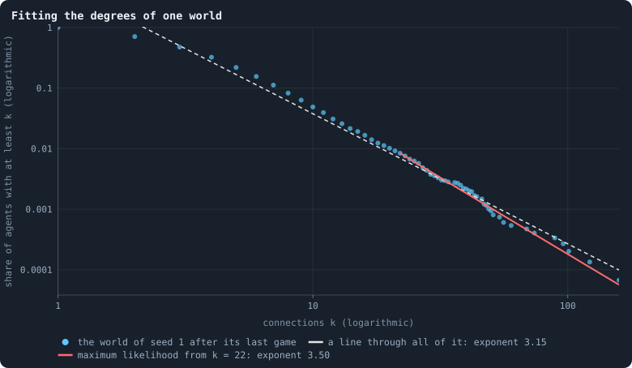
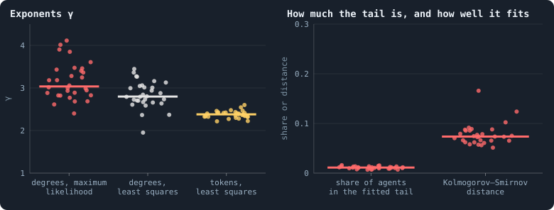
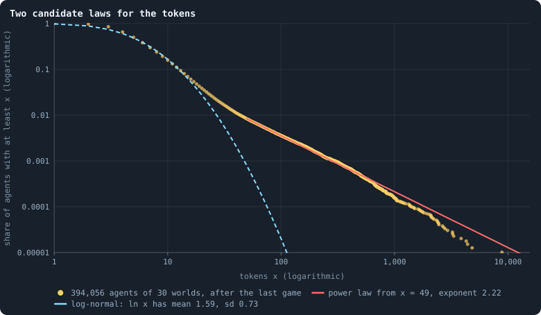
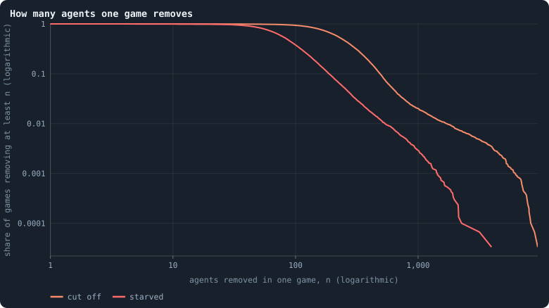
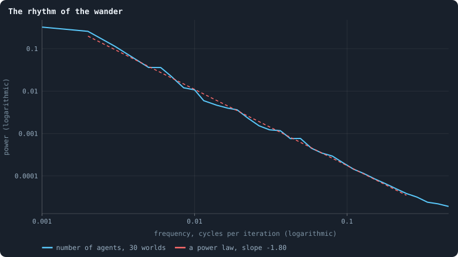

# Power laws, real and apparent

Power laws have a special place in the study of complex systems. Networks
whose numbers of [connections](the-world.md#the-network "A link between two agents of the network: they are neighbours, and can stake on each other's nodes.") follow one are called **scale-free** (Barabási
and Albert 1999); Pareto (1896) found one in incomes; sandpiles, earthquakes
and — in a famous model — extinctions come in avalanches of every size with no
typical one (Bak, Tang and Wiesenfeld 1987; Bak and Sneppen 1993); and noise
whose power falls as 1/*f* is found in music, rivers and heartbeats. A power
law is often read as a sign of something deep: a system poised at a critical
point, or growing by "the rich get richer".

Most claimed power laws do not survive a careful test (Clauset, Shalizi and
Newman 2009), and scale-free networks turn out to be rare (Broido and Clauset
2019). This page fits power laws to four things in the [baseline](b1-and-b2.md "The stated rules an experiment starts from and changes one thing of: B1 or B2.") worlds —
connections, [tokens](the-world.md#agents-and-tokens "The one thing of value in a world: every agent holds a whole number of them, and their total never changes."), the deaths of one [game](one-iteration.md#phase-2-the-game "The second phase of an iteration: every agent stakes all its tokens on its own node and its neighbours', and every node goes to someone."), and the rhythm of a world's
wander — and teaches, on the way, how a real one is told from an apparent one.

> [!question] Questions of this page
> - Are the numbers of connections distributed as a power law? Does it matter
>   how the exponent is fitted?
> - Are the tokens?
> - How many [agents](the-world.md#agents-and-tokens "One member of a world: it lives on a node of the network, holds tokens and has a brain that takes all its decisions.") does one game remove — is there a typical number, or do
>   removals come in avalanches of every size?
> - What rhythm does a world's wander have?

The worlds are the thirty of 100,000 tokens of [Thirty worlds](a-worlds-life.md#thirty-worlds);
where the thirty of 10,000 tokens this page was first written from differ,
both are given.

<!-- runs E10 -->
> [!info]- The runs behind this page
> **30 runs.** Every condition below is run once for every seed (1 to 30), for 1,500 iterations — or until its world dies out. Every setting is that of the baseline **B1** (the algorithm exactly as a new run is offered it) unless the condition changes it.
>
> - **baseline** — changes nothing: B1 as it is; 100,000 tokens. Runs `B1-100000-s001` … `B1-100000-s030`.
>
> To make these runs again: `python3 gol_lab.py run E10`, or ▶ in the Research Notebook tab of a computer running `gol_server.py`. Each run writes its settings, seed and engine version beside its frames, in `GraphOfLifeRuns/<run>/meta.json` and `provenance.json`.

> [!info]- Every setting of these runs
> | setting | baseline | what it is |
> |---|---|---|
> | [`total_tokens`](settings.md#total_tokens) | 100,000 | The number of tokens in the world, *T*. It never changes during a run. |
> | [`n_nodes`](settings.md#n_nodes) | 0 | How many founders the world starts with. 0 means one founder per hundred tokens: *n* = ⌊*T* / 100⌋. |
> | [`k_neighbors`](settings.md#k_neighbors) | 0 | How many neighbours each founder starts with in the ring. 0 means *k* = max(⌊*n* / 100⌋, 5); an odd *k* is wired as *k* − 1. |
> | [`rewire_p`](settings.md#rewire_p) | 0.2 | In the starting ring, the probability that a connection is moved to a founder chosen at random (Watts–Strogatz). |
> | [`hidden_layers`](settings.md#hidden_layers) | 50, 45, 40, 35, 30 | The widths of the brain's hidden layers, in order from input to output. |
> | [`brain_kind`](settings.md#brain_kind) | float16 | How weights are stored: `float` (64-bit), `float16` (16-bit, computed in 64-bit) or `binary` (−1, 0, +1). |
> | [`brain_bits`](settings.md#brain_bits) | 16 | Only for binary brains: how many input rows encode one number. Unused by float and float16 brains. |
> | [`message_amount`](settings.md#message_amount) | 30 | How many numbers one message holds. Each agent sends one message to itself and one to each neighbour, every phase. |
> | [`random_input_amount`](settings.md#random_input_amount) | 5 | How many random numbers, drawn uniformly from −2 to 2, a brain reads per neighbour, every time it looks. |
> | [`exchange_messages`](settings.md#exchange_messages) | on | Whether agents send and read messages at all. |
> | [`message_prepass`](settings.md#message_prepass) | on | Whether every phase begins with an extra look in which agents only write messages, so the look that acts reads messages written this phase. |
> | [`allow_handover`](settings.md#allow_handover) | on | Whether a parent may move some of its own connections to its newborn child. |
> | [`allow_revolutions`](settings.md#allow_revolutions) | on | Whether a coalition of smaller stakers can take a node from its largest staker (see the note *How a coalition takes a node*). |
> | [`allow_gifting`](settings.md#allow_gifting) | off | Whether agents may give tokens to neighbours during reproduction. Off in both baselines; on in a few pilots, in Experiment 24 and in half the worlds of the screen. |
> | [`random_decisions`](settings.md#random_decisions) | off | The control: every number a brain would produce is replaced by a random draw from the standard normal distribution. |
> | [`prune_after`](settings.md#prune_after) | blotto | After which phase connections that carried no tokens are cut: `blotto` (the game), `reproduction`, or `both`. |
> | [`inactive_window`](settings.md#inactive_window) | phase | How long a connection may go unused: `phase` means it must carry tokens in the phase being judged; `iteration` allows the two last phases. |
> | [`redistribution`](settings.md#redistribution) | uniform | How the tokens of removed agents are shared: `uniform` gives every survivor the same chance at each token; `by_tokens` weights by what a survivor holds; `poorest` raises the poorest to one common level first; `newborns` gives them to this iteration's children, `parents` to their parents, once per child (both `uniform` in an iteration without births); `children` leaves each dead agent's estate to its own living children (`uniform` where there are none). |
> | [`tokens_created_per_phase`](settings.md#tokens_created_per_phase) | 0 | Tokens added to the world at every cleanup. 0 keeps the supply fixed. |
> | [`mutate_on_replication`](settings.md#mutate_on_replication) | off | Whether a brain changes only when it is copied — into a newborn, or into a node its owner has just won — instead of also after every game, wherever it sits. |
> | [`incumbency`](settings.md#incumbency) | 1.0 | How many times over an agent's stake on its own node counts when the game decides who takes the node. 1 is the old rule. |
> | [`birth_links`](settings.md#birth_links) | 0 | How many of its parent's neighbours a newborn is joined to, drawn at random, besides its parent itself; 0 leaves every link to the brain's choice. |
> | [`mend_on_death`](settings.md#mend_on_death) | off | Whether the neighbours of an agent that dies are joined up where its death would leave them in separate pieces. |
> | [`prune_needs`](settings.md#prune_needs) | 0 | How many neighbours the two ends of an unused connection must share for it to be cut; 0 cuts every unused connection. |
> | [`valence`](settings.md#valence) | 0 | The most connections an agent's brain may choose to hold (0 = no limit). An agent at its limit cannot have a child. |
> | [`keep_home`](settings.md#keep_home) | 0.0 | The share of an agent's tokens — rounded up, never less than one — that stays on its own node whatever its brain says; a parent also keeps one. 0 is the old rule. |
> | [`max_age`](settings.md#max_age) | 0 | The age at which an agent dies (0 = never); its tokens are shared out like those of any other dead agent. |
> | [`buy_life`](settings.md#buy_life) | off | Whether an agent that has reached max_age may live on by paying one token an iteration into the estate of the dead — never its last, so one with a single token left dies. Needs max_age. |
> | [`min_child`](settings.md#min_child) | 1 | The fewest tokens a child can be born with; a parent that would give less has no child. |
> | [`child_floor`](settings.md#child_floor) | fixed | The least a child may start with: min_child alone (fixed), or also the median holding of its parent's neighbours (neighbours), so that a world grows only as rich as it is. |
> | [`mix_at_birth`](settings.md#mix_at_birth) | off | Whether a newborn's brain is its parent's mixed with a mate's — one of the parent's neighbours, drawn at random — each hidden unit whole from one or the other by an even chance, before it mutates; off, a newborn has a copy of its parent's brain. |
> | [`mix_mates`](settings.md#mix_mates) | any | Under mix_at_birth, who may be the mate: any neighbour of the parent, or only parents — a neighbour with a living child of its own (with none, the newborn's brain is a copy). |
> | [`self_message`](settings.md#self_message) | own | What an agent writes to itself, which each neighbour reads: what its own column says (own), or the largest, number by number, of what it writes to anyone (largest), so that news one column marks reaches every neighbour. |
> | [`link_search`](settings.md#link_search) | off | Whether an agent may reach beyond its neighbours to propose a link: off; jump, a walk as many steps long as the tokens it spends in one iteration, with a link proposed where it ends; walk, a scout that goes one step further in every iteration it pays for; or reach, a jump whose steps are free, as many as the tokens it holds would pay for. A paid step costs one token, paid to the agent it enters, and never the last. |
> | [`link_steering`](settings.md#link_steering) | random | Which way each step of a search goes: to a neighbour drawn at random, or to the one the searcher would most like a link with (looking). |
> | [`link_consent`](settings.md#link_consent) | mutual | Who has to agree to a link a search proposes: both ends (mutual), or only the one who proposes (forced). Nobody at its valence gets a new link either way. |
> | [`proto`](settings.md#proto) | none | Rules first played in the pilots' prototype, by name: came_from and helped_by (an input row each), contest = lottery, pool by genotype or family, kin_sense, tag_rate, mate_pays, grow, unit_token, link_token. Empty in every run but those that ask for one; only the prototype's world plays them (see the settings note). |
> | [`mutation_probability`](settings.md#mutation_probability) | 0.2 | The probability that a brain changes when it is copied to a child, and again, for every brain, after every game. |
> | [`mutation_noise_std`](settings.md#mutation_noise_std) | 0.2 | How large a change to one weight is: a normal draw with standard deviation this times 1/√(fan-in) of its layer. |
> | [`mutation_sparsity`](settings.md#mutation_sparsity) | 0.1 | The share of a brain's numbers a change touches; also the probability, for each weight matrix and bias vector, of a rarer reset that redraws that share of it. |
> | [`extinction_threshold`](settings.md#extinction_threshold) | 20 | A run stops, as extinct, when an iteration ends (after its game) with this many agents or fewer. |
> | seeds | 1 to 30 | one run per seed |
> | iterations | 1,500 | how far each run goes, unless its world dies first |
>
> A value in **bold** differs from the baseline B1.
<!-- /runs -->

## What a power law is, and why it is hard to see

A quantity *k* follows a power law if the share of values equal to *k* falls
as *k*^−γ. It has **no typical scale**: doubling *k* always divides the share
by the same factor, 2^γ, whether *k* is 2 or 2,000. The share of values **at
least** *k* — the complementary cumulative distribution — then falls as
*k*^−(γ−1), a straight line of slope 1 − γ on log–log axes
([Logarithmic axes](logarithmic-axes.md)).

The viewer offers two ways of finding γ ([Fitting a power law](power-law-fit.md)):

- **[Least squares](least-squares.md "The straight line that fits a cloud of points best, and how much of their spread it explains.")** through the whole cumulative distribution on log–log
  axes (`degreeExponent`, `tokenExponent`): the obvious method, and a biased
  one.
- **Maximum likelihood** on the tail, from the *k*_min whose fitted law sits
  closest to the data (`degreeGamma`, `degreeKMin`): the method the literature
  recommends.

And neither says whether there *is* a power law. For that, this page adds
the test of Clauset, Shalizi and Newman: draw many samples from the fitted
law, fit each the same way, and ask how often a sample fits its own law
**worse** than the data fit theirs. If that happens rarely — in 10% of samples
or fewer — the data are too far from a power law to be one. If it happens
often, a power law is a plausible description (though another curve might be
too).

## The connections of one world

<!-- figure powerlaws/degree-fit -->

**Fitting the degrees of one world.** Dots: for every number of connections k that occurs among the 14,870 agents of the world with seed 1 after its last game, the share of agents with at least k — the complementary cumulative distribution, on logarithmic axes. Dashed: the straight line least squares fits through all the dots, whose slope is 1 − γ for a power law of exponent γ (the viewer's `degreeExponent`). Red: the power law fitted by maximum likelihood to the tail from the k that fits best, k = 22 (`degreeGamma`, `degreeKMin`), which holds 0.8% of the agents ([Fitting a power law](power-law-fit.md)).

> [!example]- How to make this figure
> **Runs.** `B1-100000-s001`.
>
> **Data.** From each run's frames, `GraphOfLifeRuns/<run>/frames/`, read with `gol_store.read_frame(run, index)`; frame `2·t` is iteration *t* after reproduction and frame `2·t + 1` after the game.
>
> 1. Read the last frame after a game (`2999`) and count every agent's connections in `edges`.
> 2. Dots: for each distinct count k, the share of agents with at least k.
> 3. Dashed: least squares of ln(share) on ln(k) over the dots.
> 4. Red: `gol_series._scale_free(degrees)` — for each candidate k_min, γ = 1 + n / Σ ln(k / (k_min − ½)) over the n agents with k ≥ k_min, and the Kolmogorov–Smirnov distance; the k_min with the smallest distance wins.
>
> **To make it again:** `python3 book_figures.py powerlaws`.
<!-- /figure -->

The world of [seed](random-numbers.md "The number that fixes every random choice of a run: the same settings and the same seed make the same world.") 1 has 14,870 agents after its last game. The dashed line,
least squares through every point, has the exponent 3.15 — but it is drawn
through points that are not on a line: below about twenty connections the
distribution bends. The maximum-likelihood fit chooses the tail from
*k*_min = 22, which holds 125 agents (0.8%), and gives γ = 3.50. With 125
values, the exponent is known to about ±(γ − 1)/√125 = ±0.22.

Is the tail a power law? The largest gap between the data and the fitted law
is 0.068. Samples drawn from the fitted law show a gap at least as large in
55% of cases (200 samples): a power law is **not ruled out** for the top 1%
of this world. What it does not say is anything about the other 99%.

## Thirty worlds

<!-- figure powerlaws/exponents -->

**Power-law exponents of the 30 worlds.** One dot per world, at its mean over the measurements (every 25 iterations) from iteration 500 on; the bar is the median. Left: the exponent γ of the degree distribution by maximum likelihood on the tail (`degreeGamma`) and by least squares on the whole distribution (`degreeExponent`), and of the token distribution by least squares (`tokenExponent`). Right: the share of agents in the tail the maximum-likelihood fit chose (`degreeTailShare`) and the largest gap between that tail and the fitted law (`degreeGammaKS`).

> [!example]- How to make this figure
> **Runs.** The 30 baseline runs `B1-100000-s001` … `B1-100000-s030`: the baseline B1 at 100,000 tokens, seeds 1 to 30, 1,500 iterations each (every setting is listed in [Thirty worlds](a-worlds-life.md#thirty-worlds)). They are made with `python3 gol_lab.py run E10`.
>
> **Data.** From each run's `GraphOfLifeRuns/<run>/stats.jsonl`, which holds one row per recorded phase: `phase` 1 is the world just after reproduction, `phase` 2 just after the game, and every statistic is a field of the row (see [What a run records](frames-and-stats.md)).
>
> 1. Average `degreeGamma`, `degreeExponent`, `tokenExponent`, `degreeTailShare` and `degreeGammaKS` over the rows with `phase` = 2 and 500 ≤ `iteration` ≤ 1,499.
> 2. One dot per run, a bar at the median.
>
> **To make it again:** `python3 book_figures.py powerlaws`.
<!-- /figure -->

Across the worlds, over their [settled life](settled-life.md "A world from iteration 500 to its end, after its youth, where it is measured."):

- maximum likelihood finds the tail from about 21 connections, holding 1.1%
  of the agents (0.7% to 1.6%), with γ = 3.04 (2.40 to 4.11);
- least squares through everything gives 2.80 (1.95 to 3.45) — consistently
  **lower**, because a line through the whole distribution is tilted by the
  bend of the body;
- the test, on each world's last frame, rules a power law out in 6 of the 30
  worlds and leaves it plausible in 24.

At 10,000 tokens the tail began at about 10 connections and held 5% of the
agents, with γ = 3.34. So: the top hundredth of the connections looks like a
power law with an exponent near 3, the bulk does not, and the exponent one
reports depends on the method by a quarter to half a unit. "The network is scale-free" would claim far
more than this.

Where would a tail like this come from? The rules contain a known mechanism.
A child is joined to some of its parent's [candidates](one-iteration.md#phase-1-reproduction "An agent itself and each of its neighbours, the ones its brain looks at when it decides.") — in effect it **copies**
part of its parent's neighbourhood ([How agents have children](how-agents-have-children.md)).
An agent gains a connection whenever one of its [neighbours](the-world.md#the-network "An agent joined to another by a connection.") has a child that is
joined to it; an agent with twice the neighbours has about twice the chances.
The well connected gain connections in proportion to their connections:
[preferential attachment](preferential-attachment.md "The well connected gaining new connections faster than the poorly connected.") (Barabási and Albert 1999), reached by copying, as in
the "duplication" models of protein networks (Vázquez, Flammini, Maritan and
Vespignani 2003; Chung, Lu, Dewey and Galas 2003). Preferential attachment on
its own gives γ = 3. [How the network grows](how-agents-have-children.md#how-the-network-grows) has measured
it here: an agent gains connections in proportion to those it has (as
*k*^1.02), and loses them a little faster (as *k*^1.20), which bends the tail
down at the top. Whether this is what makes the tail is still a hypothesis:
an experiment that joined children to random agents instead would test it.

> [!info] Added later: preferential attachment, capped
> [A world that cannot break](a-world-that-cannot-break.md) meets the same mechanism when
> [brains](the-brain.md "The neural network each agent decides with: inputs about itself and its neighbours, outputs that become its decisions.") can see: whatever a brain favours, the well connected are offered as
> candidates more often, and in [pilots](pilot-worlds.md "A world made by hand to see whether an idea is worth an experiment, without a thesis or many seeds.") in which the brains chose a newborn's
> links the best-connected agent was joined to 30% of the world. The second
> baseline, [B2](b1-and-b2.md "The second baseline: B1 with the rules that keep its network from breaking and its agents from staking or breeding themselves to death."), draws two of a newborn's links at random and caps the links a
> brain may choose at eight.

## The tokens: a power law in the tail

<!-- figure powerlaws/tokens-fit -->

**Two candidate laws for the tokens.** Dots: for every token count x that occurs among the agents alive after the last game of the 30 worlds, the share holding at least x. Red: a power law fitted by maximum likelihood to the tail, from the x that fits it best. Cyan: a log-normal distribution with the mean and standard deviation of ln x over all agents — a distribution whose logarithm is normal. Both on logarithmic axes.

> [!example]- How to make this figure
> **Runs.** The 30 baseline runs `B1-100000-s001` … `B1-100000-s030`: the baseline B1 at 100,000 tokens, seeds 1 to 30, 1,500 iterations each (every setting is listed in [Thirty worlds](a-worlds-life.md#thirty-worlds)). They are made with `python3 gol_lab.py run E10`.
>
> **Data.** From each run's frames, `GraphOfLifeRuns/<run>/frames/`, read with `gol_store.read_frame(run, index)`; frame `2·t` is iteration *t* after reproduction and frame `2·t + 1` after the game.
>
> 1. Pool the `tokens` of the last frame of every run.
> 2. Dots: for each distinct x, the share of agents with at least x.
> 3. Red: `gol_series._scale_free(tokens)`, as for the degrees.
> 4. Cyan: μ and σ = the mean and standard deviation of ln x; the curve is 1 − Φ((ln x − μ)/σ), Φ the standard normal distribution.
>
> **To make it again:** `python3 book_figures.py powerlaws`.
<!-- /figure -->

The tokens of 394,056 agents, pooled over the thirty worlds after their last
game, tell a clearer story. The **log-normal** distribution with the mean and
spread of ln *x* (μ = 1.59, σ = 0.73: a [median](median-and-quantiles.md "The middle value: half of the numbers lie below it and half above.") of *e*^1.59 ≈ 4.9 tokens) fits
the body up to about 20 tokens — and then falls far below the data. From 49
tokens on, the data follow a straight line for two decades, to about 5,000
tokens, before the few richest fall a little below it: a power law with
γ = 2.22, fitted to 3,358 agents (0.9%), with a largest gap of only 0.016.
Samples from the fitted law fit it worse than the data in **37%** of cases.
Of the four candidates in this page, this is the most convincing power
law: the share of agents with at least *x* tokens falls as *x*^−1.22 — a
heavier tail than Pareto's incomes, which fell about as *x*^−1.5. (At 10,000
tokens: γ = 2.29 from 33 tokens on, plausible in 92% of samples, over a
range ten times shorter.)

Are the richest rich because they are [hubs](stars-and-hubs.md "An agent joined to far more agents than most; a star is a world held together by a single hub.")? If tokens were a fixed function of
connections, the two tails would be tied together, and a token tail heavier
than the connection tail would need the hubs to hold *more* tokens per
connection than everyone else. They do not: among the 3,358 agents in the
token tail, 40% have ten connections or more — but **33% have only one or
two**. A third of the richest agents are rich far beyond their place, and
[Gains and losses](gains-and-losses.md) showed what happens to the rich: those
with a hundred tokens or more lose 48% of their tokens per game on average,
and a rich agent with one or two connections dies in one game in ten.

That suggests a different mechanism, also a classic. An agent's tokens are
multiplied, game after game, by a random factor — sometimes a big gain, more
often a loss — while a floor holds up the poorest (a node with nothing dies,
and the [share-out](gains-losses-and-the-share-out.md "How a cleanup deals the tokens of the dead out among the living: in the baseline, each token to a survivor drawn at random.") tops up the poor). Random multiplication with a floor
produces a power-law tail (Champernowne 1953; Kesten 1973; Levy and Solomon
1996; Gabaix 1999 for the sizes of cities). Again a hypothesis, which the
simplest test would be to look for.

## How many agents one game removes

<!-- figure powerlaws/avalanches -->

**How many agents one game removes.** Of all games from iteration 500 on in the 30 worlds (30,000 games), the share that cut off at least n agents (orange) and the share in which at least n agents starved (red), for every n, on logarithmic axes. Games in which no one was removed count in the denominator, which is why the curves start below 1.

> [!example]- How to make this figure
> **Runs.** The 30 baseline runs `B1-100000-s001` … `B1-100000-s030`: the baseline B1 at 100,000 tokens, seeds 1 to 30, 1,500 iterations each (every setting is listed in [Thirty worlds](a-worlds-life.md#thirty-worlds)). They are made with `python3 gol_lab.py run E10`.
>
> **Data.** From each run's `GraphOfLifeRuns/<run>/stats.jsonl`, which holds one row per recorded phase: `phase` 1 is the world just after reproduction, `phase` 2 just after the game, and every statistic is a field of the row (see [What a run records](frames-and-stats.md)).
>
> 1. Take `orphaned` and `starved` of every row with `phase` = 2 and 500 ≤ `iteration` ≤ 1,499.
> 2. For each n that occurs, the share of rows with at least n.
>
> **To make it again:** `python3 book_figures.py powerlaws`.
<!-- /figure -->

In every settled game but three of the 30,000, at least one agent is cut
off; in 94%, a hundred or more; in 2%, a thousand or more; the median game
cuts off 239 agents, and the most ever cut off in one game was 9,460 — two
thirds of a world. On log–log axes the curve is flat to about 200 and then
falls, bending, with no straight stretch long enough to call a power law. The
removals have a typical size, a few hundred agents — about 2% of a world —
and big ones are rare.

But big ones matter. Of all agents ever cut off, 16% died in the 2% of games
that cut off a thousand or more. Counted against the size of a world, this is
what the worlds of 10,000 tokens did: there 2.5% of games cut off a hundred
or more (a hundredth of their tokens' worth, as a thousand is here), and 20%
of the deaths by cutting fell in them. Death by cutting comes in **lumps**:
whole branches of the network fall off at once. Starvation comes in smaller
lumps (at most 3,966 in one game).
[How a world breaks](how-a-world-breaks.md) asks where the lumps come from and
whether they can be foreseen.

## The rhythm of the wander

How does a world's number of agents move over time? The **power spectrum**
splits the movement into rhythms and says how much of it happens at each
([The power spectrum](power-spectrum.md)).

<!-- figure powerlaws/spectrum -->

**The rhythm of the wander.** The power spectrum of the number of agents ([The power spectrum](power-spectrum.md)): for each frequency, how much of a world's up-and-down motion happens at that rhythm — slow wanders on the left, iteration-to-iteration jitter on the right. Each world's series from iteration 500 to 1,499, with its straight-line trend removed and a Hann window applied, normalised to total power 1 and averaged over the 30 worlds; then averaged in 39 bands of equal width on the logarithmic axis. Red: the straight line least squares fits between periods of 500 and 4 iterations.

> [!example]- How to make this figure
> **Runs.** The 30 baseline runs `B1-100000-s001` … `B1-100000-s030`: the baseline B1 at 100,000 tokens, seeds 1 to 30, 1,500 iterations each (every setting is listed in [Thirty worlds](a-worlds-life.md#thirty-worlds)). They are made with `python3 gol_lab.py run E10`.
>
> **Data.** From each run's `GraphOfLifeRuns/<run>/stats.jsonl`, which holds one row per recorded phase: `phase` 1 is the world just after reproduction, `phase` 2 just after the game, and every statistic is a field of the row (see [What a run records](frames-and-stats.md)).
>
> 1. For each run, take `nodes` of the rows with `phase` = 2 and 500 ≤ `iteration` ≤ 1,499 (1,000 values); subtract the least-squares straight line.
> 2. Multiply by a Hann window and take |FFT|², the power at frequencies k/1,000, k = 1 … 500; divide by the total.
> 3. Average over runs; average within bands of equal width in log frequency; fit a line on log–log axes between frequencies 1/500 and 1/4.
>
> **To make it again:** `python3 book_figures.py powerlaws`.
<!-- /figure -->

Between periods of 4 and 500 [iterations](one-iteration.md "One step of a world's time: a phase of reproduction, then a phase of the game."), the power falls as *f*^−1.80 —
close to the *f*^−2 of a **random walk**, in which every step is added to the
last (*f*^−2.11 at 10,000 tokens). At the slowest end, periods near a
thousand iterations, the spectrum flattens a little: the world does not keep
walking away, something pulls it back. A random walk with a pull back to a
level is the Ornstein–Uhlenbeck process, whose spectrum is flat below a
corner and falls as *f*^−2 above it; the corner corresponds to a pull that
takes a few hundred iterations to act — which fits the
[autocorrelation](autocorrelation.md) of 0.61 after 100 iterations
found in [How much does the seed decide?](how-much-does-the-seed-decide.md). Each world's
series is a thousand iterations long here, so the slow end is seen less well
than in the worlds of 10,000 tokens, whose wander had 2,500 iterations to
show it. Most of the movement happens at the slowest rhythms: the wander is
slow.

It is not 1/*f* noise (a slope of −1), which would mean memory on every time
scale. The world forgets.

## What this means

- **One real power law, one plausible, two apparent.** The token tail is a
  power law over two decades. The tail of the connections is plausibly one,
  for the top 1% (the top 5% at 10,000 tokens). The [degree](degree.md "The number of an agent's connections: how many neighbours it has.") distribution as a whole is not, and neither are
  the lumps of death.
- **The rules contain two textbook mechanisms for heavy tails** — copying
  neighbourhoods at birth, and multiplying tokens by chance with a floor below.
  Neither is shown here to be the cause; both could be switched off in an
  experiment.
- **No sign of a critical state.** No avalanches of every size, no 1/*f*
  noise: disturbances die out within a few hundred iterations, and the world
  is pulled back to its level. Some theories tie [open-ended evolution](open-ended-test.md "Evolution that keeps producing new things without end, not only up to a plateau.") to
  criticality — to systems on the edge between order and chaos, where small
  causes can have effects of every size. Whatever the truth of that, this
  world is not on such an edge; it is a world that wanders and returns
  ([What the measurements say about open-ended evolution](what-the-baseline-world-is.md#what-the-measurements-say-about-open-ended-evolution)).

To make every figure of this page: `python3 book_figures.py powerlaws`.

<!-- turns -->
---

← [The shape of the network](what-shape-does-the-network-take.md) · [The shape and health of the network](../README.md#the-shape-and-health-of-the-network) · [How properties scale together](how-properties-scale-together.md) →

**Also about:** [Methods and statistics](../README.md#methods-and-statistics).

> [!info]- Pages that link here (12)
> [How births build the network](how-agents-have-children.md) · [How unequal is a world, and who stays rich](where-do-the-tokens-go.md) · [Gains and losses](gains-and-losses.md) · [The largest and the smallest](the-largest-and-the-smallest.md) · [The shape of the network](what-shape-does-the-network-take.md) · [How properties scale together](how-properties-scale-together.md) · [How a world breaks](how-a-world-breaks.md) · [Preferential attachment and its kernel](preferential-attachment.md) · [Physical inspiration](physical-inspiration.md) · [Like next to like](like-next-to-like.md) · [Fitting a power law properly](power-law-fit.md) · [The power spectrum of a time series](power-spectrum.md)
<!-- /turns -->
