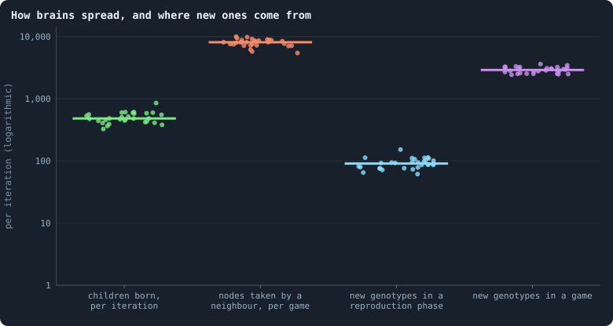
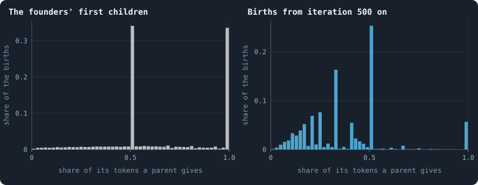

# Questioning the mechanics

> [!question] Questions of this page
> - How do [brains](the-brain.md "The neural network each agent decides with: inputs about itself and its neighbours, outputs that become its decisions.") spread, and where do new ones come from?
> - Which rules decide most of what a world does?
> - Which of them stand in the way of [open-ended evolution](open-ended-test.md "Evolution that keeps producing new things without end, not only up to a plateau."), and what could
>   replace them?
> - What did the second baseline, B2, change about them, and what came of it?

## In short

Much of what the first baseline, B1, does follows from a few of its rules, not
from what its brains compute. This page takes those rules one at a time: what
each does, whether that is what was meant, and what could replace it. In B1 a
brain spreads seventeen times more by conquest, winning a [neighbour](the-world.md#the-network "An agent joined to another by a connection.")'s [node](the-world.md#agents-and-tokens "One member of a world: it lives on a node of the network, holds tokens and has a brain that takes all its decisions."),
than by birth, and 97% of new [genotypes](genotype.md "The identity of a brain: a number that a brain keeps until it changes, and that records whose copy it was.") arise in living brains. Four rules
stood most in the way of open-ended evolution: brains that change as they
live, conquest that erases, places nobody can hold, and a cull that kills
every piece cut off from the rest. The second baseline, B2, changed three of
the four at once: its worlds no longer break, but conquest still erases, and
its evolution slows towards a plateau.

## How to question a rule

Most pages of this notebook take the rules of a world as given, and measure
what they produce. This page turns around and examines the rules themselves.
A rule can be questioned in three ways:

- **What does it do?** The measurements of the baseline say.
- **Is that what was meant?** A rule written for one purpose can quietly
  serve another.
- **What would happen without it?** That is a question for experiments, and
  this page prepares them.

For each rule, the page states the rule, what the data say about it, and why
it matters for open-ended evolution — evolution that keeps producing new
things without end. Then it says what could replace the rule, what the second
baseline did about it, and what came of that.

Nothing here is a verdict. Several of these rules may be exactly right. But a
rule that quietly decides most of what happens in a world deserves to be
looked at in the open.

**Two baselines.** A baseline is a stated set of rules that experiments start
from ([B1 and B2: the two baselines](b1-and-b2.md)). B1 holds the rules as
they were first built, and the rule and the data of every section below are
B1's. B2 was made on 12 October 2026 from [pilot](pilot-worlds.md "A world made by hand to see whether an idea is worth an experiment, without a thesis or many seeds.") worlds. It is B1 with rules
that keep its network from breaking and its agents from staking or breeding
themselves to death, and with smaller brains that see. Several of its changes
answer questions this page asked.

**The worlds.** The numbers are those of the thirty B1 worlds of 100,000
[tokens](the-world.md#agents-and-tokens "The one thing of value in a world: every agent holds a whole number of them, and their total never changes.") of [Thirty worlds](a-worlds-life.md#thirty-worlds). This page was first written from
thirty worlds of 10,000 tokens; where those differ, both are given.

<!-- runs E10 -->
> [!info]- The runs behind this page
> **30 runs.** Every condition below is run once for every seed (1 to 30), for 1,500 iterations — or until its world dies out. Every setting is that of the baseline **B1** (the algorithm exactly as a new run is offered it) unless the condition changes it.
>
> - **baseline** — changes nothing: B1 as it is; 100,000 tokens. Runs `B1-100000-s001` … `B1-100000-s030`.
>
> To make these runs again: `python3 gol_lab.py run E10`, or ▶ in the Research Notebook tab of a computer running `gol_server.py`. Each run writes its settings, seed and engine version beside its frames, in `GraphOfLifeRuns/<run>/meta.json` and `provenance.json`.

> [!info]- Every setting of these runs
> | setting | baseline | what it is |
> |---|---|---|
> | [`total_tokens`](settings.md#total_tokens) | 100,000 | The number of tokens in the world, *T*. It never changes during a run. |
> | [`n_nodes`](settings.md#n_nodes) | 0 | How many founders the world starts with. 0 means one founder per hundred tokens: *n* = ⌊*T* / 100⌋. |
> | [`k_neighbors`](settings.md#k_neighbors) | 0 | How many neighbours each founder starts with in the ring. 0 means *k* = max(⌊*n* / 100⌋, 5); an odd *k* is wired as *k* − 1. |
> | [`rewire_p`](settings.md#rewire_p) | 0.2 | In the starting ring, the probability that a connection is moved to a founder chosen at random (Watts–Strogatz). |
> | [`hidden_layers`](settings.md#hidden_layers) | 50, 45, 40, 35, 30 | The widths of the brain's hidden layers, in order from input to output. |
> | [`brain_kind`](settings.md#brain_kind) | float16 | How weights are stored: `float` (64-bit), `float16` (16-bit, computed in 64-bit) or `binary` (−1, 0, +1). |
> | [`brain_bits`](settings.md#brain_bits) | 16 | Only for binary brains: how many input rows encode one number. Unused by float and float16 brains. |
> | [`message_amount`](settings.md#message_amount) | 30 | How many numbers one message holds. Each agent sends one message to itself and one to each neighbour, every phase. |
> | [`random_input_amount`](settings.md#random_input_amount) | 5 | How many random numbers, drawn uniformly from −2 to 2, a brain reads per neighbour, every time it looks. |
> | [`exchange_messages`](settings.md#exchange_messages) | on | Whether agents send and read messages at all. |
> | [`message_prepass`](settings.md#message_prepass) | on | Whether every phase begins with an extra look in which agents only write messages, so the look that acts reads messages written this phase. |
> | [`allow_handover`](settings.md#allow_handover) | on | Whether a parent may move some of its own connections to its newborn child. |
> | [`allow_revolutions`](settings.md#allow_revolutions) | on | Whether a coalition of smaller stakers can take a node from its largest staker (see the note *How a coalition takes a node*). |
> | [`allow_gifting`](settings.md#allow_gifting) | off | Whether agents may give tokens to neighbours during reproduction. Off in both baselines; on in a few pilots, in Experiment 24 and in half the worlds of the screen. |
> | [`random_decisions`](settings.md#random_decisions) | off | The control: every number a brain would produce is replaced by a random draw from the standard normal distribution. |
> | [`prune_after`](settings.md#prune_after) | blotto | After which phase connections that carried no tokens are cut: `blotto` (the game), `reproduction`, or `both`. |
> | [`inactive_window`](settings.md#inactive_window) | phase | How long a connection may go unused: `phase` means it must carry tokens in the phase being judged; `iteration` allows the two last phases. |
> | [`redistribution`](settings.md#redistribution) | uniform | How the tokens of removed agents are shared: `uniform` gives every survivor the same chance at each token; `by_tokens` weights by what a survivor holds; `poorest` raises the poorest to one common level first; `newborns` gives them to this iteration's children, `parents` to their parents, once per child (both `uniform` in an iteration without births); `children` leaves each dead agent's estate to its own living children (`uniform` where there are none). |
> | [`tokens_created_per_phase`](settings.md#tokens_created_per_phase) | 0 | Tokens added to the world at every cleanup. 0 keeps the supply fixed. |
> | [`mutate_on_replication`](settings.md#mutate_on_replication) | off | Whether a brain changes only when it is copied — into a newborn, or into a node its owner has just won — instead of also after every game, wherever it sits. |
> | [`incumbency`](settings.md#incumbency) | 1.0 | How many times over an agent's stake on its own node counts when the game decides who takes the node. 1 is the old rule. |
> | [`birth_links`](settings.md#birth_links) | 0 | How many of its parent's neighbours a newborn is joined to, drawn at random, besides its parent itself; 0 leaves every link to the brain's choice. |
> | [`mend_on_death`](settings.md#mend_on_death) | off | Whether the neighbours of an agent that dies are joined up where its death would leave them in separate pieces. |
> | [`prune_needs`](settings.md#prune_needs) | 0 | How many neighbours the two ends of an unused connection must share for it to be cut; 0 cuts every unused connection. |
> | [`valence`](settings.md#valence) | 0 | The most connections an agent's brain may choose to hold (0 = no limit). An agent at its limit cannot have a child. |
> | [`keep_home`](settings.md#keep_home) | 0.0 | The share of an agent's tokens — rounded up, never less than one — that stays on its own node whatever its brain says; a parent also keeps one. 0 is the old rule. |
> | [`max_age`](settings.md#max_age) | 0 | The age at which an agent dies (0 = never); its tokens are shared out like those of any other dead agent. |
> | [`buy_life`](settings.md#buy_life) | off | Whether an agent that has reached max_age may live on by paying one token an iteration into the estate of the dead — never its last, so one with a single token left dies. Needs max_age. |
> | [`min_child`](settings.md#min_child) | 1 | The fewest tokens a child can be born with; a parent that would give less has no child. |
> | [`child_floor`](settings.md#child_floor) | fixed | The least a child may start with: min_child alone (fixed), or also the median holding of its parent's neighbours (neighbours), so that a world grows only as rich as it is. |
> | [`mix_at_birth`](settings.md#mix_at_birth) | off | Whether a newborn's brain is its parent's mixed with a mate's — one of the parent's neighbours, drawn at random — each hidden unit whole from one or the other by an even chance, before it mutates; off, a newborn has a copy of its parent's brain. |
> | [`mix_mates`](settings.md#mix_mates) | any | Under mix_at_birth, who may be the mate: any neighbour of the parent, or only parents — a neighbour with a living child of its own (with none, the newborn's brain is a copy). |
> | [`self_message`](settings.md#self_message) | own | What an agent writes to itself, which each neighbour reads: what its own column says (own), or the largest, number by number, of what it writes to anyone (largest), so that news one column marks reaches every neighbour. |
> | [`link_search`](settings.md#link_search) | off | Whether an agent may reach beyond its neighbours to propose a link: off; jump, a walk as many steps long as the tokens it spends in one iteration, with a link proposed where it ends; walk, a scout that goes one step further in every iteration it pays for; or reach, a jump whose steps are free, as many as the tokens it holds would pay for. A paid step costs one token, paid to the agent it enters, and never the last. |
> | [`link_steering`](settings.md#link_steering) | random | Which way each step of a search goes: to a neighbour drawn at random, or to the one the searcher would most like a link with (looking). |
> | [`link_consent`](settings.md#link_consent) | mutual | Who has to agree to a link a search proposes: both ends (mutual), or only the one who proposes (forced). Nobody at its valence gets a new link either way. |
> | [`proto`](settings.md#proto) | none | Rules first played in the pilots' prototype, by name: came_from and helped_by (an input row each), contest = lottery, pool by genotype or family, kin_sense, tag_rate, mate_pays, grow, unit_token, link_token. Empty in every run but those that ask for one; only the prototype's world plays them (see the settings note). |
> | [`mutation_probability`](settings.md#mutation_probability) | 0.2 | The probability that a brain changes when it is copied to a child, and again, for every brain, after every game. |
> | [`mutation_noise_std`](settings.md#mutation_noise_std) | 0.2 | How large a change to one weight is: a normal draw with standard deviation this times 1/√(fan-in) of its layer. |
> | [`mutation_sparsity`](settings.md#mutation_sparsity) | 0.1 | The share of a brain's numbers a change touches; also the probability, for each weight matrix and bias vector, of a rarer reset that redraws that share of it. |
> | [`extinction_threshold`](settings.md#extinction_threshold) | 20 | A run stops, as extinct, when an iteration ends (after its game) with this many agents or fewer. |
> | seeds | 1 to 30 | one run per seed |
> | iterations | 1,500 | how far each run goes, unless its world dies first |
>
> A value in **bold** differs from the baseline B1.
<!-- /runs -->

## Two roads of inheritance

**The rule.** A brain is copied in two ways. At birth, a child gets a copy of
its parent's brain. And in the game, an agent that wins a neighbour's node —
a **conquest** — puts a copy of its own brain there. The brain that was on the
node is erased. The agent on that node keeps its id, its age and its links;
only its brain is replaced
([One iteration, step by step](one-iteration.md)).

<!-- figure mechanics/where-brains-go -->

**How brains spread, and where new ones come from.** One dot per world: means over the iterations sampled every 25 from 500 on. From the left: children born in a reproduction phase; nodes won in a game by a neighbour, each of which takes on a copy of the winner's brain; genotypes that appear for the first time in the frame after a reproduction phase (a newborn's brain that changed); and genotypes that appear for the first time after a game (every brain is offered a change at its end). On a logarithmic axis.

> [!example]- How to make this figure
> **Runs.** The 30 baseline runs `B1-100000-s001` … `B1-100000-s030`: the baseline B1 at 100,000 tokens, seeds 1 to 30, 1,500 iterations each (every setting is listed in [Thirty worlds](a-worlds-life.md#thirty-worlds)). They are made with `python3 gol_lab.py run E10`.
>
> **Data.** From each run's frames, read every 25 iterations by `book_figures.sample_pass` (frame `2·t` after the reproduction phase of iteration *t*, frame `2·t + 1` after its game; `gol_store.read_frame(run, index)`).
>
> 1. For every 25th iteration t from 500 on: births = the length of `decisions.births` in frame `2·t`; takeovers = the entries of `decisions.winners` in frame `2·t + 1` with `winner` ≠ `node`.
> 2. New genotypes: the `brain_ids` of frame `2·t` not in frame `2·t − 1`, and those of frame `2·t + 1` not in frame `2·t`.
> 3. Average per run.
>
> **To make it again:** `python3 book_figures.py mechanics`.
<!-- /figure -->

**What the data say.** In a settled world — from iteration 500 on — about
**480** children are born per iteration, and about **8,100** nodes are taken
by a neighbour in each game. So a brain spreads by conquest seventeen times
more than by birth. At 10,000 tokens it was eighteen times: 39 children
against 720 nodes.

**Why it matters.** In this world the thing that evolves — the brain — is not
the thing that lives and dies — the node. Nodes are bodies; brains move from
body to body like an infection. A brain's success is how many bodies it takes,
and how long it holds them.

That is a legitimate kind of evolution: it is how viruses, memes and many
cultural traits spread. But it is not the kind the words "agent" and "child"
suggest. And it makes the individual hard to define: the agent that "keeps its
node" is the brain, the agent that "is old" is the body.

**What could replace it.** Three changes were proposed:

- (a) A won node keeps its brain, and only its tokens move. Brains are then
  inherited through birth alone.
- (b) The winner's brain and the loser's are **recombined** into the node, so
  that conquest mixes rather than replaces — the nearest thing here to sex.
- (c) A node is taken only if the winner outbids its own agent's stake by a
  margin, so that a place can be held.

**What B2 did.** It took up (c). The setting
[`incumbency`](settings.md#incumbency) makes an agent's stake on its own node
count *h* times over when the game decides who takes the node. In pilot worlds
with brains that see and *h* = 2, conquest fell from 40–90% of the nodes in a
game to 15–25%. Births came back as the way brains spread. But one agent
gathered 57% of all the tokens, staked them at home where nobody could outbid
them, and had child after child: a *queen*. B2 uses *h* = 1.5, and keeps a
share of every agent's tokens at home. Under these rules no queen formed in
the pilots, and conquest settled between a few and about ten per cent of the
nodes a game ([Who dies, and why](a-world-that-cannot-break.md#who-dies-and-why)).

Even so, a brain in B2 still spreads mostly by conquest. In B2's worlds of
10,000 tokens, 5.6 nodes per hundred agents change hands in the [median](median-and-quantiles.md "The middle value: half of the numbers lie below it and half above.")
iteration, against one birth
([Mixed at birth: ten long worlds](mixed-at-birth-ten-long-worlds.md)).
Mixing brains has been tried only at birth: with
[`mix_at_birth`](settings.md#mix_at_birth), a newborn's brain mixes its
parent's with a neighbour's. Neither (a) nor recombination at conquest has
been tried.

## Variation in the living

**The rule.** In B1 every brain is offered a change after every game, with
probability 0.2, wherever it sits — and again when it is copied into a child
([How a brain changes](mutation.md)). A brain that changes becomes a new
genotype, with a number of its own.

**What the data say.** In the figure above, about **91** new genotypes appear
in a reproduction phase, and about **2,900** in a game. So 97.0% of all new
genotypes arise in living brains after a game, not at birth (97.3% at 10,000
tokens). And a brain is rarely left alone. It escapes a change in each game
with probability 0.8, so a brain that is not copied for five games is still
unchanged with probability 0.8⁵ = 33% only.

**Why it matters.** In biology, almost all heritable variation arises when
genomes are copied; a body does not keep rewriting its own genes. Here,
variation is mostly **somatic**: it happens in the body, during its life. A
brain that does well does not stay itself. Selection works on a target that
moves under it, and a good brain is worn away in place, whether or not it is
copied. This may be why genotypes last about two iterations
([Genotypes and lineages](genotypes-and-lineages.md)), and why the number of
distinct genotypes is set by the rules
([How even is a world?](where-do-the-tokens-go.md#how-even-is-a-world)).

**What could replace it.** Change brains **only when they are copied** — at
birth and at conquest — and never in place.

**What B2 did.** It made this its rule. With
[`mutate_on_replication`](settings.md#mutate_on_replication), a brain changes
only when it is copied: into a newborn, or into a node its owner has just won.

Tried first on its own, the rule did harm. Experiment 13 gave B1 worlds of
5,000 tokens brains with one hidden layer of 16 units. Such brains respond to
what they see far more than B1's five layers do
([Brains that see, and worlds that break](a-world-that-cannot-break.md#brains-that-see-and-worlds-that-break)).
Of ten such worlds, four died out — and eight of ten, when their brains also
changed only when copied. None of the ten unchanged B1 worlds did. A stricter
variant, which changed a brain only when it was copied into a newborn, froze a
pilot world into a single genotype, with no births at all.

B2 keeps the rule all the same, because it is what heredity means: a brain
that is not copied stays itself. What harmed the worlds of Experiment 13 was a
drain: their births fell short of what the cull took. B2's other rules stop
worlds from breaking and starving, and so remove the drain
([A world that cannot break](a-world-that-cannot-break.md),
[Who dies, and why](a-world-that-cannot-break.md#who-dies-and-why)). How long a [lineage](families.md "A line of descent: the agents whose genotypes go back to one ancestor.") now stays like
its ancestor has not been measured.

## Hubs are places

**The rule.** In B1 a node goes to whoever staked most on it, the hegemon. Or
it goes to a coalition of smaller stakers, if the parts of their stakes they
marked revolutionary add up to more
([How a coalition takes a node](revolution.md)). The agent living on the node
has no special claim to it.

**What the data say.** The agent on a node with fifty or more [connections](the-world.md#the-network "A link between two agents of the network: they are neighbours, and can stake on each other's nodes.")
keeps it in 2.0% of games; on a node with one connection, in 74%
([Where the tokens flow](where-the-tokens-flow.md)). A pair of brains facing
each other across a connection survives one more game in 4% of cases
([Do agents cooperate?](do-agents-cooperate.md)). The centre of a [star](stars-and-hubs.md "An agent joined to far more agents than most; a star is a world held together by a single hub.") is the
extreme: a coalition takes its node in every game, and it carries a new brain
almost every game ([The largest and the smallest](the-largest-and-the-smallest.md)).

**Why it matters.** The most important positions of the world have no lasting
occupant. So no brain can be selected for holding one, and no partnership
lasts long enough for reciprocity, a favour returned later. A world without
lasting individuals struggles to build anything that lasts on top of them.

**What could replace it.** An advantage for the incumbent, the agent already
on the node. For instance, its own stake on its node could count double. Or a
takeover could need the coalition's revolutionary part to exceed the
hegemon's stake *and* the [home stake](home-stake.md "The tokens an agent stakes on its own node, to keep it."), what the agent stakes on its own node.
Then measure how long brains hold hubs, and whether partnerships appear.

**What B2 did.** Two things. It gave the incumbent its advantage: a stake on
one's own node counts 1.5 times ([`incumbency`](settings.md#incumbency); see
[Two roads of inheritance](#two-roads-of-inheritance) above). And it took the
hubs away. A brain may choose at most 8 links
([`valence`](settings.md#valence)); an agent that has 8 has no child, and no
chosen link is made to it. Only a newborn's two random links, and the links
that mend a death, may pass the cap.

In pilot worlds under B2's rules, the best-connected agent was joined to 1–5%
of the others. In the ten B2 worlds of Experiment 14, at 5,000 tokens, it was
joined to 2.1 to 3.1%. Without the cap, links ran away: 8.7 per agent in the
median world, and up to 17.7
([A world that cannot break](a-world-that-cannot-break.md)). And coalitions
hardly matter in B2: they win about one node in three hundred a game
([The switches the world was built with](the-switches-the-world-was-built-with.md)).

How long a brain holds its node in B2 has not been measured directly. Help —
a stake that saves another agent's node — is almost absent there: about 0.01
nodes saved per 100 agents a game ([Who helps whom](who-helps-whom.md)).

## Decisions averaged over neighbours

**The rule.** A brain looks at its candidates — the agent itself and each of
its neighbours — and computes one column of outputs for each. Some decisions
are about the agent as a whole: how much to give a child, or whether to spread
its stake or go all in. These use the **average** of the outputs over all its
columns ([One iteration, step by step](one-iteration.md)).

**What the data say.** The share of agents with a child rises from 2.1% at one
connection to 10.5% at fifty or more
([How agents have children](how-agents-have-children.md)). That is only partly
because the well connected are richer.

**Why it matters.** The same brain behaves differently depending on how many
neighbours it has, in a way it does not choose. An average of many columns is
less extreme than one column. Part of what looks like behaviour is arithmetic.

**What could replace it.** Give whole-agent decisions their own output column,
computed once from the agent's own inputs and a summary of its neighbourhood,
rather than an average over its neighbours.

**In B2.** The rule is unchanged, and nothing else has been tried.

## The share function jumps

**The rule.** Some decisions are shares: how much of its tokens a parent gives
its child, or how much of a stake is marked revolutionary. The brain gives two
outputs, *a* and *b*, and the share function turns them into one share between
0 and 1:

*f*(*a*, *b*) = *a*⁺ / (*a*⁺ + *b*⁺), or ½ when neither is positive.

Here *x*⁺ is *x* when *x* is positive, and 0 otherwise. In words: the share is
*a*'s positive part over the sum of both positive parts
([The share function](share-function.md)).

<!-- figure mechanics/child-shares -->

**Where the share function jumps.** The share of its tokens a parent gave its child, in 50 classes of width 0.02. Left: the 22,408 founders that had a child in the first reproduction phase of the 30 worlds, each holding 100 tokens, so the share is exact to a hundredth. Right: the births in the reproduction phases of every 100th iteration from 500 on, in the 30 worlds — parents with few tokens, whose shares can only be simple fractions.

> [!example]- How to make this figure
> **Runs.** The 30 baseline runs, left and right.
>
> **Data.** From each run's frames, read every 25 iterations by `book_figures.sample_pass` (frame `2·t` after the reproduction phase of iteration *t*, frame `2·t + 1` after its game; `gol_store.read_frame(run, index)`).
>
> 1. Read `decisions.births` of frame 0 (left) and of frame `2·t` for every 100th iteration t from 500 on (right): `invested` / `tokens_before` for every birth.
> 2. Count in classes of 0.02 and divide by the births.
>
> **To make it again:** `python3 book_figures.py mechanics`.
<!-- /figure -->

**What the data say.** Of the [founders](starting-ring.md "One of the agents a world starts with, each holding the same tokens, on a ring with a few shortcuts.")' first children, 33.7% got exactly half
of the parent's tokens, and 33.1% got all of them: their parents starved.
Later, 25.3% get exactly half and 5.7% everything; the other shares are mostly
the simple fractions that small token counts allow. (At 10,000 tokens: 33.2%
and 32.7% first, 29.7% and 4.5% later.)

**Why it matters.** *f* is not continuous. Hold *b* negative and let *a* pass
through 0: the share jumps from ½ to 1 — from giving half to giving everything
and dying. Evolution by small steps works badly on a landscape with cliffs. A
brain one small change away from "give everything" is one change away from
death.

**What could replace it.** A smooth share, such as the logistic
*f* = 1 / (1 + *e*^(*b* − *a*)). It is ½ when *a* = *b*, and moves smoothly
towards 1 as *a* grows past *b*. So a small change of the outputs always makes
a small change of the share.

**What B2 did.** It took the danger out of the cliff without touching *f*. A
parent always keeps at least one token
([`keep_home`](settings.md#keep_home)), and a child gets at least ten
([`min_child`](settings.md#min_child)): a parent that would give fewer has no
child. So a jump to "give everything" no longer kills the parent
([Who dies, and why](a-world-that-cannot-break.md#who-dies-and-why)). The share function itself is
unchanged, and a smooth one has not been tried.

## Every token at stake, every game

**The rule.** In B1 an agent stakes **all** its tokens, as whole tokens, in
every game. A node on which nobody stakes is left with nothing, and its agent
dies.

**What the data say.** 30% of agents holding one token die in a game
([Gains and losses](gains-and-losses.md)). Quiet borders — agents too poor to
stake across their connections — cost whole regions
([How a world breaks](how-a-world-breaks.md)).

**Why it matters.** There is no way to save, to wait, or to hold back. The
poor live on a coin toss. That toss kills a large share of the world's agents
for reasons that have little to do with their brains: noise that selection
has to work through.

**What could replace it.** Let agents keep part of their tokens out of the
game, as savings that neither defend nor attack. Or let a node with no stakes
on it keep its agent alive at zero tokens, for one game.

**What B2 did.** It tried a form of the first:
[`keep_home`](settings.md#keep_home). A share of an agent's tokens stays on
its own node whatever its brain says — not out of the game, but always
defending it. The share is rounded up, so at least one token stays home, and
the brain stakes the rest ([Who dies, and why](a-world-that-cannot-break.md#who-dies-and-why)).

How much is kept turned out to matter. In pilot worlds of brains that see,
agents that kept nothing staked themselves to death, and the worlds starved
to a single agent. Keeping only the last token ended starvation, but made an
all-in attack free: an agent could stake everything else on one neighbour and
lose nothing that mattered to it. Three agents in four were left with a
single token. B2 keeps 30%.

Experiment 15 then changed this rule in B2 worlds of 10,000 tokens, ten for
each condition. With 30% kept, about half the agents held a single token: 52%
in the median world. With only the last token kept, 77% did; with half kept,
37%. Every world that kept nothing died out within 26 to 47 iterations.
Keeping an agent alive at zero has not been tried.

## Connections have a price

**The rule.** In B1 a connection across which no token was staked in a game is
cut ([`prune_after`](settings.md#prune_after),
[`inactive_window`](settings.md#inactive_window)).

**What the data say.** Two connections in three carry one or two tokens in a
game ([What crosses a connection](where-the-tokens-flow.md#what-crosses-a-connection)). 66% of mutual
stakes are one token each way, 58% at 10,000 tokens
([Do agents cooperate?](do-agents-cooperate.md)). Regions of poor agents lose
their connections and die ([How a world breaks](how-a-world-breaks.md)).

**Why it matters.** Much of what agents stake on their neighbours is the rent
of their connections. The rule ties the network to the tokens: every
connection costs a token a game. That may be what sets a world's size
([How does a world's size follow its tokens?](how-does-a-worlds-size-follow-its-tokens.md)).
And it makes the poor lose their place in the network first.

**What could replace it.** The setting `inactive_window = iteration` already
lets a connection survive one quiet phase. Others: a connection that decays
with some probability instead of at once, or one that costs a small fixed fee
instead of a stake.

**What B2 did.** It lets only redundant links lapse
([A world that cannot break](a-world-that-cannot-break.md)). With
[`prune_needs`](settings.md#prune_needs) = 2, an unused connection lapses only
if its two ends share at least two neighbours. Then a lapse can never split a
world, nor leave two agents hanging on a single agent between them. A link
that carries tokens is never touched.

Experiment 14 took this rule away again, in ten B2 worlds of 5,000 tokens.
With every unused link lapsing, the network thinned towards a tree, in which
one link's loss could cut off a fifth of the world. Each world lost 5,000 to
30,000 agents to cuts, and one died out at iteration 532. A fee, or decay by
chance, has not been tried.

## One rule reaches across the world

**The rule.** After every phase, only the **largest connected piece** of the
network survives. Every agent that cannot reach it along connections dies,
cut off. This rule is the cull ([One iteration, step by step](one-iteration.md)).

**What the data say.** Three deaths in four are cut-offs
([Births, deaths and ages](births-deaths-and-ages.md)). A sixth of them happen
in the one game in fifty that cuts off a thousand agents or more. A single
game has cut off half a world ([How a world breaks](how-a-world-breaks.md)).

The losses grow with the world. In worlds from 3,200 to 409,600 tokens, a
single game has cut off a third to a half of all agents, at every size. So a
big world changes from game to game as much, relatively, as a small one
([How does a world's size follow its tokens?](how-does-a-worlds-size-follow-its-tokens.md)).

**Why it matters.** The rules of an agent's life are local: it stakes on its
neighbours, has its children beside itself, and dies when its own node is
empty. This one is not. Whether a region lives depends on its connection to
the rest of the world, however well it is doing inside. The thesis of
[How does a world's size follow its tokens?](how-does-a-worlds-size-follow-its-tokens.md)
reasoned that "nothing in the rules reaches across the world" except the
[share-out](gains-losses-and-the-share-out.md "How a cleanup deals the tokens of the dead out among the living: in the baseline, each token to a survivor drawn at random."); this rule does too.

And it forbids a world from ever splitting into populations that go their own
ways. In nature, that isolation is how most new species begin (Mayr 1942).

**What could replace it.** Let every piece live on, as a separate world with
the tokens it holds. On its own that would make the split permanent, since a
birth only joins a child to its parent's neighbourhood. So pair it with an
occasional long-range connection — a child joined, rarely, to an agent
anywhere. That would let separated populations meet again, and would also
shorten the world's distances ([The geometry of a world](what-shape-does-the-network-take.md#the-geometry-of-a-world)).

**What B2 did.** It took the other road: a world that cannot split.
[A world that cannot break](a-world-that-cannot-break.md) adds three local
rules. A newborn is joined to two of its parent's neighbours, drawn at random.
A death is mended: where the dead agent's former neighbours would be left
apart, they are joined up in a ring. And only redundant links lapse. Under
these rules neither a death nor a lapsed link can split a world. In the ten B2
worlds of Experiment 14, not one agent was cut off from iteration 200 to
1,000. The cull is still a rule of B2, but it has nothing left to cut — and
populations still cannot separate.

Letting a separated piece live on is planned for the experiment *Local rules
only*. A child joined to an agent anywhere was not adopted. It would break
locality, which the search for open-ended evolution asks of every rule
([How to tell a world that keeps evolving](how-to-tell-a-world-that-keeps-evolving.md),
[Physical inspiration](physical-inspiration.md)). Agents were later given a
local way to reach further: a search that walks the network and proposes a
link where it ends. The median proposal went to an agent only two or three
steps away ([Links to strangers](links-to-strangers.md)).

## The share-out lottery

**The rule.** The tokens of the agents that were cut off are pooled and dealt
out, each token to a survivor drawn at random, every survivor with the same
chance.

**What the data say.** About 1,300 tokens after a game, 0.10 per agent
([Gains and losses](gains-and-losses.md)).

**Why it matters.** It is a transfer from the dead to everyone, unrelated to
what anyone did. It is small, but it is the only income the poorest have
besides stakes, and it is noise.

**What could replace it.** The setting `redistribution = by_tokens` exists: it
gives each survivor a chance in proportion to what it holds. Others: give the
tokens to the agents across the border that went quiet, or remove them from
the world.

**In B2.** The lottery is kept, but nobody is cut off. The share-out deals out
the estates of agents that die of age instead: about seventy tokens an
iteration among 3,600 agents, in worlds of 10,000 tokens
([The estate of the dead](estate.md)). Five other heirs have since been tried,
in pilot worlds of B1 and of B2: survivors by wealth, the poorest, the
newborns, the parents, and each dead agent's own children. Who inherits
decides how many agents a world holds, and how poor they are
([Who inherits?](who-inherits.md)). Giving the tokens to the dead agent's
former neighbours is planned for *Local rules only*.

## Numbers that mislead

Two pieces of bookkeeping deserve care, though they change nothing in a world:

- **A genotype is an event, not a difference.** A brain drawn to change gets a
  new number even if its weights did not change, as when a change touches
  none of them (sparsity 0, as in [Do the brains matter?](do-the-brains-matter.md)).
  And two brains a single tiny change apart have different numbers. What lasts
  and spreads is a **line** of descent, not a number.
- **Age belongs to the node.** An agent's age counts from the birth of its
  node, not of the brain on it, which may have arrived last game. "Old agents"
  are old places. A brain's age — since it arrived at the node, or since its
  line appeared — would be the age of what evolves.

## What we learned

- **The rules, more than the brains, decide the measured world.** The [even
  split](even-split.md "What the rules do when a brain scores no candidate above zero: the stake is spread evenly.")'s resting state, in which wealth follows connections; the hubs that
  grow because every child is joined to some of its parent's neighbours; the
  price of connections; the global cull; the coin toss of the poor. Most of
  what the measurements of B1 found follows from rules that do not depend on
  what brains compute.
- **Four rules stand most in the way of open-ended evolution**, in the reading
  of this page: variation in the living, conquest that erases rather than
  mixes, positions that cannot be held, and the cull that forbids separate
  populations.
- **B2 changed three of the four, all at once.** Brains change only when
  copied, and a home stake counts 1.5 times. A world can no longer split, so
  the cull has nothing left to cut, though populations still cannot separate.
  Conquest still erases. Experiments 14 and 15 then took B2's rules away one
  at a time. Every rule of its network turned out to be needed, and what an
  agent keeps at home decides who is left to play.
- **Evolution in B2 goes on, but slows towards a plateau.** In contests an
  agent's [lifetime](age-and-lifetime.md "How many iterations an agent lives, from its birth to its death.") long, the brains of each moment of a world beat those of
  the moment before, up to iteration 2,000, in all ten worlds of
  Experiment 16. In three worlds continued to 10,000 iterations, the gains
  all but stopped after iteration 5,000
  ([Why evolution stops](why-evolution-stops.md)).

To make every figure of this page: `python3 book_figures.py mechanics`.

## Where to go next

- [B1 and B2: the two baselines](b1-and-b2.md): every setting B2 changed, in
  one table.
- [A world that cannot break](a-world-that-cannot-break.md): the local rules
  under which no world splits.
- [Who dies, and why](a-world-that-cannot-break.md#who-dies-and-why): a home advantage, a share kept at
  home, and death by age.
- [What the measurements say about open-ended evolution](what-the-baseline-world-is.md#what-the-measurements-say-about-open-ended-evolution):
  the obstacles to open-ended evolution, and what to change.

## How our view changed

- **14 October 2026.** This page proposed that brains change only when they
  are copied, to end variation in the living. Tried on its own with brains
  that see, the rule did harm: eight worlds in ten died out instead of four
  ([Brains that see, and worlds that break](a-world-that-cannot-break.md#brains-that-see-and-worlds-that-break)).
  B2 keeps it, but only beside rules that stop worlds breaking and starving.
- **14 October 2026.** The page proposed letting separated pieces live on, with
  a child joined, rarely, to an agent anywhere, so that they could meet again.
  Such a link is not local, and the search for open-ended evolution asks every
  rule to be. B2 made worlds that cannot split instead
  ([A world that cannot break](a-world-that-cannot-break.md)).
- **14 October 2026.** The page planned to test its four rules one at a time
  against B1. B2 changed three of them together instead, and Experiments 14
  and 15 then changed B2's rules one at a time
  ([A world that cannot break](a-world-that-cannot-break.md),
  [Who dies, and why](a-world-that-cannot-break.md#who-dies-and-why)).
- **14 October 2026.** From 11 October the page said that a single game had
  cut off two thirds of a world. It was half: 9,460 agents, the largest cut in
  the thirty worlds ([How a world breaks](how-a-world-breaks.md)).
- **15 October 2026.** A note added the day before said that under B2's rules
  evolution still stopped within a few hundred iterations, in every pilot.
  Contests an agent's lifetime long showed that it goes on, more slowly as it
  goes ([Why evolution stops](why-evolution-stops.md)). The text above now
  says what is known.

<!-- turns -->
---

← [The brain](the-brain.md) · [How the simulation works](../README.md#how-the-simulation-works) · [Is a run reproducible?](is-a-run-reproducible.md) →

**Also about:** [The baselines B1 and B2](../README.md#the-baselines-b1-and-b2).

> [!info]- Pages that link here (13)
> [The brain](the-brain.md) · [What B1 is, and what stood in its way](what-the-baseline-world-is.md) · [Building B2: a world that cannot break](a-world-that-cannot-break.md) · [Births, deaths and ages](births-deaths-and-ages.md) · [How births build the network](how-agents-have-children.md) · [Age and lifetime](age-and-lifetime.md) · [How unequal is a world, and who stays rich](where-do-the-tokens-go.md) · [The largest and the smallest](the-largest-and-the-smallest.md) · [Where tokens flow](where-the-tokens-flow.md) · [How a world breaks](how-a-world-breaks.md) · [Physical inspiration](physical-inspiration.md) · [Worlds of many sizes](how-does-a-worlds-size-follow-its-tokens.md) · [Do agents cooperate?](do-agents-cooperate.md)
<!-- /turns -->
