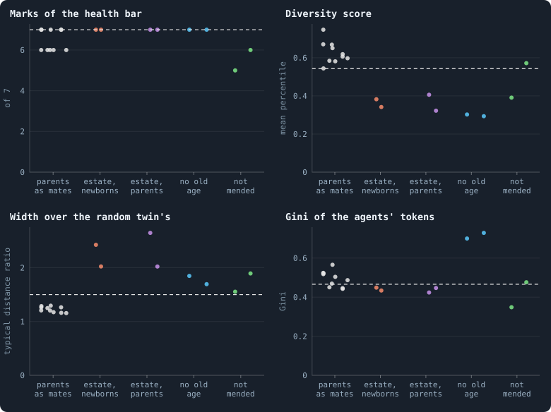
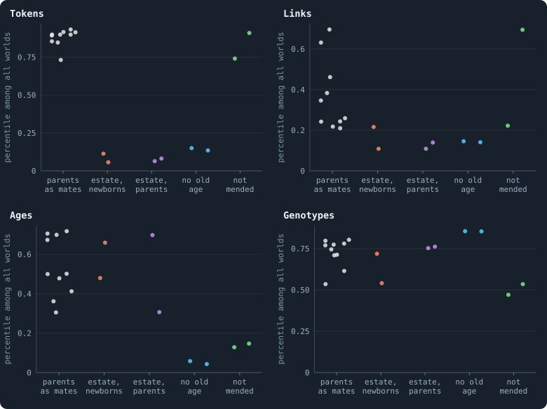

# Room and riches for the steadiest world

> [!question] Questions of this page
> - Which world the notebook has made comes closest to one that might keep
>   evolving, and what does it still miss?
> - Can a rule that keeps a world's room give it the one thing it misses,
>   without taking what it has?
> - The [estates](estate.md "The tokens a dead agent leaves, and who gets them.") of the dead paid to births make a world a healthy space, but
>   fill it with paupers. Can a rule of birth keep the space and stop the
>   paupers?
> - What does a world do when a child may never be poorer than the [agents](the-world.md#agents-and-tokens "One member of a world: it lives on a node of the network, holds tokens and has a brain that takes all its decisions.") it
>   is born among?
> - Is that rule as idle in plain [B2](b1-and-b2.md "The second baseline: B1 with the rules that keep its network from breaking and its agents from staking or breeding themselves to death."), and does it bind in [B1](b1-and-b2.md "The first baseline: the algorithm exactly as a new run is offered it."), where a child
>   may start with a single [token](the-world.md#agents-and-tokens "The one thing of value in a world: every agent holds a whole number of them, and their total never changes.")?

## In short

The steadiest world the notebook has, Experiment 19's, lives long and its
agents differ, but it is folded: a small world, not a space. Experiment 31
gave it, one at a time, four rules that keep a world's room; each gave room
and took something else. The estates of the dead paid to births made healthy
spaces of about three [dimensions](ball-dimension-and-curvature.md "How fast the number of agents within a distance grows with the distance: as its square in a plane, its cube in space."), filled with some 5,000 paupers of about two
tokens each. Experiment 32 then asked every child to start as rich as its
parent's [neighbours](the-world.md#the-network "An agent joined to another by a connection."), and nothing changed: the [game](one-iteration.md#phase-2-the-game "The second phase of an iteration: every agent stakes all its tokens on its own node and its neighbours', and every node goes to someone."), not birth, makes the
poor. These worlds are spaces because their young are the parents, so here
room and riches come from the same coin. In plain B2 the rule is just as idle
(Experiment 36); whether it binds in B1, where a child may start with a single
token, Experiment 37 will tell once it is played.

## Room for the steadiest world

<!-- experiment E31 -->

### Four wishes at once

What would a world that might keep evolving look like? The author's picture
([Healthy and rich](healthy-and-rich.md)) asks four things of it, all at the
same moment:
- **Healthy.** Its network meets all seven marks of the [health bar](health-bar.md "The seven marks a world's network must meet to count as healthy: one piece, mostly on loops, no fatal cut, no hub, three to twelve links per agent, a dimension of 2.3 to 4.").
- **Diverse.** Its agents differ, more than B2's do: its [diversity score](diversity-score.md "How much the agents of a world differ, in one number from 0 to 1: in tokens, links, ages and genotypes.") is
  above that of B2's [median](median-and-quantiles.md "The middle value: half of the numbers lie below it and half above.") world, read at the same [iteration](one-iteration.md "One step of a world's time: a phase of reproduction, then a phase of the game.").
- **A space.** It is wide, at least half again as wide as a random network
  with the same links ([What folds a world](how-many-dimensions-does-a-world-have.md#what-folds-a-world)).
- **Uneven.** Its tokens are held no more evenly than B2's: their [Gini
  coefficient](gini-coefficient.md "How unequally tokens are held: 0 if every agent holds as many, near 1 if one holds nearly all.") is no lower than that of B2's least even world. The author
  added this fourth wish later, on 19 October 2026
  ([Healthy and rich](healthy-and-rich.md)). What looks unhealthy is a world
  where almost every agent holds the same few tokens.

*A space* needs a picture. In a space, far places are far apart: to cross a
city, you walk through many streets. In a *small world*, everyone is a few
steps from everyone, as through friends of friends. To tell the two apart,
the notebook sets each world beside its [random twin](random-twin.md "A network with the same agents and as many links each, wired at random: what a world would be if it were no space at all."). The twin has the same
agents, each with as many links, but wired at random; and a random network
is a small world. A world counts as a space when a typical agent needs at
least 1.5 times the twin's steps to reach half the world.

Read by all four, few worlds pass even for a moment:
- **At 1,000 iterations:** three of the 466 worlds measured, each with
  [brains](the-brain.md "The neural network each agent decides with: inputs about itself and its neighbours, outputs that become its decisions.") mixed at birth and one other rule.
- **At 10,000:** one of 64. This is Experiment 21's world without random
  inputs, [seed](random-numbers.md "The number that fixes every random choice of a run: the same settings and the same seed make the same world.") 6
  ([Five more seeds for the rules that held](the-candidates-played-on.md#five-more-seeds-for-the-rules-that-held)).
  The same rule's other worlds failed, and two of them died.

### The steadiest world, and what it misses

The steadiest configuration the notebook has is
[Experiment 19](mixed-at-birth-with-parents-as-mates.md)'s. In it, a
newborn's brain is mixed at birth: part its parent's, part a mate's, and the
mate is one of the parent's neighbours. And only parents may be mates: a
neighbour with a living child of its own.
- **What it has.** All ten of its worlds lived to 20,000 iterations, at
  about 2,000 agents each. They stay diverse: at 20,000 their diversity
  scores are 0.52 to 0.69, against 0.49 for B2's median world at 10,000.
  They stay uneven, with Ginis of 0.47 to 0.57 at 10,000. And evolution goes
  on in them: later brains beat earlier ones, by less and less.
- **What it misses: room.** A typical agent reaches half its world in 1.13
  to 1.32 times the steps its random twin needs. Nine of the ten miss the
  dimension mark, as a folded world of 2,000 agents does: its dimension
  reads too high. These are small worlds, not spaces.

### Rules that keep a world's room

Why is the world folded? [What folds a world](how-many-dimensions-does-a-world-have.md#what-folds-a-world) found
the answer in what B2 does at a death. When an agent dies, B2 *mends* the
hole. The dead agent's neighbours are joined in a ring round the gap, as the
edge of a hole closes. Each death joins agents that were two steps apart. In
B2 every agent dies by the age of 100, so this happens to every agent in
turn, generation after generation. The world is pulled together.

The same page found three rules that keep a world's room:
- the estate of the dead paid to births, either to this iteration's
  newborns or to their parents;
- no old age, so that nobody dies at 100;
- no mending, so that a death leaves a hole.

The estate is the tokens a dead agent leaves. B2 gives each of them to a
survivor drawn at random.

Each pays for the room in its own coin
([Rules in company](rules-in-company.md)):
- **The estates** fill a world with alike agents. With plain mixing, where
  any neighbour may be the mate, they gave spaces of about 5,000 agents
  whose diversity scores fell to 0.35 to 0.40.
- **No old age** all but stops births.
- **No mending** lets one loss cut a world.

A world of more tokens would not help. B2's kind of world stays folded at
every size: a world of 100,000 tokens was 1.14 times as wide as its twin.
Room has to come from a rule.

### What we expected of the room rules

Experiment 31 tries four rules in Experiment 19's world, one at a time. They
are the estate to the newborns, the estate to the parents, no old age and no
mending. Each runs in two seeds, for 3,000 iterations. We expected at least
one rule to unfold the world without costing it the rest. Both its worlds
would then pass all four wishes at iteration 3,000. Our hope rested on the
estates. Parents as mates held a mixed world's size, so with them the
estates might give room without filling the world.

<!-- thesis E31 -->
> [!quote] The thesis of Experiment 31, written down before any of its runs existed
> **The claim.** Experiment 19's world, brains mixed at birth with only parents as mates, is steady, diverse and uneven, but folded. One of the rules that keep a world's room unfolds it without costing the rest. For at least one of four rules (the estate of the dead paid to the newborns, or to the parents, no old age, or deaths not mended) both of its worlds, at iteration 3,000, meet every mark of the health bar, are more diverse than B2's median world, are at least 1.5 times as wide as their random twins, and are no more even than B2's least even world, B2's ten worlds played on being read at the same iteration.
>
> **Why it would be so.** All ten of Experiment 19's worlds lived to 20,000 iterations. At 10,000 they held 1,429 to 2,385 agents, with diversity scores of 0.55 to 0.65 against B2's median of 0.49 and Ginis of 0.47 to 0.57 against B2's least of 0.47. Yet a typical agent reached half its world in 1.13 to 1.31 times the steps its random twin needs, and nine of ten missed the dimension mark: they are folded small worlds, not spaces. Chapter [87](how-many-dimensions-does-a-world-have.md#what-folds-a-world) found what folds a world, a death mended with a ring of links, and what keeps a world's room: the estate paid to births (2.0 to 2.6 times the twin), no old age (1.8 to 1.9) and no mending (2.0). Each pays for the room in its own coin ([Meta XII](rules-in-company.md)): estates fill a world with alike, poor agents, no old age all but stops births, and without mending one loss can cut a world. With plain mixing, the estates gave spaces of about 5,000 agents with diversity scores of only 0.35 to 0.40. With parents as mates a mixed world held its size, which may keep the diversity the estates cost.
>
> **It holds if:** For at least one rule, both worlds (seeds 1 and 2) at iteration 3,000 meet every mark, have a diversity score above the median of B2's ten worlds played on and read at 3,000, a typical distance at least 1.5 times their twin's, and a Gini of their agents' tokens no lower than the least of those ten worlds'.
>
> **It fails if:** No rule has both its worlds pass all four at 3,000: the room and the rest pull apart even in the steadiest mixed world, and the chapter says what each rule cost.
>
> *Written while the notebook still numbered its chapters: each number is a link to the page it meant that day.*
<!-- /thesis -->

### What the room rules did

<!-- figure room/measures -->

**Experiment 19's world, given room.** Each dot is one world at iteration 3,000: Experiment 19's ten (grey) and Experiment 31's two for each rule. The dashed line is what the author's picture asks: every mark, a diversity score above B2's median world at 3,000 (0.54), a typical distance at least 1.5 times the random twin's, a Gini no lower than B2's least even world at 3,000 (0.47).

> [!example]- How to make this figure
> **Runs.** Experiment 31's eight runs (`python3 gol_lab.py run E31`): B2 at 10,000 tokens with brains mixed at birth and parents as mates, and the estate of the dead paid to the newborns (`B2-10000-06b876-…`) or to the parents (`-b8e9fc-…`), no old age (`-89f5b1-…`) or deaths not mended (`-c58a16-…`), seeds 1 and 2, to 3,000 iterations; and Experiment 19's ten worlds (`B2-10000-bcc1bc-s001` … `-s010`), all read at iteration 3,000 from their archives.
>
> **Data.** From each world's archive at iteration 3,000.
>
> 1. Read each world as `research/atlas/profile.py` reads every world: the seven marks, the four spreads ranked among the frozen reference worlds (their mean is the diversity score), the Gini of the tokens.
> 2. Its typical distance over its random twin's, as `research/atlas/space.py` measures it.
> 3. The lines: every mark; the median diversity, and the least Gini, of B2's ten worlds played on and read at 3,000; a typical distance of 1.5 times the twin's.
>
> **To make it again:** `python3 book_figures.py room`.
<!-- /figure -->

**Every rule gave the world room, and every rule took something else.**
At iteration 3,000:
- **Experiment 19's own worlds** are as before:
  - 6 or 7 marks;
  - diverse, 0.54 to 0.75;
  - uneven, Ginis of 0.44 to 0.57;
  - folded, 1.16 to 1.29 times their twins.
- **The estate to the newborns, or to the parents,** made true spaces:
  - 2.0 to 2.65 times as wide as their twins, at a dimension of about 3.5;
  - every mark of the health bar;
  - about 5,000 agents.

  But the diversity scores fell to 0.32 to 0.41. And the Ginis fell to 0.42
  to 0.45: a little more even than B2's least even world (0.47).
- **No old age** made spaces too, 1.7 and 1.85 times their twins, with every
  mark and very uneven tokens (Ginis of 0.70 and 0.73). Diversity fell to
  0.29 and 0.30.
- **Deaths not mended** went two ways.
  - **Seed 1** came nearest of all: 1.89 times its twin, a diversity score
    of 0.57, a Gini of 0.48. It missed one mark: one agent's loss could cut
    off too much.
  - **Seed 2** missed two marks (a cut and a [hub](stars-and-hubs.md "An agent joined to far more agents than most; a star is a world held together by a single hub.")), and fell short on
    diversity (0.39) and on unevenness (a Gini of 0.35).

### What each rule cost

<!-- figure room/parts -->

**What each rule costs of the diversity.** The four parts of the diversity score, each world's percentile among the frozen reference worlds: how many doubling classes its agents' tokens, links and ages fill, and its effective number of genotypes per agent. Each dot is one world at iteration 3,000.

> [!example]- How to make this figure
> **Runs.** Experiment 31's eight runs (`python3 gol_lab.py run E31`): B2 at 10,000 tokens with brains mixed at birth and parents as mates, and the estate of the dead paid to the newborns (`B2-10000-06b876-…`) or to the parents (`-b8e9fc-…`), no old age (`-89f5b1-…`) or deaths not mended (`-c58a16-…`), seeds 1 and 2, to 3,000 iterations; and Experiment 19's ten worlds (`B2-10000-bcc1bc-s001` … `-s010`), all read at iteration 3,000 from their archives.
>
> **Data.** From each world's archive at iteration 3,000.
>
> 1. Read each world as `research/atlas/profile.py` reads every world: the seven marks, the four spreads ranked among the frozen reference worlds (their mean is the diversity score), the Gini of the tokens.
>
> **To make it again:** `python3 book_figures.py room`.
<!-- /figure -->

The diversity score is the mean of four parts. Three of them count how many
doubling classes (1, 2–3, 4–7, and so on) the agents' tokens, links and ages
fill. The fourth counts their [genotypes](genotype.md "The identity of a brain: a number that a copy keeps and a change replaces, and that remembers the genotype it came from."). Each rule took a different part:
- **The estates take the tokens.** Paying the estate to births fills the
  world with children: about 5,000 agents for 10,000 tokens, 1.9 tokens
  each. The agents' tokens fill about two doubling classes, against four or
  five in Experiment 19's world, and their links vary little. Almost every
  agent holds the same few tokens: the case the author called unhealthy.
- **No old age takes the ages.** With no deaths of age there are few births,
  and almost every agent is old.
- **No mending takes the ages too,** and leaves the world cuttable, but
  keeps its tokens as spread as Experiment 19's.

### Verdict: refuted, each rule pays in its own coin

**The thesis of Experiment 31 fails.** No rule had both its worlds meet all
four at 3,000. One world without mending missed by one mark. Room and the
rest still pull apart, even in the steadiest mixed world. What each rule
pays is now known:
- the estates pay with poor, alike agents;
- no old age pays with one age;
- no mending pays with cuts.

### What the room rules teach

- **Half the picture is solved.** With the estates to births, a world of
  mixed brains and parents as mates is a healthy space of about three
  dimensions, with every mark. It is the network the author's picture asks
  for. What it lacks is in its agents. There are too many of them, each too
  poor for its tokens to differ.
- **Why so many, and so poor?** We first read it as the price of a child.
  An estate paid to the newborns makes children cheap to have, and the world
  fills with them. So the next rule asked more of a birth: a child must start
  with at least what its parent's neighbours hold. The next section tells
  how that turned out: the price of a child was not the cost.
- **The nearest world is one without mending.** Seed 1 missed only a cut. A
  world whose deaths are not mended keeps its tokens and its room; what it
  needs is to stay whole. Mending without folding is a second rule to try
  ([What folds a world](how-many-dimensions-does-a-world-have.md#what-folds-a-world) traced the folding to the
  rings a death closes).

## Births as rich as the neighbours

<!-- experiment E32 -->

### A birth that asks more where the world is rich

The estate worlds of
[Room for the steadiest world](#room-for-the-steadiest-world) came nearest
the network the author's picture asks for:
- every mark of the health bar;
- a space 2.0 to 2.65 times as wide as its twin, at about three dimensions.

But they filled up with children: about 5,000 agents for 10,000 tokens, 1.9
tokens each. Almost every agent held the same few tokens, and the diversity
score fell from Experiment 19's 0.54 to 0.75 to 0.32 to 0.41.

An estate paid to births makes a birth cheap, and nothing stops a world from
making paupers. [What holds a world's size](what-holds-a-worlds-size.md)
asked for a pull: births that cost more when they would make the world
poorer. The rule tried here is that pull, with no number of its own. A child
must start with at least the median holding of its parent's neighbours
([`child_floor`](settings.md#child_floor) = `neighbours`). We call it the
*floor*. It is local, too: a parent looks only at its own neighbours.

Think of the neighbours' holdings as the going rate where a parent lives:
- a parent among rich agents can have a child only by giving it as much as
  they hold;
- a parent among poor ones may have a small child.

So the world can grow only as rich as it is. The floor comes on top of a
rule B2 already has: every child starts with at least ten tokens
([`min_child`](settings.md#min_child)). A child must get the larger of the
two.

### What we expected of the floor

We expected the floor to keep the healthy space the estates make, and to give
back the diversity they cost. Then both worlds of at least one estate would
pass all four wishes at iteration 3,000. Experiment 32 plays three
conditions, two seeds each, for 3,000 iterations. The floor comes with the
estate to the newborns, with the estate to the parents, or alone. Experiment
31's estate worlds of the same seeds are the control, and so is Experiment
19's world, for the floor alone.

<!-- thesis E32 -->
> [!quote] The thesis of Experiment 32, written down before any of its runs existed
> **The claim.** Asking a child to start with at least what its parent's neighbours hold keeps the healthy space the estates make and gives back the diversity they cost. With brains mixed at birth, parents as mates and the estate of the dead paid to births, and a child never poorer than the median holding of its parent's neighbours, both worlds of at least one of the two estates (to the newborns, to the parents), at iteration 3,000, meet every mark of the health bar, are more diverse than B2's median world, are at least 1.5 times as wide as their random twins, and are no more even than B2's least even world, B2's ten worlds played on being read at the same iteration.
>
> **Why it would be so.** In Experiment 31 the estates gave Experiment 19's world every mark and a space of about three dimensions, 2.0 to 2.65 times as wide as its twin. But they filled it with children: about 5,000 agents for 10,000 tokens, 1.9 tokens each, whose tokens fill about two doubling classes. The diversity scores fell to 0.32 to 0.41, and the tokens became a little more even than B2's (Ginis of 0.42 to 0.45). The estate makes a birth cheap, and nothing stops a world from making paupers. A child that must start as rich as the agents it is born among stops that, with no number of its own: the world can grow only as rich as it is. Experiment 31's estate worlds of the same seeds are the control, as is Experiment 19's world for the floor alone.
>
> **It holds if:** For at least one estate rule, both worlds (seeds 1 and 2) at 3,000 meet every mark, have a diversity score above the median of B2's ten worlds read at 3,000 (0.54), a typical distance at least 1.5 times their twin's, and a Gini no lower than the least of those ten worlds' (0.47).
>
> **It fails if:** Neither estate rule has both its worlds pass all four at 3,000; the chapter says what the floor changed and what it did not.
<!-- /thesis -->

### What the floor did

<!-- figure floor/measures -->

**The floor, with each estate and without.** Each dot is one world at iteration 3,000, without the floor (grey: Experiment 19's ten worlds for parents as mates alone, Experiment 31's two for each estate) and with it (orange: Experiment 32's two for each). The dashed line is what the author's picture asks: every mark, a diversity score above B2's median world at 3,000 (0.54), a typical distance at least 1.5 times the random twin's, a Gini no lower than B2's least even world at 3,000 (0.47).

> [!example]- How to make this figure
> **Runs.** Experiment 32's six runs (`python3 gol_lab.py run E32`): B2 at 10,000 tokens with brains mixed at birth, parents as mates and a child never poorer than the median holding of its parent's neighbours, with the estate of the dead paid to the newborns (`B2-10000-12215f-…`), to the parents (`-86df9e-…`) or neither (`-b289dd-…`), seeds 1 and 2, to 3,000 iterations; against Experiment 31's estate worlds of the same seeds (`B2-10000-06b876-…`, `-b8e9fc-…`) and Experiment 19's ten worlds (`B2-10000-bcc1bc-s001` … `-s010`), which have no floor.
>
> **Data.** From each world's archive at iteration 3,000.
>
> 1. Read each world as `research/atlas/profile.py` reads every world: the seven marks, the four spreads ranked among the frozen reference worlds (their mean is the diversity score), the Gini of the tokens; and its typical distance over its random twin's, as `research/atlas/space.py` measures it (`research/atlas/readings.py` does both).
> 2. The lines: every mark; the median diversity, and the least Gini, of B2's ten worlds played on and read at 3,000; a typical distance of 1.5 times the twin's.
>
> **To make it again:** `python3 book_figures.py floor`.
<!-- /figure -->

**The floor changed nothing the measures can see.** At iteration 3,000:
- **With an estate,** the four worlds with the floor are the estate worlds
  of [Room for the steadiest world](#room-for-the-steadiest-world) again:

  | | with the floor | without it ([Room for the steadiest world](#room-for-the-steadiest-world)) |
  |---|---|---|
  | marks of the health bar | 7 | 7 |
  | width over the twin | 2.2 to 2.85 | 2.0 to 2.65 |
  | agents | 5,063 to 5,735 | 5,036 to 5,445 |
  | tokens per agent | 1.74 to 1.98 | 1.84 to 1.99 |
  | diversity score | 0.35 to 0.39 | 0.32 to 0.41 |
  | Gini of the tokens | 0.40 to 0.46 | 0.42 to 0.45 |

- **Alone,** the floor left Experiment 19's world as it was. Its two worlds
  lie among Experiment 19's ten in every measure:
  - diverse, 0.60 and 0.69 (Experiment 19: 0.54 to 0.75);
  - uneven, Ginis of 0.51 and 0.54 (0.44 to 0.57);
  - folded, 1.27 and 1.22 times their twins (1.16 to 1.29);
  - each missing the mark for dimension, 4.2 and 4.1, as five of
    Experiment 19's ten do.

### Why the floor did nothing

**It could not bind.** Every child already starts with at least ten tokens
(B2's `min_child`). So the floor asks more only of a parent whose
neighbours' median holding is above ten.
- **In the estate worlds with the floor,** at 3,000, the median agent's
  neighbours held a median of one token. Of the 109 to 157 agents rich
  enough to have a child, the floor asked more of 1 to 10.
- **Alone,** it asked more of 6 and of 55, of about 300.

### Where the poor agents come from

If every child starts with ten tokens or more, why do the agents of the
estate worlds hold fewer than two on average?

<!-- figure floor/paupers -->

**Where the poor agents come from.** Left: the mean tokens of the agents of each age, in tens of iterations, at iteration 3,000, averaged over the worlds of each kind: Experiment 19's ten, and seeds 1 and 2 of the others. Right: each world's births an iteration and agents alive, both averaged over iterations 2,000 to 3,000; the dashed line is a hundred agents for every birth an iteration, which a world keeps when everyone lives out a hundred iterations.

> [!example]- How to make this figure
> **Runs.** Experiment 32's six runs (`python3 gol_lab.py run E32`): B2 at 10,000 tokens with brains mixed at birth, parents as mates and a child never poorer than the median holding of its parent's neighbours, with the estate of the dead paid to the newborns (`B2-10000-12215f-…`), to the parents (`-86df9e-…`) or neither (`-b289dd-…`), seeds 1 and 2, to 3,000 iterations; against Experiment 31's estate worlds of the same seeds (`B2-10000-06b876-…`, `-b8e9fc-…`) and Experiment 19's ten worlds (`B2-10000-bcc1bc-s001` … `-s010`), which have no floor.
>
> **Data.** From each world's archive at iteration 3,000 and its `stats.jsonl`.
>
> 1. Left: each agent's age is the iteration less the one it was born in; average the tokens of the agents aged 1 to 10, 11 to 20, and so on.
> 2. Right: the births and the agents of each iteration's first phase, averaged over the iterations 2,000 to 2,999.
>
> **To make it again:** `python3 book_figures.py floor`.
<!-- /figure -->

**The poor agents are not born poor.** In the estate worlds, every child
starts with ten tokens or more, as in any world. Then the tokens drain away:
- agents aged 1 to 10 hold 4.8 on average;
- aged 11 to 20, 2.1;
- from 30 on, about 1.5.

The game strips the young within twenty iterations. In Experiment 19's
worlds, agents hold 7 in their first ten iterations, and still 4.4 in their
last ten.

**And the young are the parents.** The agents that can have a child, with
eleven tokens or more, are young in the estate worlds and middle-aged in the
others, at 3,000:

| | median age of the agents able to have a child | share of them aged 10 or less |
|---|---|---|
| an estate, with or without the floor | 4 to 10 | 51% to 64% |
| Experiment 19, and the floor alone | 27 to 45 | 8% to 27% |

In a world where most agents hold a token or two, only two kinds of agent are
rich enough to breed. They are those just born, with their ten tokens or
more, and those just paid by the estate. And the game takes it from them
within twenty iterations.

This is also why the estate worlds are spaces.
[What folds a world](how-many-dimensions-does-a-world-have.md#what-folds-a-world) found why young parents make a
space. A death closes a ring round the gap it leaves. The ring is largest
where the old do the breeding, since an agent gathers links all its life,
from its children and its neighbours' children. Here the young breed, so the
rings stay small and the world keeps its room.

### A world's size is its births

**Every world here held 99 to 102 agents for each birth an iteration,**
averaged over iterations 2,000 to 3,000. Its agents live out their hundred
iterations and almost none die sooner, as
[What holds a world's size](what-holds-a-worlds-size.md) found in 454
moments of other worlds. So:
- a world's size is a hundred times its births an iteration;
- its riches are its 10,000 tokens, shared among them.

| | births an iteration | agents |
|---|---|---|
| Experiment 19's ten worlds | 12 to 23 | 1,210 to 2,267 |
| the floor alone | 18 and 20 | 1,762 and 1,962 |
| an estate, without the floor | 51 to 53 | 5,004 to 5,294 |
| an estate, with the floor | 46 to 58 | 4,576 to 5,789 |

The estates pay for about three times as many births, so their worlds hold
about three times as many agents, sharing the same 10,000 tokens. This
ledger holds only where every agent dies at a fixed age, as in B2.

### Verdict: refuted, the floor follows the world down

**The thesis of Experiment 32 fails.** With either estate and the floor, both
worlds met every mark and were spaces, as without the floor. None was
diverse enough (0.35 to 0.39, against 0.54) or uneven enough (Ginis of 0.40
to 0.46, against 0.47). The floor changed nothing measurable, because in a
world of paupers a child's neighbours are paupers too.

**What these results cover.** Every world of this experiment was played under
B2's rules, with brains mixed at birth and parents as mates, at 10,000
tokens, two seeds each. The floor failed because of one of those rules:
every B2 child already starts with ten tokens, more than a poor world's
neighbours hold. A world whose least child is a single token, such as B1, is
another matter.
[The floor in plain B2 and in B1](#the-floor-in-plain-b2-and-in-b1) plays
the same floor in both.

### What the floor teaches

- **In B2, a rule that measures a world against itself follows it down.** The
  floor asked a child to be as rich as its neighbours. In a poor world the
  neighbours are poor, so the floor fell with the world, below the ten
  tokens every child already gets. A pull has to measure against something a
  poor world does not drag down with it.
- **The paupers are made by the game, not at birth.** A rule on what a child
  starts with cannot reach them. Under old age, only two things can:
  - fewer births, since the world's size is a hundred times its births;
  - or a game that strips the young less.
- **Room and riches come from the same coin.** The estate worlds are spaces
  because their young are the parents. Their young are the parents because,
  in a world of paupers, only the newly born and the newly paid are rich
  enough. Under these rules a world gets young parents only by paying for
  births, and paying for births fills it with paupers. A world that is both a
  space and rich needs its young to breed without the world filling up. Or it
  needs deaths that do not fold it when the old breed: the open question of
  [What folds a world](how-many-dimensions-does-a-world-have.md#what-folds-a-world), mending without folding.

## The floor in plain B2 and in B1

<!-- experiment E36 -->

<!-- experiment E37 -->

The floor asks that a child be never poorer than the median holding of its
parent's neighbours ([`child_floor`](settings.md#child_floor) =
`neighbours`). In
[Births as rich as the neighbours](#births-as-rich-as-the-neighbours) it
changed nothing in worlds of B2's rules with brains mixed at birth. In a
world of poor agents the neighbours hold a token or two, and every B2 child
already starts with ten ([`min_child`](settings.md#min_child)). Was it the
estates and the mixed brains that kept the floor idle, or B2's least child?
Two experiments ask:
- **Plain B2.** Is the floor as idle without mixed brains and estates? Plain
  B2 is poor too: about three agents in four hold three tokens or fewer
  ([Who inherits?](who-inherits.md)). Its children start with 11.2 to 12.1
  tokens on average, in Experiment 16's ten worlds over iterations 1,000 to
  2,000.
- **B1.** Its least child is a single token. Over iterations 2,000 to 3,000,
  its children start with 2.0 to 5.1 tokens on average, a median of 2.6.
  These numbers come from the 26 of Experiment 2's 30 worlds that lived to
  3,000. Yet the median agent of its long worlds holds 4 to 15. There the
  floor asks more than most parents give.

### What we expect in plain B2

If the floor failed because of B2's least child, it should stay idle in plain
B2 too. Experiment 36 plays plain B2 with the floor, in two seeds, for 3,000
iterations. We expect the floor to ask more than ten tokens of fewer than one
in twenty of the agents able to have a child. And we expect children to
start with 11 to 13 tokens on average, as in Experiment 16's worlds.

<!-- thesis E36 -->
> [!quote] The thesis of Experiment 36, written down before any of its runs existed
> **The claim.** Where every child already starts with ten tokens, a floor at the neighbours' median changes nothing. In plain B2, with a child never poorer than the median holding of its parent's neighbours, the floor asks more than B2's ten tokens of fewer than one in twenty of the agents able to have a child, at iterations 1,000, 2,000 and 3,000, and over iterations 1,000 to 2,000 children start with 11 to 13 tokens on average, as in B2's ten worlds of Experiment 16 (11.2 to 12.1).
>
> **Why it would be so.** In Chapter [101](room-for-the-steadiest-world.md#births-as-rich-as-the-neighbours) the floor changed nothing in the estate worlds and nothing beyond seed-to-seed scatter in Experiment 19's world: in a world of poor agents a parent's neighbours hold a token or two, and every B2 child already starts with ten (min_child). Plain B2 is such a world: three agents in four hold three tokens or fewer. If the floor cannot bind there either, its failure is B2's least child, not the estates or mixed brains; Experiment 37 plays the same floor in B1, whose least child is a single token.
>
> **It holds if:** In both worlds, at 1,000, 2,000 and 3,000, fewer than one in twenty of the agents holding eleven tokens or more have neighbours whose median holding is above ten; and over iterations 1,000 to 2,000 both worlds' children start with 11 to 13 tokens on average.
>
> **It fails if:** In either world the floor asks more than ten tokens of one in twenty able agents or more at one of those iterations, or its children start with fewer than 11 or more than 13 tokens on average: the floor binds in plain B2, and the chapter says what it changed.
>
> *Written while the notebook still numbered its chapters: each number is a link to the page it meant that day.*
<!-- /thesis -->

### What we expect in B1

In B1 the floor should bind. If it does, births should become fewer and
larger, and the world smaller and richer: the pull
[What holds a world's size](what-holds-a-worlds-size.md) asked for.
Experiment 37 plays B1 with the floor, in two seeds, for 3,000 iterations. We
expect both worlds to live to 3,000. We expect their children to start
richer than in any of B1's 26 long worlds: with more than 5.1 tokens on
average. And we expect both worlds to hold fewer agents on average than B1's
median world (1,462).

<!-- thesis E37 -->
> [!quote] The thesis of Experiment 37, written down before any of its runs existed
> **The claim.** Where a child may start with a single token, a floor at the neighbours' median binds and makes a world of fewer, richer agents. In B1, with a child never poorer than the median holding of its parent's neighbours, both worlds live to iteration 3,000; over iterations 2,000 to 3,000 their children start with more tokens on average than in any of B1's 26 worlds that lived to 3,000 (more than 5.1), and both hold fewer agents on average than B1's median world (1,462).
>
> **Why it would be so.** B1's children start with 2.0 to 5.1 tokens on average over iterations 2,000 to 3,000 (a median of 2.6, over the 26 of Experiment 2's 30 worlds that lived to 3,000), while the median agent of B1's long worlds holds 4 to 15 tokens. A floor at the neighbours' median asks more than most B1 parents give: births should become fewer and larger, and the world smaller and richer. In B2 every child already starts with ten tokens and the floor never bound (Chapter [101](room-for-the-steadiest-world.md#births-as-rich-as-the-neighbours), Experiment 36).
>
> **It holds if:** Both worlds live to 3,000; over iterations 2,000 to 3,000 both worlds' children start with more than 5.1 tokens on average, and both worlds hold fewer than 1,462 agents on average.
>
> **It fails if:** Either world dies before 3,000, or its children start with 5.1 tokens or fewer on average, or it holds 1,462 agents or more on average: the floor does not bind in B1 either, or binding does not leave a smaller, richer world; the chapter says which.
>
> *Written while the notebook still numbered its chapters: each number is a link to the page it meant that day.*
<!-- /thesis -->

### What the floor did in plain B2

In plain B2 the floor hardly ever asked for anything. Call an agent *able*
when it could have a child: it holds eleven tokens or more, so that a child of
ten leaves it one. At iterations 1,000, 2,000 and 3,000, the two worlds had
82 to 147 able agents each. The floor asked more than ten tokens of 1 to 4 of
them: 0.7% to 2.9%. The median agent's neighbours held a median of 1 to 3
tokens, far below the ten every child gets anyway.

So children started as they do without the floor. Over iterations 1,000 to
2,000 they started with 12.4 and 11.5 tokens on average, against 11.2 to 12.1
in Experiment 16's ten worlds of plain B2. And the worlds were as large:
3,105 and 3,305 agents on average over those iterations, where Experiment
16's held 3,076 to 3,669.

### Verdict on plain B2: the thesis holds

Both conditions of the thesis are met. At every moment it named, the floor
asked more than ten tokens of fewer than one able agent in twenty (at most
2.9%), and in both worlds children started with 11 to 13 tokens on average.

So it was not the estates or the mixed brains that kept the floor idle in
[Births as rich as the neighbours](#births-as-rich-as-the-neighbours). In
any world of B2's rules, every child already gets ten tokens, and its
parent's neighbours are poor: a floor set by them has nothing to add.

### B1: still to be played

Experiment 37's two worlds have not been played yet. The [lab](the-lab.md "The program that runs an experiment's plan as runs, each on a frozen copy of the engine, the code that plays a world.") holds them
ready, and they start when ▶ is pressed in the panel at the top of this
section. Until then its thesis is not judged.

## What we learned

- **Half the picture is solved.** With the estates paid to births, a world
  of mixed brains and parents as mates is a healthy space of about three
  dimensions. What it lacks is in its agents: too many, each too poor for its
  tokens to differ.
- **Each rule that keeps room pays in its own coin.** The estates pay with
  poor, alike agents; no old age with one age; no mending with cuts. The
  nearest world had no mending, and missed only a cut.
- **The poor are made by the game, not at birth.** Children start with ten
  tokens or more, and the game takes most of it within twenty iterations.
- **In B2's mixed worlds, a floor set by the neighbours hardly binds.** A
  poor world's neighbours are poor, so the floor falls below the ten tokens
  every child already gets. In plain B2 it is just as idle; whether it
  binds in B1 is still to be seen.
- **Where every agent dies at a fixed age, a world's size is a hundred times
  its births an iteration.**
- **Room and riches come from the same coin.** Young parents keep a world a
  space. Here only births paid for by the estates make young parents, and
  those births fill the world with paupers.

## Where to go next

- [What folds a world](how-many-dimensions-does-a-world-have.md#what-folds-a-world): why a death mended in a ring
  folds a world, and why young parents keep it a space.
- [What holds a world's size](what-holds-a-worlds-size.md): the ledger of
  births, and the pull that is still missing.
- [Healthy and rich](healthy-and-rich.md): the author's picture of a world
  that might keep evolving, and the worlds that come closest.
- [A screen of random worlds](a-screen-of-random-worlds.md): the next step.
  Instead of one rule at a time, rounds of fifty worlds with every setting
  drawn at random, each judged for health.

## How this was made

Experiments 31, 32 and 36 start from B2, and Experiment 37 from B1, all at
10,000 tokens, two seeds per condition, for 3,000 iterations. Each box lists
the runs and every setting.

### The runs of Experiment 31

<!-- runs E31 -->
> [!info]- The runs behind this page
> **8 runs.** Every condition below is run once for every seed (1 to 2), for 3,000 iterations — or until its world dies out. Every setting is that of the baseline **B2** (a world that cannot break) unless the condition changes it.
>
> - **estate to the newborns** — changes `mix_at_birth` = on, `mix_mates` = parents, `redistribution` = newborns; 10,000 tokens. Runs `B2-10000-06b876-s001` … `B2-10000-06b876-s002`.
> - **estate to the parents** — changes `mix_at_birth` = on, `mix_mates` = parents, `redistribution` = parents; 10,000 tokens. Runs `B2-10000-b8e9fc-s001` … `B2-10000-b8e9fc-s002`.
> - **no old age** — changes `mix_at_birth` = on, `mix_mates` = parents, `max_age` = 0; 10,000 tokens. Runs `B2-10000-89f5b1-s001` … `B2-10000-89f5b1-s002`.
> - **deaths not mended** — changes `mix_at_birth` = on, `mix_mates` = parents, `mend_on_death` = off; 10,000 tokens. Runs `B2-10000-c58a16-s001` … `B2-10000-c58a16-s002`.
>
> To make these runs again: `python3 gol_lab.py run E31`, or ▶ in the Research Notebook tab of a computer running `gol_server.py`. Each run writes its settings, seed and engine version beside its frames, in `GraphOfLifeRuns/<run>/meta.json` and `provenance.json`.

> [!info]- Every setting of these runs
> | setting | estate to the newborns | estate to the parents | no old age | deaths not mended | what it is |
> |---|---|---|---|---|---|
> | [`total_tokens`](settings.md#total_tokens) | 10,000 | 10,000 | 10,000 | 10,000 | The number of tokens in the world, *T*. It never changes during a run. |
> | [`n_nodes`](settings.md#n_nodes) | 0 | 0 | 0 | 0 | How many founders the world starts with. 0 means one founder per hundred tokens: *n* = ⌊*T* / 100⌋. |
> | [`k_neighbors`](settings.md#k_neighbors) | 0 | 0 | 0 | 0 | How many neighbours each founder starts with in the ring. 0 means *k* = max(⌊*n* / 100⌋, 5); an odd *k* is wired as *k* − 1. |
> | [`rewire_p`](settings.md#rewire_p) | 0.2 | 0.2 | 0.2 | 0.2 | In the starting ring, the probability that a connection is moved to a founder chosen at random (Watts–Strogatz). |
> | [`hidden_layers`](settings.md#hidden_layers) | 16 | 16 | 16 | 16 | The widths of the brain's hidden layers, in order from input to output. |
> | [`brain_kind`](settings.md#brain_kind) | float16 | float16 | float16 | float16 | How weights are stored: `float` (64-bit), `float16` (16-bit, computed in 64-bit) or `binary` (−1, 0, +1). |
> | [`brain_bits`](settings.md#brain_bits) | 16 | 16 | 16 | 16 | Only for binary brains: how many input rows encode one number. Unused by float and float16 brains. |
> | [`message_amount`](settings.md#message_amount) | 8 | 8 | 8 | 8 | How many numbers one message holds. Each agent sends one message to itself and one to each neighbour, every phase. |
> | [`random_input_amount`](settings.md#random_input_amount) | 5 | 5 | 5 | 5 | How many random numbers, drawn uniformly from −2 to 2, a brain reads per neighbour, every time it looks. |
> | [`exchange_messages`](settings.md#exchange_messages) | on | on | on | on | Whether agents send and read messages at all. |
> | [`message_prepass`](settings.md#message_prepass) | off | off | off | off | Whether every phase begins with an extra look in which agents only write messages, so the look that acts reads messages written this phase. |
> | [`allow_handover`](settings.md#allow_handover) | off | off | off | off | Whether a parent may move some of its own connections to its newborn child. |
> | [`allow_revolutions`](settings.md#allow_revolutions) | on | on | on | on | Whether a coalition of smaller stakers can take a node from its largest staker (see the note *How a coalition takes a node*). |
> | [`allow_gifting`](settings.md#allow_gifting) | off | off | off | off | Whether agents may give tokens to neighbours during reproduction. Off in both baselines; on in a few pilots, in Experiment 24 and in half the worlds of the screen. |
> | [`random_decisions`](settings.md#random_decisions) | off | off | off | off | The control: every number a brain would produce is replaced by a random draw from the standard normal distribution. |
> | [`prune_after`](settings.md#prune_after) | blotto | blotto | blotto | blotto | After which phase connections that carried no tokens are cut: `blotto` (the game), `reproduction`, or `both`. |
> | [`inactive_window`](settings.md#inactive_window) | phase | phase | phase | phase | How long a connection may go unused: `phase` means it must carry tokens in the phase being judged; `iteration` allows the two last phases. |
> | [`redistribution`](settings.md#redistribution) | **newborns** | **parents** | uniform | uniform | How the tokens of removed agents are shared: `uniform` gives every survivor the same chance at each token; `by_tokens` weights by what a survivor holds; `poorest` raises the poorest to one common level first; `newborns` gives them to this iteration's children, `parents` to their parents, once per child (both `uniform` in an iteration without births); `children` leaves each dead agent's estate to its own living children (`uniform` where there are none). |
> | [`tokens_created_per_phase`](settings.md#tokens_created_per_phase) | 0 | 0 | 0 | 0 | Tokens added to the world at every cleanup. 0 keeps the supply fixed. |
> | [`mutate_on_replication`](settings.md#mutate_on_replication) | on | on | on | on | Whether a brain changes only when it is copied — into a newborn, or into a node its owner has just won — instead of also after every game, wherever it sits. |
> | [`incumbency`](settings.md#incumbency) | 1.5 | 1.5 | 1.5 | 1.5 | How many times over an agent's stake on its own node counts when the game decides who takes the node. 1 is the old rule. |
> | [`birth_links`](settings.md#birth_links) | 2 | 2 | 2 | 2 | How many of its parent's neighbours a newborn is joined to, drawn at random, besides its parent itself; 0 leaves every link to the brain's choice. |
> | [`mend_on_death`](settings.md#mend_on_death) | on | on | on | **off** | Whether the neighbours of an agent that dies are joined up where its death would leave them in separate pieces. |
> | [`prune_needs`](settings.md#prune_needs) | 2 | 2 | 2 | 2 | How many neighbours the two ends of an unused connection must share for it to be cut; 0 cuts every unused connection. |
> | [`valence`](settings.md#valence) | 8 | 8 | 8 | 8 | The most connections an agent's brain may choose to hold (0 = no limit). An agent at its limit cannot have a child. |
> | [`keep_home`](settings.md#keep_home) | 0.3 | 0.3 | 0.3 | 0.3 | The share of an agent's tokens — rounded up, never less than one — that stays on its own node whatever its brain says; a parent also keeps one. 0 is the old rule. |
> | [`max_age`](settings.md#max_age) | 100 | 100 | **0** | 100 | The age at which an agent dies (0 = never); its tokens are shared out like those of any other dead agent. |
> | [`buy_life`](settings.md#buy_life) | off | off | off | off | Whether an agent that has reached max_age may live on by paying one token an iteration into the estate of the dead — never its last, so one with a single token left dies. Needs max_age. |
> | [`min_child`](settings.md#min_child) | 10 | 10 | 10 | 10 | The fewest tokens a child can be born with; a parent that would give less has no child. |
> | [`child_floor`](settings.md#child_floor) | fixed | fixed | fixed | fixed | The least a child may start with: min_child alone (fixed), or also the median holding of its parent's neighbours (neighbours), so that a world grows only as rich as it is. |
> | [`mix_at_birth`](settings.md#mix_at_birth) | **on** | **on** | **on** | **on** | Whether a newborn's brain is its parent's mixed with a mate's — one of the parent's neighbours, drawn at random — each hidden unit whole from one or the other by an even chance, before it mutates; off, a newborn has a copy of its parent's brain. |
> | [`mix_mates`](settings.md#mix_mates) | **parents** | **parents** | **parents** | **parents** | Under mix_at_birth, who may be the mate: any neighbour of the parent, or only parents — a neighbour with a living child of its own (with none, the newborn's brain is a copy). |
> | [`self_message`](settings.md#self_message) | own | own | own | own | What an agent writes to itself, which each neighbour reads: what its own column says (own), or the largest, number by number, of what it writes to anyone (largest), so that news one column marks reaches every neighbour. |
> | [`link_search`](settings.md#link_search) | off | off | off | off | Whether an agent may reach beyond its neighbours to propose a link: off; jump, a walk as many steps long as the tokens it spends in one iteration, with a link proposed where it ends; walk, a scout that goes one step further in every iteration it pays for; or reach, a jump whose steps are free, as many as the tokens it holds would pay for. A paid step costs one token, paid to the agent it enters, and never the last. |
> | [`link_steering`](settings.md#link_steering) | random | random | random | random | Which way each step of a search goes: to a neighbour drawn at random, or to the one the searcher would most like a link with (looking). |
> | [`link_consent`](settings.md#link_consent) | mutual | mutual | mutual | mutual | Who has to agree to a link a search proposes: both ends (mutual), or only the one who proposes (forced). Nobody at its valence gets a new link either way. |
> | [`proto`](settings.md#proto) | none | none | none | none | Rules first played in the pilots' prototype, by name: came_from and helped_by (an input row each), contest = lottery, pool by genotype or family, kin_sense, tag_rate, mate_pays, grow, unit_token, link_token. Empty in every run but those that ask for one; only the prototype's world plays them (see the settings note). |
> | [`mutation_probability`](settings.md#mutation_probability) | 0.2 | 0.2 | 0.2 | 0.2 | The probability that a brain changes when it is copied to a child, and again, for every brain, after every game. |
> | [`mutation_noise_std`](settings.md#mutation_noise_std) | 0.2 | 0.2 | 0.2 | 0.2 | How large a change to one weight is: a normal draw with standard deviation this times 1/√(fan-in) of its layer. |
> | [`mutation_sparsity`](settings.md#mutation_sparsity) | 0.1 | 0.1 | 0.1 | 0.1 | The share of a brain's numbers a change touches; also the probability, for each weight matrix and bias vector, of a rarer reset that redraws that share of it. |
> | [`extinction_threshold`](settings.md#extinction_threshold) | 20 | 20 | 20 | 20 | A run stops, as extinct, when an iteration ends (after its game) with this many agents or fewer. |
> | seeds | 1 to 2 | 1 to 2 | 1 to 2 | 1 to 2 | one run per seed |
> | iterations | 3,000 | 3,000 | 3,000 | 3,000 | how far each run goes, unless its world dies first |
>
> A value in **bold** differs from the baseline B2.
<!-- /runs -->

### The runs of Experiment 32

<!-- runs E32 -->
> [!info]- The runs behind this page
> **6 runs.** Every condition below is run once for every seed (1 to 2), for 3,000 iterations — or until its world dies out. Every setting is that of the baseline **B2** (a world that cannot break) unless the condition changes it.
>
> - **estate to the newborns, a child as rich as its neighbours** — changes `mix_at_birth` = on, `mix_mates` = parents, `redistribution` = newborns, `child_floor` = neighbours; 10,000 tokens. Runs `B2-10000-12215f-s001` … `B2-10000-12215f-s002`.
> - **estate to the parents, a child as rich as its neighbours** — changes `mix_at_birth` = on, `mix_mates` = parents, `redistribution` = parents, `child_floor` = neighbours; 10,000 tokens. Runs `B2-10000-86df9e-s001` … `B2-10000-86df9e-s002`.
> - **a child as rich as its neighbours** — changes `mix_at_birth` = on, `mix_mates` = parents, `child_floor` = neighbours; 10,000 tokens. Runs `B2-10000-b289dd-s001` … `B2-10000-b289dd-s002`.
>
> To make these runs again: `python3 gol_lab.py run E32`, or ▶ in the Research Notebook tab of a computer running `gol_server.py`. Each run writes its settings, seed and engine version beside its frames, in `GraphOfLifeRuns/<run>/meta.json` and `provenance.json`.

> [!info]- Every setting of these runs
> | setting | estate to the newborns, a child as rich as its neighbours | estate to the parents, a child as rich as its neighbours | a child as rich as its neighbours | what it is |
> |---|---|---|---|---|
> | [`total_tokens`](settings.md#total_tokens) | 10,000 | 10,000 | 10,000 | The number of tokens in the world, *T*. It never changes during a run. |
> | [`n_nodes`](settings.md#n_nodes) | 0 | 0 | 0 | How many founders the world starts with. 0 means one founder per hundred tokens: *n* = ⌊*T* / 100⌋. |
> | [`k_neighbors`](settings.md#k_neighbors) | 0 | 0 | 0 | How many neighbours each founder starts with in the ring. 0 means *k* = max(⌊*n* / 100⌋, 5); an odd *k* is wired as *k* − 1. |
> | [`rewire_p`](settings.md#rewire_p) | 0.2 | 0.2 | 0.2 | In the starting ring, the probability that a connection is moved to a founder chosen at random (Watts–Strogatz). |
> | [`hidden_layers`](settings.md#hidden_layers) | 16 | 16 | 16 | The widths of the brain's hidden layers, in order from input to output. |
> | [`brain_kind`](settings.md#brain_kind) | float16 | float16 | float16 | How weights are stored: `float` (64-bit), `float16` (16-bit, computed in 64-bit) or `binary` (−1, 0, +1). |
> | [`brain_bits`](settings.md#brain_bits) | 16 | 16 | 16 | Only for binary brains: how many input rows encode one number. Unused by float and float16 brains. |
> | [`message_amount`](settings.md#message_amount) | 8 | 8 | 8 | How many numbers one message holds. Each agent sends one message to itself and one to each neighbour, every phase. |
> | [`random_input_amount`](settings.md#random_input_amount) | 5 | 5 | 5 | How many random numbers, drawn uniformly from −2 to 2, a brain reads per neighbour, every time it looks. |
> | [`exchange_messages`](settings.md#exchange_messages) | on | on | on | Whether agents send and read messages at all. |
> | [`message_prepass`](settings.md#message_prepass) | off | off | off | Whether every phase begins with an extra look in which agents only write messages, so the look that acts reads messages written this phase. |
> | [`allow_handover`](settings.md#allow_handover) | off | off | off | Whether a parent may move some of its own connections to its newborn child. |
> | [`allow_revolutions`](settings.md#allow_revolutions) | on | on | on | Whether a coalition of smaller stakers can take a node from its largest staker (see the note *How a coalition takes a node*). |
> | [`allow_gifting`](settings.md#allow_gifting) | off | off | off | Whether agents may give tokens to neighbours during reproduction. Off in both baselines; on in a few pilots, in Experiment 24 and in half the worlds of the screen. |
> | [`random_decisions`](settings.md#random_decisions) | off | off | off | The control: every number a brain would produce is replaced by a random draw from the standard normal distribution. |
> | [`prune_after`](settings.md#prune_after) | blotto | blotto | blotto | After which phase connections that carried no tokens are cut: `blotto` (the game), `reproduction`, or `both`. |
> | [`inactive_window`](settings.md#inactive_window) | phase | phase | phase | How long a connection may go unused: `phase` means it must carry tokens in the phase being judged; `iteration` allows the two last phases. |
> | [`redistribution`](settings.md#redistribution) | **newborns** | **parents** | uniform | How the tokens of removed agents are shared: `uniform` gives every survivor the same chance at each token; `by_tokens` weights by what a survivor holds; `poorest` raises the poorest to one common level first; `newborns` gives them to this iteration's children, `parents` to their parents, once per child (both `uniform` in an iteration without births); `children` leaves each dead agent's estate to its own living children (`uniform` where there are none). |
> | [`tokens_created_per_phase`](settings.md#tokens_created_per_phase) | 0 | 0 | 0 | Tokens added to the world at every cleanup. 0 keeps the supply fixed. |
> | [`mutate_on_replication`](settings.md#mutate_on_replication) | on | on | on | Whether a brain changes only when it is copied — into a newborn, or into a node its owner has just won — instead of also after every game, wherever it sits. |
> | [`incumbency`](settings.md#incumbency) | 1.5 | 1.5 | 1.5 | How many times over an agent's stake on its own node counts when the game decides who takes the node. 1 is the old rule. |
> | [`birth_links`](settings.md#birth_links) | 2 | 2 | 2 | How many of its parent's neighbours a newborn is joined to, drawn at random, besides its parent itself; 0 leaves every link to the brain's choice. |
> | [`mend_on_death`](settings.md#mend_on_death) | on | on | on | Whether the neighbours of an agent that dies are joined up where its death would leave them in separate pieces. |
> | [`prune_needs`](settings.md#prune_needs) | 2 | 2 | 2 | How many neighbours the two ends of an unused connection must share for it to be cut; 0 cuts every unused connection. |
> | [`valence`](settings.md#valence) | 8 | 8 | 8 | The most connections an agent's brain may choose to hold (0 = no limit). An agent at its limit cannot have a child. |
> | [`keep_home`](settings.md#keep_home) | 0.3 | 0.3 | 0.3 | The share of an agent's tokens — rounded up, never less than one — that stays on its own node whatever its brain says; a parent also keeps one. 0 is the old rule. |
> | [`max_age`](settings.md#max_age) | 100 | 100 | 100 | The age at which an agent dies (0 = never); its tokens are shared out like those of any other dead agent. |
> | [`buy_life`](settings.md#buy_life) | off | off | off | Whether an agent that has reached max_age may live on by paying one token an iteration into the estate of the dead — never its last, so one with a single token left dies. Needs max_age. |
> | [`min_child`](settings.md#min_child) | 10 | 10 | 10 | The fewest tokens a child can be born with; a parent that would give less has no child. |
> | [`child_floor`](settings.md#child_floor) | **neighbours** | **neighbours** | **neighbours** | The least a child may start with: min_child alone (fixed), or also the median holding of its parent's neighbours (neighbours), so that a world grows only as rich as it is. |
> | [`mix_at_birth`](settings.md#mix_at_birth) | **on** | **on** | **on** | Whether a newborn's brain is its parent's mixed with a mate's — one of the parent's neighbours, drawn at random — each hidden unit whole from one or the other by an even chance, before it mutates; off, a newborn has a copy of its parent's brain. |
> | [`mix_mates`](settings.md#mix_mates) | **parents** | **parents** | **parents** | Under mix_at_birth, who may be the mate: any neighbour of the parent, or only parents — a neighbour with a living child of its own (with none, the newborn's brain is a copy). |
> | [`self_message`](settings.md#self_message) | own | own | own | What an agent writes to itself, which each neighbour reads: what its own column says (own), or the largest, number by number, of what it writes to anyone (largest), so that news one column marks reaches every neighbour. |
> | [`link_search`](settings.md#link_search) | off | off | off | Whether an agent may reach beyond its neighbours to propose a link: off; jump, a walk as many steps long as the tokens it spends in one iteration, with a link proposed where it ends; walk, a scout that goes one step further in every iteration it pays for; or reach, a jump whose steps are free, as many as the tokens it holds would pay for. A paid step costs one token, paid to the agent it enters, and never the last. |
> | [`link_steering`](settings.md#link_steering) | random | random | random | Which way each step of a search goes: to a neighbour drawn at random, or to the one the searcher would most like a link with (looking). |
> | [`link_consent`](settings.md#link_consent) | mutual | mutual | mutual | Who has to agree to a link a search proposes: both ends (mutual), or only the one who proposes (forced). Nobody at its valence gets a new link either way. |
> | [`proto`](settings.md#proto) | none | none | none | Rules first played in the pilots' prototype, by name: came_from and helped_by (an input row each), contest = lottery, pool by genotype or family, kin_sense, tag_rate, mate_pays, grow, unit_token, link_token. Empty in every run but those that ask for one; only the prototype's world plays them (see the settings note). |
> | [`mutation_probability`](settings.md#mutation_probability) | 0.2 | 0.2 | 0.2 | The probability that a brain changes when it is copied to a child, and again, for every brain, after every game. |
> | [`mutation_noise_std`](settings.md#mutation_noise_std) | 0.2 | 0.2 | 0.2 | How large a change to one weight is: a normal draw with standard deviation this times 1/√(fan-in) of its layer. |
> | [`mutation_sparsity`](settings.md#mutation_sparsity) | 0.1 | 0.1 | 0.1 | The share of a brain's numbers a change touches; also the probability, for each weight matrix and bias vector, of a rarer reset that redraws that share of it. |
> | [`extinction_threshold`](settings.md#extinction_threshold) | 20 | 20 | 20 | A run stops, as extinct, when an iteration ends (after its game) with this many agents or fewer. |
> | seeds | 1 to 2 | 1 to 2 | 1 to 2 | one run per seed |
> | iterations | 3,000 | 3,000 | 3,000 | how far each run goes, unless its world dies first |
>
> A value in **bold** differs from the baseline B2.
<!-- /runs -->

### The runs of Experiment 36

The numbers of [What the floor did in plain B2](#what-the-floor-did-in-plain-b2)
are read from the two worlds' archives at 1,000, 2,000 and 3,000, and from
their `stats.jsonl` (the tokens given to children over the births), beside
Experiment 16's ten worlds read the same way:
`python3 book_figures.py floorplain` writes them to
`book/results/floorplain.json`.

<!-- runs E36 -->
> [!info]- The runs behind this page
> **2 runs.** Every condition below is run once for every seed (1 to 2), for 3,000 iterations — or until its world dies out. Every setting is that of the baseline **B2** (a world that cannot break) unless the condition changes it.
>
> - **a child as rich as its neighbours** — changes `child_floor` = neighbours; 10,000 tokens. Runs `B2-10000-60e522-s001` … `B2-10000-60e522-s002`.
>
> To make these runs again: `python3 gol_lab.py run E36`, or ▶ in the Research Notebook tab of a computer running `gol_server.py`. Each run writes its settings, seed and engine version beside its frames, in `GraphOfLifeRuns/<run>/meta.json` and `provenance.json`.

> [!info]- Every setting of these runs
> | setting | a child as rich as its neighbours | what it is |
> |---|---|---|
> | [`total_tokens`](settings.md#total_tokens) | 10,000 | The number of tokens in the world, *T*. It never changes during a run. |
> | [`n_nodes`](settings.md#n_nodes) | 0 | How many founders the world starts with. 0 means one founder per hundred tokens: *n* = ⌊*T* / 100⌋. |
> | [`k_neighbors`](settings.md#k_neighbors) | 0 | How many neighbours each founder starts with in the ring. 0 means *k* = max(⌊*n* / 100⌋, 5); an odd *k* is wired as *k* − 1. |
> | [`rewire_p`](settings.md#rewire_p) | 0.2 | In the starting ring, the probability that a connection is moved to a founder chosen at random (Watts–Strogatz). |
> | [`hidden_layers`](settings.md#hidden_layers) | 16 | The widths of the brain's hidden layers, in order from input to output. |
> | [`brain_kind`](settings.md#brain_kind) | float16 | How weights are stored: `float` (64-bit), `float16` (16-bit, computed in 64-bit) or `binary` (−1, 0, +1). |
> | [`brain_bits`](settings.md#brain_bits) | 16 | Only for binary brains: how many input rows encode one number. Unused by float and float16 brains. |
> | [`message_amount`](settings.md#message_amount) | 8 | How many numbers one message holds. Each agent sends one message to itself and one to each neighbour, every phase. |
> | [`random_input_amount`](settings.md#random_input_amount) | 5 | How many random numbers, drawn uniformly from −2 to 2, a brain reads per neighbour, every time it looks. |
> | [`exchange_messages`](settings.md#exchange_messages) | on | Whether agents send and read messages at all. |
> | [`message_prepass`](settings.md#message_prepass) | off | Whether every phase begins with an extra look in which agents only write messages, so the look that acts reads messages written this phase. |
> | [`allow_handover`](settings.md#allow_handover) | off | Whether a parent may move some of its own connections to its newborn child. |
> | [`allow_revolutions`](settings.md#allow_revolutions) | on | Whether a coalition of smaller stakers can take a node from its largest staker (see the note *How a coalition takes a node*). |
> | [`allow_gifting`](settings.md#allow_gifting) | off | Whether agents may give tokens to neighbours during reproduction. Off in both baselines; on in a few pilots, in Experiment 24 and in half the worlds of the screen. |
> | [`random_decisions`](settings.md#random_decisions) | off | The control: every number a brain would produce is replaced by a random draw from the standard normal distribution. |
> | [`prune_after`](settings.md#prune_after) | blotto | After which phase connections that carried no tokens are cut: `blotto` (the game), `reproduction`, or `both`. |
> | [`inactive_window`](settings.md#inactive_window) | phase | How long a connection may go unused: `phase` means it must carry tokens in the phase being judged; `iteration` allows the two last phases. |
> | [`redistribution`](settings.md#redistribution) | uniform | How the tokens of removed agents are shared: `uniform` gives every survivor the same chance at each token; `by_tokens` weights by what a survivor holds; `poorest` raises the poorest to one common level first; `newborns` gives them to this iteration's children, `parents` to their parents, once per child (both `uniform` in an iteration without births); `children` leaves each dead agent's estate to its own living children (`uniform` where there are none). |
> | [`tokens_created_per_phase`](settings.md#tokens_created_per_phase) | 0 | Tokens added to the world at every cleanup. 0 keeps the supply fixed. |
> | [`mutate_on_replication`](settings.md#mutate_on_replication) | on | Whether a brain changes only when it is copied — into a newborn, or into a node its owner has just won — instead of also after every game, wherever it sits. |
> | [`incumbency`](settings.md#incumbency) | 1.5 | How many times over an agent's stake on its own node counts when the game decides who takes the node. 1 is the old rule. |
> | [`birth_links`](settings.md#birth_links) | 2 | How many of its parent's neighbours a newborn is joined to, drawn at random, besides its parent itself; 0 leaves every link to the brain's choice. |
> | [`mend_on_death`](settings.md#mend_on_death) | on | Whether the neighbours of an agent that dies are joined up where its death would leave them in separate pieces. |
> | [`prune_needs`](settings.md#prune_needs) | 2 | How many neighbours the two ends of an unused connection must share for it to be cut; 0 cuts every unused connection. |
> | [`valence`](settings.md#valence) | 8 | The most connections an agent's brain may choose to hold (0 = no limit). An agent at its limit cannot have a child. |
> | [`keep_home`](settings.md#keep_home) | 0.3 | The share of an agent's tokens — rounded up, never less than one — that stays on its own node whatever its brain says; a parent also keeps one. 0 is the old rule. |
> | [`max_age`](settings.md#max_age) | 100 | The age at which an agent dies (0 = never); its tokens are shared out like those of any other dead agent. |
> | [`buy_life`](settings.md#buy_life) | off | Whether an agent that has reached max_age may live on by paying one token an iteration into the estate of the dead — never its last, so one with a single token left dies. Needs max_age. |
> | [`min_child`](settings.md#min_child) | 10 | The fewest tokens a child can be born with; a parent that would give less has no child. |
> | [`child_floor`](settings.md#child_floor) | **neighbours** | The least a child may start with: min_child alone (fixed), or also the median holding of its parent's neighbours (neighbours), so that a world grows only as rich as it is. |
> | [`mix_at_birth`](settings.md#mix_at_birth) | off | Whether a newborn's brain is its parent's mixed with a mate's — one of the parent's neighbours, drawn at random — each hidden unit whole from one or the other by an even chance, before it mutates; off, a newborn has a copy of its parent's brain. |
> | [`mix_mates`](settings.md#mix_mates) | any | Under mix_at_birth, who may be the mate: any neighbour of the parent, or only parents — a neighbour with a living child of its own (with none, the newborn's brain is a copy). |
> | [`self_message`](settings.md#self_message) | own | What an agent writes to itself, which each neighbour reads: what its own column says (own), or the largest, number by number, of what it writes to anyone (largest), so that news one column marks reaches every neighbour. |
> | [`link_search`](settings.md#link_search) | off | Whether an agent may reach beyond its neighbours to propose a link: off; jump, a walk as many steps long as the tokens it spends in one iteration, with a link proposed where it ends; walk, a scout that goes one step further in every iteration it pays for; or reach, a jump whose steps are free, as many as the tokens it holds would pay for. A paid step costs one token, paid to the agent it enters, and never the last. |
> | [`link_steering`](settings.md#link_steering) | random | Which way each step of a search goes: to a neighbour drawn at random, or to the one the searcher would most like a link with (looking). |
> | [`link_consent`](settings.md#link_consent) | mutual | Who has to agree to a link a search proposes: both ends (mutual), or only the one who proposes (forced). Nobody at its valence gets a new link either way. |
> | [`proto`](settings.md#proto) | none | Rules first played in the pilots' prototype, by name: came_from and helped_by (an input row each), contest = lottery, pool by genotype or family, kin_sense, tag_rate, mate_pays, grow, unit_token, link_token. Empty in every run but those that ask for one; only the prototype's world plays them (see the settings note). |
> | [`mutation_probability`](settings.md#mutation_probability) | 0.2 | The probability that a brain changes when it is copied to a child, and again, for every brain, after every game. |
> | [`mutation_noise_std`](settings.md#mutation_noise_std) | 0.2 | How large a change to one weight is: a normal draw with standard deviation this times 1/√(fan-in) of its layer. |
> | [`mutation_sparsity`](settings.md#mutation_sparsity) | 0.1 | The share of a brain's numbers a change touches; also the probability, for each weight matrix and bias vector, of a rarer reset that redraws that share of it. |
> | [`extinction_threshold`](settings.md#extinction_threshold) | 20 | A run stops, as extinct, when an iteration ends (after its game) with this many agents or fewer. |
> | seeds | 1 to 2 | one run per seed |
> | iterations | 3,000 | how far each run goes, unless its world dies first |
>
> A value in **bold** differs from the baseline B2.
<!-- /runs -->

### The runs of Experiment 37

<!-- runs E37 -->
> [!info]- The runs behind this page
> **2 runs.** Every condition below is run once for every seed (1 to 2), for 3,000 iterations — or until its world dies out. Every setting is that of the baseline **B1** (the algorithm exactly as a new run is offered it) unless the condition changes it.
>
> - **a child as rich as its neighbours** — changes `child_floor` = neighbours; 10,000 tokens. Runs `B1-10000-60e522-s001` … `B1-10000-60e522-s002`.
>
> To make these runs again: `python3 gol_lab.py run E37`, or ▶ in the Research Notebook tab of a computer running `gol_server.py`. Each run writes its settings, seed and engine version beside its frames, in `GraphOfLifeRuns/<run>/meta.json` and `provenance.json`.

> [!info]- Every setting of these runs
> | setting | a child as rich as its neighbours | what it is |
> |---|---|---|
> | [`total_tokens`](settings.md#total_tokens) | 10,000 | The number of tokens in the world, *T*. It never changes during a run. |
> | [`n_nodes`](settings.md#n_nodes) | 0 | How many founders the world starts with. 0 means one founder per hundred tokens: *n* = ⌊*T* / 100⌋. |
> | [`k_neighbors`](settings.md#k_neighbors) | 0 | How many neighbours each founder starts with in the ring. 0 means *k* = max(⌊*n* / 100⌋, 5); an odd *k* is wired as *k* − 1. |
> | [`rewire_p`](settings.md#rewire_p) | 0.2 | In the starting ring, the probability that a connection is moved to a founder chosen at random (Watts–Strogatz). |
> | [`hidden_layers`](settings.md#hidden_layers) | 50, 45, 40, 35, 30 | The widths of the brain's hidden layers, in order from input to output. |
> | [`brain_kind`](settings.md#brain_kind) | float16 | How weights are stored: `float` (64-bit), `float16` (16-bit, computed in 64-bit) or `binary` (−1, 0, +1). |
> | [`brain_bits`](settings.md#brain_bits) | 16 | Only for binary brains: how many input rows encode one number. Unused by float and float16 brains. |
> | [`message_amount`](settings.md#message_amount) | 30 | How many numbers one message holds. Each agent sends one message to itself and one to each neighbour, every phase. |
> | [`random_input_amount`](settings.md#random_input_amount) | 5 | How many random numbers, drawn uniformly from −2 to 2, a brain reads per neighbour, every time it looks. |
> | [`exchange_messages`](settings.md#exchange_messages) | on | Whether agents send and read messages at all. |
> | [`message_prepass`](settings.md#message_prepass) | on | Whether every phase begins with an extra look in which agents only write messages, so the look that acts reads messages written this phase. |
> | [`allow_handover`](settings.md#allow_handover) | on | Whether a parent may move some of its own connections to its newborn child. |
> | [`allow_revolutions`](settings.md#allow_revolutions) | on | Whether a coalition of smaller stakers can take a node from its largest staker (see the note *How a coalition takes a node*). |
> | [`allow_gifting`](settings.md#allow_gifting) | off | Whether agents may give tokens to neighbours during reproduction. Off in both baselines; on in a few pilots, in Experiment 24 and in half the worlds of the screen. |
> | [`random_decisions`](settings.md#random_decisions) | off | The control: every number a brain would produce is replaced by a random draw from the standard normal distribution. |
> | [`prune_after`](settings.md#prune_after) | blotto | After which phase connections that carried no tokens are cut: `blotto` (the game), `reproduction`, or `both`. |
> | [`inactive_window`](settings.md#inactive_window) | phase | How long a connection may go unused: `phase` means it must carry tokens in the phase being judged; `iteration` allows the two last phases. |
> | [`redistribution`](settings.md#redistribution) | uniform | How the tokens of removed agents are shared: `uniform` gives every survivor the same chance at each token; `by_tokens` weights by what a survivor holds; `poorest` raises the poorest to one common level first; `newborns` gives them to this iteration's children, `parents` to their parents, once per child (both `uniform` in an iteration without births); `children` leaves each dead agent's estate to its own living children (`uniform` where there are none). |
> | [`tokens_created_per_phase`](settings.md#tokens_created_per_phase) | 0 | Tokens added to the world at every cleanup. 0 keeps the supply fixed. |
> | [`mutate_on_replication`](settings.md#mutate_on_replication) | off | Whether a brain changes only when it is copied — into a newborn, or into a node its owner has just won — instead of also after every game, wherever it sits. |
> | [`incumbency`](settings.md#incumbency) | 1.0 | How many times over an agent's stake on its own node counts when the game decides who takes the node. 1 is the old rule. |
> | [`birth_links`](settings.md#birth_links) | 0 | How many of its parent's neighbours a newborn is joined to, drawn at random, besides its parent itself; 0 leaves every link to the brain's choice. |
> | [`mend_on_death`](settings.md#mend_on_death) | off | Whether the neighbours of an agent that dies are joined up where its death would leave them in separate pieces. |
> | [`prune_needs`](settings.md#prune_needs) | 0 | How many neighbours the two ends of an unused connection must share for it to be cut; 0 cuts every unused connection. |
> | [`valence`](settings.md#valence) | 0 | The most connections an agent's brain may choose to hold (0 = no limit). An agent at its limit cannot have a child. |
> | [`keep_home`](settings.md#keep_home) | 0.0 | The share of an agent's tokens — rounded up, never less than one — that stays on its own node whatever its brain says; a parent also keeps one. 0 is the old rule. |
> | [`max_age`](settings.md#max_age) | 0 | The age at which an agent dies (0 = never); its tokens are shared out like those of any other dead agent. |
> | [`buy_life`](settings.md#buy_life) | off | Whether an agent that has reached max_age may live on by paying one token an iteration into the estate of the dead — never its last, so one with a single token left dies. Needs max_age. |
> | [`min_child`](settings.md#min_child) | 1 | The fewest tokens a child can be born with; a parent that would give less has no child. |
> | [`child_floor`](settings.md#child_floor) | **neighbours** | The least a child may start with: min_child alone (fixed), or also the median holding of its parent's neighbours (neighbours), so that a world grows only as rich as it is. |
> | [`mix_at_birth`](settings.md#mix_at_birth) | off | Whether a newborn's brain is its parent's mixed with a mate's — one of the parent's neighbours, drawn at random — each hidden unit whole from one or the other by an even chance, before it mutates; off, a newborn has a copy of its parent's brain. |
> | [`mix_mates`](settings.md#mix_mates) | any | Under mix_at_birth, who may be the mate: any neighbour of the parent, or only parents — a neighbour with a living child of its own (with none, the newborn's brain is a copy). |
> | [`self_message`](settings.md#self_message) | own | What an agent writes to itself, which each neighbour reads: what its own column says (own), or the largest, number by number, of what it writes to anyone (largest), so that news one column marks reaches every neighbour. |
> | [`link_search`](settings.md#link_search) | off | Whether an agent may reach beyond its neighbours to propose a link: off; jump, a walk as many steps long as the tokens it spends in one iteration, with a link proposed where it ends; walk, a scout that goes one step further in every iteration it pays for; or reach, a jump whose steps are free, as many as the tokens it holds would pay for. A paid step costs one token, paid to the agent it enters, and never the last. |
> | [`link_steering`](settings.md#link_steering) | random | Which way each step of a search goes: to a neighbour drawn at random, or to the one the searcher would most like a link with (looking). |
> | [`link_consent`](settings.md#link_consent) | mutual | Who has to agree to a link a search proposes: both ends (mutual), or only the one who proposes (forced). Nobody at its valence gets a new link either way. |
> | [`proto`](settings.md#proto) | none | Rules first played in the pilots' prototype, by name: came_from and helped_by (an input row each), contest = lottery, pool by genotype or family, kin_sense, tag_rate, mate_pays, grow, unit_token, link_token. Empty in every run but those that ask for one; only the prototype's world plays them (see the settings note). |
> | [`mutation_probability`](settings.md#mutation_probability) | 0.2 | The probability that a brain changes when it is copied to a child, and again, for every brain, after every game. |
> | [`mutation_noise_std`](settings.md#mutation_noise_std) | 0.2 | How large a change to one weight is: a normal draw with standard deviation this times 1/√(fan-in) of its layer. |
> | [`mutation_sparsity`](settings.md#mutation_sparsity) | 0.1 | The share of a brain's numbers a change touches; also the probability, for each weight matrix and bias vector, of a rarer reset that redraws that share of it. |
> | [`extinction_threshold`](settings.md#extinction_threshold) | 20 | A run stops, as extinct, when an iteration ends (after its game) with this many agents or fewer. |
> | seeds | 1 to 2 | one run per seed |
> | iterations | 3,000 | how far each run goes, unless its world dies first |
>
> A value in **bold** differs from the baseline B1.
<!-- /runs -->

## How our view changed

- **21 October 2026.** From 20 October, this page read the cost of the
  estate worlds as the price of a child. An estate paid to the newborns
  makes children cheap to have, so the world fills with them. A rule that
  asks more of a birth should stop it. Experiment 32 tried such a rule
  ([Births as rich as the neighbours](#births-as-rich-as-the-neighbours)),
  and showed that the price of a child was not the cost. With the floor, the
  estate worlds were the same. In a world of paupers a parent's neighbours
  hold a token or two. So the floor asked no more than the ten tokens every
  child already gets. The paupers are not born poor: children start with ten
  tokens or more, and the game takes most of it within twenty iterations. A
  world's size is a hundred times its births an iteration, and the estates
  pay for three times as many births.
- **23 October 2026.** The page gave the width of the worlds without old age
  as 1.7 to 1.9 times their twins. The two worlds measure 1.70 and 1.85
  (`book/results/room.json`); the 1.9 came from rounding twice.

<!-- turns -->
---

← [The candidates, played on and played again](the-candidates-played-on.md) · [Looking for a healthy, rich world](../README.md#looking-for-a-healthy-rich-world) · [A screen of random worlds](a-screen-of-random-worlds.md) →

**Also about:** [Space and dimension](../README.md#space-and-dimension), [Size and riches of a world](../README.md#size-and-riches-of-a-world).

> [!info]- Pages that link here (9)
> [Every setting](settings.md) · [The estate of the dead](estate.md) · [The random twin: is a world a space?](random-twin.md) · [What holds a world's size](what-holds-a-worlds-size.md) · [The health bar](health-bar.md) · [The diversity score](diversity-score.md) · [Who may be a mate](mixed-at-birth-with-parents-as-mates.md) · [The candidates, played on and played again](the-candidates-played-on.md) · [A screen of random worlds](a-screen-of-random-worlds.md)
<!-- /turns -->
