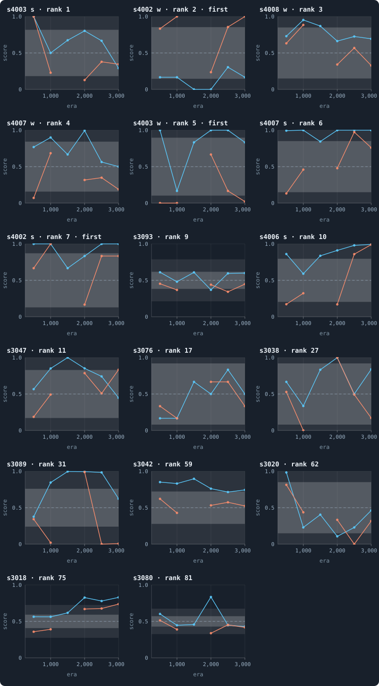
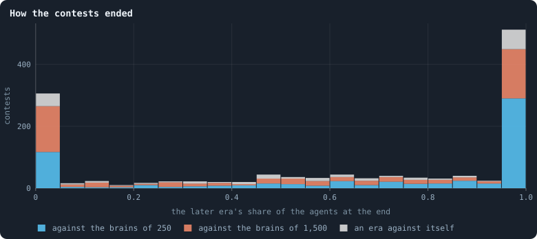
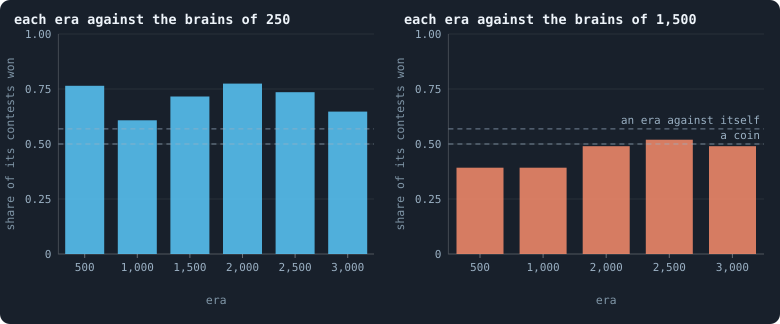
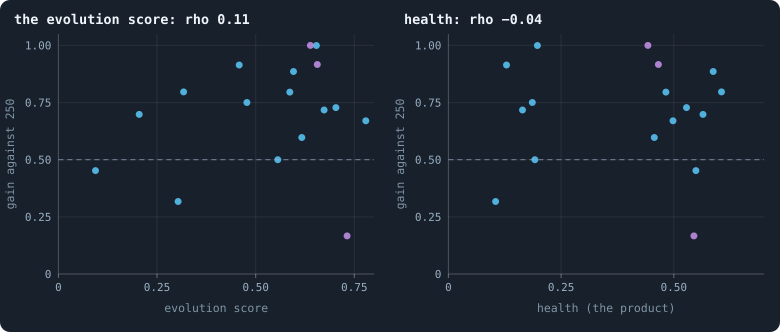

# Did the brains get better? Round 3's eras against each other

> [!question] Questions of this page
> - Do the later [brains](the-brain.md "The neural network each agent decides with: inputs about itself and its neighbours, outputs that become its decisions.") of round 3's worlds beat their earlier brains?
> - If they do, did they keep getting better to the end of their runs, or
>   stop by the middle?
> - Does the evolution rank tell which worlds got better? Does health?

<!-- experiment E45 -->

## In short

Experiment 45 played the brains of round 3's eras against each other in 17
worlds: the ten the evolution rank puts first
([Candidates for open-ended evolution](candidates-for-open-ended-evolution.md)),
and the five healthiest and the five least healthy that lived. In each world,
the brains of [iterations](one-iteration.md "One step of a world's time: a phase of reproduction, then a phase of the game.") 500 to 3,000 played those of 250
and those of 1,500, six contests a pair, three on each era's world, and three
eras played themselves: 1,326 contests of 100 iterations. The thesis, written
before any contest: the brains got better early and had stopped by the middle
of the runs, and how much a world's brains got better follows its evolution
rank, not its health.

The thesis is refuted, both as written and in the second reading added on
15 November. Its first part fails. As written, in no world did the later eras
score above the noise band against 250; in 14 of the 17 worlds the band
reaches past 0 and 1, so no score could. In the second reading, 5 of the 14
worlds it judges did, fewer than half. The second part holds: against 1,500,
the later eras stayed within the band in most worlds. The third is undecided:
neither the evolution rank nor health tells which worlds gained.

A contest almost always ends with one era holding nearly every [agent](the-world.md#agents-and-tokens "One member of a world: it lives on a node of the network, holds tokens and has a brain that takes all its decisions."), so six
contests say little about one world. Over all 17 worlds together, the brains
did get better, and early. The later eras beat the brains of 250 in 71% of
their contests, and more often than not in 14 of the 17 worlds. The brains of
500 already won as often as any later era. Those of 1,500 beat 500 and 1,000
in 61% of their contests, not clearly more than a coin would give, and the
eras after 1,500 beat 1,500 in exactly half. The later brains won on the world
of 250 too, and a little more often on their own.

## Why play eras against each other

A world's numbers can settle while its brains still improve, and they can
keep moving while nothing is selected
([Eras, contests and invasions](measuring-evolution.md#eras-contests-and-invasions-does-a-world-keep-getting-better)).
A contest asks the brains themselves. Take the world of one era, give each of
its agents a brain drawn by coin from two eras, switch [mutation](rules-in-detail.md#how-a-brain-changes "A random change to a brain, made with a set probability when it is copied, and in B1 also after every game: a changed brain is a new genotype.") off so that
every copy keeps its era, and let the world play 100 iterations under its own
rules. The later era's **score** is the share of the agents carrying its
brains at the end: 0.5 is a tie, more means its brains spread at the earlier
era's expense ([A contest, step by step](measuring-evolution.md#a-contest-step-by-step)).
A hundred iterations is a [lifetime](measuring-lives.md#age-lifetime-and-survival-curves "How many iterations an agent lives, from its birth to its death.") or more in round 3's worlds, where most
agents live a few [games](one-iteration.md#phase-2-the-game "The second phase of an iteration: every agent stakes all its tokens on its own node and its neighbours', and every node goes to someone.").

Round 3's worlds evolve fast and narrowly. Counted on the brain-copy tree,
where conquests make most of the copies, the median world lives through about
2,700 generations in 3,000 iterations, with an effective population of about
100, against about 3,500 in shadow worlds of pure luck
([Candidates for open-ended evolution](candidates-for-open-ended-evolution.md)).
So a line can sweep a world by luck, and a world's numbers alone cannot say
whether its brains got better. The contests can.

## The plan

- **The worlds:** the ten worlds the evolution rank puts first, leaving out
  those health's filter marks (s3037, eighth, stands still), and the five
  healthiest and the five least healthy of those that lived. A world in two of
  these groups is played once. Each plays with its own rules and its own kept
  worlds.
- **The eras:** 250, 500, 1,000, 1,500, 2,000, 2,500 and 3,000.
- **Two fixed eras:**
  - every later era plays 250: did the brains get better at all?
  - every other era plays 1,500: were they still getting better at the middle?

  Each pair plays on both eras' worlds, three coins each. An era's score is the
  mean of the six.
- **The noise:** 250, 1,500 and 3,000 each play themselves, four coins each.
  A contest of an era against itself should end at 0.5, so the spread of these
  twelve contests is the noise of that world. A score counts as a win only
  above 0.5 plus twice that spread.
- **Does the rank tell?** A world's **gain** is the median score of its eras
  against 250. Across the worlds, the gain is set against the evolution rank's
  score, and against health.

<!-- thesis E45 -->
> [!quote] The thesis of Experiment 45, written down before any of its runs existed
> **The claim.** Round 3's brains got better early and had stopped getting better by the middle of their runs; and how much a world's brains got better follows its place in the evolution rank, not its health. In most of the worlds the brains of every later era beat those of iteration 250 beyond a contest's own noise; against the brains of iteration 1,500, the eras after it do no better than that noise; and the worlds the rank puts first gained the most.
>
> **Why it would be so.** On the brain-copy tree, where conquests make 58% of the copies in the median world, round 3's worlds live through about 2,700 generations in 3,000 iterations, and their ancestry narrows far faster than chance allows: in 69 of the 82 worlds that lived, the living meet one ancestor sooner than in any of 100 shadow worlds of random parents (Candidates for open-ended evolution). Selection on what the brains do is beyond chance almost everywhere, yet the line of descent moves less than mutation alone would move it in 79 of the 82 worlds (Did evolution happen? Fourteen ways to find out): the brains are held in place, as they are once selection has found what it can. The notebook's two longest worlds, of B2 with brains mixed at birth, climbed for 20,000 to 25,000 iterations and then only wandered (Every era against three, Experiment 28); round 3's worlds copy brains several times as often, so they should reach their plateau within their 3,000 iterations. The evolution rank reads what an improvement needs: lines that spread beyond what luck spreads, behaviour new beyond what mutation alone makes, brains copied in proportion to what they do, and children that play like their parents. Health reads the shape of a world, and is unrelated to the rank (rank correlation -0.01). Against this: some lines never return to behaviour they had shown, so some worlds may still climb at the end; and eight of the rank's first ten stake a token at a time, for which two of its four readings are only approximations.
>
> **It holds if:** All three. (1) In at least two thirds of the worlds, the median score of the eras 500 to 3,000 against 250 lies above the world's noise band: above 0.5 plus twice the standard deviation of its twelve contests of an era against itself (250, 1,500 and 3,000, four coins each). An era's score is the share of the agents that hold the later era's brains at the end, the mean of its six contests, three coins on each era's world. (2) In at least two thirds of the worlds, the median score of the eras 2,000 to 3,000 against 1,500 lies within the band, between 0.5 minus and 0.5 plus twice that deviation. (3) A world's gain is the median score of its eras 500 to 3,000 against 250. Across the worlds, the gain rises with the evolution rank's score (research/screen/evolution.json of 12 November 2026): Spearman's rho above 0, with a one-sided permutation p below 0.05 (10,000 permutations); and the gain's rho with health's product is smaller than its rho with the evolution score.
>
> **It fails if:** Any of: (1) in fewer than half of the worlds do the eras 500 to 3,000 score above the band against 250, so most worlds did not get better at all; (2) in half of the worlds or more, the eras 2,000 to 3,000 score above the band against 1,500, so most were still getting better in the middle of their runs; (3) the gain does not rise with the evolution score (rho at 0 or below), or its rho with health's product is larger. Between these, the thesis is undecided. A world whose contests cannot be played decides nothing and is left out of every count.
<!-- /thesis -->

On 15 November 2026, with the contests of three of the 17 worlds played
(s4002 s, s4003 w and s4002 w), the band of the thesis turned out unable to
decide. In these worlds a contest almost always ends with one era holding
every agent: 219 of the first 235 contests ended with at least 99% of the
agents on one side, even when an era played itself. So the spread of the
contests of an era against itself is close to its largest possible value,
0.5, and the band reaches above 1: to 1.41 in s4002 s, 1.47 in s4003 w and
1.37 in s4002 w. A score is never above 1. In such a world part (1) of the
thesis cannot hold and part (2) cannot fail, whatever the brains did.

The thesis keeps its words and is judged as written. A second reading is
added beside it. An era's score is the mean of six contests, and the noise of
a mean of six is the spread of one contest divided by √6, about 2.45. The
second reading takes the band as 0.5 plus and minus twice that smaller
spread, about ±0.35 to ±0.40 in the three worlds played, and is otherwise the
thesis word for word. It was written after the contests of those three worlds
had been played, and the scores of two of them seen, so it is judged on the
other 14 worlds, with the three reported beside them. Both readings will be
reported.

## What the contests said

### Every world

<!-- figure rounderas/scores -->

**Every world's eras against 250 and against 1,500.** One panel for each of the 17 worlds, in the order of the evolution rank. Each dot is an era's score: the share of the agents its brains held after 100 iterations, the mean of six contests, three on each era's world. Blue: against the brains of iteration 250. Orange: against the brains of 1,500 (none at 1,500 itself). The dashed line is a tie. The wide, faint band is the thesis's band as written, 0.5 plus or minus twice the spread of the world's twelve contests of an era against itself, cut at 0 and 1; in 14 worlds it covers every score there can be. The narrower, brighter band is the second reading's, twice the spread divided by √6, the noise of a mean of six. The three worlds marked first were played, and two of them seen, before the second reading was written.

> [!example]- How to make this figure
> **Runs.** The 1,326 contests of Experiment 45 (`python3 gol_lab.py run E45`), 78 in each of 17 worlds of round 3: the eras 500 to 3,000 against 250, the eras 500 to 3,000 against 1,500, each pair three times (coins 17 to 19) on each era's world, and the eras 250, 1,500 and 3,000 each against itself four times (coins 17 to 20). Each contest plays 100 iterations, every mutation off.
>
> **Data.** From each trial's `GraphOfLifeRuns/<trial>/result.json`: `share`, the later era's share of the agents at the end.
>
> 1. For each world and pair of eras, the mean of `share` over the pair's six contests: the later era's score; the earlier era's score is 1 less that.
> 2. The noise: the standard deviation (n − 1) of `share` over the world's twelve contests of an era against itself.
> 3. The band as written: 0.5 ± twice the noise; the second reading: 0.5 ± twice the noise / √6.
>
> **To make it again:** `python3 book_figures.py rounderas`.
<!-- /figure -->

The scores jump from era to era. In s4003 w the era of 1,000 held 0.17 against
the brains of 250, between the eras of 500 and 1,500, which held 1.00 and
0.83. In s3089 the era of 2,000 held 0.99 against the brains of 1,500, and the
eras of 2,500 and 3,000 almost nothing. One era's score is the mean of six
contests, and a single contest is close to a toss of all or nothing (below),
so one score says little.

The table gives each world's numbers. **Rank** is its place in the evolution
rank of round 3's 82 worlds that lived. **Noise** is the standard deviation of
its twelve contests of an era against itself. The **band as written** is 0.5
plus or minus twice the noise; the **band of the second reading** is 0.5 plus
or minus twice the noise divided by √6. **Gain** is the median score of the
eras 500 to 3,000 against 250; **late**, the median of 2,000 to 3,000 against
1,500. A number in bold lies above the second reading's band.

<!-- table rounderas/worlds -->
| world | rank | chosen by | noise | band as written | band, second reading | gain against 250 | late against 1,500 |
|---|---|---|---|---|---|---|---|
| [s4003 s](run:B1-30000-fffc7d-s4003) | 1 | the rank | 0.39 | −0.28 to 1.28 | 0.18 to 0.82 | 0.67 | 0.35 |
| [s4002 w (played first)](run:B1-30000-5379e2-s4002) | 2 | the rank, healthiest | 0.43 | −0.37 to 1.37 | 0.15 to 0.85 | 0.17 | **0.86** |
| [s4008 w](run:B1-30000-1cfaa4-s4008) | 3 | the rank | 0.43 | −0.36 to 1.36 | 0.15 to 0.85 | 0.73 | 0.34 |
| [s4007 w](run:B1-30000-04d3eb-s4007) | 4 | the rank, least healthy | 0.42 | −0.34 to 1.34 | 0.16 to 0.84 | 0.72 | 0.32 |
| [s4003 w (played first)](run:B1-30000-9efb1d-s4003) | 5 | the rank | 0.49 | −0.47 to 1.47 | 0.10 to 0.90 | **0.92** | 0.17 |
| [s4007 s](run:B1-30000-a8a2d2-s4007) | 6 | the rank | 0.43 | −0.36 to 1.36 | 0.15 to 0.85 | **1.00** | 0.76 |
| [s4002 s (played first)](run:B1-30000-192733-s4002) | 7 | the rank | 0.45 | −0.41 to 1.41 | 0.13 to 0.87 | **1.00** | 0.83 |
| [s3093](run:B1-30000-26a341-s3093) | 9 | the rank | 0.14 | 0.21 to 0.79 | 0.38 to 0.62 | 0.60 | 0.44 |
| [s4006 s](run:B1-30000-8526cf-s4006) | 10 | the rank, healthiest | 0.36 | −0.22 to 1.22 | 0.20 to 0.80 | **0.89** | **0.86** |
| [s3047](run:B1-30000-10c9f1-s3047) | 11 | the rank | 0.40 | −0.31 to 1.31 | 0.17 to 0.83 | 0.80 | 0.79 |
| [s3076](run:B1-30000-66c764-s3076) | 17 | least healthy | 0.51 | −0.53 to 1.53 | 0.08 to 0.92 | 0.50 | 0.67 |
| [s3038](run:B1-30000-1ad8a9-s3038) | 27 | least healthy | 0.51 | −0.53 to 1.53 | 0.08 to 0.92 | 0.75 | 0.49 |
| [s3089](run:B1-30000-77ad6a-s3089) | 31 | least healthy | 0.32 | −0.14 to 1.14 | 0.24 to 0.76 | **0.91** | 0.01 |
| [s3042](run:B1-30000-b82ad0-s3042) | 59 | healthiest | 0.27 | −0.04 to 1.04 | 0.28 to 0.72 | **0.80** | 0.53 |
| [s3020](run:B1-30000-511930-s3020) | 62 | least healthy | 0.43 | −0.36 to 1.36 | 0.15 to 0.85 | 0.32 | 0.32 |
| [s3018](run:B1-30000-af1e28-s3018) | 75 | healthiest | 0.11 | 0.27 to 0.73 | 0.41 to 0.59 | **0.70** | **0.68** |
| [s3080](run:B1-30000-625bc7-s3080) | 81 | healthiest | 0.09 | 0.33 to 0.67 | 0.43 to 0.57 | 0.45 | 0.42 |
<!-- /table -->

### How the contests ended

<!-- figure rounderas/ends -->

**How the contests ended.** All 1326 contests, by the share of the agents the later era's brains held after 100 iterations, in steps of 0.05, stacked by the fixed era they played. When an era plays itself, both sides carry the same brains, and the share is that of the side in the later era's place. 752 contests ended with one side holding at least 99% of the agents.

> [!example]- How to make this figure
> **Runs and data.** As for the figure *Every world's eras against 250 and against 1,500* above.
>
> 1. Count the contests of each set by `share`, in twenty steps of 0.05 from 0 to 1.
>
> **To make it again:** `python3 book_figures.py rounderas`.
<!-- /figure -->

752 of the 1,326 contests ended with one side holding at least 99% of the
agents: 372 of the 612 against 250, 282 of the 510 against 1,500, and 98 of
the 204 of an era against itself. Round 3's worlds live through about 90
generations in 100 iterations, so in a contest one era's brains usually take
the whole world, as single lines take the worlds themselves. That is what broke the band as
written. When contests end at 0 or 1, their spread is close to 0.5, the
largest a share can have, and twice that reaches from below 0 to above 1.

Counting [tokens](the-world.md#agents-and-tokens "The one thing of value in a world: every agent holds a whole number of them, and their total never changes.") instead of agents would change nothing: over all contests the
later era's share of the tokens and its share of the agents correlate at
0.99.

### Over all the worlds

<!-- figure rounderas/won -->

**How often an era won, over all the worlds.** Each bar is one era: of its 102 contests against a fixed era, six in each of the 17 worlds, the share it won, ending with more than half of the agents. Left: against the brains of 250. Right: against the brains of 1,500; there the eras 500 and 1,000 are the earlier side. The dashed lines, in both panels, are a coin, 0.5, and the share of the contests of an era against itself won by the side in the later era's place: 116 of 204. Both sides carry the same brains there; if the place itself helps, a later era no better than the fixed one would win about this often. The eras 500 and 1,000 are in the earlier era's place against 1,500, so for them that line would lie as far below a coin.

> [!example]- How to make this figure
> **Runs and data.** As for the figure *Every world's eras against 250 and against 1,500* above.
>
> 1. A contest is won by the later era if `share` is above 0.5, by the earlier if below.
> 2. For each era, the share of its contests with the fixed era that it won, over every world.
> 3. The second line: the share of the 204 contests of an era against itself with `share` above 0.5.
>
> **To make it again:** `python3 book_figures.py rounderas`.
<!-- /figure -->

To count all the worlds together, take how often the later era won, that is,
ended with more than half of the agents. Every world played the same number of
contests, so this weighs the worlds equally. Each world's rate less one half
is then tested as the notebook tests pairs
([Permutation tests](statistics.md#permutation-tests)): if winning were a coin
toss, each world's difference would be as likely to have the other sign. Of
all 131,072 ways to flip the signs of 17 differences, *p* is the share whose
mean lies as far from 0 as the real one, or further.

- **Against 250, the later eras won 71% of their contests** (75% in the median
  world), and more than half of them in 14 of the 17 worlds (*p* = 0.003).
- **The gain came early.** The era of 500 won 76% of its contests against
  250, as often as any later era (61% to 77%).
- **From 500 to 1,500, no clear gain.** The brains of 1,500 won 61% of their
  contests against those of 500 and 1,000 (*p* = 0.14).
- **After 1,500, none.** The eras 2,000 to 3,000 won exactly half of their
  contests against 1,500 (*p* = 1).

Taken together, round 3's brains had made their gain by iteration 500 and then
stopped, as the thesis expected. What the experiment could not do is show it
in each world on its own.

### Does the rank tell?

<!-- figure rounderas/rank -->

**Gain against the evolution rank, and against health.** Each dot is one of the 17 worlds: its gain, the median score of its eras 500 to 3,000 against the brains of 250, against its evolution score (left) and its health (right). Rho is Spearman's rank correlation over all 17. Violet: the three worlds played first; blue: the 14 the second reading judges.

> [!example]- How to make this figure
> **Runs.** As for the figure *Every world's eras against 250 and against 1,500* above.
>
> **Data.** From each trial's `GraphOfLifeRuns/<trial>/result.json`: `share`, the later era's share of the agents at the end; the evolution score `score` of `research/screen/evolution.json` and the product of health of `research/screen/health.json`.
>
> 1. Each era's score against 250 as in the first figure; a world's gain is the median of its six eras' scores.
> 2. Spearman's rho of the gain with each score, ties given the mean of their ranks.
>
> **To make it again:** `python3 book_figures.py rounderas`.
<!-- /figure -->

The gain does not follow the evolution rank. Over the 17 worlds, Spearman's
[rank correlation](statistics.md#rank-correlation) of the gain with the
evolution score is 0.11, and shuffled gains reach that 33 times in 100. Nor
does the gain follow health (−0.04). In s4002 w, second in the rank, the later
eras lost to the brains of 250 in most contests. But a world's gain is the
median of six noisy scores, so this test could find only a strong link.

### Two more things the contests show

**Better in both gardens.** Each pair played on both eras' worlds. On the
world of 250, the later eras won 69% of their contests against 250, more than
half in 13 of the 17 worlds (*p* = 0.01). On their own world they won 73%,
in 14 of 17 (*p* = 0.001). So the later brains are better in general, and not
only in the world they made. That is test 2 of
[Did evolution happen?](did-evolution-happen.md#2--old-and-new-in-a-common-garden),
answered for these pairs. They are a little better still at home: over all
contests of two different eras, the later era held 63% of the agents on its
own world and 58% on the other's, more at home in 14 of the 17 worlds
(*p* = 0.007).

**The later place wins a little, even against itself.** A contest gives the
brains of its two eras two labels, and the score counts the agents with the
later era's label. When an era plays itself, both labels carry the same
brains, so each should win half of the time. Yet the side in the later era's
place won 116 of the 204 contests (57%). A fair coin gives a result this lopsided 6 times in 100, and the
world means, tested as above, give *p* = 0.012. No cause was found in the
[engine](runs-and-records.md#the-lab-the-engine-and-pilots "The program that runs an experiment's plan as runs, each on a frozen copy of the engine, the code that plays a world."): the brains' labels are only compared for equality, the sides are
dealt by a fair coin, and ties are broken at random. If the effect is real,
it adds about 7 points to every later era's rate. The later eras still beat
250 by more than that: 14 points more than the later place won against
itself (*p* = 0.046). Against 1,500, the eras after it then did a little
worse than a tie, 7 points less (*p* = 0.32).

## The verdict

**The thesis is refuted, as written and in the second reading.** By its own
words it fails if any of its three parts fails, and its first part fails in
both readings.

- **As written,** on all 17 worlds:
  - part (1) fails: in none of the 17 worlds do the eras 500 to 3,000 score
    above the band against 250. In 14 of them the band reaches past 1, so this
    part could not hold there, whatever the brains did;
  - part (2) holds: in all 17 the eras 2,000 to 3,000 score within the band
    against 1,500, and in those 14 they could not do otherwise;
  - part (3) is undecided: the gain's rank correlation with the evolution
    score is above 0 (0.11) but not beyond chance (*p* = 0.33), and its
    correlation with health is smaller (−0.04).
- **In the second reading,** on the 14 worlds not played when it was written:
  - part (1) fails: 5 of the 14 score above the narrower band against 250,
    fewer than half;
  - part (2) holds: 10 of the 14 score within the band against 1,500, at least
    two thirds; 2 score above it, and 2 below;
  - part (3) is undecided: 0.24 with the evolution score (*p* = 0.21), 0.14
    with health.
- **Beside them,** the three worlds played first change nothing. On all 17,
  the second reading finds 7 worlds above the band against 250, 12 within it
  against 1,500 and 3 above, with the same verdict.

The thesis's picture of the round still holds for the worlds taken together:
the brains got better early, and then stopped. What fails is the claim that
most worlds show it one by one beyond their own noise, and the claim that the
rank tells which worlds gained.

## What we learned

- **Six contests cannot judge one world.** When contests end at 0 or 1, the
  noise of a mean of *n* of them is about 0.5/√*n*: 0.2 for six. A later era
  that wins 70% of its contests clears a band of twice that noise, on average,
  only if a pair plays more than 25 contests. A test of one world must count
  many contests, or many worlds must be pooled.
- **Round 3 levels off early.** The notebook's two longest worlds,
  of [B2](b1-and-b2.md "The second baseline: B1 with the rules that keep its network from breaking and its agents from staking or breeding themselves to death."), climbed for 20,000 to 25,000 iterations
  ([Every era against three](every-era-against-three.md)). Round 3's worlds,
  taken together, had made their gain by iteration 500, and the 2,500
  iterations after it brought no clearly better brains.
- **Neither the rank nor health picked the worlds that gained.** But with this
  much noise in each world, only a strong link could have shown.
- **Brains are better in general, and fit their own world.** The later brains
  beat those of 250 on 250's own world, so they are better, not only adapted
  to the world they made. They do better still at home, so part of what
  selection found fits the present state of that world: its network and how
  its tokens are spread. A brain's world, made by the agents themselves, is
  part of what selects it.
- **A small bias to check.** The later place won 57% of the contests of an era
  against itself. Before contests decide anything finer, the contest code
  should be checked with the two places swapped.

## What it cost

The 1,326 contests took 376 worker-hours on two of the lab's workers, from
12 November 2026, 17:07, to 21 November, 02:48. The plan had reckoned about
303. The lab stood still for about eleven hours on the night of 18 November,
after the computer restarted.

## Experiment 44, withdrawn unplayed

<!-- experiment E44 -->

Experiment 44 was the same tournament on the 21 worlds of round 3's shortlist
by health. Each pair played once on each era's world, and every era also
played 3,000.

It was withdrawn unplayed on 12 November 2026, with the author's agreement,
after an independent review found two problems:
- In round 3, health runs against heredity, generations and fertility, yet
  health chose these worlds.
- The family trees behind that choice counted births only, though conquests
  copy brains more often
  ([Candidates for open-ended evolution](candidates-for-open-ended-evolution.md)).

Its thesis stays as it was written:

<!-- thesis E44 -->
> [!quote] The thesis of Experiment 44, written down before any of its runs existed
> **The claim.** Round 3's shortlisted worlds got better early and had stopped getting better by the middle of their runs. In most of the 21 worlds the brains of every later era beat the brains of iteration 250 beyond a contest's own noise; against the brains of iteration 1,500, the eras after it do no better than that noise.
>
> **Why it would be so.** Round 3's worlds evolve fast and narrowly: hundreds of generations in 3,000 iterations, an effective population of about 14, and a line of descent that keeps moving a little beyond the noise (Candidates for open-ended evolution). The notebook's two longest worlds, of B2 with brains mixed at birth, climbed for 20,000 to 25,000 iterations and then only wandered (Every era against three, Experiment 28); round 3's worlds live through generations several times faster, so they should reach their plateau within their 3,000 iterations. Against this: their brains respond far more than B1's (How big should a brain be?), and some lines never return to behaviour they had shown, so some worlds may still climb at the end.
>
> **It holds if:** Both. (1) In at least 14 of the 21 worlds, the median score of the eras 500 to 3,000 against 250 (each era's score the mean of its two contests, one on each era's world) lies above the world's noise band, 0.5 plus twice the standard deviation of its twelve contests of an era against itself (250, 1,500 and 3,000, four coins each). (2) In at least 14 of the 21 worlds, the median score of the eras 1,750 to 3,000 against 1,500 lies within that band.
>
> **It fails if:** Either: (1) in fewer than 11 of the 21 worlds do the later eras score above the band against 250, so most worlds did not get better at all; or (2) in 11 or more of the 21 the eras after 1,500 score above the band against 1,500, so most worlds were still getting better at the middle of their runs. Between the two, the thesis is undecided. A world whose contests cannot be played (its kept worlds unreadable) decides nothing, and is left out of both counts.
<!-- /thesis -->

## Where to go next

- [A hundred thousand iterations](a-hundred-thousand-iterations.md): the long
  run, which would ask whether anything comes after a plateau. Its draft
  thesis reads one contest's share against 0.55; contests that end at 0 or 1
  need many coins a pair, or a count of wins.
- [Did evolution happen? Fourteen ways to find out](did-evolution-happen.md):
  the other tests. This page answers the first, and the second for these
  pairs.
- [Every era against three](every-era-against-three.md): the same tournament on
  the notebook's two longest worlds of B2, which climbed for
  20,000 to 25,000 iterations.
- [Candidates for open-ended evolution](candidates-for-open-ended-evolution.md):
  the evolution rank, and the worlds' brain trees.
- [Why does evolution level off?](why-does-evolution-level-off.md):
  Experiment 46, which changed one thing at a time to find what stops it.

## How this was made

The plan is `book/experiments/E45.json`. `research/screen/evolution_plans.py`
wrote it on 12 November 2026 from two files:
- the evolution rank, `research/screen/evolution.json`, made by
  `research/screen/evolution.py` from what `research/screen/braintree.py`
  read;
- health of 9 November, `research/screen/health.json`.

Nothing was played before the plan was written. The lab played the contests
from 12 to 21 November 2026. The figures, the table and every number on this
page come from the contests' own records,
`GraphOfLifeRuns/<trial>/result.json`, and from those two files. The code is
`book_chapters/rounderas.py`, and `python3 book_figures.py rounderas` draws
them again; the recipe folded under each figure gives every step. The same
code judges the thesis in both readings.

Experiment 44's plan, `book/experiments/E44.json`, is kept as it was, marked
withdrawn. Before it was written, one contest of 20 iterations was played as a
check on two of its worlds, one of them staking a token at a time.

<!-- runs E45 -->
> [!info]- The trials behind this page
> **1,326 trials**, contests: the world of one era, its agents given brains drawn by coin from two eras, every mutation off, and the later era's share of the agents counted at the end; each plays 100 iterations, from a world another run kept in its archive.
>
> - **against 250** — 612 trials: worlds `B1-30000-04d3eb-s4007`, `B1-30000-10c9f1-s3047`, `B1-30000-192733-s4002`, `B1-30000-1ad8a9-s3038`, `B1-30000-1cfaa4-s4008`, `B1-30000-26a341-s3093`, `B1-30000-511930-s3020`, `B1-30000-5379e2-s4002`, `B1-30000-625bc7-s3080`, `B1-30000-66c764-s3076`, `B1-30000-77ad6a-s3089`, `B1-30000-8526cf-s4006`, `B1-30000-9efb1d-s4003`, `B1-30000-a8a2d2-s4007`, `B1-30000-af1e28-s3018`, `B1-30000-b82ad0-s3042`, `B1-30000-fffc7d-s4003`; eras 250, 500, 1,000, 1,500, 2,000, 2,500, 3,000; coins 17, 18, 19.
> - **against 1,500** — 510 trials: worlds `B1-30000-04d3eb-s4007`, `B1-30000-10c9f1-s3047`, `B1-30000-192733-s4002`, `B1-30000-1ad8a9-s3038`, `B1-30000-1cfaa4-s4008`, `B1-30000-26a341-s3093`, `B1-30000-511930-s3020`, `B1-30000-5379e2-s4002`, `B1-30000-625bc7-s3080`, `B1-30000-66c764-s3076`, `B1-30000-77ad6a-s3089`, `B1-30000-8526cf-s4006`, `B1-30000-9efb1d-s4003`, `B1-30000-a8a2d2-s4007`, `B1-30000-af1e28-s3018`, `B1-30000-b82ad0-s3042`, `B1-30000-fffc7d-s4003`; eras 500 to 3,000, every 500; coins 17, 18, 19.
> - **each against itself** — 204 trials: worlds `B1-30000-04d3eb-s4007`, `B1-30000-10c9f1-s3047`, `B1-30000-192733-s4002`, `B1-30000-1ad8a9-s3038`, `B1-30000-1cfaa4-s4008`, `B1-30000-26a341-s3093`, `B1-30000-511930-s3020`, `B1-30000-5379e2-s4002`, `B1-30000-625bc7-s3080`, `B1-30000-66c764-s3076`, `B1-30000-77ad6a-s3089`, `B1-30000-8526cf-s4006`, `B1-30000-9efb1d-s4003`, `B1-30000-a8a2d2-s4007`, `B1-30000-af1e28-s3018`, `B1-30000-b82ad0-s3042`, `B1-30000-fffc7d-s4003`; eras 250, 1,500, 3,000; coins 17, 18, 19, 20.
>
> To play these trials again: `python3 gol_lab.py run E45`, or ▶ in the Research Notebook tab of a computer running `gol_server.py`. Each writes its settings and engine beside its result, in `GraphOfLifeRuns/<trial>/meta.json` and `result.json`.
<!-- /runs -->

<!-- runs E44 -->
> [!info] The trials behind this page
> None: withdrawn unplayed on 12 November 2026, with the author's agreement, after an independent review (11 November): health, which chose its 21 worlds, runs against heredity, generations and fertility in round 3, and the family trees behind that choice counted births only, though conquests copy brains more often. Experiment 45 plays the same tournament with three coins on each era's world, on the worlds the evolution rank puts first and on the healthiest and least healthy.
<!-- /runs -->

<!-- turns -->
---

← [Did evolution happen? Fourteen ways to find out](did-evolution-happen.md) · [Round 3 of the random screen](../README.md#round-3-of-the-random-screen) · [A hundred thousand iterations](a-hundred-thousand-iterations.md) →

**Also about:** [Does evolution keep going?](../README.md#does-evolution-keep-going).

> [!info]- Pages that link here (6)
> [What this notebook is about](what-this-notebook-is-about.md) · [Candidates for open-ended evolution](candidates-for-open-ended-evolution.md) · [Did evolution happen? Fourteen ways to find out](did-evolution-happen.md) · [Measuring evolution: genotypes, eras and the open-ended test](measuring-evolution.md) · [Why does evolution level off?](why-does-evolution-level-off.md) · [Every simulation: what was run, and what was measured](every-simulation.md)
<!-- /turns -->
