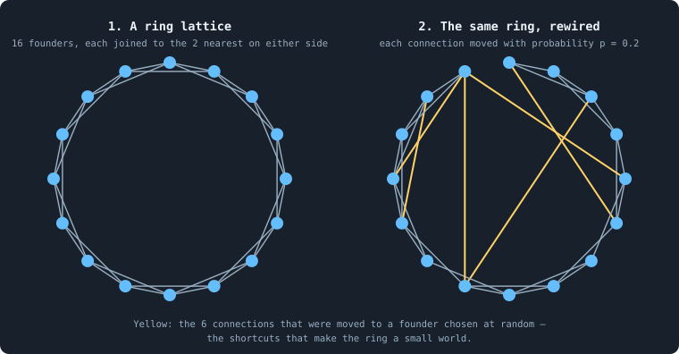

# The rules in detail

> [!question] Questions of this page
> - What does a world look like before its first iteration?
> - A computer cannot throw dice: where does the chance in a world come from?
> - How does a brain's pair of numbers become one share between 0 and 1?
> - How does a brain say yes or no?
> - How are tokens split into whole numbers?
> - What does a brain see of itself and of its neighbours?
> - What does a brain say, and how do its numbers become decisions?
> - What do agents write to each other?
> - How can a coalition of small stakers take a node?
> - How does a brain change?
> - When does a world end?

## In short

The rules of a world, one detail at a time: how the first network is built, where chance comes in, how a brain's numbers become shares and decisions, what agents tell each other, how a coalition takes a node, how a brain changes, and when a world ends.

It gathers what were 11 pages of their own, one section each:

- [The starting ring](#the-starting-ring): Every world starts as a ring of founders with a few shortcuts, the "small-world" network of Watts and Strogatz (1998).
- [Seeds and the random stream](#seeds-and-the-random-stream): Graph of Life is full of chance: random starting brains, random tie-breaks, probabilistic decisions, random inputs, random sharing out of tokens.
- [The share function f(a, b)](#the-share-function-fa-b): A brain often answers with two numbers where the rules need one share between 0 and 1.
- [A yes-or-no decision](#a-yes-or-no-decision): Some decisions are a plain yes or no, such as whether to join a newborn to a neighbour, or to hand it a connection.
- [Splitting tokens into whole numbers](#splitting-tokens-into-whole-numbers): Tokens are whole: an agent cannot stake 3.7 tokens.
- [What a brain sees](#what-a-brain-sees): Every time an agent decides anything, its brain looks at its candidates: the agent itself first, then each of its neighbours in increasing order of id.
- [What a brain says](#what-a-brain-says): For every candidate it looks at — itself and each neighbour — a brain produces one column of numbers: 45 in B1, 19 in B2.
- [Messages](#messages): Agents can say things to each other: every time an agent looks at its neighbours, it writes a message to each of them, and one to itself.
- [How a coalition takes a node](#how-a-coalition-takes-a-node): In the game every node goes to someone, usually whoever staked the most on it: the hegemon.
- [How a brain changes](#how-a-brain-changes): Brains change: this is the variation that evolution needs (What this notebook is about).
- [When a world ends](#when-a-world-ends): A run goes for a fixed number of iterations, unless its world dies out first.

## The starting ring

Every world starts as a **ring of founders with a few shortcuts**, the
"small-world" network of Watts and Strogatz (1998). The founders, the agents a
world begins with, sit around a circle, each joined to its nearest founders on
either side. Then a few connections are moved to founders chosen at random. In
the baseline, 100 founders of 100 tokens each start with 4 neighbours, and
about 40 of the 200 connections become shortcuts. The ring is clustered like a
neighbourhood, yet every founder is only a few steps from every other.

### The picture

Picture houses standing round a lake, where every household knows the two
households on either side. The people you know mostly know each other too.
But news passed on by word of mouth needs many steps to reach the far shore.
Now swap a few of these acquaintances, chosen at random, for someone across
the lake. The village stays close-knit, yet news now reaches anyone in a few
steps. Such a network is called a **small world**.

**The founders' ring, in a small example.** Left: a ring of 16 founders, each
joined to the 2 nearest on either side. Right: the same ring after each
connection was moved with probability 0.2. The 6 connections drawn in yellow
were moved to a founder chosen at random: they are the shortcuts.

### Step by step

Let *T* be the number of tokens ([`total_tokens`](settings.md#total_tokens)).

1. **The founders.** There are *n* = ⌊*T*/100⌋ of them
   ([`n_nodes`](settings.md#n_nodes)): one for every hundred tokens, rounded
   down. They are numbered 0 to *n* − 1, and these numbers are also their
   agent ids. Picture them in order around a circle.
2. **The ring.** Let *k* = max(⌊*n*/100⌋, 5)
   ([`k_neighbors`](settings.md#k_neighbors)). Every founder *i* is joined to
   the founders *i* ± 1, *i* ± 2, …, *i* ± ⌊*k*/2⌋. The count goes round the
   circle, so founder 0 is next to founder *n* − 1. That makes *n*·⌊*k*/2⌋
   connections, and every founder has 2⌊*k*/2⌋ of them.
3. **The shortcuts.** Go once round the circle through the connections
   {*i*, *i* + 1}, for *i* = 0, 1, …, *n* − 1. Then go round once more
   through the connections {*i*, *i* + 2}, and so on up to
   {*i*, *i* + ⌊*k*/2⌋}. On the way, each connection {*i*, *i* + *j*} is
   **rewired** with probability *p* = 0.2
   ([`rewire_p`](settings.md#rewire_p)). Its far end *i* + *j* is replaced by
   a founder chosen uniformly at random. The new end is neither *i* itself nor
   a founder already joined to *i*. Rewiring moves connections; it never adds
   or removes one.
4. **Tokens.** Every founder gets ⌊*T*/*n*⌋ tokens. If *n* does not divide
   *T*, then *T* − *n*⌊*T*/*n*⌋ tokens are left over. They are dealt out by
   one [multinomial draw](rules-in-detail.md#how-a-draw-becomes-a-decision), in
   which every founder has the same chance at every token.
5. **Brains.** Every founder gets a brain whose weights are drawn at random
   ([The brain](the-brain.md)). Each is a genotype of its own, numbered 1 to
   *n*.

Steps 1–3 are done by the networkx function
`watts_strogatz_graph(n, k, p, seed)`. It draws from a random generator of its
own, started from the run's seed. Steps 4–5 draw from the world's random
stream ([Seeds and the random stream](rules-in-detail.md#seeds-and-the-random-stream)).

The ring needs more founders than *k*. With *k* = 5 that means at least six
founders. So with one founder per hundred tokens, a world needs at least 600
tokens.

### The baseline's ring

With *T* = 10,000: *n* = 100 founders of 100 tokens each, and *k* = 5. So
every founder is joined to 2 founders on each side — degree 4 — and the ring
has 100 · 2 = 200 connections. On average 0.2 · 200 = 40 of them are
rewired.

### Why a small world?

A plain ring is **clustered**: two neighbours of a founder are often
neighbours of each other. With 2 neighbours on each side, a founder's 4
neighbours make 6 pairs, and 3 of these pairs are joined. So the clustering is
3/6 = 0.5 ([Clustering](measuring-networks.md#clustering)). Had the same 200 connections joined
founders at random, the clustering would be near 0.04. Two neighbours of a
founder would then be joined with a chance of only 4 in 99.

But a plain ring is **long**. To get from one founder to the one opposite
takes about *n*/(2·2) = 25 steps. Halfway round the circle is *n*/2 = 50
founders, and each step covers at most 2. The average distance between two
founders is about 12.9 steps ([Path length](measuring-networks.md#distances-in-a-network-path-length-radius-and-diameter-the-spectral-gap)).

A few random shortcuts change that. Every shortcut joins two far-apart parts
of the circle, and a handful are enough to make every distance short. In the
real ring of the run with seed 1, 37 of the 200 connections were rewired. The
average distance fell to 4.4 steps, about a third of what it was. The
clustering fell to 0.27: about half was lost, but it is still far above the
0.04 of a random network. Clustered and short at once: that is a small world.
[The world: tokens, agents and a network](the-world.md) draws this ring.

### What becomes of the ring

In B1, every game cuts the connections that carried no tokens in it, so the
ring is forgotten within a few iterations. It matters mainly as a fair,
connected start: every founder can reach every other.
[The first hundred iterations](b1-lives-and-wealth.md#the-first-hundred-iterations) follows what
the founders make of it.

## Seeds and the random stream

Graph of Life is full of chance: random starting brains, random tie-breaks,
probabilistic decisions, random inputs, random sharing out of tokens. Yet a
run can be made again exactly. A computer makes its random numbers by a fixed
calculation from a starting number, the **seed**, so the same seed gives the
same numbers. A run's seed starts two streams: one builds the starting ring,
and one gives the world every other random choice, always in the same order.
So a run is decided by its settings and its seed alone, given the same
libraries and a matrix library held to one thread.

### Dice from a formula

A computer does not throw dice. It computes a long sequence of numbers that
*look* random — they pass the usual statistical tests — from a starting value
called the **seed**. Think of a vast book of random digits: the seed says on
which page to start reading. The same seed gives the same sequence, every
time, on every computer that uses the same algorithm.

For example, start numpy's `RandomState`, the generator every world uses, from
seed 1, and ask it for three numbers between 0 and 1. It gives 0.417, 0.720
and 0.000114. From seed 2 it gives 0.436, 0.026 and 0.550. Ask again
tomorrow, on another computer, and the answers are the same.

### The two streams of a run

Every run has one seed, a whole number; most experiments use 1, 2, 3, ….
A run started without a seed is given one drawn at random, and that seed is
written down with the run. From the seed, two streams are started:

1. **The ring's stream.** The networkx library builds the starting ring
   ([The starting ring](rules-in-detail.md#the-starting-ring)) from a generator of its own,
   seeded with the run's seed.
2. **The world's stream.** Everything else is drawn from **one** stream:
   numpy's `RandomState` (the Mersenne Twister algorithm), seeded with the
   run's seed. It gives the founders' brains, every tie broken at random and
   every probabilistic yes-or-no decision. It also gives every random input of
   a brain, every share-out of tokens and every mutation.

The program always takes its draws in the same order: agents are visited in
increasing order of id, and so are neighbours. So the whole history of a world
is a function of its settings and its seed. Nothing else enters: not the
time, not the computer's load, not how many runs go on at once.

Two more things keep it so. Every world has a stream of its own, so two
worlds played side by side in one program cannot disturb each other. And a
checkpoint saves the stream's place, so a run stopped and resumed draws
exactly the numbers it would have drawn
([Is a run reproducible?](is-a-run-reproducible.md)).

One stream for a whole world has a price. If one agent anywhere takes one
more random number, every later draw everywhere shifts.
[Physical inspiration](physical-inspiration.md) counts this among the three
rules that break locality.

### What "the same" needs

A run comes out the same only with the same Python, numpy and networkx
versions. It also needs the matrix library held to **one thread**, as
[Is a run reproducible?](is-a-run-reproducible.md) found. Here is why. A brain
computes sums of many products. With several threads, a sum may be added up
in a different order. And on a computer, adding floating-point numbers is not
exactly associative. The sum (*a* + *b*) + *c* can differ from
*a* + (*b* + *c*) in the last bit. For example, (0.1 + 0.2) + 0.3 gives 0.6000000000000001, but
0.1 + (0.2 + 0.3) gives 0.6. A brain's output can then differ in its last
digit, a tie can tip the other way, and the two runs part.

So the lab runs every simulation on one thread. A different processor or
library version can round a sum differently too. So every run records its
versions and its processor. The lab refuses to continue a run under different
ones ([The lab, the engine and pilots](runs-and-records.md#the-lab-the-engine-and-pilots)).

### How a draw becomes a decision

Three kinds of draw appear in the rules:

- **a uniform number** *U* between 0 and 1. A yes-or-no decision read as a
  probability *q* says yes when *U* < *q*, which happens with probability
  exactly *q* ([A yes-or-no decision](rules-in-detail.md#a-yes-or-no-decision)).
- **a uniform choice** among several equal candidates. It breaks a tie for
  the largest stake. It also picks which of the equal stakers that tipped a
  coalition takes the node ([How a coalition takes a node](rules-in-detail.md#how-a-coalition-takes-a-node)).
- **a multinomial draw**: *P* tokens dealt out among *N* agents, each token
  independently to agent *j* with probability *q*ⱼ. The result is *N* whole
  numbers that add up to exactly *P*. The cleanup deals out the tokens of the
  dead this way. Under the baselines' rule, `uniform`, every *q*ⱼ is 1/*N*.

A small multinomial draw: deal 3 tokens to 2 agents, each token to either one
with probability ½. The outcomes are (3, 0), (2, 1), (1, 2) and (0, 3), with
chances 1/8, 3/8, 3/8 and 1/8. Every outcome adds up to 3: no token is lost or
made.

Other draws feed a brain rather than decide for it. Each random input is a
uniform number between −2 and 2 ([What a brain sees](rules-in-detail.md#what-a-brain-sees)). A
mutation adds normal draws to a brain's numbers
([How a brain changes](rules-in-detail.md#how-a-brain-changes)).

## The share function f(a, b)

A brain often answers with **two numbers** where the rules need **one
share** between 0 and 1. The share may be of its tokens for a child, of a
stake to mark revolutionary, or the probability of saying yes. One function
turns every such pair into its share. Negative numbers count as zero, and the
share is the first number's part of the total; if neither is positive, the
share is one half. So a brain can say "all", "nothing" or "half" outright,
and brains of random weights often do.

### Two claims on one cake

Picture two people who divide a cake by what each of them claims. A claim
below zero is no claim at all. The first person gets the part of the cake
that their claim is of everything claimed. If neither claims anything, they
cut the cake in half.

The share function does exactly this with a brain's two numbers. The first
number, *a*, is the first claim, and the second, *b*, is the other. The share
is what the first claim gets.

### The rule (the share function)
For two real numbers *a* and *b*,

$$
f(a, b) =
\begin{cases}
\dfrac{\max(a, 0)}{\max(a, 0) + \max(b, 0)} & \text{if } \max(a, 0) + \max(b, 0) > 0, \\[2ex]
\dfrac{1}{2} & \text{if } a \le 0 \text{ and } b \le 0 .
\end{cases}
$$

In words: negative numbers count as zero, and the share is *a*'s part of the
total. If neither number is positive, there is no preference, and the share
is one half.

### Examples (the share function)
Take *a* = 0.8 and *b* = 1.2. Both are positive, so both count in full. The
total is 0.8 + 1.2 = 2, and *a*'s part of it is 0.8 / 2 = 0.4.

Now take *a* = 3 and *b* = −1. The negative *b* counts as zero, so the total
is 3, and *a* has all of it: the share is 1. The table holds these two
examples and four more.

| *a* | *b* | *f*(*a*, *b*) | why |
|---|---|---|---|
| 0.8 | 1.2 | 0.4 | 0.8 / (0.8 + 1.2) |
| 3 | −1 | 1 | *b* counts as 0, so *a* has all of it |
| −1 | 3 | 0 | *a* counts as 0 |
| −2 | −5 | 0.5 | neither is positive |
| 0 | 0 | 0.5 | neither is positive |
| 5 | 5 | 0.5 | equal parts |

### Three properties worth knowing

- **It is a share.** Always 0 ≤ *f*(*a*, *b*) ≤ 1, and swapping the two
  numbers gives the rest of the whole: *f*(*a*, *b*) + *f*(*b*, *a*) = 1.
- **Only the ratio counts.** Only the ratio of the positive parts matters:
  *f*(2, 1) = *f*(20, 10) = 2/3. Making both numbers larger does not make
  the share larger.
- **It has corners.** The share is exactly 0 or exactly 1 whenever one of the
  two numbers is zero or negative and the other positive. It is exactly ½
  whenever both are zero or negative. So a brain can say "all", "nothing" or
  "half" outright, without computing any ratio.

### All, nothing or half

Brains of random weights land on these corners often. A founder's weights
are drawn at random around zero, and the last layer of its brain does not
squash its sums ([The brain](the-brain.md)). So each of its two numbers is as
likely to be negative as positive, and their signs fall like two independent
coins. Each of four cases then has a chance of one in four:

| *a* | *b* | *f*(*a*, *b*) | the parent's child gets |
|---|---|---|---|
| positive | positive | between 0 and 1 | a part of its tokens |
| positive | zero or negative | 1 | all of them |
| zero or negative | positive | 0 | nothing: there is no child |
| zero or negative | zero or negative | ½ | half |

So about three founders in four should have a child. Of those, a third
should give it everything and a third exactly half. That is what happened in
the first reproduction phase of the 30 B1 worlds of 10,000 tokens
(Experiment 2). Of their 3,000 founders, 2,241 had a child. Of these, 33%
gave it every token they had, and died for it, holding none; another 33% gave
exactly half ([The brain](the-brain.md)).

Selection then pushes evolved brains firmly into the corners. Look at the 30
B1 worlds of 100,000 tokens (Experiment 10). In every one of them, the two
child-share numbers end up, on average over the agents, the first negative
and the second positive. *f* reads that as 0: no child. The two numbers for
the revolutionary part of a stake end up the other way round, which *f*
reads as 1 ([What the brains are like](what-the-brains-are-like.md)).

### Where it is used (the share function)
- **The child's tokens.** A parent with τ tokens gives its child
  ⌊*f*(*ā*, *b̄*) · τ⌋: the share of its tokens, rounded down to a whole
  number. Here *ā* and *b̄* are its two reproduction outputs, averaged over
  all its candidates ([How agents have children](b1-lives-and-wealth.md#how-births-build-the-network),
  [One iteration, step by step](one-iteration.md)). B2 adds limits: a parent
  keeps at least one token, a child needs at least 10, and an agent with 8
  connections or more has no child
  ([B1 and B2: the two baselines](b1-and-b2.md)).
- **The revolutionary part of a stake.** Of *a* tokens staked on a node,
  ⌊*f* · *a*⌋ are marked revolutionary ([How a coalition takes a node](rules-in-detail.md#how-a-coalition-takes-a-node)).
- **A probability.** A yes-or-no decision read as a probability says yes
  with probability *f*(*y*, *n*) ([A yes-or-no decision](rules-in-detail.md#a-yes-or-no-decision)).
- **Rules of some experiments**, read the same way: how much of its tokens an
  agent gives away as gifts ([`allow_gifting`](settings.md#allow_gifting)),
  and how far it searches for strangers
  ([`link_search`](settings.md#link_search)).

In the code it is `_share_of_first(a, b)` in `GraphOfLife.py`.

## A yes-or-no decision

Some decisions are a plain yes or no, such as whether to join a newborn to
a neighbour, or to hand it a connection. A brain answers each with **four
numbers**. Two say how strongly it means yes and how strongly no; the other
two, the **mode**, say how to read that pair. Read as a probability, chance
draws the answer; read sharply, the stronger one always wins. The mode is
part of the brain, so whether a lineage decides firmly or by chance is
inherited, and can evolve.

### Firm, or by chance

Two people can lean the same way and still act differently. Say both lean
three to one towards yes. The first always says yes. The second says yes
three times in four and no the fourth time, as if drawing lots weighted by
its leaning. A brain can be either of the two, and it says which, decision by
decision.

### The four numbers

For one candidate — one column of the brain's outputs, see
[What a brain says](rules-in-detail.md#what-a-brain-says) — the brain gives:

- *y*: how strongly it says **yes**;
- *n*: how strongly it says **no**;
- *m*₁ and *m*₂: the **mode**, how it wants *y* and *n* to be read.

### The rule (a yes-or-no decision)
1. If *m*₁ > *m*₂, the pair is read as a **probability**. Draw a uniform
   random number *U* between 0 and 1: every value in that range is equally
   likely. Answer yes if *U* < *f*(*y*, *n*), where *f* is
   [the share function](rules-in-detail.md#the-share-function-fa-b). So the answer is yes with
   probability *f*(*y*, *n*).
2. Otherwise (*m*₁ ≤ *m*₂), the pair is read **sharply**: the answer is yes
   if *y* > *n*, and no if *y* < *n*. If *y* = *n* exactly, a fair coin
   decides.

### Examples (a yes-or-no decision)
| *y* | *n* | *m*₁ | *m*₂ | how it is read | answer |
|---|---|---|---|---|---|
| 0.9 | 0.3 | 1.0 | −0.2 | probability | yes with probability 0.9/1.2 = 0.75 |
| 0.9 | 0.3 | −1.0 | 0.4 | sharp | yes, since 0.9 > 0.3 |
| −0.5 | −0.1 | 0.2 | 0.1 | probability | yes with probability 0.5 (neither positive) |
| −0.5 | −0.1 | 0.1 | 0.2 | sharp | no, since −0.5 < −0.1 |

Step by step, the first row. The mode compares *m*₁ = 1.0 with *m*₂ = −0.2.
The first is larger, so the pair is a probability. Both *y* = 0.9 and
*n* = 0.3 are positive, so *f*(0.9, 0.3) = 0.9 / (0.9 + 0.3) = 0.9/1.2 =
0.75. The answer is yes three times in four.

The second row has the same *y* and *n*, but now *m*₁ = −1.0 is smaller than
*m*₂ = 0.4. The pair is read sharply, and since 0.9 > 0.3 the answer is yes,
every time.

The last two rows hold two negative numbers. Read as a probability, both
count as zero, and the answer is a coin toss. Read sharply, the numbers are
compared as they are, negative or not, and −0.5 < −0.1 gives a firm no.

### Why a mode?

With a mode, a brain decides not only *what* it prefers, but also *whether
to act on its preference every time, or only sometimes*. The mode outputs
are part of the brain, so that choice is inherited and changes over
generations like any other. A lineage can evolve to be decisive, or to be
erratic.

The same idea is used for the stake. A pair of mode outputs decides whether
an agent spreads its tokens over its candidates or puts them all on one
([One iteration, step by step](one-iteration.md)).

### Where it is used (a yes-or-no decision)
- **Linking a newborn**: one decision per candidate of the parent, the
  parent itself included — outputs 2–3 with mode 4–5. In the settled life of
  the 30 B1 worlds of 100,000 tokens, 11.5% of children are joined to none of
  their parent's candidates at birth
  ([How agents have children](b1-lives-and-wealth.md#how-births-build-the-network)). In B2 a newborn
  is first joined to its parent and to two of the parent's neighbours, drawn
  at random, and the brain decides about the others.
- **Handing over a connection**: one decision per neighbour of the parent —
  outputs 11–12 with mode 13–14. In those B1 worlds, 75% of parents hand over
  no connection at all. B2 has no handovers.
- **Rules of some experiments**: whether to give a gift to a neighbour
  ([`allow_gifting`](settings.md#allow_gifting)), and whether to accept a
  link with a stranger met in a search ([`link_search`](settings.md#link_search)).

In the code it is `_choose_binary(yes, no, mode_yes, mode_no, rng)` in
`GraphOfLife.py`. The uniform number comes from the world's random
stream ([Seeds and the random stream](rules-in-detail.md#seeds-and-the-random-stream)).

## Splitting tokens into whole numbers

Tokens are whole: an agent cannot stake 3.7 tokens. So when an agent spreads
its τ tokens over several candidates in proportion to scores, the shares have
to be rounded, and rounded so that **no token is lost or made**. The rule is
the **largest-remainder method**, known from sharing out the seats of a
parliament among parties (Hamilton's method). Every candidate first gets its
exact share rounded down, and the tokens left over go one each to the
candidates that lost the most in the rounding.

### Seats in a parliament

Think of a parliament whose seats are shared out among parties by their
votes. A party's exact share is rarely a whole number of seats, and a seat
cannot be cut. So each party first gets the whole seats it has earned. The
few seats left over go one each to the parties that lost the most by
rounding down. Every seat is given, and none twice.

The program shares an agent's tokens among its candidates the same way. The
tokens are the seats, the candidates are the parties, and the brain's scores
are the votes.

### The rule (splitting tokens into whole numbers)
Given τ tokens and scores *w*₁, …, *w*ₘ, one per candidate:

1. **Negative scores count as zero:** *v*ⱼ = max(*w*ⱼ, 0).
2. **Shares:** *q*ⱼ = *v*ⱼ / Σᵢ *v*ᵢ, each candidate's part of the total. If
   every *v*ⱼ is zero, every share is 1/*m*.
3. **Exact amounts:** *r*ⱼ = *q*ⱼ · τ. They add up to τ, but are not whole.
4. **Round down:** every candidate gets ⌊*r*ⱼ⌋, its exact amount rounded
   down to a whole number.
5. **The leftovers:** what rounding down lost, *L* = τ − Σⱼ ⌊*r*ⱼ⌋, is a
   whole number between 0 and *m* − 1. The *L* candidates with the largest
   **remainders** *r*ⱼ − ⌊*r*ⱼ⌋ get one more token each.

The result is *m* whole numbers that add up to exactly τ, each within one
token of its exact share.

### A worked example (splitting tokens into whole numbers)
Split τ = 11 tokens by the scores (2.0, 1.0, −0.5, 0.5):

| | candidate 1 | 2 | 3 | 4 | sum |
|---|---|---|---|---|---|
| score *w* | 2.0 | 1.0 | −0.5 | 0.5 | |
| *v* = max(*w*, 0) | 2.0 | 1.0 | 0 | 0.5 | 3.5 |
| exact *r* = 11 · *v*/3.5 | 6.286 | 3.143 | 0 | 1.571 | 11 |
| rounded down | 6 | 3 | 0 | 1 | 10 |
| remainder | 0.286 | 0.143 | 0 | 0.571 | |
| + leftover (*L* = 1) | | | | +1 | |
| **tokens** | **6** | **3** | **0** | **2** | **11** |

Row by row: the third score, −0.5, counts as zero, so the scores that count
add up to 3.5. Candidate 1's exact amount is 11 · 2.0/3.5 = 6.286 tokens, and
so on along the row. Rounded down, the four candidates get 6, 3, 0 and 1:
10 tokens, so *L* = 1 token is left over. The largest remainder is
candidate 4's, 0.571, and candidate 4 gets the eleventh token.

### Zero scores, and ties

- **A score of zero or below gets nothing**, unless every score is zero or
  below. Then the tokens are split evenly, every share 1/*m*.
- **Equal remainders.** If two remainders are exactly equal, the order in
  which numpy's `argsort` returns them decides. (numpy is the library of
  numerical tools the program is written with, and `argsort` is its sorting
  function.) It is the same order every time for the same numbers, so the
  rule stays reproducible. In an even split every remainder is the same, and
  the leftovers go down the list of candidates in order. The agent's own node
  is first in that list, so it gets the first leftover token
  ([Where the tokens flow](b1-the-game-and-its-flows.md#where-tokens-flow)).

An agent with 3 tokens and one neighbour that splits evenly shows both.
Each of its two candidates has an exact share of 1.5 tokens, and rounded
down, each gets 1. The one token left over goes to the first candidate, the
agent's own node: 2 at home, 1 on the neighbour
([The even split](measuring-tokens.md#the-even-split)).

### Where it is used (splitting tokens into whole numbers)
- **In the game**, when an agent **spreads** its stake: its τ tokens are
  split over its candidates by their stake scores
  ([One iteration, step by step](one-iteration.md)). Evolved B1 brains spread
  in 98% of cases. In B2 nearly every agent puts all its tokens on one
  candidate, spreading in only 0.1–4% of cases ([The even split](measuring-tokens.md#the-even-split)).
  In B2, 30% of an agent's tokens (rounded up, at least one) also stay at
  home before anything is split, and only the rest is staked by the brain.
- **The even split.** In the median B1 world of 100,000 tokens, 42% of the
  agents score every candidate at zero or below, and the rule splits their
  tokens evenly ([The even split](measuring-tokens.md#the-even-split)).
- **Gifts**, in the experiments that allow them: the tokens an agent gives
  away are split over the neighbours it chose
  ([`allow_gifting`](settings.md#allow_gifting)).

In the code it is `_apportion(weights, total)` in `GraphOfLife.py`.

## What a brain sees

Every time an agent decides anything, its brain looks at its candidates: the
agent itself first, then each of its neighbours in increasing order of id.
For each candidate it gets one column of numbers, **154** in B1 and 66 in B2,
and computes one column of outputs from it
([What a brain says](rules-in-detail.md#what-a-brain-says)). A column holds whether the
candidate is the agent itself, how rich and how well connected the two are, a
summary of each one's neighbourhood, four messages and five random numbers.
The brain is the same for every column; only the inputs differ.

### One form per candidate

Think of each column as a form that the program fills in about one
candidate, and the brain reads. Every form has the same boxes, in the same
order. Only what is written in them changes from one candidate to the next.
What is not on the form, the brain cannot know.

This page lists the boxes: the inputs, in the order the program builds them,
for an agent *u* looking at a candidate *v*. Rows are counted from 0, as in
the code.

### The inputs

| rows | how many | what |
|---|---|---|
| 0 | 1 | 1 if *v* is *u* itself, 0 otherwise |
| 1 | 1 | ln(1 + τ(*u*)): the agent's own tokens |
| 2 | 1 | ln(1 + τ(*v*)): the candidate's tokens |
| 3 | 1 | ln(1 + deg(*u*)): the agent's own number of connections |
| 4 | 1 | ln(1 + deg(*v*)): the candidate's |
| 5–10 | 6 | six quantiles of ln(1 + τ) over *u*'s neighbours |
| 11–16 | 6 | six quantiles of ln(1 + τ) over *v*'s neighbours |
| 17–22 | 6 | six quantiles of ln(1 + deg) over *u*'s neighbours |
| 23–28 | 6 | six quantiles of ln(1 + deg) over *v*'s neighbours |
| 29–58 | 30 | the message *u* wrote to itself |
| 59–88 | 30 | the message *u* wrote to *v* |
| 89–118 | 30 | the message *v* wrote to *u* |
| 119–148 | 30 | the message *v* wrote to itself |
| 149–153 | 5 | random numbers, each uniform between −2 and 2 |

Here τ is a number of tokens, deg a number of connections (the degree), and
ln the natural logarithm. A uniform random number between −2 and 2 is one
for which every value in that range is equally likely.

The table is B1's, and it adds up to 1 + 4 + 24 + 120 + 5 = **154**. With
*m* numbers per message ([`message_amount`](settings.md#message_amount)) and
*r* random inputs ([`random_input_amount`](settings.md#random_input_amount))
it is 29 + 4*m* + *r*. B2's messages hold 8 numbers, so its brains read
29 + 32 + 5 = 66 inputs: the messages fill rows 29–60, and the random numbers
rows 61–65. Some experiments' rules add rows of their own. With gifts, for
example, a second flag after row 0 says whether the connection to the
candidate would lapse unless something crosses it. Every later row then moves
down by one ([`allow_gifting`](settings.md#allow_gifting)).

### Why logarithms?

ln(1 + *x*) makes a brain see **orders of magnitude**. The difference between
10 and 20 tokens (ln 21 − ln 11 = 0.65) is then much larger than the
difference between 1,000 and 1,010 (0.01), as it should be: doubling matters,
adding ten to a thousand does not. The "1 +" keeps 0 at 0.

### The six quantiles

A neighbourhood may have one member or thousands, but the form has a fixed
number of boxes. So the program sums a neighbourhood up in six numbers. It
sorts the values over the neighbours, *x*₀ ≤ *x*₁ ≤ … ≤ *x*ₙ₋₁, and takes six
**quantiles** at *q* = 0, 0.2, 0.4, 0.6, 0.8 and 1: the smallest value, four
values in between, and the largest. Quantile *q* is read at position
*h* = (*n* − 1)·*q* of the sorted list. When *h* falls between two positions,
the value is read off the straight line between the two values around it:

$$
Q(q) = x_{\lfloor h \rfloor} + \bigl(h - \lfloor h \rfloor\bigr)\,\bigl(x_{\lceil h \rceil} - x_{\lfloor h \rfloor}\bigr),
\qquad h = (n-1)\,q .
$$

Here ⌊*h*⌋ is *h* rounded down and ⌈*h*⌉ is *h* rounded up. An agent with no
neighbours gets six zeros. [Median and quantiles](statistics.md#many-worlds-at-once-the-median-bands-the-settled-life-and-the-spread)
uses the same idea to measure worlds.

**Example.** A neighbourhood holds 1, 3, 3, 10 and 40 tokens, so *n* = 5. The
logarithms ln(1 + τ), sorted, are 0.693, 1.386, 1.386, 2.398 and 3.714.

- At *q* = 0 the quantile is the smallest value, 0.693.
- At *q* = 0.2, *h* = 0.8: eight tenths of the way from the first value to
  the second, *Q* = 0.693 + 0.8·(1.386 − 0.693) = 1.248.
- At *q* = 0.4, *h* = 1.6: between two equal values, *Q* = 1.386.
- At *q* = 0.6, *h* = 2.4: *Q* = 1.386 + 0.4·(2.398 − 1.386) = 1.791.
- At *q* = 0.8, *h* = 3.2: *Q* = 2.398 + 0.2·(3.714 − 2.398) = 2.661.
- At *q* = 1 it is the largest value, 3.714.

The six inputs are (0.693, 1.248, 1.386, 1.791, 2.661, 3.714).

### When the inputs are measured

At the **start of each phase**, before anyone acts. Every agent's tokens and
degree, and every neighbourhood's quantiles, are measured once and then read
by everyone. So the order in which agents act does not change what they see.
The messages are those delivered last ([Messages](rules-in-detail.md#messages)). The random
numbers are drawn fresh for every look, column by column, from the world's
random stream ([Seeds and the random stream](rules-in-detail.md#seeds-and-the-random-stream)).

### Why random inputs?

A brain is a fixed function: the same inputs give the same outputs. Two
neighbours who look alike to it would always be treated alike. Five random
inputs give it a way to break such ties. How strongly it listens to them is
set by its weights, so how random an agent's behaviour is can itself evolve.

In B1 they move more stakes than wealth does. In the 30 B1 worlds of 100,000
tokens,
drawing the five random numbers of every column again changes the stakes of
15% of the agents. Doubling every neighbour's tokens, as the agent sees them,
changes only 1.5% ([What the brains are like](what-the-brains-are-like.md)).

### Where it is used (what a brain sees)
- [What the brains are like](what-the-brains-are-like.md): an evolved B1
  brain hears every group of inputs equally loudly. Each input is read by a
  column of 50 first-layer weights, and that column's length is 0.67 for
  every group, the random numbers included (0.57 in a founder).
- [How a signal fades through layers](the-brain.md#how-a-signal-fades-through-layers): seeing is not
  using. A change in these inputs reaches a B1 founder's outputs at a gain of
  only 0.0006, and a B2 founder's at about 0.2
  ([B1 and B2: the two baselines](b1-and-b2.md)).
- [What a brain can compute](what-a-brain-can-compute.md): what a B2 brain
  can and cannot work out from its 66 inputs.
- [Do agents cooperate?](cooperation-help-and-gliders.md#do-agents-cooperate-help-kin-and-partners): no input names a genotype,
  so a brain cannot tell kin from stranger, except through messages.

## What a brain says

For every candidate it looks at — itself and each neighbour — a brain
produces one column of numbers: **45** in B1, 19 in B2. Each group of rows
has one job: how much to give a child, whom the child joins, where and how
to stake, how much of a stake is revolutionary, which connections to hand
over, and what to say. Two decisions concern the agent as a whole, and their
rows are averaged over all its columns first; the others are taken candidate
by candidate. An output can be any number, positive or negative; only the
message rows are squeezed into the range from −1 to 1.

### One answer sheet per candidate

[What a brain sees](rules-in-detail.md#what-a-brain-sees) pictures each column of inputs as a
form about one candidate. The column of outputs is the answer sheet the brain
hands back for it. Every sheet has the same lines, in the same order. Some
lines make sense only once per agent, such as how much to give a child; for
those, the program reads the average over all of the agent's sheets.

### The outputs

This is B1's layout, rows counted from 0 as in the code. The decisions
themselves are explained in [One iteration, step by step](one-iteration.md).

| rows | name | used in | how it is read |
|---|---|---|---|
| 0–1 | child share | reproduction | averaged over all candidates' columns, then *f*(row 0, row 1) = the share of its tokens the agent gives a child |
| 2–3 | link | reproduction | per candidate: (yes, no) — join the child to this candidate? |
| 4–5 | link mode | reproduction | per candidate: read rows 2–3 as a probability (row 4 > row 5) or sharply |
| 6 | stake score | game | per candidate: how much to stake here, relative to the others |
| 7–8 | spread mode | game | averaged over all columns: spread the stake by score (row 7 > row 8) or put it all on the best-scored candidate |
| 9–10 | revolution | game | per candidate: *f*(row 9, row 10) = the share of the stake on it marked revolutionary |
| 11–12 | handover | reproduction | per neighbour: (yes, no) — give this connection to the child? |
| 13–14 | handover mode | reproduction | per neighbour: probability or sharp, as for links |
| 15–44 | message | both | per candidate: the 30 numbers of the message to it, each squashed into (−1, 1) by tanh |

Rows 0–14 are 15 numbers; with the 30 message numbers that is **45**. *f* is
[the share function](rules-in-detail.md#the-share-function-fa-b); "probability or sharp" is
[the yes-or-no rule](rules-in-detail.md#a-yes-or-no-decision); a spread stake is split by
[the largest-remainder method](rules-in-detail.md#splitting-tokens-into-whole-numbers).

### Averaged or per candidate?

Two decisions are about the agent as a whole: *how much do I give my child?*
and *do I spread my stake?* But the brain answers once per candidate. So
these outputs, rows 0–1 and 7–8, are **averaged over all of the agent's
columns** (itself and every neighbour) before they are used. The other
decisions are about one candidate each, and use that candidate's column.

### The output layer is linear

The hidden layers pass their sums through the sigmoid, a function that
squeezes any number into the range from 0 to 1. The last layer does not: an
output can be any real number, positive or negative. Only the message rows
are squashed afterwards, by tanh, which squeezes any number into the range
from −1 to 1. So a message is always 30 numbers between −1 and 1. See
[The brain](the-brain.md).

### An example: what an evolved brain says

Take the 30 B1 worlds of 100,000 tokens (Experiment 10) at their end. Average
each output over a world's agents and their columns, and take the median
world ([What the brains are like](what-the-brains-are-like.md)):

- **Rows 0–1**, the child share: −0.53 and +0.70. The first is negative and
  the second positive, so *f* = 0: no child.
- **Row 6**, the stake score: +0.08 (the worlds range from −1.1 to +0.6),
  nearly the same for every candidate.
- **Rows 7–8**: +0.61 against −0.45. Row 7 is the larger, so the stake is
  spread.
- **Rows 9–10**: +0.64 and −0.61, so *f* = 1: all of a stake is marked
  revolutionary. In these worlds, 97% of staked tokens are.

Read together: have no child, spread the stake almost evenly, and mark all of
it revolutionary. A founder's brain, for comparison, averages 0 on every one
of these rows.

### When some rules are off, or added

The layout follows the rules. Without revolutions there are no rows 9–10;
without handovers, no rows 11–14; and the rows after them move up. B1 has
both, and the layout above. B2 has no handovers: its rows 0–10 are as above,
and its message of 8 numbers fills rows 11–18, 19 rows in all. Rules that
some experiments switch on add rows before the message: gifts add six, a
search for strangers four ([Every setting](settings.md)).

### Where it is used (what a brain says)
- [What the brains are like](what-the-brains-are-like.md): where selection
  pushed each row in B1's worlds, and why the stake score barely changes
  from one candidate to the next.
- [How the game is played](b1-the-game-and-its-flows.md#how-the-game-is-played-what-agents-stake-and-who-wins-the-nodes): what rows 6–10 come to
  in B1's worlds. From iteration 500 on, 98% of the agents spread their stake.
- [What a brain can compute](what-a-brain-can-compute.md): a B2 brain whose
  weights are set by hand so that its 19 outputs play a rule written in
  Python.

## Messages

Agents can say things to each other: every time an agent looks at its
neighbours, it writes a **message** to each of them, and one to itself. A
message is a list of numbers between −1 and 1, 30 in B1 and 8 in B2. Looking
at a neighbour, an agent reads four messages: its own to itself and to that
neighbour, and the neighbour's to it and to itself. No rule says what the
numbers mean: a message means whatever the brains that write and read it make
of it, and that can evolve. In B1, a message turned out to say little more
than who wrote it.

### Notes between neighbours

Picture neighbours who leave each other notes. Every agent writes one note to
each neighbour, and one to itself. When it later considers a neighbour, it
reads four notes: its note to itself, its note to that neighbour, the
neighbour's note to it, and the neighbour's note to itself. The notes are
lists of numbers, and nothing gives them a meaning but the brains that write
and read them.

### Who writes what

Whenever an agent *u* looks at its candidates — itself and its neighbours —
its brain gives one column of outputs for every candidate *v*. In B1, rows
15–44 of that column are the 30 numbers of a message
([What a brain says](rules-in-detail.md#what-a-brain-says)). Passed through tanh, a function that
squeezes any number into the range from −1 to 1, they are the message from
*u* **to** *v*. So in every look an agent writes one message to itself and
one to each neighbour.

How many numbers a message holds is a setting,
*m* ([`message_amount`](settings.md#message_amount)): *m* = 30 in B1, and
*m* = 8 in B2, whose message fills output rows 11–18.

### Who reads what

When *u* looks at a candidate *v*, it reads four messages
([What a brain sees](rules-in-detail.md#what-a-brain-sees)):

1. what *u* wrote to itself — a memory of sorts;
2. what *u* wrote to *v*;
3. what *v* wrote to *u*;
4. what *v* wrote to itself.

Only the last message written from each writer to each reader is kept. A
message that does not exist yet — between two agents who have just become
neighbours — reads as 30 zeros, or *m* zeros in general.

Some experiments change what an agent writes to itself. Under
[`self_message`](settings.md#self_message) = largest, it is the largest,
number by number, of everything the agent writes in that look.

### When messages are delivered

Messages are not delivered the moment they are written. Every look of a
phase writes into an **outbox**, and the outbox is delivered when the look is
over. So every agent in a look reads the same generation of messages,
whatever the order in which the agents are visited.

With [`message_prepass`](settings.md#message_prepass) on, as in B1, each
phase has **two looks**:

1. **The prepass.** Every agent looks at its candidates and writes messages,
   and does nothing else. The messages are delivered.
2. **The look that acts.** Every agent looks again, reads the messages of
   the prepass — written in this phase, about the world as it now is — and
   decides. It writes messages again, which are delivered at the end of the
   phase and read in the next phase's prepass.

B2 has no prepass, so each of its phases has one look. An agent there acts
on messages written a phase earlier, before the births, deaths and conquests
since. The messages it writes as it acts are read in the next phase.

### Forgetting

At the end of every game, messages to or from anyone who is no longer a
neighbour (or no longer alive) are deleted. A connection that is cut and
later made again starts with zeros.

### What it costs a brain

In B1, 120 of a brain's 154 inputs are messages, and 30 of its 45 outputs.
Its first layer has 154 × 50 = 7,700 weights, and 120 × 50 = 6,000 of them
read messages: more than a third of all the brain's 15,550 weights. In B2,
32 of 66 inputs and 8 of 19 outputs are messages.

### What the messages say

Do the messages carry anything useful? For B1,
[What agents say to each other](b1-brains-lineages-and-messages.md#what-agents-say-to-each-other) answered:
hardly. It read every message of the 30 B1 worlds of 100,000 tokens at their
end. Two messages written by one agent to two readers differ by 0.0005, as
the root mean square of the differences of their 30 numbers. Messages written
by two different agents differ by 0.60. So an agent says the same thing to
everyone, and all agents of one genotype write alike: a message is a name.
What a message could be about — the writer's and the reader's tokens and
connections, and whether it is written to oneself — accounts for only 1.2%
of the messages' variety.

### Where it is used (messages)
- [What agents say to each other](b1-brains-lineages-and-messages.md#what-agents-say-to-each-other): what
  the messages of B1's worlds carry, number by number.
- [What a brain can compute](what-a-brain-can-compute.md): why no message
  can carry news of a third agent, and how `self_message` = largest would let
  one.
- [Do agents cooperate?](cooperation-help-and-gliders.md#do-agents-cooperate-help-kin-and-partners): messages are the only way
  a brain could tell kin from strangers.

## How a coalition takes a node

In the game every node goes to someone, usually whoever staked the most on
it: the **hegemon**. But a **coalition** of smaller stakers takes the node if
the parts of their stakes they marked **revolutionary** add up to more than
the hegemon's whole stake. The node then goes to one member of the
coalition: the one at whom a running sum of their revolutionary parts,
smallest first, passes the halfway mark. In B1 coalitions decide about half
of all nodes; in B2 they hardly ever win.

### The largest army, and a band against it

Think of a hill that goes to the largest army marching on it. Smaller armies
can band together against that army: each swears part of its troops to the
band. If the sworn troops together outnumber the largest army, the band
takes the hill.

Which member of the band then holds it? Line the band up from the smallest
sworn part to the largest, and count the sworn troops along the line. The
hill goes to the member at whom the count first passes half of everything
that matters on the field: all the sworn troops, plus the largest army.

The rest of this page states the rule as the program has it, shows that it
says the same as this picture, and works an example.

### What each staker brings

For a node *v*, collect every stake placed on it — by its own agent and by
its neighbours. A staker *i* who put *a*ᵢ tokens on *v* also marked a part of
them revolutionary:

$$
\rho_i = \bigl\lfloor f(r_{i,1}, r_{i,2}) \cdot a_i \bigr\rfloor ,
$$

where *r*ᵢ,₁ and *r*ᵢ,₂ are rows 9 and 10 of *i*'s brain output for the
candidate *v*, *f* is [the share function](rules-in-detail.md#the-share-function-fa-b), and ⌊ ⌋ rounds
down to a whole number of tokens.

### The rule (how a coalition takes a node)
1. **The hegemon.** Let *H* = maxᵢ *a*ᵢ be the largest stake on *v*, and
   *h* the staker who made it. If several made it, *h* is chosen among them
   uniformly at random.
2. **The coalition** is every *other* staker with a revolutionary part
   ρᵢ > 0. The hegemon's own revolutionary part never counts: it is the one
   being fought. Let *R* be the sum of the coalition's revolutionary parts.
   If there is no coalition, *h* wins.
3. **Climbing.** Sort the coalition from the smallest ρ to the largest.
   Members with equal ρ form one **rung**. Go up rung by rung, adding the
   rungs' ρ to a running sum *L*, the "lower class". At each rung ask: does
   the lower class outweigh everyone above it plus the hegemon?

   $$
   L > (R - L) + H \;?
   $$

   At the first rung where it does, **the coalition wins**, and the winner is
   one member of that rung, chosen uniformly at random. If no rung does, the
   hegemon wins.

Whoever wins, node *v* gets a copy of the winner's brain and **all** the
tokens staked on it ([One iteration, step by step](one-iteration.md)).

### The simpler statement

Add *L* to both sides of the inequality *L* > (*R* − *L*) + *H*, and divide
both by 2: it is the same as

$$
L > \frac{R + H}{2} .
$$

*L* grows rung by rung and reaches *R* at the top rung. So a rung where the
inequality holds exists exactly when *R* > (*R* + *H*)/2, that is, when

$$
R > H .
$$

**The coalition wins if and only if its revolutionary tokens together exceed
the largest single stake.** And the member who wins is the one at whose rung
the running sum first passes the halfway mark (*R* + *H*)/2. That makes the
winner a kind of weighted median of the coalition, shifted up by the
hegemon's weight.

Note the asymmetry: the hegemon is weighed with its **whole** stake *H*, the
coalition only with the parts its members marked revolutionary.

### A worked example (how a coalition takes a node)
Four agents stake on node *v*:

| staker | stake *a* | revolutionary part ρ |
|---|---|---|
| A | 10 | 0 |
| B | 4 | 4 |
| C | 3 | 3 |
| D | 6 | 5 |

The hegemon is A, with *H* = 10. The coalition is B, C and D (A's own part
would not count anyway), with *R* = 4 + 3 + 5 = 12 > 10, so the coalition
wins. Sorted by ρ, the coalition reads C (3), B (4), D (5), and the halfway
mark is (12 + 10)/2 = 11. Climb:

| rung | *L* | *L* > 11? |
|---|---|---|
| C | 3 | no |
| B | 7 | no |
| D | 12 | **yes** |

D wins node *v*: the node takes on a copy of D's brain, and holds all
10 + 4 + 3 + 6 = 23 tokens staked on it.

If D had marked only 2 tokens revolutionary, *R* would be 9 < 10, and A would
have won.

**The same stakes in B2.** B2 gives a defender a home advantage
([`incumbency`](settings.md#incumbency) = 1.5): an agent's stake on its own
node counts 1.5 times when the hegemon is chosen and *H* is measured.
Suppose A is the agent living on *v*. Its 10 tokens then count as *H* = 15,
and *R* = 12 < 15, so A keeps its node. The node still holds the 23 tokens
staked on it: only who wins is weighed.

### How often a coalition wins

Two cases need no climbing. An agent who staked on its own node alone keeps
it, with all it staked. A node on which nobody staked anything — not even
its own agent — is left with no tokens, and its agent starves in the
cleanup.

Everywhere else, how often a coalition wins depends on the world. In B1 it
decides about half of all nodes. In the last game of the 30 B1 worlds of
100,000 tokens (Experiment 10), coalitions won 52% of the nodes on which
anyone staked. The winning member was the agent living on the node for 12%
of all those nodes, and a neighbour for 40%. By then 97% of all staked tokens
are marked revolutionary
([How the game is played](b1-the-game-and-its-flows.md#how-the-game-is-played-what-agents-stake-and-who-wins-the-nodes)). In B2's pilot worlds
of 10,000 tokens, coalitions won about one node in three hundred a game. B2
with and without them was the same world in every measure
([The switches the world was built with](what-the-switches-did-in-pilots.md#revolutions-handover-and-gifts-the-switches-the-world-was-built-with)).

### Where it is used (how a coalition takes a node)
- [How the game is played](b1-the-game-and-its-flows.md#how-the-game-is-played-what-agents-stake-and-who-wins-the-nodes): who wins the nodes of
  B1's worlds, and how.
- [The switches the world was built with](what-the-switches-did-in-pilots.md#revolutions-handover-and-gifts-the-switches-the-world-was-built-with):
  B1 and B2 without revolutions. B1 without them becomes a world of mayflies,
  whose agents are 7 to 13 iterations old on average.
- [Revolutions, with every other rule](what-the-switches-did-in-pilots.md#revolutions-with-every-other-rule):
  the worlds near B2 in which revolutions do matter.
- [A crew of raiders](strategies-written-by-hand.md#a-crew-of-raiders): two raiders of two tokens each
  stake one on a stranger of one token. In B2 the stranger's home stake
  counts as 1.5, so neither raider can take the node alone, but together,
  with *R* = 2, they do.

In the code it is `_resolve_winner(offers, revolutionaries, rng)` in
`GraphOfLife.py`. With
[`allow_revolutions`](settings.md#allow_revolutions) off, nobody marks
anything revolutionary, and the hegemon always wins.

## How a brain changes

Brains change: this is the **variation** that evolution needs
([What this notebook is about](what-this-notebook-is-about.md)). A brain is
offered a change whenever it is copied into a newborn, and it changes with
probability 0.2. B1 also offers every brain a change after every game; B2
instead offers one whenever a node won by a neighbour takes on a copy of the
winner's brain. A change nudges about one number in ten by a fifth of a
weight's typical size, and now and then redraws some numbers from scratch. A
brain that changed is a new genotype.

### A copy with slips

Think of a brain as a long table of numbers, copied out by hand. Most copies
are perfect. One in five has slips: about one number in ten is a little off,
and now and then part of the table is written out afresh, from scratch. The
slips are blind. Whether one helps or harms is for the world to find out.

### When

A brain is offered a change at two moments:

1. **At birth**, in both baselines. A child's brain is a copy of its
   parent's, and the copy is offered a change. (In some experiments the copy
   is first mixed with a neighbour's brain:
   [`mix_at_birth`](settings.md#mix_at_birth).)
2. **After every game, in B1.** Every brain in the world — after the
   cleanup, so only the survivors' — is offered a change, each
   independently.

B2 replaces the second moment by another copy
([`mutate_on_replication`](settings.md#mutate_on_replication)). When a
neighbour wins a node, the node takes on a copy of the winner's brain, and
that copy is offered a change, as a newborn's is. A brain that stays where it
is never changes. The reason: in B1, 97% of new genotypes are made in brains
that are not being copied, so a successful brain is worn away where it sits
([What the measurements say about open-ended evolution](what-the-baseline-world-is.md#what-the-measurements-say-about-open-ended-evolution)).

Each time, the brain changes **with probability** *p* = 0.2
([`mutation_probability`](settings.md#mutation_probability)). A uniform
random number *U* between 0 and 1 is drawn, every value equally likely, and
the brain changes if *U* ≤ *p*.

So in one iteration of B1, an agent's brain is offered at least one change
(after the game), and a newborn's two (at birth and after the game). The
chance that a given brain is changed at least once in an iteration is
1 − 0.8 = 0.2 for an old agent and 1 − 0.8² = 0.36 for a newborn.

### What a change does

A brain is a list of **weight matrices** *W* and **bias vectors** *b*, one of
each per layer: the numbers it computes with ([The brain](the-brain.md)).
Every one of them is changed separately, in two steps. Let *s* = 0.1
([`mutation_sparsity`](settings.md#mutation_sparsity)), σ = 0.2
([`mutation_noise_std`](settings.md#mutation_noise_std)), and let *k* be the
**fan-in** of the layer: the number of inputs each of its neurons has.

**Step 1: jitter.** Every number of the matrix (or vector) is, independently
with probability *s*, moved by a normal random amount. The amount is a draw
from a bell curve centred on 0, with standard deviation σ/√*k*:

$$
w \;\leftarrow\; w + \varepsilon, \qquad \varepsilon \sim \mathcal{N}\!\left(0,\ \left(\frac{\sigma}{\sqrt{k}}\right)^{2}\right).
$$

Here 𝒩(0, *d*²) stands for that bell curve, with standard deviation *d*.

**Step 2: a rare reset.** With probability *s*, the matrix is also reset in
part: every number of it is, independently with probability *s*, replaced by
a fresh draw. A weight is drawn from the distribution the founders' weights
were drawn from, 𝒩(0, (1/√*k*)²); a bias from 𝒩(0, (σ/√*k*)²).

So a change moves about one number in ten by a little, and now and then
redraws about one number in ten of a matrix from scratch.

### How big "a little" is

A founder's weights are drawn from 𝒩(0, (1/√*k*)²): their standard deviation
is 1/√*k*. A jitter has standard deviation σ/√*k* = 0.2/√*k*: **a fifth of
the typical size of a weight**. For the first layer of the B1 brain,
*k* = 154, so a weight is typically about 1/√154 ≈ 0.081 in size, and a
jitter about 0.016.

Per change, the expected number of jittered weights is
*s* · 15,550 ≈ 1,555 of the B1 brain's 15,550 weights. B2's smaller brain has
66 · 16 + 16 · 19 = 1,360 weights, of which about 136 are jittered. Per
matrix, a reset happens with probability 0.1, and then touches about a tenth
of its numbers.

Jitters and resets pull a weight's size in opposite directions. The jitters
of a change add to a weight's variance, on average, *s* · σ² = 0.1 · 0.04 =
0.004 times a founder's variance: 0.4% of it. The same change redraws a given
weight from the founders' distribution with probability *s*² = 0.01. That
takes away, on average, 1% of the variance the weight has above a founder's.
The two balance where a weight's variance is 1.40 times a founder's, since
0.01 · (1.40 − 1) = 0.004. That is the size at which the first-layer weights
of evolved B1 brains are found: mutation alone sets it
([What the brains are like](what-the-brains-are-like.md)).

### A new genotype

A brain that changed gets a **new genotype number**, and records the
genotype it came from as its parent
([Genotypes and the family tree](measuring-evolution.md#genotypes-families-and-the-common-ancestor)). A brain that was offered a
change and did not change keeps its number.

One special case matters in [Do the brains matter?](do-the-brains-matter.md).
With *s* = 0, step 1 and step 2 change nothing. But a brain drawn to change
(with probability *p*) still gets a new genotype number. Its weights are
those of its parent, exactly.

### Precision

In B1 and B2, weights are stored as 16-bit numbers
([`brain_kind`](settings.md#brain_kind)), which keep about three significant
decimal digits. The change is computed in 64 bits and the result stored in
16, so a jitter much smaller than a weight's last stored digit can be lost in
the rounding.

### Where it is used (how a brain changes)
- [Do the brains matter?](do-the-brains-matter.md): B1 worlds whose brains
  never change (*s* = 0), against B1 itself (Experiment 7).
- [How fast should brains change?](how-fast-should-brains-change.md): B2
  worlds at five chances of change, *p* from 0.05 to 0.8 (Experiment 9).
- [Genotypes and the family tree](measuring-evolution.md#genotypes-families-and-the-common-ancestor): how the new genotype numbers
  make a family tree.
- [What the brains are like](what-the-brains-are-like.md): what mutation
  alone does to the size of an evolved brain's weights.

In the code it is `Brain.mutate` and `Brain._perturb` in
`GraphOfLife.py`. Every draw comes from the world's random stream
([Seeds and the random stream](rules-in-detail.md#seeds-and-the-random-stream)).

## When a world ends

A run goes for a fixed number of iterations, unless its world dies out first.
In this notebook that has an exact meaning: if an iteration's game leaves 20
agents or fewer, the world is **extinct** and its run stops. A world that
small is no longer a population worth measuring. But it is not always dying:
small worlds run without the rule fell below 20 agents and grew back. So the
notebook reports the worlds that die out apart from those that live to the
end.

### The rule (when a world ends)
A run goes for a fixed number of iterations — 3,000 for the thirty baseline
worlds of 10,000 tokens, 1,500 for the thirty of 100,000 — unless its world
**dies out** first.

After every iteration — that is, after its game and the cleanup that follows
— the agents are counted. If there are at most
[`extinction_threshold`](settings.md#extinction_threshold) of them, 20 in both
baselines, the world counts as **extinct** and the run stops.

The count is made once per iteration, after the game, and not after the
reproduction phase. That misses no world. Only the reproduction phase adds
agents; a game and its cleanup can only take them away. So a world left with
20 agents or fewer by its reproduction phase has 20 or fewer after the game
too.

What the timing does decide is when a small world is first judged. A world of
800 tokens starts with 8 founders, one per hundred tokens, already below the
line. It still plays one whole iteration before its agents are counted.

### Why 20 and not 0?

A world of a handful of agents is not a population any more, and its
statistics — inequality, clustering, families — mean little. Stopping at 20
also saves running a dying world to its end.

But a world at 20 agents is not always dying.
[How does a world's size follow its tokens?](b1-the-network-size-and-scaling.md#worlds-of-many-sizes)
ran small worlds with the threshold at 0. All six worlds of 800 and 1,600
tokens lived to iteration 600, and five of them were worlds the threshold had
stopped after their first game. One of them fell to 4 agents and came back.

So "extinct" in this notebook means exactly what the rule says — **fell to 20
agents or fewer** — which is not always the same as dying. An experiment that
cares about extinction should run a condition with the threshold at 0 beside
it.

### An empty world

If a cleanup ever removes every agent, the program puts one new agent on a
node of its own, with a fresh random brain and all *T* tokens of the world.
With the threshold at 20, that world is extinct at once. With the threshold
at 0, a run can never stop as extinct: when its agents are counted, the world
always holds at least this one.

### How the notebook counts the dead

A world that dies out did not end up anywhere: the last stretch of its life is
its dying. So where the worlds of a setting end up is measured over the worlds
that lived to the end. The dead are reported beside them, as an outcome of
their own ([The settled life of a world](statistics.md#the-settled-life-of-a-world)).

Of the 30 baseline worlds of 10,000 tokens, four died: after 4, 313, 1,547
and 2,184 iterations. Of the 30 of 100,000 tokens, none did
([A world's life](b1-lives-and-wealth.md#the-life-of-a-b1-world)).

Iterations are numbered from 0. So "died after *N* iterations" means that the
iteration numbered *N* − 1 was the last to run, and it ended with 20 agents or
fewer.

### Where it is used (when a world ends)
- [A world's life](b1-lives-and-wealth.md#the-life-of-a-b1-world): the four B1 worlds of 10,000 tokens that
  died out, one of them in its fourth iteration.
- [Brains that see, and worlds that break](building-b2-and-the-search-for-a-healthy-rich-world.md#brains-that-see-and-worlds-that-break):
  four of ten worlds of 5,000 tokens died out when their brains could see, and
  eight of ten when those brains also changed only when copied.
- [Who dies, and why](building-b2-and-the-search-for-a-healthy-rich-world.md#who-dies-and-why): all ten B2 worlds that kept
  nothing at home died out, within 26 to 47 iterations.
- [How this notebook is written](how-this-notebook-is-written.md): the rule
  that the dead are counted apart.

## Where to go next

- [The world: tokens, agents and a network](the-world.md): the world this
  ring starts, with the real ring of seed 1 drawn.
- [Clustering](measuring-networks.md#clustering) and [Path length](measuring-networks.md#distances-in-a-network-path-length-radius-and-diameter-the-spectral-gap): the two
  measures a small world is judged by.
- [The first hundred iterations](b1-lives-and-wealth.md#the-first-hundred-iterations): how the
  founders become a world.
- [Is a run reproducible?](is-a-run-reproducible.md): the experiment that
  tested all this, and found the threads.
- [How much does the seed decide?](b1-the-network-size-and-scaling.md#how-much-does-the-seed-decide): how
  differently thirty worlds of the same settings turn out.
- [How many seeds an experiment needs](statistics.md#how-many-seeds-an-experiment-needs): why an experiment
  runs many seeds.
- [How agents have children](b1-lives-and-wealth.md#how-births-build-the-network): the decisions of
  a birth, in the worlds.
- [The even split](measuring-tokens.md#the-even-split): what the rule does when no score is above
  zero, and why that is common.
- [Where the tokens flow](b1-the-game-and-its-flows.md#where-tokens-flow): how the rounding tilts
  stakes towards home.
- [Median and quantiles](statistics.md#many-worlds-at-once-the-median-bands-the-settled-life-and-the-spread): quantiles, as the
  notebook uses them to measure worlds.
- [The brain](the-brain.md): the network between the inputs and the outputs.
- [One iteration, step by step](one-iteration.md): when the looks happen in
  an iteration.
- [Staking at home, and keeping one's node](b1-the-game-and-its-flows.md#staking-at-home-and-keeping-ones-node): how often an
  agent keeps its own node.
- [Genotypes and lineages](b1-brains-lineages-and-messages.md#genotypes-and-lineages): the family trees that
  the changes grow.
- [Why evolution stops](how-to-tell-a-world-that-keeps-evolving.md#why-evolution-stops): what changing brains find,
  and where they stop.
- [How does a world's size follow its tokens?](b1-the-network-size-and-scaling.md#worlds-of-many-sizes):
  small worlds near the line, and below it.

## How our view changed

- *What a brain says*:
  - **8 October 2026.** This page said that every run of the notebook has
    both revolutions and handovers on, so that the layout above is the only
    one.
  - **12 October 2026.** B2 was made without handovers
    ([B1 and B2: the two baselines](b1-and-b2.md)): its brains have 19 outputs.
    Later experiments switch other rules on and off as well. The page now says
    how each of them changes the layout.
- *How a coalition takes a node*:
  - **8 October 2026.** This page said that most nodes are not contested by a
    coalition.
  - **23 October 2026.** Corrected. [How the game is played](b1-the-game-and-its-flows.md#how-the-game-is-played-what-agents-stake-and-who-wins-the-nodes),
    written the same day as that sentence, measured the opposite in B1: in its
    settled worlds coalitions decide about half of all nodes. In B2's pilot
    worlds they won only about one node in three hundred a game
    ([The switches the world was built with](what-the-switches-did-in-pilots.md#revolutions-handover-and-gifts-the-switches-the-world-was-built-with),
    15 October 2026).
- *When a world ends*:
  - **9 October 2026.** The page first gave a single reason for stopping at 20:
    it saves running a dying world to its end. Small worlds run with the
    threshold at 0 then showed that a world at 20 agents is not always dying:
    all six of 800 and 1,600 tokens lived on
    ([How does a world's size follow its tokens?](b1-the-network-size-and-scaling.md#worlds-of-many-sizes)).
  - **23 October 2026.** Until now the page said that a world which falls to 20
    agents or fewer in the reproduction phase, and recovers in the game, is not
    extinct. No world can do that, because a game adds no agents: only the
    reproduction phase makes children (`GraphOfLife.py`, read when this
    page was rewritten). The count after the game misses no world.
