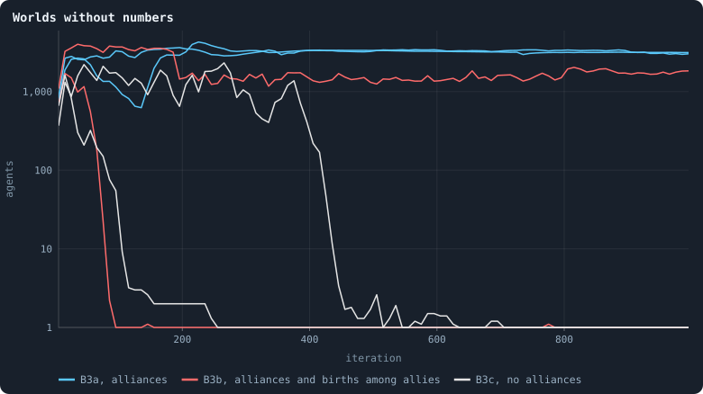
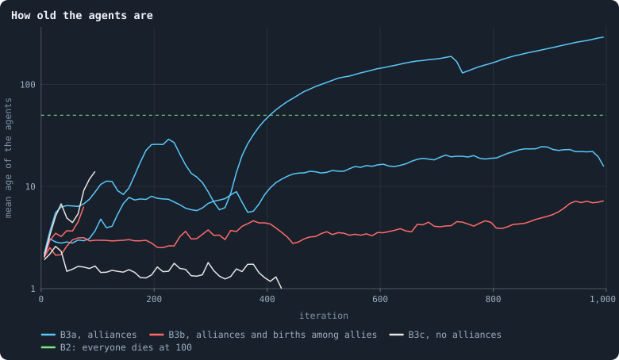

# Rules without numbers

> [!question] Questions of this page
> - Which numbers in B2's rules were chosen by hand, and what does each do?
> - What is left of a world when all of them are taken away at once?
> - Which numbers can be replaced by something the world decides for itself,
>   and which are a matter of definition?

## Why ask

The author of the simulation set a rule for everything that follows: no
factor chosen by hand may sit in the rules, except the total of tokens and the
parameters of mutation. Every other number should come out of the world. The
one and a half by which an owner's stake counts was named as the example of
what is not wanted.

B2, the world that cannot break, has seven such numbers. Each was chosen to
stop one way a world was seen to fail, and each was tested in
[A world that cannot break](a-world-that-cannot-break.md) and
[Who dies, and why](who-dies-and-why.md):

| number | in B2 | what it stops | shown in |
|---|---|---|---|
| `incumbency` | 1.5 | an owner's stake counts one and a half times: defending is cheaper than attacking | [Who dies, and why](who-dies-and-why.md) |
| `birth_links` | 2 | a newborn is joined to its parent and two of the parent's neighbours: no world grows as a tree | [A world that cannot break](a-world-that-cannot-break.md) |
| `prune_needs` | 2 | an unused link lapses only if its ends share two neighbours: pruning never cuts | [A world that cannot break](a-world-that-cannot-break.md) |
| `valence` | 8 | a brain may choose at most 8 links: no hubs | [A world that cannot break](a-world-that-cannot-break.md) |
| `keep_home` | 0.3 | 30% of an agent's tokens stay at home: no agent stakes itself to death, and no world of one-token zombies | [Who dies, and why](who-dies-and-why.md) |
| `max_age` | 100 | every agent dies at 100: no hoarding queen, and room for the young | [Who dies, and why](who-dies-and-why.md) |
| `min_child` | 10 | a child starts with at least 10 tokens: children are not spent as missiles | [Who dies, and why](who-dies-and-why.md) |

Two more rules of B2 have no number in them: a death is mended by joining the
dead agent's neighbours in a ring, and a brain changes only when it is
copied. They stay. The brain itself has sizes too, one hidden layer of 16 and
messages of 8 numbers. Those are the subject of *How big should a brain be?* and are left
alone here.

Experiments 14 and 15 take six of B2's numbers away **one at a time**, all
but the owner's one and a half, to show what each prevents. This page does the opposite. It takes all seven away at once
and asks what a world does with none of them. Then it asks which of them can
be replaced by a rule with no number in it.

## B3: B2 without its numbers

The pilots of this page (batch N in `research/oee/pilots/LOG.md`) run B1's
game with every number at its original value. An owner's stake counts once.
A newborn has only the links its brain chooses. Any connection that carries
no tokens lapses. No agent has a cap on its links, none keeps anything at
home by rule, none dies of age, and a child may have a single token. On top
of that they have what B2 has without a number: brains with one hidden layer
of 16 that change only when copied, deaths mended in a ring, and a memory of
the last game's stakes. Revolutions are off. Three variants, two seeds each,
at 10,000 tokens:

- **B3a**: with alliances ([Alliances](alliances.md));
- **B3b**: with alliances, and a newborn also joined to every neighbour its
  parent was allied with in the last game (`birth_allies`), which builds
  space from the alliances, with no number;
- **B3c**: without alliances.

## What the six worlds did

<!-- figure numberless/agents -->

**Worlds without numbers.** One line per world, each a mean over 10 iterations; a world that died out ends at one agent.

> [!example]- How to make this figure
> **Runs.** Pilot worlds of `research/oee/pilots/run.py`, kept in `GraphOfLifeRuns/.pilots/N`: `B3a-s1`, `-s2`, `B3b-s1`, `-s2` and `B3c-s1`, `-s2`, at 10,000 tokens for 1,000 iterations. Settings: one hidden layer of 16, messages of 8 numbers, no pre-pass, no handover, revolutions off, and every number of B2 at its original value; prototype switches `mor=all repair=true memory=true`, with `allies=true` (B3a), `allies=true birth_allies=true` (B3b), or neither (B3c).
>
> **Data.** From each world's `series.jsonl`.
>
> 1. Take the agents after each iteration's game (`nodes`) and average over consecutive stretches of 10 iterations.
>
> **To make it again:** `python3 book_figures.py numberless`.
<!-- /figure -->

**Without alliances, the worlds died.** Both B3c worlds died out, one at
iteration 102 and the other at 432. Before they did, nearly every node
changed hands in every game: 88 to 91 per hundred agents. In the
longer-lived world, 96 agents in a hundred were born and 77 starved in every
iteration from 100 to 400, so the average agent was one and a half iterations
old. This is the world [Who dies, and why](who-dies-and-why.md) warns of. Children
of a token or two stake everything and lose it, and nothing holds the
population up but births, until they fall short.

**With alliances, the worlds lived, but not as worlds should.** Every world
with alliances that lived became one alliance. In the last 300 iterations the
largest held 99.7 to 100% of the agents, and the fighting stopped, at 0.0 to
0.4 nodes per hundred agents a game. What was left differed from world to
world:

- **B3a, seed 1, a star and then a tree.** From iteration 130 to 330 one
  agent was joined to between 58 and 98% of all the others. Nothing stopped
  brains from joining their children to the best-connected neighbour. When
  the star went, the world grew back as a tree: at the end, 2.2 links per
  agent, 42% of agents with a single link, a third in the 2-core, and one
  agent or one link whose loss would cut off 39% of the world. It was a tree
  of old agents, with a mean age of 206. There were 3.5 births per hundred
  agents an iteration, and as many agents cut off.
- **B3a, seed 2, a world of mayflies.** In every iteration 26 agents in a
  hundred were born and 24 starved; the mean age was 21.
- **B3b, birth among allies.** Seed 1 died out at iteration 74. Seed 2 lived
  dense and short. It had 8 links per agent, one agent joined to a fifth of
  the world, and a ball dimension of 5.2. There were 53 births and 49
  starvations per hundred agents an iteration, and the mean age was 5.

<!-- figure numberless/ages -->

**How old the agents are.** One line per world while it had more than 20 agents, each a mean over 10 iterations. In B2 every agent dies at 100, so the mean age settles near 50.

> [!example]- How to make this figure
> **Runs.** Pilot worlds of `research/oee/pilots/run.py`, kept in `GraphOfLifeRuns/.pilots/N`: `B3a-s1`, `-s2`, `B3b-s1`, `-s2` and `B3c-s1`, `-s2`, at 10,000 tokens for 1,000 iterations. Settings: one hidden layer of 16, messages of 8 numbers, no pre-pass, no handover, revolutions off, and every number of B2 at its original value; prototype switches `mor=all repair=true memory=true`, with `allies=true` (B3a), `allies=true birth_allies=true` (B3b), or neither (B3c).
>
> **Data.** From each world's `series.jsonl`.
>
> 1. Take the mean age of the agents after each game (`meanAge`) while the world has more than 20 agents, and average over stretches of 10 iterations.
>
> **To make it again:** `python3 book_figures.py numberless`.
<!-- /figure -->

None of the six passes the health bar of
[How to tell a world that keeps evolving](how-to-tell-a-world-that-keeps-evolving.md), and none is a
world in which evolution could work for long. The three that lived ended the
fighting, and with it nearly all selection but that between who has children
and who does not.

## What each number was doing

Every failure above was already named in [A world that cannot break](a-world-that-cannot-break.md) and [Who dies, and why](who-dies-and-why.md), one number at a
time. Here they come all at once:

| without | what happened |
|---|---|
| a share kept at home | agents stake themselves to death: 24 to 77 in a hundred starve in every iteration where the world lives as mayflies |
| a smallest child | the starving are children of a token or two; mean ages of 1.5 to 21 iterations |
| a cap on links | a star, one agent joined to 98% of the world |
| links at birth, and with every unused link lapsing | a tree: 2.2 links per agent, and a cut of 39% by one loss |
| an age limit | in the tree, agents live for hundreds of iterations and births nearly stop |
| the home advantage | the alliances do its work, as in [Alliances](alliances.md) |

Alliances made the difference between dying and living: both worlds without
them died, and three of the four with them lived. They did not make the
difference between living and evolving.

> [!info] Added later: contests a lifetime long
> Played in contests of 100 iterations, once in each era's world
> ([Why evolution stops](why-evolution-stops.md#would-we-notice-if-it-went-on)), the
> three worlds that lived answer three ways. In B3a, seed 1, the brains of
> iteration 1,000 tied with those of 500 (0.50 and 0.46). In seed 2 they took
> 0.84 of their own world and the whole of 500's. In B3b, seed 2, the brains of
> 500 took the whole of 1,000's world and lost a little more than half of their
> own (1,000 held 0.00 and 0.43). These worlds, of 1,500 to 3,400 agents, are
> held together by one alliance, and a contest in them tends to go to one side
> entirely. Whether B3 keeps evolving, two seeds cannot say.

## Numbers and definitions

Not every number in a rule is a factor chosen by hand. Some say what a rule
*means*. A unit of tokens is one token. "An unused link lapses only if its
two ends stay joined twice over without it" uses a 2 that is the definition
of the property wanted, as three is the definition of a triangle. Pruning
with one shared neighbour can leave two agents hanging on a single third;
with two it cannot, and no smaller number does that. Other numbers are
**magnitudes**: 1.5, 0.3, 8, 10 and 100. Nothing in the rules picks them; a
world would work, differently, at 1.4 or at 120.

The author's rule is aimed at the magnitudes. Each needs a replacement that
the world decides for itself, and each failure above says what that
replacement must prevent. These are candidates, and the pilots that test them
come next:

- **The owner's one and a half → none.** Alliances form without it
  ([Alliances](alliances.md)), and what defends a node is then whoever
  stands with its owner.
- **The share kept at home and the smallest child → birth by division.** An
  agent decides only *when* to have a child, and a child always takes half of
  its parent's tokens. No child is then poorer than the parent it leaves, so
  none can be spent as a missile, and no number is needed to say how small a
  child may be.
- **The cap on links → links that cost.** In the original algorithm a link
  lives only while tokens cross it, and with gifts
  ([The switches the world was built with](the-switches-the-world-was-built-with.md)) an agent can pay
  to keep the links it wants. How many links an agent holds is then set by
  what it can pay for.
- **The links at birth → all of them.** A newborn joined to its parent and to
  every neighbour of its parent closes every triangle it can, and needs no
  number. Combined with links that cost, it is the brains that decide which
  of those links last.
- **The age limit** has no candidate yet. It is what makes room for the
  young in B2, and the tree of old agents above shows what a world without
  it can become.

> [!info] First tries
> Two of these candidates have been tried since, briefly. **Links that cost**
> fail as gifts stand: with every unused link lapsing, the brains do not pay
> for the links that hold their world together, and the network breaks as it
> does without gifts ([The switches the world was built with](the-switches-the-world-was-built-with.md)).
> **Birth by division** stops the missiles but not the starving: alone, a world
> of 3,000 tokens starved out in 60 iterations. With half of every agent's
> tokens kept at home, a world lived, but most of its agents held a single
> token, and half of one token is no child. With B2's rules of space added,
> births stopped altogether, and with no age limit nobody died. Replacing the
> numbers one by one leaves the problems they solved; what replaces them has
> to solve those problems too (`research/oee/pilots/LOG.md`, *Number-free
> candidates*).

> [!info] Added later: links that hold a token (batches P and Q, 2026-10-16)
> A stronger form of links that cost was tried next (`link_token` in
> research/oee/pilots/proto.py). Every link holds one token, paid by whoever
> makes it — a newborn pays for its links at birth — and when a link lapses its
> token goes back to one of its two ends. Tokens held plus links then always
> equal the world's tokens, so the links can never outnumber the tokens and no
> cap is needed. Tested in B2 at 10,000 tokens with the cap removed
> (`valence = 0`), two seeds, 2,000 iterations, with links found only at birth
> and with a search walk for new partners as well (`seek`):
>
> - **The network stays healthy without the cap**: one piece, no agent or link
>   whose loss cuts anyone off, every agent in the 2-core, dimension 4.1–4.2,
>   5.2–5.6 links per agent, and the best-connected agent joined to 2–3% of the
>   world (B2, with its cap of 8: 1.5%).
> - **The world is smaller**: about a third of the tokens sit in links, and the
>   worlds hold 1,100–1,500 agents against B2's 3,200–3,650.
> - **Evolution goes on more strongly than in B2.** In lifetime contests
>   (T = 100) the brains of 1,000 hold 0.83 and 0.93 of the nodes against those
>   of 500 (with the search, 0.81 and 0.87), and those of 2,000 hold 0.73 and
>   0.84 against those of 1,000 (0.71 and 0.62), where B2 has 0.67–0.69 and
>   0.65–0.76.
> - **The age limit is still needed.** With links that hold a token and no age
>   limit, births and deaths nearly stopped and the worlds froze
>   ([Brains mixed at birth, units that cost, an eye for raids on kin](mixed-brains-costly-units.md)).
>
> So the cap on links can be replaced: a link that holds a token is a rule
> without a number, and the worlds that use it are healthier in the ways the cap
> was for, and evolve further.

<!-- turns -->
---

← [The switches the world was built with](the-switches-the-world-was-built-with.md) · [Changing the rules](../README.md#changing-the-rules) · [Who inherits?](who-inherits.md) →
<!-- /turns -->
