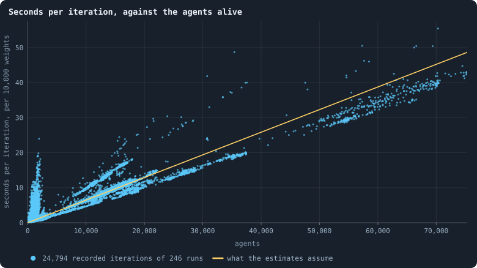

# How runs are made, recorded and costed

> [!question] Questions of this page
> - What plays a world, and what makes sure it can be played again exactly?
> - What does a run keep of the worlds it plays?
> - How long does a run take, how much memory does it need, and how much disk do its frames fill?

## In short

How every simulation of the notebook is made and kept, so that it can be made again: the lab and the engine, what a run records, and what a simulation costs.

Its sections:

- [The lab, the engine and pilots](#the-lab-the-engine-and-pilots)
- [What a run records](#what-a-run-records)
- [What a simulation costs](#what-a-simulation-costs)

## The lab, the engine and pilots

The **engine** is the program that plays a [world](the-world.md). The
**lab** carries out an experiment's plan. It has the engine play every run
the plan asks for, several at a time. And it records how each was made, so
that it can be made again exactly. An **experiment** is that plan, with a
**thesis** written down before any of its runs exist. **Pilots** are worlds
made by hand, to see quickly whether an idea is worth an experiment.

### The engine

The engine is the simulation code, `GraphOfLife.py`. Given the
[settings](settings.md) and a [seed](rules-in-detail.md#seeds-and-the-random-stream), it builds
[the starting ring](rules-in-detail.md#the-starting-ring). Then it plays
[one iteration](one-iteration.md) after another. The run writes the whole
world down after every phase ([What a run records](runs-and-records.md#what-a-run-records)).
With the same settings, seed and libraries, and one thread for the matrix
library, it plays the same world, frame for frame.

### Runs and experiments

A **run** is one world played from its [founders](rules-in-detail.md#the-starting-ring) to its
end. That is as many iterations as asked for, or until it falls to 20 agents
or fewer ([When a world ends](rules-in-detail.md#when-a-world-ends)). A run is named for what it is:
baseline, world size, what differs, seed. So `B1-5000-s001` is
[B1](b1-and-b2.md) at 5,000 tokens with seed 1. Two experiments that need
the same run share it, as Experiments 12 and 13 share theirs.

An **experiment** is a plan, a file `book/experiments/E…json`. It names a
baseline, the conditions that change it, the world's size, the seeds, how
far to run and what to keep. It also holds the **thesis**: a claim, why it
would be so, and what would confirm or refute it. The thesis is fixed before
the runs start. The page quotes it from the plan, so it cannot be reworded
once the results are in. Some plans ask for **trials** instead:
[contests](measuring-evolution.md#eras-contests-and-invasions-does-a-world-keep-getting-better) or
[invasions](measuring-evolution.md#the-invasion-test) played from worlds that
runs kept.

### The lab

The lab is `gol_lab.py`. It works out which runs a plan means, makes those
that do not exist yet, and advances them, each in a process of its own. It
can be paused and continued at any point, and it estimates a plan's time
from measured costs ([What a simulation costs](runs-and-records.md#what-a-simulation-costs)).

Every run is made and advanced by a frozen copy of the engine, a
**snapshot**. The snapshot is taken from committed code when it is first
needed. So a later change to the code cannot mix into a run that has
started. Beside its frames, each run writes two files, `meta.json` and
`provenance.json`. They hold its settings and seed, its snapshot and the
commit it came from, and the versions of Python, numpy and networkx. The lab
keeps the matrix library to one thread. It refuses to continue a run under
other library versions, or on another processor.

### An example: Experiment 1

Experiment 1 tested the lab: stopped, killed or resumed runs record the same
frames bit for bit, and one thread keeps even the last bits
([Is a run reproducible?](is-a-run-reproducible.md#the-experiment)).

### Pilot worlds

Most pages read **runs**: worlds the lab made for an experiment. There are
ten or thirty seeds of every condition, and a thesis written before the first
of them existed. Some pages, most of them about B2, read **pilots** instead. A pilot
is a world made by hand, to find out whether an idea is worth an experiment
at all. It is quick to set up, usually two seeds of each condition, and has
no thesis in advance.

A pilot shows what *can* happen, or gives a number worth testing. A
difference between pilots of two seeds each is a lead, not a finding. Pilots
of two seeds suggested that [brains](the-brain.md) that see break worlds.
Experiment 13 then ran ten seeds of each condition. Of the worlds whose
brains see and change only when copied, eight in ten died out. None of B1's
did
([Brains that see, and worlds that break](building-b2-and-the-search-for-a-healthy-rich-world.md#brains-that-see-and-worlds-that-break)).

#### What makes one

A pilot is one process running one world (`research/oee/pilots/run.py`):

    python3 run.py OUTDIR --iters 1000 --ckpt 100 --set total_tokens=10000 seed=1 ... --proto ...

`--set` takes the engine's settings by name, exactly as a run's would
([Every setting](settings.md)). `--proto` switches on mechanics that exist
only in the pilots' prototype (`research/oee/pilots/proto.py`). That is a
copy of the engine with hooks: alliances, kin pooling, memory inputs, support
stakes, other contests. Each is described at the top of that file. A rule
that proves itself there can later be written into the engine, as the rules
of B2 were.

The prototype states some of B2's rules in its own words: `mor=all` for
mutate_on_replication, `keep_frac` for keep_home, `repair` for mend_on_death,
`safe_prune` for prune_needs. The two versions differ in small details, such
as which links a crowded newborn may still make. The switch
`--proto engine=true` makes the prototype play the engine's own phases
unchanged, and only keep its books. A check, `research/oee/pilots/equiv.py`,
makes sure that such a world stays identical to the engine's, iteration for
iteration. The pilots of
[The switches the world was built with](what-the-switches-did-in-pilots.md#revolutions-handover-and-gifts-the-switches-the-world-was-built-with)
and of [Other contests](another-game.md) run this way.

#### What a pilot records

- `config.json`: every setting and prototype switch.
- `series.jsonl`: one row per iteration. It holds the agents, the
  connections, ages, the number of founder lineages and genotypes, and the
  Gini of tokens. It also counts what happened in the iteration: births,
  nodes taken, and how many by kin. And it counts deaths, how many of them
  starved and how many were cut off, and mutations.

  Every tenth row adds the network's health
  ([The health bar](measuring-health.md#the-health-bar)).
  That is the 2-core, the worst cut by one agent and by one connection, the
  best-connected agent's share, links per agent and the ball dimension.
  It also adds the sizes of groups: clones (neighbours with the same brain),
  kin (brains within four mutations), and sides where the rules have them.
- `ckpt_<iteration>.npz`: the whole world every `--ckpt` iterations, with
  every agent's founder lineage. The tournaments are played from these.

#### Tournaments between its eras

`research/oee/pilots/tourney.py` plays the cross-time tournament
([Eras, contests and invasions](measuring-evolution.md#eras-contests-and-invasions-does-a-world-keep-getting-better)) on a pilot's
checkpoints. Each contest takes one era's world, its graph and tokens, and
gives every agent a brain drawn from one era or the other. It switches
mutation off and plays `--T` iterations. The later era's score is the share
of agents carrying its brains at the end. Each pair is played in both eras'
worlds, `--reps` times each, so with the usual `--reps 2` a pair is four
contests. `research/oee/pilots/elo.py` fits one rating per era.

The brains can be dealt in three ways:

- **coins**, the default: a coin per agent, as in the lab's contests, so the
  two eras are mixed agent by agent;
- **halves** (`--layout halves`): era B gets the half of the agents nearest,
  in steps, to an agent drawn at random, and era A the rest. Each era then
  starts as one territory. This is the fairer contest for anything that
  depends on neighbours of one kind standing together. An alliance is such a
  thing, and a coin per agent cuts through it
  ([Alliances](another-game.md#alliances));
- **turf** (`--layout turf`): halves, and the era whose world the contest is
  played in keeps its own brains where they are on its half. So its clones
  still sit next to clones, and its allies next to allies. Each era plays once
  at home in this way and once away, where its brains are drawn at random. It
  is the contest for what brains are as a group
  ([Other contests](another-game.md)).

Within an era a brain keeps its genotype's number in a contest, so clones are
still clones. That matters where stakes are pooled by genotype.

#### How far to trust one

A pilot has two seeds where an experiment has ten, and it was not announced
with a thesis before it ran. So a pilot can show that something *can*
happen, or give a number worth testing. But a difference between two pilots
of two seeds each is a lead, not a finding
([How many seeds an experiment needs](statistics.md#how-many-seeds-an-experiment-needs)).
The pages built on pilots say so where it matters. Whatever they find that
the notebook relies on later is meant to be tested again as an experiment of
the lab.

Pilot worlds are kept in `GraphOfLifeRuns/.pilots`, outside the repository
like every run. The command lines that made them are in each page's recipes
and in `research/oee/pilots/LOG.md`.

### Starting an experiment

On a computer running `gol_server.py`, press ▶ on the experiment's page in
the Research Notebook tab; the lab says how long is left. In a terminal, the
same is `python3 gol_lab.py run E14`, and `python3 gol_lab.py analyse E14`
once the runs are done. The command `python3 gol_lab.py verify E14` plays a
few of the runs again, and checks them against what was recorded. And
`python3 book_figures.py` draws every figure again. It writes each, with its
caption and recipe, into the pages.

### Where it is used

Every page with a box *The runs behind this page* reads the lab's runs.

<!-- used the-lab-the-engine-and-pilots -->
- [Welcome](../README.md#graph-of-life--the-research-notebook)
- [What this notebook is about](what-this-notebook-is-about.md#how-to-read-a-page-and-how-to-make-it-again)
- [How this notebook is written](how-this-notebook-is-written.md#where-to-go-next)
- [A screen of random worlds](a-screen-of-random-worlds.md#looked-at-as-if-for-the-first-time)
- [Candidates for open-ended evolution](candidates-for-open-ended-evolution.md#what-could-be-played-next)
- [Did the brains get better? Round 3's eras against each other](round-3-eras-against-each-other.md#in-short)
- [Questioning the mechanics](questioning-the-mechanics.md#two-roads-of-inheritance)
- [Is a run reproducible?](is-a-run-reproducible.md#where-to-go-next)
- [Every setting](settings.md#where-to-go-next)
- [The rules in detail](rules-in-detail.md#what-the-same-needs)
- [B1 and B2: the two baselines](b1-and-b2.md#where-to-go-next)
- [Measuring lives: births, deaths, ages and estates](measuring-lives.md#what-each-heir-did)
- [What keeps wealth spread?](what-keeps-wealth-spread.md#the-question)
- [Physical inspiration](physical-inspiration.md#what-this-asks-of-the-notebook)
- [Is a world a space? Dimension, and what folds it](how-many-dimensions-does-a-world-have.md#every-world-at-iteration-1000)
- [How far does a difference travel?](how-far-does-a-difference-travel.md#in-short)
- [What the brains are like](what-the-brains-are-like.md#how-a-brain-is-examined)
- [How big should a brain be?](how-big-should-a-brain-be.md#every-brain-of-round-3-responds)
- [Does evolution keep going?](how-to-tell-a-world-that-keeps-evolving.md#would-we-notice-if-it-went-on)
- [Every era against three](every-era-against-three.md#how-this-was-made)
- [Can a strategy written by hand beat evolution?](strategies-written-by-hand.md#what-we-expected-of-a-crowd)
- [What a brain can compute](what-a-brain-can-compute.md#the-check)
- [Other contests: a lottery, and alliances](another-game.md#in-short)
- [Rules without numbers](rules-without-numbers.md#b3-b2-without-its-numbers)
- [Measuring health: criteria, the health bar and diversity](measuring-health.md#two-examples)
- [Every simulation: what was run, and what was measured](every-simulation.md#where-to-go-next)

> [!info]- And in the Archive (5)
> [What B1 is, and what stood in its way](what-the-baseline-world-is.md#where-the-world-stands-on-the-ladder) · [B1: brains, lineages and messages](b1-brains-lineages-and-messages.md#the-experiment) · [What the switches did in pilots (indicative)](what-the-switches-did-in-pilots.md#in-short) · [Crews, breeders and B1 raiders: Experiments 33 to 35](crews-breeders-and-b1-raiders.md#how-this-was-made) · [Cooperation, help and gliders (side study)](cooperation-help-and-gliders.md#what-was-tried-to-make-helping-pay)
<!-- /used -->

## What a run records

Everything the notebook shows is computed from two kinds of record that every
run writes into its folder, `GraphOfLifeRuns/<run>/`. A **frame** is the
whole world, written down after every phase. It holds every agent with its
tokens, genotype, parent and age, every connection, and every decision of the
phase. The **statistics file** holds a row of about ninety numbers computed
from each frame. The costly ones, which walk the whole network, are computed
only every 25 iterations. Every statistic can be computed again from the frames, so every
figure can be made again by hand.

### Frames

After every phase of every iteration, the whole world is written down as a
**frame**. Iteration *t* has two:

| frame | when | `phase` |
|---|---|---|
| 2*t* | after the reproduction phase of iteration *t* (and its cleanup) | 1 |
| 2*t* + 1 | after the game of iteration *t* (and its cleanup) | 2 |

A run of 3,000 iterations has 6,000 frames. A frame holds, for every agent
alive, in increasing order of id:

- `ids` — its id;
- `tokens` — its tokens;
- `brain_ids` and `parent_brain_ids` — its genotype and that genotype's
  parent ([Genotypes](measuring-evolution.md#genotypes-families-and-the-common-ancestor));
- `parent_ids` — the id of the agent it was born to (−1 for a founder);
- `ages` — iterations since it was born (0 in the iteration of its birth);
- `delta` — how many tokens it gained (+) or lost (−) in this phase;

For the world as a whole, a frame holds:

- `edges`: every connection, as a pair of ids;
- `nodes_before`: how many agents there were when the phase began;
- `cleanup`: how many agents the cleanup removed, and why;
- `decisions`: every decision of the phase. That is every birth, with the
  tokens given, the links and the handovers. And it is every stake in the
  game, with its targets, amounts and revolutionary parts, and who won each
  node.

Frames are read with `gol_store.read_frame(run, index)`.

A long run may keep a frame only every so often. A plan that asks for
`frames_every` *n* in its `record` keeps the two frames of every *n*-th
iteration, and the statistics file a line for each of those. What an
iteration cost is still given per iteration, over every iteration since the
last line. The families count (`cladesInWindow`) needs every iteration in
order, so such a run leaves it empty. So do the analyses that follow every
birth, which need every frame. The kept worlds (`archive_every`) are what
contests and probes read, and they are kept as always. Added on
11 November 2026, so that worlds of 20,000 iterations and more fit on the
disk.

### The statistics file

From every frame, a row of statistics is computed and appended to
`GraphOfLifeRuns/<run>/stats.jsonl`, one JSON object per line. Every row
carries `iteration` and `phase` — so "the rows with `phase` = 2" are the
world after each game — and about ninety statistics. They are the numbers
the viewer charts, and every one has a note that says how it is computed.

**On every row:**

| field | what it is | note |
|---|---|---|
| `nodes`, `edges` | agents alive, connections | |
| `nodes_before` | agents alive when the phase began | |
| `tokens` | all tokens in the world (the same on every row) | |
| `meanTokens`, `medianTokens`, `minTokens`, `maxTokens` | tokens per agent | [Tokens per agent](measuring-tokens.md#tokens-per-agent-mean-median-extremes) |
| `gini` | inequality of tokens | [Gini coefficient](measuring-tokens.md#measuring-inequality-the-gini-coefficient-the-richest-tenth-and-entropy) |
| `topDecileShare` | share of all tokens held by the richest tenth | [The richest tenth](measuring-tokens.md#the-richest-tenths-share) |
| `tokenEntropy`, `tokenEvenness`, `degreeEntropy`, `degreeEvenness` | how evenly tokens and connections are spread, in bits and as a share of the most even | [Entropy and evenness](measuring-tokens.md#entropy-and-evenness) |
| `meanDegree`, `medianDegree`, `minDegree`, `maxDegree`, `density` | connections per agent; `density` is the share of all possible pairs that are joined | [Degree](measuring-networks.md#an-agents-connections-degree-and-clustering) |
| `leaves` | agents with exactly one connection | [Core, trees and leaves](measuring-networks.md#core-trees-and-leaves) |
| `distinctBrains`, `distinctParents`, `brainDiversity` | genotypes among the living, their parent genotypes, genotypes per agent | [Brain diversity](measuring-evolution.md#brain-diversity) |
| `cladesInWindow` | families: ancestors eight iterations back | [Families](measuring-evolution.md#families) |
| `births` | children born (phase 1 rows) | [Births and deaths](measuring-lives.md#births-and-the-four-ways-to-die) |
| `starved`, `orphaned` | agents the cleanup removed for having no tokens, or for being cut off; deaths of age (B2's [`max_age`](settings.md#max_age)) are in no field, only in a frame's `cleanup.aged` | [Births and deaths](measuring-lives.md#births-and-the-four-ways-to-die) |
| `gainers`, `losers`, `maxTokenAdded`, `maxTokenLost`, `redistributed` | who gained and who lost in the phase, the extremes, and the tokens of the dead dealt out | [Gains and losses](b1-lives-and-wealth.md#gains-losses-and-the-share-out) |
| `meanInvestedShare`, `reproTokenShare`, `meanChildLinks`, `handovers` | how parents gave (phase 1) | [Reproduction statistics](measuring-lives.md#reproduction-statistics) |
| `selfAllocationShare`, `heldHomeShare` | staking on one's own node, and keeping it (phase 2) | [Staking at home](b1-the-game-and-its-flows.md#staking-at-home-and-keeping-ones-node) |
| `spreadShare`, `revoltShare`, `totalFlow`, `meanEdgeFlow`, `maxEdgeFlow`, `prunedEdges` | the stakes on neighbours, and the connections they keep alive (phase 2) | [Token flow](measuring-tokens.md#measuring-the-flow-token-flow-and-circulation) |
| `revolutions` | nodes won by a coalition (phase 2) | [Revolution](rules-in-detail.md#how-a-coalition-takes-a-node) |
| `cutRiskBefore` | the largest share of the world one cut could sever, before the cleanup (in a game's row, after its unused connections are cut) | [Cut risk](measuring-networks.md#cut-risk) |
| `gifts`, `giftTokens`, `giftShare` | gifts of tokens (phase 1): 0 in a run without gifts, `null` in the game's rows ([`allow_gifting`](settings.md#allow_gifting)) | [Reproduction statistics](measuring-lives.md#reproduction-statistics) |

**Graph statistics** cost far more to compute: they walk the whole network.
They are filled in only on the rows of every 25th iteration (0, 25, 50, …);
on other rows they are `null`:

| field | what it is | note |
|---|---|---|
| `transitivity`, `triangles` | clustering, and the number of triangles | [Clustering](measuring-networks.md#clustering) |
| `meanPathLength` | average distance between agents | [Path length](measuring-networks.md#distances-in-a-network-path-length-radius-and-diameter-the-spectral-gap) |
| `radius`, `diameter` | the smallest and largest eccentricity | [Radius and diameter](measuring-networks.md#radius-and-diameter) |
| `coreShare` | share of agents in the 2-core | [Core, trees and leaves](measuring-networks.md#core-trees-and-leaves) |
| `bridges` | connections whose removal would split the network | [Bridges](measuring-networks.md#bridges-cut-risk-loops-and-the-core-how-a-network-can-be-cut) |
| `cutRisk` | the largest share of the world one cut could sever | [Cut risk](measuring-networks.md#cut-risk) |
| `cycleRank`, `loopDensity`, `components` | independent loops, loops per connection, separate pieces | [Loops](measuring-networks.md#loops) |
| `spectralGap` | how hard the network is to cut in two; how fast a random walk forgets | [The spectral gap](measuring-networks.md#the-spectral-gap) |
| `dimension`, `ricciCurvature` | dimension and curvature from how balls grow | [Dimension and curvature](measuring-space.md#three-ways-to-measure-a-networks-dimension) |
| `boxDimension`, `boxDimensionR2` | dimension from covering the network with boxes | [Box dimension](measuring-space.md#box-dimension) |
| `lightningScore`, `cyclingShare`, `lightningLongest`, `flowImbalance`, and the `net…` versions, `netFlowShare` | tokens that go round in loops (phase 2) | [Lightning](measures-of-the-archived-studies.md#lightning-tokens-that-go-round) |
| `degreeExponent`, `tokenExponent`, `degreeGamma`, `degreeKMin`, `degreeTailShare`, `degreeGammaKS`, and their `…R2` | power-law tails of the degrees and tokens | [Fitting a power law](measures-of-the-archived-studies.md#fitting-a-power-law-properly) |
| `tokensVsDegree`, `trianglesVsDegree`, `clusteringVsDegree`, `changeVsTokens`, and their `…R2` | how one property of agents grows with another | [Scaling relations](measures-of-the-archived-studies.md#scaling-relations-between-agents-properties) |
| `assortativity` | whether hubs join hubs | [Assortativity](measures-of-the-archived-studies.md#assortativity) |

Fields beginning with `_` (`_seconds`, `_cpu`, `_peakMB`, …) are the costs of
the run, not of the world ([What a simulation costs](runs-and-records.md#what-a-simulation-costs)).

The file is read with `gol_record.read_stats(run)`. It returns the rows as a
list of dictionaries, in frame order.

### Recomputing a statistic

Every statistic is a function of one frame, and for a few of the frame
before. The function is `gol_series.frame_stats(frame, previous, heavy)`. The
families need every iteration's frame in order. So a statistic can always be
recomputed from the frames. The command `python3 -c "import gol_record;
gol_record.record_stored('<run>')"` rebuilds a run's whole statistics file.

## What a simulation costs

Every experiment of the notebook is sized by what it costs. That is the
hours a computer spends on it, the memory a run needs, and the disk its
frames take. These costs are measured, not guessed. A run's time is close to
proportional to its number of agents and the size of their brains. A B1
world of 10,000 tokens takes about a second per iteration. An experiment takes about 12 hours
of the computer, and never more than two days. A plan gives its cost in
worker-hours, the hours of one of the lab's workers. Since 11 November 2026
the lab plays on two workers at once, while a separate agent uses a core.

### Measured, not guessed

Every iteration a run records carries its own wall-clock seconds, its
processor seconds, and the most memory its process has held. The command
`python3 gol_lab.py costs` fits the numbers below to all of them. This page
is rewritten as the measurements accumulate.

### The model

The cost of a run is close to proportional to the number of agents it has,
and to the size of their brains. That is because every agent's brain looks
at every neighbour, twice per phase.

What is measured, and how each figure is estimated:

- **time**: seconds per agent per iteration, for every 10,000 weights in a
  brain;
- **agents**: agents alive per token of the supply, from iteration 100 on,
  once a world has settled;
- **disk**: bytes per agent per iteration, with every frame and its decisions
  kept;
- **memory**: the most a run holds. It is a base, plus a multiple of every
  byte of every brain, since the game copies them and a checkpoint stacks
  them. The multiple is fitted by least squares over runs of every size. Then
  the base is raised until no recorded run lies above the line, so that the
  estimate bounds a run's peak rather than averaging it. Small runs' memory
  is nearly all fixed overhead. Read off them alone, the multiple came out ten
  times too large, and a world of 100,000 tokens looked like 28 GB.

<!-- costs -->
- **Time:** 0.65 ms per agent per iteration, for every 10,000 weights in a brain.
- **Agents:** 0.14 alive per token of the world, once settled.
- **Disk:** 72 bytes per agent per iteration.
- **Memory:** 1503 MB, plus 5.3 times every byte of every brain.

Fitted to 246 recorded runs on 2026-10-14 by `python3 gol_lab.py costs`.
<!-- /costs -->
Each kind of run is fitted on its own: the same settings, apart from the size
of the world and the seed. Kinds differ in more than the size of their
brains. The baseline's brains are half as big again as the ones before it.
Yet they cost an agent hardly any more, since its agents have fewer
neighbours to look at. Until a kind has been measured, it borrows from all runs. Until
anything had been, the calibration of 2 October 2026 on the baseline stood.
It gave about 1.3 ms per agent per iteration in the lab, and 0.18 agents per
token once a world has settled. And it gave 70 bytes per agent per iteration
on disk.

**Seconds per iteration, against the agents alive.** Every dot is one
recorded iteration of one run of the lab. It shows the agents alive (x)
against the seconds the iteration took, per 10,000 weights in a brain (y). The line is
what the estimates assume. The figure is redrawn by `python3 gol_lab.py costs`.

### What the baseline set cost

Take the thirty runs of Experiment 2: 10,000 tokens and 3,000 iterations
each. They are the worlds the study of the baseline was first written from
([The life of a B1 world](b1-lives-and-wealth.md#the-life-of-a-b1-world) lists their settings). They took
26 hours of computing, done in 7.2 hours on four workers, and fill 7.8 GB. No
run needed more than 651 MB of memory.

That is the unit the experiments on the baseline are sized in: one condition
of thirty seeds at 10,000 tokens is about seven hours. The thirty worlds of
100,000 tokens, 1,500 iterations each
([Thirty worlds](b1-lives-and-wealth.md#thirty-worlds)), took 211 hours and fill
58 GB.

### The rules for sizing an experiment

- An experiment takes **about 12 hours** of the computer, and never more than
  two days. The lab estimates the time on its workers before ▶, and says how
  much is left while it runs. The estimate is what fits the plan to this.
- A run's time grows with its world. At the baseline, a world of *T* tokens
  settles at about 0.12 × *T* agents, measured on worlds of 10,000 tokens. An
  agent costs about 0.87 ms per iteration, so 10,000 tokens cost about 1.1
  seconds per iteration. If the number of agents grows in step with the
  tokens, 200,000 tokens cost about 22. And it does: agents grow as the
  tokens to the power 1.00
  ([Worlds of many sizes](b1-the-network-size-and-scaling.md#worlds-of-many-sizes)).
- Memory limits big worlds before time does. The lab starts a run only when
  its estimated peak fits next to the runs already going, in three quarters
  of the machine's memory.
- Disk is about 65 bytes per agent per iteration, with every frame kept. The
  lab will not start a run the disk cannot hold.
- The workers default to four, the machine's fast cores. More are possible
  from the Research Notebook tab; the slower cores add less than a fast one
  each.

## Where to go next

- [Is a run reproducible?](is-a-run-reproducible.md)
- [Every simulation: what was run, and what was measured](every-simulation.md)
- [B1 and B2: the two baselines](b1-and-b2.md)
- [Many worlds at once](statistics.md#many-worlds-at-once-the-median-bands-the-settled-life-and-the-spread): how the rows of thirty runs
  become one figure.
- [Every setting](settings.md): what a run was asked to play.
- [Worlds of many sizes](b1-the-network-size-and-scaling.md#worlds-of-many-sizes): how a
  world's number of agents follows its tokens.

## How our view changed

- *What a run records*:
  - **11 November 2026.** A plan may keep a frame only every `frames_every`-th
    iteration, for long worlds that would not fit on the disk otherwise.
  - **23 October 2026.** This page said that the gift fields are `null` in
    every run of the notebook, since no run had gifts. In a run without gifts
    they are 0 in every reproduction row. Gifts have been switched on since
    15 October 2026. They are on in [pilots](runs-and-records.md#pilot-worlds), in
    Experiment 24, and in half the worlds of
    [A screen of random worlds](a-screen-of-random-worlds.md). The table also
    did not say where deaths of age are counted. It does now.

<!-- turns -->
---

← [Measuring health: criteria, the health bar and diversity](measuring-health.md) · [Reference: the rules and measures in detail](../README.md#reference-the-rules-and-measures-in-detail) · [Statistics: the tools of the notebook](statistics.md) →

**Also about:** [Methods and statistics](../README.md#methods-and-statistics), [How the simulation works](../README.md#how-the-simulation-works).

> [!info]- Pages that link here (37)
> [Welcome](../README.md) · [What this notebook is about](what-this-notebook-is-about.md) · [How this notebook is written](how-this-notebook-is-written.md) · [A hundred thousand iterations](a-hundred-thousand-iterations.md) · [The world: tokens, agents and a network](the-world.md) · [One iteration, step by step](one-iteration.md) · [Is a run reproducible?](is-a-run-reproducible.md) · [Every setting](settings.md) · [Glossary](glossary.md) · [The rules in detail](rules-in-detail.md) · [B1 and B2: the two baselines](b1-and-b2.md) · [Measuring lives: births, deaths, ages and estates](measuring-lives.md) · [Measuring tokens: inequality and flow](measuring-tokens.md) · [Measuring a network: connections, hubs, distances and cuts](measuring-networks.md) · [Measuring space: dimension and the random twin](measuring-space.md) · [Do the brains matter?](do-the-brains-matter.md) · [Brains replaced by their average](brains-replaced-by-their-average.md) · [Measuring evolution: genotypes, eras and the open-ended test](measuring-evolution.md) · [Does evolution keep going?](how-to-tell-a-world-that-keeps-evolving.md) · [How fast should brains change?](how-fast-should-brains-change.md) · [A source and a sink](a-source-and-a-sink.md) · [One agent in a sea of average agents](one-agent-in-a-sea-of-average-agents.md) · [Other contests: a lottery, and alliances](another-game.md) · [Rules without numbers](rules-without-numbers.md) · [Measuring health: criteria, the health bar and diversity](measuring-health.md) · [How worlds are measured](how-worlds-are-measured.md) · [Every simulation: what was run, and what was measured](every-simulation.md) · [B1: lives and wealth](b1-lives-and-wealth.md) · [B1: the game and its flows](b1-the-game-and-its-flows.md) · [B1: the network, size and scaling](b1-the-network-size-and-scaling.md) · [B1: brains, lineages and messages](b1-brains-lineages-and-messages.md) · [Building B2, and the search for a healthy, rich world](building-b2-and-the-search-for-a-healthy-rich-world.md) · [What the switches did in pilots (indicative)](what-the-switches-did-in-pilots.md) · [Cooperation, help and gliders (side study)](cooperation-help-and-gliders.md) · [Space at scale (side study)](space-at-scale.md) · [Measures, atlases and assembly (side studies)](measures-atlases-and-assembly.md) · [Measures of the archived studies](measures-of-the-archived-studies.md)
<!-- /turns -->
