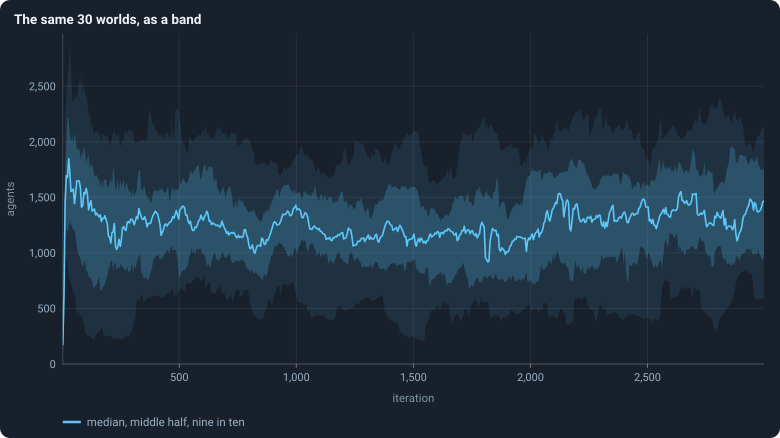

# Statistics: the tools of the notebook

> [!question] Questions of this page
> - How does the notebook sum up thirty worlds in a few numbers?
> - Do two quantities go up and down together, and how strongly?
> - If a world is crowded now, is it still crowded 100 [iterations](one-iteration.md "One step of a world's time: a phase of reproduction, then a phase of the game.") later? 500?
> - Thirty worlds give a mean. How far might another thirty give a different one?
> - [Agents](the-world.md#agents-and-tokens "One member of a world: it lives on a node of the network, holds tokens and has a brain that takes all its decisions.") decide differently. Is that because of where they are, who they are, how they answer their place, or chance?
> - A world has 1,600 genotypes. Does it have 1,600 kinds of agents?

## In short

The statistics the notebook measures with, each explained from the start:
medians and bands over many worlds, correlation and fitted lines, how to fit a
power law, how long a world remembers, how sure a number is and how many seeds
it takes, how a spread splits into parts, and how many kinds a world really
holds.

Its sections:

- [Many worlds at once: the median, bands, the settled life and the spread](#many-worlds-at-once-the-median-bands-the-settled-life-and-the-spread)
- [Two numbers together: correlation, a fitted line and logarithmic axes](#two-numbers-together-correlation-a-fitted-line-and-logarithmic-axes)
- [How long a world remembers: autocorrelation and the power spectrum](#how-long-a-world-remembers-autocorrelation-and-the-power-spectrum)
- [How sure can we be? The bootstrap, permutation tests, the Wilson interval and how many seeds](#how-sure-can-we-be-the-bootstrap-permutation-tests-the-wilson-interval-and-how-many-seeds)
- [Splitting variation: between worlds and within them](#splitting-variation-between-worlds-and-within-them)
- [Effective numbers: how many kinds](#effective-numbers-how-many-kinds)

## Many worlds at once: the median, bands, the settled life and the spread

The notebook rarely looks at one world. It runs thirty, with different
seeds, and sums them up in four steps. The **median** and other
**quantiles** describe a set of numbers without letting one extreme decide.
A **band** draws thirty worlds through time as one line and two shaded
regions. A world's **settled life**, from iteration 500 to its end (from 100
in round 3 of the screen), gives it one number per statistic. And the **spread** says how far the worlds' numbers
lie from each other, as a share of their mean.

### Median and quantiles

The notebook describes sets of numbers, such as thirty worlds' sizes or a
million lifetimes, by a few **quantiles** rather than by their mean alone.

#### The median

Sort the numbers. The **median** is the one in the middle: half of the
numbers are at or below it, and half at or above. With an even count, it is
the average of the two middle ones.

The median of 3, 9, 1, 4 and 100 is 4. The mean is 23.4, pulled up by the
single 100. That is why the notebook prefers the median for "the typical
world": one extreme world cannot move it far.

#### Quantiles

The **quantile** *Q*(*q*), for a share *q* between 0 and 1, is the value
below which a share *q* of the numbers lie. *Q*(0.5) is the median.
*Q*(0.25) and *Q*(0.75) are the **quartiles**, a quarter and three quarters
of the way up. *Q*(0.05) and *Q*(0.95) cut off the lowest and the highest
twentieth. The 25th **percentile** is the same thing as *Q*(0.25).

#### Exactly how (many worlds at once)
Sort *n* numbers from the smallest, *x*₀ ≤ *x*₁ ≤ … ≤ *x*ₙ₋₁, counting
from 0. The quantile is read at the position *h* = (*n* − 1)·*q*. Where *h*
falls between two numbers, it is read on the straight line between them:

$$
Q(q) = x_{\lfloor h \rfloor} + \bigl(h - \lfloor h \rfloor\bigr)\,\bigl(x_{\lfloor h \rfloor + 1} - x_{\lfloor h \rfloor}\bigr) .
$$

In words: start at the number just below position *h*. Then go part of the
way to the next number: as far as *h* goes past the lower position. This is the default of
numpy's `quantile`; statisticians call it "type 7". Every quantile in this
notebook is computed so. So are the six quantiles of a neighbourhood that a
[brain](the-brain.md "The neural network each agent decides with: inputs about itself and its neighbours, outputs that become its decisions.") reads ([What a brain sees](rules-in-detail.md#what-a-brain-sees)).

**Example.** Take the five numbers 1, 3, 4, 9, 100. *Q*(0.25) is at
*h* = 1, so it is 3. The median is at *h* = 2, so it is 4. *Q*(0.9) is at
*h* = 3.6, so it is 9 + 0.6·(100 − 9) = 63.6.

#### The middle half and nine in ten

Two ranges appear in almost every figure:

- **the middle half**, from *Q*(0.25) to *Q*(0.75): half of the values lie
  in it;
- **nine in ten**, from *Q*(0.05) to *Q*(0.95): 90% of the values lie in it.

With thirty worlds, nine in ten leaves out the lowest one or two and the
highest one or two.

### Bands: many worlds in one figure

Thirty worlds, each with a value at each of 3,000 iterations, drawn as thirty
lines, are a tangle nobody can read. So the notebook draws them as a
**band**: a line for the typical world, and shaded regions for how far the
others spread around it.

#### How a band is made

Take a statistic and a set of runs: say, the number of agents after every
[game](one-iteration.md#phase-2-the-game "The second phase of an iteration: every agent stakes all its tokens on its own node and its neighbours', and every node goes to someone.") in the 30 [baseline](b1-and-b2.md "The stated rules an experiment starts from: B1 or B2. Drawn worlds are stored as changes from B1, but judged against each other.") runs.

1. **Stretches.** Cut the iterations into up to 600 stretches of equal
   length. A statistic measured every iteration over 3,000 iterations gets 600
   stretches of 5 iterations (0–4, 5–9, …). A graph statistic, measured only
   every 25 iterations, gets 120 stretches of 25. A stretch is never shorter
   than the spacing of the measurements, so none is left empty.
2. **One value per world and stretch.** For each world, take the mean of the
   statistic over the iterations of the stretch at which it was measured.
3. **Across the worlds.** In each stretch, take the
   [quantiles](#quantiles) of those values over the worlds that have one. A
   world that died has none after its death.
   - The **line** is the median, *Q*(0.5).
   - The **darker band** runs from *Q*(0.25) to *Q*(0.75): the middle half of
     the worlds.
   - The **paler band** runs from *Q*(0.05) to *Q*(0.95): nine worlds in ten.
4. **Draw** the line and the bands at the middle of each stretch.

In the code, this is `bands` in `gol_analysis.py`.

#### How to read one

- The line is the **typical world**, not any single world. No world need
  follow it.
- A **narrow band** means that the worlds agree at that moment; a wide one
  that they differ.
- A band says nothing about how a single world moves through time. A world
  near the top of the band at one moment can be near the bottom later. To show
  single worlds, the notebook draws them separately, as in
  [The life of a B1 world](b1-lives-and-wealth.md#the-life-of-a-b1-world).
- After a world dies, the band is made of fewer worlds. In the baseline of
  10,000 [tokens](the-world.md#agents-and-tokens "The one thing of value in a world: every agent holds a whole number of them, and their total never changes."), four of thirty died, and its last thousand iterations are
  bands of 26. In the baseline of 100,000 tokens, none died.

### The settled life of a world

To compare worlds, such as thirty seeds or two conditions, each world has to
be summed up in one number per statistic. Where does it settle? This is the
rule the notebook uses, and why.

#### The rule

> A world's level for a statistic is its **mean over its settled life**, over
> the rows of the phase the statistic belongs to:
> - in the baselines and the experiments built on them, iterations **500 to
>   the end** of the run (2,999 for the baseline runs);
> - in round 3 of the screen and the worlds that follow it, since 24 October
>   2026, iterations **100 to the end**.
>
> Only worlds that lived to the end are measured this way; worlds that died
> are counted apart.

For the baseline runs of 10,000 tokens, that is the mean over 2,500 game
rows. For a graph statistic, measured every 25 iterations, it is the mean
over 100. The runs of 100,000 tokens end at iteration 1,499, so their settled
life is 1,000 iterations long.

#### Why from iteration 500?

A world's first few hundred iterations are unlike the rest of its life. It
starts with a boom and a crash
([The first hundred iterations](b1-lives-and-wealth.md#the-first-hundred-iterations)).
Its births, deaths and structure take hundreds of iterations to settle into
the ranges they keep
([Births, deaths and ages](b1-lives-and-wealth.md#births-deaths-and-ages)). Averaging the youth
in would mix two different things.

Round 3 of the screen starts at iteration 100 instead, by the author's
walkthrough of 24 October 2026 (`research/screen/walkthrough.md`). Every
world starts the same way, so its first hundred iterations are always left
out. But a drawn world is judged by its whole run after them, not by a
reading at one moment.

#### Why a long mean, and not the end?

A single world does not settle at one level. It **wanders**, up and down over
hundreds of iterations ([The life of a B1 world](b1-lives-and-wealth.md#the-life-of-a-b1-world)). Where it
stands at iteration 2,999, or over its last few hundred iterations, is
wherever the wander happens to have taken it. A mean over 2,500 iterations
averages much of the wander away. So it says more about the world, and less
about the moment.

[How much does the seed decide?](b1-the-network-size-and-scaling.md#how-much-does-the-seed-decide) measures
how much. Measured over their last 100 iterations, the worlds' sizes differ by
a third of the mean. Measured over their settled life, they differ by a
sixth.

#### Why not the worlds that died?

A world that dies did not end up anywhere: the last part of its life is its
dying. Its mean would mix a settled world with a collapse. So the dead are
reported beside the living, as an outcome of their own: how many died, and
when ([When a world ends](rules-in-detail.md#when-a-world-ends)).

### Spread between worlds

How different are worlds that differ only in their seed? The notebook answers
with one number per statistic: the **coefficient of variation** of the
worlds' levels, which it calls the **spread** *c*.

#### The definition of the spread

Measure each of *N* worlds by its level, *x*₁, …, *x*_N
([The settled life of a world](#the-settled-life-of-a-world)). Their mean and
their standard deviation are

$$
\bar x = \frac{1}{N}\sum_{i=1}^{N} x_i ,
\qquad
s = \sqrt{\frac{1}{N-1}\sum_{i=1}^{N} (x_i - \bar x)^2 } .
$$

In words: the mean is the average level, and the standard deviation is the
typical distance of a level from that mean. Dividing by *N* − 1 rather than
*N* makes *s*² an unbiased estimate of the variance of the population the
worlds are drawn from. The spread is

$$
c = \frac{s}{\bar x} .
$$

It has no unit. A spread of 0.17 says that the worlds typically lie about 17%
of the mean away from the mean, whatever the statistic is measured in. That
is what lets the notebook compare the spread of the number of agents with the
spread of the Gini coefficient.

#### An example of the spread

Five worlds settle at 1,000, 1,200, 1,300, 1,400 and 1,600 agents. The mean
is 1,300. The deviations are −300, −100, 0, 100 and 300, and their squares
add up to 200,000. Divided by 4, that is 50,000, so *s* = √50,000 ≈ 224. So
*c* = 224/1,300 ≈ 0.17.

#### A picture of the spread

The notebook's "dot columns" show the same thing without summing it up. Each
world is a dot at its level divided by the mean of all worlds. So 1 is the
average world, and a column's height shows the spread
([How much does the seed decide?](b1-the-network-size-and-scaling.md#how-much-does-the-seed-decide)).

#### What the spread is used for

- To say how much the seed decides
  ([How much does the seed decide?](b1-the-network-size-and-scaling.md#how-much-does-the-seed-decide)).
- To work out how many seeds an experiment needs: the number grows with *c*²
  ([How many seeds an experiment needs](statistics.md#how-many-seeds-an-experiment-needs)).

## Two numbers together: correlation, a fitted line and logarithmic axes

Much of the notebook asks how one number goes with another. The
**correlation** *r* says, from −1 to 1, how closely two quantities rise and
fall together along a straight line. The **least-squares line** is the
straight line that misses a cloud of points least. Its **R²**, the square of
*r*, is the share of their spread it accounts for. A **logarithmic axis**
gives every factor of ten the same room, so that numbers of very different
sizes fit on one chart. On two such axes a power law is a straight line,
whose slope is its exponent.

### Correlation

Do two quantities go up and down together? The **correlation coefficient**
*r* answers with a number between −1 and 1.

#### The definition of correlation

Take *n* pairs (*x*₁, *y*₁), …, (*x*ₙ, *y*ₙ), with means *x̄* and *ȳ*. The
**Pearson correlation** is

$$
r = \frac{\sum_{i} (x_i - \bar x)(y_i - \bar y)}
         {\sqrt{\sum_{i} (x_i - \bar x)^2}\ \sqrt{\sum_{i} (y_i - \bar y)^2}} .
$$

The numerator adds up, pair by pair, whether *x* and *y* are on the same side
of their means (positive) or on opposite sides (negative). The denominator
scales the sum so that *r* lies between −1 and 1.

- *r* = 1: the points lie exactly on a rising straight line.
- *r* = −1: they lie exactly on a falling straight line.
- *r* = 0: there is no straight-line relation, though there can still be a
  curved one.

*r*² is the share of the variance of *y* that a straight line in *x* accounts
for. So *r* = 0.5 means a quarter
([How much the line explains](#how-much-the-line-explains)).

**Example.** Take three worlds, (*x*, *y*) = (1, 2), (2, 2) and (3, 5). The
means are 2 and 3. The deviations are (−1, −1), (0, −1) and (1, 2), so the
products are 1, 0 and 2, with a sum of 3. The sums of squares are 2 and 6.
So *r* = 3 / (√2 · √6) = 3/√12 ≈ 0.87.

#### Is a correlation real?

With few pairs, a sizeable *r* can come about by chance. The notebook checks
this with a [permutation test](statistics.md#permutation-tests). It shuffles
the *y* values against the *x* values many times, and sees how often the
shuffled pairs give an *r* at least as large.

In [How much does the seed decide?](b1-the-network-size-and-scaling.md#how-much-does-the-seed-decide), take
26 worlds. Their numbers of agents in the first and the second half of a run
correlate at 0.12. Shuffled pairings reach that 28 times in 100: it is
nothing. For [connections](the-world.md#the-network "A link between two agents of the network: they are neighbours, and can stake on each other's nodes.") the correlation is 0.41, which shuffled pairings
reach only 2 times in 100.

#### Correlation is not cause

[How unequal is a world, and who stays rich](b1-lives-and-wealth.md#how-unequal-is-a-world-and-who-stays-rich) finds
that agents with more connections hold more tokens. The correlation between
the number of connections and the logarithm of the tokens is *r* = 0.50. That alone cannot say
which way it works. Connections may make an agent rich, riches may bring
connections, or something else may bring both.

#### Rank correlation

**Spearman's rank correlation** ρ is the ordinary correlation of two lists of
ranks. Put each list of values in order, give each value its place, with
equal values sharing the mean of their places, and correlate the places:

- ρ = 1: the two orders agree;
- ρ = 0: one order says nothing about the other;
- ρ < 0: one order turns the other round.

Ranks make ρ deaf to the sizes of the values, so a few very large ones cannot
decide it. Experiment 43 compares the order of health in round 3 with the
order in its new worlds this way. The studies of [B1](b1-and-b2.md "The first baseline: the algorithm exactly as a new run is offered it.") used it for whether the
rich stay rich ([Mobility](measures-of-the-archived-studies.md#mobility)).

### Fitting a straight line

Many figures of this notebook draw a straight line through a cloud of points.
Many statistics of the viewer are the slope of such a line. This section says
which line, and what its R² means.

#### The line that misses least

Take *n* points (*x*₁, *y*₁), …, (*x*ₙ, *y*ₙ). The **least-squares line**
*y* = *a* + *b x* is the one that makes the sum of squared vertical misses

$$
\sum_i \bigl(y_i - a - b x_i\bigr)^2
$$

as small as possible. Set the derivatives in *a* and *b* to zero. With the
means *x̄* and *ȳ*, that gives

$$
b = \frac{S_{xy}}{S_{xx}}, \qquad a = \bar y - b \bar x ,
$$

$$
S_{xx} = \sum_i (x_i - \bar x)^2, \quad
S_{yy} = \sum_i (y_i - \bar y)^2, \quad
S_{xy} = \sum_i (x_i - \bar x)(y_i - \bar y) .
$$

In words: the slope is how much *x* and *y* vary together, over how much *x*
varies alone. The line always passes through the point of means
(*x̄*, *ȳ*).

#### How much the line explains

How much better is the line than no line at all? Without a line, the best
single guess for every *y* is *ȳ*, with squared misses *S*_yy. With the line,
the squared misses shrink to *S*_yy − *S*_xy²/*S*_xx. The share removed is

$$
R^2 = \frac{S_{xy}^2}{S_{xx}\, S_{yy}} ,
$$

which is the square of the [correlation](#correlation) *r*. R² = 1 means that
every point lies on the line. R² = 0 means that the line explains nothing.

**Example.** Take the points (1, 2), (2, 3) and (3, 7). The means are 2 and
4. The deviations of *x* are −1, 0 and 1; those of *y* are −2, −1 and 3. So
*S*_xx = 2, *S*_yy = 14 and *S*_xy = 2 + 0 + 3 = 5. That gives *b* = 2.5,
*a* = 4 − 5 = −1, and R² = 25/28 ≈ 0.89.

#### Lines through logarithms

A power law *y* = *A x*^*b* becomes a straight line in the logarithms. It
reads ln *y* = ln *A* + *b* ln *x*
([Logarithmic axes and power laws](#logarithmic-axes-and-power-laws)). So the
notebook and the viewer fit power laws by least squares on (ln *x*, ln *y*).
The program (`_power_fit` in `gol_series.py`) keeps only the points with both
values positive. A zero cannot be logged, and it is a real observation, not a
small one. The program wants at least 8 points.

Two things to keep in mind:

- **R² is about scatter.** A curve that bends gently has a high R² over a
  short range; a true law with noisy points has a low one. R² says how much of
  the spread a line accounts for, not whether a law holds.
- **The line is pulled by where the points are.** Every point counts the
  same, so a crowd of points at small *x* decides the slope more than a few at
  large *x*. For distributions, this makes least squares a poor way to find an
  exponent. [Fitting a power law](measures-of-the-archived-studies.md#fitting-a-power-law-properly) says what to do instead.

### Logarithmic axes and power laws

Many quantities in Graph of Life range over several orders of magnitude. An
agent may hold 1 token or 3,000; a life may last 1 iteration or 1,500. On an
ordinary axis, everything below a few hundred is squeezed into a sliver. A
**logarithmic axis** gives every factor of ten the same room.

#### How to read a logarithmic axis

On a logarithmic axis, the distance between two values is the difference of
their logarithms. So 1 to 10, 10 to 100 and 100 to 1,000 are equally long.
And so are 1 to 2, 10 to 20 and 500 to 1,000. **Equal distances are equal
ratios.** The ticks are usually at the powers of ten.

Two things follow:

- Take a quantity that grows by the same **factor** every step, doubling
  every three iterations say. Against time, on a logarithmic value axis, it is
  a **straight line**
  ([The first hundred iterations](b1-lives-and-wealth.md#the-first-hundred-iterations)).
- Zero and negative numbers cannot be drawn: log 0 does not exist. Figures
  with logarithmic axes leave such values out, and say so.

#### Log–log plots and power laws

When **both** axes are logarithmic, a **power law**

$$
y = a\, x^{b}
$$

becomes a straight line, because taking logarithms gives

$$
\log y = \log a + b \log x :
$$

a line with the **slope** *b*. So a power law is recognised by a straight
line on log–log axes, and its exponent is read off as the slope. Examples:

- *b* = 1: *y* grows in proportion to *x*: twice the tokens, twice the
  agents. That is the question of
  [Worlds of many sizes](b1-the-network-size-and-scaling.md#worlds-of-many-sizes).
- *b* = −1: *y* halves when *x* doubles.
- A curve that **bends** downward on log–log axes is not a power law. It falls
  faster and faster, as an exponential tail does.

#### Distributions on log–log axes

To see the shape of a wide distribution, of [degrees](measuring-networks.md#degree "The number of an agent's connections: how many neighbours it has."), tokens or lifetimes, the
notebook draws its **complementary cumulative distribution**. That is the
share of values at least *x*, against *x*, with both axes logarithmic.
Suppose the share of values equal to *x* follows a power law with the
exponent −γ. Then the share at least *x* follows one with the exponent
−(γ − 1), and is a straight line. A survival curve
([Kaplan–Meier](measuring-lives.md#survival-curves-kaplanmeier)) is the same kind of picture for lifetimes.

Clauset, Shalizi and Newman (2009) give a caution, so the notebook calls
something a power law only when it holds over a wide range, and a bent
alternative fits no better. How to fit one properly, and where its tail
starts, is in
[Measures of the archived studies](measures-of-the-archived-studies.md#fitting-a-power-law-properly):
only pages of the Archive fit one.

## How long a world remembers: autocorrelation and the power spectrum

A world wanders: its size, its inequality and its births go up and down over
hundreds of iterations. The **autocorrelation** says how long it remembers
where it was: the correlation of a world with itself, some time later. In
B1 it falls from about 0.6 after 100 iterations to nothing after 300, so
levels 500 iterations apart are nearly independent. The **power spectrum**
splits the wander into rhythms and says how much of it happens at each. A
world's number of agents moves like a random walk on short scales, and is
pulled back towards its level on long ones.

### Autocorrelation

How long does a world **remember** where it was? If a world is crowded now,
is it still crowded 100 iterations later? 500? The **autocorrelation**
answers: the [correlation](statistics.md#two-numbers-together-correlation-a-fitted-line-and-logarithmic-axes) of a world with itself, some time
later.

#### How the notebook measures it

1. **Levels.** Cut each world's life, from iteration 100 on, into stretches
   of 100 iterations, and take the mean of the statistic in each. A world of
   10,000 tokens, run to iteration 2,999, gives 29 levels, *x*₁, …, *x*₂₉. A
   world of 100,000 tokens, run to 1,499, gives 14.
2. **Centre.** Subtract the world's own average of its levels from each. What
   remains is how far the world is above or below *its own* typical level.
3. **Pairs.** For a lag of ℓ stretches, collect, over all worlds, every pair
   (*x*ⱼ, *x*ⱼ₊ℓ) of centred levels ℓ stretches apart.
4. **Correlate.** The correlation of those pairs is the autocorrelation at a
   distance of 100·ℓ iterations.

The second step matters. Without it, a world that is simply bigger than the
others throughout would look like a world with a long memory.

#### How to read it

- Close to 1: a world is still where it was.
- Close to 0: where a world was says nothing about where it will be.

#### Why it dips below zero

At lags of 500 iterations and more, the measured autocorrelation is
**negative**. That is mostly not a real anti-memory, but a known bias of the
second step. Each world was measured against its own average of only *m*
levels. Its centred levels add up to zero, so a world above its own average
in some stretches must be below it in others. This pulls every measured
autocorrelation down by about

$$
\frac{S}{m}, \qquad S = 1 + 2\sum_{\ell \ge 1} \rho_\ell ,
$$

where the ρℓ are the true autocorrelations. It is a classic result (Marriott
and Pope 1954; Kendall 1954).

**In the worlds of 10,000 tokens**, with *m* = 29, take the baseline's values
for the number of agents. Then *S* ≈ 1 + 2·(0.68 + 0.34 + 0.17 + 0.04) ≈ 3.5,
so the pull is about 3.5/29 ≈ 0.12. That is about the dip seen there, −0.1
to −0.17.

**In the worlds of 100,000 tokens**, with only *m* = 14, the dip is far
deeper: about −0.5 at 700 iterations. The formula assumes that the memory
dies within a few stretches. A level that also drifts slowly over the 1,400
iterations is pushed further by the centring.
[How much does the seed decide?](b1-the-network-size-and-scaling.md#a-world-forgets)
brackets it with two made-up levels measured the same way. A random walk
falls to −0.66 at 900 iterations, and a level with no memory at all sits at
−0.08.

#### What it means for measuring

Levels 500 iterations apart are nearly independent. A mean over *k*
correlated levels is about as precise as a mean over *k*/*S* independent
ones. A world's settled life, iterations 500 to 2,999, is 25 stretches of
100. With *S* ≈ 3.5 that is worth about seven independent looks, against one
look for a single stretch at the end. That is why the notebook measures
worlds over their settled life
([The settled life of a world](statistics.md#the-settled-life-of-a-world)).

#### What a B1 world remembers

In B1's thirty worlds of 100,000 tokens, a world a hundred iterations on is
still much where it was: the autocorrelation is 0.61 for the number of agents
(0.68 at 10,000 tokens) and 0.62 for inequality. Two hundred iterations on it is 0.21 for both, and
three hundred on nothing is left. So a world forgets its level within about
three hundred iterations, far faster than a random walk would
([A world forgets](b1-the-network-size-and-scaling.md#a-world-forgets)). Two
looks at one world that far apart are close to two looks at different worlds.

### The power spectrum of a time series

A world's number of agents goes up and down. Is that a slow drift over
hundreds of iterations, or a quick jitter from one iteration to the next? The
**power spectrum** splits the motion into rhythms, and says how much of it
happens at each.

#### Waves

Take any series of *N* values *x*₀ … *x*_{N−1}. It can be written exactly as
a sum of sine waves of the frequencies *f* = *k*/*N*, for
*k* = 0, 1, …, *N*/2. The wave of frequency *k*/*N* makes *k* full cycles
over the series: it has a **period** of *N*/*k* steps. The discrete Fourier
transform

$$
X_k = \sum_{t=0}^{N-1} x_t\, e^{-2\pi i k t / N}
$$

gives each wave's size and timing, and |*X*ₖ|² is its **power**. The powers
add up, apart from a constant factor, to the series' variance. So the
spectrum says how the variance is shared among the rhythms.

#### Three preparations

1. **Remove the trend.** A slow overall rise is not a rhythm, but it would
   put much power at the lowest frequencies. So the notebook first subtracts
   the [least-squares](statistics.md#fitting-a-straight-line) straight line.
2. **Taper the ends.** The transform treats the series as if it repeated. The
   jump from its last value back to its first would spread false power over
   all frequencies, which is called **leakage**. Multiplying by a **Hann
   window**, ½(1 − cos 2π*t*/(*N*−1)), which rises from 0 to 1 and back,
   removes the jump.
3. **Normalise.** Dividing by the total power makes worlds of different sizes
   comparable before they are averaged.

#### Reading the slope

On log–log axes, many natural series give a straight line: power ∝ *f*^β.

| β | name | what it means |
|---|---|---|
| 0 | white noise | every value independent of the last; all rhythms equally strong |
| −1 | pink or 1/*f* noise | memory on every time scale at once |
| −2 | brown noise, a random walk | each value the last plus an independent step |

Picture a random walk held near a level by a restoring force: the
**Ornstein–Uhlenbeck process**. Its spectrum is

$$
S(f) \propto \frac{1}{1 + (2\pi f \tau)^2} .
$$

Here τ is the time the force needs to pull a deviation back by a factor *e*.
In words: for periods shorter than 2πτ the spectrum falls like a random
walk's (β = −2), and for longer ones it is flat. Its autocorrelation after a
time *s* is *e*^(−*s*/τ) ([Autocorrelation](#autocorrelation)).

#### The spectrum in the baseline

The number of agents of the baseline worlds of 10,000 tokens has β ≈ −2.1
for periods between 4 and 500 iterations. Its spectrum levels off for periods
of 800 iterations and more. In the worlds of 100,000 tokens, β ≈ −1.8
([Power laws, real and apparent](b1-the-network-size-and-scaling.md#power-laws-real-and-apparent-and-how-to-fit-one)). So a
world moves like a random walk on short scales, and is pulled back on long
ones. Its τ is a few hundred iterations. In the small worlds, 70% of the
variance lies at periods of 500 iterations or more, and 0.4% at periods
shorter than 10.

## How sure can we be? The bootstrap, permutation tests, the Wilson interval and how many seeds

Every number the notebook reports comes from a few dozen worlds, and another
few dozen would give a somewhat different number. Four tools say how much
that matters. The **bootstrap** redraws the worlds we have, many times, to
show how much a mean could vary. A **permutation test** shuffles which world
belongs to which condition, to show how often chance alone gives a difference
as large as the real one. The **Wilson interval** gives the range a share
probably lies in when it was counted in few worlds. And a simple formula says
how many seeds an experiment needs to find a change of a given size.

### The bootstrap

Thirty worlds give a mean. Another thirty would give a somewhat different
one. How uncertain is the mean? The **bootstrap** (Efron 1979) answers
without any formula about distributions, by re-sampling the data we have.

#### The idea of the bootstrap

The thirty values we measured are our best picture of the population they
come from. So draw new "samples of thirty" **from them**: thirty values
picked at random **with replacement**. The same world may be picked twice,
and another not at all. Compute the mean of each such sample. The spread of
those means shows how much the mean would vary from one set of thirty worlds
to another.

#### Exactly how (how sure can we be)
Take the values *x*₁, …, *x*ₙ.

1. Repeat *B* = 10,000 times: draw *n* indices uniformly at random from
   1, …, *n*, with replacement. Compute the mean of the values at them.
2. The **95% interval** for the mean runs from the 2.5th to the 97.5th
   percentile of the 10,000 means
   ([Median and quantiles](statistics.md#quantiles)).

The random draws are seeded, so the interval comes out the same every time.

**Example.** Take the values 2, 4 and 9. One resample might be (4, 4, 9),
with mean 5.67; another (2, 9, 2), with mean 4.33. Over 10,000 resamples, the
means range from 2 (all three picks are the 2) to 9. The middle 95% of them
form the interval.

#### For a difference

To compare two conditions, the notebook bootstraps the **difference** of
their means. If the runs are paired by seed, it resamples the paired
differences *dᵢ* = *yᵢ* − *xᵢ*. Otherwise it resamples each condition
separately and subtracts. An interval that does not contain 0 means that the
data are hard to reconcile with "no difference". That is then tested directly
with a [permutation test](#permutation-tests).

In the code, this is `bootstrap` and `compare_conditions` in
`gol_analysis.py`.

### Permutation tests

A difference between two conditions, or a correlation between two
measurements, could be real, or it could be chance. A **permutation test**
asks: if there were no real difference, how often would chance alone produce
one at least this large? It answers by **shuffling**, with no assumption
about distributions.

#### The logic

Suppose a [setting](settings.md "One number or switch of a run's rules, fixed before it starts.") changes nothing. Then the label "condition A" or
"condition B" on each world is arbitrary. Any relabelling of the worlds is as
likely as the one we have. So relabel at random many times, and recompute
the difference each time. Then see where the real difference falls among the
shuffled ones. If it is larger than almost all of them, "no difference" is
hard to believe.

The share of shuffles that give a difference at least as large (in size) as
the real one is the **p-value**. The notebook computes it as

$$
p = \frac{1 + \#\{\text{shuffles at least as extreme}\}}{1 + \text{number of shuffles}} ,
$$

with 10,000 shuffles. In words: count the shuffles at least as extreme as the
real labelling, and the real labelling itself, and divide by all labellings
tried. The 1s count the real labelling as one of the possibilities, so *p* is
never exactly 0.

#### Three versions in this notebook

- **Two independent groups.** Pool the values of both conditions. Deal them
  at random into two groups of the original sizes, and take the difference of
  the means.
- **Pairs.** Each world of condition B may have a partner in A with the same
  seed. Then take the differences *dᵢ* of the pairs. Under "no difference",
  each *dᵢ* is as likely to be +*dᵢ* as −*dᵢ*. So flip the sign of each at
  random, and take the mean.
- **A correlation.** Does a world's first half predict its second? Keep the
  first-half values in place, and shuffle the second-half values among the
  worlds; then recompute the [correlation](statistics.md#two-numbers-together-correlation-a-fitted-line-and-logarithmic-axes). Here the test is
  one-sided: how often is the shuffled *r* at least as large as the real one?

#### Testing many settings at once

The screen of random worlds tests every setting on every outcome of its worlds
([How the drawn settings shape a world](how-the-drawn-settings-shape-a-world.md)):
- for **whether a world died**, it counts the deaths under each value of the
  setting;
- for **a number**, it takes the median under each value.

Then the outcome is shuffled among the worlds, 20,000 times, keeping how many
worlds had each value. The chance is the share of shuffles in which the values
differ at least as much as in the real worlds. The difference is measured by
the **chi-square** statistic for deaths, and by the **Kruskal–Wallis**
statistic of the ranks for numbers.

Many settings are tested on many outcomes, so a few small chances turn up by
luck. So every test also has a **false discovery rate**: among all the
settings tested on that outcome, how often a result this strong would be a
false alarm (Benjamini and Hochberg 1995). A result is a **finding** only when
that rate is below 0.1. Every test also gives its **size**: the share of the
outcome's spread that the setting's values account for, from 0 (none) to 1
(all of it).

**An example.** Of the 41 worlds of round 3 drawn with gifts, 2 died; of the 43
drawn without, 12. Shuffled at random among the 84 worlds, keeping the two
groups' sizes, the 14 deaths end up at least this far apart about 140 times in
20,000: a chance of 0.007. But 25 settings were tested on deaths, so a chance
that small could turn up by luck in one of them. The false discovery rate is
0.09, below 0.1, so it counts as a finding. Gifts or none account for a tenth
of the spread of deaths across the worlds (a size of 0.10).

#### Reading a p-value

A *p*-value is not the probability that the difference is real. It is how
surprising the data would be if it were not. The notebook reports it together
with the size of the difference and its [bootstrap](#the-bootstrap) interval.
And it calls a difference **indicative**, rather than an effect, when fewer
than thirty seeds per condition went into it.

In the code, this is `compare_conditions` and `wandering` in
`gol_analysis.py`.

### The Wilson interval

Four of the thirty baseline worlds of 10,000 tokens died out: 13%. With only
thirty worlds, the true rate could easily be lower or higher. The **Wilson
interval** (Wilson 1927) gives a range for a share estimated from a count.

#### The formula of the Wilson interval

Suppose *k* of *n* trials are "successes". The observed share is
*p̂* = *k*/*n*. With *z* = 1.960 for 95%, the Wilson interval is

$$
\frac{\hat p + \dfrac{z^2}{2n} \;\pm\; z \sqrt{\dfrac{\hat p(1-\hat p)}{n} + \dfrac{z^2}{4n^2}}}{1 + \dfrac{z^2}{n}} .
$$

In words: the interval is centred a little nearer to one half than the
observed share. And its width allows for how few trials there were.

**Example.** Take *k* = 4 and *n* = 30. Then *p̂* = 0.1333, and
*z*²/*n* = 0.1280.

- The centre is (0.1333 + 0.0640) / 1.1280 = 0.1749.
- The half-width is 1.960 · √(0.1333 · 0.8667/30 + 3.8415/3,600) / 1.1280
  = 1.960 · √(0.003852 + 0.001067) / 1.1280 = 1.960 · 0.07013 / 1.1280
  = 0.1219.

The interval is **5.3% to 29.7%**. Thirty worlds say only that between about
one world in twenty and one in three dies.

#### Why not the simple ± formula?

The textbook interval *p̂* ± *z*√(*p̂*(1 − *p̂*)/*n*) gives 1.2% to 25.5%
here. For small counts it is badly wrong: with *k* = 0 it gives the
"interval" 0 to 0. The Wilson interval stays inside 0 to 1 and is never
empty. And it covers the true share about as often as it promises.

### How many seeds an experiment needs

An experiment changes one setting and asks whether the worlds change. Worlds
differ by chance anyway, so a small change can hide in the noise. How many
worlds, that is seeds, does each condition need for a change of a given size
to be **found**, most of the time?

The rule of the notebook: a difference seen in fewer than thirty seeds per
condition is called *indicative*, not an effect. The rule is for plans that ask
whether a change moves worlds on average. Three kinds of plan ask something
else, and use fewer seeds:
- a **screen** plays each drawn world once, with a seed of its own: what a
  setting does is read across the many worlds that drew it;
- a **replay** of chosen worlds, such as Experiment 43, plays each with two
  new seeds, to see whether its health belongs to its settings;
- the **open-ended test** asks what a configuration can do, not what it
  usually does, so two worlds of three are enough (the author, 19 October
  2026: a configuration that shows open-ended evolution in a few seeds is
  enough; [The test](measuring-evolution.md#the-test)).

#### The formula for the seeds

Suppose each condition runs *n* worlds. The worlds of a condition vary with a
[spread](statistics.md#spread-between-worlds) *c*: their standard
deviation divided by their mean. And the setting changes the mean by a share
Δ (Δ = 0.1 for a change of 10%). To find such a change with a two-sided test
at the 5% level, four times in five, each condition needs about

$$
n = \frac{2\,(z_{1} + z_{2})^2\, c^2}{\Delta^2}
$$

worlds, rounded up. Here *z*₁ = 1.960 and *z*₂ = 0.842 are the points of the
standard normal distribution beyond which lie 2.5% and 20% of it.

#### Where it comes from

Take the difference of two means of *n* worlds each, with standard deviation
*s* in both. Its standard error is *s*√(2/*n*). A two-sided test at the 5%
level calls a difference real when it exceeds *z*₁ standard errors. For a
true difference *D* to exceed that four times in five, *D* must lie *z*₂
standard errors further out:

$$
D = (z_1 + z_2)\, s \sqrt{2/n}
\quad\Longleftrightarrow\quad
n = \frac{2\,(z_1 + z_2)^2\, s^2}{D^2} .
$$

With *s* = *c* · mean and *D* = Δ · mean, the means cancel, and the formula
above follows. It assumes that the means are roughly normal, which with tens
of worlds they are.

#### An example of the seeds needed

Take the number of agents in a settled baseline world of 10,000 tokens,
measured over the last fifth of its run. It has *c* = 0.17. To see a change
of 10%:

$$
n = \frac{2 \times (1.960 + 0.842)^2 \times 0.17^2}{0.1^2}
  = \frac{2 \times 7.851 \times 0.0289}{0.01} \approx 45.4 ,
$$

so 46 seeds per condition. Turned around: with 30 seeds, the smallest change
found four times in five is Δ = (*z*₁ + *z*₂)·*c*·√(2/30) ≈ 0.12, that is
12%. In the worlds of 100,000 tokens, measured over their settled life, *c*
is 0.11, and 19 seeds are enough
([How much does the seed decide?](b1-the-network-size-and-scaling.md#how-much-does-the-seed-decide)).

#### Two lessons

- *n* grows with the **square** of the spread. Halving *c*, by measuring
  worlds over a longer stretch
  ([The settled life of a world](statistics.md#the-settled-life-of-a-world)),
  quarters the seeds needed.
- *n* grows with one over the **square** of the change. A change half as big
  needs four times the seeds.

In the code, this is `seeds_needed` in `gol_analysis.py`.
[How much does the seed decide?](b1-the-network-size-and-scaling.md#how-much-does-the-seed-decide) draws *n*
against Δ.

#### What thirty seeds can see

In B1's worlds of 100,000 tokens, measured over their settled life, thirty
seeds per condition see a change of about 8% in the number of agents four
times in five, 9% in connections and 5% in inequality. Measured over the last
fifth of each run instead, a change of 10% in the number of agents takes 48
seeds, not 19. Two more lessons came from the same worlds
([How many seeds an experiment needs](b1-the-network-size-and-scaling.md#how-many-seeds-an-experiment-needs)):

- **Pairing by seed helps little.** Two conditions run with the same seed
  share their starting ring and founders, and little else. A comparison seed
  by seed is about as noisy as one between unrelated worlds.
- **Shape needs more seeds than size.** Only a few worlds in thirty grow a
  giant [hub](measuring-networks.md#stars-and-hubs "An agent joined to far more agents than most; a star is a world held together by a single hub."). A setting that made giant hubs twice as common would need far
  more than thirty seeds to see.

## Splitting variation: between worlds and within them

A spread of numbers can often be split exactly into parts with different
causes. For a statistic of many worlds, cut each world's life into stretches.
The variance then splits into what lies **between** the worlds, fixed by the
seed, and what lies **within** each: its wander over time. In B1 most of the
variation of a world is time, not seed. A decision's variance splits too,
into **where** an agent is, **who** it is, **who it is, there**, and
**chance**; only pages of the Archive use that split
([Where, who and chance](measures-of-the-archived-studies.md#where-who-and-chance-splitting-a-decisions-variance)).

### Between worlds and within them

The worlds of thirty seeds differ, and each world also changes over time.
How much of all the variation lies **between** the worlds, something each
seed fixes? And how much lies **within** each world, its wander over time?
This section splits it.

#### The split

As for the [autocorrelation](statistics.md#how-long-a-world-remembers-autocorrelation-and-the-power-spectrum), cut each of *N* worlds'
lives, from iteration 100 on, into stretches of 100 iterations. Take the mean
of the statistic in each. A world of 10,000 tokens, run to iteration
2,999, gives *m* = 29 levels; a world of 100,000 tokens, run to 1,499, gives
14. Write *x*ᵢⱼ for the level of world *i* in stretch *j*, and *x̄*ᵢ for
world *i*'s own average of its levels.

- **Between:** how much the worlds' own averages differ. It is the variance
  of *x̄*₁, …, *x̄*_N, with *N* − 1 in the denominator:

  $$
  B = \frac{1}{N-1}\sum_{i=1}^{N} \bigl(\bar x_i - \bar{\bar x}\bigr)^2 .
  $$

- **Within:** how much a world moves around its own average. It is the
  variance of each world's *m* levels, with *m* − 1 in the denominator,
  averaged over the worlds:

  $$
  W = \frac{1}{N}\sum_{i=1}^{N} \frac{1}{m-1}\sum_{j=1}^{m} \bigl(x_{ij} - \bar x_i\bigr)^2 .
  $$

The **share between** is *B* / (*B* + *W*).

#### How to read the share between

- Close to 1: the worlds differ, but each stays where it is. Knowing the seed
  tells you the level.
- Close to 0: every world covers much the same range over time. The seed
  tells you little.

In the baseline worlds of 100,000 tokens the share between is a fifth to a
quarter for most statistics: 21% for the number of agents. It is half for the
share of agents in the core. At 10,000 tokens it is a tenth to a quarter, and
17% for the number of agents
([How much does the seed decide?](b1-the-network-size-and-scaling.md#how-much-does-the-seed-decide)). So most
of the variation is time, not seed.

#### A caution

Even *B* is partly wander. The average of levels that are correlated over
several stretches still carries some of the noise of the wander. So a share
between of 17% is an upper bound on what the seed itself decides. The sharper
test asks whether a world's first half predicts its second half, across
worlds ([Is a correlation real?](statistics.md#is-a-correlation-real)).

## Effective numbers: how many kinds

Counting kinds can mislead: one kind may hold half the agents and the rest
one agent each. An **effective number** counts kinds by how much of the
population they hold. It is the number of equally common kinds that would be
as diverse. It runs from 1, when one kind holds everything, to the full count,
when all are equal. The same idea counts the directions a cloud of points
spreads over, such as a world's messages: the **participation ratio**, which
only pages of the Archive use
([How many directions a cloud of points uses](measures-of-the-archived-studies.md#how-many-directions-a-cloud-of-points-uses)).

### Effective numbers: how many kinds there really are

#### The count

Let *p*ᵢ be the share of agents of kind *i*: a genotype, a kind of behaviour,
a family. The effective number is

$$
D = \frac{1}{\sum_i p_i^2} .
$$

In words: *D* is one over the chance that two agents drawn at random are of
the same kind. That chance is the **Simpson index** (Simpson 1949). Two
properties make *D* the right count:

- if there are *n* kinds, equally common, then *D* = *n*;
- if one kind holds nearly everyone, then *D* is close to 1, however many rare
  kinds there are.

**Example.** Ten agents fall into two kinds of five: *D* = 1/(0.5² + 0.5²) =
2. Now let eight be of one kind, and one each of two others:
*D* = 1/(0.8² + 0.1² + 0.1²) = 1/0.66 ≈ 1.5. Three kinds, but worth only one
and a half.

*D* is one of the **Hill numbers**, the family of diversity counts ecologists
use (Hill 1973). This one, of order 2, weighs the common kinds most.

#### Kinds that are similar

Two genotypes one mutation apart may act exactly alike. Counting them as two
kinds overstates diversity. That is why the
[effective kinds of staking](measuring-health.md#decisions-the-effective-kinds-of-staking) group
brains into kinds **by what they do**, not by their weights. Brains whose
decisions in the same situations differ no more than a brain differs from
itself, between two sets of random inputs, are one kind.

The effective number of kinds of behaviour is then set beside the effective
number of genotypes. The first can be far smaller, if most genetic
differences change nothing an agent does.

#### Two effective numbers

[Brain diversity](measuring-evolution.md#brain-diversity) uses a sibling of this count:
2^*H*, with *H* the entropy of the shares
([The effective number](measuring-tokens.md#the-effective-number)). It is the
Hill number of order 1, which weighs rare kinds a little more than *D*, of
order 2, does. Both are 1 for a single kind and *n* for *n* equally common
ones. On a population with many rare kinds, 2^*H* is the larger. Where the
notebook gives an effective number, it says which.

## Where to go next

- [How much does the seed decide?](b1-the-network-size-and-scaling.md#how-much-does-the-seed-decide): the
  spread of thirty worlds, statistic by statistic.
- [The life of a B1 world](b1-lives-and-wealth.md#the-life-of-a-b1-world): bands at work, and single
  worlds drawn one by one.
- [Power laws, real and apparent](b1-the-network-size-and-scaling.md#power-laws-real-and-apparent-and-how-to-fit-one):
  the fit applied to the tokens, connections and cuts of B1's worlds.
- [How properties scale together](b1-the-network-size-and-scaling.md#how-properties-scale-together): four
  power laws fitted to every agent of a world.
- [When a world ends](rules-in-detail.md#when-a-world-ends): the deaths of whole worlds, counted in
  shares like the one above.
- [How different are the agents?](b1-brains-lineages-and-messages.md#how-different-are-the-agents): the split
  of where, who and chance, measured in B1 and [B2](b1-and-b2.md "The second baseline: B1 with the rules that keep its network from breaking and its agents from staking or breeding themselves to death.").
- [Measuring inequality](measuring-tokens.md#entropy-and-evenness): entropy,
  evenness and 2^*H*, the effective number of order 1.
- [What agents say to each other](b1-brains-lineages-and-messages.md#what-agents-say-to-each-other): how many
  directions a world's messages use.
- [The diversity score](measuring-health.md#the-diversity-score): four spreads of a world in one
  number.

## How our view changed

- *How long a world remembers: autocorrelation and the power spectrum*:
  - **24 October 2026.** The worlds of 100,000 tokens were added to this page
    on 11 October. Since then it said that the measured autocorrelation dips
    *slightly* below zero, by about *S*/*m* ≈ 0.12. That holds for the worlds of
    10,000 tokens, with 29 stretches each. In the worlds of 100,000 tokens, with
    14, the dip reaches about −0.5 at 700 iterations
    ([How much does the seed decide?](b1-the-network-size-and-scaling.md#a-world-forgets)).
- *How sure can we be? The bootstrap, permutation tests, the Wilson interval and how many seeds*:
  - **24 October 2026.** The four notes became one page. The note on how many
    seeds an experiment needs had said that *c* is about 0.10 in the worlds of
    100,000 tokens. It also said that 19 seeds are enough. A spread of 0.10 would give
    16 seeds. The spread
    [How much does the seed decide?](b1-the-network-size-and-scaling.md#how-much-does-the-seed-decide) measures
    is 0.11, and that gives 19.
- **11 November 2026.** The pages on B1 moved to the Archive, and three methods
  they explained, which the notebook still uses, moved here. [Fitting a power
  law properly](measures-of-the-archived-studies.md#fitting-a-power-law-properly) came whole from Power laws, real
  and apparent. [What a B1 world remembers](#what-a-b1-world-remembers) and
  [What thirty seeds can see](#what-thirty-seeds-can-see) say in short what How
  much does the seed decide? found.
- **12 November 2026.** Moved to [Measures of the archived
  studies](measures-of-the-archived-studies.md): three sections that only pages
  of the Archive use: fitting a power law properly; where, who and chance; and
  how many directions a cloud of points uses.
- **12 November 2026.** The rule of the settled life said that pages written
  before it, the first analyses of Experiments 2 to 6, used the last fifth of
  a run: iterations 2,400 to 2,999. Where the notebook checks a thesis written
  with the last fifth in mind, it says so. That note now stands here, and the
  rule names the window round 3 uses, from iteration 100.

## References

- Clauset, A., Shalizi, C. R. and Newman, M. E. J. (2009). Power-law
  distributions in empirical data. *SIAM Review* 51, 661–703.

- Kendall, M. G. (1954). Note on bias in the estimation of autocorrelation.
  *Biometrika* 41, 403–404.
- Marriott, F. H. C. and Pope, J. A. (1954). Bias in the estimation of
  autocorrelations. *Biometrika* 41, 390–402.

- Benjamini, Y. and Hochberg, Y. (1995). Controlling the false discovery rate:
  a practical and powerful approach to multiple testing. *Journal of the Royal
  Statistical Society B* 57, 289–300.
- Efron, B. (1979). Bootstrap methods: another look at the jackknife.
  *The Annals of Statistics* 7, 1–26.
- Wilson, E. B. (1927). Probable inference, the law of succession, and
  statistical inference. *Journal of the American Statistical Association*
  22, 209–212.

- Hill, M. O. (1973). Diversity and evenness: a unifying notation and its
  consequences. *Ecology* 54, 427–432.
- Simpson, E. H. (1949). Measurement of diversity. *Nature* 163, 688.

<!-- turns -->
---

← [How runs are made, recorded and costed](runs-and-records.md) · [Reference: the rules and measures in detail](../README.md#reference-the-rules-and-measures-in-detail)

**Also about:** [Methods and statistics](../README.md#methods-and-statistics), [Brains: what they are, and whether they matter](../README.md#brains-what-they-are-and-whether-they-matter).

> [!info]- Pages that link here (30)
> [How this notebook is written](how-this-notebook-is-written.md) · [The ideas this builds on](the-ideas-this-builds-on.md) · [How the drawn settings shape a world](how-the-drawn-settings-shape-a-world.md) · [Glossary](glossary.md) · [The rules in detail](rules-in-detail.md) · [B1 and B2: the two baselines](b1-and-b2.md) · [Measuring lives: births, deaths, ages and estates](measuring-lives.md) · [What keeps wealth spread?](what-keeps-wealth-spread.md) · [Measuring tokens: inequality and flow](measuring-tokens.md) · [Measuring a network: connections, hubs, distances and cuts](measuring-networks.md) · [Physical inspiration](physical-inspiration.md) · [Measuring space: dimension and the random twin](measuring-space.md) · [Particles: patterns that outlast what carries them](particles.md) · [Do the brains matter?](do-the-brains-matter.md) · [How big should a brain be?](how-big-should-a-brain-be.md) · [Measuring evolution: genotypes, eras and the open-ended test](measuring-evolution.md) · [A source and a sink](a-source-and-a-sink.md) · [Measuring health: criteria, the health bar and diversity](measuring-health.md) · [How runs are made, recorded and costed](runs-and-records.md) · [How worlds are measured](how-worlds-are-measured.md) · [What B1 is, and what stood in its way](what-the-baseline-world-is.md) · [B1: lives and wealth](b1-lives-and-wealth.md) · [B1: the game and its flows](b1-the-game-and-its-flows.md) · [B1: the network, size and scaling](b1-the-network-size-and-scaling.md) · [B1: brains, lineages and messages](b1-brains-lineages-and-messages.md) · [Building B2, and the search for a healthy, rich world](building-b2-and-the-search-for-a-healthy-rich-world.md) · [What the switches did in pilots (indicative)](what-the-switches-did-in-pilots.md) · [Space at scale (side study)](space-at-scale.md) · [Measures, atlases and assembly (side studies)](measures-atlases-and-assembly.md) · [Measures of the archived studies](measures-of-the-archived-studies.md)
<!-- /turns -->
