# Can a strategy written by hand beat evolution?

> [!question] Questions of this page
> - Is the play evolution found in [B2](b1-and-b2.md "The second baseline: B1 with the rules that keep its network from breaking and its agents from staking or breeding themselves to death.")'s worlds the best there is, or
>   only the best it could reach?
> - Can a strategy written by hand, for one
>   [agent](the-world.md#agents-and-tokens "One member of a world: it lives on a node of the network, holds tokens and has a brain that takes all its decisions.") or for a team, beat evolved [brains](the-brain.md "The neural network each agent decides with: inputs about itself and its neighbours, outputs that become its decisions.") in their own world?
> - What would a team need in order to grow, and which of its parts wins?
> - How many raiders must start together for a raid to take hold?
> - Is it the world, or the place in it, that decides?
> - A raider written by hand took hold in young B2 worlds. Why did it stop
>   winning as the worlds grew older: did they learn to defend themselves?
> - Can anything written by hand win in a late world?

## In short

Evolution in B2's worlds slows down as they age: is the play it has found the
best there is? To find out, we planted rules written by hand as a patch in
evolved B2 worlds. From 5% of a world, a plain raider or a team with a
pipeline took 40 to 62% of three worlds in ten. The residents' own brains,
planted the same way, never ended with more than 8%. The better play pays
only with three things at once: the raid, a password that tells teammates
from strangers, and a crowd. Experiment 29 measured the crowd: about a
hundred raiders must start together, and the world they start in decides as
much as the crowd.

Then the raiders stopped winning ([Why the raiders stopped
winning](#why-the-raiders-stopped-winning)). A raider that took hold in young
B2 worlds failed in the same worlds grown older (Experiment 30). Their patches
had grown too poor to raid; they had not learned to defend themselves. Crews of
raiders and raiders that breed failed there too (Experiments 33 and 34). In [B1](b1-and-b2.md "The first baseline: the algorithm exactly as a new run is offered it.")
every strategy failed faster (Experiment 35).

## Strategies written by hand

### Is evolution's play the best there is?

Evolution in B2 slows down as a world ages. In contests a [lifetime](measuring-lives.md#age-lifetime-and-survival-curves "How many iterations an agent lives, from its birth to its death.") long,
later brains beat earlier ones by less and less
([Would we notice if it went on?](how-to-tell-a-world-that-keeps-evolving.md#would-we-notice-if-it-went-on)).
Why does it slow? One early answer was that the [game](one-iteration.md#phase-2-the-game "The second phase of an iteration: every agent stakes all its tokens on its own node and its neighbours', and every node goes to someone.") has a best way to play,
and that evolution finds it
([Does the game have an answer?](how-to-tell-a-world-that-keeps-evolving.md#does-the-game-have-an-answer)).
The agents' game is close to a Colonel Blotto contest, whose best play is to
be unpredictable. Once a population plays that way, nothing better is left to
find.

That answer makes a prediction we can test without waiting for evolution at
all. If the evolved play is the best there is, no strategy anyone could write
should beat it by much. If one does, evolution is not near the top: the game
has more to give than evolution has taken.

There is a second reason to write strategies by hand. Evolution finds what is
one small step from what it has. A strategy that needs many agents to act
together may be far better and still never be found, because no single
mutation makes it. Some agents would hold a frontier, others would feed it,
and all would know which is which. The author of the simulation suggested
exactly such a strategy, a *factory*. In this structured group, every agent
has its job in the pipeline of [token flow](measuring-tokens.md#measuring-the-flow-token-flow-lightning-and-circulation "The tokens a game moves along each connection, from the agent who stakes to the node staked on."). It extracts [tokens](the-world.md#agents-and-tokens "The one thing of value in a world: every agent holds a whole number of them, and their total never changes.") from its
surroundings like a colony of parasites. If a factory written by hand can
grow in an evolved world, the game rewards organisation. The question then
becomes how evolution could get there.

### The invasion test

The method has a page of its own ([The invasion test](measuring-evolution.md#the-invasion-test)).
Take an evolved world: one of the ten B2 worlds of
[Experiment 16](how-to-tell-a-world-that-keeps-evolving.md#the-runs-of-experiment-16),
each of 10,000 tokens, as it stood at [iteration](one-iteration.md "One step of a world's time: a phase of reproduction, then a phase of the game.") 2,000. This page calls each
world by its seed there: world 2 is the world of seed 2. Then:

- **The patch.** Draw an agent at random, then take the agents nearest to
  it, step by step, until the patch holds 5% of the world.
- **The planting.** Give every agent of the patch a strategy instead of its
  brain, and play on under the world's own rules. A strategy spreads as a
  brain does: into a child, and into a node its owner takes. It never
  mutates.
- **The count.** Follow the share of the world's agents that carry the
  strategy.

Each planting has a seed of its own. It picks where the patch lies, and how
every chance falls after that.

A strategy's share means nothing on its own. A patch might grow or shrink
whatever it does, because of where it was placed. So every patch is also
played as a **control**. The same agents are given a copy of one resident's
brain, the brain of an agent of the patch drawn at random. The copy is marked
so it can be counted, and it never mutates. A strategy beats the residents if
it holds more of the world than the resident patch played from the same place
on the same seed.

A strategy reads exactly what a brain reads, and writes exactly what a brain
writes (`research/oee/pilots/manual.py`; the rules now live in the [engine](runs-and-records.md#the-lab-the-engine-and-pilots "The program that runs an experiment's plan as runs, each on a frozen copy of the engine, the code that plays a world.")'s
`gol_strategies.py`). It sees each [candidate](one-iteration.md#phase-1-reproduction "An agent itself and each of its neighbours, the ones its brain looks at when it decides.")'s tokens, its [connections](the-world.md#the-network "A link between two agents of the network: they are neighbours, and can stake on each other's nodes.") and
its messages. Its decisions go through the same output rows that the engine
turns into a child, its links, the stakes and the messages. So it reads and
writes nothing an evolved brain could not.

What it makes of what it reads is another matter. A rule written in Python
can combine its inputs in ways a B2 brain cannot. The raider below is within a B2
brain's reach: 12 of the brain's 16 hidden units, with weights set by hand,
play it. The factory's message is not: no B2 brain of any size can compute
it ([What a brain can compute](what-a-brain-can-compute.md)).

### Three strategies

- **The turtle** keeps everything at home. When it has 30 tokens or more it
  has a child with a third of them.
- **The raider** looks for the poorest [neighbour](the-world.md#the-network "An agent joined to another by a connection.") that is not a teammate: a
  *stranger*. Under B2 it can stake at most 70% of its tokens, since 30% stay
  home. And a holder's own stake on its node counts one and a half times. If
  70% of the raider's tokens are more than one and a half times the
  stranger's, they are sure to take its node. That holds even if the
  stranger keeps everything at home. Then the raider stakes them all there;
  otherwise it keeps everything at home. When it has 30 tokens or more it
  has a child with a third of them, joined to every teammate next door.
- **The factory** is a team with a pipeline. Every member works out how far
  it is from the team's **frontier**. Its distance is 0 if a stranger is
  next door. Otherwise it is one more than the smallest distance a teammate
  reported. It writes the distance into its messages. Members on the
  frontier attack as the raider does. Everything they can stake goes on the
  poorest stranger next door if that takes it; otherwise they hold. Members
  inside stake everything they can on the teammate nearest the frontier.
  That pumps their tokens downhill, towards where the team meets the rest of
  the world. Inside members breed when rich, at 30 tokens or more, and join
  their children to their teammates.

Teammates know each other by what they write. The first four numbers of
every message a strategy sends are fixed, 0.9, −0.9, 0.9 and −0.9: its
**password**. The fifth carries its distance. The password is not a
privilege: an evolved brain could write the same numbers.

### What the strategies did

The first test planted every strategy, and the control, in worlds 1 and 2,
on two seeds each, for 300 iterations.

<!-- figure handmade/shares -->
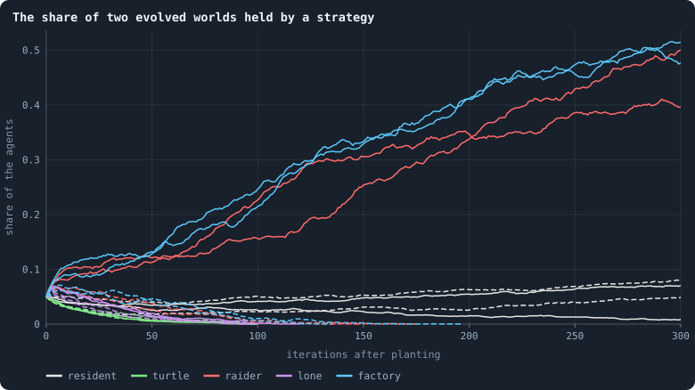

**The share of two evolved worlds held by a strategy.** One line per planting: two seeds in each of two worlds, the world of seed 1 dashed, of seed 2 solid. Grey is the control, a patch of the residents' own brains planted in the same place.

> [!example]- How to make this figure
> **Runs.** The B2 worlds of Experiment 16, `B2-10000-s001` … `-s010`, as their archives keep them at iteration 2,000 (`GraphOfLifeRuns/<run>/archive/`). Strategies planted with `python3 research/oee/pilots/manual.py`: in `-s001` and `-s002` every strategy and the control on seeds 1 and 2 (`--strategies factory,turtle,raider,resident --seeds 1,2 --T 300 --patch 0.05`); in all ten worlds the raider, the factory and the control on seed 1; in `-s001` and `-s002` the lone raider on seeds 1 and 2; in `-s002` a single raider, and a single resident, on seeds 1 to 20 (`--patch 0.0002 --T 200`).
>
> **Data.** From the worlds the archives keep.
>
> 1. Load the world of iteration 2,000 (`GraphOfLife.from_checkpoint`). On seed *s*, draw an agent at random and take the agents nearest to it, step by step, until the patch holds the share asked for (5%, or one agent).
> 2. Give each agent of that patch the strategy (`manual.py`), or, for the control, a frozen copy of the brain of one agent of the patch drawn at random; neither ever mutates.
> 3. Play on under the world's own rules and count, after each iteration, the agents carrying the strategy, as a share of all agents.
>
> **To make it again:** `python3 book_figures.py handmade`.
<!-- /figure -->

**In one world, the strategies took half of it.** In world 2 the factory grew
from 5% of the agents to 48 and 51% in 300 iterations. Over its last fifty
iterations it was still gaining. The raider did nearly as well, with 40 and
50%. The control, a patch of the residents' own brains in the same place,
ended with 7 and 1%.

**In the other world, they died out.** In world 1 the factory and the raider
grew a little at first, to 6 or 7% of the world. Then they shrank, and were
gone after 135 to 196 iterations. The control there ended with 8 and 5%.

**The turtle died out everywhere** within about a hundred iterations. It
never takes a node and rarely has a child, and under B2 every agent dies at
age 100. A strategy that only defends cannot outlive its own bodies.

So in one of two evolved worlds, a plain rule took half the world from brains
that evolution had shaped for 2,000 iterations.

### Ten worlds

Then the raider, the factory and the control were planted once in each of the
ten B2 worlds of Experiment 16, on seed 1.

<!-- figure handmade/ten -->
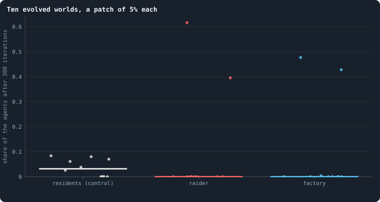

**Ten evolved worlds, a patch of 5% each.** One dot per world, the bar the median of ten.

> [!example]- How to make this figure
> **Runs and data.** As for the figure *The share of two evolved worlds held by a strategy* above.
>
> 1. Load the world of iteration 2,000 (`GraphOfLife.from_checkpoint`). On seed *s*, draw an agent at random and take the agents nearest to it, step by step, until the patch holds the share asked for (5%, or one agent).
> 2. Give each agent of that patch the strategy (`manual.py`), or, for the control, a frozen copy of the brain of one agent of the patch drawn at random; neither ever mutates.
> 3. Play on under the world's own rules and count, after each iteration, the agents carrying the strategy, as a share of all agents.
>
> **To make it again:** `python3 book_figures.py handmade`.
<!-- /figure -->

In three of the ten worlds, one of the two strategies took between 40 and 62%
of the world in 300 iterations:
- **World 2:** both did, the raider with 40% and the factory with 48%.
- **World 3:** the raider took 62%, while the factory shrank to 13 agents.
- **World 6:** the other way round. The factory took 43%, and the raider
  died out.

In the other seven worlds both died out. The control, a patch of the
residents' own brains, never ended with more than 8%.

So the answer is not one strategy that beats every evolved world. Evolved
worlds differ in where they are weak. Some could be raided from where the
patch happened to land; most could not be, by these two rules. But in three
worlds of ten, a plain rule took 40 to 62% of the world from brains evolution
had shaped for 2,000 iterations. The residents' own brains did nothing of the
kind from the same places.

**The evolved play is not the best there is.** That answers the question
this page began with. The game had more to give, and evolution had not taken
it ([What the probes say about why](how-to-tell-a-world-that-keeps-evolving.md#what-the-probes-say-about-why)).
Whether the factory or the raider won depended on the world, so the pipeline
is no advantage in general. What the two share is what matters, and the next
two tests take it apart.

### The password

The raider differs from a resident in two ways. It attacks the poorest
neighbour it is sure to take. And it knows its teammates, and never attacks
them. Which of the two wins?

The **lone raider** keeps the first and drops the second. It attacks the
poorest neighbour it is sure to take, whoever that is. It writes no password,
and joins its children to nobody by choice. It was planted where the first
test planted the raider: in worlds 1 and 2, on two seeds each. It grew a
little at first, from 177 agents in world 1 or 153 in world 2, to about 200.
Then it died out in all four plantings, within 97 to 122 iterations. That
includes world 2, where the raider with its password took half.

The rule of attack is not what wins; knowing one's own is. A raider that
cannot tell its own spends its attacks on its own. Inside the patch its
poorest neighbour is usually a teammate, often its own newborn child, and
taking it gains nothing. Meanwhile the bodies it lives in grow old and die,
as the turtle's did.

### One raider alone

Evolution makes a new strategy one agent at a time: a mutation changes one
brain, and the new brain must spread from there. So the last test plants a
single raider, a patch of one agent, in world 2, where a patch of 5% took
half. It ran on twenty seeds for 200 iterations, against a single resident
planted the same way.

The single raider died out every time. Before it went, it grew larger than
the single resident, with peaks of up to 28 agents against at most 5. It also
lived longer, a [median](statistics.md#many-worlds-at-once-the-median-bands-the-settled-life-and-the-spread "The middle value: half of the numbers lie below it and half above.") of about 34 iterations against 21. But it never took
hold. The single resident never did either: one brain in three thousand is
easily lost.

A raider needs a crowd. With 153 teammates who know one another, it took half
a world. Alone, or among teammates it cannot tell from strangers, it dies.

## How large a crowd a raider needs

<!-- experiment E29 -->

### How deep is the valley?

Put together, the tests above say that the better play needs three things
at once:
- a way to attack: the raid;
- a way to know one's own: the password, so that raiders never raid each
  other;
- enough of one's own to start with: a crowd of teammates who know the
  password.

Each alone is worth nothing or less. A raid without a password is spent on
one's own, and a password without a crowd is a secret nobody else knows.
Evolution changes one brain a little at a time, and every step on the way
must pay. A strategy whose parts pay only together is a valley evolution
cannot cross. This is the old problem of the **green beard**. Such a gene
would have to make its bearers both show a sign and favour those who show it.

The valley is not in the brain: a B2 brain can play the raider
([What a brain can compute](what-a-brain-can-compute.md)). So how large a
crowd the raider needs says how deep the valley is, between the play
evolution has and the raider's.

The tests above leave that open, for two reasons. Twenty failures of a single
raider do not prove it never takes hold. With none in twenty, it could still
take hold up to one time in seven. And they planted each size in one place
per world. That mixes up what the world allows with where the patch happened
to land.

### What we expected of a crowd

We expected a threshold. A single raider should never take hold, as in the
twenty tries above. Of twenty patches of 5%, ten places in each of the two
worlds where raiders had taken hold, at least half should. And a smaller
patch should never do clearly better than a larger one.

In worlds 2 and 3, Experiment 29 plants patches of 1, 3, 10, 30 and 100
raiders, and of 5% of the world. Each size goes into ten places. A patch of
5% is also planted in five places in each of the other eight worlds. Every
planting has a control: the same patch given frozen copies of one resident's
brain. Each planting is an invasion test, played by the lab:
- The world as it stood at iteration 2,000 is loaded.
- A patch is chosen on the trial's place: an agent drawn at random, then its
  nearest neighbours, step by step, to the patch's size.
- The patch is given the strategy, which never mutates.
- The world plays 300 iterations under its own rules, and the strategy's
  agents and tokens are counted after every iteration.

A planting **takes hold** when, after 300 iterations, its raiders are alive,
more than the patch began with, and more than the control holds there.

A place is a seed, as in the tests above. So the plantings on places 1 and 2
are those tests' plantings on seeds 1 and 2, played again by the lab. All 44
plantings the two share came out exactly alike.

<!-- thesis E29 -->
> [!quote] The thesis of Experiment 29, written down before any of its runs existed
> **The claim.** A raider needs a crowd. In worlds 2 and 3 of Experiment 16 at iteration 2,000, the share of plantings in which a patch of raiders takes hold rises with the patch: none of the 20 single raiders takes hold, and at least half of the 20 patches of 5% do. A planting takes hold when, after 300 iterations, its raiders are alive, more than the patch began with, and more than the control holds there: the same patch given frozen copies of one resident's brain.
>
> **Why it would be so.** In Chapter [51](strategies-written-by-hand.md) a patch of 5% of raiders took 40% and 50% of world 2 and 62% of world 3, while a single raider died out in all 20 plantings in world 2, with peaks of up to 28 agents. Its play pays only with three things at once: the raid, the password and enough teammates (the green beard). Chapter [94](what-a-brain-can-compute.md)'s replay of the same patches lost one of four in worlds 2 and 3 to chance. Twenty plantings of each size, ten places in each world, bound how often a size could take hold and be missed: none in 20 still allows up to 14% at 95% confidence.
>
> **It holds if:** No single raider of 20 takes hold, at least 10 of the 20 patches of 5% do, and no smaller patch takes hold in three or more plantings in twenty more than a larger one.
>
> **It fails if:** A single raider takes hold, fewer than 10 of the 20 patches of 5% do, or a smaller patch takes hold in three or more plantings in twenty more than a larger one.
>
> *Written while the notebook still numbered its chapters: each number is a link to the page it meant that day.*
<!-- /thesis -->

### What the raiders did

<!-- figure crowd/crowd -->
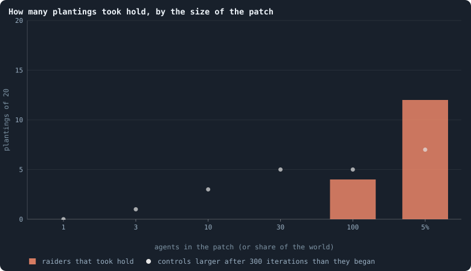

**How many plantings took hold, by the size of the patch.** Bars: of the 20 plantings of each size (ten places in each of worlds 2 and 3), how many raider patches took hold: alive after 300 iterations, more than they began with, and more than the control planted in the same place. Grey dots: how many of the controls, frozen copies of one resident's brain, were larger after 300 iterations than they began.

> [!example]- How to make this figure
> **Runs.** Experiment 29's 320 invasions (`python3 gol_lab.py run E29`): the ten B2 worlds of Experiment 16, `B2-10000-s001` … `-s010`, as their archives keep them at iteration 2,000. In worlds 2 and 3, patches of 1, 3, 10, 30 and 100 agents and of 5% of the world on places 1 to 10; in the other eight, 5% on places 1 to 5. Every patch once with the raider's rule and once as a control, frozen copies of one patch member's brain (`gol_strategies.plant`).
>
> **Data.** From each trial's `result.json`.
>
> 1. Load the world of iteration 2,000; on place p, draw an agent at random and take its nearest neighbours, step by step, until the patch has its size.
> 2. Give the patch the raider ([Strategies written by hand](strategies-written-by-hand.md)'s rule), or the control; neither ever mutates.
> 3. Play 300 iterations under the world's own rules, counting the patch's agents after every iteration.
> 4. A planting takes hold when, after 300 iterations, its raiders are alive, more than the patch began with, and more than the control holds there.
>
> **To make it again:** `python3 book_figures.py crowd`.
<!-- /figure -->

**About a hundred raiders are the least that can start a raid.**
- **Up to 30 raiders:** none took hold in 20 plantings. The patches died out
  faster the smaller they were. Half had died out by iteration 51 for a
  single raider, 72 for three, 100 for ten and 148 for thirty.
- **A hundred raiders** took hold 4 times in 20.
- **5% of the world,** 153 agents in world 2 and 168 in world 3, took hold 12
  times in 20.

The twenty single raiders of [One raider alone](#one-raider-alone) were all
planted in world 2. Ten of them are ten of these plantings again, and ten are
more. So 30 different single raiders have now died. If a single raider could
take hold, it would do so less than one time in ten. Otherwise these 30
would very likely have shown it.

The controls, frozen copies of the residents' own brains, show no such
threshold:
- **Alive after 300 iterations:** a larger patch of residents lived more
  often, 0, 1, 5, 8, 13 and 16 times in 20, from one agent to 5%.
- **Larger than they began:** rarely, 0 to 7 times in 20.

A raid is either joined by enough raiders or it dies.

### The world decides as much as the crowd

<!-- figure crowd/worlds -->
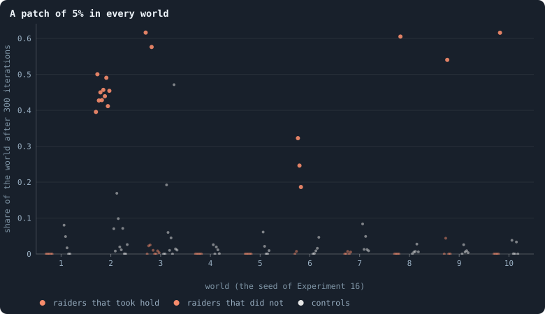

**A patch of 5% in every world.** Each dot is one planting of a patch of 5% of the world at iteration 2,000: left of each world, the raiders (filled where they took hold), right of it, the control planted in the same place. Worlds 2 and 3 have ten places, the others five.

> [!example]- How to make this figure
> **Runs and data.** As for the figure *How many plantings took hold, by the size of the patch* above.
>
> 1. Load the world of iteration 2,000; on place p, draw an agent at random and take its nearest neighbours, step by step, until the patch has its size.
> 2. Give the patch the raider ([Strategies written by hand](strategies-written-by-hand.md)'s rule), or the control; neither ever mutates.
> 3. Play 300 iterations under the world's own rules, counting the patch's agents after every iteration.
> 4. A planting takes hold when, after 300 iterations, its raiders are alive, more than the patch began with, and more than the control holds there.
>
> **To make it again:** `python3 book_figures.py crowd`.
<!-- /figure -->

- **World 2:** every one of ten patches of 5% took hold, each holding 40 to
  50% of the world after 300 iterations.
- **World 3:** two of ten took hold, with 58% and 62%. In the other eight
  places the raiders died out (three) or shrank to between 12 and 82 agents
  (five).
- **The other eight worlds:** four let a raid take hold in some places
  (world 6 in three of five, worlds 8, 9 and 10 in one each). Four let it
  take hold in none (worlds 1, 4, 5 and 7).
- **Over all ten worlds,** at the same five places, the raid took hold 13
  times in 50.

In most worlds, most places beat the raid. What makes a place raidable?
[What a raid starts from](strategies-written-by-hand.md#what-a-raid-starts-from)
found that it depends on the patch itself: on its wealth, the tokens per
agent it holds when it is planted.

### Verdict on Experiment 29: the thesis holds

**The thesis holds.**
- No single raider took hold, 0 of 20.
- 12 of the 20 patches of 5% did, where at least 10 were asked for.
- No smaller patch took hold more often than a larger one.

**The valley is about a hundred agents wide.** The raider pays only in
company: it needs about a hundred neighbours playing it at once before it
takes hold. Mutation changes one brain at a time, and a hundred neighbours
changing the same way at once does not happen. So evolution cannot reach the
raider by mutation alone, though a B2 brain can play it. The green beard's
valley, named above, is measured here.

**A crowd can grow from one.** A brain's children carry it. A raider that
bred before it died would grow its own crowd, if its first children lived
long enough. The single raiders' lines grew to at most 28 agents before dying
out, about a quarter of the crowd they needed.

## Why the raiders stopped winning

A [raider written by hand](strategies-written-by-hand.md) took hold in young
B2 worlds, but not in the same worlds grown older (Experiment 30). The worlds
had not learned to defend themselves: their patches grew too poor, and a
raider needs three tokens to take a neighbour of one. Raiders that pool their
stakes (Experiment 33) and raiders that breed as the world's agents do
(Experiment 34) failed there too. In a late patch few agents can stake at
all, and almost none can afford a child. In B1, which has none of B2's rules
against them, every strategy failed faster (Experiment 35), partly because B1
cuts every connection carrying no tokens. So far nothing written by hand has
taken hold in a late world of either [baseline](b1-and-b2.md "The stated rules an experiment starts from and changes one thing of: B1 or B2."), and each failure has a cause
we can name.

### Does evolution close the door?

<!-- experiment E30 -->

#### A raid that worked in young worlds

The raider is a rule written by hand that takes the place of an agent's
brain ([Strategies written by hand](strategies-written-by-hand.md)). It looks
for the poorest neighbour that is not one of its team: a *stranger*. If it
is sure to take that neighbour's node, it stakes all it can there; otherwise
it keeps everything at home. When it holds 30 tokens or more, it has a child
with a third of them. Raiders know their teammates by a password they write
into their messages, so they never raid each other.

Planted as 5% of an evolved B2 world at iteration 2,000, the raider took half
of some worlds. Those worlds had never met a raider. Do worlds that evolve
longer get harder to raid?

Three answers are possible, and each says something different about
open-ended evolution:
- **The door stays open.** Later worlds are raided as easily as early ones.
  Evolution does not find the defence any more than it found the raid, so
  better play lies across a valley it does not cross. The next step is to
  ask what would let it cross: a crowd, or a rule.
- **The door closes, and others open.** Later worlds resist this raid but
  lose to others. That is an arms race, which may go round in circles or
  climb.
- **The door closes, and nothing opens.** Later worlds resist every raid
  tried: a top, at least for these brains.

Each planting is an [invasion test](measuring-evolution.md#the-invasion-test):
- **The patch.** An agent is drawn at random, then its nearest neighbours,
  step by step, until the patch holds 5% of the world.
- **The planting.** Every agent of the patch gets the raider's rule in place
  of its brain. The world plays on for 300 iterations under its own rules.
- **The control.** The same patch is played again with frozen copies of one
  of its own agents' brains: what the patch would do anyway.
- **Taking hold.** After 300 iterations, a planting takes hold if its raiders
  are alive and more than the patch began with. They must also be more than
  the control holds in the same place.

#### What we expected of older worlds

We expected the door to stay open. Evolution's own contests fade: later
brains beat earlier ones by less and less
([Every era against three](every-era-against-three.md)). A world learning to
defend itself would not show that. In every long world, one agent's best
reply to the rest would gain about one node a game, at every era from 2,500
to 50,000. Nothing in a world that has never met a raider selects against
one.

Experiment 30 plants raiders, 5% of a world in three places each, in B2's
five worlds played on to 10,000 iterations. These are Experiment 16's worlds,
played on as [pilots](runs-and-records.md#pilot-worlds "A world made by hand to see whether an idea is worth an experiment, without a thesis or many seeds.") of the engine's own rules. The raiders are planted at
iterations 500, 2,000, 5,000 and 10,000, and each planting has its control.
The test is the one of
[How large a crowd a raider needs](strategies-written-by-hand.md#how-large-a-crowd-a-raider-needs).

<!-- thesis E30 -->
> [!quote] The thesis of Experiment 30, written down before any of its runs existed
> **The claim.** Evolution in B2 does not learn to resist the raider. In B2's worlds played on to 10,000 iterations, patches of 5% of raiders take hold as often at iterations 5,000 and 10,000 as at 500 and 2,000: a one-sided Fisher exact test finds no fewer late than early at the 5% level. A planting takes hold as in Experiment 29: after 300 iterations its raiders are alive, more than the patch began with, and more than the control patch of residents holds there.
>
> **Why it would be so.** In every long world the book has, an agent's best reply to the rest would gain about one node a game, as much at 50,000 iterations as at 2,500 (Chapter [95](every-era-against-three.md)): evolution does not close in on any equilibrium. The raider exploits what B2's brains do not do, and nothing in a world that has never met a raider selects against one. Later brains beat earlier ones by less and less, which a world learning to defend itself would not show.
>
> **It holds if:** The plantings that take hold at 5,000 and 10,000 together (30, in five worlds at three places each) are not fewer than at 500 and 2,000 together by a one-sided Fisher exact test at the 5% level.
>
> **It fails if:** Fewer take hold late than early by that test: evolution closed the door. The chapter then asks what opened instead (other raids that later brains lose to) or whether nothing did.
>
> *Written while the notebook still numbered its chapters: each number is a link to the page it meant that day.*
<!-- /thesis -->

#### What the raiders did in older worlds

<!-- figure door/door -->
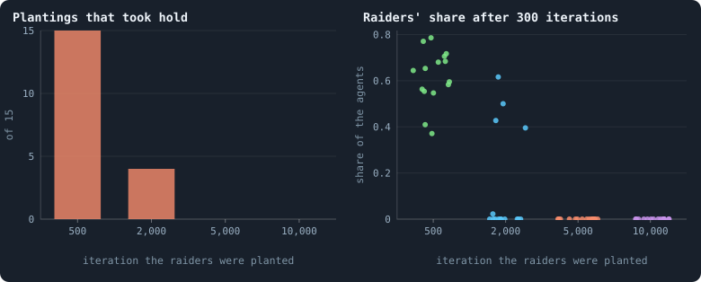

**The same raid, planted in older worlds.** Left: of the fifteen plantings at each era (five worlds, three places), how many took hold. Right: each planting's raiders as a share of the world after 300 iterations (0 where they died out).

> [!example]- How to make this figure
> **Runs.** Experiment 30's 120 invasions (`python3 gol_lab.py run E30`): B2's worlds of Experiment 16 played on to 10,000 iterations as pilots of the engine's own rules (`GraphOfLifeRuns/.pilots/L/B2-long-s001` … `s005`), at iterations 500, 2,000, 5,000 and 10,000, a patch of 5% on places 1 to 3, once with the raider's rule and once as a control; and, in the second chart, every patch of 5% of Experiment 29 too (Experiment 16's ten worlds at 2,000), of which Experiment 30's plantings at 2,000 replay fifteen, counted once.
>
> **Data.** From each trial's `result.json`.
>
> 1. Load the world of the era; on place p, draw an agent at random and take its nearest neighbours, step by step, until the patch holds 5% of the world.
> 2. Give the patch the raider ([Strategies written by hand](strategies-written-by-hand.md)'s rule), or the control, frozen copies of one patch member's brain.
> 3. Play 300 iterations under the world's own rules; a planting takes hold when its raiders are then alive, more than the patch began with, and more than the control holds.
> 4. A patch's wealth is its tokens over its agents when it is planted.
>
> **To make it again:** `python3 book_figures.py door`.
<!-- /figure -->

**The door closed.**
- **At iteration 500,** all fifteen plantings took hold. The raiders held
  37% to 79% of their world 300 iterations later.
- **At 2,000,** four of fifteen took hold, in worlds 2 and 3 again, as in
  [How large a crowd a raider needs](strategies-written-by-hand.md#how-large-a-crowd-a-raider-needs).
  These fifteen are fifteen of that experiment's plantings, in the same
  worlds and places, and they played out exactly alike.
- **At 5,000 and at 10,000,** none of fifteen did. Nearly every patch grew a
  little at first, 29 of the 30 in their first five iterations. Then they
  shrank and died out, half of them within about 150 iterations, the last
  after 253.

**But not by a defence.** One planting at iteration 500 and one at 10,000,
in the same world and place, were played again with every decision kept.
Over 120 iterations:
- **At 500,** residents took 3,233 nodes from the raiders and the raiders
  took 7,123 from residents.
- **At 10,000,** residents took 29 nodes from the raiders. The raiders
  rarely raided at all: 470 raids against 11,226 at 500. They had no
  children, and died where they stood, of age.

#### What a raid starts from

<!-- figure door/wealth -->
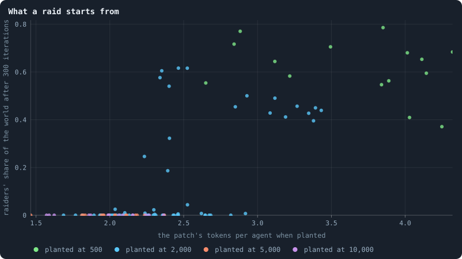

**What a raid starts from.** Each dot is one planting of 5% of a world, from Experiments 29 and 30, each counted once, by the patch's tokens per agent when it was planted and the raiders' share of the world 300 iterations later.

> [!example]- How to make this figure
> **Runs.** As for the figure *The same raid, planted in older worlds* above.
>
> **Data.** From each trial's `result.json`.
>
> 1. Load the world of the era; on place p, draw an agent at random and take its nearest neighbours, step by step, until the patch holds 5% of the world.
> 2. Give the patch the raider ([Strategies written by hand](strategies-written-by-hand.md)'s rule), or the control, frozen copies of one patch member's brain.
> 3. Play 300 iterations under the world's own rules; a planting takes hold when its raiders are then alive, more than the patch began with, and more than the control holds.
> 4. A patch's wealth is its tokens over its agents when it is planted.
>
> **To make it again:** `python3 book_figures.py door`.
<!-- /figure -->

The raider stakes only where it is sure to win. In B2, 30% of an agent's
tokens stay at home, and a holder's own stake on its node counts one and a
half times. So 70% of the raider's tokens has to come to more than one and a
half times the neighbour's. Against a neighbour of one token, the raider
needs three tokens to raid at all.

So a raid depends on the patch's wealth: its tokens per agent when it is
planted. Here is how often a patch of 5% took hold, by that wealth. The
table counts the 105 such plantings of Experiments 29 and 30, each once:

| tokens per agent | took hold |
|---|---|
| under 2 | 0 of 23 |
| 2 to 2.5 | 7 of 48 |
| 2.5 to 3 | 6 of 14 |
| 3 to 4 | 14 of 14 |
| 4 or more | 6 of 6 |

Experiment 30's fifteen plantings at 2,000 repeat fifteen of Experiment 29's
exactly. Its long runs begin from Experiment 16's worlds at 2,000, and the
places are the same. So they are counted once, as Experiment 29's.

A patch planted at 500 held a median of 3.85 tokens per agent; one planted
at 5,000 or 10,000 held 2.0. At 2,000 the median was 2.36 over Experiment
29's sixty plantings, and 2.26 over the fifteen that Experiment 30 repeated.
The
worlds hold about as many tokens per agent at 10,000 as at 1,000, 2.7
to 3.3. But a patch, an agent and its nearest neighbours, is poorer than
the average agent, and it got poorer as the worlds aged.

Whether the residents also learned something, these plantings cannot say.
At 2,000, the plantings of 2.2 to 2.6 tokens per agent took hold 8 times in
25. Only five late patches
were that rich, and none of the five took hold.

#### Verdict on Experiment 30: the door closed, by poverty

**The thesis fails.** The plantings at 5,000 and 10,000 took hold 0 times
in 30, against 19 times in 30 at 500 and 2,000. By a one-sided Fisher exact
test that is fewer beyond any doubt (p below 0.0001). The door closed.

It closed because the patches got poorer, not, as far as can be told,
because the residents learned to resist a raid. A raid that needs three
tokens a raider cannot start among agents that hold two.

So a world of many small agents shuts out every lone raider. A node goes to
the largest stake, and a holder's own stake counts one and a half times.
With a token or two each, no single agent can take anything that holds as
much as it does.

A strategy written by hand carries its own thresholds, the raider's three
tokens among them. So before we say that evolution closed a door, a test
should plant patches of the same wealth at every era. None of the
experiments below does that yet: they change the raider, or the world it is
planted in.

### A crew of raiders

<!-- experiment E33 -->

#### Raiders that pool their stakes

Does a world of many small agents shut out a group too? Stakes from several
agents do not simply add up. A node goes to the
largest single stake, the holder's own counting one and a half times. The
one exception is a band of revolutionaries who together outweigh it
([How a coalition takes a node](rules-in-detail.md#how-a-coalition-takes-a-node)).

The **crew** raider uses that:
- **Its rule:** it stakes all it can on the weakest stranger next door that
  is no richer than itself. It marks every token a revolution token.
- **What it does:** two crew raiders of two tokens, each staking one, take a
  stranger of one token that neither could take alone.
- **How they join:** raiders that each see the same stranger as the weakest
  next door become one mob without a word passing.

Beside the crew, this page calls the raider of Experiment 30 the *lone
raider*: it raids alone, password and all. (Strategies written by hand gives
that name to a raider without a password, which is not planted here.)

#### What we expected of the crews

If a world of small agents shuts out lone raiders but not crews, the game
itself rewards groups, and the poorer the world, the more. That would be a
reason for larger and larger groups that comes from the rules, not from
anything added to them. So we expected crews to take hold where lone raiders
could not.

Experiment 33 plants crews of 5% where Experiment 30 planted its lone
raiders. They go into the same five worlds and the same places, at 2,000,
5,000 and 10,000. Beside them are Experiment 30's own plantings of lone
raiders and controls there.

<!-- thesis E33 -->
> [!quote] The thesis of Experiment 33, written down before any of its runs existed
> **The claim.** Raiders that pool their stakes take hold where lone raiders cannot. In B2's worlds played on, at iterations 5,000 and 10,000, where patches of 5% of lone raiders took hold in none of 30 plantings, patches of 5% of crew raiders — raiders that stake on the weakest stranger next door no richer than themselves, every token of it a revolution token, so that raiders bordering the same stranger become one mob — take hold in at least 5 of the same 30 plantings.
>
> **Why it would be so.** In Experiment 30 the lone raider's door closed because the patches it started from grew poor: it needs three tokens to take even a neighbour of one, and by iteration 5,000 a patch held two tokens an agent. In that game a node goes to the largest single stake, the holder's own counting one and a half times, unless revolutionaries together outweigh it. Two raiders of two tokens, each staking one as a revolution token, take a stranger of one token that neither could take alone. Raiders that each see the same stranger as the weakest next door join without any message. A world of many small agents shuts out lone raiders, not crews: if that is so, the poorer the world, the more a group is worth.
>
> **It holds if:** At least 5 of the 30 crew plantings at 5,000 and 10,000 take hold: alive after 300 iterations, more than the patch began with, and more than the control planted in the same place.
>
> **It fails if:** Four or fewer take hold: pooling stakes does not open the door, and the chapter says what the crews met instead.
<!-- /thesis -->

#### What the crews did

<!-- figure crews/hold -->
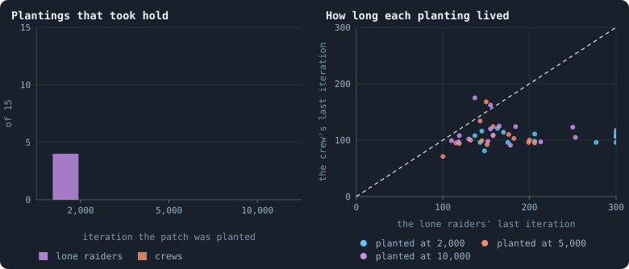

**Crews and lone raiders, planted in the same places.** Left: of the fifteen plantings at each era (five worlds, three places), how many took hold, lone raiders (violet) and crews (orange). Right: each place once, by the iteration the lone raiders' last agent died in and the crew's (300: still alive at the end). Below the dashed line the crew died first.

> [!example]- How to make this figure
> **Runs.** Experiment 33's 135 invasions (`python3 gol_lab.py run E33`): B2's worlds of Experiment 16 played on to 10,000 iterations as pilots of the engine's own rules (`GraphOfLifeRuns/.pilots/L/B2-long-s001` … `s005`), at iterations 2,000, 5,000 and 10,000, a patch of 5% on places 1 to 3, given the crew's rule, the lone raider's ([Strategies written by hand](strategies-written-by-hand.md)'s) or frozen copies of one patch member's brain (the control); the lone raiders' and the controls' plantings are Experiment 30's own.
>
> **Data.** From each trial's `result.json`.
>
> 1. Load the world of the era; on place p, draw an agent at random and take its nearest neighbours, step by step, until the patch holds 5% of the world.
> 2. Give the patch the rule, or the control; play 300 iterations under the world's own rules, counting the patch's strategy and its tokens after every iteration.
> 3. A planting takes hold when its strategy is then alive, holds more agents than the patch began with, and more than the control planted in the same place.
>
> **To make it again:** `python3 book_figures.py crews`.
<!-- /figure -->

**No crew took hold, at any era.**
- **At 2,000,** where four of the fifteen lone raiders' plantings took hold
  (worlds 2 and 3), no crew did, not even in those places.
- **At 5,000 and 10,000,** none of thirty did, as for the lone raiders.

**And the crews died first.** In 42 of the 45 places the crew was gone
before the lone raiders planted there. That was so in 15 of 15 places at
2,000, 14 at 5,000 and 13 at 10,000.

| planted at | the crew's last agent died, median | the lone raiders' | the control's |
|---|---|---|---|
| 2,000 | 107 iterations later | 206 | still alive at 300 |
| 5,000 | 100 | 151 | still alive at 300 |
| 10,000 | 108 | 155 | 297 |

<!-- figure crews/wealth -->
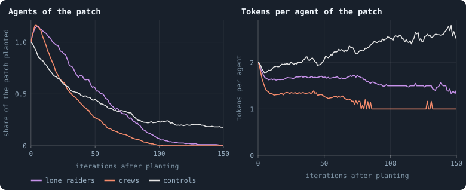

**What became of the patches planted at 5,000 and 10,000.** The median over the thirty plantings at 5,000 and 10,000 of each kind: crews (orange), lone raiders (violet), controls (grey). Left: the patch's strategy's agents as a share of the patch planted (0 once it has died out). Right: their tokens per agent, over the plantings still alive.

> [!example]- How to make this figure
> **Runs.** As for the figure *Crews and lone raiders, planted in the same places* above.
>
> **Data.** From each trial's `result.json`.
>
> 1. Load the world of the era; on place p, draw an agent at random and take its nearest neighbours, step by step, until the patch holds 5% of the world.
> 2. Give the patch the rule, or the control; play 300 iterations under the world's own rules, counting the patch's strategy and its tokens after every iteration.
>
> **To make it again:** `python3 book_figures.py crews`.
<!-- /figure -->

**The crews paid their neighbours.** Ten iterations after planting, at
5,000 and 10,000, the patches held:

| | tokens per agent, median |
|---|---|
| crews | 1.33 |
| lone raiders | 1.65 |
| controls | 1.85 |

Every patch started at about 2.0.

**Neither kind of raider had a child.** Both rules wait for 30 tokens. Of
the 7,587 agents the 45 patches were planted on, 4 held that many: 3 at
2,000, 1 at 5,000, none at 10,000. So a patch lived only as long as the
nodes it held and the nodes it took. The crews took few, and lasted about
as long as the youngest agent they were planted on: B2's agents die at
age 100.

#### What a crew meets

<!-- figure crews/mobs -->
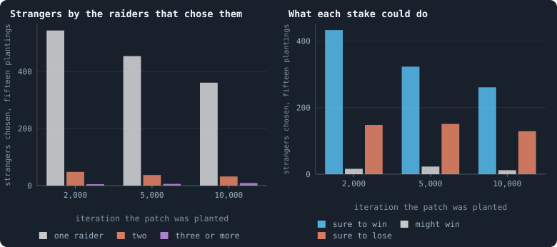

**A crew's first game, as planted.** Every stranger a crew raider would stake on in its first game, over the fifteen plantings of each era. Left: how many raiders of the crew chose it. Right: whether the raiders that chose it outweigh it even if it keeps everything at home (sure to win), only if it keeps no more than it must (might win), or not even then (sure to lose: their tokens go to the stranger).

> [!example]- How to make this figure
> **Runs.** No world is played: the worlds and places of Experiment 33's crews, read as they were planted — B2's worlds played on (`GraphOfLifeRuns/.pilots/L/B2-long-s001` … `s005`) at iterations 2,000, 5,000 and 10,000, places 1 to 3.
>
> **Data.** From the worlds' checkpoints at each era, read by `research/oee/strategies/mobs.py`.
>
> 1. Draw each patch as the planting draws it.
> 2. For every patch agent with a stranger next door: the weakest such stranger (the first, where several are as weak); if the agent holds at least as much and has more than its home share, it stakes all but that share there.
> 3. Raiders that chose the same stranger are one mob. Weigh the mob against the stranger's stake at home, counted one and a half times: everything it holds (sure to win), or only what B2 makes it keep, 30% rounded up and at least one token (might win). What other neighbours stake on it is left out.
>
> **To make it again:** `python3 book_figures.py crews`.
<!-- /figure -->

The worlds were read as the crews were planted, before any game was
played. Three things stood in the crews' way.

- **Few could stake at all.** B2 keeps at least one token of every agent at
  home, so an agent of one token can stake nothing. Seven agents in ten of
  the patches planted at 5,000 or 10,000 held just one: 1,844 of 2,568, and
  1,848 of 2,520.
- **Mobs hardly formed.** A stranger next to a patch borders 1.6 of its
  agents on average.

  | planted at | strangers chosen by one raider | by two | by three or more |
  |---|---|---|---|
  | 5,000 | 454 | 37 | 6 |
  | 10,000 | 361 | 32 | 9 |

- **A stake that is not pooled is a gift.** At 5,000, the raiders could not
  take 151 of the 497 strangers they chose, even if each stranger kept at
  home only what it must. Their tokens go to the stranger.
  - At 5,000 and 10,000, 266 of the 280 raiders behind such stakes were
    agents of two tokens staking one on a stranger of one.
  - That stranger's single token, at home, counts one and a half.
  - Two such raiders would take it. One alone hands it a token, and is left
    with one, too few to stake.

The crew's rule sent out more raiders than the lone raider's: 549 against
353 at 5,000. At 5,000 and 10,000 the crews sent out 358 more raiders, and
310 of them were raiders of two tokens against a stranger of one.

#### Verdict on Experiment 33: refuted

**The thesis fails.** No crew took hold in the thirty plantings at 5,000
and 10,000; the thesis asked for five. Pooling stakes did not open the door
that closed on the lone raiders. The crews fared worse than the lone
raiders, and the poorer the world, the less a mob was worth, not the more:
- the fewer raiders could stake at all;
- the fewer bordered the same stranger;
- and a stake that found no partner went to the stranger.

The game rewards a group only where a group can gather. On B2's network a
stranger next to a patch touches one or two of its agents. With each raider
choosing alone, about one stranger in ten drew a mob. A crew that pools its
stakes would have to choose its target together. That needs news about a
third agent, which no message of a B2 brain carries
([What a brain can compute](what-a-brain-can-compute.md#what-no-brain-of-b2-can-compute)).

Every planting so far was in B2's worlds, and three of the crews' obstacles
are B2's own rules.
[Hand-written strategies in B1](#hand-written-strategies-in-b1) plants the
same strategies where those rules do not hold.

### Raiders that breed

<!-- experiment E34 -->

#### A raider that breeds as the world does

The lone raiders and the crews were barren in the late worlds. Their rule
asks for 30 tokens before a child, and only 4 of the 7,587 agents they were
planted on held that many. Experiment 30's replay at 10,000 saw the same:
its raiders had no children. A patch that cannot breed lives only as long
as the nodes it holds and the nodes it takes. In B2 every agent dies at age
100, and the crews died with the youngest agent they were planted on. So the
closed door might say as much about the raider's own rule of breeding as
about the world.

The world's own agents breed as soon as they can give a child ten tokens,
B2's least child ([`min_child`](settings.md#min_child)). Experiment 34 gives
the raider the same:
- **The breeding raider** raids as the raider does. It stakes all it can on
  the weakest stranger next door, if seven tenths of its tokens outweigh one
  and a half times that stranger's. Otherwise it keeps everything at home.
  It has a child of ten tokens whenever it holds more, joined to its
  teammates as the raider's children are. Each child can raid at once:
  seven tokens staked take a stranger of up to four.
- **The breeding turtle** breeds the same way and never raids. It keeps
  everything at home. It tells breeding alone from breeding and raiding.

Both are planted where the raiders of Experiments 30 and 33 were. They are
patches of 5% of B2's five worlds played on, at 2,000, 5,000 and 10,000
iterations, in the same three places. Beside them are those experiments'
lone raiders and controls on the same patches.

#### What we expected of breeding

We expected breeding to open the door. A raider that breeds replaces its
dead, so its patch need not die with the agents it was planted on. And every
child can raid at once. The breeding turtle would show whether the raid adds
anything to the breeding.

<!-- thesis E34 -->
> [!quote] The thesis of Experiment 34, written down before any of its runs existed
> **The claim.** A raider that breeds as the world's own agents can takes hold where the barren raider could not, and it is the raid that does it. In B2's worlds played on, at iterations 5,000 and 10,000, where patches of 5% of Chapter [51](strategies-written-by-hand.md)'s raider, which has a child only when it holds 30 tokens, took hold in none of 30 plantings, patches of 5% of a raider that has a child of ten tokens whenever it holds more take hold in at least 5 of the same 30, and in more of them than patches of a turtle that breeds the same way but never raids.
>
> **Why it would be so.** In Experiment 33 neither kind of raider had a child: of the 7,587 agents the patches were planted on, 4 held the 30 tokens their rules wait for. A barren patch lives only as long as the nodes it holds and the nodes it takes, and in B2 every agent dies at age 100; the crews died with the youngest agent they were planted on. The world's own agents have a child as soon as they can give it ten tokens (B2's min_child). A raider that does the same replaces its dead, and each of its children can raid at once: seven tokens staked take a stranger of up to four. The breeding turtle breeds the same way and never raids, and so tells breeding alone from breeding and raiding.
>
> **It holds if:** Breeding raiders take hold in at least 5 of the 30 plantings at 5,000 and 10,000, and in more of them than breeding turtles do: alive after 300 iterations, more than the patch began with, and more than the control planted in the same place.
>
> **It fails if:** Breeding raiders take hold in 4 or fewer of the 30, or in no more of them than breeding turtles: breeding does not open the door, or the raid adds nothing to it; the chapter says which.
>
> *Written while the notebook still numbered its chapters: each number is a link to the page it meant that day.*
<!-- /thesis -->

#### Breeding opened nothing

<!-- figure breeders/hold -->
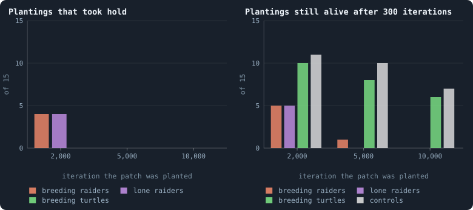

**Breeding raiders, beside barren raiders, breeding turtles and controls.** Of the fifteen plantings at each era (five worlds, three places). Left: how many took hold — alive after 300 iterations, with more agents than the patch began with and than the control planted in the same place: breeding raiders (orange), lone raiders (violet), breeding turtles (green). Right: how many were still alive at all, the controls (grey) beside them.

> [!example]- How to make this figure
> **Runs.** Experiment 34's 180 invasions (`python3 gol_lab.py run E34`): B2's worlds of Experiment 16 played on to 10,000 iterations as pilots of the engine's own rules (`GraphOfLifeRuns/.pilots/L/B2-long-s001` … `s005`), at iterations 2,000, 5,000 and 10,000, a patch of 5% on places 1 to 3, given the breeding raider's rule, the breeding turtle's, the lone raider's ([Strategies written by hand](strategies-written-by-hand.md)'s) or frozen copies of one patch member's brain (the control); the lone raiders' and the controls' plantings are those of Experiments 30 and 33.
>
> **Data.** From each trial's `result.json`.
>
> 1. Load the world of the era; on place p, draw an agent at random and take its nearest neighbours, step by step, until the patch holds 5% of the world.
> 2. Give the patch the rule, or the control; play 300 iterations under the world's own rules, counting the patch's strategy's agents and their tokens after every iteration (each trial's `result.json`).
> 3. A planting takes hold when its strategy is alive after 300 iterations, holds more agents than the patch began with, and more than the control planted in the same place; count the plantings of each era that took hold, and those alive at all.
>
> **To make it again:** `python3 book_figures.py breeders`.
<!-- /figure -->

At 2,000 iterations, breeding raiders took hold in 4 of 15 plantings: as
many as the barren raiders. At 5,000 and 10,000 they took hold in none of
30, again as the barren raiders. The breeding turtles took hold nowhere, at
any era. Counted by tokens instead of agents, every number is the same.

The breeding raiders did a little better on the way. At its largest, the
median planting of breeding raiders held 1.50, 1.28 and 1.18 times its
patch at the three eras. For the barren raiders it was 1.36, 1.21 and 1.14.
And it lived a little longer: its last agent died 243, 166 and 167
iterations after planting, against 206, 151 and 155. But of the 30 breeding
plantings at 5,000 and 10,000, one was alive after 300 iterations.

The breeding turtles lived on, but shrank. After 300 iterations 10, 8 and 6
of their 15 plantings were alive, about as many as of the controls (11, 10
and 7). None grew: only two of the 45 ever held more agents than they were
planted with, one more, for one iteration.

#### Why almost nobody can afford a child

<!-- figure breeders/patches -->
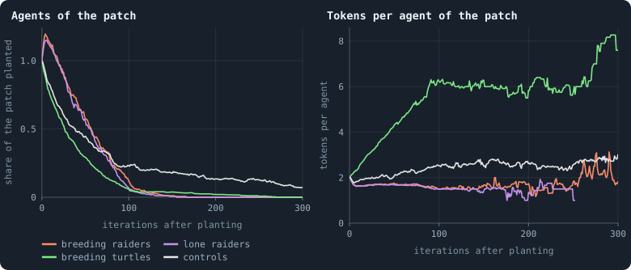

**What became of the patches planted at 5,000 and 10,000.** The median over the thirty plantings at 5,000 and 10,000 of each kind: breeding raiders (orange), lone raiders (violet), breeding turtles (green), controls (grey). Left: the strategy's agents as a share of the patch planted (0 once it has died out). Right: their tokens per agent, over the plantings still alive.

> [!example]- How to make this figure
> **Runs and data.** As for the figure *Breeding raiders, beside barren raiders, breeding turtles and controls* above.
>
> 1. Load the world of the era; on place p, draw an agent at random and take its nearest neighbours, step by step, until the patch holds 5% of the world.
> 2. Give the patch the rule, or the control; play 300 iterations under the world's own rules, counting the patch's strategy's agents and their tokens after every iteration (each trial's `result.json`).
> 3. At each iteration after planting, take the median over the thirty plantings of the strategy's agents over the patch planted, and of its tokens per agent over the plantings still alive.
>
> **To make it again:** `python3 book_figures.py breeders`.
<!-- /figure -->

A child of ten tokens needs a parent with eleven. In the worlds the patches
were planted in, 3.3%, 3.1% and 3.3% of the agents held that many at the
three eras: one in thirty. The median patch began with about two tokens per
agent (2.26, 2.03 and 1.99). So a breeding raider could almost never breed,
any more than the raider that waits for 30.

The raids do spread the raiders: every node they take gets their rule. But
each raid stakes all a raider can on a poor node, so the raiders spread
their tokens thinner as they spread. Within ten iterations their tokens per
agent fell from about 2 to 1.6. Then the old die at 100, and nothing
replaces them.

The turtle shows the other side. It keeps everything at home, so it keeps
its nodes longer, and its patch lives. But it cannot afford children either,
so it shrinks as its agents die of age. The turtles that remain are the
richer ones, since a turtle of one token is the easiest to take. They held
about 6 tokens each after a hundred iterations, and 7.6 after 300.

#### Verdict on Experiment 34: refuted

The thesis is refuted on both counts. Breeding raiders took hold in none of
the 30 plantings at 5,000 and 10,000, where the thesis asked for at least 5.
And they took hold in no more of them than the breeding turtles, which took
hold in none either. Breeding does not open the door: in B2's late worlds a
raider can no more afford the world's least child than its own.

### Hand-written strategies in B1

<!-- experiment E35 -->

#### B2's rules against the raiders

Every strategy written by hand so far was planted in B2's worlds only. That
holds for the raider's first plantings
([Strategies written by hand](strategies-written-by-hand.md),
[How large a crowd a raider needs](strategies-written-by-hand.md#how-large-a-crowd-a-raider-needs)) and
for all those above. And the reasons they failed there are B2's own rules:
- **A home share.** B2 keeps 30% of an agent's tokens at home, and at least
  one ([`keep_home`](settings.md#keep_home)). Seven in ten agents of a late
  patch held a single token and could stake nothing.
- **A holder's bonus.** A holder's own stake counts one and a half times
  ([`incumbency`](settings.md#incumbency)). A raider needs three tokens to
  take a neighbour of one, and a crew's stake that finds no partner is lost.
- **Old age.** Every agent dies at age 100
  ([`max_age`](settings.md#max_age)), so a patch that cannot breed dies with
  the agents it was planted on.
- **A least child of ten tokens**
  ([`min_child`](settings.md#min_child)), which the breeding strategies give.

B1, the notebook's first baseline, has none of them. An agent may stake
everything, a holder's stake counts once, a child may start with a single
token, and nobody dies of age. Its worlds stay rich. At 2,000, 5,000 and
10,000 iterations, the median agent of its two long worlds holds 4 to 15
tokens. Almost none holds a single token.

#### The strategies read each world's rules

Until now the raiders carried B2's numbers. They staked 70% of their tokens,
and needed more than one and a half times what the target holds. They now
read both from the world they are planted in. In B2 that changes nothing
(the same choices on 20,000 random views). In B1:
- **A raider** stakes everything it holds, and needs only more than its
  target holds. So a raid moves it onto the node it takes, and leaves its
  home empty. It grows only by its children.
- **A crew raider** stakes everything as revolution tokens on the weakest
  stranger no richer than itself. One as rich as its target ties with it
  when the target keeps everything at home.
- **The breeding raider and the breeding turtle** have a child of B1's least
  size, a single token, whenever they hold more.

**Counted by tokens.** In B1 a child can be a single token, so counting a
patch by its agents rewards whatever splits into the smallest children. This
experiment counts a patch by the tokens it holds. Counted so, B2's verdicts
are unchanged. Lone raiders took hold in 4, 0 and 0 of 15 plantings at
2,000, 5,000 and 10,000, and crews in none.

The plantings are of the same kind as those of Experiments 30 and 33.
Patches of 5% are planted at 2,000, 5,000 and 10,000, in three places, in
each of B1's two long worlds. Beside each is a control.

#### What we expected in B1

If B2's rules closed the door, B1 should open it. Without a home share or a
holder's bonus, a raid is cheap. Without old age, a patch need not breed to
last. And the agents a patch meets are rich enough to be worth taking. So we
expected lone raiders to take hold in B1, and crews at least as often.

<!-- thesis E35 -->
> [!quote] The thesis of Experiment 35, written down before any of its runs existed
> **The claim.** The door that closed on hand-written raiders in B2's late worlds, and the crews' failure there, come from B2's own rules. In B1's two long worlds, which keep no share of an agent's tokens at home, count a holder's own stake once, let a child start with a single token and have no old age, patches of 5% planted at iterations 2,000, 5,000 and 10,000, with the raiders' rules reading each world's own, take hold, counted by the tokens they hold, in at least 5 of the 18 plantings of lone raiders, and in at least as many plantings of crews as of lone raiders.
>
> **Why it would be so.** In B2's worlds at 5,000 and 10,000 no lone raider and no crew took hold in 30 plantings each (Chapters [97](strategies-written-by-hand.md#why-the-raiders-stopped-winning) and [102](strategies-written-by-hand.md#a-crew-of-raiders)), for reasons that are B2's rules: a late patch held two tokens an agent and seven in ten of its agents a single token, which B2's home share keeps from being staked; a holder's own stake counts one and a half times, so a raider needs three tokens to take one, and a crew's stake that finds no partner is lost; and a patch that cannot breed dies with its founders at age 100. B1 has none of these rules, and its worlds stay rich: the median agent holds 4 to 15 tokens at these eras. Reading B1's rules, a raider stakes everything it holds, so a raid moves it onto the node it takes, and it needs only more than the neighbour holds. A child can be a single token in B1, so a patch is counted by the tokens it holds rather than by its agents; counted so, B2's verdicts are the same (lone raiders 4, 0 and 0 of 15; crews none). The breeding raider and the breeding turtle of Chapter [103](strategies-written-by-hand.md#raiders-that-breed) are planted too, and reported.
>
> **It holds if:** Counted by tokens (alive after 300 iterations, more tokens than the patch began with, and more than the control planted in the same place), lone raiders take hold in at least 5 of the 18 plantings, and crews in at least as many as lone raiders.
>
> **It fails if:** Lone raiders take hold in 4 or fewer of the 18, or crews in fewer than lone raiders: that verdict of B2 holds in B1 too, and the chapter says which.
>
> *Written while the notebook still numbered its chapters: each number is a link to the page it meant that day.*
<!-- /thesis -->

#### Nothing took hold in B1

<!-- figure b1raiders/hold -->
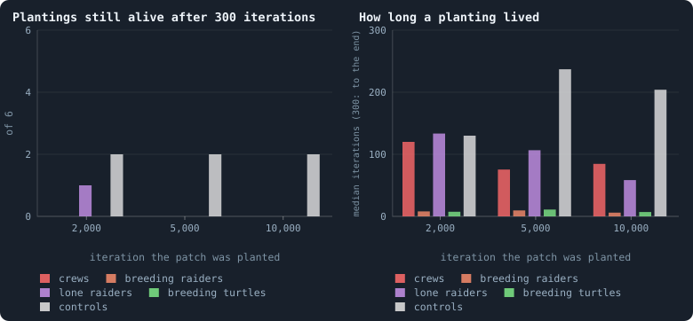

**Every strategy in B1's two long worlds.** Of the six plantings at each era (two worlds, three places): crews (red), breeding raiders (orange), lone raiders (violet), breeding turtles (green) and the controls (grey). Left: how many were still alive after 300 iterations; none of the strategies took hold, by its tokens or by its agents. Right: the median iteration a planting's last agent died in.

> [!example]- How to make this figure
> **Runs.** Experiment 35's 90 invasions (`python3 gol_lab.py run E35`): B1's two worlds played on to 10,000 iterations as pilots (`GraphOfLifeRuns/.pilots/L/B1-long-s1` and `s2`), at iterations 2,000, 5,000 and 10,000, a patch of 5% on places 1 to 3, given the crew's rule, the breeding raider's, the breeding turtle's, the lone raider's or frozen copies of one patch member's brain (the control), each rule reading B1's home share, holder's bonus and least child.
>
> **Data.** From each trial's `result.json`.
>
> 1. Load the world of the era; on place p, draw an agent at random and take its nearest neighbours, step by step, until the patch holds 5% of the world.
> 2. Give the patch the rule, or the control; play 300 iterations under the world's own rules, counting the patch's strategy's agents and their tokens after every iteration (each trial's `result.json`).
> 3. Count the plantings of each era whose strategy is alive after 300 iterations, and take the median of the iteration each planting's last agent died in (300 if it lived to the end).
>
> **To make it again:** `python3 book_figures.py b1raiders`.
<!-- /figure -->

Not one of the 90 plantings took hold, counted by tokens or by agents. After
300 iterations no crew, breeding raider or breeding turtle was alive
anywhere, and lone raiders in one planting of 18, at 2,000. Even the
controls were alive in only 2 of the 6 plantings of each era.

The breeding strategies died first: in the median planting their last agent
died 6 to 11 iterations after planting. Lone raiders lasted 59 to 134
iterations, crews 76 to 120, the controls 130 to 237.

#### What the patches did in B1

<!-- figure b1raiders/patches -->
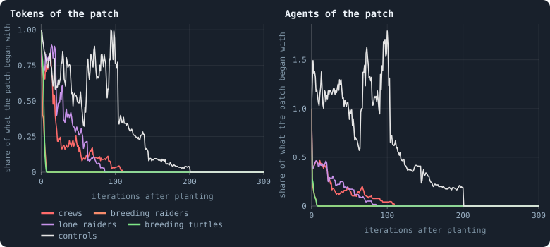

**What became of the patches in B1.** The median over the eighteen plantings of each kind, at each iteration after planting: the strategy's tokens (left) and agents (right) as a share of what the patch began with, 0 once it has died out.

> [!example]- How to make this figure
> **Runs.** As for the figure *Every strategy in B1's two long worlds* above.
>
> **Data.** From each trial's `result.json`.
>
> 1. Load the world of the era; on place p, draw an agent at random and take its nearest neighbours, step by step, until the patch holds 5% of the world.
> 2. Give the patch the rule, or the control; play 300 iterations under the world's own rules, counting the patch's strategy's agents and their tokens after every iteration (each trial's `result.json`).
> 3. At each iteration after planting, take the median over the eighteen plantings of the strategy's tokens over the patch's tokens at planting, and of its agents over the patch planted.
>
> **To make it again:** `python3 book_figures.py b1raiders`.
<!-- /figure -->

The strategies lost most of their agents in their very first iteration. The
median patch kept 26% to 28% of its agents for the breeding strategies, and
40% for lone raiders and crews. The controls gained 27% in the same
iteration.

B1's rules explain it. In B1 a connection that carries no tokens in a game
is cut, wherever it is ([`prune_needs`](settings.md#prune_needs) = 0). B2
cuts an unused connection only where its two ends share at least two other
neighbours. These strategies never stake on each other: each stakes at home,
or on a stranger. So nearly every connection inside a patch carries nothing
and is cut. An agent of the patch with no stranger next door is then cut
off from the world. The [cleanup](one-iteration.md#cleanup "The end of every phase: only the largest connected piece of the network lives on, and the tokens of the dead are shared out.") removes it at the end of the game. Evolved
brains spread their stakes over their neighbours as well as their own node,
so their connections carry tokens and stay.

Then each strategy failed in its own way:
- **The breeding raider and the breeding turtle** have a child of a single
  token whenever they hold more. And 98% to 99% of the agents of these
  worlds hold two or more. So they had a child every iteration, and their
  tokens went into children of one token, the poorest agents of a rich
  world. Their patches' tokens were gone within ten iterations.
- **The lone raider and the crew** mostly moved rather than spread. A raid
  in B1 stakes everything, so a raider that takes a node leaves its own, and
  only children add to a patch. In 14 of the 18 plantings of each, the patch
  never held more agents than it was planted with. The other four of each
  grew for a while, the most a crew from 39 agents to 220, and then died out
  too. In the median planting their tokens drained over about a hundred
  iterations.
- **The controls**, copies of an evolved brain, spread. At its largest, the
  median planting held 2.5, 5.1 and 6.7 times its patch at the three eras.
  Yet in 4 of the 6 plantings of each era they too had died out by
  iteration 300.

#### Verdict on Experiment 35: refuted

The thesis is refuted. Lone raiders took hold in none of the 18 plantings,
where it asked for at least 5. Crews took hold in as many, none, but the
thesis needed both. So it was not B2's rules alone that kept the raiders
out. B1 has no home share, no holder's bonus, no old age and no least child
of ten tokens. Yet there every strategy written by hand failed sooner,
partly by a rule of B1's own.

### What the raiders taught

- **The door closed by poverty, not by a defence.** In B2 the raider took
  hold in all 15 plantings at iteration 500 and in none of 30 at 5,000 and
  10,000. A lone raider needs three tokens to take a neighbour of one, and a
  late patch holds about two an agent. A world of many small agents shuts
  out every lone raider.
- **A group helps only where it can gather.** On B2's network a stranger
  touches one or two agents of a patch. Few mobs form, a stake without a
  partner is a gift, and the crews died before the lone raiders.
- **A strategy cannot breed where the world does not let it.** In B2's late
  worlds one agent in thirty can afford a child of ten tokens. A raider that
  breeds as the world's agents do breeds as rarely as they do.
- **A raid spreads a rule, not tokens.** In B2 every node a raider takes
  gets its rule, so its patch grows at first. But it spreads its tokens
  thinner, and its agents die of age unreplaced. Keeping still, as the
  breeding turtle does, keeps a patch alive, not growing.
- **B2's rules were not what kept the raiders out.** In B1, which has none
  of them, every strategy written by hand failed, and faster. Copies of one
  patch agent's evolved brain grew to several times their patch there.
- **A strategy must fit the world's rules.** In B1 a connection that carries
  no tokens is cut. So a patch whose agents never stake on each other cuts
  itself into pieces in its first game. A least child of one token is a trap
  for a strategy that breeds whenever it can. It pours its tokens into
  children too poor to keep a node. And without a home share, a raid is a
  move, not a gain of a node.
- **Nothing written by hand has yet taken hold in a late world**, of B2 or
  of B1. Lone raiders, crews, breeding raiders and breeding turtles all
  failed; the factory of Strategies written by hand was never planted in
  one. Each failure has a cause we can name, and none of the causes is a
  defence the residents were seen to evolve.

## What we learned

- **Evolution's play is not the best there is.** From a patch of 5%, a plain
  raider or the factory took 40 to 62% of three evolved B2 worlds in ten. The
  residents' own brains, planted the same way, never ended with more than 8%.
  No rule beat every world: worlds, and places within a world, differ in
  their weak points.
- **Knowing one's own is what wins.** Without its password, the raider died
  out in all four plantings, even in the world where with it it took half.
  The turtle, which only defends, died out everywhere.
- **A raider needs about a hundred teammates at once.** No patch of up to 30
  raiders took hold in 20 plantings. A hundred took hold 4 times in 20, and
  5% of the world 12 times. All 30 single raiders died.
- **That is a valley evolution does not cross.** The raid, the password and
  the crowd pay only together, as a green beard would. A B2 brain can play
  the raider, so what fails is the way there, not the brain.
- **Evolution goes on, but not towards this play.** Other pages gave
  evolution parts of the raider for free. Some pilots gave brains a sense of
  their clones or their family. Others counted stakes together, by genotype
  or by family
  ([A password and a crowd, for free](another-game.md#a-password-and-a-crowd-for-free)).
  In alliances, knowing one's own is a decision two neighbours make together
  ([Alliances](another-game.md#alliances)). None of these rules made
  evolution find the raiders' play. Yet under each, contests a lifetime long
  saw later brains beat earlier ones in at least one world of two
  ([A lifetime long](another-game.md#a-lifetime-long),
  [Does a world of allies keep evolving?](another-game.md#does-a-world-of-allies-keep-evolving)).
  Evolution went on there slowly, as in plain B2.

## Where to go next

- [Why the raiders stopped winning](strategies-written-by-hand.md#why-the-raiders-stopped-winning): the
  same raider in older worlds, in crews, breeding, and in B1. Its patches
  grew too poor to raid.
- [What a brain can compute](what-a-brain-can-compute.md): a B2 brain of 12
  units plays the raider, and no B2 brain can write the factory's message.
- [The invasion test](measuring-evolution.md#the-invasion-test): the method in full, and how to read
  what it shows.
- [Other contests: a lottery, and alliances](another-game.md): a password and
  a crowd given to evolution for free.
- [What holds a world's size](building-b2-and-the-search-for-a-healthy-rich-world.md#what-holds-a-worlds-size): why B2's agents
  are so poor. They breed as soon as they can, and fill their world.

## How this was made

The plantings of [Strategies written by hand](#strategies-written-by-hand)
are pilots: no experiment of the lab stands behind them, so they have no box
of runs. They were made with `research/oee/pilots/manual.py` and kept in
`GraphOfLifeRuns/.pilots/`. Experiment 29's plantings are the lab's trials.
Each figure says, folded beneath it, which plantings it reads and how.

### The plantings of the pilots

- **The worlds:** the ten B2 worlds of Experiment 16, `B2-10000-s001` …
  `-s010`, as their archives keep them at iteration 2,000
  (`GraphOfLifeRuns/<run>/archive/`).
- **The first test:** every strategy and the control in `-s001` and `-s002`,
  on seeds 1 and 2:
  `--strategies factory,turtle,raider,resident --seeds 1,2 --T 300 --patch 0.05`
  (`invade_B2_2000.json`).
- **Ten worlds:** the raider, the factory and the control in all ten, on
  seed 1 (`invade_B2_2000_ten.json`).
- **The password:** the lone raider in `-s001` and `-s002`, on seeds 1 and 2
  (`invade_B2_2000_lone.json`).
- **One raider alone:** a single raider and a single resident in `-s002`, on
  seeds 1 to 20: `--patch 0.0002 --T 200` (`invade_B2_2000_single.json`).
- **The figures:** `python3 book_figures.py handmade` draws them again; their
  numbers are in `book/results/handmade.json`.

### The trials of Experiment 29

`python3 book_figures.py crowd` draws the two figures again; their numbers
are in `book/results/crowd.json`. The trials on places 1 and 2 repeat 44 of
the pilots' plantings, and came out exactly as they did.

<!-- runs E29 -->
> [!info]- The trials behind this page
> **320 trials**, invasions: a patch of the world of one era given a strategy written by hand, and its agents counted after every iteration; each plays 300 iterations, from a world another run kept in its archive.
>
> - **raiders, worlds 2 and 3** — 120 trials: worlds `B2-10000-s002`, `B2-10000-s003`; at iteration 2,000; strategies raider; patches of 1, 3, 10, 30, 100 agents; 5% of the world; places 1 to 10, every 1.
> - **controls, worlds 2 and 3** — 120 trials: worlds `B2-10000-s002`, `B2-10000-s003`; at iteration 2,000; strategies resident; patches of 1, 3, 10, 30, 100 agents; 5% of the world; places 1 to 10, every 1.
> - **raiders, the other eight worlds** — 40 trials: worlds `B2-10000-s001`, `B2-10000-s004`, `B2-10000-s005`, `B2-10000-s006`, `B2-10000-s007`, `B2-10000-s008`, `B2-10000-s009`, `B2-10000-s010`; at iteration 2,000; strategies raider; patches of 5% of the world; places 1 to 5, every 1.
> - **controls, the other eight worlds** — 40 trials: worlds `B2-10000-s001`, `B2-10000-s004`, `B2-10000-s005`, `B2-10000-s006`, `B2-10000-s007`, `B2-10000-s008`, `B2-10000-s009`, `B2-10000-s010`; at iteration 2,000; strategies resident; patches of 5% of the world; places 1 to 5, every 1.
>
> To play these trials again: `python3 gol_lab.py run E29`, or ▶ in the Research Notebook tab of a computer running `gol_server.py`. Each writes its settings and engine beside its result, in `GraphOfLifeRuns/<trial>/meta.json` and `result.json`.
<!-- /runs -->

### How the raiders' trials were made

Experiments 30, 33 and 34 plant patches in B2's five worlds of Experiment 16,
played on to 10,000 iterations as pilots
(`GraphOfLifeRuns/.pilots/L/B2-long-s001` … `s005`). Experiment 35 plants
them in B1's two long worlds, played on to 10,000 iterations as pilots too
(`GraphOfLifeRuns/.pilots/L/B1-long-s1` and `s2`). Each trial plays from a
pilot's checkpoint, which holds a whole world, as a run's archive does. Each
figure says, folded beneath it, how it is drawn from the trials.

#### The trials of Experiment 30

`python3 book_figures.py door` draws the two figures again; their numbers
are in `book/results/door.json`. The fifteen plantings at 2,000 repeat
fifteen of Experiment 29's exactly, so the second figure and its table
count each of them once.

<!-- runs E30 -->
> [!info]- The trials behind this page
> **120 trials**, invasions: a patch of the world of one era given a strategy written by hand, and its agents counted after every iteration; each plays 300 iterations, from a world another run kept in its archive.
>
> - **raiders** — 60 trials: worlds `pilot:L/B2-long-s001`, `pilot:L/B2-long-s002`, `pilot:L/B2-long-s003`, `pilot:L/B2-long-s004`, `pilot:L/B2-long-s005`; at iteration 500, 2,000, 5,000, 10,000; strategies raider; patches of 5% of the world; places 1, 2, 3.
> - **controls** — 60 trials: worlds `pilot:L/B2-long-s001`, `pilot:L/B2-long-s002`, `pilot:L/B2-long-s003`, `pilot:L/B2-long-s004`, `pilot:L/B2-long-s005`; at iteration 500, 2,000, 5,000, 10,000; strategies resident; patches of 5% of the world; places 1, 2, 3.
>
> To play these trials again: `python3 gol_lab.py run E30`, or ▶ in the Research Notebook tab of a computer running `gol_server.py`. Each writes its settings and engine beside its result, in `GraphOfLifeRuns/<trial>/meta.json` and `result.json`.
<!-- /runs -->

#### The trials of Experiment 33

`python3 book_figures.py crews` draws the three figures again; their numbers
are in `book/results/crews.json`. The third figure plays no world: it reads
each world as the crews were planted in it
(`research/oee/strategies/mobs.py`).

<!-- runs E33 -->
> [!info]- The trials behind this page
> **135 trials**, invasions: a patch of the world of one era given a strategy written by hand, and its agents counted after every iteration; each plays 300 iterations, from a world another run kept in its archive.
>
> - **crews** — 45 trials: worlds `pilot:L/B2-long-s001`, `pilot:L/B2-long-s002`, `pilot:L/B2-long-s003`, `pilot:L/B2-long-s004`, `pilot:L/B2-long-s005`; at iteration 2,000, 5,000, 10,000; strategies crew; patches of 5% of the world; places 1, 2, 3.
> - **lone raiders** — 45 trials: worlds `pilot:L/B2-long-s001`, `pilot:L/B2-long-s002`, `pilot:L/B2-long-s003`, `pilot:L/B2-long-s004`, `pilot:L/B2-long-s005`; at iteration 2,000, 5,000, 10,000; strategies raider; patches of 5% of the world; places 1, 2, 3.
> - **controls** — 45 trials: worlds `pilot:L/B2-long-s001`, `pilot:L/B2-long-s002`, `pilot:L/B2-long-s003`, `pilot:L/B2-long-s004`, `pilot:L/B2-long-s005`; at iteration 2,000, 5,000, 10,000; strategies resident; patches of 5% of the world; places 1, 2, 3.
>
> To play these trials again: `python3 gol_lab.py run E33`, or ▶ in the Research Notebook tab of a computer running `gol_server.py`. Each writes its settings and engine beside its result, in `GraphOfLifeRuns/<trial>/meta.json` and `result.json`.
<!-- /runs -->

#### The trials of Experiment 34

`python3 book_figures.py breeders` draws the figures again. The share of
agents that could afford a child is read from the five worlds as kept at
each era (`GraphOfLifeRuns/.pilots/L/B2-long-s001` … `s005`,
`ckpt_<iteration>.npz`). It is written with every other number of the
section to `book/results/breeders.json`.

<!-- runs E34 -->
> [!info]- The trials behind this page
> **180 trials**, invasions: a patch of the world of one era given a strategy written by hand, and its agents counted after every iteration; each plays 300 iterations, from a world another run kept in its archive.
>
> - **breeding raiders** — 45 trials: worlds `pilot:L/B2-long-s001`, `pilot:L/B2-long-s002`, `pilot:L/B2-long-s003`, `pilot:L/B2-long-s004`, `pilot:L/B2-long-s005`; at iteration 2,000, 5,000, 10,000; strategies breeding-raider; patches of 5% of the world; places 1, 2, 3.
> - **breeding turtles** — 45 trials: worlds `pilot:L/B2-long-s001`, `pilot:L/B2-long-s002`, `pilot:L/B2-long-s003`, `pilot:L/B2-long-s004`, `pilot:L/B2-long-s005`; at iteration 2,000, 5,000, 10,000; strategies breeding-turtle; patches of 5% of the world; places 1, 2, 3.
> - **lone raiders** — 45 trials: worlds `pilot:L/B2-long-s001`, `pilot:L/B2-long-s002`, `pilot:L/B2-long-s003`, `pilot:L/B2-long-s004`, `pilot:L/B2-long-s005`; at iteration 2,000, 5,000, 10,000; strategies raider; patches of 5% of the world; places 1, 2, 3.
> - **controls** — 45 trials: worlds `pilot:L/B2-long-s001`, `pilot:L/B2-long-s002`, `pilot:L/B2-long-s003`, `pilot:L/B2-long-s004`, `pilot:L/B2-long-s005`; at iteration 2,000, 5,000, 10,000; strategies resident; patches of 5% of the world; places 1, 2, 3.
>
> To play these trials again: `python3 gol_lab.py run E34`, or ▶ in the Research Notebook tab of a computer running `gol_server.py`. Each writes its settings and engine beside its result, in `GraphOfLifeRuns/<trial>/meta.json` and `result.json`.
<!-- /runs -->

#### The trials of Experiment 35

`python3 book_figures.py b1raiders` draws the figures again. The share of
agents holding two tokens or more is read from the two worlds as kept at
each era (`GraphOfLifeRuns/.pilots/L/B1-long-s1` and `s2`,
`ckpt_<iteration>.npz`). It is written with every other number of the
section to `book/results/b1raiders.json`.

<!-- runs E35 -->
> [!info]- The trials behind this page
> **90 trials**, invasions: a patch of the world of one era given a strategy written by hand, and its agents counted after every iteration; each plays 300 iterations, from a world another run kept in its archive.
>
> - **crews** — 18 trials: worlds `pilot:L/B1-long-s1`, `pilot:L/B1-long-s2`; at iteration 2,000, 5,000, 10,000; strategies crew; patches of 5% of the world; places 1, 2, 3.
> - **breeding raiders** — 18 trials: worlds `pilot:L/B1-long-s1`, `pilot:L/B1-long-s2`; at iteration 2,000, 5,000, 10,000; strategies breeding-raider; patches of 5% of the world; places 1, 2, 3.
> - **breeding turtles** — 18 trials: worlds `pilot:L/B1-long-s1`, `pilot:L/B1-long-s2`; at iteration 2,000, 5,000, 10,000; strategies breeding-turtle; patches of 5% of the world; places 1, 2, 3.
> - **lone raiders** — 18 trials: worlds `pilot:L/B1-long-s1`, `pilot:L/B1-long-s2`; at iteration 2,000, 5,000, 10,000; strategies raider; patches of 5% of the world; places 1, 2, 3.
> - **controls** — 18 trials: worlds `pilot:L/B1-long-s1`, `pilot:L/B1-long-s2`; at iteration 2,000, 5,000, 10,000; strategies resident; patches of 5% of the world; places 1, 2, 3.
>
> To play these trials again: `python3 gol_lab.py run E35`, or ▶ in the Research Notebook tab of a computer running `gol_server.py`. Each writes its settings and engine beside its result, in `GraphOfLifeRuns/<trial>/meta.json` and `result.json`.
<!-- /runs -->

## How our view changed

- **24 October 2026.** From 15 October, this page said that none of the
  rules tried after it made evolution find the raiders' play "or go on
  improving". Contests a lifetime long, played later that day, found
  evolution going on slowly. In plain B2, every era beat the one before it,
  to iteration 2,000
  ([Would we notice if it went on?](how-to-tell-a-world-that-keeps-evolving.md#would-we-notice-if-it-went-on)).
  Under every contest tried but a lottery, later brains beat earlier ones in
  at least one world of two ([A lifetime long](another-game.md#a-lifetime-long)).
  With alliances they did so in both worlds
  ([Does a world of allies keep evolving?](another-game.md#does-a-world-of-allies-keep-evolving)).
  What none of these rules did is make evolution find the raiders' play. The
  page kept the old sentence until the pages were merged.
- **24 October 2026.** From 15 October, this page said that a strategy
  written by hand "can do nothing an evolved brain could not do". The reason
  it gave was that a strategy reads and writes exactly what a brain does. On
  19 October,
  [What a brain can compute](what-a-brain-can-compute.md#what-no-brain-of-b2-can-compute)
  showed that this holds for the raider but not for the factory. Twelve of a
  B2 brain's 16 units play the raider. But a brain scores each candidate's
  column on its own. So no B2 brain of any size can write news of a third
  agent into a message. The factory's distance to its frontier is such news.
- **24 October 2026.** When the pages were merged, their numbers were checked
  against the pilots' records (`GraphOfLifeRuns/.pilots/invade_B2_2000*.json`)
  and each trial's `result.json`. Six statements were wrong; no conclusion
  changes.
  - In world 2 the factory was said to reach 48 and 52%, and to be still
    growing when the test stopped. After 300 iterations it held 48 and 51%.
    One planting had peaked at 52% four iterations before the end, the other
    at 50% fifteen iterations before it. Both gained over their last fifty
    iterations.
  - In the ten worlds, the factory was said to have died out in world 3. It
    shrank from 302 agents to 13, and was still alive after 300 iterations.
  - The strategies were said to take half or more of three worlds in ten.
    They took 40 to 62%: the raider 62% of world 3, and the factory 48% of
    world 2 and 43% of world 6.
  - Experiment 29's patches of 5% were said to hold about 175 agents. In
    worlds 2 and 3, where its twenty such plantings were, they held 153 and
    168.
  - The raider that took half a world was said to have a few hundred
    teammates. Its patch in world 2 held 153.
  - In world 3, the raiders of the places where no raid took hold were said
    to have died out or kept a handful. Three died out, and five kept 12 to
    82 agents.
- *Why the raiders stopped winning*:
  - **21 October 2026.** From 20 October, the section on Experiment 30 said
    that a world of many small agents shuts out every lone raider, but not a
    group. Raiders that see the same stranger as the weakest next door would
    pool their stakes. So the poorer the world, the more a group would be
    worth. Experiment 33 ([A crew of raiders](#a-crew-of-raiders)) planted
    such crews in the same places. They took hold nowhere, at 2,000, 5,000 or
    10,000, and died before the lone raiders in 42 of 45 places.
  - **23 October 2026.** From 21 October, the section on Experiment 33 said
    the closed door says as much about the raider's breeding rule as about the
    world. That rule waits for 30 tokens before a child. Experiment 34
    ([Raiders that breed](#raiders-that-breed)) gave the raider the world's
    own way of breeding, and nothing changed. In B2's late worlds, only one
    agent in thirty can afford even the world's least child.
  - **23 October 2026.** When these pages were merged, their statements were
    checked against each trial's `result.json`, and three were wrong.
    - [Hand-written strategies in B1](#hand-written-strategies-in-b1) said
      that no planting of a lone raider or a crew there ever held more agents
      than it was planted with. Four of the 18 of each did, for a while: a
      crew grew from 39 agents to 220 before it died out.
      [Raiders that breed](#raiders-that-breed) said the same of the breeding
      turtles, and two of the 45 held one agent more, for one iteration. The
      stored numbers give only the median planting's largest size, which is
      the planted size at every era. No verdict changes.
    - The section on Experiment 30 said that every late patch grew a little
      in its first five iterations and was gone by about iteration 150. One of
      the 30 never grew, and they died out 100 to 253 iterations after
      planting, half of them within about 150.
    - Its table of plantings by wealth counted 120 plantings without saying
      that fifteen are counted twice. Counted once, the plantings of 2.2 to 2.6
      tokens per agent at 2,000 took hold 8 times in 25, not 9 in 30. The
      picture does not change.
  - **24 October 2026.** The second figure and the table of plantings by
    wealth are now drawn with each planting counted once
    (`book_chapters/door.py`). Their rows read 0 of 23, 7 of 48, 6 of 14, 14
    of 14 and 6 of 6. They had read 0 of 24, 8 of 58, 7 of 16, 16 of 16 and 6
    of 6. The median wealth at 2,000 is 2.36 over Experiment 29's sixty
    plantings, where the page gave 2.35 over all seventy-five.
- **11 November 2026.** The page Why the raiders stopped winning, on
  Experiments 30 and 33 to 35, became a section of this one. Both pages ask
  whether a strategy written by hand can beat evolution. The second asks why
  this page's raider stopped winning in older worlds. Nothing was cut.

<!-- turns -->
---

[Strategies written by hand](../README.md#strategies-written-by-hand) · [What a brain can compute](what-a-brain-can-compute.md) →

**Also about:** [Does evolution keep going?](../README.md#does-evolution-keep-going), [Groups and cooperation](../README.md#groups-and-cooperation), [The baselines B1 and B2](../README.md#the-baselines-b1-and-b2).

> [!info]- Pages that link here (17)
> [What this notebook is about](what-this-notebook-is-about.md) · [The ideas this builds on](the-ideas-this-builds-on.md) · [A screen of random worlds](a-screen-of-random-worlds.md) · [The rules in detail](rules-in-detail.md) · [Physical inspiration](physical-inspiration.md) · [What the brains are like](what-the-brains-are-like.md) · [Measuring evolution: genotypes, eras and the open-ended test](measuring-evolution.md) · [Does evolution keep going?](how-to-tell-a-world-that-keeps-evolving.md) · [How fast should brains change?](how-fast-should-brains-change.md) · [Every era against three](every-era-against-three.md) · [What a brain can compute](what-a-brain-can-compute.md) · [One agent in a sea of average agents](one-agent-in-a-sea-of-average-agents.md) · [Other contests: a lottery, and alliances](another-game.md) · [Every simulation: what was run, and what was measured](every-simulation.md) · [What B1 is, and what stood in its way](what-the-baseline-world-is.md) · [B1: brains, lineages and messages](b1-brains-lineages-and-messages.md) · [Cooperation, help and gliders (side study)](cooperation-help-and-gliders.md)
<!-- /turns -->
