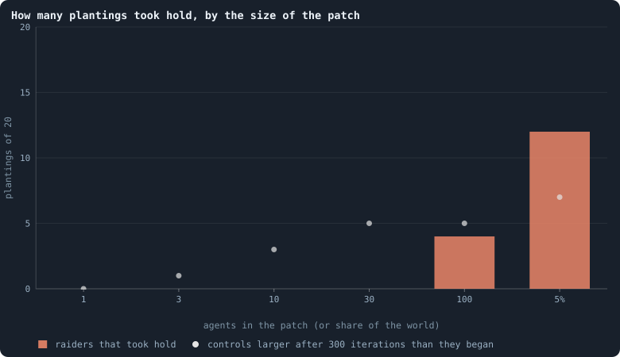
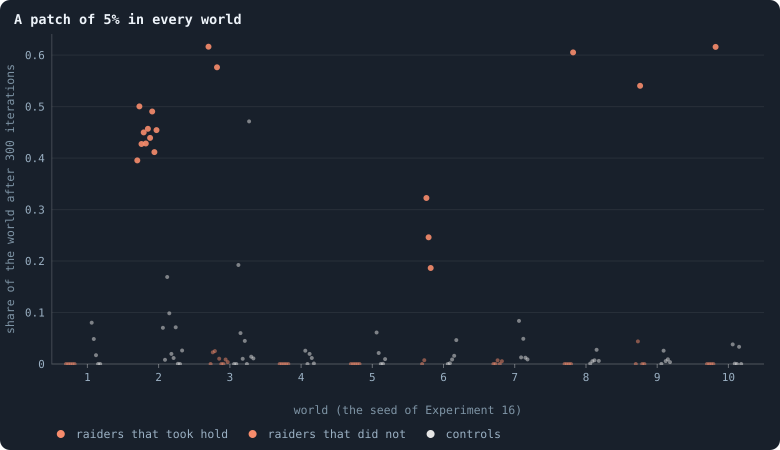

# Can a strategy written by hand beat evolution?

> [!question] Questions of this page
> - Is the play evolution found in [B2](b1-and-b2.md "The second baseline: B1 with the rules that keep its network from breaking and its agents from staking or breeding themselves to death.")'s worlds the best there is, or only
>   the best it could reach?
> - Can a strategy written by hand, for one [agent](the-world.md#agents-and-tokens "One member of a world: it lives on a node of the network, holds tokens and has a brain that takes all its decisions.") or for a team, beat evolved
>   [brains](the-brain.md "The neural network each agent decides with: inputs about itself and its neighbours, outputs that become its decisions.") in their own world?
> - What would a team need in order to grow, and which of its parts wins?
> - How many raiders must start together for a raid to take hold?
> - Is it the world, or the place in it, that decides?

## In short

Evolution in B2's worlds slows down as they age: is the play it has found the
best there is? To find out, we planted rules written by hand as a patch in
evolved B2 worlds. From 5% of a world, a plain raider or a team with a
pipeline took 40 to 62% of three worlds in ten. The residents' own brains,
planted the same way, never ended with more than 8%. The better play pays
only with three things at once: the raid, a password that tells teammates
from strangers, and a crowd. Experiment 29 measured the crowd: about a
hundred raiders must start together, and the world they start in decides as
much as the crowd.

## Strategies written by hand

### Is evolution's play the best there is?

Evolution in B2 slows down as a world ages. In contests a [lifetime](age-and-lifetime.md "How many iterations an agent lives, from its birth to its death.") long,
later brains beat earlier ones by less and less
([Would we notice if it went on?](how-to-tell-a-world-that-keeps-evolving.md#would-we-notice-if-it-went-on)).
Why does it slow? One early answer was that the [game](one-iteration.md#phase-2-the-game "The second phase of an iteration: every agent stakes all its tokens on its own node and its neighbours', and every node goes to someone.") has a best way to play,
and that evolution finds it
([Does the game have an answer?](how-to-tell-a-world-that-keeps-evolving.md#does-the-game-have-an-answer)).
The agents' game is close to a Colonel Blotto contest, whose best play is to
be unpredictable. Once a population plays that way, nothing better is left to
find.

That answer makes a prediction we can test without waiting for evolution at
all. If the evolved play is the best there is, no strategy anyone could write
should beat it by much. If one does, evolution is not near the top: the game
has more to give than evolution has taken.

There is a second reason to write strategies by hand. Evolution finds what is
one small step from what it has. A strategy that needs many agents to act
together may be far better and still never be found, because no single
[mutation](mutation.md "A random change to a brain, made with a set probability when it is copied, and in B1 also after every game: a changed brain is a new genotype.") makes it. Some agents would hold a frontier, others would feed it,
and all would know which is which. The author of the simulation suggested
exactly such a strategy, a *factory*. In this structured group, every agent
has its job in the pipeline of [token flow](token-flow.md "The tokens a game moves along each connection, from the agent who stakes to the node staked on."). It extracts [tokens](the-world.md#agents-and-tokens "The one thing of value in a world: every agent holds a whole number of them, and their total never changes.") from its
surroundings like a colony of parasites. If a factory written by hand can
grow in an evolved world, the game rewards organisation. The question then
becomes how evolution could get there.

### The invasion test

The method has a page of its own ([The invasion test](eras-and-contests.md#the-invasion-test)).
Take an evolved world: one of the ten B2 worlds of
[Experiment 16](how-to-tell-a-world-that-keeps-evolving.md#the-runs-of-experiment-16),
each of 10,000 tokens, as it stood at [iteration](one-iteration.md "One step of a world's time: a phase of reproduction, then a phase of the game.") 2,000. This page calls each
world by its [seed](random-numbers.md "The number that fixes every random choice of a run: the same settings and the same seed make the same world.") there: world 2 is the world of seed 2. Then:

- **The patch.** Draw an agent at random, then take the agents nearest to
  it, step by step, until the patch holds 5% of the world.
- **The planting.** Give every agent of the patch a strategy instead of its
  brain, and play on under the world's own rules. A strategy spreads as a
  brain does: into a child, and into a node its owner takes. It never
  mutates.
- **The count.** Follow the share of the world's agents that carry the
  strategy.

Each planting has a seed of its own. It picks where the patch lies, and how
every chance falls after that.

A strategy's share means nothing on its own. A patch might grow or shrink
whatever it does, because of where it was placed. So every patch is also
played as a **control**. The same agents are given a copy of one resident's
brain, the brain of an agent of the patch drawn at random. The copy is marked
so it can be counted, and it never mutates. A strategy beats the residents if
it holds more of the world than the resident patch played from the same place
on the same seed.

A strategy reads exactly what a brain reads, and writes exactly what a brain
writes (`research/oee/pilots/manual.py`; the rules now live in the [engine](the-lab.md "The program that runs an experiment's plan as runs, each on a frozen copy of the engine, the code that plays a world.")'s
`gol_strategies.py`). It sees each [candidate](one-iteration.md#phase-1-reproduction "An agent itself and each of its neighbours, the ones its brain looks at when it decides.")'s tokens, its [connections](the-world.md#the-network "A link between two agents of the network: they are neighbours, and can stake on each other's nodes.") and
its [messages](messages.md "Numbers an agent writes to itself and to each neighbour every phase, which their brains read."). Its decisions go through the same output rows that the engine
turns into a child, its links, the stakes and the messages. So it reads and
writes nothing an evolved brain could not.

What it makes of what it reads is another matter. A rule written in Python
can combine its inputs in ways a B2 brain cannot. The raider below is within a B2
brain's reach: 12 of the brain's 16 hidden units, with weights set by hand,
play it. The factory's message is not: no B2 brain of any size can compute
it ([What a brain can compute](what-a-brain-can-compute.md)).

### Three strategies

- **The turtle** keeps everything at home. When it has 30 tokens or more it
  has a child with a third of them.
- **The raider** looks for the poorest [neighbour](the-world.md#the-network "An agent joined to another by a connection.") that is not a teammate: a
  *stranger*. Under B2 it can stake at most 70% of its tokens, since 30% stay
  home. And a holder's own stake on its node counts one and a half times. If
  70% of the raider's tokens are more than one and a half times the
  stranger's, they are sure to take its node. That holds even if the
  stranger keeps everything at home. Then the raider stakes them all there;
  otherwise it keeps everything at home. When it has 30 tokens or more it
  has a child with a third of them, joined to every teammate next door.
- **The factory** is a team with a pipeline. Every member works out how far
  it is from the team's **frontier**. Its distance is 0 if a stranger is
  next door. Otherwise it is one more than the smallest distance a teammate
  reported. It writes the distance into its messages. Members on the
  frontier attack as the raider does. Everything they can stake goes on the
  poorest stranger next door if that takes it; otherwise they hold. Members
  inside stake everything they can on the teammate nearest the frontier.
  That pumps their tokens downhill, towards where the team meets the rest of
  the world. Inside members breed when rich, at 30 tokens or more, and join
  their children to their teammates.

Teammates know each other by what they write. The first four numbers of
every message a strategy sends are fixed, 0.9, −0.9, 0.9 and −0.9: its
**password**. The fifth carries its distance. The password is not a
privilege: an evolved brain could write the same numbers.

### What the strategies did

The first test planted every strategy, and the control, in worlds 1 and 2,
on two seeds each, for 300 iterations.

<!-- figure handmade/shares -->

**The share of two evolved worlds held by a strategy.** One line per planting: two seeds in each of two worlds, the world of seed 1 dashed, of seed 2 solid. Grey is the control, a patch of the residents' own brains planted in the same place.

> [!example]- How to make this figure
> **Runs.** The B2 worlds of Experiment 16, `B2-10000-s001` … `-s010`, as their archives keep them at iteration 2,000 (`GraphOfLifeRuns/<run>/archive/`). Strategies planted with `python3 research/oee/pilots/manual.py`: in `-s001` and `-s002` every strategy and the control on seeds 1 and 2 (`--strategies factory,turtle,raider,resident --seeds 1,2 --T 300 --patch 0.05`); in all ten worlds the raider, the factory and the control on seed 1; in `-s001` and `-s002` the lone raider on seeds 1 and 2; in `-s002` a single raider, and a single resident, on seeds 1 to 20 (`--patch 0.0002 --T 200`).
>
> **Data.** From the worlds the archives keep.
>
> 1. Load the world of iteration 2,000 (`GraphOfLife.from_checkpoint`). On seed *s*, draw an agent at random and take the agents nearest to it, step by step, until the patch holds the share asked for (5%, or one agent).
> 2. Give each agent of that patch the strategy (`manual.py`), or, for the control, a frozen copy of the brain of one agent of the patch drawn at random; neither ever mutates.
> 3. Play on under the world's own rules and count, after each iteration, the agents carrying the strategy, as a share of all agents.
>
> **To make it again:** `python3 book_figures.py handmade`.
<!-- /figure -->

**In one world, the strategies took half of it.** In world 2 the factory grew
from 5% of the agents to 48 and 51% in 300 iterations. Over its last fifty
iterations it was still gaining. The raider did nearly as well, with 40 and
50%. The control, a patch of the residents' own brains in the same place,
ended with 7 and 1%.

**In the other world, they died out.** In world 1 the factory and the raider
grew a little at first, to 6 or 7% of the world. Then they shrank, and were
gone after 135 to 196 iterations. The control there ended with 8 and 5%.

**The turtle died out everywhere** within about a hundred iterations. It
never takes a node and rarely has a child, and under B2 every agent dies at
age 100. A strategy that only defends cannot outlive its own bodies.

So in one of two evolved worlds, a plain rule took half the world from brains
that evolution had shaped for 2,000 iterations.

### Ten worlds

Then the raider, the factory and the control were planted once in each of the
ten B2 worlds of Experiment 16, on seed 1.

<!-- figure handmade/ten -->

**Ten evolved worlds, a patch of 5% each.** One dot per world, the bar the median of ten.

> [!example]- How to make this figure
> **Runs.** The B2 worlds of Experiment 16, `B2-10000-s001` … `-s010`, as their archives keep them at iteration 2,000 (`GraphOfLifeRuns/<run>/archive/`). Strategies planted with `python3 research/oee/pilots/manual.py`: in `-s001` and `-s002` every strategy and the control on seeds 1 and 2 (`--strategies factory,turtle,raider,resident --seeds 1,2 --T 300 --patch 0.05`); in all ten worlds the raider, the factory and the control on seed 1; in `-s001` and `-s002` the lone raider on seeds 1 and 2; in `-s002` a single raider, and a single resident, on seeds 1 to 20 (`--patch 0.0002 --T 200`).
>
> **Data.** From the worlds the archives keep.
>
> 1. Load the world of iteration 2,000 (`GraphOfLife.from_checkpoint`). On seed *s*, draw an agent at random and take the agents nearest to it, step by step, until the patch holds the share asked for (5%, or one agent).
> 2. Give each agent of that patch the strategy (`manual.py`), or, for the control, a frozen copy of the brain of one agent of the patch drawn at random; neither ever mutates.
> 3. Play on under the world's own rules and count, after each iteration, the agents carrying the strategy, as a share of all agents.
>
> **To make it again:** `python3 book_figures.py handmade`.
<!-- /figure -->

In three of the ten worlds, one of the two strategies took between 40 and 62%
of the world in 300 iterations:
- **World 2:** both did, the raider with 40% and the factory with 48%.
- **World 3:** the raider took 62%, while the factory shrank to 13 agents.
- **World 6:** the other way round. The factory took 43%, and the raider
  died out.

In the other seven worlds both died out. The control, a patch of the
residents' own brains, never ended with more than 8%.

So the answer is not one strategy that beats every evolved world. Evolved
worlds differ in where they are weak. Some could be raided from where the
patch happened to land; most could not be, by these two rules. But in three
worlds of ten, a plain rule took 40 to 62% of the world from brains evolution
had shaped for 2,000 iterations. The residents' own brains did nothing of the
kind from the same places.

**The evolved play is not the best there is.** That answers the question
this page began with. The game had more to give, and evolution had not taken
it ([What the probes say about why](how-to-tell-a-world-that-keeps-evolving.md#what-the-probes-say-about-why)).
Whether the factory or the raider won depended on the world, so the pipeline
is no advantage in general. What the two share is what matters, and the next
two tests take it apart.

### The password

The raider differs from a resident in two ways. It attacks the poorest
neighbour it is sure to take. And it knows its teammates, and never attacks
them. Which of the two wins?

The **lone raider** keeps the first and drops the second. It attacks the
poorest neighbour it is sure to take, whoever that is. It writes no password,
and joins its children to nobody by choice. It was planted where the first
test planted the raider: in worlds 1 and 2, on two seeds each. It grew a
little at first, from 177 agents in world 1 or 153 in world 2, to about 200.
Then it died out in all four plantings, within 97 to 122 iterations. That
includes world 2, where the raider with its password took half.

The rule of attack is not what wins; knowing one's own is. A raider that
cannot tell its own spends its attacks on its own. Inside the patch its
poorest neighbour is usually a teammate, often its own newborn child, and
taking it gains nothing. Meanwhile the bodies it lives in grow old and die,
as the turtle's did.

### One raider alone

Evolution makes a new strategy one agent at a time: a mutation changes one
brain, and the new brain must spread from there. So the last test plants a
single raider, a patch of one agent, in world 2, where a patch of 5% took
half. It ran on twenty seeds for 200 iterations, against a single resident
planted the same way.

The single raider died out every time. Before it went, it grew larger than
the single resident, with peaks of up to 28 agents against at most 5. It also
lived longer, a [median](median-and-quantiles.md "The middle value: half of the numbers lie below it and half above.") of about 34 iterations against 21. But it never took
hold. The single resident never did either: one brain in three thousand is
easily lost.

A raider needs a crowd. With 153 teammates who know one another, it took half
a world. Alone, or among teammates it cannot tell from strangers, it dies.

## How large a crowd a raider needs

<!-- experiment E29 -->

### How deep is the valley?

Put together, the tests above say that the better play needs three things
at once:
- a way to attack: the raid;
- a way to know one's own: the password, so that raiders never raid each
  other;
- enough of one's own to start with: a crowd of teammates who know the
  password.

Each alone is worth nothing or less. A raid without a password is spent on
one's own, and a password without a crowd is a secret nobody else knows.
Evolution changes one brain a little at a time, and every step on the way
must pay. A strategy whose parts pay only together is a valley evolution
cannot cross. This is the old problem of the **green beard**. Such a gene
would have to make its bearers both show a sign and favour those who show it.

The valley is not in the brain: a B2 brain can play the raider
([What a brain can compute](what-a-brain-can-compute.md)). So how large a
crowd the raider needs says how deep the valley is, between the play
evolution has and the raider's.

The tests above leave that open, for two reasons. Twenty failures of a single
raider do not prove it never takes hold. With none in twenty, it could still
take hold up to one time in seven. And they planted each size in one place
per world. That mixes up what the world allows with where the patch happened
to land.

### What we expected of a crowd

We expected a threshold. A single raider should never take hold, as in the
twenty tries above. Of twenty patches of 5%, ten places in each of the two
worlds where raiders had taken hold, at least half should. And a smaller
patch should never do clearly better than a larger one.

In worlds 2 and 3, Experiment 29 plants patches of 1, 3, 10, 30 and 100
raiders, and of 5% of the world. Each size goes into ten places. A patch of
5% is also planted in five places in each of the other eight worlds. Every
planting has a control: the same patch given frozen copies of one resident's
brain. Each planting is an invasion test, played by the lab:
- The world as it stood at iteration 2,000 is loaded.
- A patch is chosen on the trial's place: an agent drawn at random, then its
  nearest neighbours, step by step, to the patch's size.
- The patch is given the strategy, which never mutates.
- The world plays 300 iterations under its own rules, and the strategy's
  agents and tokens are counted after every iteration.

A planting **takes hold** when, after 300 iterations, its raiders are alive,
more than the patch began with, and more than the control holds there.

A place is a seed, as in the tests above. So the plantings on places 1 and 2
are those tests' plantings on seeds 1 and 2, played again by the lab. All 44
plantings the two share came out exactly alike.

<!-- thesis E29 -->
> [!quote] The thesis of Experiment 29, written down before any of its runs existed
> **The claim.** A raider needs a crowd. In worlds 2 and 3 of Experiment 16 at iteration 2,000, the share of plantings in which a patch of raiders takes hold rises with the patch: none of the 20 single raiders takes hold, and at least half of the 20 patches of 5% do. A planting takes hold when, after 300 iterations, its raiders are alive, more than the patch began with, and more than the control holds there: the same patch given frozen copies of one resident's brain.
>
> **Why it would be so.** In Chapter [51](strategies-written-by-hand.md) a patch of 5% of raiders took 40% and 50% of world 2 and 62% of world 3, while a single raider died out in all 20 plantings in world 2, with peaks of up to 28 agents. Its play pays only with three things at once: the raid, the password and enough teammates (the green beard). Chapter [94](what-a-brain-can-compute.md)'s replay of the same patches lost one of four in worlds 2 and 3 to chance. Twenty plantings of each size, ten places in each world, bound how often a size could take hold and be missed: none in 20 still allows up to 14% at 95% confidence.
>
> **It holds if:** No single raider of 20 takes hold, at least 10 of the 20 patches of 5% do, and no smaller patch takes hold in three or more plantings in twenty more than a larger one.
>
> **It fails if:** A single raider takes hold, fewer than 10 of the 20 patches of 5% do, or a smaller patch takes hold in three or more plantings in twenty more than a larger one.
>
> *Written while the notebook still numbered its chapters: each number is a link to the page it meant that day.*
<!-- /thesis -->

### What the raiders did

<!-- figure crowd/crowd -->

**How many plantings took hold, by the size of the patch.** Bars: of the 20 plantings of each size (ten places in each of worlds 2 and 3), how many raider patches took hold: alive after 300 iterations, more than they began with, and more than the control planted in the same place. Grey dots: how many of the controls, frozen copies of one resident's brain, were larger after 300 iterations than they began.

> [!example]- How to make this figure
> **Runs.** Experiment 29's 320 invasions (`python3 gol_lab.py run E29`): the ten B2 worlds of Experiment 16, `B2-10000-s001` … `-s010`, as their archives keep them at iteration 2,000. In worlds 2 and 3, patches of 1, 3, 10, 30 and 100 agents and of 5% of the world on places 1 to 10; in the other eight, 5% on places 1 to 5. Every patch once with the raider's rule and once as a control, frozen copies of one patch member's brain (`gol_strategies.plant`).
>
> **Data.** From each trial's `result.json`.
>
> 1. Load the world of iteration 2,000; on place p, draw an agent at random and take its nearest neighbours, step by step, until the patch has its size.
> 2. Give the patch the raider ([Strategies written by hand](strategies-written-by-hand.md)'s rule), or the control; neither ever mutates.
> 3. Play 300 iterations under the world's own rules, counting the patch's agents after every iteration.
> 4. A planting takes hold when, after 300 iterations, its raiders are alive, more than the patch began with, and more than the control holds there.
>
> **To make it again:** `python3 book_figures.py crowd`.
<!-- /figure -->

**About a hundred raiders are the least that can start a raid.**
- **Up to 30 raiders:** none took hold in 20 plantings. The patches died out
  faster the smaller they were. Half had died out by iteration 51 for a
  single raider, 72 for three, 100 for ten and 148 for thirty.
- **A hundred raiders** took hold 4 times in 20.
- **5% of the world,** 153 agents in world 2 and 168 in world 3, took hold 12
  times in 20.

The twenty single raiders of [One raider alone](#one-raider-alone) were all
planted in world 2. Ten of them are ten of these plantings again, and ten are
more. So 30 different single raiders have now died. If a single raider could
take hold, it would do so less than one time in ten. Otherwise these 30
would very likely have shown it.

The controls, frozen copies of the residents' own brains, show no such
threshold:
- **Alive after 300 iterations:** a larger patch of residents lived more
  often, 0, 1, 5, 8, 13 and 16 times in 20, from one agent to 5%.
- **Larger than they began:** rarely, 0 to 7 times in 20.

A raid is either joined by enough raiders or it dies.

### The world decides as much as the crowd

<!-- figure crowd/worlds -->

**A patch of 5% in every world.** Each dot is one planting of a patch of 5% of the world at iteration 2,000: left of each world, the raiders (filled where they took hold), right of it, the control planted in the same place. Worlds 2 and 3 have ten places, the others five.

> [!example]- How to make this figure
> **Runs.** Experiment 29's 320 invasions (`python3 gol_lab.py run E29`): the ten B2 worlds of Experiment 16, `B2-10000-s001` … `-s010`, as their archives keep them at iteration 2,000. In worlds 2 and 3, patches of 1, 3, 10, 30 and 100 agents and of 5% of the world on places 1 to 10; in the other eight, 5% on places 1 to 5. Every patch once with the raider's rule and once as a control, frozen copies of one patch member's brain (`gol_strategies.plant`).
>
> **Data.** From each trial's `result.json`.
>
> 1. Load the world of iteration 2,000; on place p, draw an agent at random and take its nearest neighbours, step by step, until the patch has its size.
> 2. Give the patch the raider ([Strategies written by hand](strategies-written-by-hand.md)'s rule), or the control; neither ever mutates.
> 3. Play 300 iterations under the world's own rules, counting the patch's agents after every iteration.
> 4. A planting takes hold when, after 300 iterations, its raiders are alive, more than the patch began with, and more than the control holds there.
>
> **To make it again:** `python3 book_figures.py crowd`.
<!-- /figure -->

- **World 2:** every one of ten patches of 5% took hold, each holding 40 to
  50% of the world after 300 iterations.
- **World 3:** two of ten took hold, with 58% and 62%. In the other eight
  places the raiders died out (three) or shrank to between 12 and 82 agents
  (five).
- **The other eight worlds:** four let a raid take hold in some places
  (world 6 in three of five, worlds 8, 9 and 10 in one each). Four let it
  take hold in none (worlds 1, 4, 5 and 7).
- **Over all ten worlds,** at the same five places, the raid took hold 13
  times in 50.

In most worlds, most places beat the raid. What makes a place raidable?
[What a raid starts from](does-evolution-close-the-door.md#what-a-raid-starts-from)
found that it depends on the patch itself: on its wealth, the tokens per
agent it holds when it is planted.

### Verdict on Experiment 29: the thesis holds

**The thesis holds.**
- No single raider took hold, 0 of 20.
- 12 of the 20 patches of 5% did, where at least 10 were asked for.
- No smaller patch took hold more often than a larger one.

**The valley is about a hundred agents wide.** The raider pays only in
company: it needs about a hundred neighbours playing it at once before it
takes hold. Mutation changes one brain at a time, and a hundred neighbours
changing the same way at once does not happen. So evolution cannot reach the
raider by mutation alone, though a B2 brain can play it. The green beard's
valley, named above, is measured here.

**A crowd can grow from one.** A brain's children carry it. A raider that
bred before it died would grow its own crowd, if its first children lived
long enough. The single raiders' lines grew to at most 28 agents before dying
out, about a quarter of the crowd they needed.

## What we learned

- **Evolution's play is not the best there is.** From a patch of 5%, a plain
  raider or the factory took 40 to 62% of three evolved B2 worlds in ten. The
  residents' own brains, planted the same way, never ended with more than 8%.
  No rule beat every world: worlds, and places within a world, differ in
  their weak points.
- **Knowing one's own is what wins.** Without its password, the raider died
  out in all four plantings, even in the world where with it it took half.
  The turtle, which only defends, died out everywhere.
- **A raider needs about a hundred teammates at once.** No patch of up to 30
  raiders took hold in 20 plantings. A hundred took hold 4 times in 20, and
  5% of the world 12 times. All 30 single raiders died.
- **That is a valley evolution does not cross.** The raid, the password and
  the crowd pay only together, as a green beard would. A B2 brain can play
  the raider, so what fails is the way there, not the brain.
- **Evolution goes on, but not towards this play.** Other pages gave
  evolution parts of the raider for free. Some [pilots](pilot-worlds.md "A world made by hand to see whether an idea is worth an experiment, without a thesis or many seeds.") gave brains a sense of
  their clones or their family. Others counted stakes together, by [genotype](genotype.md "The identity of a brain: a number that a copy keeps and a change replaces, and that remembers the genotype it came from.")
  or by family
  ([A password and a crowd, for free](another-game.md#a-password-and-a-crowd-for-free)).
  In alliances, knowing one's own is a decision two neighbours make together
  ([Alliances](another-game.md#alliances)). None of these rules made
  evolution find the raiders' play. Yet under each, contests a lifetime long
  saw later brains beat earlier ones in at least one world of two
  ([A lifetime long](another-game.md#a-lifetime-long),
  [Does a world of allies keep evolving?](another-game.md#does-a-world-of-allies-keep-evolving)).
  Evolution went on there slowly, as in plain B2.

## Where to go next

- [Why the raiders stopped winning](does-evolution-close-the-door.md): the
  same raider in older worlds, in crews, breeding, and in [B1](b1-and-b2.md "The first baseline: the algorithm exactly as a new run is offered it."). Its patches
  grew too poor to raid.
- [What a brain can compute](what-a-brain-can-compute.md): a B2 brain of 12
  units plays the raider, and no B2 brain can write the factory's message.
- [The invasion test](eras-and-contests.md#the-invasion-test): the method in full, and how to read
  what it shows.
- [Other contests: a lottery, and alliances](another-game.md): a password and
  a crowd given to evolution for free.

## How this was made

The plantings of [Strategies written by hand](#strategies-written-by-hand)
are pilots: no experiment of the lab stands behind them, so they have no box
of runs. They were made with `research/oee/pilots/manual.py` and kept in
`GraphOfLifeRuns/.pilots/`. Experiment 29's plantings are the lab's trials.
Each figure says, folded beneath it, which plantings it reads and how.

### The plantings of the pilots

- **The worlds:** the ten B2 worlds of Experiment 16, `B2-10000-s001` …
  `-s010`, as their archives keep them at iteration 2,000
  (`GraphOfLifeRuns/<run>/archive/`).
- **The first test:** every strategy and the control in `-s001` and `-s002`,
  on seeds 1 and 2:
  `--strategies factory,turtle,raider,resident --seeds 1,2 --T 300 --patch 0.05`
  (`invade_B2_2000.json`).
- **Ten worlds:** the raider, the factory and the control in all ten, on
  seed 1 (`invade_B2_2000_ten.json`).
- **The password:** the lone raider in `-s001` and `-s002`, on seeds 1 and 2
  (`invade_B2_2000_lone.json`).
- **One raider alone:** a single raider and a single resident in `-s002`, on
  seeds 1 to 20: `--patch 0.0002 --T 200` (`invade_B2_2000_single.json`).
- **The figures:** `python3 book_figures.py handmade` draws them again; their
  numbers are in `book/results/handmade.json`.

### The trials of Experiment 29

`python3 book_figures.py crowd` draws the two figures again; their numbers
are in `book/results/crowd.json`. The trials on places 1 and 2 repeat 44 of
the pilots' plantings, and came out exactly as they did.

<!-- runs E29 -->
> [!info]- The trials behind this page
> **320 trials**, invasions: a patch of the world of one era given a strategy written by hand, and its agents counted after every iteration; each plays 300 iterations, from a world another run kept in its archive.
>
> - **raiders, worlds 2 and 3** — 120 trials: worlds `B2-10000-s002`, `B2-10000-s003`; at iteration 2,000; strategies raider; patches of 1, 3, 10, 30, 100 agents; 5% of the world; places 1 to 10, every 1.
> - **controls, worlds 2 and 3** — 120 trials: worlds `B2-10000-s002`, `B2-10000-s003`; at iteration 2,000; strategies resident; patches of 1, 3, 10, 30, 100 agents; 5% of the world; places 1 to 10, every 1.
> - **raiders, the other eight worlds** — 40 trials: worlds `B2-10000-s001`, `B2-10000-s004`, `B2-10000-s005`, `B2-10000-s006`, `B2-10000-s007`, `B2-10000-s008`, `B2-10000-s009`, `B2-10000-s010`; at iteration 2,000; strategies raider; patches of 5% of the world; places 1 to 5, every 1.
> - **controls, the other eight worlds** — 40 trials: worlds `B2-10000-s001`, `B2-10000-s004`, `B2-10000-s005`, `B2-10000-s006`, `B2-10000-s007`, `B2-10000-s008`, `B2-10000-s009`, `B2-10000-s010`; at iteration 2,000; strategies resident; patches of 5% of the world; places 1 to 5, every 1.
>
> To play these trials again: `python3 gol_lab.py run E29`, or ▶ in the Research Notebook tab of a computer running `gol_server.py`. Each writes its settings and engine beside its result, in `GraphOfLifeRuns/<trial>/meta.json` and `result.json`.
<!-- /runs -->

## How our view changed

- **24 October 2026.** From 15 October, this page said that none of the
  rules tried after it made evolution find the raiders' play "or go on
  improving". Contests a lifetime long, played later that day, found
  evolution going on slowly. In plain B2, every era beat the one before it,
  to iteration 2,000
  ([Would we notice if it went on?](how-to-tell-a-world-that-keeps-evolving.md#would-we-notice-if-it-went-on)).
  Under every contest tried but a lottery, later brains beat earlier ones in
  at least one world of two ([A lifetime long](another-game.md#a-lifetime-long)).
  With alliances they did so in both worlds
  ([Does a world of allies keep evolving?](another-game.md#does-a-world-of-allies-keep-evolving)).
  What none of these rules did is make evolution find the raiders' play. The
  page kept the old sentence until the pages were merged.
- **24 October 2026.** From 15 October, this page said that a strategy
  written by hand "can do nothing an evolved brain could not do". The reason
  it gave was that a strategy reads and writes exactly what a brain does. On
  19 October,
  [What a brain can compute](what-a-brain-can-compute.md#what-no-brain-of-b2-can-compute)
  showed that this holds for the raider but not for the factory. Twelve of a
  B2 brain's 16 units play the raider. But a brain scores each candidate's
  column on its own. So no B2 brain of any size can write news of a third
  agent into a message. The factory's distance to its frontier is such news.
- **24 October 2026.** When the pages were merged, their numbers were checked
  against the pilots' records (`GraphOfLifeRuns/.pilots/invade_B2_2000*.json`)
  and each trial's `result.json`. Six statements were wrong; no conclusion
  changes.
  - In world 2 the factory was said to reach 48 and 52%, and to be still
    growing when the test stopped. After 300 iterations it held 48 and 51%.
    One planting had peaked at 52% four iterations before the end, the other
    at 50% fifteen iterations before it. Both gained over their last fifty
    iterations.
  - In the ten worlds, the factory was said to have died out in world 3. It
    shrank from 302 agents to 13, and was still alive after 300 iterations.
  - The strategies were said to take half or more of three worlds in ten.
    They took 40 to 62%: the raider 62% of world 3, and the factory 48% of
    world 2 and 43% of world 6.
  - Experiment 29's patches of 5% were said to hold about 175 agents. In
    worlds 2 and 3, where its twenty such plantings were, they held 153 and
    168.
  - The raider that took half a world was said to have a few hundred
    teammates. Its patch in world 2 held 153.
  - In world 3, the raiders of the places where no raid took hold were said
    to have died out or kept a handful. Three died out, and five kept 12 to
    82 agents.

<!-- turns -->
---

[Strategies written by hand](../README.md#strategies-written-by-hand) · [What a brain can compute](what-a-brain-can-compute.md) →

> [!info]- Pages that link here (12)
> [What this notebook is about](what-this-notebook-is-about.md) · [The ideas this builds on](the-ideas-this-builds-on.md) · [What B1 is, and what stood in its way](what-the-baseline-world-is.md) · [What the brains are like](what-the-brains-are-like.md) · [Eras, contests and invasions: does a world keep getting better?](eras-and-contests.md) · [Does evolution keep going?](how-to-tell-a-world-that-keeps-evolving.md) · [How fast should brains change?](how-fast-should-brains-change.md) · [Every era against three](every-era-against-three.md) · [What a brain can compute](what-a-brain-can-compute.md) · [Why the raiders stopped winning](does-evolution-close-the-door.md) · [Other contests: a lottery, and alliances](another-game.md) · [A screen of random worlds](a-screen-of-random-worlds.md)
<!-- /turns -->
