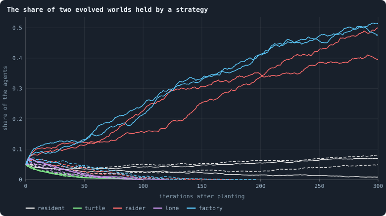
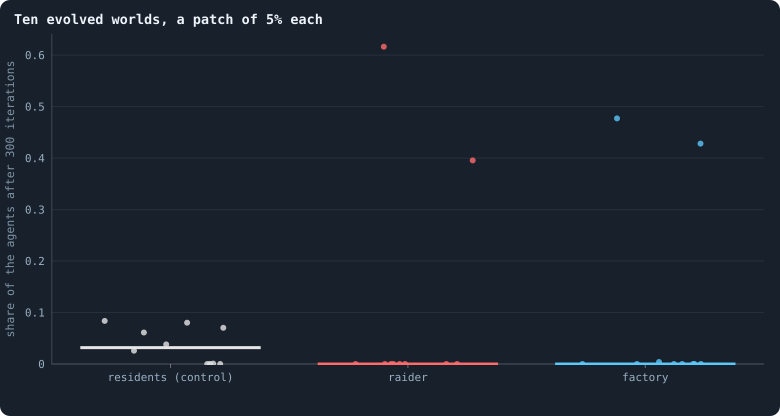

# Strategies written by hand

> [!question] Questions of this page
> - Is the play evolution found the best there is, or only the best it could
>   reach?
> - Can a strategy written by hand, for one [agent](the-world.md#agents-and-tokens "One member of a world: it lives on a node of the network, holds tokens and has a brain that takes all its decisions.") or for a team, beat evolved
>   [brains](the-brain.md "The neural network each agent decides with: inputs about itself and its neighbours, outputs that become its decisions.") in their own world?
> - What would a team need in order to grow?

## Why ask

[Why evolution stops](how-to-tell-a-world-that-keeps-evolving.md#why-evolution-stops) read the end of evolution as the end of
the [game](one-iteration.md#phase-2-the-game "The second phase of an iteration: every agent stakes all its tokens on its own node and its neighbours', and every node goes to someone."): a Colonel Blotto contest has a best way to play, to be
unpredictable, and once evolution has found it there is nothing better left
to find. That reading makes a prediction that can be tested without waiting
for evolution at all. If the evolved play is the answer, then no strategy
anyone could write should beat it by much. If one does, evolution did not stop
at the top. It stopped where it could no longer climb, and the game still had
more to give.

There is a second reason to write strategies by hand. Evolution finds what is
one small step from what it has. A strategy that needs many agents to act
together — some to hold a frontier, others to feed it, all knowing which is
which — may be far better and still never be found, because no single
[mutation](mutation.md "A random change to a brain, made with a set probability when it is copied, and in B1 also after every game: a changed brain is a new genotype.") makes it. The author of the simulation suggested exactly such a
strategy: a *factory*, a structured group in which every agent has its job in
the pipeline of [token flow](token-flow.md "The tokens a game moves along each connection, from the agent who stakes to the node staked on."), extracting [tokens](the-world.md#agents-and-tokens "The one thing of value in a world: every agent holds a whole number of them, and their total never changes.") from its surroundings like a
colony of parasites. If a factory written by hand can grow in an evolved
world, the game rewards organisation, and the question becomes how evolution
could get there.

## The invasion test

The method has a note of its own ([The invasion test](invasion-test.md)).
Take an evolved world: one of the [B2](b1-and-b2.md "The second baseline: B1 with the rules that keep its network from breaking and its agents from staking or breeding themselves to death.") worlds of
[Experiment 16](how-to-tell-a-world-that-keeps-evolving.md#the-runs-of-experiment-16), 10,000 tokens, as it
stood at [iteration](one-iteration.md "One step of a world's time: a phase of reproduction, then a phase of the game.") 2,000. Choose a **patch**: an agent at random and the
agents nearest to it, step by step, until the patch holds 5% of the world.
Give every agent of the patch a strategy instead of its brain, and play on
under the world's own rules. Follow the share of the world's agents that carry
the strategy. A strategy spreads as a brain does: into a child, and into a
node its owner takes.

A strategy's share means nothing on its own. A patch might grow or shrink
whatever it does, because of where it was placed. So every patch is also
played as a **control**. The same agents are given a copy of one resident's
brain, the brain of an agent of the patch drawn at random. The copy is marked
so it can be counted, and it never mutates. A strategy beats the residents if
it holds more of the world than the resident patch played from the same place
on the same [seed](random-numbers.md "The number that fixes every random choice of a run: the same settings and the same seed make the same world.").

A strategy reads exactly what a brain reads and writes exactly what a brain
writes (`research/oee/pilots/manual.py`). It sees each [candidate](one-iteration.md#phase-1-reproduction "An agent itself and each of its neighbours, the ones its brain looks at when it decides.")'s tokens, its
[connections](the-world.md#the-network "A link between two agents of the network: they are neighbours, and can stake on each other's nodes.") and its [messages](messages.md "Numbers an agent writes to itself and to each neighbour every phase, which their brains read."). Its decisions go through the same output rows
the [engine](the-lab.md "The program that runs an experiment's plan as runs, each on a frozen copy of the engine, the code that plays a world.") turns into a child, its links, the stakes and the messages. It can
do nothing an evolved brain could not do.

## Three strategies

- **The turtle** keeps everything at home. When it has 30 tokens or more it
  has a child with a third of them.
- **The raider** looks for the poorest [neighbour](the-world.md#the-network "An agent joined to another by a connection.") that is not a teammate.
  Under B2 it can stake at most 70% of its tokens, since 30% stay home. If
  that is more than one and a half times the neighbour's tokens, it is enough
  to take the node even if the neighbour kept everything at home, and the
  raider stakes it all there. Otherwise it keeps everything at home. When it
  has 30 tokens or more it has a child with a third of them, joined to every
  teammate next door.
- **The factory** is a team with a pipeline. Every member works out how far
  it is from the team's **frontier**. Its distance is 0 if a stranger is next
  door, and otherwise one more than the smallest distance a teammate reported.
  It writes the distance into its messages. Members on the frontier attack as
  the raider does: everything they can stake goes on the poorest stranger next
  door if that takes it, and otherwise they hold. Members inside stake
  everything they can on the teammate nearest the frontier. That pumps their
  tokens downhill, towards where the team meets the rest of the world. Inside
  members breed when rich, and join their children to their teammates.

Teammates know each other by what they write. The first four numbers of every
message a strategy sends are a fixed signature, and the fifth carries its
distance. This is a password, not a privilege: an evolved brain could write
the same numbers.

## What the strategies did

<!-- figure handmade/shares -->

**The share of two evolved worlds held by a strategy.** One line per planting: two seeds in each of two worlds, the world of seed 1 dashed, of seed 2 solid. Grey is the control, a patch of the residents' own brains planted in the same place.

> [!example]- How to make this figure
> **Runs.** The B2 worlds of Experiment 16, `B2-10000-s001` … `-s010`, as their archives keep them at iteration 2,000 (`GraphOfLifeRuns/<run>/archive/`). Strategies planted with `python3 research/oee/pilots/manual.py`: in `-s001` and `-s002` every strategy and the control on seeds 1 and 2 (`--strategies factory,turtle,raider,resident --seeds 1,2 --T 300 --patch 0.05`); in all ten worlds the raider, the factory and the control on seed 1; in `-s001` and `-s002` the lone raider on seeds 1 and 2; in `-s002` a single raider, and a single resident, on seeds 1 to 20 (`--patch 0.0002 --T 200`).
>
> **Data.** From the worlds the archives keep.
>
> 1. Load the world of iteration 2,000 (`GraphOfLife.from_checkpoint`). On seed *s*, draw an agent at random and take the agents nearest to it, step by step, until the patch holds the share asked for (5%, or one agent).
> 2. Give each agent of that patch the strategy (`manual.py`), or, for the control, a frozen copy of the brain of one agent of the patch drawn at random; neither ever mutates.
> 3. Play on under the world's own rules and count, after each iteration, the agents carrying the strategy, as a share of all agents.
>
> **To make it again:** `python3 book_figures.py handmade`.
<!-- /figure -->

**In one world, the strategies took half of it.** In the world of seed 2 the
factory grew from 5% of the agents to 48 and 52% in 300 iterations, and it was
still growing when the test stopped. The raider did nearly as well, with 40
and 50%. The control, a patch of the residents' own brains in the same place,
ended with 7 and 1%.

**In the other world, they died out.** In the world of seed 1 the factory and
the raider grew a little at first, to 6 or 7% of the world, then shrank, and
were gone after 135 to 196 iterations. The control there ended with 8 and 5%.

**The turtle died out everywhere** within about a hundred iterations. It
never takes a node and rarely has a child, and under B2 every agent dies at
age 100. A strategy that only defends cannot outlive its own bodies.

So in one of two evolved worlds a plain rule took half the world from brains
that evolution had shaped for 2,000 iterations.

## Ten worlds

Then the raider, the factory and the control were planted once in each of the
ten B2 worlds of Experiment 16, on one seed each.

<!-- figure handmade/ten -->

**Ten evolved worlds, a patch of 5% each.** One dot per world, the bar the median of ten.

> [!example]- How to make this figure
> **Runs.** The B2 worlds of Experiment 16, `B2-10000-s001` … `-s010`, as their archives keep them at iteration 2,000 (`GraphOfLifeRuns/<run>/archive/`). Strategies planted with `python3 research/oee/pilots/manual.py`: in `-s001` and `-s002` every strategy and the control on seeds 1 and 2 (`--strategies factory,turtle,raider,resident --seeds 1,2 --T 300 --patch 0.05`); in all ten worlds the raider, the factory and the control on seed 1; in `-s001` and `-s002` the lone raider on seeds 1 and 2; in `-s002` a single raider, and a single resident, on seeds 1 to 20 (`--patch 0.0002 --T 200`).
>
> **Data.** From the worlds the archives keep.
>
> 1. Load the world of iteration 2,000 (`GraphOfLife.from_checkpoint`). On seed *s*, draw an agent at random and take the agents nearest to it, step by step, until the patch holds the share asked for (5%, or one agent).
> 2. Give each agent of that patch the strategy (`manual.py`), or, for the control, a frozen copy of the brain of one agent of the patch drawn at random; neither ever mutates.
> 3. Play on under the world's own rules and count, after each iteration, the agents carrying the strategy, as a share of all agents.
>
> **To make it again:** `python3 book_figures.py handmade`.
<!-- /figure -->

In three of the ten worlds one of the two strategies took between 40 and 62%
of the world in 300 iterations. In seed 2 both did. In seed 3 the raider took
62% while the factory died out, and in seed 6 it was the other way round, the
factory with 43%. In the other seven worlds both died out. The control, a
patch of the residents' own brains, never held more than 8%.

So the answer is not one strategy that beats every evolved world. Evolved
worlds differ in where they are weak. Some can be raided, from where the patch
happened to land, and most could not be by these two rules. But in three
worlds out of ten, a plain rule took half or more of the world from brains
that evolution had shaped for 2,000 iterations, and the residents' own brains
did nothing of the kind from the same places. The evolved play is not the best
there is. That answers the question of
[Why evolution stops](how-to-tell-a-world-that-keeps-evolving.md#what-the-probes-say-about-why): the game
had more to give, and evolution had not taken it. Whether the factory or the
raider won depended on the world; the pipeline is no advantage in general.
What the two share is what matters, and the next two tests take it apart.

## The password

The raider differs from a resident in two ways. It attacks the poorest
neighbour it is sure to take, and it knows its teammates and never attacks
them. Which of the two wins?

The **lone raider** keeps the first and drops the second. It attacks the
poorest neighbour it is sure to take, whoever that is. It writes no password
and joins its children to nobody by choice. Planted in the same patches, it
grew a little at first, from 153 or 177 agents to about 200, and then died
out in all four plantings, within 97 to 122 iterations. That includes the
world where the raider with its password took half.

The rule of attack is not what wins; knowing one's own is. A raider that
cannot tell its own spends its attacks on its own. Inside the patch its
poorest neighbour is usually a teammate, often its own newborn child, and
taking it gains nothing. Meanwhile the bodies it lives in grow old and die,
as the turtle's did.

## One raider alone

Evolution makes a new strategy one agent at a time: a mutation changes one
brain, and the new brain must spread from there. So the last test plants a
single raider, a patch of one agent, in the world where a patch of 5% took
half. It ran on twenty seeds for 200 iterations, against a single resident
planted the same way.

The single raider died out every time. It grew larger than the single
resident before it went, with peaks of up to 28 agents against at most 5, and
it lived longer, a [median](median-and-quantiles.md "The middle value: half of the numbers lie below it and half above.") of about 34 iterations against 21. But it never
took hold. The single resident never did either: one brain in three thousand
is easily lost.

A raider needs a crowd. With a few hundred teammates who know one another it
takes half a world. Alone, or among teammates it cannot tell from strangers,
it dies.

## What it teaches

**Evolution stopped short of the top.** The game has better play than the
play these worlds end with: a small rule written by hand took half or more of
three evolved worlds in ten. No rule here beat them all, and evolved worlds
differ in their weak points.

**The better play needs three things at once.** It needs a way to attack (the
raid), a way to know one's own (the password), and enough of one's own to
start with (a crowd). Each alone is worth nothing or less: a raid without a
password is spent on one's own, and a password without a crowd is a secret
nobody else knows. Evolution changes one brain a little at a time, and every
step on the way must pay. A strategy whose parts pay only together is a
valley evolution cannot cross. This is the old problem of the **green
beard**, a gene that would have to make its bearers both show a sign and
favour those who show it.

**What would let evolution get there** is what the following pages try: a
sense of one's own given for free, stakes that count together by [lineage](families.md "A line of descent: the agents whose genotypes go back to one ancestor."),
families that carry a password of their own
([Another game](another-game.md)), and alliances, where knowing one's own is
a decision two agents make together ([Alliances](alliances.md)). None of
them made evolution find the raiders' play, or go on improving.

<!-- turns -->
---

[Strategies written by hand](../README.md#strategies-written-by-hand) · [What a brain can compute](what-a-brain-can-compute.md) →

> [!info]- Pages that link here (15)
> [What this notebook is about](what-this-notebook-is-about.md) · [The ideas this builds on](the-ideas-this-builds-on.md) · [What B1 is, and what stood in its way](what-the-baseline-world-is.md) · [Does evolution keep going?](how-to-tell-a-world-that-keeps-evolving.md) · [How fast should brains change?](how-fast-should-brains-change.md) · [Every era against three](every-era-against-three.md) · [What a brain can compute](what-a-brain-can-compute.md) · [How large a crowd a raider needs](how-large-a-crowd-a-raider-needs.md) · [Does evolution close the door?](does-evolution-close-the-door.md) · [A crew of raiders](a-crew-of-raiders.md) · [Raiders that breed](raiders-that-breed.md) · [Hand-written strategies in B1](hand-written-strategies-in-b1.md) · [The invasion test](invasion-test.md) · [Another game](another-game.md) · [A screen of random worlds](a-screen-of-random-worlds.md)
<!-- /turns -->
