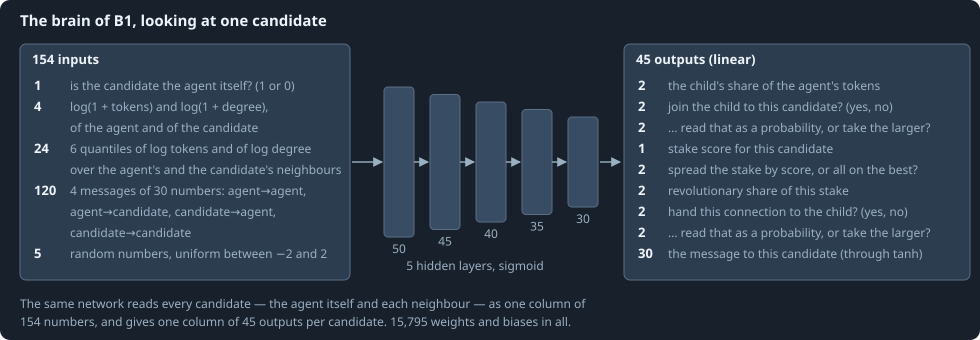
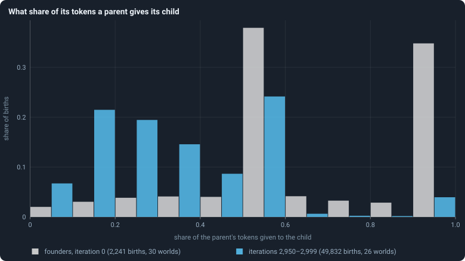

# The brain

> [!question] Questions of this page
> - What does a brain see, and what does it compute from it?
> - How do its outputs become the decisions of [One iteration, step by step](one-iteration.md)?
> - How is a brain inherited, and how does it change?
> - Do brains end up deciding differently from the random brains they start as?

## In short

An [agent](the-world.md#agents-and-tokens "One member of a world: it lives on a node of the network, holds tokens and has a brain that takes all its decisions.")'s brain is a small neural network that takes all its decisions. For
each candidate, the agent itself and each [neighbour](the-world.md#the-network "An agent joined to another by a connection."), it reads 154 numbers and
gives 45, which the rules turn into decisions. It is 15,795 numbers in all,
copied into children and changed with probability 0.2 at every birth and
after every game. Over a run, selection moves the brains' decisions far from
the [founders](starting-ring.md "One of the agents a world starts with, each holding the same tokens, on a ring with a few shortcuts.")' random ones. But it moves them only as constants: the brains
barely react to what they see.

## A brain at a glance

A brain is a machine that turns numbers into numbers. When an agent has to
decide, it looks at each of its **candidates** in turn: itself first, then
each neighbour. For each, its brain reads a column of numbers. They say how
rich and how well connected the agent and the candidate are, and what their
neighbourhoods look like. They also hold what the two last said to each other,
and a little noise. The same network turns every column into a column of
outputs. The outputs take every decision of
[One iteration, step by step](one-iteration.md):

- how much to give a child, whom the child joins, and which [connections](the-world.md#the-network "A link between two agents of the network: they are neighbours, and can stake on each other's nodes.") to
  hand it;
- where to stake, and how much of each stake to mark revolutionary;
- what to say to each neighbour.

Nothing in a brain is designed. A founder's brain is drawn at random, and
brains change only by chance: when they are copied, and after every game.
This page describes the brain of the [baseline](b1-and-b2.md "The stated rules an experiment starts from and changes one thing of: B1 or B2.") [B1](b1-and-b2.md "The first baseline: the algorithm exactly as a new run is offered it.") completely. It says what the
brain reads, how it computes, how its outputs become decisions, and how it
changes from one generation to the next.

## One look: a column per candidate

Agent *u* looks at its candidates (*u*, *v*₁, …, *v*_d): itself and its *d*
neighbours, in increasing order of id. It builds one column of **154 inputs**
for each candidate. It feeds all *d* + 1 columns through the same network at
once. The inputs, in order:

- **1** — whether the candidate is the agent itself: 1 for the first column,
  0 for the others.
- **4** — ln(1 + τ) of the agent and of the candidate, and ln(1 + deg) of
  both: [tokens](the-world.md#agents-and-tokens "The one thing of value in a world: every agent holds a whole number of them, and their total never changes.") and connections on a logarithmic scale. On that scale, 10
  against 100 tokens looks as different as 100 against 1,000. Indeed,
  ln(1 + 10) = 2.4, ln(1 + 100) = 4.6 and ln(1 + 1,000) = 6.9. The two
  steps are about the same, 2.2 and 2.3.
- **24** — summaries of the two neighbourhoods. For the agent and for the
  candidate: six [quantiles](median-and-quantiles.md "The middle value: half of the numbers lie below it and half above.") of ln(1 + τ) over their neighbours, and the same
  for ln(1 + deg). The six are the smallest value, the 20th, 40th, 60th and
  80th percentiles, and the largest. About a fifth of the neighbours lie below
  the 20th percentile. That is 6 × 2 × 2 = 24 numbers.
- **120** — four messages of 30 numbers each ([Messages](messages.md)). They
  are what the agent last wrote to itself and to the candidate, and what the
  candidate last wrote to the agent and to itself.
- **5** — random numbers, each drawn uniformly between −2 and 2, new for
  every candidate in every look. They let two agents in the same position,
  or one agent looking twice, act differently.

That makes 1 + 4 + 24 + 120 + 5 = 154. [What a brain sees](brain-inputs.md)
gives the full list, row by row, with a worked example.

## The neural network

Picture six sheets of units, stacked one above the other over the inputs.
Every unit listens to every unit of the sheet below it. It weighs what it
hears, adds it up, and passes on a squashed version of the sum. The lowest
sheet listens to the 154 inputs; the highest gives the 45 outputs.

Exactly: the brain is a **feed-forward neural network**, in which numbers
flow one way only, from the inputs up to the outputs. It has five hidden
layers of 50, 45, 40, 35 and 30 units, and an output layer of 45. Write *x*
for a column of 154 inputs. Layer ℓ = 1, …, 6 computes

$$
z^{(\ell)} = W^{(\ell)} a^{(\ell-1)} + b^{(\ell)}, \qquad a^{(0)} = x,
$$

$$
a^{(\ell)} = \sigma\bigl(z^{(\ell)}\bigr) \ \text{ for the hidden layers } \ell = 1, \dots, 5,
\qquad \sigma(z) = \frac{1}{1 + e^{-z}},
$$

$$
y = z^{(6)} \quad \text{for the output layer (no squashing).}
$$

In words: each layer multiplies what it receives by a matrix of weights and
adds a vector of biases. Each hidden layer then squashes the result with the
sigmoid σ; the output layer leaves it as it is. *W*⁽ˡ⁾ is the matrix of
**weights** of layer ℓ: one row per unit of the layer, one column per unit of
the layer before. The vector *b*⁽ˡ⁾ holds its **biases**. The sigmoid squashes
every hidden sum into (0, 1): σ(0) = 0.5, σ(2) = 0.88 and σ(−2) = 0.12.
Counting the numbers:

$$
154 \cdot 50 + 50 \cdot 45 + 45 \cdot 40 + 40 \cdot 35 + 35 \cdot 30 + 30 \cdot 45 = 15{,}550 \ \text{weights},
$$

$$
50 + 45 + 40 + 35 + 30 + 45 = 245 \ \text{biases}.
$$

That is 15,795 numbers in all. They are the brain's **genome**: nothing else
about an agent is inherited.

**A founder's brain** gets every weight drawn from a normal distribution (the
bell curve) with mean 0 and standard deviation 1/√*k*. Here *k*, the layer's
**fan-in**, is the number of units feeding it: 154 for the first layer, 50
for the second, and so on. Every bias starts at 0. In the first layer, a
weight is thus typically about 1/√154 = 0.08 in size.

Why 1/√*k*? It keeps the sums *z* of a layer about as large as its inputs,
whatever the layer's width. A sum of *k* products, each of standard deviation
about 1/√*k* times its input, has a standard deviation about that of one
input.

**Precision.** B1 stores its weights as 16-bit floating-point numbers
(`float16`), which keep about three significant decimal digits, and computes
with them in 64-bit arithmetic. A brain then takes a quarter of the memory of
one stored in 64 bits.

## How a signal fades through layers

A brain's inputs reach its outputs only by passing through every layer in
between. Each layer can let a change through larger or smaller. When every
layer lets it through smaller, a deep network ends up nearly blind: its
outputs barely move, whatever its inputs do. This is called the **vanishing
signal**. In training by gradients it is the *vanishing gradient*
(Hochreiter 1991; Glorot and Bengio 2010).

### The gain of one layer

Take one hidden layer of the brain:

$$
a = \sigma(W x + b), \qquad \sigma(z) = \frac{1}{1 + e^{-z}} .
$$

Move the input *x* by a small amount δ*x*. Each sum *z* moves by *W* δ*x*.
Each output moves by the slope of the sigmoid at that sum, times that:

$$
\delta a_i = \sigma'(z_i) \, (W \delta x)_i , \qquad \sigma'(z) = \sigma(z)\,\bigl(1 - \sigma(z)\bigr) \le \tfrac14 .
$$

The slope of the sigmoid is at most ¼, at *z* = 0. It falls off on both
sides: it is 0.10 at *z* = ±2 and 0.018 at *z* = ±4.

A founder's weights have the standard deviation 1/√*k* for a fan-in of *k*
([The neural network](#the-neural-network)). So the product *W* δ*x* is about
as large as δ*x* itself: that is what the scale 1/√*k* is chosen for. One
sigmoid layer then passes a change on at most about **a quarter** as large.
This ratio is the layer's **gain**:

$$
g = \frac{\lVert \delta a \rVert / \sqrt{\text{outputs}}}{\lVert \delta x \rVert / \sqrt{\text{inputs}}} .
$$

In words: the root-mean-square change out, over the root-mean-square change
in.

### Layers multiply

Gains multiply through the layers. Five sigmoid layers, each passing about a
quarter, pass

$$
\left(\tfrac14\right)^5 \approx 0.001 .
$$

A change of 1 in every input moves the outputs by about a thousandth. So the
outputs are set almost entirely by the brain's biases and by the average
activity of its layers. What it sees hardly counts. The brain still computes
something. It just computes nearly the same thing for every input.

Measured, a B1 founder's gain is 0.0006, and an evolved B1 brain's 0.0015
([What the brains are like](what-the-brains-are-like.md)). [B2](b1-and-b2.md "The second baseline: B1 with the rules that keep its network from breaking and its agents from staking or breeding themselves to death.")'s brain has one
hidden layer of 16 units, and a founder's gain of about 0.2
([Building B2: a world that cannot break](a-world-that-cannot-break.md)).

### Why the signal matters for evolution

Selection can only favour a brain that reacts to its situation if its
reactions differ enough to matter. Take two candidates whose scores differ by
a thousandth of a token's worth. For every decision of
[One iteration, step by step](one-iteration.md), they are the same candidate.
So a mutation that makes a brain attend to a neighbour's wealth has almost no
effect to be selected for. Only mutations that move what the brain does
*whatever it sees* have any.

### The usual remedies

Deep learning met this problem when networks first grew deep, and found
three remedies:

- **Fewer layers.** Each layer removed multiplies the gain by about four.
- **A different squashing.** tanh has slope 1 at 0, four times the
  sigmoid's. A *rectifier* (ReLU), max(0, *z*), has slope 1 wherever it is
  active (Nair and Hinton 2010).
- **Larger starting weights**, scaled to the squashing so that each layer's
  gain starts near 1 (Glorot and Bengio 2010). For rectifiers that is a
  standard deviation of √(2/*k*) (He and others 2015). For sigmoids it is
  about four times what suits tanh, since the sigmoid's slope is a quarter of
  tanh's.

B2 took the first remedy. *How big should a brain be?*, a page still to be
written, is to try the others.

## From outputs to decisions

A look gives one column of 45 outputs per candidate. Think of each column as
a form the brain fills in about one candidate. Should the child join it? How
much to stake on it? What to tell it? A few answers concern the agent as a
whole, and those are averaged over all its forms. Here are the rows, counted
from 0 as in the code:

| rows | what | read as | used in |
|---|---|---|---|
| 0–1 | child share | *f*(row 0, row 1), averaged over columns first | reproduction |
| 2–3 | join the child to this candidate? | yes/no, per candidate | reproduction |
| 4–5 | how to read rows 2–3 | probability or sharp, per candidate | reproduction |
| 6 | stake score | one score per candidate | game |
| 7–8 | spread or all in | spread if row 7 > row 8, averaged over columns first | game |
| 9–10 | revolutionary share | *f*(row 9, row 10), per candidate | game |
| 11–12 | hand this connection to the child? | yes/no, per neighbour | reproduction |
| 13–14 | how to read rows 11–12 | probability or sharp, per neighbour | reproduction |
| 15–44 | message | tanh of each, one message per candidate | both |

*f* is [the share function](share-function.md); "probability or sharp" is
[the yes-or-no rule](binary-decision.md); the split of a spread stake is
[the largest-remainder method](largest-remainder.md).
[What a brain says](brain-outputs.md) goes through the table row by row.
Three things in it are easy to miss:

- the **child's share** and the choice between **spreading and going all
  in** are each one decision for the whole agent. Their rows are averaged
  over all candidate columns before they are read.
- everything else is decided **per candidate**. Does the child join it, and
  is the connection to it handed to the child? How much is staked on it, and
  how much of that stake is revolutionary?
- the **message** to a candidate is rows 15–44 of that candidate's column,
  each passed through tanh, which squeezes any number into (−1, 1). The
  message an agent writes to itself is in the column of itself.

## How a brain changes

A brain is copied the way a text is copied by hand. Usually the copy is
exact; sometimes it has a few small slips; now and then a few words are
replaced outright.

A brain may change at two moments. One is when it is copied into a child. The
other is after every game, for every brain in the world, independently. Each
time, with probability *p* = 0.2, the brain is **mutated**; otherwise it is
left exactly as it was. A mutation treats every weight matrix and every bias
vector separately, with *s* = 0.1 and σ = 0.2. Here σ is the size of a change,
not the sigmoid ([How a brain changes](mutation.md) has the details):

1. **Jitter.** Each number, independently with probability *s*, has a normal
   random number of standard deviation σ/√*k* added to it. That is a fifth of
   the spread of the layer's starting weights.
2. **Reset**, rarely. With probability *s*, a fraction *s* of the matrix's
   numbers are drawn afresh, each independently with probability *s*. A
   weight is drawn from the starting distribution, normal with standard
   deviation 1/√*k*. A bias is drawn from a normal with standard deviation
   σ/√*k*.

So a mutation nudges about one number in ten, a little. And about one matrix
in ten also has about one number in ten replaced outright. In the first
layer, a jitter is typically about 0.2/√154 = 0.016, a fifth of a typical
weight.

**Genotypes.** Every brain carries an id, its **genotype**. A copy keeps the
id. So a child whose brain did not mutate, and a node that took on a
conqueror's brain, carry the genotype of the brain they copied. A mutation
gives the brain a new id and remembers the old one as its parent. The ids
therefore form a family tree ([Genotypes and the family tree](genotype.md)),
which [Genotypes and lineages](genotypes-and-lineages.md) climbs.

## What brains end up doing

No one designs these brains, and nothing rewards any behaviour. Do they still
change what they do over a run? Take one decision, the share of its tokens a
parent gives a child:

<!-- figure brain/child-share -->

**What share of its tokens a parent gives its child.** For every birth: the tokens the child received divided by the tokens its parent held just before, in bins of 0.1. Grey: the founders' births in the very first reproduction phase, decided by brains of random weights. Blue: the births of the last 50 iterations, decided by brains descended from them through 2,950 iterations of copying, changing and conquering. Only parents that gave at least one whole token had a child and are counted.

> [!example]- How to make this figure
> **Runs.** The 30 baseline runs `B1-10000-s001` … `B1-10000-s030`: the baseline B1 at 10,000 tokens, seeds 1 to 30, 3,000 iterations each (every setting is listed in [A world's life](a-worlds-life.md)). They are made with `python3 gol_lab.py run E02`.
>
> **Data.** From each run's frames, `GraphOfLifeRuns/<run>/frames/`, read with `gol_store.read_frame(run, index)`; frame `2·t` is iteration *t* after reproduction and frame `2·t + 1` after the game.
>
> 1. In the frames with `phase` 1 of iteration 0, and of iterations 2,950 to 2,999, read `decisions.births`: each entry has the parent's `tokens_before` and the child's `invested`.
> 2. Put `invested / tokens_before` into ten bins of width 0.1 and divide each count by the number of births.
>
> **To make it again:** `python3 book_figures.py brain`.
<!-- /figure -->

The founders' random brains give their children a median of half their
tokens. A third of them (33%) give everything, and die of it, since a parent
left with no tokens starves. Another third give exactly half, which is what
*f* says when both of its outputs are negative. In the last fifty iterations
of the runs, the typical parent gives a third, and only 4% give everything.

Other decisions moved just as far. In the first game, half of the agents (49%
in the median world) spread their stake over several candidates. The others
put it all on one. And half of all staked tokens (50%) were marked
revolutionary. That is what brains of random weights do. Spreading turns on
which of two random outputs is the larger. And the revolutionary share is *f*
of two random outputs, a half on average. From iteration 500 on, the two were
98% and 97% ([How the game is played](how-the-game-is-played.md)). That held
in the worlds of 10,000 tokens and in those of 100,000 alike.

Nobody chose these numbers. Are they the work of selection, with brains that
did otherwise losing their tokens and their nodes? Or are they only the churn
of copying and changing brains?
[Do the brains matter?](do-the-brains-matter.md) tests the question against
worlds whose brains never change, and
[How the game is played](how-the-game-is-played.md) comes back to it.

The answer is selection, but only on constants.
[What the brains are like](what-the-brains-are-like.md) opened the brains.
Selection did set these numbers, the same way in every world: have few
children, spread the stake, mark every token revolutionary. But none of these
depends on the situation. The brains are nearly blind: their outputs move by
about a thousandth of a change in what they see
([How a signal fades through layers](#how-a-signal-fades-through-layers)). So they decide almost the
same, whatever their situation.
[How to tell a world that keeps evolving](how-to-tell-a-world-that-keeps-evolving.md)
played evolved brains against their founders. By iteration 50, they hold about
nine tenths of a world contested with the founders, and after iteration 100
they gain nothing more.

## The control: decisions by chance

One setting replaces the brain by noise. With
[`random_decisions`](settings.md#random_decisions) on, every one of the 45
outputs of every column is drawn from a standard normal distribution instead
of being computed. Every decision is then read from that noise exactly as
above, and nothing else changes.
[Do the brains matter?](do-the-brains-matter.md) shows what becomes of a
world run that way.

## Where to go next

- [What a brain sees](brain-inputs.md): the 154 inputs, row by row, with a
  worked example.
- [What a brain says](brain-outputs.md): the 45 outputs, row by row.
- [What the brains are like](what-the-brains-are-like.md): what evolved
  brains do, and why they barely see.
- [Questioning the mechanics](questioning-the-mechanics.md): the rules
  themselves, examined one by one.

## References

- Glorot, X. and Bengio, Y. (2010). Understanding the difficulty of training
  deep feedforward neural networks. *Proceedings of AISTATS*, 249–256.
- He, K., Zhang, X., Ren, S. and Sun, J. (2015). Delving deep into
  rectifiers. *Proceedings of ICCV*, 1026–1034.
- Hochreiter, S. (1991). *Untersuchungen zu dynamischen neuronalen Netzen*.
  Diploma thesis, Technische Universität München.
- Nair, V. and Hinton, G. E. (2010). Rectified linear units improve
  restricted Boltzmann machines. *Proceedings of ICML*, 807–814.

<!-- turns -->
---

← [One iteration, step by step](one-iteration.md) · [How the simulation works](../README.md#how-the-simulation-works) · [Questioning the mechanics](questioning-the-mechanics.md) →

**Also about:** [Brains, and how alike agents are](../README.md#brains-and-how-alike-agents-are).

> [!info]- Pages that link here (21)
> [What this notebook is about](what-this-notebook-is-about.md) · [Glossary](glossary.md) · [The world: tokens, agents and a network](the-world.md) · [One iteration, step by step](one-iteration.md) · [Every setting](settings.md) · [The starting ring](starting-ring.md) · [The share function f(a, b)](share-function.md) · [What a brain sees](brain-inputs.md) · [What a brain says](brain-outputs.md) · [How a brain changes](mutation.md) · [B1 and B2: the two baselines](b1-and-b2.md) · [What B1 is, and what stood in its way](what-the-baseline-world-is.md) · [The life of a B1 world](a-worlds-life.md) · [Building B2: a world that cannot break](a-world-that-cannot-break.md) · [The even split](even-split.md) · [What the brains are like](what-the-brains-are-like.md) · [Do the brains matter?](do-the-brains-matter.md) · [How different are the agents?](how-different-are-the-agents.md) · [Eras, contests and invasions: does a world keep getting better?](eras-and-contests.md) · [What a brain can compute](what-a-brain-can-compute.md) · [The lab, the engine and pilots](the-lab.md)
<!-- /turns -->
