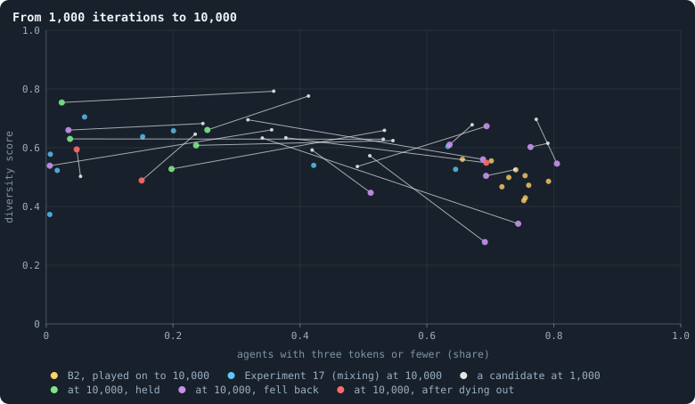
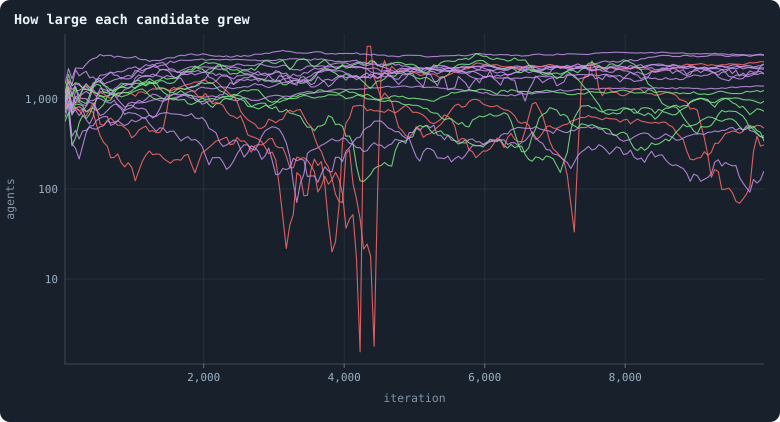
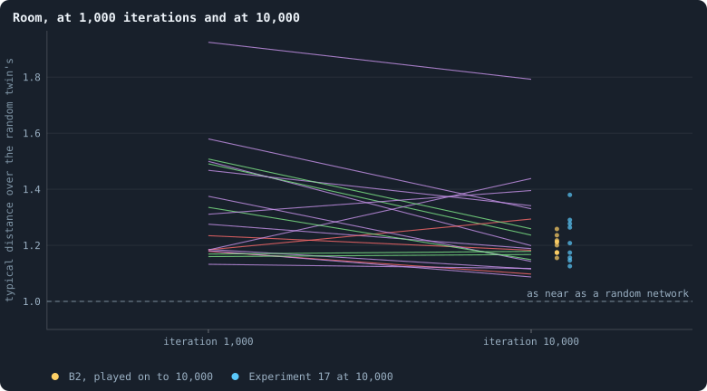
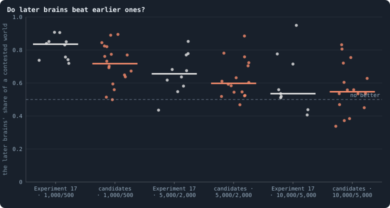
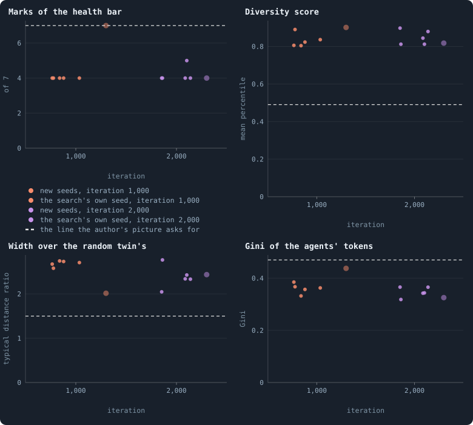

# The candidates, played on and played again

> [!question] Questions of this page
> - The candidate worlds met every mark of the [health bar](health-bar.md "The seven marks a world's network must meet to count as healthy: one piece, mostly on loops, no fatal cut, no hub, three to twelve links per agent, a dimension of 2.3 to 4.") at [iteration](one-iteration.md "One step of a world's time: a phase of reproduction, then a phase of the game.")
>   1,000, with [agents](the-world.md#agents-and-tokens "One member of a world: it lives on a node of the network, holds tokens and has a brain that takes all its decisions.") more diverse than [B2](b1-and-b2.md "The second baseline: B1 with the rules that keep its network from breaking and its agents from staking or breeding themselves to death.")'s. Do they stay that way over
>   10,000 iterations?
> - Which of them live, which fall back to B2's poverty, and does evolution
>   go on in them?
> - When a rule's world held, was it the rule or the luck of its [seed](random-numbers.md "The number that fixes every random choice of a run: the same settings and the same seed make the same world.")? Does
>   any rule make a mixed world hold more often than mixing alone?
> - The random search found one world more diverse than any other. Was it
>   its [settings](settings.md "One number or switch of a run's rules, fixed before it starts."), or the luck of one draw?
> - Can the [lab](the-lab.md "The program that runs an experiment's plan as runs, each on a frozen copy of the engine, the code that plays a world.") play the [pilots](pilot-worlds.md "A world made by hand to see whether an idea is worth an experiment, without a thesis or many seeds.")' worlds, and their rules, as the pilots did?

## In short

A **candidate world** meets every mark of the health bar at iteration 1,000,
and its agents are more diverse than B2's. Played on to 10,000 iterations,
most did not stay there: of nineteen, five held, eleven fell back and three
died out. Three rules whose worlds had held were given five new seeds each,
and did no better than [brains](the-brain.md "The neural network each agent decides with: inputs about itself and its neighbours, outputs that become its decisions.") mixed at birth alone. In new seeds, the random
search's best settings made diverse, wide and rich worlds, but thin, easily
cut and too even ones. One world says little about its rules: it may have
held by the luck of its seed, or of its moment. Along the way, the lab
learned to play the pilots' worlds again exactly, game for game.

## The candidates, played on

<!-- experiment E20 -->

Picture a world caught at a good moment. At iteration 1,000 its network is
sound and its agents differ. Will it still look like that 9,000 iterations
later?

The author's picture of a world that might keep evolving asks for both at
once ([Healthy and rich](healthy-and-rich.md)). A world that comes close at
iteration 1,000 is a **candidate world**. First, it meets every mark of the
health bar, the seven marks of a sound network:
- one piece;
- at least 80% of its agents on [loops](bridges.md#loops "A path through the network that comes back to where it started without using a connection twice.") or between them (the [2-core](core-trees-leaves.md "What is left of a network when agents with one connection or none are peeled away again and again: the agents on loops or between them."));
- no agent whose loss cuts off more than 2% of the others, and no link
  whose loss cuts off more than 1%;
- no agent joined to more than 5% of the others;
- 3 to 12 links per agent;
- a [dimension](ball-dimension-and-curvature.md "How fast the number of agents within a distance grows with the distance: as its square in a plane, its cube in space.") between 2.3 and 4.

Second, its [diversity score](diversity-score.md "How much the agents of a world differ, in one number from 0 to 1: in tokens, links, ages and genotypes.") is above that of B2's [median](median-and-quantiles.md "The middle value: half of the numbers lie below it and half above.") world. The
diversity score says, in one number from 0 to 1, how much a world's agents
differ in [tokens](the-world.md#agents-and-tokens "The one thing of value in a world: every agent holds a whole number of them, and their total never changes."), links, ages and [genotypes](genotype.md "The identity of a brain: a number that a copy keeps and a change replaces, and that remembers the genotype it came from."). B2 is the second [baseline](b1-and-b2.md "The stated rules an experiment starts from and changes one thing of: B1 or B2."), the
world built so that its network cannot break.

One moment says little. Most candidate worlds have brains **mixed at
birth**. A newborn's brain is then its parent's mixed with a mate's, one of
the parent's [neighbours](the-world.md#the-network "An agent joined to another by a connection."). Each hidden unit is taken whole from one or the
other. Such mixed worlds drift in size, and their riches drift with it
([What holds a world's size](what-holds-a-worlds-size.md)).

So every candidate world is played on to 10,000 iterations. There it is
read by [Healthy and rich](healthy-and-rich.md)'s **test of a long run**. A
world passes if, at iteration 10,000:
- it is still alive: it never fell to 20 agents or fewer, where the lab
  calls a world [extinct](extinction.md "A world's end before its last iteration: it has dropped to its threshold of agents or fewer.");
- it meets every mark of the health bar;
- it is more diverse than B2's median world at 10,000 (a diversity score
  of 0.49);
- it holds a smaller share of its agents at three tokens or fewer than the
  least poor of B2's ten worlds (66%).

B2's own ten worlds, played on to 10,000 iterations, are the yardstick.

### Six worlds left unfinished

Twenty-five candidate worlds were played on as pilot worlds (batch LC),
each in a copy of its own. A pilot is a world made by hand, outside the
lab's experiments, to see whether an idea is worth one. Nineteen reached
10,000 iterations. Two of them were the mixed worlds of batch Q. These
turned out to be [Experiment 17](mixed-at-birth-ten-long-worlds.md)'s
worlds of seeds 1 and 2, agent for agent, and they are read with Experiment
17's worlds.

Then, on 18 October 2026, the computer was restarted. The pilots had been
running out of sight, in no page of the notebook. From then on, every
simulation of this notebook runs where it can be seen. It runs in the lab,
started with ▶ beside the page that asks for it.

Six candidate worlds were left unfinished. Two of them use only the
engine's own settings:
- **links to strangers by a free reach, forced on the other end.** An agent
  may propose a link to an agent beyond its neighbours, reached in free
  steps. The other end cannot refuse
  ([Links to strangers](links-to-strangers.md)).
- **brains mixed at birth, with only the last token kept at home.** B2 keeps
  30% of an agent's tokens on its own node, whatever its brain says. Here
  only one token stays
  ([Brains mixed at birth, with every other rule](mixing-with-every-other-rule.md)).

The other four use rules that so far exist only in the pilots' prototype:
- contests decided by lottery;
- brain units that cost a token;
- an input that tells where a brain came from;
- a family tag.

They follow once those rules are part of the engine; Experiment 23 is to
play them.

**Experiment 20** plays the first two in the lab, from iteration 0. We
expected the lab's two worlds to be the pilots' two worlds again, [game](one-iteration.md#phase-2-the-game "The second phase of an iteration: every agent stakes all its tokens on its own node and its neighbours', and every node goes to someone.") for
game. A pilot plays the engine's own game, so a pilot with a lab world's
settings and seed is that lab world. It had happened before: the two mixed
worlds of batch Q are Experiment 17's worlds. If the twins match, the lab
can finish what the pilots began.

<!-- thesis E20 -->
> [!quote] The thesis of Experiment 20, written down before any of its runs existed
> **The claim.** Played by the lab from iteration 0, these two worlds are the pilot worlds of batch LC, game for game: in each, the agents alive and the links between them after every game match the pilot's, iteration by iteration, up to where the pilot stopped (iteration 4,344 for links to strangers, 6,522 for mixing with the last token kept). Played on to 10,000, each is then read by [Meta X](healthy-and-rich.md)'s test of a long run.
>
> **Why it would be so.** A pilot plays the engine's own game, so a pilot with a lab world's settings and seed is that lab world: the two mixed worlds of batch Q are Experiment 17's worlds of seeds 1 and 2, agent for agent. These two candidates of [Meta X](healthy-and-rich.md) were being played on to 10,000 iterations as pilots when the computer was restarted on 18 October 2026; pilots now run only where they can be seen, and both use engine settings only, so the lab can finish them. At iteration 1,000 both met every mark of the health bar: links to strangers by a free reach, forced on the other end (batch K), with 1,931 agents, 49% of them at three tokens or fewer and a diversity score of 0.54; mixing with only the last token kept at home (batch Y), with 1,791 agents, 79% poor and 0.62. Read where the pilots stopped, they held 2,584 agents, 59% poor, at 4,000, and 2,066, 78% poor, at 6,500 — this plan was written after those readings, so the claim is only that the lab plays the same worlds.
>
> **It holds if:** Both worlds' agents and links match their pilot's after every game up to where the pilot stopped.
>
> **It fails if:** A world's agents or links differ from its pilot's at some iteration: the lab plays another world than the pilot did, and the chapter says from where.
>
> *Written while the notebook still numbered its chapters: each number is a link to the page it meant that day.*
<!-- /thesis -->

### The twin check: the thesis holds

Both of the lab's worlds match their pilots. After every game, the same
agents are alive and the same links join them. The pilot of links to
strangers had played 4,344 games, and the pilot of mixing with the last
token kept 6,522. The twins matched through every one. Both pilots had
been resumed from a checkpoint at iteration 1,000, and still matched.
**The thesis holds.**

So a pilot of engine rules is the lab's world. The long runs read below
stand as if the lab had made them. The four candidate worlds with pilot
rules cannot be checked this way yet.

### Where the candidate worlds went

Nineteen long runs can be read at iteration 10,000: seventeen pilots, and
the two worlds of Experiment 20 in place of their unfinished pilots. The
figure shows where each went.

<!-- figure candidates/paths -->

**From 1,000 iterations to 10,000.** Each line is a candidate, from where it stood at iteration 1,000 (small grey dot) to where it stood at 10,000 (large dot): green if it still met every mark of the health bar, was more diverse than B2's median world and poorer than none of B2's worlds — [Healthy and rich](healthy-and-rich.md)'s test of a long run — violet if it fell back, red if it had died out on the way (20 agents or fewer, the lab's line) and was refilled from its last agents. Yellow: B2's ten worlds played on to 10,000; blue: Experiment 17's mixed worlds that lived to 10,000. The author's picture is the top left: agents that differ, and few of them poor.

> [!example]- How to make this figure
> **Runs.** Batch LC's long runs (`GraphOfLifeRuns/.pilots/LC/`): each candidate of [Healthy and rich](healthy-and-rich.md), B2 at 10,000 tokens with the rules of the batch it came from, played on in a copy of its own from its checkpoint to 10,000 iterations (`research/oee/pilots/run.py --resume`), two of them finished by the lab from iteration 0 (Experiment 20: `B2-10000-e10e0d-s001`, `B2-10000-82bd1e-s001`); Experiment 17's ten mixed worlds (`B2-10000-4af4a3-s001` … `s010`) and B2's ten worlds played on to 10,000 (`GraphOfLifeRuns/.pilots/L/B2-long-s001` … `s010`).
>
> **Data.** From each world's checkpoint at 1,000 and at 10,000 (`research/atlas/at.py --at 1000` and `--at 10000`, `GraphOfLifeRuns/.pilots/atlas/at1000.json` and `at10000.json`).
>
> 1. Read each world as `research/atlas/profile.py` reads every world.
> 2. Rank its four spreads among the frozen reference worlds; the diversity score is their mean.
>
> **To make it again:** `python3 book_figures.py candidates`.
<!-- /figure -->

**Five of nineteen held**: they passed the test of a long run. All five
are mixed at birth:
- with a fast change of brains, in both its seeds: a [mutation](mutation.md "A random change to a brain, made with a set probability when it is copied, and in B1 also after every game: a changed brain is a new genotype.") probability of
  0.8, where B2 has 0.2;
- without random inputs, in one seed: B2's brains read five random numbers
  per neighbour each time they look, and these read none;
- without [revolutions](revolution.md "A node taken by stakers who each marked part of their stake revolutionary and together staked more than the largest single stake."), in one seed: no coalition of smaller stakers can take
  a node from its largest staker;
- with an input that tells an agent where its brain came from, in one seed.

**Eleven fell back.** Seven fell into B2's poverty: two thirds of their
agents or more held three tokens or fewer. The other four each missed a
single mark of the health bar. Two large worlds had a dimension above four.
Two small ones had an agent joined to more than 5% of the others.

**Three died out on the way**, each falling to a single agent:
- mixing with the [estate](estate.md "The tokens a dead agent leaves, and who gets them.") of a dead agent left to its own children, at
  iteration 4,043;
- mixing with brains that grow, at 3,158;
- mixing with an input that tells who helped, at 4,271.

A pilot plays on where the lab would stop. So each of these pilots filled
its world again from its last agent.

### Diversity, size and room

**Diversity fell in sixteen of the nineteen.** What a candidate world had at
iteration 1,000 mostly wore off: agents that differ in tokens, links, ages
and genotypes. The median diversity score fell from 0.63 to 0.56. The two
worlds that fell furthest ended less diverse than any of B2's worlds. They
mix with the estate left to the poorest (0.28), and with stakes pooled by
genotype (0.34).

<!-- figure candidates/sizes -->

**How large each candidate grew.** Each line is a candidate: its agents after each game, means over 50 iterations, on a logarithmic axis. Green: the candidates that held at 10,000 iterations; violet: those that fell back; red: those that died out on the way and were refilled from their last agents.

> [!example]- How to make this figure
> **Runs.** Batch LC's long runs (`GraphOfLifeRuns/.pilots/LC/`): each candidate of [Healthy and rich](healthy-and-rich.md), B2 at 10,000 tokens with the rules of the batch it came from, played on in a copy of its own from its checkpoint to 10,000 iterations (`research/oee/pilots/run.py --resume`), two of them finished by the lab from iteration 0 (Experiment 20: `B2-10000-e10e0d-s001`, `B2-10000-82bd1e-s001`); Experiment 17's ten mixed worlds (`B2-10000-4af4a3-s001` … `s010`) and B2's ten worlds played on to 10,000 (`GraphOfLifeRuns/.pilots/L/B2-long-s001` … `s010`).
>
> **Data.** From each long run's `series.jsonl`.
>
> 1. Read the agents after each game.
> 2. Average over stretches of 50 iterations.
>
> **To make it again:** `python3 book_figures.py candidates`.
<!-- /figure -->

**Rich and small, or large and poor.** Sizes wandered: several worlds
shrank to a few hundred agents and grew back. Where a world ended, its
riches went with its size. Across the nineteen at 10,000, the more agents,
the poorer they were (a rank [correlation](correlation.md "Whether two quantities go up and down together, from −1 to 1.") of 0.85). The five that held had
372 to 1,244 agents. The eight largest that lived, with 1,846 to 3,097
agents, all fell back, seven of them into poverty. It is the finding of
[What holds a world's size](what-holds-a-worlds-size.md) again. A world's
size is set by how eagerly its agents breed, and a full world is a poor
one.

Is a world a space, wide like a plane or a room? Or is it a small world,
where everyone is a few steps from everyone? Compare it with its [random
twin](random-twin.md "A network with the same agents and as many links each, wired at random: what a world would be if it were no space at all."): a network with the same agents and as many links each, wired at
random. Count the steps within which a typical agent's ball holds half its
world. Divide by the same count in the twin
([What folds a world](how-many-dimensions-does-a-world-have.md#what-folds-a-world)). The notebook calls a world a
space when this ratio is at least 1.5.

<!-- figure candidates/space -->

**Room, at 1,000 iterations and at 10,000.** Each line is a candidate: the steps within which a typical agent's ball holds half its world, over the same for its random twin ([What folds a world](how-many-dimensions-does-a-world-have.md#what-folds-a-world)), at iteration 1,000 and at 10,000. Green: the candidates that held; violet: those that fell back; red: those that died out on the way. Beside the right end: B2's ten worlds played on to 10,000 (yellow) and Experiment 17's (blue).

> [!example]- How to make this figure
> **Runs.** Batch LC's long runs (`GraphOfLifeRuns/.pilots/LC/`): each candidate of [Healthy and rich](healthy-and-rich.md), B2 at 10,000 tokens with the rules of the batch it came from, played on in a copy of its own from its checkpoint to 10,000 iterations (`research/oee/pilots/run.py --resume`), two of them finished by the lab from iteration 0 (Experiment 20: `B2-10000-e10e0d-s001`, `B2-10000-82bd1e-s001`); Experiment 17's ten mixed worlds (`B2-10000-4af4a3-s001` … `s010`) and B2's ten worlds played on to 10,000 (`GraphOfLifeRuns/.pilots/L/B2-long-s001` … `s010`).
>
> **Data.** From each world's checkpoint at 1,000 and 10,000 (`research/atlas/space.py --at 1000` and `--at 10000`).
>
> 1. Count, from a sample of agents, how many others lie within each number of steps.
> 2. Find the steps within which the typical ball holds half the world, between whole steps by the logarithm of the ball.
> 3. Do the same on a random network with every agent's links kept; divide.
>
> **To make it again:** `python3 book_figures.py candidates`.
<!-- /figure -->

**None became a space.** At iteration 1,000 a few candidate worlds were
wider than their random twins by half or more. By 10,000 all but one were
folded, at 1.09 to 1.44 times the twin's typical distance, as B2's own
worlds are. The exception, mixing with the estate left to the poorest
(1.79), is one of the poor worlds.

### Too even, not too poor

On 19 October 2026 the author made the picture more precise
([Healthy and rich](healthy-and-rich.md)). The worry was never a world with
many poor agents. It was a world whose agents hold their tokens too evenly:
almost everyone the same few. The share at three tokens or fewer had only
stood in for that.

The [Gini coefficient](gini-coefficient.md) of the agents' tokens measures
it directly. It is 0 when every agent holds as many tokens, and near 1 when
one agent holds nearly all. Read with the Gini instead, the verdict on the
five that held turns round:
- **Four of the five that held are more even than every one of B2's
  worlds.** Their Ginis are 0.37 to 0.44, against B2's 0.47 to 0.51. They
  are fast brain change in both seeds, no random inputs and no revolutions.
  They are rich worlds, of 8 to 27 tokens per agent. A random exchange of
  tokens would leave a Gini of 0.47 to 0.49 at those riches. So their
  tokens are spread more evenly than a random exchange would leave them.
- **Two that fell back did so on the share of the poor alone.** They meet
  every other count, and their tokens are less even than B2's. One mixes
  with only the last token kept at home (seed 2). Its Gini is 0.66, with
  80% of its agents at three tokens or fewer. The other mixes with a sense
  of kin, an input that tells which neighbours carry the agent's own brain
  (seed 2). Its Gini is 0.56, with 69% poor.
- **Only the input of where a brain came from (seed 2) passes both
  readings.**

So the **clarified test** asks four things: alive, every mark, more diverse
than B2's median world, and tokens no more even than B2's. By it, **three
of nineteen held**: where a brain came from, the last token kept, and the
sense of kin, each in one seed.

Across the nineteen, a world's size goes with its share of poor agents (the
rank correlation of 0.85 above). It goes far less with how evenly its
tokens are spread: 0.46 with the Gini. The small rich worlds are the even
ones; the large poor ones are not.

### Does evolution go on?

Are the brains still getting better after thousands of iterations? A
contest tells. Take a world's brains at two moments, say iterations 500 and
1,000. Seat them on alternate agents of the world as it was at one of those
moments, and play 100 iterations. That is about a [lifetime](age-and-lifetime.md "How many iterations an agent lives, from its birth to its death."): in B2 every
agent dies by age 100. Then count the share of agents the later brains hold. Above one half, the later brains are
the better players. Each world plays two such contests, one in each
moment's world, and the figure shows their mean.

<!-- figure candidates/evolution -->

**Do later brains beat earlier ones?** Each dot is a world: the share of a contested world the later moment's brains hold after 100 iterations against the earlier moment's, the mean of two contests, one in each moment's world; the bar is the median world. 5,000/2,000: the brains of iteration 5,000 against those of 2,000. Orange: the candidates (the first step judged on the world each came from; a world that died out on the way has the steps before its death only); grey: Experiment 17's mixed worlds.

> [!example]- How to make this figure
> **Runs.** Batch LC's long runs (`GraphOfLifeRuns/.pilots/LC/`): each candidate of [Healthy and rich](healthy-and-rich.md), B2 at 10,000 tokens with the rules of the batch it came from, played on in a copy of its own from its checkpoint to 10,000 iterations (`research/oee/pilots/run.py --resume`), two of them finished by the lab from iteration 0 (Experiment 20: `B2-10000-e10e0d-s001`, `B2-10000-82bd1e-s001`); Experiment 17's ten mixed worlds (`B2-10000-4af4a3-s001` … `s010`) and B2's ten worlds played on to 10,000 (`GraphOfLifeRuns/.pilots/L/B2-long-s001` … `s010`).
>
> **Data.** From `GraphOfLifeRuns/.pilots/lc_T100.json` (`research/oee/checks/lc_rejudge_worlds.txt`), the batches' own contests for 1,000/500, and `e17_T100.json`.
>
> 1. Seat the brains of the two moments on alternate agents of each moment's world and play 100 iterations (`research/oee/checks/rejudge.py`).
> 2. Count the agents the later moment's brains hold, as a share of all.
>
> **To make it again:** `python3 book_figures.py candidates`.
<!-- /figure -->

**Evolution goes on, slowing, as in Experiment 17.** The brains of 1,000
beat those of 500 in seventeen of eighteen worlds, with a median share of a
contested world of 0.72. Those of 5,000 beat those of 2,000 in fifteen of
sixteen (0.60). Those of 10,000 beat those of 5,000 in eleven of sixteen
(0.55). Experiment 17's mixed worlds held 0.84, 0.66 and 0.54 at the same
three steps. Ten worlds won both of the late steps; none ran away.

## Five more seeds for the rules that held

<!-- experiment E21 -->

A few candidate worlds passed the test of a long run
([The candidates, played on](#the-candidates-played-on)). Three rules stood
out, all of them with brains mixed at birth:

| rule, with mixing | seed | agents at 10,000 | agents with 3 tokens or fewer | diversity score |
|---|---|---|---|---|
| a fast change of brains (mutation probability 0.8) | 1 | 1,244 | 25% | 0.66 |
| a fast change of brains (mutation probability 0.8) | 2 | 407 | 2% | 0.75 |
| no random inputs | 2 | 372 | 4% | 0.63 |
| no revolutions | 2 | 948 | 24% | 0.61 |

Was it the rule, or the luck of the seed? One throw of a die cannot tell a
loaded die from a fair one; a few more throws begin to. And there were
reasons to doubt. A mixed world's size drifts, and its riches drift with it.
Plain mixing, with no other rule, passed the same test in five of
Experiment 17's ten worlds. And no revolutions failed it in its own seed 1:
2,221 agents, 64% of them poor, and a dimension above four. One world can
be luck.

So [Healthy and rich](healthy-and-rich.md)'s second step gives each rule
that held **five seeds more, from the start**. **Experiment 21** plays
seeds 3 to 7, which no batch has used for these rules. It sets them beside
Experiment 17's worlds of the same seeds, with plain mixing, which passed
in three of the five.

A fourth rule held in one seed too: mixing with an input that tells each
agent where its brain came from. That input exists so far only in the
pilots' prototype. It joins this experiment once it is part of the engine.

We expected each rule to hold again. A rule that made one world hold should
make most of its worlds hold: at least four of its five. And a rule earns
its place only if it holds more often than mixing alone, which passed in
three of the same five seeds.

<!-- thesis E21 -->
> [!quote] The thesis of Experiment 21, written down before any of its runs existed
> **The claim.** A rule whose candidate held over 10,000 iterations holds again in new worlds: for each of three rules — brains mixed at birth with a fast change of brains (a mutation probability of 0.8), with no random inputs, and with no revolutions — at least four of five new worlds (seeds 3 to 7) live to iteration 10,000 and there meet every mark of the health bar, have a diversity score above that of B2's median world at 10,000 (0.49), and hold a smaller share of their agents at three tokens or fewer than the least poor of B2's ten worlds (0.66).
>
> **Why it would be so.** [Meta X](healthy-and-rich.md)'s candidates were played on to 10,000 iterations as pilots (batch LC), and by [Meta X](healthy-and-rich.md)'s test — it lives, meets every mark, is more diverse than B2's median world and poorer than none of B2's — some held: mixing with a fast change of brains in both its seeds (1,244 agents, 25% at three tokens or fewer, a diversity score of 0.66; 407 agents, 2%, 0.75), mixing without random inputs in seed 2 (372 agents, 4%, 0.63), mixing without revolutions in seed 2 (948 agents, 24%, 0.61; its seed 1 fell back, 2,221 agents, 64%). Plain mixing held in five of Experiment 17's ten worlds, three of them among seeds 3 to 7. One world can be luck: [Meta X](healthy-and-rich.md)'s second step gives each rule that held five seeds more, from the start. Mixed worlds' size drifts, and their riches go with it ([Meta XI](what-holds-a-worlds-size.md)), so a rule earns its place only if it holds more often than mixing alone. The control is Experiment 17's worlds of the same seeds.
>
> **It holds if:** For a rule: at least four of its five worlds live to 10,000 and pass [Meta X](healthy-and-rich.md)'s test there.
>
> **It fails if:** For a rule: three or fewer pass — it does no better than mixing alone, which passed in three of the same five seeds.
>
> *Written while the notebook still numbered its chapters: each number is a link to the page it meant that day.*
<!-- /thesis -->

### What the twenty worlds did

<!-- figure fiveseeds/verdict -->

**Experiment 21 at iteration 10,000.** Each dot is a world at iteration 10,000, seeds 3 to 7 from left to right within each rule: green if it passed [Healthy and rich](healthy-and-rich.md)'s test of a long run — alive, every mark of the health bar met, more diverse than B2's median world and poorer than none of B2's ten worlds played on to 10,000 — violet if it failed it, red, at the top, if it died out before 10,000. Grey column: plain mixing, Experiment 17's worlds of the same seeds.

> [!example]- How to make this figure
> **Runs.** The twenty runs of Experiment 21 — B2 at 10,000 tokens with brains mixed at birth, alone (Experiment 17's runs `B2-10000-4af4a3-s003` … `s007`) or with a mutation probability of 0.8 (`B2-10000-0df8be-…`), no random inputs (`B2-10000-1109f3-…`) or no revolutions (`B2-10000-1f9b27-…`), seeds 3 to 7, 10,000 iterations (`python3 gol_lab.py run E21`) — and B2's ten worlds played on to 10,000 (`GraphOfLifeRuns/.pilots/L/B2-long-s001` … `s010`).
>
> **Data.** From each run's whole world kept at iteration 10,000 (`archive/world_010000.npz`, read by `research/atlas/at.py --at 10000`, `GraphOfLifeRuns/.pilots/atlas/at10000.json`).
>
> 1. Read each world as `research/atlas/profile.py` reads every world.
> 2. Rank its four spreads among the frozen reference worlds; the diversity score is their mean.
> 3. A world that died out (20 agents or fewer) fails.
>
> **To make it again:** `python3 book_figures.py fiveseeds`.
<!-- /figure -->

**No rule held more often than mixing alone.** Plain mixing passed the test
in three of its five worlds: seeds 4, 5 and 6. A fast change of brains
passed in two, seeds 3 and 6. No random inputs and no revolutions passed in
one each, both in seed 6. Every rule needed four.

**A fast change of brains: alive, diverse and not poor, but short of a
mark.** All five of its worlds lived to 10,000, and none was poor: 4% to
39% of their agents held three tokens or fewer. All five were more diverse
than B2's median world, with diversity scores of 0.61 to 0.69; plain
mixing's ranged from 0.52 to 0.66. Three of them each missed one mark. Two
had a dimension just above the bar's limit of 4 (4.03 and 4.22). The third,
a small world of 445 agents, had an agent joined to more than 5% of the
others.

**Without random inputs, two of five worlds died out**, at iterations 3,835
and 3,209. Of the three that lived, one passed, with 1,969 agents, 55% of
them poor. One was small and rich but less diverse than any of B2's worlds:
521 agents, and a diversity score of 0.38. One small world had a [hub](stars-and-hubs.md "An agent joined to far more agents than most; a star is a world held together by a single hub."), an
agent joined to far more agents than most.

**Without revolutions, one world died out**, at iteration 9,338. Of the four
that lived, one passed, with 1,996 agents, 59% of them poor. Two missed
B2's median diversity by a hair: 0.491 and 0.489, against 0.492. And one
small world of 212 agents had a hub.

So taking away the dice, the random inputs, or the revolutions made mixed
worlds mortal: three of ten died out within 10,000 iterations. Plain mixing
lost none of the same seeds.

<!-- figure fiveseeds/sizes -->

**Agents alive, world by world.** Each line is one world, its agents after each game (means over 50 iterations), on a logarithmic axis; a line that stops early is a world that died out.

> [!example]- How to make this figure
> **Runs.** The twenty runs of Experiment 21 — B2 at 10,000 tokens with brains mixed at birth, alone (Experiment 17's runs `B2-10000-4af4a3-s003` … `s007`) or with a mutation probability of 0.8 (`B2-10000-0df8be-…`), no random inputs (`B2-10000-1109f3-…`) or no revolutions (`B2-10000-1f9b27-…`), seeds 3 to 7, 10,000 iterations (`python3 gol_lab.py run E21`) — and B2's ten worlds played on to 10,000 (`GraphOfLifeRuns/.pilots/L/B2-long-s001` … `s010`).
>
> **Data.** From each run's `stats.jsonl`.
>
> 1. Read the agents after each game (`nodes`, phase 2).
> 2. Average over stretches of 50 iterations.
>
> **To make it again:** `python3 book_figures.py fiveseeds`.
<!-- /figure -->

**Each death was a slow shrinking.** The three worlds that died out had
reached 1,614, 2,983 and 1,931 agents. Five hundred iterations before the
end, they held 745, 685 and 188. For hundreds of iterations fewer were born
than died, as in the mixed worlds of
[Five mixed worlds, fifty thousand iterations](mixed-at-birth-ten-long-worlds.md#five-mixed-worlds-fifty-thousand-iterations).

**Size still sets riches.** Across the seventeen worlds alive at 10,000, the
more agents a world held, the poorer they were (a rank correlation of
0.86). The small worlds are rich, and the large ones half poor
([What holds a world's size](what-holds-a-worlds-size.md)).

**Room is rare.** Fifteen of the seventeen are folded, as near as B2's
worlds to their random twins: a typical distance of 1.09 to 1.29 times the
twin's. The two that are wider, 1.68 and 1.40, are the worlds without
random inputs and without revolutions that passed. They are two of the
largest, half of their agents poor. Other worlds as large are as folded as
the small ones ([What folds a world](how-many-dimensions-does-a-world-have.md#what-folds-a-world)).

<!-- figure fiveseeds/evolution -->

**Do later brains beat earlier ones?** Each dot is a world: the share of a contested world the later moment's brains hold after 100 iterations against the earlier moment's, the mean of two contests, one in each moment's world; the bar is the median world. Mixing alone: Experiment 17's worlds of the same seeds. A world that died out has the steps before its death only.

> [!example]- How to make this figure
> **Runs.** The twenty runs of Experiment 21 — B2 at 10,000 tokens with brains mixed at birth, alone (Experiment 17's runs `B2-10000-4af4a3-s003` … `s007`) or with a mutation probability of 0.8 (`B2-10000-0df8be-…`), no random inputs (`B2-10000-1109f3-…`) or no revolutions (`B2-10000-1f9b27-…`), seeds 3 to 7, 10,000 iterations (`python3 gol_lab.py run E21`) — and B2's ten worlds played on to 10,000 (`GraphOfLifeRuns/.pilots/L/B2-long-s001` … `s010`).
>
> **Data.** From `GraphOfLifeRuns/.pilots/e21_T100.json` and `e17_T100.json` (`research/oee/checks/rejudge.py`, `research/oee/checks/e20_e21_rejudge_worlds.txt`).
>
> 1. Seat the brains of the two moments on alternate agents of each moment's world and play 100 iterations.
> 2. Count the agents the later moment's brains hold, as a share of all.
>
> **To make it again:** `python3 book_figures.py fiveseeds`.
<!-- /figure -->

**Evolution slows under every rule.** The brains of 1,000 beat those of 500
in nearly every world, with a median share of a contested world of 0.68 to
0.83. Those of 5,000 beat those of 2,000 less clearly (0.57 to 0.64). Those
of 10,000 against those of 5,000 hold 0.56, both with mixing alone and with
a fast change of brains. Under fast change, the later brains won in all
five worlds. Without random inputs and without revolutions they hold only
0.45. There the later brains won in one of the three worlds that lived
without random inputs, and in two of the four without revolutions.

### Verdict: no rule beat mixing alone

**The thesis fails for all three rules.** No rule's worlds passed the test
in four of five seeds. None did better than mixing alone, which passed in
three of the same five. The candidate worlds that held over 10,000
iterations held by their seed's luck as much as by their rule's.

Read by the clarified test ([Too even, not too poor](#too-even-not-too-poor)),
the verdict stands. No world here failed on the share of the poor alone, so
leaving that count out changes nothing. Asking instead that a world be no
more even than B2 changes one rule. The line is a Gini of at least 0.47,
the least of B2's ten worlds at 10,000.
- **A fast change of brains passes in none of five.** Its two worlds that
  passed are more even than any of B2's, with Ginis of 0.38 and 0.34. Four
  of its five worlds are, at 8 to 22 tokens per agent. Its "not poor" was
  evenness.
- **The others keep their count.** Plain mixing still passes in three, and
  no random inputs and no revolutions in one each, with Ginis of 0.52 to
  0.55.

By the clarified reading, even the candidate worlds that put these three
rules forward were too even. They are four of the five that held, each more
even than every one of B2's worlds.

The author also counts a configuration that shows [open-ended evolution](open-ended-test.md "Evolution that keeps producing new things without end, not only up to a plateau.") in a
few seeds as enough. That is a claim about what a configuration can do.
This test asked how often a rule's worlds stay healthy, which is a
different question, and its answer stays as it was.

## The search's best world, in new seeds

<!-- experiment E24 -->

Instead of changing one rule at a time, a search can draw every setting at
random. The search by elimination did that, round after round, and kept the
values that did not make worlds worse (`research/oee/search.md`). In its
second round one world stood out, `Z/r2-25`:
- At iteration 1,000 it met every mark of the health bar.
- Its agents were more diverse than in any world the notebook had measured:
  a diversity score of 0.90, against 0.49 for B2's median world.
- It was a space, twice as wide as its random twin.

It plays with:
- brains that can grow;
- a lottery for each node;
- stakes pooled by genotype;
- an input that tells an agent where its brain came from;
- no mending and no old age;
- every unused link lapsing;
- gifts;
- a walk to find strangers.

Was it the settings, or the luck of one draw? The best of 63 draws is also
the luckiest. And rules whose single world had held over 10,000 iterations
did no better than mixing alone
[in new seeds](#five-more-seeds-for-the-rules-that-held). Only new seeds
can tell a configuration from a lucky draw.

Four of these rules exist only in the research prototype, and the lab could
not play them until now. It now hands a run that asks for them to the
prototype itself, frozen beside the engine (`gol_pilot.py`).
**Experiment 24** plays the search's settings in five new seeds, 1 to 5,
and in the search's own seed, 2025, each to 2,000 iterations.

The clarified test ([Too even, not too poor](#too-even-not-too-poor)) asks
one more thing. The search's world has a Gini of 0.44, more even than any
of B2's worlds, which read 0.49 and more at iteration 1,000. So even if the
configuration holds, it is not yet the author's picture. This section
reports how even each new world is.

We expected the settings, not the luck of one draw, to make the world. At
iteration 1,000, at least three of the five new worlds should:
- meet every mark of the health bar;
- be more diverse than B2's median world;
- be spaces, at least 1.5 times as wide as their random twins.

And the lab's world of seed 2025 should be the pilot's again, game for
game.

<!-- thesis E24 -->
> [!quote] The thesis of Experiment 24, written down before any of its runs existed
> **The claim.** The random search's best world was a configuration, not a winner's curse. Played from five new seeds, at least three of the five worlds meet every mark of the health bar at iteration 1,000, have a diversity score above that of B2's median world (0.49) and are spaces: a typical agent reaches half the world in at least 1.5 times the steps its random twin needs. And the lab plays the search's own world, seed 2025, as the pilot did: its agents and links after every game match the pilot's to iteration 1,000.
>
> **Why it would be so.** In the search's second round, the world of Z/r2-25 met every mark at iteration 1,000 with a diversity score of 0.90 and was twice as wide as its random twin: the most promising of 63 worlds whose every setting was drawn at random. It plays with brains that can grow, a lottery for each node, stakes pooled by genotype, an input that tells an agent where its brain came from, no mending, every unused link lapsing, no old age, gifts and a walk to find strangers. The best of 63 draws is also the luckiest, and in Chapter [93](the-candidates-played-on.md#five-more-seeds-for-the-rules-that-held) rules whose single world held did not hold in new seeds; only new seeds can tell. The lab now plays the pilots' rules with the prototype itself, frozen beside the engine, so its world of seed 2025 should be the pilot's again. Read by [Meta X](healthy-and-rich.md)'s clarified test the world is more even than any of B2's (a Gini of 0.44 against 0.49 and more): even a configuration that holds would not yet be the author's picture, and the chapter says how even each new world is.
>
> **It holds if:** At least three of the five new worlds (seeds 1 to 5) pass at iteration 1,000 — every mark, a diversity score above 0.49, a typical distance at least 1.5 times the twin's — and the world of seed 2025 matches the pilot's agents and links after every game to iteration 1,000.
>
> **It fails if:** Two or fewer of the five pass, or the world of seed 2025 differs from the pilot's.
>
> *Written while the notebook still numbered its chapters: each number is a link to the page it meant that day.*
<!-- /thesis -->

### What the six worlds did

**The lab plays the pilots' rules as the pilots did.** The world of seed
2025 was played by the prototype frozen beside the engine. It matched the
pilot's agents and links after every one of its 1,000 games. Every world
of the pilots' rules the lab plays from now on is the world a pilot would
have been.

<!-- figure searchbest/measures -->

**The search's best settings, in six worlds.** Each dot is one world at iteration 1,000 (orange) or 2,000 (violet): the five new seeds small, the search's own seed large. The dashed line is what the author's picture asks: every mark of the health bar, a diversity score above B2's median world (0.49), a typical distance at least 1.5 times the random twin's, and a Gini no lower than B2's least even world (0.47).

> [!example]- How to make this figure
> **Runs.** Experiment 24's six runs (`python3 gol_lab.py run E24`): the settings of `Z/r2-25` played by the research prototype in the lab (`gol_pilot.py`), seeds 1 to 5 (`B2-10000-d2b0d2-s001` … `-s005`) and the search's own seed (`B2-10000-d2b0d2-s2025`), each to 2,000 iterations, with a whole world kept every 100.
>
> **Data.** From each run's checkpoints at 1,000 and 2,000 (`ckpt_001000.npz`, `ckpt_002000.npz`).
>
> 1. Read each world as `research/atlas/profile.py` reads every world: the seven marks, the four spreads ranked among the frozen reference worlds, the Gini of the tokens.
> 2. Its typical distance over its random twin's as `research/atlas/space.py` measures it.
>
> **To make it again:** `python3 book_figures.py searchbest`.
<!-- /figure -->

**The new worlds are what the search's world was, except for its marks.**
At iteration 1,000 every one of the five new worlds was:
- **diverse,** with diversity scores of 0.80 to 0.89 against B2's 0.49,
  among the highest the notebook has measured;
- **a wide space,** 2.6 to 2.75 times as wide as its random twin;
- **rich,** with 11 to 17 tokens per agent.

None met more than four marks of the health bar:
- **One agent's loss** cut off 19% to 47% of the world, and one link's loss
  up to 43%.
- **Their dimension** was 2.0 to 2.2, below the bar's 2.3: thin, about
  two-dimensional networks.

And beyond the bar, **their tokens** were too even, with Ginis of 0.33 to
0.38, against B2's least even world at 0.47. At 2,000 the picture was much
the same; one world met five marks.

**The search's own world was a lucky moment of the same thing.** At 1,000
it met every mark, as the search found. By 2,000 it met four, with a
dimension of 2.15. An agent's loss could cut off a quarter of it, and its
Gini fell to 0.33. It is one of these worlds, caught in a moment when it
happened to have no bottleneck.

### Verdict: a lucky moment, and a faithful lab

**The thesis fails.** None of the five new worlds passed at 1,000; three
were asked for. Every one missed the marks of cuts and dimension. Its
second part holds: the lab's world of seed 2025 is the pilot's, game for
game.

A search judged at one moment finds lucky moments. The best of 63 worlds
was best at iteration 1,000 by a bottleneck that happened to be missing.
Its settings make diverse, wide, rich worlds every time. They also make
thin, cuttable and even ones every time, and the search's measure at one
moment could not see that.

These settings give exactly what
[Experiment 19](mixed-at-birth-with-parents-as-mates.md)'s world lacks.
That world, mixing with parents as mates, is healthy, diverse and uneven,
but folded. This one is a wide space, but thin and even. Among its
settings, every unused link lapsing is the one
[Rules in company](rules-in-company.md) found to make worlds rich, about
two-dimensional and short of marks. That is where the two configurations
meet, and where [Room for the steadiest world](room-for-the-steadiest-world.md)
looks for room.

## What we learned

- **A pilot of engine rules is the lab's world, and the lab now plays the
  pilots' rules too.** Three twin checks match game for game. So what the
  pilots found stands, and the lab can take up where a pilot stopped. Rules
  that lived only in the prototype can now be put to the test like any
  other, beside the pages that ask for them. Among them are a lottery for
  each node, stakes pooled by genotype, brains that grow, and an input of
  where a brain came from.
- **Most candidate worlds do not hold.** Of nineteen, five held over 10,000
  iterations, eleven fell back and three died out. By the clarified test,
  three held.
- **One world says little about a rule.** A candidate world that held was
  one draw from a wide spread. Of the same rule's next five worlds, some
  held, some fell back and some died. No rule held more often than mixing
  alone.
- **A search judged at one moment finds lucky moments.** The search's best
  settings make diverse, wide and rich worlds every time, and thin,
  cuttable and even ones every time.
- **A fast change of brains is the steadiest of the three rules, but its
  riches are evenness.** Every one of its worlds lived, diverse and with
  few poor, and missed at most a single mark. But four of its five are more
  even than any of B2's worlds.
- **What lasts is what [What holds a world's size](what-holds-a-worlds-size.md)
  predicts.** Small worlds are rich, large worlds poor, and diversity wears
  off. Riches and room pull apart: every rich candidate world folded, and
  the few wide ones are large and half poor.
- **Evolution goes on, slowing, and never speeds up.** In nearly every kind
  of world played this long, later brains keep beating earlier ones by less
  and less. Without random inputs or without revolutions, by iteration
  10,000 they won in only some worlds.

## Where to go next

- [Room for the steadiest world](room-for-the-steadiest-world.md): looks for
  room where the search's wide worlds and Experiment 19's steady ones meet.
  Of 64 worlds read at 10,000, only one meets all four of the author's
  asks: Experiment 21's world without random inputs, seed 6.
- [What holds a world's size](what-holds-a-worlds-size.md): why a mixed
  world's size drifts, and why a full world is a poor one.
- [Healthy and rich](healthy-and-rich.md): the author's picture, how the
  candidate worlds were found, and the reading by the Gini.
- [Mixed at birth, with parents as mates](mixed-at-birth-with-parents-as-mates.md):
  the steadiest configuration so far, healthy, diverse and uneven, but
  folded.

## How this was made

The runs behind each section fold away below, each with every setting it
was played with.

### The runs of Experiment 20

<!-- runs E20 -->
> [!info]- The runs behind this page
> **2 runs.** Every condition below is run once for every seed (1), for 10,000 iterations — or until its world dies out. Every setting is that of the baseline **B2** (a world that cannot break) unless the condition changes it.
>
> - **links to strangers, a free reach, forced** — changes `link_search` = reach, `link_consent` = forced; 10,000 tokens. Runs `B2-10000-e10e0d-s001` … `B2-10000-e10e0d-s001`.
> - **mixed at birth, the last token kept** — changes `mix_at_birth` = on, `keep_home` = 0.01; 10,000 tokens. Runs `B2-10000-82bd1e-s001` … `B2-10000-82bd1e-s001`.
>
> To make these runs again: `python3 gol_lab.py run E20`, or ▶ in the Research Notebook tab of a computer running `gol_server.py`. Each run writes its settings, seed and engine version beside its frames, in `GraphOfLifeRuns/<run>/meta.json` and `provenance.json`.

> [!info]- Every setting of these runs
> | setting | links to strangers, a free reach, forced | mixed at birth, the last token kept | what it is |
> |---|---|---|---|
> | [`total_tokens`](settings.md#total_tokens) | 10,000 | 10,000 | The number of tokens in the world, *T*. It never changes during a run. |
> | [`n_nodes`](settings.md#n_nodes) | 0 | 0 | How many founders the world starts with. 0 means one founder per hundred tokens: *n* = ⌊*T* / 100⌋. |
> | [`k_neighbors`](settings.md#k_neighbors) | 0 | 0 | How many neighbours each founder starts with in the ring. 0 means *k* = max(⌊*n* / 100⌋, 5); an odd *k* is wired as *k* − 1. |
> | [`rewire_p`](settings.md#rewire_p) | 0.2 | 0.2 | In the starting ring, the probability that a connection is moved to a founder chosen at random (Watts–Strogatz). |
> | [`hidden_layers`](settings.md#hidden_layers) | 16 | 16 | The widths of the brain's hidden layers, in order from input to output. |
> | [`brain_kind`](settings.md#brain_kind) | float16 | float16 | How weights are stored: `float` (64-bit), `float16` (16-bit, computed in 64-bit) or `binary` (−1, 0, +1). |
> | [`brain_bits`](settings.md#brain_bits) | 16 | 16 | Only for binary brains: how many input rows encode one number. Unused by float and float16 brains. |
> | [`message_amount`](settings.md#message_amount) | 8 | 8 | How many numbers one message holds. Each agent sends one message to itself and one to each neighbour, every phase. |
> | [`random_input_amount`](settings.md#random_input_amount) | 5 | 5 | How many random numbers, drawn uniformly from −2 to 2, a brain reads per neighbour, every time it looks. |
> | [`exchange_messages`](settings.md#exchange_messages) | on | on | Whether agents send and read messages at all. |
> | [`message_prepass`](settings.md#message_prepass) | off | off | Whether every phase begins with an extra look in which agents only write messages, so the look that acts reads messages written this phase. |
> | [`allow_handover`](settings.md#allow_handover) | off | off | Whether a parent may move some of its own connections to its newborn child. |
> | [`allow_revolutions`](settings.md#allow_revolutions) | on | on | Whether a coalition of smaller stakers can take a node from its largest staker (see the note *How a coalition takes a node*). |
> | [`allow_gifting`](settings.md#allow_gifting) | off | off | Whether agents may give tokens to neighbours during reproduction. Off in both baselines; on in a few pilots, in Experiment 24 and in half the worlds of the screen. |
> | [`random_decisions`](settings.md#random_decisions) | off | off | The control: every number a brain would produce is replaced by a random draw from the standard normal distribution. |
> | [`prune_after`](settings.md#prune_after) | blotto | blotto | After which phase connections that carried no tokens are cut: `blotto` (the game), `reproduction`, or `both`. |
> | [`inactive_window`](settings.md#inactive_window) | phase | phase | How long a connection may go unused: `phase` means it must carry tokens in the phase being judged; `iteration` allows the two last phases. |
> | [`redistribution`](settings.md#redistribution) | uniform | uniform | How the tokens of removed agents are shared: `uniform` gives every survivor the same chance at each token; `by_tokens` weights by what a survivor holds; `poorest` raises the poorest to one common level first; `newborns` gives them to this iteration's children, `parents` to their parents, once per child (both `uniform` in an iteration without births); `children` leaves each dead agent's estate to its own living children (`uniform` where there are none). |
> | [`tokens_created_per_phase`](settings.md#tokens_created_per_phase) | 0 | 0 | Tokens added to the world at every cleanup. 0 keeps the supply fixed. |
> | [`mutate_on_replication`](settings.md#mutate_on_replication) | on | on | Whether a brain changes only when it is copied — into a newborn, or into a node its owner has just won — instead of also after every game, wherever it sits. |
> | [`incumbency`](settings.md#incumbency) | 1.5 | 1.5 | How many times over an agent's stake on its own node counts when the game decides who takes the node. 1 is the old rule. |
> | [`birth_links`](settings.md#birth_links) | 2 | 2 | How many of its parent's neighbours a newborn is joined to, drawn at random, besides its parent itself; 0 leaves every link to the brain's choice. |
> | [`mend_on_death`](settings.md#mend_on_death) | on | on | Whether the neighbours of an agent that dies are joined up where its death would leave them in separate pieces. |
> | [`prune_needs`](settings.md#prune_needs) | 2 | 2 | How many neighbours the two ends of an unused connection must share for it to be cut; 0 cuts every unused connection. |
> | [`valence`](settings.md#valence) | 8 | 8 | The most connections an agent's brain may choose to hold (0 = no limit). An agent at its limit cannot have a child. |
> | [`keep_home`](settings.md#keep_home) | 0.3 | **0.01** | The share of an agent's tokens — rounded up, never less than one — that stays on its own node whatever its brain says; a parent also keeps one. 0 is the old rule. |
> | [`max_age`](settings.md#max_age) | 100 | 100 | The age at which an agent dies (0 = never); its tokens are shared out like those of any other dead agent. |
> | [`buy_life`](settings.md#buy_life) | off | off | Whether an agent that has reached max_age may live on by paying one token an iteration into the estate of the dead — never its last, so one with a single token left dies. Needs max_age. |
> | [`min_child`](settings.md#min_child) | 10 | 10 | The fewest tokens a child can be born with; a parent that would give less has no child. |
> | [`child_floor`](settings.md#child_floor) | fixed | fixed | The least a child may start with: min_child alone (fixed), or also the median holding of its parent's neighbours (neighbours), so that a world grows only as rich as it is. |
> | [`mix_at_birth`](settings.md#mix_at_birth) | off | **on** | Whether a newborn's brain is its parent's mixed with a mate's — one of the parent's neighbours, drawn at random — each hidden unit whole from one or the other by an even chance, before it mutates; off, a newborn has a copy of its parent's brain. |
> | [`mix_mates`](settings.md#mix_mates) | any | any | Under mix_at_birth, who may be the mate: any neighbour of the parent, or only parents — a neighbour with a living child of its own (with none, the newborn's brain is a copy). |
> | [`self_message`](settings.md#self_message) | own | own | What an agent writes to itself, which each neighbour reads: what its own column says (own), or the largest, number by number, of what it writes to anyone (largest), so that news one column marks reaches every neighbour. |
> | [`link_search`](settings.md#link_search) | **reach** | off | Whether an agent may reach beyond its neighbours to propose a link: off; jump, a walk as many steps long as the tokens it spends in one iteration, with a link proposed where it ends; walk, a scout that goes one step further in every iteration it pays for; or reach, a jump whose steps are free, as many as the tokens it holds would pay for. A paid step costs one token, paid to the agent it enters, and never the last. |
> | [`link_steering`](settings.md#link_steering) | random | random | Which way each step of a search goes: to a neighbour drawn at random, or to the one the searcher would most like a link with (looking). |
> | [`link_consent`](settings.md#link_consent) | **forced** | mutual | Who has to agree to a link a search proposes: both ends (mutual), or only the one who proposes (forced). Nobody at its valence gets a new link either way. |
> | [`proto`](settings.md#proto) | none | none | Rules first played in the pilots' prototype, by name: came_from and helped_by (an input row each), contest = lottery, pool by genotype or family, kin_sense, tag_rate, mate_pays, grow, unit_token, link_token. Empty in every run but those that ask for one; only the prototype's world plays them (see the settings note). |
> | [`mutation_probability`](settings.md#mutation_probability) | 0.2 | 0.2 | The probability that a brain changes when it is copied to a child, and again, for every brain, after every game. |
> | [`mutation_noise_std`](settings.md#mutation_noise_std) | 0.2 | 0.2 | How large a change to one weight is: a normal draw with standard deviation this times 1/√(fan-in) of its layer. |
> | [`mutation_sparsity`](settings.md#mutation_sparsity) | 0.1 | 0.1 | The share of a brain's numbers a change touches; also the probability, for each weight matrix and bias vector, of a rarer reset that redraws that share of it. |
> | [`extinction_threshold`](settings.md#extinction_threshold) | 20 | 20 | A run stops, as extinct, when an iteration ends (after its game) with this many agents or fewer. |
> | seeds | 1 | 1 | one run per seed |
> | iterations | 10,000 | 10,000 | how far each run goes, unless its world dies first |
>
> A value in **bold** differs from the baseline B2.
<!-- /runs -->

### The runs of Experiment 21

<!-- runs E21 -->
> [!info]- The runs behind this page
> **20 runs.** Every condition below is run once for every seed (3 to 7), for 10,000 iterations — or until its world dies out. Every setting is that of the baseline **B2** (a world that cannot break) unless the condition changes it.
>
> - **mixed at birth** — changes `mix_at_birth` = on; 10,000 tokens. Runs `B2-10000-4af4a3-s003` … `B2-10000-4af4a3-s007`.
> - **mixed at birth, fast brain change** — changes `mix_at_birth` = on, `mutation_probability` = 0.8; 10,000 tokens. Runs `B2-10000-0df8be-s003` … `B2-10000-0df8be-s007`.
> - **mixed at birth, no random inputs** — changes `mix_at_birth` = on, `random_input_amount` = 0; 10,000 tokens. Runs `B2-10000-1109f3-s003` … `B2-10000-1109f3-s007`.
> - **mixed at birth, no revolutions** — changes `mix_at_birth` = on, `allow_revolutions` = off; 10,000 tokens. Runs `B2-10000-1f9b27-s003` … `B2-10000-1f9b27-s007`.
>
> To make these runs again: `python3 gol_lab.py run E21`, or ▶ in the Research Notebook tab of a computer running `gol_server.py`. Each run writes its settings, seed and engine version beside its frames, in `GraphOfLifeRuns/<run>/meta.json` and `provenance.json`.

> [!info]- Every setting of these runs
> | setting | mixed at birth | mixed at birth, fast brain change | mixed at birth, no random inputs | mixed at birth, no revolutions | what it is |
> |---|---|---|---|---|---|
> | [`total_tokens`](settings.md#total_tokens) | 10,000 | 10,000 | 10,000 | 10,000 | The number of tokens in the world, *T*. It never changes during a run. |
> | [`n_nodes`](settings.md#n_nodes) | 0 | 0 | 0 | 0 | How many founders the world starts with. 0 means one founder per hundred tokens: *n* = ⌊*T* / 100⌋. |
> | [`k_neighbors`](settings.md#k_neighbors) | 0 | 0 | 0 | 0 | How many neighbours each founder starts with in the ring. 0 means *k* = max(⌊*n* / 100⌋, 5); an odd *k* is wired as *k* − 1. |
> | [`rewire_p`](settings.md#rewire_p) | 0.2 | 0.2 | 0.2 | 0.2 | In the starting ring, the probability that a connection is moved to a founder chosen at random (Watts–Strogatz). |
> | [`hidden_layers`](settings.md#hidden_layers) | 16 | 16 | 16 | 16 | The widths of the brain's hidden layers, in order from input to output. |
> | [`brain_kind`](settings.md#brain_kind) | float16 | float16 | float16 | float16 | How weights are stored: `float` (64-bit), `float16` (16-bit, computed in 64-bit) or `binary` (−1, 0, +1). |
> | [`brain_bits`](settings.md#brain_bits) | 16 | 16 | 16 | 16 | Only for binary brains: how many input rows encode one number. Unused by float and float16 brains. |
> | [`message_amount`](settings.md#message_amount) | 8 | 8 | 8 | 8 | How many numbers one message holds. Each agent sends one message to itself and one to each neighbour, every phase. |
> | [`random_input_amount`](settings.md#random_input_amount) | 5 | 5 | **0** | 5 | How many random numbers, drawn uniformly from −2 to 2, a brain reads per neighbour, every time it looks. |
> | [`exchange_messages`](settings.md#exchange_messages) | on | on | on | on | Whether agents send and read messages at all. |
> | [`message_prepass`](settings.md#message_prepass) | off | off | off | off | Whether every phase begins with an extra look in which agents only write messages, so the look that acts reads messages written this phase. |
> | [`allow_handover`](settings.md#allow_handover) | off | off | off | off | Whether a parent may move some of its own connections to its newborn child. |
> | [`allow_revolutions`](settings.md#allow_revolutions) | on | on | on | **off** | Whether a coalition of smaller stakers can take a node from its largest staker (see the note *How a coalition takes a node*). |
> | [`allow_gifting`](settings.md#allow_gifting) | off | off | off | off | Whether agents may give tokens to neighbours during reproduction. Off in both baselines; on in a few pilots, in Experiment 24 and in half the worlds of the screen. |
> | [`random_decisions`](settings.md#random_decisions) | off | off | off | off | The control: every number a brain would produce is replaced by a random draw from the standard normal distribution. |
> | [`prune_after`](settings.md#prune_after) | blotto | blotto | blotto | blotto | After which phase connections that carried no tokens are cut: `blotto` (the game), `reproduction`, or `both`. |
> | [`inactive_window`](settings.md#inactive_window) | phase | phase | phase | phase | How long a connection may go unused: `phase` means it must carry tokens in the phase being judged; `iteration` allows the two last phases. |
> | [`redistribution`](settings.md#redistribution) | uniform | uniform | uniform | uniform | How the tokens of removed agents are shared: `uniform` gives every survivor the same chance at each token; `by_tokens` weights by what a survivor holds; `poorest` raises the poorest to one common level first; `newborns` gives them to this iteration's children, `parents` to their parents, once per child (both `uniform` in an iteration without births); `children` leaves each dead agent's estate to its own living children (`uniform` where there are none). |
> | [`tokens_created_per_phase`](settings.md#tokens_created_per_phase) | 0 | 0 | 0 | 0 | Tokens added to the world at every cleanup. 0 keeps the supply fixed. |
> | [`mutate_on_replication`](settings.md#mutate_on_replication) | on | on | on | on | Whether a brain changes only when it is copied — into a newborn, or into a node its owner has just won — instead of also after every game, wherever it sits. |
> | [`incumbency`](settings.md#incumbency) | 1.5 | 1.5 | 1.5 | 1.5 | How many times over an agent's stake on its own node counts when the game decides who takes the node. 1 is the old rule. |
> | [`birth_links`](settings.md#birth_links) | 2 | 2 | 2 | 2 | How many of its parent's neighbours a newborn is joined to, drawn at random, besides its parent itself; 0 leaves every link to the brain's choice. |
> | [`mend_on_death`](settings.md#mend_on_death) | on | on | on | on | Whether the neighbours of an agent that dies are joined up where its death would leave them in separate pieces. |
> | [`prune_needs`](settings.md#prune_needs) | 2 | 2 | 2 | 2 | How many neighbours the two ends of an unused connection must share for it to be cut; 0 cuts every unused connection. |
> | [`valence`](settings.md#valence) | 8 | 8 | 8 | 8 | The most connections an agent's brain may choose to hold (0 = no limit). An agent at its limit cannot have a child. |
> | [`keep_home`](settings.md#keep_home) | 0.3 | 0.3 | 0.3 | 0.3 | The share of an agent's tokens — rounded up, never less than one — that stays on its own node whatever its brain says; a parent also keeps one. 0 is the old rule. |
> | [`max_age`](settings.md#max_age) | 100 | 100 | 100 | 100 | The age at which an agent dies (0 = never); its tokens are shared out like those of any other dead agent. |
> | [`buy_life`](settings.md#buy_life) | off | off | off | off | Whether an agent that has reached max_age may live on by paying one token an iteration into the estate of the dead — never its last, so one with a single token left dies. Needs max_age. |
> | [`min_child`](settings.md#min_child) | 10 | 10 | 10 | 10 | The fewest tokens a child can be born with; a parent that would give less has no child. |
> | [`child_floor`](settings.md#child_floor) | fixed | fixed | fixed | fixed | The least a child may start with: min_child alone (fixed), or also the median holding of its parent's neighbours (neighbours), so that a world grows only as rich as it is. |
> | [`mix_at_birth`](settings.md#mix_at_birth) | **on** | **on** | **on** | **on** | Whether a newborn's brain is its parent's mixed with a mate's — one of the parent's neighbours, drawn at random — each hidden unit whole from one or the other by an even chance, before it mutates; off, a newborn has a copy of its parent's brain. |
> | [`mix_mates`](settings.md#mix_mates) | any | any | any | any | Under mix_at_birth, who may be the mate: any neighbour of the parent, or only parents — a neighbour with a living child of its own (with none, the newborn's brain is a copy). |
> | [`self_message`](settings.md#self_message) | own | own | own | own | What an agent writes to itself, which each neighbour reads: what its own column says (own), or the largest, number by number, of what it writes to anyone (largest), so that news one column marks reaches every neighbour. |
> | [`link_search`](settings.md#link_search) | off | off | off | off | Whether an agent may reach beyond its neighbours to propose a link: off; jump, a walk as many steps long as the tokens it spends in one iteration, with a link proposed where it ends; walk, a scout that goes one step further in every iteration it pays for; or reach, a jump whose steps are free, as many as the tokens it holds would pay for. A paid step costs one token, paid to the agent it enters, and never the last. |
> | [`link_steering`](settings.md#link_steering) | random | random | random | random | Which way each step of a search goes: to a neighbour drawn at random, or to the one the searcher would most like a link with (looking). |
> | [`link_consent`](settings.md#link_consent) | mutual | mutual | mutual | mutual | Who has to agree to a link a search proposes: both ends (mutual), or only the one who proposes (forced). Nobody at its valence gets a new link either way. |
> | [`proto`](settings.md#proto) | none | none | none | none | Rules first played in the pilots' prototype, by name: came_from and helped_by (an input row each), contest = lottery, pool by genotype or family, kin_sense, tag_rate, mate_pays, grow, unit_token, link_token. Empty in every run but those that ask for one; only the prototype's world plays them (see the settings note). |
> | [`mutation_probability`](settings.md#mutation_probability) | 0.2 | **0.8** | 0.2 | 0.2 | The probability that a brain changes when it is copied to a child, and again, for every brain, after every game. |
> | [`mutation_noise_std`](settings.md#mutation_noise_std) | 0.2 | 0.2 | 0.2 | 0.2 | How large a change to one weight is: a normal draw with standard deviation this times 1/√(fan-in) of its layer. |
> | [`mutation_sparsity`](settings.md#mutation_sparsity) | 0.1 | 0.1 | 0.1 | 0.1 | The share of a brain's numbers a change touches; also the probability, for each weight matrix and bias vector, of a rarer reset that redraws that share of it. |
> | [`extinction_threshold`](settings.md#extinction_threshold) | 20 | 20 | 20 | 20 | A run stops, as extinct, when an iteration ends (after its game) with this many agents or fewer. |
> | seeds | 3 to 7 | 3 to 7 | 3 to 7 | 3 to 7 | one run per seed |
> | iterations | 10,000 | 10,000 | 10,000 | 10,000 | how far each run goes, unless its world dies first |
>
> A value in **bold** differs from the baseline B2.
<!-- /runs -->

### The runs of Experiment 24

<!-- runs E24 -->
> [!info]- The runs behind this page
> **6 runs.** Every condition below is run once for each of its seeds, for 2,000 iterations — or until its world dies out. Every setting is that of the baseline **B2** (a world that cannot break) unless the condition changes it.
>
> - **the search's configuration** — changes `hidden_layers` = 32, `random_input_amount` = 0, `message_prepass` = on, `allow_gifting` = on, `prune_after` = reproduction, `inactive_window` = iteration, `incumbency` = 1.0, `birth_links` = 0, `mend_on_death` = off, `prune_needs` = 0, `keep_home` = 0.0, `max_age` = 0, `link_search` = walk, `mutation_probability` = 0.4, `extinction_threshold` = 0, `proto` = came_from, contest = lottery, grow, pool = genotype; 10,000 tokens; seeds 1 to 5. Runs `B2-10000-d2b0d2-s001` … `B2-10000-d2b0d2-s005`.
> - **the search's own world** — changes `hidden_layers` = 32, `random_input_amount` = 0, `message_prepass` = on, `allow_gifting` = on, `prune_after` = reproduction, `inactive_window` = iteration, `incumbency` = 1.0, `birth_links` = 0, `mend_on_death` = off, `prune_needs` = 0, `keep_home` = 0.0, `max_age` = 0, `link_search` = walk, `mutation_probability` = 0.4, `extinction_threshold` = 0, `proto` = came_from, contest = lottery, grow, pool = genotype; 10,000 tokens; seeds 2025. Runs `B2-10000-d2b0d2-s2025` … `B2-10000-d2b0d2-s2025`.
>
> To make these runs again: `python3 gol_lab.py run E24`, or ▶ in the Research Notebook tab of a computer running `gol_server.py`. Each run writes its settings, seed and engine version beside its frames, in `GraphOfLifeRuns/<run>/meta.json` and `provenance.json`.
>
> Runs that ask for the pilots' rules are played by the research prototype, frozen beside the engine (`gol_pilot.py`): they keep no frames, but one row of the world's statistics every iteration (`series.jsonl`) and a whole world at every checkpoint.

> [!info]- Every setting of these runs
> | setting | the search's configuration | the search's own world | what it is |
> |---|---|---|---|
> | [`total_tokens`](settings.md#total_tokens) | 10,000 | 10,000 | The number of tokens in the world, *T*. It never changes during a run. |
> | [`n_nodes`](settings.md#n_nodes) | 0 | 0 | How many founders the world starts with. 0 means one founder per hundred tokens: *n* = ⌊*T* / 100⌋. |
> | [`k_neighbors`](settings.md#k_neighbors) | 0 | 0 | How many neighbours each founder starts with in the ring. 0 means *k* = max(⌊*n* / 100⌋, 5); an odd *k* is wired as *k* − 1. |
> | [`rewire_p`](settings.md#rewire_p) | 0.2 | 0.2 | In the starting ring, the probability that a connection is moved to a founder chosen at random (Watts–Strogatz). |
> | [`hidden_layers`](settings.md#hidden_layers) | **32** | **32** | The widths of the brain's hidden layers, in order from input to output. |
> | [`brain_kind`](settings.md#brain_kind) | float16 | float16 | How weights are stored: `float` (64-bit), `float16` (16-bit, computed in 64-bit) or `binary` (−1, 0, +1). |
> | [`brain_bits`](settings.md#brain_bits) | 16 | 16 | Only for binary brains: how many input rows encode one number. Unused by float and float16 brains. |
> | [`message_amount`](settings.md#message_amount) | 8 | 8 | How many numbers one message holds. Each agent sends one message to itself and one to each neighbour, every phase. |
> | [`random_input_amount`](settings.md#random_input_amount) | **0** | **0** | How many random numbers, drawn uniformly from −2 to 2, a brain reads per neighbour, every time it looks. |
> | [`exchange_messages`](settings.md#exchange_messages) | on | on | Whether agents send and read messages at all. |
> | [`message_prepass`](settings.md#message_prepass) | **on** | **on** | Whether every phase begins with an extra look in which agents only write messages, so the look that acts reads messages written this phase. |
> | [`allow_handover`](settings.md#allow_handover) | off | off | Whether a parent may move some of its own connections to its newborn child. |
> | [`allow_revolutions`](settings.md#allow_revolutions) | on | on | Whether a coalition of smaller stakers can take a node from its largest staker (see the note *How a coalition takes a node*). |
> | [`allow_gifting`](settings.md#allow_gifting) | **on** | **on** | Whether agents may give tokens to neighbours during reproduction. Off in both baselines; on in a few pilots, in Experiment 24 and in half the worlds of the screen. |
> | [`random_decisions`](settings.md#random_decisions) | off | off | The control: every number a brain would produce is replaced by a random draw from the standard normal distribution. |
> | [`prune_after`](settings.md#prune_after) | **reproduction** | **reproduction** | After which phase connections that carried no tokens are cut: `blotto` (the game), `reproduction`, or `both`. |
> | [`inactive_window`](settings.md#inactive_window) | **iteration** | **iteration** | How long a connection may go unused: `phase` means it must carry tokens in the phase being judged; `iteration` allows the two last phases. |
> | [`redistribution`](settings.md#redistribution) | uniform | uniform | How the tokens of removed agents are shared: `uniform` gives every survivor the same chance at each token; `by_tokens` weights by what a survivor holds; `poorest` raises the poorest to one common level first; `newborns` gives them to this iteration's children, `parents` to their parents, once per child (both `uniform` in an iteration without births); `children` leaves each dead agent's estate to its own living children (`uniform` where there are none). |
> | [`tokens_created_per_phase`](settings.md#tokens_created_per_phase) | 0 | 0 | Tokens added to the world at every cleanup. 0 keeps the supply fixed. |
> | [`mutate_on_replication`](settings.md#mutate_on_replication) | on | on | Whether a brain changes only when it is copied — into a newborn, or into a node its owner has just won — instead of also after every game, wherever it sits. |
> | [`incumbency`](settings.md#incumbency) | **1.0** | **1.0** | How many times over an agent's stake on its own node counts when the game decides who takes the node. 1 is the old rule. |
> | [`birth_links`](settings.md#birth_links) | **0** | **0** | How many of its parent's neighbours a newborn is joined to, drawn at random, besides its parent itself; 0 leaves every link to the brain's choice. |
> | [`mend_on_death`](settings.md#mend_on_death) | **off** | **off** | Whether the neighbours of an agent that dies are joined up where its death would leave them in separate pieces. |
> | [`prune_needs`](settings.md#prune_needs) | **0** | **0** | How many neighbours the two ends of an unused connection must share for it to be cut; 0 cuts every unused connection. |
> | [`valence`](settings.md#valence) | 8 | 8 | The most connections an agent's brain may choose to hold (0 = no limit). An agent at its limit cannot have a child. |
> | [`keep_home`](settings.md#keep_home) | **0.0** | **0.0** | The share of an agent's tokens — rounded up, never less than one — that stays on its own node whatever its brain says; a parent also keeps one. 0 is the old rule. |
> | [`max_age`](settings.md#max_age) | **0** | **0** | The age at which an agent dies (0 = never); its tokens are shared out like those of any other dead agent. |
> | [`buy_life`](settings.md#buy_life) | off | off | Whether an agent that has reached max_age may live on by paying one token an iteration into the estate of the dead — never its last, so one with a single token left dies. Needs max_age. |
> | [`min_child`](settings.md#min_child) | 10 | 10 | The fewest tokens a child can be born with; a parent that would give less has no child. |
> | [`child_floor`](settings.md#child_floor) | fixed | fixed | The least a child may start with: min_child alone (fixed), or also the median holding of its parent's neighbours (neighbours), so that a world grows only as rich as it is. |
> | [`mix_at_birth`](settings.md#mix_at_birth) | off | off | Whether a newborn's brain is its parent's mixed with a mate's — one of the parent's neighbours, drawn at random — each hidden unit whole from one or the other by an even chance, before it mutates; off, a newborn has a copy of its parent's brain. |
> | [`mix_mates`](settings.md#mix_mates) | any | any | Under mix_at_birth, who may be the mate: any neighbour of the parent, or only parents — a neighbour with a living child of its own (with none, the newborn's brain is a copy). |
> | [`self_message`](settings.md#self_message) | own | own | What an agent writes to itself, which each neighbour reads: what its own column says (own), or the largest, number by number, of what it writes to anyone (largest), so that news one column marks reaches every neighbour. |
> | [`link_search`](settings.md#link_search) | **walk** | **walk** | Whether an agent may reach beyond its neighbours to propose a link: off; jump, a walk as many steps long as the tokens it spends in one iteration, with a link proposed where it ends; walk, a scout that goes one step further in every iteration it pays for; or reach, a jump whose steps are free, as many as the tokens it holds would pay for. A paid step costs one token, paid to the agent it enters, and never the last. |
> | [`link_steering`](settings.md#link_steering) | random | random | Which way each step of a search goes: to a neighbour drawn at random, or to the one the searcher would most like a link with (looking). |
> | [`link_consent`](settings.md#link_consent) | mutual | mutual | Who has to agree to a link a search proposes: both ends (mutual), or only the one who proposes (forced). Nobody at its valence gets a new link either way. |
> | [`proto`](settings.md#proto) | **came_from, contest = lottery, grow, pool = genotype** | **came_from, contest = lottery, grow, pool = genotype** | Rules first played in the pilots' prototype, by name: came_from and helped_by (an input row each), contest = lottery, pool by genotype or family, kin_sense, tag_rate, mate_pays, grow, unit_token, link_token. Empty in every run but those that ask for one; only the prototype's world plays them (see the settings note). |
> | [`mutation_probability`](settings.md#mutation_probability) | **0.4** | **0.4** | The probability that a brain changes when it is copied to a child, and again, for every brain, after every game. |
> | [`mutation_noise_std`](settings.md#mutation_noise_std) | 0.2 | 0.2 | How large a change to one weight is: a normal draw with standard deviation this times 1/√(fan-in) of its layer. |
> | [`mutation_sparsity`](settings.md#mutation_sparsity) | 0.1 | 0.1 | The share of a brain's numbers a change touches; also the probability, for each weight matrix and bias vector, of a rarer reset that redraws that share of it. |
> | [`extinction_threshold`](settings.md#extinction_threshold) | **0** | **0** | A run stops, as extinct, when an iteration ends (after its game) with this many agents or fewer. |
> | seeds | 1 to 5 | 2025 | one run per seed |
> | iterations | 2,000 | 2,000 | how far each run goes, unless its world dies first |
>
> A value in **bold** differs from the baseline B2.
<!-- /runs -->

## How our view changed

- **19 October 2026.** Earlier that day, this page counted five of the
  nineteen candidate worlds as holding over 10,000 iterations. It took "not
  poor" to mean fewer agents at three tokens or fewer than in any of B2's
  worlds. The author then made the picture precise: the worry is a world
  too even, not one with many poor ([Healthy and rich](healthy-and-rich.md)).
  Read with the Gini of the agents' tokens, four of those five are more
  even than any of B2's worlds ([Too even, not too poor](#too-even-not-too-poor)).
  Three of nineteen hold, each in one seed: where a brain came from, the
  last token kept, and the sense of kin.
- **19 October 2026.** Earlier that day, this page called a fast change of
  brains the steadiest of the three rules given new seeds. All its worlds
  lived, diverse and not poor, and two of five passed. It seemed "a rule
  worth building on, beside mixing". Read by the clarified test, it passes
  in none of five. Four of its five worlds, both that passed among them,
  are more even than any of B2's: its "not poor" was evenness. The verdict
  of Experiment 21 stands
  ([Verdict: no rule beat mixing alone](#verdict-no-rule-beat-mixing-alone)).

<!-- turns -->
---

← [Who may be a mate](mixed-at-birth-with-parents-as-mates.md) · [Looking for a healthy, rich world](../README.md#looking-for-a-healthy-rich-world) · [Room and riches for the steadiest world](room-for-the-steadiest-world.md) →

> [!info]- Pages that link here (9)
> [Is a world a space? Dimension, and what folds it](how-many-dimensions-does-a-world-have.md) · [The random twin: is a world a space?](random-twin.md) · [Every era against three](every-era-against-three.md) · [Rules in company](rules-in-company.md) · [Healthy and rich](healthy-and-rich.md) · [The health bar](health-bar.md) · [The diversity score](diversity-score.md) · [Room and riches for the steadiest world](room-for-the-steadiest-world.md) · [Every simulation: what was run, and what was measured](every-simulation.md)
<!-- /turns -->
