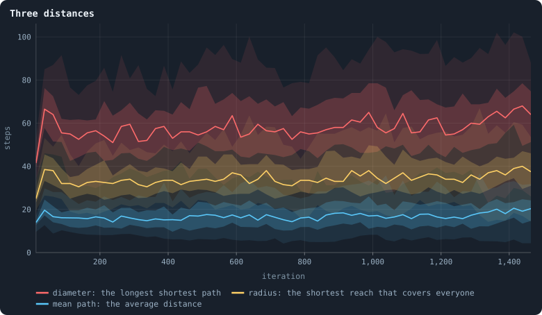
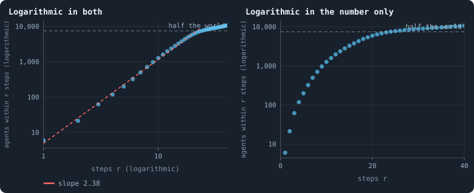
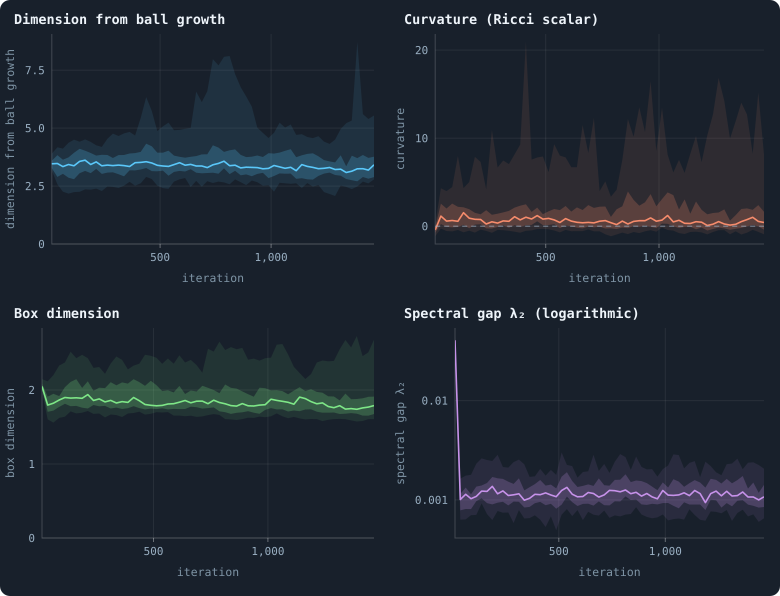
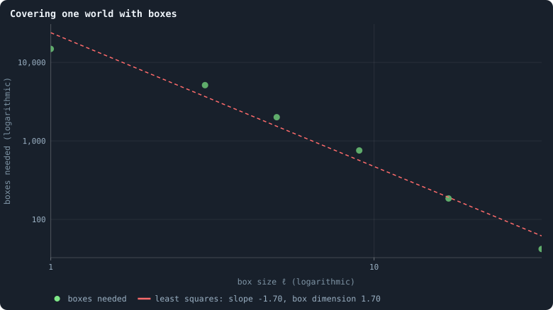
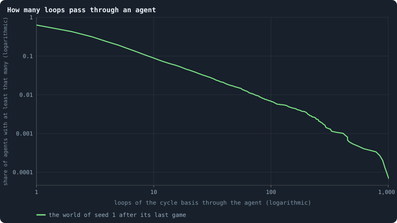

# The geometry of a world

A network has no space around it: agents are not anywhere, they are only
joined. Still, a network has a **geometry** — distances between its agents, a
way of growing outward from any one of them, places where it is thin and could
be cut. The viewer measures it in nine ways. This chapter reads them on the
baseline worlds, and holds the most telling ones against a **null**: a random
network with exactly the same number of connections at every agent. What the
world has and the random network lacks is what the rules built.

> [!question] Questions of this chapter
> - How far apart are the agents of a world, and is that far or near for a
>   network of its kind?
> - What kind of space is it: a line, a sheet, a tree?
> - How easily could it be cut in two? How long would a random walk — or a
>   token — need to cross it?
> - How many loops does it have, and where do they run?

The worlds are the thirty of 100,000 tokens of [Chapter 9](thirty-worlds.md);
where the thirty of 10,000 tokens this chapter was first written from differ,
both are given.

<!-- runs E10 -->
> [!info] The runs behind this chapter
> **30 runs.** Every condition below is run once for every seed (1 to 30), for 1,500 iterations — or until its world dies out. Every setting is that of the baseline **B1** (the algorithm exactly as a new run is offered it) unless the condition changes it.
>
> - **baseline** — changes nothing: B1 as it is; 100,000 tokens. Runs `B1-100000-s001` … `B1-100000-s030`.
>
> To make these runs again: `python3 gol_lab.py run E10`, or ▶ in the Book tab of a computer running `gol_server.py`. Each run writes its settings, seed and engine version beside its frames, in `GraphOfLifeRuns/<run>/meta.json` and `provenance.json`.

> [!info]- Every setting of these runs
> | setting | baseline | what it is |
> |---|---|---|
> | [`total_tokens`](../notes/settings.md#total_tokens) | 100,000 | The number of tokens in the world, *T*. It never changes during a run. |
> | [`n_nodes`](../notes/settings.md#n_nodes) | 0 | How many founders the world starts with. 0 means one founder per hundred tokens: *n* = ⌊*T* / 100⌋. |
> | [`k_neighbors`](../notes/settings.md#k_neighbors) | 0 | How many neighbours each founder starts with in the ring. 0 means *k* = max(⌊*n* / 100⌋, 5); an odd *k* is wired as *k* − 1. |
> | [`rewire_p`](../notes/settings.md#rewire_p) | 0.2 | In the starting ring, the probability that a connection is moved to a founder chosen at random (Watts–Strogatz). |
> | [`hidden_layers`](../notes/settings.md#hidden_layers) | 50, 45, 40, 35, 30 | The widths of the brain's hidden layers, in order from input to output. |
> | [`brain_kind`](../notes/settings.md#brain_kind) | float16 | How weights are stored: `float` (64-bit), `float16` (16-bit, computed in 64-bit) or `binary` (−1, 0, +1). |
> | [`brain_bits`](../notes/settings.md#brain_bits) | 16 | Only for binary brains: how many input rows encode one number. Unused by float and float16 brains. |
> | [`message_amount`](../notes/settings.md#message_amount) | 30 | How many numbers one message holds. Each agent sends one message to itself and one to each neighbour, every phase. |
> | [`random_input_amount`](../notes/settings.md#random_input_amount) | 5 | How many random numbers, drawn uniformly from −2 to 2, a brain reads per neighbour, every time it looks. |
> | [`exchange_messages`](../notes/settings.md#exchange_messages) | on | Whether agents send and read messages at all. |
> | [`message_prepass`](../notes/settings.md#message_prepass) | on | Whether every phase begins with an extra look in which agents only write messages, so the look that acts reads messages written this phase. |
> | [`allow_handover`](../notes/settings.md#allow_handover) | on | Whether a parent may move some of its own connections to its newborn child. |
> | [`allow_revolutions`](../notes/settings.md#allow_revolutions) | on | Whether a coalition of smaller stakers can take a node from its largest staker (see the note *How a coalition takes a node*). |
> | [`allow_gifting`](../notes/settings.md#allow_gifting) | off | Whether agents may give tokens to neighbours during reproduction. Off in every run of this book. |
> | [`random_decisions`](../notes/settings.md#random_decisions) | off | The control: every number a brain would produce is replaced by a random draw from the standard normal distribution. |
> | [`prune_after`](../notes/settings.md#prune_after) | blotto | After which phase connections that carried no tokens are cut: `blotto` (the game), `reproduction`, or `both`. |
> | [`inactive_window`](../notes/settings.md#inactive_window) | phase | How long a connection may go unused: `phase` means it must carry tokens in the phase being judged; `iteration` allows the two last phases. |
> | [`redistribution`](../notes/settings.md#redistribution) | uniform | How the tokens of removed agents are shared: `uniform` gives every survivor the same chance at each token; `by_tokens` weights by what a survivor holds; `poorest` raises the poorest to one common level first; `newborns` gives them to this iteration's children, `parents` to their parents, once per child (both `uniform` in an iteration without births); `children` leaves each dead agent's estate to its own living children (`uniform` where there are none). |
> | [`tokens_created_per_phase`](../notes/settings.md#tokens_created_per_phase) | 0 | Tokens added to the world at every cleanup. 0 keeps the supply fixed. |
> | [`mutate_on_replication`](../notes/settings.md#mutate_on_replication) | off | Whether a brain changes only when it is copied — into a newborn, or into a node its owner has just won — instead of also after every game, wherever it sits. |
> | [`incumbency`](../notes/settings.md#incumbency) | 1.0 | How many times over an agent's stake on its own node counts when the game decides who takes the node. 1 is the old rule. |
> | [`birth_links`](../notes/settings.md#birth_links) | 0 | How many of its parent's neighbours a newborn is joined to, drawn at random, besides its parent itself; 0 leaves every link to the brain's choice. |
> | [`mend_on_death`](../notes/settings.md#mend_on_death) | off | Whether the neighbours of an agent that dies are joined up where its death would leave them in separate pieces. |
> | [`prune_needs`](../notes/settings.md#prune_needs) | 0 | How many neighbours the two ends of an unused connection must share for it to be cut; 0 cuts every unused connection. |
> | [`valence`](../notes/settings.md#valence) | 0 | The most connections an agent's brain may choose to hold (0 = no limit). An agent at its limit cannot have a child. |
> | [`keep_home`](../notes/settings.md#keep_home) | 0.0 | The share of an agent's tokens — rounded up, never less than one — that stays on its own node whatever its brain says; a parent also keeps one. 0 is the old rule. |
> | [`max_age`](../notes/settings.md#max_age) | 0 | The age at which an agent dies (0 = never); its tokens are shared out like those of any other dead agent. |
> | [`buy_life`](../notes/settings.md#buy_life) | off | Whether an agent that has reached max_age may live on by paying one token an iteration into the estate of the dead — never its last, so one with a single token left dies. Needs max_age. |
> | [`min_child`](../notes/settings.md#min_child) | 1 | The fewest tokens a child can be born with; a parent that would give less has no child. |
> | [`child_floor`](../notes/settings.md#child_floor) | fixed | The least a child may start with: min_child alone (fixed), or also the median holding of its parent's neighbours (neighbours), so that a world grows only as rich as it is. |
> | [`mix_at_birth`](../notes/settings.md#mix_at_birth) | off | Whether a newborn's brain is its parent's mixed with a mate's — one of the parent's neighbours, drawn at random — each hidden unit whole from one or the other by an even chance, before it mutates; off, a newborn has a copy of its parent's brain. |
> | [`mix_mates`](../notes/settings.md#mix_mates) | any | Under mix_at_birth, who may be the mate: any neighbour of the parent, or only parents — a neighbour with a living child of its own (with none, the newborn's brain is a copy). |
> | [`self_message`](../notes/settings.md#self_message) | own | What an agent writes to itself, which each neighbour reads: what its own column says (own), or the largest, number by number, of what it writes to anyone (largest), so that news one column marks reaches every neighbour. |
> | [`link_search`](../notes/settings.md#link_search) | off | Whether an agent may reach beyond its neighbours to propose a link: off; jump, a walk as many steps long as the tokens it spends in one iteration, with a link proposed where it ends; walk, a scout that goes one step further in every iteration it pays for; or reach, a jump whose steps are free, as many as the tokens it holds would pay for. A paid step costs one token, paid to the agent it enters, and never the last. |
> | [`link_steering`](../notes/settings.md#link_steering) | random | Which way each step of a search goes: to a neighbour drawn at random, or to the one the searcher would most like a link with (looking). |
> | [`link_consent`](../notes/settings.md#link_consent) | mutual | Who has to agree to a link a search proposes: both ends (mutual), or only the one who proposes (forced). Nobody at its valence gets a new link either way. |
> | [`proto`](../notes/settings.md#proto) | none | Rules first played in the pilots' prototype, by name: came_from and helped_by (an input row each), contest = lottery, pool by genotype or family, kin_sense, tag_rate, mate_pays, grow, unit_token, link_token. Empty in every run but those that ask for one; only the prototype's world plays them (see the settings note). |
> | [`mutation_probability`](../notes/settings.md#mutation_probability) | 0.2 | The probability that a brain changes when it is copied to a child, and again, for every brain, after every game. |
> | [`mutation_noise_std`](../notes/settings.md#mutation_noise_std) | 0.2 | How large a change to one weight is: a normal draw with standard deviation this times 1/√(fan-in) of its layer. |
> | [`mutation_sparsity`](../notes/settings.md#mutation_sparsity) | 0.1 | The share of a brain's numbers a change touches; also the probability, for each weight matrix and bias vector, of a rarer reset that redraws that share of it. |
> | [`extinction_threshold`](../notes/settings.md#extinction_threshold) | 20 | A run stops, as extinct, when an iteration ends (after its game) with this many agents or fewer. |
> | seeds | 1 to 30 | one run per seed |
> | iterations | 1,500 | how far each run goes, unless its world dies first |
>
> A value in **bold** differs from the baseline B1.
<!-- /runs -->

## Distances

The **distance** between two agents is the fewest connections on a path
between them ([Path length](path-length.md)). Three numbers summarise
a world's distances ([Radius and diameter](radius-and-diameter.md)):
the **mean path length**; the **diameter**, the distance between the two
agents furthest apart; and the **radius**, how far the most central agent has
to reach to touch everyone.

<!-- figure geometry/distances -->

**Three distances.** Every 25 iterations, in the 30 baseline worlds: the diameter, the radius and the mean path length, all estimated from breadth-first searches out of 8 to 16 spread agents ([Radius and diameter](../notes/radius-and-diameter.md)). For each, the line is the median of the worlds at each iteration, the darker band holds the middle half of them (from the 25th to the 75th percentile) and the paler band nine in ten (5th to 95th).

> [!example]- How to make this figure
> **Runs.** The 30 baseline runs `B1-100000-s001` … `B1-100000-s030`: the baseline B1 at 100,000 tokens, seeds 1 to 30, 1,500 iterations each (every setting is listed in [Chapter 9](09-thirty-worlds.md)). They are made with `python3 gol_lab.py run E10`.
>
> **Data.** From each run's `GraphOfLifeRuns/<run>/stats.jsonl`, which holds one row per recorded phase: `phase` 1 is the world just after reproduction, `phase` 2 just after the game, and every statistic is a field of the row (see [What a run records](../notes/frames-and-stats.md)).
>
> 1. Take `diameter`, `radius` and `meanPathLength` of the rows with `phase` = 2.
> 2. In each stretch, take the median, the 25th and 75th and the 5th and 95th percentiles of those means over the worlds that still have a value there (a world that died has none after its death).
>
> **To make it again:** `python3 book_figures.py geometry`.
<!-- /figure -->

Over the settled life the median world has a mean path length of 17.7
steps, a radius of 36 and a diameter of 60 — about twice those of the worlds
of 10,000 tokens (9.8, 17 and 29). Are those long? Take the world of seed 1
after its last game, 14,870 agents, and compute every distance exactly: a
mean path of 27.9, a radius of 48, a diameter of 96. Now keep every agent's
number of connections and wire them at random (five times, a "configuration
model"): the mean path falls to **6.0**, the radius to 8.6, the diameter to
16.

The world is **four and a half times as long** as its connections require —
where the world of seed 1 at 10,000 tokens was twice as long (8.8 against
4.2). The gap widens with size: a random network's distances grow with the
logarithm of its agents, a world's with a power of them. Random networks are
"small worlds" because every connection is as likely to be a long jump as a
short one. In this world there are no long jumps: a child is joined to its
parent's neighbourhood ([Chapter 31](how-agents-have-children.md)), so the
network only ever grows locally, branch by branch.

## How the world grows around an agent

Stand on an agent and count the agents within *r* steps.

<!-- figure geometry/ball -->

**How many agents are within r steps.** The world with seed 1 after its last game (14,870 agents). From 24 agents spread evenly through the list of ids, a breadth-first search counts how many agents lie within r steps; the dots are the means over the 24. Left, both axes logarithmic: a power law r^d — growth like a d-dimensional space — is a straight line of slope d; red is the line least squares fits up to the radius where half the world is reached. Right, only the vertical axis logarithmic: exponential growth, as in a tree or a random network, would be a straight line there ([Dimension and curvature](../notes/ball-dimension-and-curvature.md)).

> [!example]- How to make this figure
> **Runs.** `B1-100000-s001`.
>
> **Data.** From each run's frames, `GraphOfLifeRuns/<run>/frames/`, read with `gol_store.read_frame(run, index)`; frame `2·t` is iteration *t* after reproduction and frame `2·t + 1` after the game.
>
> 1. Read frame `2999`; build the network from `edges`.
> 2. From every ⌊n/24⌋-th agent of the id-sorted list, breadth-first search; count the agents at distance ≤ r for r = 1 … 40; average over the 24 sources.
> 3. Fit ln V(r) = a + d·ln r by least squares for r with V(r) ≤ n/2.
>
> **To make it again:** `python3 book_figures.py geometry`.
<!-- /figure -->

Within one step there are, on average, 6 agents (the agent and its
neighbours). Within two, 21; within three, 62; within five, 200; within ten,
1,270. The count grows as *r*^2.38, until half the world is reached at 24
steps, and then flattens as the balls run into the edges of the world. In the
world of seed 1 at 10,000 tokens, two steps already held 70 agents — most
agents were two steps from a hub — and half the world lay within seven. The
growth is closer to a power law here (the left panel would show a straight
line) than to an exponential (the right one would), and
[Chapter 24](how-many-dimensions-does-a-world-have.md) reads it as a
dimension.

## Four measures of a world's shape

From ball growth and from coverings come four numbers that the viewer
records every 25 iterations ([Dimension and curvature](ball-dimension-and-curvature.md),
[Box dimension](box-dimension.md), [The spectral gap](spectral-gap.md)):

<!-- figure geometry/measures -->

**Four measures of a world's geometry.** Every 25 iterations, in the 30 baseline worlds: the dimension and the curvature read off how balls grow ([Dimension and curvature](../notes/ball-dimension-and-curvature.md)), the box dimension ([Box dimension](../notes/box-dimension.md)), and the spectral gap, on a logarithmic axis ([The spectral gap](../notes/spectral-gap.md)). In each, the line is the median of the worlds at each iteration, the darker band holds the middle half of them (from the 25th to the 75th percentile) and the paler band nine in ten (5th to 95th).

> [!example]- How to make this figure
> **Runs.** The 30 baseline runs `B1-100000-s001` … `B1-100000-s030`: the baseline B1 at 100,000 tokens, seeds 1 to 30, 1,500 iterations each (every setting is listed in [Chapter 9](09-thirty-worlds.md)). They are made with `python3 gol_lab.py run E10`.
>
> **Data.** From each run's `GraphOfLifeRuns/<run>/stats.jsonl`, which holds one row per recorded phase: `phase` 1 is the world just after reproduction, `phase` 2 just after the game, and every statistic is a field of the row (see [What a run records](../notes/frames-and-stats.md)).
>
> 1. Take `dimension`, `ricciCurvature`, `boxDimension` and `spectralGap` of the rows with `phase` = 2 (measured every 25 iterations).
> 2. In each stretch, take the median, the 25th and 75th and the 5th and 95th percentiles of those means over the worlds that still have a value there (a world that died has none after its death).
>
> **To make it again:** `python3 book_figures.py geometry`.
<!-- /figure -->

- **Dimension from ball growth**: 3.4 in the median world (the worlds: 2.9 to
  6.9; 3.0 at 10,000 tokens), against 3.7 in the founders' ring after the
  first game. Balls grow, over their first few steps, about as fast as in
  three-dimensional space, or faster.
- **Curvature**: +1.4 (0.1 to 23), from −1.7 at the start. Positive
  curvature means balls grow more slowly at larger *r* than at smaller — as on
  a sphere. Here that is mostly the bushy neighbourhoods of hubs, which fill
  the first steps of a ball, and in a star the whole world is two steps from
  everywhere (the 23). Read it as "the growth slows", not as a sphere.
- **Box dimension**: 1.88 (1.66 to 2.58; 1.85 at 10,000 tokens), from 2.48 in
  the ring, with R² = 0.96.
- **Spectral gap**: 0.0012 (0.0010 to 0.0019), half that of the worlds of
  10,000 tokens (0.0026), down from 0.080 in the ring.

Two dimensions, 3.4 and 1.9, for the same world. They do not contradict each
other; they look at different scales. Ball growth is fitted at radii 1 to 5,
where the bushy neighbourhoods of hubs make the world look high-dimensional;
box covering runs from size 1 to 33, and at large sizes it counts the long,
thin branches, which make the world look low-dimensional. Neither number is
"the" dimension of a network that has no single one; both are indices for
comparing worlds.

## Covering a world with boxes

<!-- figure geometry/boxes -->

**Covering one world with boxes.** The world with seed 1 after its last game, covered by boxes: a box of size ℓ is every agent within (ℓ − 1)/2 steps of a centre, and centres are taken greedily, best-connected first, among the agents no box holds yet. Dots: how many boxes it takes for ℓ = 1, 3, 5, 9, 17 and 33; red: the least-squares line on logarithmic axes, whose slope is minus the box dimension ([Box dimension](../notes/box-dimension.md)).

> [!example]- How to make this figure
> **Runs.** `B1-100000-s001`.
>
> **Data.** From each run's frames, `GraphOfLifeRuns/<run>/frames/`, read with `gol_store.read_frame(run, index)`; frame `2·t` is iteration *t* after reproduction and frame `2·t + 1` after the game.
>
> 1. Read frame `2999`; order the agents by degree, highest first.
> 2. For each ℓ: go down the order; every agent not yet in a box starts a new box, which takes every agent within (ℓ − 1)/2 steps of it; count the boxes.
> 3. Fit ln(boxes) on ln ℓ by least squares.
>
> **To make it again:** `python3 book_figures.py geometry`.
<!-- /figure -->

The world of seed 1 needs 14,870 boxes of size 1 (every agent alone), 5,135
of size 3, 2,004 of size 5, 756 of size 9, 185 of size 17 and 42 of size 33.
On logarithmic axes these lie close to a line of slope −1.71: a box dimension
of about 1.7, between a line and a sheet (2.0 for the same world at 10,000
tokens).

## How easily a world could be cut

The **spectral gap** λ₂ measures, in one number, how hard a network is to cut
into two large parts, and how quickly a random walk on it forgets where it
started — after about 1/λ₂ steps ([The spectral gap](spectral-gap.md)).

The world of seed 1 has λ₂ = 0.00095. Its random twin, with the same
connections per agent, has 0.031: **thirty-three times larger** (thirty-two
at 10,000 tokens). By Cheeger's
inequality, a small λ₂ guarantees a bottleneck — a large part of the world
joined to the rest by few connections. [Chapter 36](how-a-world-breaks.md)
finds those bottlenecks: whole branches hanging on single connections.

The gap also says something about the tokens. [Chapter 29](where-the-tokens-flow.md)
showed that a game moves tokens almost like a random walk. On this network, a
random walk needs about a thousand steps to forget its start — so tokens could
spread evenly across a whole world only over a thousand games, as long as the
whole run. Meanwhile the network changes every game: about 2,300 connections
are made and 1,600 cut per iteration, and the hubs change brains every
game. **Locally**, tokens settle
in a few games, which is why every agent's tokens follow its connections
([Chapter 34](how-properties-scale-together.md)). **Globally**, the world is
never at rest: far-apart regions are only loosely coupled.

## Loops

A tree has no loops; every connection beyond the *n* − 1 of a spanning tree
closes one, and those loops are independent: the **cycle rank** |*E*| − |*V*|
+ 1 ([Loops](loops.md)).

<!-- figure geometry/loops -->

**How many loops pass through an agent.** A breadth-first spanning tree of the world with seed 1 after its last game leaves 11,297 connections over, each closing one loop of a cycle basis ([Loops](../notes/loops.md)). For every count x, the share of agents that at least x of those loops pass through. 37% of the agents lie on none of them.

> [!example]- How to make this figure
> **Runs.** `B1-100000-s001`.
>
> **Data.** From each run's frames, `GraphOfLifeRuns/<run>/frames/`, read with `gol_store.read_frame(run, index)`; frame `2·t` is iteration *t* after reproduction and frame `2·t + 1` after the game.
>
> 1. Read frame `2999`; build a breadth-first spanning tree.
> 2. For every connection not in the tree, walk both ends up the tree to where they meet; every agent on the way, and the meeting point, lies on that loop.
> 3. Count the loops per agent; draw the share with at least x.
>
> **To make it again:** `python3 book_figures.py geometry`.
<!-- /figure -->

Over the settled life, the median world has 10,000 independent loops, a
**loop density** — independent loops per connection — of 0.42 (0.38 at 10,000
tokens): 42% of the connections are "spare", beyond what holding the world
together needs. In the world of seed 1, 11,297 connections close loops of a
breadth-first spanning tree; 37% of the agents lie on none of those loops —
they hang on tree-like branches — and one agent lies on 1,012 of them: a
tenth of all the loops of the world run through a single hub (half, in the
smaller world of seed 1). The number of loops through an agent is
heavy-tailed: most agents are on a few, a handful on hundreds.

## What this means

- **The world is a stretched network of stars.** Four and a half times the
  distances and a thirty-third of the spectral gap of a random network with
  the same connections (twice the distances at 10,000 tokens). Growth by birth is local — a child joins its parent's
  neighbourhood — and nothing ever makes a long jump. The gap widens with
  size: in worlds of up to 60,000 agents, distances grow like the number of
  agents to the power 0.25 to 0.30, as in a body of about three dimensions,
  not with its logarithm, as in a random network
  ([Chapter 42](how-does-a-worlds-size-follow-its-tokens.md)).
- **The world mixes slowly.** Tokens settle within neighbourhoods and not
  across the world; regions of a world are only loosely coupled.
- **For evolution, that cuts both ways.** A network that mixes slowly lets
  regions differ for a long time, which is how spatial structure protects
  variety and how cooperation can grow among neighbours (Nowak and May 1992;
  [Chapter 38](do-agents-cooperate.md)). But a network with bottlenecks
  also breaks easily, and whole branches can be lost at once
  ([Chapter 36](how-a-world-breaks.md)).

To make every figure of this chapter: `python3 book_figures.py geometry`.

<!-- turns -->
---

← [Chapter 34 · How properties scale together](34-how-properties-scale-together.md) · [Contents](../README.md) · [Chapter 36 · How a world breaks](36-how-a-world-breaks.md) →
<!-- /turns -->
