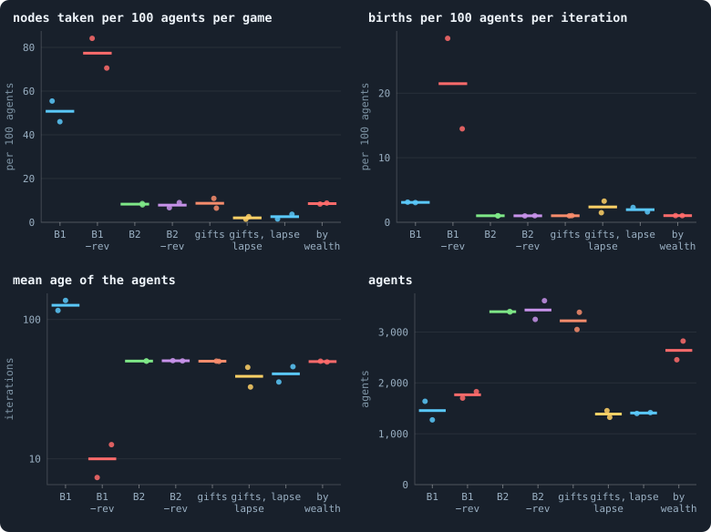
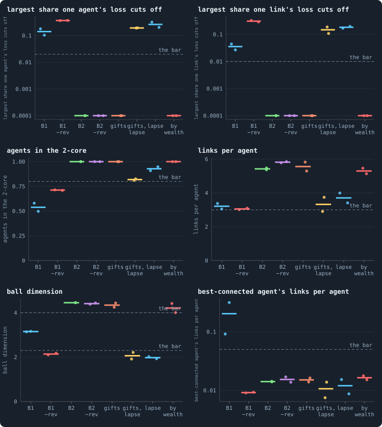
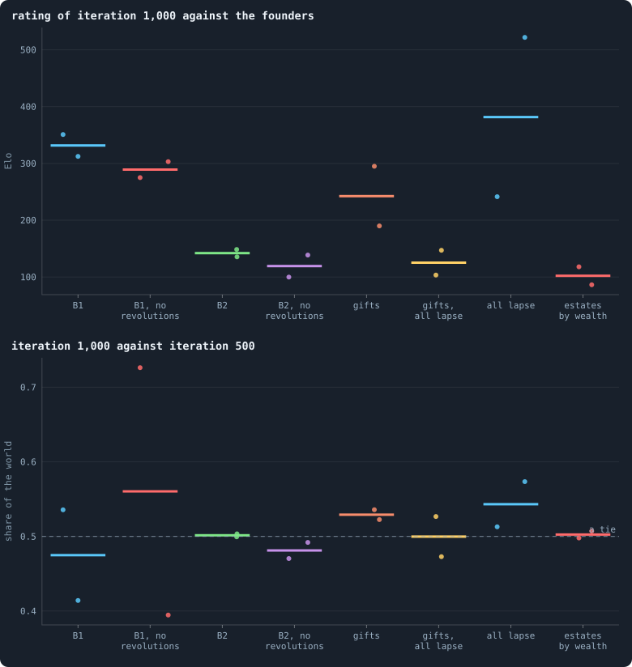
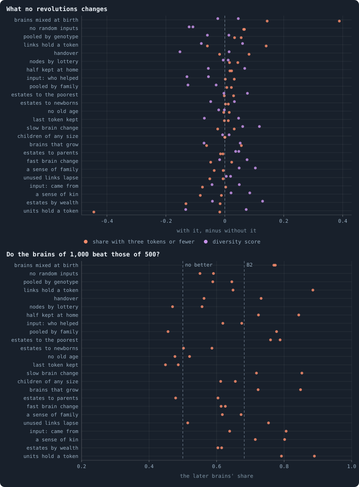
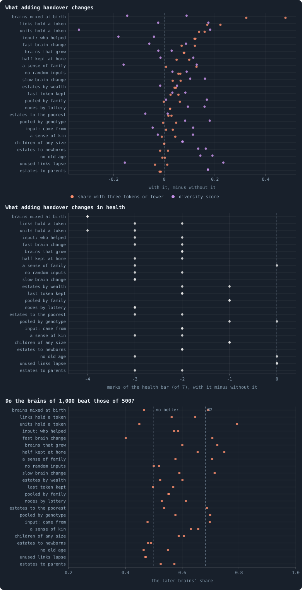

# Revolutions, handover and gifts: the switches the world was built with

> [!question] Questions of this page
> - The engine of Graph of Life came with switches of its own. Does any of
>   them keep evolution going?
> - What do revolutions do, in a world of nearly blind [brains](the-brain.md "The neural network each agent decides with: inputs about itself and its neighbours, outputs that become its decisions.") and in one of
>   brains that see?
> - Can gifts, [tokens](the-world.md#agents-and-tokens "The one thing of value in a world: every agent holds a whole number of them, and their total never changes.") paid to keep a [connection](the-world.md#the-network "A link between two agents of the network: they are neighbours, and can stake on each other's nodes.") alive, make the shape of the
>   network a decision instead of a rule with a number in it?
> - Does each switch do beside every other rule what it does alone?
> - Does handover cost a world the same health whatever its other rules, and
>   does it buy anything?
> - Are gifts given much, to whom, and do they come back?

## In short

The engine of Graph of Life came with three switches of its own.
Revolutions let small stakers unite against the largest, handover lets a
parent pass links to its child, and gifts let an [agent](the-world.md#agents-and-tokens "One member of a world: it lives on a node of the network, holds tokens and has a brain that takes all its decisions.") pay a [neighbour](the-world.md#the-network "An agent joined to another by a connection."). In B1
revolutions win most of the nodes that change hands, and decide whether a
world is old and calm or young and turbulent. In B2, alone or beside each of
some twenty other rules, revolutions and gifts are details, except where
brains are mixed at birth. Handover thins B2's network into trees with nearly
every rule. Judged a [lifetime](age-and-lifetime.md "How many iterations an agent lives, from its birth to its death.") long, evolution goes on in nearly every B2
world whatever the switches: they change only how fast.

## The switches the world was built with

The rules made for B2 have been judged by one test: does a world keep
beating its own past
([Does evolution keep going?](how-to-tell-a-world-that-keeps-evolving.md))?
The switches the [engine](the-lab.md "The program that runs an experiment's plan as runs, each on a frozen copy of the engine, the code that plays a world.") was built with were never judged that way. Some were
set for other reasons. Handover was taken out of B2 because it breaks the
network ([Building B2: a world that cannot break](a-world-that-cannot-break.md)).
Revolutions are to be turned off in a page still to be written, *What keeps
wealth spread?*, for what they do to wealth. And gifts had been off in every
run of the notebook. The author asked whether these switches had been tested
for [open-ended evolution](open-ended-test.md "Evolution that keeps producing new things without end, not only up to a plateau."). They had not, and each has a reason it might
matter. So a batch of pilot worlds, batch S, threw them into B1 and B2.

### Three switches, and two more

**Revolutions.** Think of a hill that goes to the largest army marching on
it. Smaller armies can band together against that army, each swearing part
of its troops to the band. If the sworn troops together outnumber the largest
army, the band takes the hill.

In the [game](one-iteration.md#phase-2-the-game "The second phase of an iteration: every agent stakes all its tokens on its own node and its neighbours', and every node goes to someone.") a node goes to whoever staked the most on it, and a revolution is
such a band. A staker may mark part of its stake on a node as revolutionary.
If the marked parts of the smaller stakers together exceed the largest single
stake, they take the node ([How a coalition takes a node](revolution.md)).
With the switch off ([`allow_revolutions`](settings.md#allow_revolutions)),
every node goes to whoever staked the most on it.

Revolutions are the one form of collective action the original game has. A
rule that rewards standing together is the kind of rule
[Why evolution stops](how-to-tell-a-world-that-keeps-evolving.md#why-evolution-stops)
said evolution needs. Both B1 and B2 have had revolutions on all along.

**Handover.** A parent may move some of its own links to its newborn child
([`allow_handover`](settings.md#allow_handover)). B1 has it; B2 was built
without it. Batch S left it as each baseline has it.
[Handover, with every other rule](#handover-with-every-other-rule) plays it
in B2.

**Gifts.** With gifts ([`allow_gifting`](settings.md#allow_gifting)), an
agent may hand tokens to its neighbours during reproduction, as a gift rather
than a stake. It gives from what its child left it: the tokens it keeps after
a birth. A gift is a real transfer, and it crosses a connection, so it keeps
that connection alive. These are gifts an agent chooses to make. They are not
the failed stakes that
[Gliders, and who helps whom](gliders-and-who-helps-whom.md) calls gifts,
which end up with a node's holder.

The author built gifts to make the upkeep of a link a decision. In the
original algorithm a connection that carried no tokens lapsed, so an agent
could keep a neighbour only by staking on it. With gifts, the accounting is
done after reproduction, over a whole [iteration](one-iteration.md "One step of a world's time: a phase of reproduction, then a phase of the game.") (`prune_after = reproduction`,
`inactive_window = iteration`, the form's default until 2026-10-02). So an
agent sees which of its connections are about to lapse, and can pay to keep
them.

B2 made upkeep a rule instead: an unused link lapses only if its two ends
share two other neighbours (`prune_needs = 2`). That rule has a number in it.
Gifts with every unused link lapsing (`prune_needs = 0`) would put the
network's shape in the brains' hands. That is the kind of replacement for a
number that [Rules without numbers](rules-without-numbers.md) looks for.

**Two more.** The pilots of batch S also tried **every unused link lapsing**
without gifts, as in the original algorithm (`prune_needs = 0` alone). And
they tried **sharing the [estate](estate.md "The tokens a dead agent leaves, and who gets them.") by wealth** (`redistribution = by_tokens`).
It gives the tokens of the dead to the survivors in proportion to what they
hold. So every round of deaths concentrates wealth instead of spreading it,
and a world of rich and poor plays a different game.

### The worlds of batch S

The worlds are pilots in the engine's own code (`--proto engine=true`; see
[Pilot worlds](pilot-worlds.md)), two [seeds](random-numbers.md "The number that fixes every random choice of a run: the same settings and the same seed make the same world.") of each kind. Each holds 10,000
tokens and runs for 1,000 iterations, and a whole world is kept every 100
iterations. With two seeds a kind, what they show is indicative, not an
effect ([How many seeds an experiment needs](seeds-needed.md)). The two
baselines differ in their brains. B1's, of five hidden layers, barely see
what is around them. B2's, of one hidden layer of 16 units, are brains that
see ([B1 and B2: the two baselines](b1-and-b2.md)).

| world | what it changes |
|---|---|
| B1 | the baseline: brains of five layers, revolutions on |
| B1, no revolutions | `allow_revolutions = false` |
| B2 | a world that cannot break ([Building B2: a world that cannot break](a-world-that-cannot-break.md)), revolutions on |
| B2, no revolutions | `allow_revolutions = false` |
| B2 with gifts | `allow_gifting`, `prune_after = reproduction`, `inactive_window = iteration` |
| B2 with gifts, every unused link lapsing | the same, and `prune_needs = 0` |
| B2, every unused link lapsing | `prune_needs = 0` alone |
| B2, estates by wealth | `redistribution = by_tokens` |

B2's pilot of seed 1 is the same world as the lab's run `B2-10000-s001` of
[Experiment 16](how-to-tell-a-world-that-keeps-evolving.md#why-evolution-stops),
agent for agent and token for token. So the pilots in the engine's code
reproduce the lab exactly.

### What the switches did to the world

The two figures below read each world over iterations 500 to 1,000. The
first shows how a world lives: the nodes taken, the births, the ages and the
number of agents. The second holds each world's network against the [health
bar](health-bar.md "The seven marks a world's network must meet to count as healthy: one piece, mostly on loops, no fatal cut, no hub, three to twelve links per agent, a dimension of 2.3 to 4."), the marks a healthy network must meet.

<!-- figure switches/life -->

**How each switch changes a world's life.** One dot per world, the mean or median over iterations 500 to 1,000; the bar is the median of the two. Labels as in the figure below.

> [!example]- How to make this figure
> **Runs.** Pilot worlds of `research/oee/pilots/run.py` in the engine's own code (`--proto engine=true`), kept in `GraphOfLifeRuns/.pilots/S`, two seeds each (`-s1`, `-s2`), at 10,000 tokens for 1,000 iterations with a whole world every 100 (`--ckpt 100`): B1 (`S6-B1`, the settings of the study of the baseline), B1 without revolutions (`S7-B1norev`), B2 (`S0-B2`: `--set hidden_layers=16 message_amount=8 message_prepass=false allow_handover=false mutate_on_replication=true incumbency=1.5 birth_links=2 mend_on_death=true prune_needs=2 valence=8 keep_home=0.3 max_age=100 min_child=10`), B2 without revolutions (`S1-norev`), B2 with gifts (`S2-gifts`: `allow_gifting=true prune_after=reproduction inactive_window=iteration`), the same with every unused link lapsing (`S3-giftslapse`: also `prune_needs=0`), B2 with every unused link lapsing (`S4-lapse`) and B2 with estates shared by wealth (`S5-bytokens`: `redistribution=by_tokens`). The jobs are listed in `research/oee/pilots/jobs_S.txt`.
>
> **Data.** From each world's `series.jsonl`.
>
> 1. Of the rows from iteration 500 to 1,000: the nodes taken (`conquests`) and the births per 100 agents, averaged; the mean age (`meanAge`), averaged; the agents (`nodes`), median.
>
> **To make it again:** `python3 book_figures.py switches`.
<!-- /figure -->

<!-- figure switches/bar -->

**Each switch against the health bar.** One dot per world, at its median over iterations 500 to 1,000; the bar is the median of the two; dashed lines are the health bar of [How to tell a world that keeps evolving](how-to-tell-a-world-that-keeps-evolving.md). *−rev*: no revolutions; *gifts, lapse*: gifts, and every unused link lapses; *lapse*: every unused link lapses; *by wealth*: estates shared by wealth. Cut shares and the best-connected agent's share are drawn on logarithmic axes, a cut of nothing at 0.0001.

> [!example]- How to make this figure
> **Runs.** Pilot worlds of `research/oee/pilots/run.py` in the engine's own code (`--proto engine=true`), kept in `GraphOfLifeRuns/.pilots/S`, two seeds each (`-s1`, `-s2`), at 10,000 tokens for 1,000 iterations with a whole world every 100 (`--ckpt 100`): B1 (`S6-B1`, the settings of the study of the baseline), B1 without revolutions (`S7-B1norev`), B2 (`S0-B2`: `--set hidden_layers=16 message_amount=8 message_prepass=false allow_handover=false mutate_on_replication=true incumbency=1.5 birth_links=2 mend_on_death=true prune_needs=2 valence=8 keep_home=0.3 max_age=100 min_child=10`), B2 without revolutions (`S1-norev`), B2 with gifts (`S2-gifts`: `allow_gifting=true prune_after=reproduction inactive_window=iteration`), the same with every unused link lapsing (`S3-giftslapse`: also `prune_needs=0`), B2 with every unused link lapsing (`S4-lapse`) and B2 with estates shared by wealth (`S5-bytokens`: `redistribution=by_tokens`). The jobs are listed in `research/oee/pilots/jobs_S.txt`.
>
> **Data.** From each world's `series.jsonl`.
>
> 1. Of the rows from iteration 500 to 1,000 that measured the network (every 10th), take the median of the worst share of the others one agent's loss cuts off (`nodeCutRisk`), the same for one link (`cutRisk`), the 2-core (`coreShare`), links per agent (`meanDegree`), the ball dimension and the best-connected agent's share (`maxDegreeShare`).
>
> **To make it again:** `python3 book_figures.py switches`.
<!-- /figure -->

**Revolutions shape B1 and do nothing to B2.** In B1 a revolution is common.
In every game, revolutions took 28 to 39 nodes per hundred agents, most of
the 46 to 55 that changed hands. The world they make is calm and old. The
average agent was 116 to 137 iterations old, and 3 agents in a hundred were
born in an iteration. The network grew [stars](stars-and-hubs.md "An agent joined to far more agents than most; a star is a world held together by a single hub."): one agent was joined to 9 to
32% of the others.

Take revolutions away, and B1 becomes a world of mayflies. Nodes changed
hands 71 to 84 times per hundred agents a game. Between 14 and 28 agents in a
hundred were born in every iteration, and the average agent was 7 to 13
iterations old. Its network had no stars: no agent was joined to more than 1%
of the others. But it was stretched and fragile. Its [ball dimension](ball-dimension-and-curvature.md "How fast the number of agents within a distance grows with the distance: as its square in a plane, its cube in space.") was 2.1 to
2.2, and a single agent's loss would cut off 36 to 37% of the world.

In B2, revolutions won about one node in three hundred a game over the
thousand iterations. From iteration 500 on they won one in 400 to 1,000. B2
with and without them were the same world in every measure.

**Gifts changed nothing that the network shows,** as long as B2's rule for
lapsing links held. Under that rule a link lapses only if its ends share two
neighbours. Then links seldom lapse, and a gift has little to save.

**Links that must be used break the network, gifts or no gifts.** With every
unused link lapsing, as in the original algorithm, B2's world held 1,300 to
1,450 agents instead of 3,400. One to three agents in a hundred were cut off
in every iteration. Its ball dimension was about 2, and one agent's loss could
cut off a fifth of it. Gifts did not change that: the brains did not pay to
keep the links that mattered.

**Estates shared by wealth** made the world smaller, 2,450 and 2,800 agents
against 3,400, and otherwise left it as it was.

### Does any switch keep evolution going?

How can one tell whether evolution goes on? Play a world against its own
past. Take the brains of one world at two moments, two eras. Give every agent
a brain drawn from one era or the other, switch [mutation](mutation.md "A random change to a brain, made with a set probability when it is copied, and in B1 also after every game: a changed brain is a new genotype.") off, and play on
under the world's own rules. If the later brains end up holding more than
half of the world, they are better
([Eras and contests: does a world keep getting better?](eras-and-contests.md)).
The first contests here lasted 20 iterations, and from them each era gets a
rating, the [founders](starting-ring.md "One of the agents a world starts with, each holding the same tokens, on a ring with a few shortcuts.")' at 0.

<!-- figure switches/elo -->

**Does any switch keep evolution going?** One dot per world. Top: the rating of the brains of iteration 1,000 against the founders'. Bottom: their share of a world contested with the brains of iteration 500 of the same world.

> [!example]- How to make this figure
> **Runs.** Pilot worlds of `research/oee/pilots/run.py` in the engine's own code (`--proto engine=true`), kept in `GraphOfLifeRuns/.pilots/S`, two seeds each (`-s1`, `-s2`), at 10,000 tokens for 1,000 iterations with a whole world every 100 (`--ckpt 100`): B1 (`S6-B1`, the settings of the study of the baseline), B1 without revolutions (`S7-B1norev`), B2 (`S0-B2`: `--set hidden_layers=16 message_amount=8 message_prepass=false allow_handover=false mutate_on_replication=true incumbency=1.5 birth_links=2 mend_on_death=true prune_needs=2 valence=8 keep_home=0.3 max_age=100 min_child=10`), B2 without revolutions (`S1-norev`), B2 with gifts (`S2-gifts`: `allow_gifting=true prune_after=reproduction inactive_window=iteration`), the same with every unused link lapsing (`S3-giftslapse`: also `prune_needs=0`), B2 with every unused link lapsing (`S4-lapse`) and B2 with estates shared by wealth (`S5-bytokens`: `redistribution=by_tokens`). The jobs are listed in `research/oee/pilots/jobs_S.txt`.
>
> **Data.** From each world's checkpoints, `ckpt_<iteration>.npz`.
>
> 1. For every pair of the eras 0, 100, 200, 500 and 1,000 play four contests, two in each era's world: every agent gets a brain drawn at random from one era or the other, mutation is switched off, and 20 iterations are played under the world's own rules (`research/oee/pilots/tourney.py --T 20 --reps 2`).
> 2. Fit one rating per era (Bradley–Terry, `research/oee/pilots/elo.py`), the founders at 0.
>
> **To make it again:** `python3 book_figures.py switches`.
<!-- /figure -->

**In contests of 20 iterations, no switch kept B2 evolving.** In every
variant of B2, the brains of iteration 1,000 held between 0.47 and 0.57 of a
world contested with those of iteration 500. B2 itself held 0.50 in both
worlds.

**Some switches give evolution more to learn at first.** With gifts, the
brains of iteration 100 rated +263 and +157 against the founders, against
+102 and +85 in B2. With every unused link lapsing they rated +520 and +256.
In a world whose links break, the founders' careless play is costly, so the
first improvements are large.

**A lifetime long, evolution in B2 goes on.** An agent of B2 lives at most
100 iterations, and a contest of 20 misses what pays off over such a life. In
Experiment 16's B2 worlds, contests of 20 iterations had the brains of
iteration 2,000 tied with those of 500. In contests of 100 iterations the
later brains won (0.73)
([Would we notice if it went on?](how-to-tell-a-world-that-keeps-evolving.md#would-we-notice-if-it-went-on)).
So the worlds of batch S were played again, in contests of 100 iterations,
once in each era's world. Eras played against themselves that way hold 0.44
to 0.58: that is how far a tie can stray. The brains of iteration 1,000 held these
shares against those of 500, in the two seeds:

| world | iteration 1,000 against 500, a lifetime long |
|---|---|
| B2 | 0.69 and 0.67 |
| B2 without revolutions | 0.76 and 0.61 |
| B2 with gifts | 0.87 and 0.83 |
| B2 with every unused link lapsing | 0.65 and 0.53 |
| B2 with estates shared by wealth | 0.65 and 0.62 |
| B2 with gifts and every unused link lapsing | 0.25 and 0.62, in worlds whose networks were breaking |
| B1 | 0.37 and 0.68 |
| B1 without revolutions | 0.35 and 0.16 |

So in B2 and nearly all its variants, evolution went on between iterations
500 and 1,000. The switches do not change that. They change only how fast it
goes, and it went fastest with gifts.

### In B1: how long evolution goes on

**In contests of 20 iterations, revolutions decide how long B1 evolves.**
With revolutions, B1's brains rated about +350 at iteration 100 and changed
little after. The brains of iteration 1,000 held 0.54 and 0.41 against those
of iteration 500. Without revolutions, evolution went on longer. In the world
of seed 1, the brains of iteration 1,000 beat those of 500 in all four
contests (0.73). They beat those of 200 in all four too (0.82). In the world
of seed 2 they improved until iteration 500, to +383, and then fell back
(0.40).

Why would a world without revolutions evolve for longer? B1 without
revolutions is a world of mayflies, with 15 to 28 times as many births per
agent as B2. And in B1 every brain changes after every game. So a thousand of
its iterations hold many more generations than a thousand of B2's. Its
contests are noisy too: single contests between its eras ended anywhere from
0.09 to 1.00.

**A world of 3,000 iterations.** A third world without revolutions, of seed
3, ran for 3,000 iterations, to see whether its evolution stops later or not
at all. It stopped later, and then the world itself nearly died. In contests
of 20 iterations its brains improved until iteration 500. The brains of
iteration 500 beat those of 0, 100 and 200 in eleven of twelve contests. Then
they lost ground. Iteration 1,000 held 0.32 against iteration 500, and
iteration 1,500 held 0.11. Meanwhile the world shrank. It held about a
thousand agents from iteration 1,000 to 1,750, and a few dozen after 2,000.
At its smallest it held 13, and 44 at iteration 3,000. A lab run would have
counted it as [extinct](extinction.md "A world's end before its last iteration: it has dropped to its threshold of agents or fewer."). Contests played in its later eras' worlds often ended
with fewer than 50 agents, so their scores say nothing.

**A lifetime long, single worlds of B1 tell another story.** In the table
above, played in contests of 100 iterations, B1's later brains lost in three
of its four worlds. With revolutions they held 0.37 and 0.68; without them,
0.35 and 0.16. So the world of seed 1 without revolutions, which short contests saw
still improving at iteration 1,000, lost a lifetime long. And the world of
seed 2 with revolutions, which short contests saw stopped, won. B1's single
worlds are noisy, and the two lengths of contest disagree about them.

## Revolutions, with every other rule

Alone, revolutions shape B1 and do nothing to B2
([What the switches did to the world](#what-the-switches-did-to-the-world)).
But B2 itself is one world among many the notebook now plays, and each of its
other rules can be changed too. Are there rules with which revolutions
matter, where in B2 itself they do not?

### One switch beside every other rule

What a switch does alone in B2 need not be what it does once other rules are
thrown too. On 16 October 2026 the author asked for the switches in
combination. The plainest way to ask is a square of four worlds:

| | without the other rule | with the other rule |
|---|---|---|
| **without the switch** | B2 | B2 with the other rule |
| **with the switch** | B2 with the switch | B2 with both |

The bottom row minus the top row is what the switch does. In the left column
that is the switch alone; in the right, the switch in the other rule's
company. If the two differences agree, the switch does the same whatever its
company.

A batch of pilots plays the fourth corner, B2 with both, for each other rule
in turn, two seeds each. The other three corners already exist, seed for
seed, from batch S, from earlier batches or from the lab. So each pair of
rules is played in full, but only in pairs. That is not the
fractional factorial design of
[Eight switches at once](eight-switches-at-once.md), which throws eight
switches together in sixteen worlds
([Many switches in few worlds](fractional-factorial.md)).

Three batches did this for the switches of this page:

- **batch W**: B2 without revolutions, beside each of 24 other rules;
- **batch X**: B2 with handover, beside each of 23;
- **batch T**: B2 with gifts, beside each of 21, and B1 with gifts, with
  revolutions and without.

The other rules are the switches the notebook's pilots and lab experiments
have tried with B2, and batch S's other ways of deciding a node:

- where the estate of the dead goes: by wealth, to the poorest, to the
  newborns or to the parents ([Who inherits?](who-inherits.md));
- links that hold a token, brains mixed at birth, and inputs that say who
  helped an agent or where it came from;
- handover, no random inputs, no old age, children of any size, and half, or
  all but the last token, kept at home;
- brains that grow or whose units each hold a token, brains that change more
  slowly or faster, and every unused link lapsing;
- a lottery, sides pooled by [genotype](genotype.md "The identity of a brain: a number that a copy keeps and a change replaces, and that remembers the genotype it came from.") or by family, and a sense of kin or of
  family ([Other contests: a lottery, and alliances](another-game.md)).

Every world holds 10,000 tokens and is played for 1,000 iterations in the
engine's own code, as in batch S. Each corner is read at iteration 1,000, the
same moment in each, as [Healthy and rich](healthy-and-rich.md) reads every
world. Four of its numbers matter here. One is the share of agents holding
three tokens or fewer, the poor. The others are the [diversity score](diversity-score.md "How much the agents of a world differ, in one number from 0 to 1: in tokens, links, ages and genotypes."), the
marks of the health bar a world meets, and its number of agents. And each
world's brains of iteration 1,000 are played against those of 500 a lifetime
long, in contests of 100 iterations. The lab's ten B2 worlds, played the same
way, have a [median](median-and-quantiles.md "The middle value: half of the numbers lie below it and half above.") of 0.68.

For revolutions, batch W plays B2 without revolutions beside each other rule.
Each of its worlds completes a square whose other corners are B2, B2 without
revolutions, and B2 with the other rule alone. Batch S's other ways of
deciding a node had only ever been played without revolutions. For them
batch W plays the missing corner instead: the same rule *with* revolutions.

### What turning revolutions off changes

<!-- figure norevcombos/changes -->

**Each rule, with no revolutions and without.** Each row is one other rule. First: what adding no revolutions to a world of B2 with that rule changes (batch W), at iteration 1,000 — in orange, the share of the agents holding three tokens or fewer; in violet, the diversity score; a dot for each seed, 1 and 2. Last: the share of a contested world the brains of 1,000 of the world with both rules hold after 100 iterations against those of 500, the mean of two contests, a dot for each seed; the dashed line marked B2 is the median of the lab's ten B2 worlds, played the same way.

> [!example]- How to make this figure
> **Runs.** Batch W's pilot worlds (B2 at 10,000 tokens, no revolutions and one other rule, seeds 1 and 2, `GraphOfLifeRuns/.pilots/W/`) and their controls: the same rule alone, from the batch or lab experiment that made it.
>
> **Data.** From each world's checkpoint at iteration 1,000 (`research/atlas/at.py --at 1000`, `GraphOfLifeRuns/.pilots/atlas/at1000.json`) and the contests in `GraphOfLifeRuns/.pilots/batch_TUV_T100.json` and `rejudge_T100.json`.
>
> 1. Read each world as `research/atlas/profile.py` reads every world.
> 2. Subtract the world with the rule alone from the world with both, seed by seed.
> 3. Seat the brains of the two eras on alternate agents of each era's world, play 100 iterations, and count the agents the later brains hold.
>
> **To make it again:** `python3 book_figures.py norevcombos`.
<!-- /figure -->

**For most rules, nothing.** Over the 24 rules and two seeds, the share of
agents holding three tokens or fewer changes by a median of +0.002. The
diversity score changes by +0.008, and the marks of the health bar hardly
move. Revolutions are rare in most of these worlds. They take a median of
0.24 nodes per hundred agents an iteration, in the worlds that have them. Of
the nodes that change hands, they take a median of 3.7 in a hundred. Nine
worlds in ten stay below 0.8 and 7.4.

**With brains mixed at birth, revolutions keep a world small and rich.**
Mixed worlds are small, and in them revolutions are five to ten times as
common as in B2. They take 1.0 and 1.4 nodes per hundred agents an
iteration, seven or eight in a hundred of the nodes that change hands.
Without revolutions, the two mixed worlds held 1,410 and 360 more agents at
iteration 1,000. And 39 and 14 more of every hundred held three tokens or
fewer.

Revolutions are as common in other small worlds, where links or brain units
hold a token: 0.75 to 1.35 per hundred agents. But there, without them, the
worlds did not change one way. With units that hold a token, one world grew
much richer without revolutions: 44 fewer of every hundred held three tokens
or fewer. The other stayed as it was. With links that hold a token, one grew
a little richer and the other poorer.

**Without random inputs, a little poorer and less diverse.** In both seeds,
six and seven more of every hundred agents held three tokens or fewer. The
diversity scores were lower by 0.11 and 0.12.

**Evolution goes on without revolutions.** In lifetime contests, the brains
of 1,000 take more than half of a contested world from those of 500 in 42 of
the 48 worlds. Their median is 0.64, against 0.68 in B2's ten worlds. Six
worlds held a half or less. Both worlds with the last token kept at home did
(0.45 and 0.49). So did one seed each with no old age (0.48) and with the
estate to the parents (0.48). And so did one seed each with nodes by lottery
(0.47) and with sides pooled by family (0.46). The fastest are the worlds
with units that hold a token (0.79 and 0.89) and with half kept at home (0.72
and 0.84). So are those with slow brain change and with brains that grow
(0.72 and 0.85 each).

## Handover, with every other rule

With **handover** ([`allow_handover`](settings.md#allow_handover)), a
parent moves some of its links to its newborn. A parent that hands over all
but one hangs on that one. B1 has it. B2 was built without it. In the worlds
of [Building B2: a world that cannot break](a-world-that-cannot-break.md),
handover left 40% of the agents in trees outside the core. And one link's
loss could cut off 4% of a world.

Batch X plays B2 with handover beside each of 23 other rules. They are the
switches of
[Revolutions, with every other rule](#revolutions-with-every-other-rule), and
batch S's other ways of deciding a node. Each world completes a square, as in
[One switch beside every other rule](#one-switch-beside-every-other-rule).
Its other corners are B2, B2 with handover alone, and B2 with the other rule
alone.

### What handover changes

<!-- figure handovercombos/changes -->

**Each rule, with handover and without.** Each row is one other rule. First: what adding handover to a world of B2 with that rule changes (batch X), at iteration 1,000 — in orange, the share of the agents holding three tokens or fewer; in violet, the diversity score; a dot for each seed, 1 and 2. Then: what it changes in the marks of the health bar the world meets. Last: the share of a contested world the brains of 1,000 of the world with both rules hold after 100 iterations against those of 500, the mean of two contests, a dot for each seed; the dashed line marked B2 is the median of the lab's ten B2 worlds, played the same way.

> [!example]- How to make this figure
> **Runs.** Batch X's pilot worlds (B2 at 10,000 tokens, handover and one other rule, seeds 1 and 2, `GraphOfLifeRuns/.pilots/X/`) and their controls: the same rule alone, from the batch or lab experiment that made it.
>
> **Data.** From each world's checkpoint at iteration 1,000 (`research/atlas/at.py --at 1000`, `GraphOfLifeRuns/.pilots/atlas/at1000.json`) and the contests in `GraphOfLifeRuns/.pilots/batch_TUV_T100.json` and `rejudge_T100.json`.
>
> 1. Read each world as `research/atlas/profile.py` reads every world.
> 2. Subtract the world with the rule alone from the world with both, seed by seed.
> 3. Seat the brains of the two eras on alternate agents of each era's world, play 100 iterations, and count the agents the later brains hold.
>
> **To make it again:** `python3 book_figures.py handovercombos`.
<!-- /figure -->

**It costs health with nearly every rule.** Handover costs two marks of the
health bar at the median, and up to four; in five of the 46 worlds, none.
The marks it costs are the network's. With handover, 38 of the 46 worlds
have less than 0.8 of their agents in the [2-core](bridges.md#core-trees-and-leaves "What is left of a network when agents with one connection or none are peeled away again and again: the agents on loops or between them."). In 42 of the 46, a link's
loss would cut off more than 1% of the world. In 36, an agent's loss would
cut off more than 2%. Without handover, none, two and three do. A parent that gives
its links away thins the network into trees, with 1.8 links fewer per agent
at the median. And trees hang on single links.

**It makes worlds a little poorer, and a little more diverse.** The share of
agents holding three tokens or fewer rises by 0.04 at the median, and the
diversity score by 0.08.

**It cancels the riches of mixing.** B2 with brains mixed at birth holds 28%
and 40% of its agents at three tokens or fewer at iteration 1,000. With
handover as well, 48 and 32 more of every hundred are that poor. Handover is
one of the rules that
[Brains mixed at birth, with every other rule](mixing-with-every-other-rule.md)
found to cancel mixing's riches. It costs riches too where links or brain
units hold a token: 14 to 22 more of every hundred are poor.

**It unfolds a world a little.** When an agent of B2 dies, its former
neighbours, grouped by the links among them, are joined up in a ring round
the gap. A parent that passes its links on does not gather them till it
dies. So the dying leave rings of 3.7 groups fewer
([What folds a world](how-many-dimensions-does-a-world-have.md#what-folds-a-world)).
A typical agent is then further from everyone than in B2. The typical
distance, over the [random twin](random-twin.md "A network with the same agents and as many links each, wired at random: what a world would be if it were no space at all.")'s, rises by 0.24 at the median, in 41 of 46
worlds. The room is bought with the trees and [bridges](bridges.md "A connection that lies on no loop: cut it and the network falls into two pieces.") above: room and
resilience pull apart, as What folds a world found.

**Evolution goes on, more slowly.** In lifetime contests, the brains of
1,000 take more than half of a contested world from those of 500 in 35 of
the 46 worlds. Their median is 0.57. That is below B2's 0.68, and below the
0.64 of the worlds without revolutions
([What turning revolutions off changes](#what-turning-revolutions-off-changes)).
It is as with handover alone (0.60 and 0.60). Evolution is slowest where
every unused link lapses (0.47 and 0.47) and with the estate to the newborns
(0.48 and 0.49). It is slow, too, in one seed each with faster brain change
(0.40), units that hold a token (0.45) and mixing (0.47). It is fastest with
half kept at home (0.65 and 0.75) and with brains that grow (0.60 and 0.72).

## Gifts, with every other rule

With **gifts** ([`allow_gifting`](settings.md#allow_gifting)), an agent may
hand some of what its child left it to its neighbours. It gives in the
reproduction phase ([Three switches, and two more](#three-switches-and-two-more)).
Here, as in batch S, unused links are cut after reproduction once unused for
an iteration, so that a gift can keep a link alive. In B2 alone, gifts
changed nothing the network shows
([What the switches did to the world](#what-the-switches-did-to-the-world)).

Batch T plays B2 with gifts beside each of 21 other rules. Each world
completes a square whose other corners are B2, B2 with gifts alone, and B2
with the other rule alone. Batch T also plays B1 with gifts, with revolutions
and without.

### How much is given

In nine worlds of seed 1, the games were recorded over 200 iterations from
iteration 1,000 (`research/oee/checks/gifts.py`).

**Gifts are small.** In a game, 0.12% to 0.35% of the world's tokens change
hands as gifts, given by 0.16% to 0.52% of the agents. The exceptions are
the worlds where the estate of the dead goes to the newborns or the parents.
There, 1.2% and 1.6% of the tokens are given, by 1.1% and 1.6% of the agents.
A gift is 1.2 to 2.2 tokens on average.

**Gifts run downhill, and are seldom returned.** Of all gifts, 64% to 87% go
from the richer of the two agents to the poorer. They go to an agent of the
giver's own genotype no more often than to anyone else. That is 10% to 35% of
gift tokens, against 11% to 34% by chance. And they come back less often than
chance would have them. Within ten games 3% to 41% of gifts are answered,
against 10% to 65% by chance. Two thirds to nine tenths of gift tokens go
along links that carried no stake in the game before. A gift may be keeping
those links alive.

### What gifts change

<!-- figure giftcombos/changes -->

**Each rule, with gifts and without.** Each row is one other rule. First: what adding gifts to a world of B2 with that rule changes (batch T), at iteration 1,000 — in orange, the share of the agents holding three tokens or fewer; in violet, the diversity score; a dot for each seed, 1 and 2. Then: what it changes in the marks of the health bar the world meets. Last: the share of a contested world the brains of 1,000 of the world with both rules hold after 100 iterations against those of 500, the mean of two contests, a dot for each seed; the dashed line marked B2 is the median of the lab's ten B2 worlds, played the same way.

> [!example]- How to make this figure
> **Runs.** Batch T's pilot worlds (B2 at 10,000 tokens, gifts and one other rule, seeds 1 and 2, `GraphOfLifeRuns/.pilots/T/`) and their controls: the same rule alone, from the batch or lab experiment that made it.
>
> **Data.** From each world's checkpoint at iteration 1,000 (`research/atlas/at.py --at 1000`, `GraphOfLifeRuns/.pilots/atlas/at1000.json`) and the contests in `GraphOfLifeRuns/.pilots/batch_TUV_T100.json` and `rejudge_T100.json`.
>
> 1. Read each world as `research/atlas/profile.py` reads every world.
> 2. Subtract the world with the rule alone from the world with both, seed by seed.
> 3. Seat the brains of the two eras on alternate agents of each era's world, play 100 iterations, and count the agents the later brains hold.
>
> **To make it again:** `python3 book_figures.py giftcombos`.
<!-- /figure -->

**For most rules, nothing much.** Over the 21 rules and two seeds, the share
of agents holding three tokens or fewer changes by a median of +0.002. The
diversity score changes by −0.03. At the median no mark of the health bar
changes, and a world holds about a hundred agents more.

**With brains mixed at birth, gifts cost riches.** There 11 and 17 more of
every hundred agents hold three tokens or fewer, and the worlds hold 710 and
540 agents more. Each gift from a rich agent to a poor one spreads a little
of what makes a mixed world rich back out.

**Diversity falls a little with several rules.** It falls most with the
estate to the poorest (by 0.08 and 0.15) and with no revolutions (0.18 and
0.07). It falls, too, with the last token kept at home (0.11 and 0.06). And
where gifts meet handover, they add a mark of the health bar in both seeds.
A gift keeps alive some of the links handover thins.

**Evolution goes on, but the speed gifts gave B2 does not carry over.**
Alone, gifts made B2's brains of 1,000 beat those of 500 more clearly than in
B2 itself ([Does any switch keep evolution going?](#does-any-switch-keep-evolution-going)).
With another rule as well, the later brains take more than half of a
contested world in 40 of the 42 worlds. But their median is 0.64: as in B2
(0.68), not as with gifts alone. They are fastest with units that hold a
token (0.95 and 0.80) and with mixing (0.91 and 0.70). They are slowest with
no old age (0.44 and 0.53) and with the estate to the newborns (0.55 and
0.45).

### Gifts on B1

**On B1, gifts fill a world without revolutions.** B1 without revolutions is
already a world of mayflies
([What the switches did to the world](#what-the-switches-did-to-the-world)).
With gifts as well it held 4,500 and 5,900 agents at iteration 1,000, instead
of 2,200 and 1,800. And 90% and 94% of them held three tokens or fewer,
instead of 43% and 32%. With revolutions, gifts went one way in one seed and
the other way in the other. The world grew from 871 to 1,906 agents in one,
and shrank from 795 to 507 in the other. In lifetime contests the later brains took 0.64
and 0.46 with gifts and revolutions, and 0.89 and 0.08 with gifts and no
revolutions.

## What we learned

- **In B2, evolution goes on whatever the switches; they change only how
  fast.** A lifetime long, the brains of iteration 1,000 beat those of 500 in
  B2 and nearly all its variants of batch S. In company they win in 42 of 48
  worlds without revolutions, 40 of 42 with gifts and 35 of 46 with handover.
  Evolution does not need revolutions. Gifts alone sped it up, but not in
  company, and handover slows it, to a median of 0.57 against B2's 0.68. No
  switch the world was built with stops evolution in B2. Whether any makes it
  go on without end, worlds of 1,000 iterations cannot tell.
- **Revolutions matter where they are common.** In B1 they are most of the
  fighting, and they decide whether a world is old and calm, with stars, or
  young and turbulent. In B2's kind of world they are a detail, with one
  exception: they keep brains mixed at birth from filling their world. That
  fits [Eight switches at once](eight-switches-at-once.md), where no
  revolutions moved the share of poor agents by only 0.03 on average over
  sixteen worlds. How often revolutions happen is not how much they matter.
  In one world where every unused link lapses, they won 96 of every hundred
  nodes that changed hands. Without them that world changed hardly at all. In
  the mixed worlds they won seven or eight in a hundred, and without them the
  worlds grew poor.
- **In B1, short contests saw evolution last longer without revolutions, but
  not without end.** With revolutions, B1's brains stopped improving by
  iteration 200 in both worlds. Without them, the worlds of seeds 2 and 3
  improved until iteration 500 and then lost ground. The world of seed 1 was
  still improving at iteration 1,000, where its run ended. The turbulent world
  in which evolution lasts longer can also die, as the world of 3,000
  iterations nearly did. Contests a lifetime long do not bear the lead out
  world by world.
- **Handover trades resilience for room.** Whatever else the rules are, it
  thins the network into trees hanging on single links. With fewer links to
  gather, the dying fold the world less. It is no friend of riches: it
  cancels mixing's, and those of links and units that hold a token.
- **Gifts are a detail in B2's kind of world.** They move a few thousandths
  of the tokens a game, mostly to the poorer. Like revolutions and unlike
  handover, they change little whatever else the rules are. Where births are
  cheap, gifts feed them. With the estate paying for births they are given
  seven to nine times as much as in the median world. And in B1 without
  revolutions they fill the world with the poor.
- **Gifts do not make the network a decision.** The author built gifts so
  that an agent could pay to keep a connection it values. With every unused
  link lapsing, the brains did not pay for the links that held their world
  together. The network broke as it does without gifts. So links that cost,
  the rule [Rules without numbers](rules-without-numbers.md) proposed, do not
  replace B2's rule for lapsing links, at least not as gifts stand.

## Where to go next

- [Rules in company](rules-in-company.md): what every batch of rules played
  in company says together.
- [Eight switches at once](eight-switches-at-once.md): eight switches, these
  three among them, thrown together in sixteen worlds of B2 and of B1.
- [Brains mixed at birth, with every other rule](mixing-with-every-other-rule.md):
  the fourth switch played beside every other, and the one with which
  revolutions and gifts matter.
- [Does evolution keep going?](how-to-tell-a-world-that-keeps-evolving.md):
  the yardstick these switches are judged by, and why a contest must last a
  life.

## How this was made

Every world on this page is a pilot, made with `research/oee/pilots/run.py`
in the engine's own code (`--proto engine=true`) and kept in
`GraphOfLifeRuns/.pilots` ([Pilot worlds](pilot-worlds.md)). No experiment of
the lab stands behind it, so the page has no box of runs. Every figure says,
folded beneath it, which worlds it reads and how. The command lines that made
the worlds, and what each check found, are in `research/oee/pilots/LOG.md`.

### The pilots of batch S

- **The worlds**: `S6-B1`, `S7-B1norev`, `S0-B2`, `S1-norev`, `S2-gifts`,
  `S3-giftslapse`, `S4-lapse` and `S5-bytokens`, in
  `GraphOfLifeRuns/.pilots/S`. Each has seeds 1 and 2 (`-s1`, `-s2`), 10,000
  tokens and 1,000 iterations, with a whole world every 100 (`--ckpt 100`).
  The jobs are listed in `research/oee/pilots/jobs_S.txt`. Like every job
  list of the pilots, it is kept on the machine that ran them, not in the
  repository.
- **The world of 3,000 iterations**: `GraphOfLifeRuns/.pilots/L/B1norev-long-s3`.
- **Contests of 20 iterations**: `research/oee/pilots/tourney.py --T 20
  --reps 2`, on the eras 0, 100, 200, 500 and 1,000, with one rating per era
  fitted by `research/oee/pilots/elo.py`.
- **Contests a lifetime long**: `research/oee/checks/rejudge.py`, 100
  iterations, once in each era's world, seed 17
  (`GraphOfLifeRuns/.pilots/rejudge_T100.json`).
- **The figures**: `python3 book_figures.py switches`.

### The pilots of batches W, X and T

- **The worlds**: B2 at 10,000 tokens (and in batch T also B1), seeds 1 and
  2, 1,000 iterations, a whole world every 100. They are kept in
  `GraphOfLifeRuns/.pilots/W`, `X` and `T`. `research/oee/pilots/make_jobs_TU.py`
  writes their job lists, `jobs_W.txt`, `jobs_X.txt` and `jobs_T.txt`.
- **Each world at iteration 1,000**: `research/atlas/at.py --at 1000`, into
  `GraphOfLifeRuns/.pilots/atlas/at1000.json`, each world read as
  `research/atlas/profile.py` reads every world.
- **Contests a lifetime long**: `research/oee/checks/rejudge.py`, into
  `GraphOfLifeRuns/.pilots/batch_*_T100.json`.
- **The gifts recorded**: `research/oee/checks/gifts.py`, over 200 iterations
  from iteration 1,000, in `GraphOfLifeRuns/.pilots/frames_T_gifts-*_1000.json`.
- **The figures**: `python3 book_figures.py norevcombos`, `handovercombos` and
  `giftcombos`.

## How our view changed

- **15 October 2026.** As first written that morning, this page said that
  without revolutions B1's brains went on improving. They did so to iteration
  500 in one world, and to 1,000 or beyond in the other. It called that the
  only lead of its kind so far. The same day a third world, played to 3,000
  iterations, improved until iteration 500, then lost ground and nearly died
  out. So evolution lasts longer in B1 without revolutions, but not without
  end, and the lead was withdrawn
  ([In B1: how long evolution goes on](#in-b1-how-long-evolution-goes-on)).
- **15 October 2026.** As first written, this page said that no switch keeps
  evolution going in B2. In every variant, the brains of iteration 1,000 held
  0.47 to 0.57 against those of 500. Its contests lasted 20 iterations, too
  short for what pays off over a life of 100
  ([Would we notice if it went on?](how-to-tell-a-world-that-keeps-evolving.md#would-we-notice-if-it-went-on)).
  That night the contests were played again a lifetime long. In B2 and
  nearly all its variants, evolution went on between iterations 500 and
  1,000. The switches change only how fast
  ([Does any switch keep evolution going?](#does-any-switch-keep-evolution-going)).
- **24 October 2026.** When the lifetime contests came in, on 15 October,
  this page said that in B1 the short contests had been right. World by world
  they were not. The world of seed 1 without revolutions held 0.73 against
  iteration 500 in contests of 20 iterations, and 0.35 a lifetime long. The
  world of seed 2 with revolutions held 0.41 and 0.68. So the lead that B1
  evolves longer without revolutions rests on contests of 20 iterations alone
  (`book/results/switches.json`; `GraphOfLifeRuns/.pilots/rejudge_T100.json`;
  [In B1: how long evolution goes on](#in-b1-how-long-evolution-goes-on)).

<!-- turns -->
---

← [Rules in company](rules-in-company.md) · [Changing the rules](../README.md#changing-the-rules) · [Rules without numbers](rules-without-numbers.md) →

> [!info]- Pages that link here (16)
> [Questioning the mechanics](questioning-the-mechanics.md) · [Every setting](settings.md) · [How a coalition takes a node](revolution.md) · [What B1 is, and what stood in its way](what-the-baseline-world-is.md) · [The estate of the dead](estate.md) · [Reproduction statistics](reproduction-statistics.md) · [Where tokens flow](where-the-tokens-flow.md) · [Does evolution keep going?](how-to-tell-a-world-that-keeps-evolving.md) · [Other contests: a lottery, and alliances](another-game.md) · [Rules in company](rules-in-company.md) · [Rules without numbers](rules-without-numbers.md) · [Brains mixed at birth, units that cost, an eye for raids on kin](mixed-brains-costly-units.md) · [Eight switches at once](eight-switches-at-once.md) · [The lab, the engine and pilots](the-lab.md) · [Every simulation: what was run, and what was measured](every-simulation.md) · [Pilot worlds](pilot-worlds.md)
<!-- /turns -->
