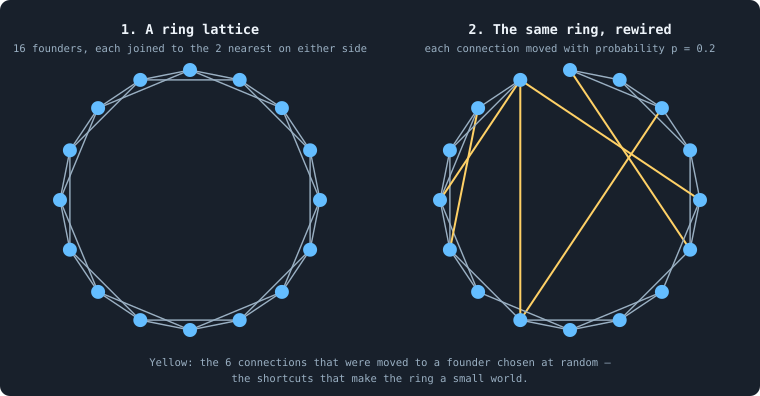
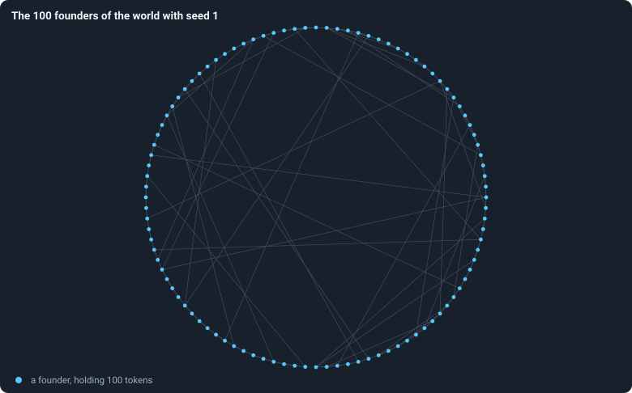

# The world: tokens, agents and a network

> [!question] Questions of this page
> - What exactly is a world: what does it consist of, and what stays fixed?
> - How is a world built at the start, from its settings and its seed?
> - What is written down about it as it runs?

## In short

A world is a network of nodes joined by connections, with one agent on every
node. Every agent holds a whole number of tokens and a brain that takes all
its decisions. Tokens move between agents but are never made or destroyed,
so their total, *T*, never changes. A world starts as *T*/100 founders of
100 tokens each, on a ring with a few random shortcuts. Everything after that
follows from the world's settings and its seed, and the world is written down
after every phase.

## A world at a glance

Picture a fishing net spread out on the ground. Each knot is a **node**, and
each string between two knots is a **connection**. On every knot stands a
player, an **agent**. It holds a purse of coins, its **tokens**, and a small
rulebook, its **brain**. An agent deals only with the agents tied to its own
knot. Coins pass from hand to hand, but no coin is ever minted or melted.

Time runs in steps called **iterations**, and each has two **phases**. In the
first, **reproduction**, an agent may give some of its coins to a child. The
child gets a knot of its own, tied into its parent's part of the net. In the
second, **the game**, every agent stakes all its coins on its own knot and its
neighbours' knots. Each knot goes to whoever staked most on it, or sometimes
to a [coalition](revolution.md "A node taken by stakers who each marked part of their stake revolutionary and together staked more than the largest single stake.") of smaller stakers. Strings that carried no coins in the game
are cut. An agent left with no coins dies, and so does every part of the net
that has come loose from the rest.

This page says exactly what a world is made of and how it begins.
[One iteration, step by step](one-iteration.md) says how it changes, and
[The brain](the-brain.md) how its agents decide.

## The network

Draw a few dots on paper and join some pairs of them with lines. That is a
**graph**: the dots are its nodes, and the lines its connections (in graph
theory, *edges*). Here is a small one. Take four nodes *a*, *b*, *c* and
*d*, and four connections: {*a*, *b*}, {*a*, *c*}, {*b*, *c*} and
{*c*, *d*}. So *a*, *b* and *c* form a triangle, and *d* hangs on *c*.

In symbols, a world is a graph *G* = (*V*, *E*): a set *V* of nodes and a set
*E* of connections. Three rules hold for every connection:

- it joins two different nodes;
- it has no direction, so the connection {*u*, *v*} is the same as
  {*v*, *u*};
- two nodes are joined at most once.

The **neighbours** of a node *u* are the nodes it is joined to:

$$
N(u) = \{\, v \in V : \{u, v\} \in E \,\}.
$$

In words: *N*(*u*) is the set of every node *v* whose connection with *u* is
in *E*. The **degree** of *u* is how many neighbours it has,
deg(*u*) = |*N*(*u*)|. In the example, *N*(*c*) = {*a*, *b*, *d*}, so
deg(*c*) = 3; *a* and *b* have degree 2, and *d* has degree 1.

Every connection has two ends, so the degrees add up to twice the number of
connections. In the example, 2 + 2 + 3 + 1 = 8 = 2 · 4. So the **mean
degree**, the number of connections an agent has on average, is twice the
number of connections divided by the number of nodes:

$$
\bar k = \frac{1}{|V|} \sum_{u \in V} \deg(u) = \frac{2\,|E|}{|V|} .
$$

In the example, *k̄* = 8 / 4 = 2. [Degree](degree.md) says more about
degrees.

Every node carries a whole-number **id**. Ids are handed out in increasing
order and never reused. So an id names one agent for its whole life. And an
agent with a smaller id is never younger than one with a larger id.

## Agents and tokens

On every node lives one **agent**; in this notebook "agent" and "node" mean
the same thing. An agent has four things:

- **tokens**: a whole number τ(*u*) (τ is the Greek letter tau). After every
  phase, every living agent holds at least one: an agent left with none dies
  ([One iteration, step by step](one-iteration.md));
- **a brain** *B*(*u*): a neural network that takes all its decisions
  ([The brain](the-brain.md));
- **an age**: the number of iterations since it was born
  ([Age and lifetime](age-and-lifetime.md));
- **a genotype**, the identity of its brain. An agent can lose its genotype.
  When another agent wins its node in the game, the node takes on a copy of
  the winner's brain ([Genotypes and the family tree](genotype.md)).

The world holds a fixed number of tokens, *T*. Tokens move between agents,
but they are never made or destroyed. So after every phase of every
iteration, the tokens of all the agents add up to *T*:

$$
\sum_{u \in V} \tau(u) = T .
$$

[Why the tokens add up](one-iteration.md#why-the-tokens-add-up) checks that
every rule keeps this sum. Tokens are the only thing of value. An agent needs
them to have a child, and in the game they are what it fights with. And since
every living agent holds at least one token, a world can never hold more than
*T* agents. A world of 10,000 tokens holds at most 10,000 agents, and in
practice far fewer.

## How a world begins

A world begins as a circle of equal founders. Each is joined to its nearest
neighbours on either side, and a few connections reach across the circle
instead. Every founder holds the same number of tokens, and a brain of its
own, drawn at random.

A world is fixed by its **settings** and its **seed**. The settings are 41
numbers and switches, chosen before the run starts.
[Every setting](settings.md) lists them all, with their values in the baseline
B1. A **baseline** is a set of rules that an experiment starts from and
changes one thing of. B1 is the first
([B1 and B2: the two baselines](b1-and-b2.md)). Eighteen of the settings were
added later, in the search for [open-ended evolution](open-ended-test.md "Evolution that keeps producing new things without end, not only up to a plateau."): evolution that keeps
producing new things without end. B1 keeps every one of them at its old rule,
so its rules are exactly the ones these pages describe. The **seed** is a
whole number that fixes every random choice of the run.

The settings that shape the start are the number of tokens *T*, the number of
founders and their ring. These pages teach with worlds of *T* = 10,000 tokens.
The study of the baseline reads the same baseline at *T* = 100,000. That is
ten times as many founders of 100 tokens each, on a denser ring (step 2
below). [How the game is played](how-the-game-is-played.md) shows what the
denser ring changes in the first game.

From the settings and the seed, the world is built in three steps.

**1. The founders.** The world starts with

$$
n = \left\lfloor \frac{T}{100} \right\rfloor
$$

agents, the **founders**: one for every hundred tokens (⌊*x*⌋ is *x* rounded
down). With *T* = 10,000 there are 100 founders, with ids 0 to 99. Each gets
⌊*T* / *n*⌋ tokens, here exactly 100. When *T* is not a multiple of *n*, a few
tokens are left over. They are dealt out at random, every founder equally
likely to get each one. Each founder also gets a brain whose weights are drawn
at random ([The brain](the-brain.md)). So every founder starts with a genotype
of its own, numbered 1 to 100.

**2. The ring.** The founders are joined into a **small-world ring**, the
construction of Watts and Strogatz (1998). Picture them on a circle, in order
of id. Each is joined to its ⌊*k*/2⌋ nearest neighbours on either side,
where

$$
k = \max\!\left( \left\lfloor \frac{n}{100} \right\rfloor ,\ 5 \right).
$$

In words: *k* is one for every hundred founders, but at least five. An odd
*k* loses one, so that both sides get as many. With 100
founders *k* = 5, so every founder is joined to 2 on each side. It starts
with degree 4, and the ring has 100 · 4 / 2 = 200 connections. With the 1,000
founders of *T* = 100,000, *k* = 10: every founder starts with 10 neighbours,
not 4 ([Every setting](settings.md#k_neighbors)).

Then each connection is, with probability 0.2, **rewired**: one of its ends
is moved to a founder chosen at random. Rewiring moves connections but never
adds or removes one. [The starting ring](starting-ring.md) gives the exact
procedure.

Why a small world? A ring lattice is **clustered**: two neighbours of a
founder are usually neighbours of each other. But it is **long**: getting
from one side of the circle to the other takes many steps. A handful of
random shortcuts keeps most of the clustering and makes every distance short.
Here is the real starting network of one baseline run:

<!-- figure world/ring -->

**The 100 founders of the world with seed 1.** The starting graph of `B1-10000-s001`: 100 founders placed around a circle in the order of the ring, each joined to its two nearest neighbours on either side; 37 of the 200 connections were moved to a founder chosen at random, and cross the circle.

> [!example]- How to make this figure
> **Runs.** `B1-10000-s001`.
>
> **Data.** From its settings.
>
> 1. Build the graph exactly as the engine does: `networkx.watts_strogatz_graph(n=100, k=5, p=0.2, seed=1)` — with k = 5 networkx joins every node to ⌊5/2⌋ = 2 neighbours on either side.
> 2. Place node i at angle 2πi / 100 on a circle and draw every connection.
>
> **To make it again:** `python3 book_figures.py world`.
<!-- /figure -->

Without rewiring, this ring would have a clustering of 0.5
([Clustering](clustering.md)), and its founders would be 12.9 steps apart on
average ([Path length](path-length.md)). Rewired, 37 of its 200 connections
are shortcuts. The clustering falls to 0.27, and the average distance to 4.4
steps.

**3. The random stream.** The ring is drawn by the networkx library, from a
random generator of its own, started from the seed. Every other random choice
a world ever makes is drawn from one stream of pseudo-random numbers. These
look random, but are computed one after another from the same seed. That
stream gives the founders' brains and every change of a brain. It gives every
probabilistic decision and tie-break, every random input of a brain, and every
[share-out](gains-losses-and-the-share-out.md "How a cleanup deals the tokens of the dead out among the living: in the baseline, each token to a survivor drawn at random.") of the tokens of the dead. So a run depends on its settings and its
seed, and on nothing else ([Seeds and the random stream](random-numbers.md)).
[Is a run reproducible?](is-a-run-reproducible.md) tests this.

## What is recorded

A run is kept like a film: a still picture of the whole world after every
phase. Each picture is a **frame**: frame 2*t* after the reproduction phase
of iteration *t*, and frame 2*t* + 1 after its game. Iteration 0, for
example, gives frames 0 and 1. A frame holds every living agent's id, tokens,
genotype, parent genotype and age; every connection; and every decision taken
in the phase.

From each frame, a row of about ninety **statistics** is computed: the number
of agents, of connections, the inequality of wealth, and so on. The rows are
kept in the run's file `stats.jsonl`. [What a run records](frames-and-stats.md)
lists the fields, and links each statistic to the page that defines it.

A baseline run of 10,000 tokens and 3,000 iterations writes 6,000 frames,
about 300 megabytes on disk. One of 100,000 tokens and 1,500 iterations
writes 3,000 frames, about 2 gigabytes.

## Where to go next

- [One iteration, step by step](one-iteration.md): how a world changes, in
  the exact order the program runs.
- [The brain](the-brain.md): how an agent decides.
- [The starting ring](starting-ring.md): the founders' ring, built step by
  step.
- [Every setting](settings.md): every number and switch of a run.

<!-- turns -->
---

[How the simulation works](../README.md#how-the-simulation-works) · [One iteration, step by step](one-iteration.md) →

> [!info]- Pages that link here (10)
> [What this notebook is about](what-this-notebook-is-about.md) · [Glossary](glossary.md) · [The ideas this builds on](the-ideas-this-builds-on.md) · [The starting ring](starting-ring.md) · [B1 and B2: the two baselines](b1-and-b2.md) · [Thirty worlds](thirty-worlds.md) · [How the game is played](how-the-game-is-played.md) · [What shape does the network take?](what-shape-does-the-network-take.md) · [Eras and contests: does a world keep getting better?](eras-and-contests.md) · [The lab, the engine and pilots](the-lab.md)
<!-- /turns -->
