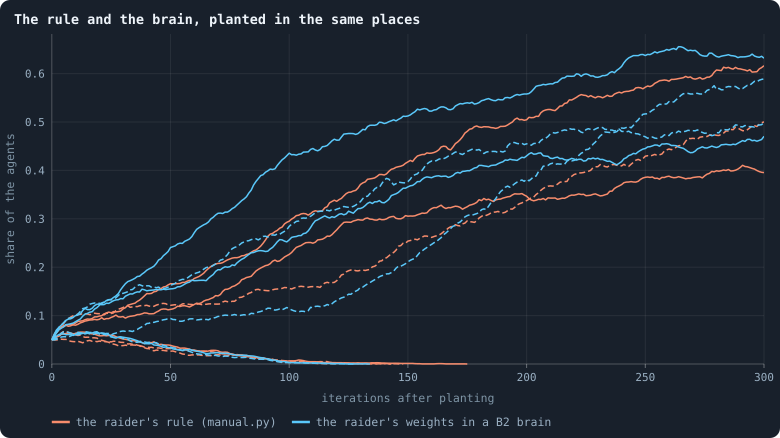

# What a brain can compute

> [!question] Questions of this page
> - Could an evolved [brain](the-brain.md "The neural network each agent decides with: inputs about itself and its neighbours, outputs that become its decisions.") play the raider of [Strategies written by hand](strategies-written-by-hand.md), or only a rule
>   written in Python?
> - What can no brain of [B2](b1-and-b2.md "The second baseline: B1 with the rules that keep its network from breaking and its agents from staking or breeding themselves to death.") compute, whatever its size?
> - What is the smallest change to the rules that would let it?

## Why ask

[Strategies written by hand](strategies-written-by-hand.md) planted strategies written
by hand into evolved worlds, and a plain one, the **raider**, took half or
more of three worlds in ten from brains that evolution had shaped for 2,000
[iterations](one-iteration.md "One step of a world's time: a phase of reproduction, then a phase of the game."). So the [game](one-iteration.md#phase-2-the-game "The second phase of an iteration: every agent stakes all its tokens on its own node and its neighbours', and every node goes to someone.") had better play than evolution found. But the
raider was a rule written in Python. It read what a brain reads and wrote
what a brain writes, yet nothing showed that a brain could compute it.

That matters for the question the author put in October 2026: are there
strategies that are ever better, with no top, and can the [agents](the-world.md#agents-and-tokens "One member of a world: it lives on a node of the network, holds tokens and has a brain that takes all its decisions.")' networks
play them? If a strategy is beyond every brain a world can grow, evolution
will never find it, however long it runs. If it is within reach, evolution
failed for another reason, the way there, and the question becomes how to
open the way.

This page answers for the raider by building it: a B2 brain whose
weights are set by hand to play the raider's rule. It then proves what no
B2 brain can compute, and names the smallest change to the rules that
would let one.

## What a brain is

A B2 brain is small. When an agent decides anything, it looks at its
**[candidates](one-iteration.md#phase-1-reproduction "An agent itself and each of its neighbours, the ones its brain looks at when it decides.")**, itself first and then each [neighbour](the-world.md#the-network "An agent joined to another by a connection."), and the brain gets
one column of 66 numbers for each ([What a brain sees](brain-inputs.md)).
The column holds:
- the agent's [tokens](the-world.md#agents-and-tokens "The one thing of value in a world: every agent holds a whole number of them, and their total never changes.") and links, and the candidate's;
- six [quantiles](median-and-quantiles.md "The middle value: half of the numbers lie below it and half above.") of the tokens and links of the agent's neighbours, and the
  same for the candidate's neighbours;
- four [messages](messages.md "Numbers an agent writes to itself and to each neighbour every phase, which their brains read.") of eight numbers each: what the agent wrote to itself, to
  the candidate, what the candidate wrote to the agent, and what the
  candidate wrote to itself;
- five random numbers.

One hidden layer of 16 units, each a sigmoid of a weighted sum of the
column, feeds 19 outputs, each a weighted sum of the units
([What a brain says](brain-outputs.md)). The weights are kept in
half precision (float16), about three decimal digits. The same weights
score every column.

The [engine](the-lab.md "The program that runs an experiment's plan as runs, each on a frozen copy of the engine, the code that plays a world.") turns the outputs into decisions:
- **The stake.** Everything the agent may stake (70% under B2, the rest
  stays home) goes on the column with the highest stake score, or is
  spread in proportion to the scores. Which of the two is decided by a
  pair of outputs averaged over the columns.
- **The child.** It gets a share of the agent's tokens, read from a pair
  of outputs averaged over the columns. Under B2 a child needs 10 tokens.
- **The child's links.** Each column says yes or no to joining the child
  to that candidate.
- **The messages.** Each column's eight message outputs, squashed into
  (−1, 1), are what the agent writes to that candidate.

## A raider in a brain's weights

The raider of [Strategies written by hand](strategies-written-by-hand.md) does three things:
- **It attacks.** It looks for the poorest neighbour that is not a
  teammate. If 70% of its own tokens are more than one and a half times
  that neighbour's, it stakes them all there; otherwise it keeps
  everything home.
- **It breeds.** At 30 tokens or more it gives a child a third of them,
  joined to every teammate next door.
- **It signs.** Every message it writes starts with four fixed numbers,
  0.9, −0.9, 0.9, −0.9: its password. Teammates are the neighbours whose
  last message to it starts with these numbers, each within 0.02.

Twelve of the brain's sixteen units are enough. The other four are left
at zero.

| unit | reads | is near 1 when |
|---|---|---|
| 0 | the row that says the column is the agent itself | the column is the agent itself |
| 1–8 | the first four numbers the candidate wrote to the agent | two walls per number, at the password's value less 0.02 and plus 0.02; the lower wall minus the upper is 1 inside the band and 0 outside |
| 9 | the agent's tokens and the candidate's | ln(1 + own) − ln(1 + its) > 0.69: the candidate can be taken |
| 10 | the candidate's tokens | it falls as they rise: how weak the candidate is |
| 11 | the agent's tokens | 30 or more: rich enough for a child |

The outputs are weighted sums of these:
- **Stake score:** 40 × (can be taken) + 1 × (weak) − 10 × (password
  bands) + 5 × (self), all on the highest.
- **Child:** a share of a third when rich, nothing otherwise.
- **Links:** yes where the column is the agent itself or a teammate.
- **Messages:** the password, then zeros.
- **[Revolutions](revolution.md "A node taken by stakers who each marked part of their stake revolutionary and together staked more than the largest single stake."):** none.

The stake score's weights keep three orders:
- a stranger that can be taken scores above home, even if its messages
  happen to match three of the password's four numbers (40 − 30 > 5 + 1);
- home scores above a stranger that cannot be taken (5 > 1);
- home scores above every teammate (5 + 40 > 40 + 1).

Among strangers that can be taken, the weakest scores highest. So the
brain puts its stake where the rule does.

Three details took more than the first try:
- **The agent's own column has to be shut out of the password.** An agent
  reads what it wrote to itself a phase ago. A node a raider has just won,
  or a raider just born, has not written anything yet, so its own column
  looked like a stranger's and home lost to every target. The self row now
  closes every password wall.
- **"Can be taken" is a line in ln(1 + tokens), where the rule's line is
  straight in tokens.** No line in the one is the other: 13 tokens against
  6 can be taken and 15 against 7 cannot, and both pairs differ by ln 2.
  But the raiders hold one to a few tokens. Over the 55,599 weakest
  strangers they faced in the three worlds below, a line just below ln 2
  agrees with the rule every time: 3 against 1 is taken, 2 against 1 and
  6 against 3 are not.
- **A third is not a third in float16.** The nearest float16 below it,
  0.33325, would give a parent of 30 tokens a child of 9, below B2's
  minimum of 10. The weight is the next float16 above a third.

**The check.** Patches of raiders were planted as in [Strategies written by hand](strategies-written-by-hand.md), [How worlds are measured](how-worlds-are-measured.md)% of
three of Experiment 16's B2 worlds at iteration 2,000, and every situation
a raider met in their first 40 iterations was kept. Each kept situation is
a column per candidate, as the raider read it. That gives 62,114
situations. Each was given to the rule and to the brain, and the two were
compared decision by decision, as the engine would read them.

| world | situations | every decision the same | the stake on the very same candidate |
|---|---|---|---|
| `B2-10000-s001` | 15,824 | 100% | 99.4% |
| `B2-10000-s002` | 21,024 | 99.98% | 98.8% |
| `B2-10000-s003` | 25,266 | 99.98% | 98.4% |

"Every decision the same" counts the stake as the same when the brain put
it on the same kind of target with the same tokens: home, or a stranger as
weak as the rule's choice. Where it chose another candidate, it was
another equally weak stranger. The rule takes the first of equals; the
brain takes whichever a trace of the password walls puts a hair ahead.
The child, its links, the password and the revolutions matched in every
situation. In eight of the 62,114, the weakest stranger's last message
happened to match one of the password's four numbers, and the brain took
the next weakest stranger instead.

**Planted in its place**, the brain does what the rule did. The test of
[Strategies written by hand](strategies-written-by-hand.md) was run again with the hand-set brain in place of the rule, on
the same [seeds](random-numbers.md "The number that fixes every random choice of a run: the same settings and the same seed make the same world.") and in the same places. Neither ever mutates.

<!-- figure computable/replays -->

**The rule and the brain, planted in the same places.** One line per planting: three evolved worlds, two seeds each (seed 1 solid, seed 2 dashed). Orange: a patch of raiders that follow the rule of [Strategies written by hand](strategies-written-by-hand.md); blue: the same patch given a B2 brain whose weights were set by hand to play the same rule. Neither ever mutates. A line that stops early is a patch that died out.

> [!example]- How to make this figure
> **Runs.** Three B2 worlds of Experiment 16, `B2-10000-s001` … `-s003`, as their archives keep them at iteration 2,000 (`GraphOfLifeRuns/<run>/archive/`), each with a patch of raiders planted as in [Strategies written by hand](strategies-written-by-hand.md) (`research/oee/pilots/manual.py`: the agent drawn on seed *s* and its nearest neighbours, step by step, until the patch holds 5% of the world).
>
> **Data.** From the worlds the archives keep.
>
> 1. Load the world of iteration 2,000 and plant the patch on seed 1 or 2.
> 2. Give every agent of the patch the raider's rule (`manual.py`), or a frozen copy of the hand-set brain (`research/oee/strategies/raider_B2.npz`, made by `python3 research/oee/strategies/handset.py save`).
> 3. Play 300 iterations under the world's own rules (`handset.py invade B2-10000-s001 B2-10000-s002 B2-10000-s003 --seeds 1,2 --T 300`) and count, after each, the agents carrying the patch's brain, as a share of all agents.
>
> **To make it again:** `python3 book_figures.py computable`.
<!-- /figure -->

In world 1 both died out on both seeds, as the rule had in [Strategies written by hand](strategies-written-by-hand.md). In
world 2 both took about half of the world: the rule 40% and 50%, the brain
47% and 50%. In world 3 the rule took 62% on seed 1, and the brain 63%. On
seed 2 the rule died out after 143 iterations while the brain took 59%.
The two choose the very same candidate in all but one or two situations in
a hundred, so their worlds part ways within a few iterations, and from there it is chance that
a patch takes hold. That is a warning for every invasion test to come: one
planting says little, and the tests that follow use several places in each
world.

**So the raider is a B2 brain.** It takes 12 of the 16 units B2 gives
every agent. Evolution did not fail to find it for lack of room in a
brain. [Strategies written by hand](strategies-written-by-hand.md) said why it fails: the raid, the password and the crowd
pay only together.

## What no brain of B2 can compute

**The claim.** In B2, what an agent *u* writes to a neighbour *v* depends
only on what *v*'s column in *u*'s look holds:
- the tokens and links of *u* and *v*;
- the quantiles of their neighbours' tokens and links;
- the messages *u* and *v* wrote to each other and to themselves the phase
  before;
- the random numbers.

It never depends on what any third agent wrote, nor on which brain a third
agent carries.

**Why.** A brain scores each column from that column alone: the same
weights, column by column, and no unit sees two columns. So *u*'s message
to *v* is made from *v*'s column, which holds the list above. What *u*
wrote to itself is made from *u*'s own column, which holds *u*'s tokens,
links and quantiles and what *u* wrote to itself before, and nothing of
any neighbour but the quantiles of their tokens and links.

So if no message written so far carried word of a third agent, none
written now does. At the start nothing has been written. Phase by phase,
no message ever carries such word.

**What does see every column** is the agent's own decisions:
- the stake goes on the best column or is spread over all of them;
- the child's share and the stake's mode are averages over all columns.

News of a third agent can leave an agent only through what it does: the
tokens and links its decisions change, which its neighbours see. A
message cannot carry it.

**What this rules out.** [Strategies written by hand](strategies-written-by-hand.md)'s factory had every member write its
distance to the team's frontier: 0 if a stranger is next door, otherwise
one more than the nearest teammate's distance. To a teammate, whether *u*
has a stranger next door is news of a third agent. No B2 brain, of any
size, can write it into a message. It could only show it through its own
tokens or links, at a cost. The raider needs nothing of the kind:
everything it decides comes from its own columns, and that is why its
weights exist.

**A factory without the message** also needs something the raider's units
do not give: feed the poorest teammate when no stranger can be taken.
The stake score is one weighted sum per column. It would have to rank
"teammate and poor" above home and below "stranger and can be taken", but
the raider's "can be taken" unit fires for a poor teammate as it does for
a stranger. Each would need a unit that sees the password and the tokens
at once. A password in the middle of a message's range is a band, two
walls a number, and a band cannot be one unit's side of a line. A password
at the edge of the range — a number beyond 0.98, say — is a single wall,
and a single unit can combine it with tokens. The ladder of strategies
that comes next will need such passwords.

## The smallest change

The obstacle is precise: a brain pools its columns only into its own
decisions, never into what it says. The smallest change that lifts it is
a **pooled message to itself**. The message an agent writes to itself
becomes the largest, number by number, of the messages it writes to all
its candidates, itself included.

Every neighbour already reads that message: it is one of the four
messages in each column. So with the change:
- **One phase:** a column can mark "this neighbour is a stranger", and the
  agent's message to itself then says "a stranger is next door", which
  every neighbour reads a phase later.
- **A few phases:** a distance to the frontier follows. An agent marks a
  stranger 1 and a teammate a fraction of what that teammate says of
  itself, and the largest mark is its own nearness to the frontier. This
  is a field over the team, which settles in as many phases as the team
  is deep.
- **In general,** the agents' brains become a network that passes
  messages over the graph and pools them, a graph neural network with the
  largest as its pooling. What such networks can tell apart is known
  (Xu et al., 2019). No network that passes messages tells apart more than
  the Weisfeiler–Lehman test does. One that pools by the largest tells
  neighbourhoods apart by which values occur in them, not by how often.

It costs no weights. A brain keeps its shape, and a world saved without
the change loads with it. But an agent's message to itself is no longer
free: it is at least what it tells any neighbour. So the change alters
what every evolved brain does. It is a rule to test in new worlds, off
unless a run turns it on, not a repair for old ones.

A second way would give every column the largest and smallest of what
all neighbours wrote, as new inputs. That leaves the messages free and
changes the brain's shape.

A field of nearness over a team is also a first local field on the graph:
a quantity every agent holds, made only from its neighbours' values a
step before. The notebook's [second aim](physical-inspiration.md), a
physics, asks for exactly that kind of thing.

## What it teaches

- **The raider is within B2's reach.** A brain of 12 units plays it, in
  every decision of 62,114 situations but eight, and planted in the
  raider's place it took half of the same worlds. Evolution's failure to
  find it is a failure of the way there, not of the brain.
- **A brain is private to each pair.** What it hears from one neighbour
  reaches another only through what it does, never through what it says.
  Pipelines, chains of command and any message about a third agent are
  beyond every B2 brain, whatever its size.
- **One small rule would open them**: a message to itself that pools what
  it says to everyone. It is the next thing to test, once the ladder of
  strategies shows what it is worth
  ([what would count as open-ended evolution](open-ended-test.md)
  says how the long runs will be judged).

**Related notes:** [Strategies written by hand](strategies-written-by-hand.md) ·
[Why evolution stops](how-to-tell-a-world-that-keeps-evolving.md#why-evolution-stops) ·
[Another game](another-game.md) ·
[What a brain sees](brain-inputs.md) ·
[What a brain says](brain-outputs.md) ·
[The invasion test](invasion-test.md)

<!-- turns -->
---

← [Strategies written by hand](strategies-written-by-hand.md) · [Strategies written by hand](../README.md#strategies-written-by-hand) · [How large a crowd a raider needs](how-large-a-crowd-a-raider-needs.md) →

**Also about:** [Brains, and how alike agents are](../README.md#brains-and-how-alike-agents-are).

> [!info]- Pages that link here (8)
> [Every setting](settings.md) · [What a brain sees](brain-inputs.md) · [What a brain says](brain-outputs.md) · [Messages](messages.md) · [Every era against three](every-era-against-three.md) · [What would count as open-ended evolution](open-ended-test.md) · [How large a crowd a raider needs](how-large-a-crowd-a-raider-needs.md) · [Why the raiders stopped winning](does-evolution-close-the-door.md)
<!-- /turns -->
