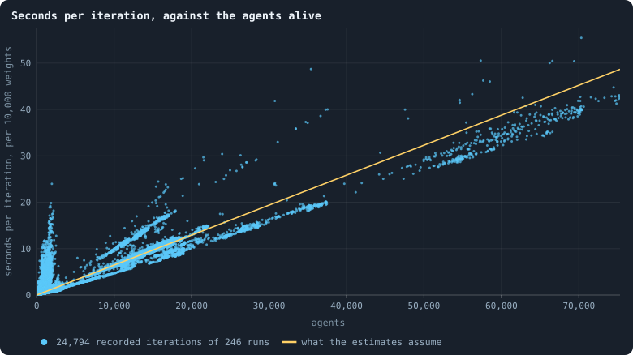

# What a simulation costs

> [!question] Questions of this page
> - How long does a run take, how much memory does it need, and how much
>   disk do its frames fill?
> - How does the lab know before ▶ whether a plan fits the machine?
> - How large an experiment is reasonable?

## In short

Every experiment of the notebook is sized by what it costs. That is the
hours a computer spends on it, the memory a run needs, and the disk its
frames take. These costs are measured, not guessed. A run's time is close to
proportional to its number of [agents](the-world.md#agents-and-tokens "One member of a world: it lives on a node of the network, holds tokens and has a brain that takes all its decisions.") and the size of their [brains](the-brain.md "The neural network each agent decides with: inputs about itself and its neighbours, outputs that become its decisions."). A [B1](b1-and-b2.md "The first baseline: the algorithm exactly as a new run is offered it.")
world of 10,000 [tokens](the-world.md#agents-and-tokens "The one thing of value in a world: every agent holds a whole number of them, and their total never changes.") takes about a second per [iteration](one-iteration.md "One step of a world's time: a phase of reproduction, then a phase of the game."). An experiment takes about 12 hours
of the computer, and never more than two days.

## Measured, not guessed

Every iteration a run records carries its own wall-clock seconds, its
processor seconds, and the most memory its process has held. The command
`python3 gol_lab.py costs` fits the numbers below to all of them. This page
is rewritten as the measurements accumulate.

## The model

The cost of a run is close to proportional to the number of agents it has,
and to the size of their brains. That is because every agent's brain looks
at every [neighbour](the-world.md#the-network "An agent joined to another by a connection."), twice per phase.

What is measured, and how each figure is estimated:

- **time**: seconds per agent per iteration, for every 10,000 weights in a
  brain;
- **agents**: agents alive per token of the supply, from iteration 100 on,
  once a world has settled;
- **disk**: bytes per agent per iteration, with every frame and its decisions
  kept;
- **memory**: the most a run holds. It is a base, plus a multiple of every
  byte of every brain, since the [game](one-iteration.md#phase-2-the-game "The second phase of an iteration: every agent stakes all its tokens on its own node and its neighbours', and every node goes to someone.") copies them and a checkpoint stacks
  them. The multiple is fitted by [least squares](correlation.md#fitting-a-straight-line "The straight line that fits a cloud of points best, and how much of their spread it explains.") over runs of every size. Then
  the base is raised until no recorded run lies above the line, so that the
  estimate bounds a run's peak rather than averaging it. Small runs' memory
  is nearly all fixed overhead. Read off them alone, the multiple came out ten
  times too large, and a world of 100,000 tokens looked like 28 GB.

<!-- costs -->
- **Time:** 0.65 ms per agent per iteration, for every 10,000 weights in a brain.
- **Agents:** 0.14 alive per token of the world, once settled.
- **Disk:** 72 bytes per agent per iteration.
- **Memory:** 1503 MB, plus 5.3 times every byte of every brain.

Fitted to 246 recorded runs on 2026-10-14 by `python3 gol_lab.py costs`.
<!-- /costs -->
Each kind of run is fitted on its own: the same [settings](settings.md "One number or switch of a run's rules, fixed before it starts."), apart from the size
of the world and the [seed](random-numbers.md "The number that fixes every random choice of a run: the same settings and the same seed make the same world."). Kinds differ in more than the size of their
brains. The [baseline](b1-and-b2.md "The stated rules an experiment starts from and changes one thing of: B1 or B2.")'s brains are half as big again as the ones before it.
Yet they cost an agent hardly any more, since its agents have fewer
neighbours to look at. Until a kind has been measured, it borrows from all runs. Until
anything had been, the calibration of 2 October 2026 on the baseline stood.
It gave about 1.3 ms per agent per iteration in the lab, and 0.18 agents per
token once a world has settled. And it gave 70 bytes per agent per iteration
on disk.

**Seconds per iteration, against the agents alive.** Every dot is one
recorded iteration of one run of the lab. It shows the agents alive (x)
against the seconds the iteration took, per 10,000 weights in a brain (y). The line is
what the estimates assume. The figure is redrawn by `python3 gol_lab.py costs`.

## What the baseline set cost

Take the thirty runs of Experiment 2: 10,000 tokens and 3,000 iterations
each. They are the worlds the study of the baseline was first written from
([The life of a B1 world](a-worlds-life.md) lists their settings). They took
26 hours of computing, done in 7.2 hours on four workers, and fill 7.8 GB. No
run needed more than 651 MB of memory.

That is the unit the experiments on the baseline are sized in: one condition
of thirty seeds at 10,000 tokens is about seven hours. The thirty worlds of
100,000 tokens, 1,500 iterations each
([Thirty worlds](a-worlds-life.md#thirty-worlds)), took 211 hours and fill
58 GB.

## The rules for sizing an experiment

- An experiment takes **about 12 hours** of the computer, and never more than
  two days. The lab estimates the time on its workers before ▶, and says how
  much is left while it runs. The estimate is what fits the plan to this.
- A run's time grows with its world. At the baseline, a world of *T* tokens
  settles at about 0.12 × *T* agents, measured on worlds of 10,000 tokens. An
  agent costs about 0.87 ms per iteration, so 10,000 tokens cost about 1.1
  seconds per iteration. If the number of agents grows in step with the
  tokens, 200,000 tokens cost about 22. And it does: agents grow as the
  tokens to the power 1.00
  ([Worlds of many sizes](how-does-a-worlds-size-follow-its-tokens.md)).
- Memory limits big worlds before time does. The lab starts a run only when
  its estimated peak fits next to the runs already going, in three quarters
  of the machine's memory.
- Disk is about 65 bytes per agent per iteration, with every frame kept. The
  lab will not start a run the disk cannot hold.
- The workers default to four, the machine's fast cores. More are possible
  from the Research Notebook tab; the slower cores add less than a fast one
  each.

## Where to go next

- [The lab, the engine and pilots](the-lab.md): how the lab plays a plan, and
  what it records beside each run.
- [What a run records](frames-and-stats.md): the frames and rows that fill
  the disk.
- [Worlds of many sizes](how-does-a-worlds-size-follow-its-tokens.md): how a
  world's number of agents follows its tokens.
- [Every simulation: what was run, and what was measured](every-simulation.md):
  every run the costs were measured on.

<!-- turns -->
---

← [One world, many colours: what the viewer can colour by](one-world-many-colours.md) · [Methods and statistics](../README.md#methods-and-statistics) · [What goes with what](what-goes-with-what.md) →

> [!info]- Pages that link here (5)
> [What this notebook is about](what-this-notebook-is-about.md) · [A hundred thousand iterations](a-hundred-thousand-iterations.md) · [What would count as open-ended evolution](open-ended-test.md) · [The lab, the engine and pilots](the-lab.md) · [What a run records](frames-and-stats.md)
<!-- /turns -->
