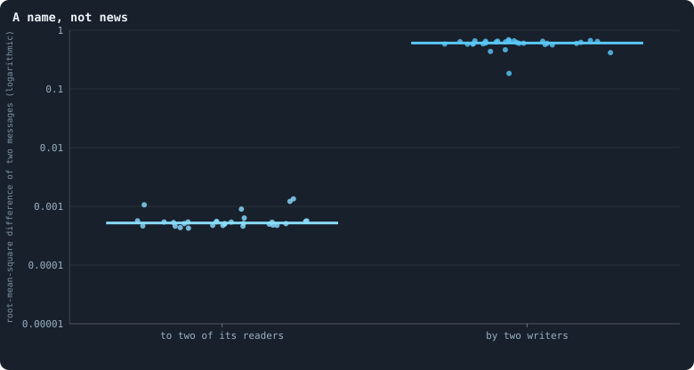
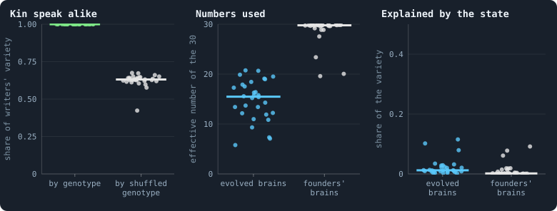
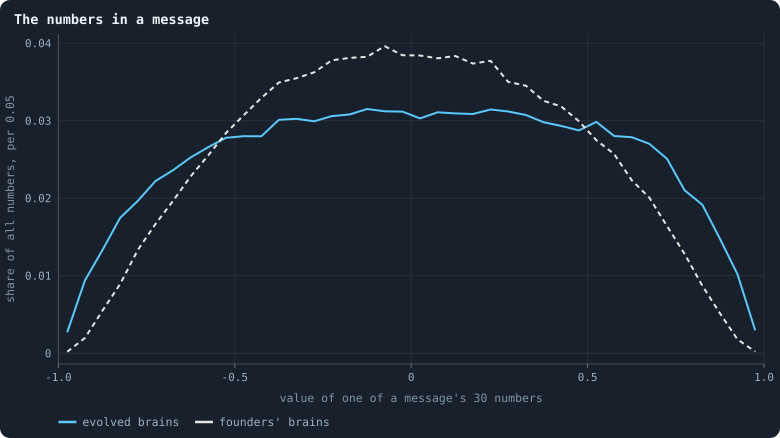

# What agents say to each other

> [!question] Questions of this page
> - Does an [agent](the-world.md#agents-and-tokens "One member of a world: it lives on a node of the network, holds tokens and has a brain that takes all its decisions.") say different things to different [neighbours](the-world.md#the-network "An agent joined to another by a connection.")?
> - What does a message tell its reader: about the writer, about the
>   reader, about the world?
> - Do kin speak alike? Could an agent recognise its kin by what they say?
> - How many of the 30 numbers are used?

## In short

Each agent writes a message of 30 numbers to itself and to each neighbour, and
nothing but the [brains](the-brain.md "The neural network each agent decides with: inputs about itself and its neighbours, outputs that become its decisions.") gives the numbers a meaning. At the end of thirty [B1](b1-and-b2.md "The first baseline: the algorithm exactly as a new run is offered it.")
worlds, two messages of one agent differ by 0.0005, while those of two agents
differ by 0.60. So a message tells its reader one thing, who wrote it: it is a
name, and all agents of one [genotype](genotype.md "The identity of a brain: a number that a copy keeps and a change replaces, and that remembers the genotype it came from.") write the same one. Kin could recognise
each other by it with a single comparison, but B1's nearly blind brains cannot
make it.

## Notes in a code nobody wrote

Picture neighbours who pass each other notes written in numbers, in a code
that nobody ever wrote down. Every agent writes a note of 30 numbers to itself
and to each of its neighbours, in every phase. It reads the notes written to
it ([Messages](messages.md)). Nothing in the rules reads them except the
brains, and nothing gives the numbers a meaning. If a message says anything,
evolution made it say it.

A free channel between neighbours is the classic setting for the evolution of
signals. It has been studied from Lewis's account of signalling conventions
(Lewis 1969) to the evolution of meaning in populations of simple agents
(Skyrms 2010). So what do the agents of Graph of Life say?

## How the messages are read

As in [What the brains are like](what-the-brains-are-like.md), each of the
thirty worlds is rebuilt exactly as its last [game](one-iteration.md#phase-2-the-game "The second phase of an iteration: every agent stakes all its tokens on its own node and its neighbours', and every node goes to someone.") left it. Every agent looks
at its [candidates](one-iteration.md#phase-1-reproduction "An agent itself and each of its neighbours, the ones its brain looks at when it decides."): itself and each of its neighbours. Its brain writes a
message to each of them, 30 outputs squeezed by tanh into the range from −1
to 1. (tanh is a function that maps any number into that range.)

That gives between 32,000 and 79,000 messages per world. There is one for
every [connection](the-world.md#the-network "A link between two agents of the network: they are neighbours, and can stake on each other's nodes.") in each direction, and one from every agent to itself. As a
control, a fresh [founder](starting-ring.md "One of the agents a world starts with, each holding the same tokens, on a ring with a few shortcuts.")'s brain writes from exactly the same inputs. It shows
what the architecture does before any selection.

The worlds are the thirty B1 worlds of 100,000 [tokens](the-world.md#agents-and-tokens "The one thing of value in a world: every agent holds a whole number of them, and their total never changes.") of
[Thirty worlds](a-worlds-life.md#thirty-worlds). This page was first written
from thirty worlds of 10,000 tokens; where those differ, both are given.

## A name, not news

Picture someone who sends the same postcard to everyone they know. The card
says nothing about its reader, and nothing about the world. It tells each
reader only one thing: who sent it. Do the agents write such postcards?

<!-- figure talk/names -->

**A name, not news.** For every agent of a world at its end, the message its brain writes to each of its candidates (the 30 message outputs, squashed by tanh into −1 to 1). Left: how different the messages one agent writes to two of its readers are; right: how different the messages of two agents are. One dot per world, each the median over its agents.

> [!example]- How to make this figure
> **Runs.** The 30 baseline worlds that lived to the end.
>
> **Data.** From the final checkpoint of each run, `GraphOfLifeRuns/<run>/checkpoint.npz`, read with `gol_store.load_checkpoint(run, config)`: the world after its last iteration, every living agent's brain and every message in flight.
>
> 1. For every agent, its inputs as the engine builds them and tanh of output rows 15–44 of its brain: one message per candidate.
> 2. Left: the root-mean-square difference between its messages to its first two candidates; right: between its first message and the previous agent's (`book_chapters.inner.message_stats`).
>
> **To make it again:** `python3 book_figures.py talk`.
<!-- /figure -->

Measure the difference of two messages as the root mean square of the
differences of their 30 numbers: their typical difference. Two messages
written by **one** agent to two of its readers differ by **0.0005**. Two
messages written by **two** agents differ by **0.60** (0.55 at 10,000 tokens).

So an agent says the same thing to everyone: to itself, to a rich neighbour
and to a poor one, to kin and to strangers. A message tells its reader one
thing, *who wrote it*. It is a name.

This follows from [What the brains are like](what-the-brains-are-like.md). A
brain's outputs move by a thousandth of a change in its inputs. So the message
it writes to one candidate is nearly the message it writes to the next. A
founder's brain is no different (0.0002 against 0.60). The architecture makes
messages names before any selection.

## What a name says

If a message is a name, whose name is it? And does it carry anything else? The
figure answers three questions, one per panel.

<!-- figure talk/what -->

**What the messages carry.** One dot per world. Left: of how much the agents' messages differ from one agent to the next, the share that lies between genotypes — 1 if agents of one genotype write exactly alike — against the same share with the genotypes shuffled among the agents (the median of 50 shuffles). Middle: the effective number of independent numbers the messages use, of their 30 (the participation ratio of the eigenvalues of their covariance). Right: the share of the messages' variety that a straight-line fit on the writer's and reader's tokens and connections (their logarithms) and whether the message is to itself accounts for. Blue: the agents' own brains; grey: a fresh founder's brain — weights drawn as for the founders of a world, normal with standard deviation 1/√(fan-in), biases 0 — given exactly the same inputs.

> [!example]- How to make this figure
> **Runs.** The 30 baseline worlds that lived to the end.
>
> **Data.** From the final checkpoint of each run, `GraphOfLifeRuns/<run>/checkpoint.npz`, read with `gol_store.load_checkpoint(run, config)`: the world after its last iteration, every living agent's brain and every message in flight.
>
> 1. As in the figure above, every message an agent's brain writes to each candidate.
> 2. Kin: each writer's mean message; between-genotype sum of squares of those means over their total; the null shuffles the genotypes among writers.
> 3. Numbers used: (Σλ)² / Σλ² of the covariance eigenvalues λ of the 30 components.
> 4. Explained: least squares of all 30 components on [1, ln(1+τ_writer), ln(1+k_writer), ln(1+τ_reader), ln(1+k_reader), self]; 1 − residual sum of squares / total.
>
> **To make it again:** `python3 book_figures.py talk`.
<!-- /figure -->

**Kin speak alike.** Take the mean message of every writer. How much of the
variety between writers lies between genotypes, and how much among writers of
one genotype? In every world, **all of it** (1.00) lies between genotypes. Two
agents of one genotype write the same message, but for a thousandth or so.

With the genotypes shuffled among the writers, the share is 0.63. That much
would lie "between genotypes" by chance, since most genotypes are carried by a
single agent ([Genotypes and lineages](genotypes-and-lineages.md)). That kin
speak alike is no wonder. One genotype is one brain, and a brain that hardly
sees writes the same thing wherever it is. A message is the name **of a
genotype**.

**Few numbers are used.** Picture every message as a point, with its 30
numbers as coordinates. If the points spread along only a few directions, the
messages use only a few numbers' worth of freedom. In the [median](median-and-quantiles.md "The middle value: half of the numbers lie below it and half above.") world, the
messages vary along only **15** independent directions (6 to 21). They are
counted as a participation ratio
([How many directions a cloud of points uses](effective-number.md#how-many-directions-a-cloud-of-points-uses)).
Founders' brains, independent of each other, use 30, all of them.

Why so few? A world's genotypes descend from a few lines
([Genotypes and lineages](genotypes-and-lineages.md)). The messages of one
line differ only where the line's changes moved them. So a world speaks a few
dialects, each spoken by a line. The worlds of 10,000 tokens used fewer
directions, 8.8 in the median world. In a world ten times larger, more lines
live side by side, for longer
([Worlds of 100,000 tokens](how-does-a-worlds-size-follow-its-tokens.md#worlds-of-100000-tokens)),
and so do more dialects.

**Nearly nothing about the world.** What could a message be about? The
writer's tokens and connections, the reader's, and whether the message is to
oneself. Fit the messages to these with a straight line, taking tokens and
connections as logarithms. The fit accounts for **1.2%** of their variety
(0.2% to 12%; founders' brains, 0.2%). At 10,000 tokens it was 3.5%, and one
world reached 40%. Here none comes close: what an agent says has almost
nothing to do with its situation.

## The numbers themselves

What values do the 30 numbers of a message take?

<!-- figure talk/values -->

**The numbers in a message.** Every one of the 30 numbers of every message written at the end of the 30 worlds, in bins 0.05 wide: by the agents' own brains (blue) and by a fresh founder's brain — weights drawn as for the founders of a world, normal with standard deviation 1/√(fan-in), biases 0 — given exactly the same inputs (grey, dashed).

> [!example]- How to make this figure
> **Runs.** The 30 baseline worlds that lived to the end.
>
> **Data.** From the final checkpoint of each run, `GraphOfLifeRuns/<run>/checkpoint.npz`, read with `gol_store.load_checkpoint(run, config)`: the world after its last iteration, every living agent's brain and every message in flight.
>
> 1. As above; count the numbers in 40 bins from −1 to 1 and divide by all numbers.
>
> **To make it again:** `python3 book_figures.py talk`.
<!-- /figure -->

Founders' messages pile up around 0, in a bell. Evolved messages are spread
almost evenly from −0.7 to +0.7, with more numbers near the ends: 2.5% lie
beyond ±0.9, against 0.4% for founders.

Larger weights would do this. And [mutation](mutation.md "A random change to a brain, made with a set probability when it is copied, and in B1 also after every game: a changed brain is a new genotype.") alone leaves the weights of an
evolved brain larger than a founder's
([What a brain listens to](what-the-brains-are-like.md#what-a-brain-listens-to)).
So nothing here needs selection to explain it. Nor are the evolved values more
informative for being spread wider. They are still the same for every reader.

## Could kin recognise each other?

[Do agents cooperate?](do-agents-cooperate.md) found that kin live side by
side: a tenth of an agent's neighbours carry its own genotype. Yet kin are
staked on exactly like strangers. A brain cannot see genotypes. It could tell
kin only through messages, if a [lineage](genotype.md#families "A line of descent: the agents whose genotypes go back to one ancestor.") evolved a password. That is a signal
its members send, with a habit of treating those who send it differently.
Biologists call such a signal a **green beard** (Hamilton 1964; Dawkins 1976).

The password exists already, without any evolution. When an agent *u* looks at
a neighbour *v*, it reads four messages ([Messages](messages.md)). Two of them
are the message it wrote to itself and the message *v* wrote to it. If *u* and
*v* share a genotype, these two messages are identical but for a thousandth or
so. If *v* is a close relative, they are nearly identical. If *v* is a
stranger, they differ by about 0.6 per number, as a root mean square. Telling
them apart needs one comparison.

What is missing is a brain that can make it. A difference of 0.6 in 30 inputs
reaches the stakes at a thousandth of its size, and the stakes split evenly
anyway. Kin recognition is one comparison away, and it is blocked by the same
obstacle as everything else in the brain.
[What the measurements say about open-ended evolution](what-the-baseline-world-is.md#what-the-measurements-say-about-open-ended-evolution)
proposes heritable tags, so that kin can find each other. They are already
here: messages are heritable tags.

Since then, brains have been given sight. In [B2](b1-and-b2.md "The second baseline: B1 with the rules that keep its network from breaking and its agents from staking or breeding themselves to death."), a brain has one hidden layer
of 16 units, and a founder's gain is about 0.2
([Brains that see, and worlds that break](a-world-that-cannot-break.md#brains-that-see-and-worlds-that-break)).
Its messages hold 8 numbers, not 30. Whether seeing brains use the names to
tell kin from strangers has not been measured. Three things nearby were
measured, in [pilot](the-lab.md#pilot-worlds "A world made by hand to see whether an idea is worth an experiment, without a thesis or many seeds.") worlds under B2's rules:

- Connected groups of kin shrank over time, in every world.
- Evolution turned the brains' attention to messages down, not up. Take the
  agents with at least three tokens to divide. Redrawing the messages a
  founder's brain reads changes its division of the stake in 34 to 48% of
  them. For evolved brains, it changes in only 11 to 20%. The one exception
  was a world that pooled the stakes of kin
  ([What the probes say about why](how-to-tell-a-world-that-keeps-evolving.md#what-the-probes-say-about-why)).
- Given a sense of its own clones for free, as an input, a seeing brain made
  little use of it. Flipping which neighbours are clones changed 12 to 16% of
  the evolved brains' divisions, and 26% of the founders'. No groups formed.
  Groups of kin formed only where a rule pooled their stakes
  ([Another game](another-game.md), [Alliances](another-game.md#alliances)).

So sight is needed, but it is not enough. What a brain can read pays only if
the rules give it something to gain by reading it
([Who helps whom](who-helps-whom.md)).

## What we learned

- **Messages are names.** An agent writes the same message to every reader,
  and all agents of one genotype write the same message. A message carries who
  wrote it, and almost nothing else.
- **No language has evolved.** A signal can mean something only if two things
  hold. What is sent must depend on something: the sender's state, the
  receiver, or the situation. And what is done on receipt must depend on what
  was sent. Neither holds here. Messages ignore the situation, and decisions
  ignore the messages. With every message set to 0, the stakes of only 9% of
  agents change at all
  ([What the brains are like](what-the-brains-are-like.md)).
- **The raw material is there.** The names identify kin exactly. If brains
  could compare what they read, kin recognition would be one comparison away,
  and with it Hamilton's kin selection
  ([Do agents cooperate?](do-agents-cooperate.md)). That makes the gain of the
  brain, again, the first thing to change. The pilots with seeing brains add
  that it is not the only thing: a rule must also make it pay to treat kin as
  kin.

## Where to go next

- [What the brains are like](what-the-brains-are-like.md): why the brains
  barely see, which makes every message a name.
- [Messages](messages.md): how messages are written, delivered and read.
- [Do agents cooperate?](do-agents-cooperate.md): kin live side by side, and
  are treated like strangers.
- [Another game](another-game.md): what happened when kin could sense each
  other, and when their stakes were pooled.

## How this was made

Every figure of this page reads the final checkpoint of each of the thirty
runs of Experiment 10, listed below. A checkpoint holds the world after its
last [iteration](one-iteration.md "One step of a world's time: a phase of reproduction, then a phase of the game."), with every living agent's brain. From it,
`python3 book_figures.py talk` rebuilds every message and draws every figure.
Each figure says, folded beneath it, which runs it reads and how.

The numbers given for worlds of 10,000 tokens come from the thirty runs of
Experiment 2, `B1-10000-s001` … `-s030`, made with
`python3 gol_lab.py run E02`. When this page was first written, the 26 of them
that lived to the end of their 3,000 iterations were read the same way.

<!-- runs E10 -->
> [!info]- The runs behind this page
> **30 runs.** Every condition below is run once for every seed (1 to 30), for 1,500 iterations — or until its world dies out. Every setting is that of the baseline **B1** (the algorithm exactly as a new run is offered it) unless the condition changes it.
>
> - **baseline** — changes nothing: B1 as it is; 100,000 tokens. Runs `B1-100000-s001` … `B1-100000-s030`.
>
> To make these runs again: `python3 gol_lab.py run E10`, or ▶ in the Research Notebook tab of a computer running `gol_server.py`. Each run writes its settings, seed and engine version beside its frames, in `GraphOfLifeRuns/<run>/meta.json` and `provenance.json`.

> [!info]- Every setting of these runs
> | setting | baseline | what it is |
> |---|---|---|
> | [`total_tokens`](settings.md#total_tokens) | 100,000 | The number of tokens in the world, *T*. It never changes during a run. |
> | [`n_nodes`](settings.md#n_nodes) | 0 | How many founders the world starts with. 0 means one founder per hundred tokens: *n* = ⌊*T* / 100⌋. |
> | [`k_neighbors`](settings.md#k_neighbors) | 0 | How many neighbours each founder starts with in the ring. 0 means *k* = max(⌊*n* / 100⌋, 5); an odd *k* is wired as *k* − 1. |
> | [`rewire_p`](settings.md#rewire_p) | 0.2 | In the starting ring, the probability that a connection is moved to a founder chosen at random (Watts–Strogatz). |
> | [`hidden_layers`](settings.md#hidden_layers) | 50, 45, 40, 35, 30 | The widths of the brain's hidden layers, in order from input to output. |
> | [`brain_kind`](settings.md#brain_kind) | float16 | How weights are stored: `float` (64-bit), `float16` (16-bit, computed in 64-bit) or `binary` (−1, 0, +1). |
> | [`brain_bits`](settings.md#brain_bits) | 16 | Only for binary brains: how many input rows encode one number. Unused by float and float16 brains. |
> | [`message_amount`](settings.md#message_amount) | 30 | How many numbers one message holds. Each agent sends one message to itself and one to each neighbour, every phase. |
> | [`random_input_amount`](settings.md#random_input_amount) | 5 | How many random numbers, drawn uniformly from −2 to 2, a brain reads per neighbour, every time it looks. |
> | [`exchange_messages`](settings.md#exchange_messages) | on | Whether agents send and read messages at all. |
> | [`message_prepass`](settings.md#message_prepass) | on | Whether every phase begins with an extra look in which agents only write messages, so the look that acts reads messages written this phase. |
> | [`allow_handover`](settings.md#allow_handover) | on | Whether a parent may move some of its own connections to its newborn child. |
> | [`allow_revolutions`](settings.md#allow_revolutions) | on | Whether a coalition of smaller stakers can take a node from its largest staker (see the note *How a coalition takes a node*). |
> | [`allow_gifting`](settings.md#allow_gifting) | off | Whether agents may give tokens to neighbours during reproduction. Off in both baselines; on in a few pilots, in Experiment 24 and in half the worlds of the screen. |
> | [`random_decisions`](settings.md#random_decisions) | off | The control: every number a brain would produce is replaced by a random draw from the standard normal distribution. |
> | [`prune_after`](settings.md#prune_after) | blotto | After which phase connections that carried no tokens are cut: `blotto` (the game), `reproduction`, or `both`. |
> | [`inactive_window`](settings.md#inactive_window) | phase | How long a connection may go unused: `phase` means it must carry tokens in the phase being judged; `iteration` allows the two last phases. |
> | [`redistribution`](settings.md#redistribution) | uniform | How the tokens of removed agents are shared: `uniform` gives every survivor the same chance at each token; `by_tokens` weights by what a survivor holds; `poorest` raises the poorest to one common level first; `newborns` gives them to this iteration's children, `parents` to their parents, once per child (both `uniform` in an iteration without births); `children` leaves each dead agent's estate to its own living children (`uniform` where there are none). |
> | [`tokens_created_per_phase`](settings.md#tokens_created_per_phase) | 0 | Tokens added to the world at every cleanup. 0 keeps the supply fixed. |
> | [`mutate_on_replication`](settings.md#mutate_on_replication) | off | Whether a brain changes only when it is copied — into a newborn, or into a node its owner has just won — instead of also after every game, wherever it sits. |
> | [`incumbency`](settings.md#incumbency) | 1.0 | How many times over an agent's stake on its own node counts when the game decides who takes the node. 1 is the old rule. |
> | [`birth_links`](settings.md#birth_links) | 0 | How many of its parent's neighbours a newborn is joined to, drawn at random, besides its parent itself; 0 leaves every link to the brain's choice. |
> | [`mend_on_death`](settings.md#mend_on_death) | off | Whether the neighbours of an agent that dies are joined up where its death would leave them in separate pieces. |
> | [`prune_needs`](settings.md#prune_needs) | 0 | How many neighbours the two ends of an unused connection must share for it to be cut; 0 cuts every unused connection. |
> | [`valence`](settings.md#valence) | 0 | The most connections an agent's brain may choose to hold (0 = no limit). An agent at its limit cannot have a child. |
> | [`keep_home`](settings.md#keep_home) | 0.0 | The share of an agent's tokens — rounded up, never less than one — that stays on its own node whatever its brain says; a parent also keeps one. 0 is the old rule. |
> | [`max_age`](settings.md#max_age) | 0 | The age at which an agent dies (0 = never); its tokens are shared out like those of any other dead agent. |
> | [`buy_life`](settings.md#buy_life) | off | Whether an agent that has reached max_age may live on by paying one token an iteration into the estate of the dead — never its last, so one with a single token left dies. Needs max_age. |
> | [`min_child`](settings.md#min_child) | 1 | The fewest tokens a child can be born with; a parent that would give less has no child. |
> | [`child_floor`](settings.md#child_floor) | fixed | The least a child may start with: min_child alone (fixed), or also the median holding of its parent's neighbours (neighbours), so that a world grows only as rich as it is. |
> | [`mix_at_birth`](settings.md#mix_at_birth) | off | Whether a newborn's brain is its parent's mixed with a mate's — one of the parent's neighbours, drawn at random — each hidden unit whole from one or the other by an even chance, before it mutates; off, a newborn has a copy of its parent's brain. |
> | [`mix_mates`](settings.md#mix_mates) | any | Under mix_at_birth, who may be the mate: any neighbour of the parent, or only parents — a neighbour with a living child of its own (with none, the newborn's brain is a copy). |
> | [`self_message`](settings.md#self_message) | own | What an agent writes to itself, which each neighbour reads: what its own column says (own), or the largest, number by number, of what it writes to anyone (largest), so that news one column marks reaches every neighbour. |
> | [`link_search`](settings.md#link_search) | off | Whether an agent may reach beyond its neighbours to propose a link: off; jump, a walk as many steps long as the tokens it spends in one iteration, with a link proposed where it ends; walk, a scout that goes one step further in every iteration it pays for; or reach, a jump whose steps are free, as many as the tokens it holds would pay for. A paid step costs one token, paid to the agent it enters, and never the last. |
> | [`link_steering`](settings.md#link_steering) | random | Which way each step of a search goes: to a neighbour drawn at random, or to the one the searcher would most like a link with (looking). |
> | [`link_consent`](settings.md#link_consent) | mutual | Who has to agree to a link a search proposes: both ends (mutual), or only the one who proposes (forced). Nobody at its valence gets a new link either way. |
> | [`proto`](settings.md#proto) | none | Rules first played in the pilots' prototype, by name: came_from and helped_by (an input row each), contest = lottery, pool by genotype or family, kin_sense, tag_rate, mate_pays, grow, unit_token, link_token. Empty in every run but those that ask for one; only the prototype's world plays them (see the settings note). |
> | [`mutation_probability`](settings.md#mutation_probability) | 0.2 | The probability that a brain changes when it is copied to a child, and again, for every brain, after every game. |
> | [`mutation_noise_std`](settings.md#mutation_noise_std) | 0.2 | How large a change to one weight is: a normal draw with standard deviation this times 1/√(fan-in) of its layer. |
> | [`mutation_sparsity`](settings.md#mutation_sparsity) | 0.1 | The share of a brain's numbers a change touches; also the probability, for each weight matrix and bias vector, of a rarer reset that redraws that share of it. |
> | [`extinction_threshold`](settings.md#extinction_threshold) | 20 | A run stops, as extinct, when an iteration ends (after its game) with this many agents or fewer. |
> | seeds | 1 to 30 | one run per seed |
> | iterations | 1,500 | how far each run goes, unless its world dies first |
>
> A value in **bold** differs from the baseline B1.
<!-- /runs -->

## How our view changed

- **14 October 2026.** From 9 October, this page said that two agents of one
  genotype write exactly the same message. So kin would read identical
  messages from each other. They are the same but for a thousandth or so. One
  brain in two places sees two slightly different things, and a nearly blind
  brain still passes on a thousandth of the difference.
- **15 October 2026.** From 9 October, this page said that "a brain that can
  see is what it needs" for kin to recognise each other. On 14 October it
  added that pooled stakes for kin were being piloted, with no results yet.
  The pilots of 15 October gave seeing brains a sense of their own clones for
  free. They made little use of it, and no groups formed; groups of kin formed
  only where a rule pooled their stakes ([Another game](another-game.md),
  [Alliances](another-game.md#alliances)). This page took that in on 23 October 2026.

<!-- turns -->
---

← [What the brains are like](what-the-brains-are-like.md) · [Brains, and how alike agents are](../README.md#brains-and-how-alike-agents-are) · [Do the brains matter?](do-the-brains-matter.md) →

> [!info]- Pages that link here (8)
> [Messages](messages.md) · [What B1 is, and what stood in its way](what-the-baseline-world-is.md) · [The life of a B1 world](a-worlds-life.md) · [What the brains are like](what-the-brains-are-like.md) · [Who helps whom](who-helps-whom.md) · [Do agents cooperate? Help, kin and partners](do-agents-cooperate.md) · [Gliders, and who helps whom](gliders-and-who-helps-whom.md) · [Effective numbers: how many kinds, and how many directions](effective-number.md)
<!-- /turns -->
