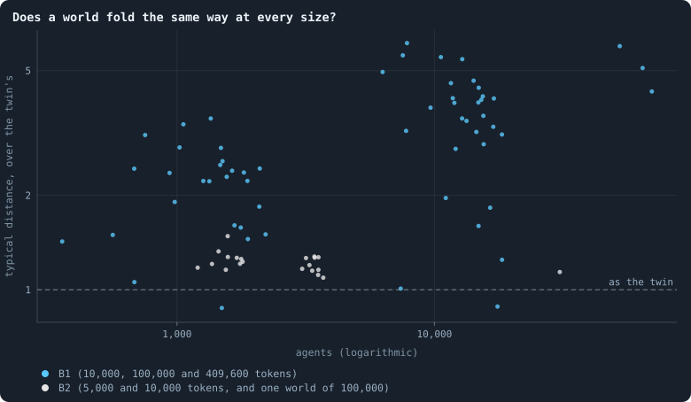

# What folds a world

> [!question] Questions of this page
> - [How many dimensions does a world have?](how-many-dimensions-does-a-world-have.md) found [B1](b1-and-b2.md "The first baseline: the algorithm exactly as a new run is offered it.")'s
>   worlds to be spaces, with a [dimension](ball-dimension-and-curvature.md "How fast the number of agents within a distance grows with the distance: as its square in a plane, its cube in space.") of their own. Are [B2](b1-and-b2.md "The second baseline: B1 with the rules that keep its network from breaking and its agents from staking or breeding themselves to death.")'s worlds, and
>   the others the notebook has made since, spaces too?
> - When does a world become a space, and when does it lose it?
> - Which rules decide it?

One aim of this notebook is a world that makes its own space: a network in which
every [agent](the-world.md#agents-and-tokens "One member of a world: it lives on a node of the network, holds tokens and has a brain that takes all its decisions.") has [neighbours](the-world.md#the-network "An agent joined to another by a connection."), the neighbours have neighbours, and the whole is
a space of a few dimensions — three, if it can be
([Physical inspiration](physical-inspiration.md)). [How many dimensions does a world have?](how-many-dimensions-does-a-world-have.md) measured B1's worlds
with two rulers and found them spaces: the number of agents within *r* steps
of a typical agent grows as a power of *r*, about *r*² to *r*³, and a
**[random twin](random-twin.md "A network with the same agents and as many links each, wired at random: what a world would be if it were no space at all.")** of each world — exactly the same number of links at every
agent, wired at random — does not: its balls grow by a factor every step,
the mark of a small world, which has no dimension at all. B2, the world that
cannot break ([A world that cannot break](a-world-that-cannot-break.md)), has been the
[baseline](b1-and-b2.md "The stated rules an experiment starts from and changes one thing of: B1 or B2.") of everything since. Its network has only been read through one
number on the [health bar](health-bar.md "The seven marks a world's network must meet to count as healthy: one piece, mostly on loops, no fatal cut, no hub, three to twelve links per agent, a dimension of 2.3 to 4."), a dimension by ball growth over radii 1 to 5 —
and that number rose with a world's size
([What holds a world's size](what-holds-a-worlds-size.md)), as a small world's would.

This page reads B2's worlds and the others with [How many dimensions does a world have?](how-many-dimensions-does-a-world-have.md)'s full rulers
(`research/atlas/space.py`), and adds one number that sums a world up: its
**typical distance** — the steps within which a typical agent's ball holds
half the world — over its twin's. A small world is about as near as its
twin, a ratio of 1; a space is wider, because its distances grow as a power
of its size, the twin's only as the logarithm.

## B1 and B2 side by side

<!-- figure spaces/balls -->

**B1 and B2 side by side.** Left: the share of its world a typical agent's ball holds within r steps (the geometric mean over 40 agents drawn at random), the median of each kind of world, on logarithmic axes; dashed, the same for the worlds' random twins, which have exactly the links of their world at every agent, wired at random. Right: the local dimension the balls show, d(r) = ln(N(r+1)/N(r)) / ln((r+1)/r), until a ball holds a quarter of the world, the median of each kind; dashed, the twins.

> [!example]- How to make this figure
> **Runs.** B1: the 26 worlds of 10,000 tokens of Experiment 2 that lived to the end, after their last game; B2: Experiment 16's ten worlds at iteration 2,000; mixed at birth: Experiment 17's worlds at 10,000; the estates to the newborns or the parents: batch R's B2 worlds (`R/B2-newborns-s1`, `-s2`, `R/B2-parents-s1`, `-s2`) at 2,000.
>
> **Data.** From each world's whole world kept then (`research/atlas/space.py`, `GraphOfLifeRuns/.pilots/atlas/space.json`).
>
> 1. Build the network of the world's largest piece; make its random twin.
> 2. From 40 agents drawn at random, a breadth-first search; N(r) the geometric mean of the number within r steps.
> 3. Read the share N(r)/n and the local dimension d(r).
>
> **To make it again:** `python3 book_figures.py spaces`.
<!-- /figure -->

- **B1 is a space**, as [How many dimensions does a world have?](how-many-dimensions-does-a-world-have.md) found: its local dimension holds between
  2.0 and 2.5 from radius 1 to 6, and a typical agent needs 10.5 steps to
  reach half of its world, where its twin needs 4.5 — a typical distance of
  2.3 times the twin's.
- **B2 is nearly a small world.** Its local dimension climbs — 2.4, 3.9, 5.0
  — until, four steps out, a typical agent's ball already holds a quarter of
  the world's 3,400 agents. It needs 5.0 steps to reach half the world, its
  twin 4.2: a typical distance of 1.18. Each step multiplies its ball by
  four to six, its twin's by five to seven.
- **[Brains](the-brain.md "The neural network each agent decides with: inputs about itself and its neighbours, outputs that become its decisions.") mixed at birth do not change that**: Experiment 17's worlds read
  1.21, at 630 agents.
- **But B2 with the [estate](estate.md "The tokens a dead agent leaves, and who gets them.") of the dead going to the newborns or to the
  parents** ([Who inherits?](who-inherits.md)) **is a space, and one of about
  three dimensions.** Its local dimension rises to 3.1 at radius 3, 3.5 at 4
  to 5, and falls back to 2.7 by radius 7; a typical agent needs 11.2 steps
  to reach half of its 5,200 agents, its twin 4.7 — a typical distance of
  2.4, as wide as B1. Its twin's dimension climbs past 5.7 within four steps.

## A world nine times larger

> [!info] Added later (17 October 2026)
> The world of this section was still being played when the page was
> first written.

A small world's rulers run out of room within a few steps, and a space only
shows its dimension where it has room
([How many dimensions does a world have?](how-many-dimensions-does-a-world-have.md)). So a B2 world of
100,000 [tokens](the-world.md#agents-and-tokens "The one thing of value in a world: every agent holds a whole number of them, and their total never changes.") was played for 1,000 [iterations](one-iteration.md "One step of a world's time: a phase of reproduction, then a phase of the game.") (a [pilot](pilot-worlds.md "A world made by hand to see whether an idea is worth an experiment, without a thesis or many seeds."), [seed](random-numbers.md "The number that fixes every random choice of a run: the same settings and the same seed make the same world.") 1,
`GraphOfLifeRuns/.pilots/BIG/B2-100000-s1`): at the end it held 30,686
agents, nine times B2's usual 3,400.

<!-- figure spaces/size -->

**Does a world fold the same way at every size?** Each dot is a world: its typical distance over its random twin's, against the agents in its largest piece, both on logarithmic axes. Blue: B1's worlds of 10,000, 100,000 and 409,600 tokens after their last game ([How many dimensions does a world have?](how-many-dimensions-does-a-world-have.md)'s readings). Grey: B2's worlds of 5,000 tokens at iteration 1,000 (Experiment 14) and of 10,000 at 2,000 (Experiment 16), and one B2 world of 100,000 tokens at iteration 1,000 (a pilot). A space grows wider than its twin as it grows; a small world stays as near.

> [!example]- How to make this figure
> **Runs.** B1: Experiments 2, 10 and 8 (`B1-10000-…`, `B1-100000-…`, `B1-409600-…`); B2: Experiments 14 and 16, and the pilot world `GraphOfLifeRuns/.pilots/BIG/B2-100000-s1` (B2's settings at 100,000 tokens, seed 1, 1,000 iterations).
>
> **Data.** From [How many dimensions does a world have?](how-many-dimensions-does-a-world-have.md)'s readings (`GraphOfLifeRuns/.book/<run>.dims2.json`) and `research/atlas/space.py` (`GraphOfLifeRuns/.pilots/atlas/space.json`).
>
> 1. Measure each world and its random twin as in the first figure.
> 2. Divide the radius at which its typical ball holds half the world by its twin's.
>
> **To make it again:** `python3 book_figures.py spaces`.
<!-- /figure -->

**It is folded as B2 at 10,000 tokens is.** A typical agent's ball holds half
of its 30,686 agents within 5.5 steps, its twin's within 4.8 — a typical
distance of 1.14 — and its local dimension climbs from 2.9 to 5.5 to 7.1 in
three steps, as its twin's does (3.1, 5.8, 7.8), with no plateau. B1's typical
distance grows with its size, as a space's must: 2.3 at 1,500 agents, 3.7 at
13,800, 5.1 at 64,000. B2's does not: 1.24 at 1,600 agents (5,000 tokens),
1.18 at 3,400, 1.14 at 30,700. **At every size measured, B2 is a small
world.**

## A world through its life

Every one of these worlds starts the same way: the first hundred iterations
of a B2 world are the same whatever its rule for estates or for age, for
until the first agents reach a hundred, nobody dies. How does a world become
what it is?

<!-- figure spaces/life -->

**A world through its life.** The typical distance of a world — the steps within which a typical agent's ball holds half of it — over the same for its random twin, at moments of its life; the median of two or three seeds of each kind. About 1: a small world, as near as its twin. Above: a space, wider than its twin. Above, worlds of 10,000 tokens: B2 itself (Experiment 16), without old age, with the estate of the dead to the newborns or to the parents (batch R), and with every unused link lapsing (batch S). Below, worlds of 5,000 tokens from Experiment 14, each without one of B2's rules, or with handover.

> [!example]- How to make this figure
> **Runs.** Experiment 16's B2 worlds and their sister experiment without old age (`B2-10000-s001` … `s003`, `B2-10000-3ec24f-s001` … `s003`), batch R's and batch S's pilot worlds, and Experiment 14's worlds at 5,000 tokens (`B2-5000-…-s001` … `s003`).
>
> **Data.** From the whole worlds kept every 100 iterations (`research/atlas/space.py --life`, `GraphOfLifeRuns/.pilots/atlas/space_life.json`).
>
> 1. Measure each world as in the figure above, at each moment.
> 2. Divide the radius at which its typical ball holds half the world by its twin's.
>
> **To make it again:** `python3 book_figures.py spaces`.
<!-- /figure -->

- **Every B2 world starts as a space**: at iteration 100 its typical
  distance is 1.68 times its twin's. Birth makes space — a newborn is joined
  to its parent and to two of the parent's neighbours, next to where it was
  born.
- **B2 folds when its agents start to die of age.** From iteration 100 on,
  the first generation dies, and by iteration 300 the typical distance has
  fallen to 1.24; it stays near 1.2 for as long as the world is played.
- **Without old age, nothing folds**: the world keeps the space it was born
  with, 1.8 to 1.9.
- **With the estate to the newborns or to the parents, the dying build
  space instead**: the typical distance rises to 2.0 to 2.2 with the estate
  to the newborns, and to 2.4 to 2.6 with the estate to the parents.
- **With every unused link lapsing, the world opens wide**: 4.3 to 4.7 times
  its twin's distance from iteration 200 on.

The lower panel holds the worlds of Experiment 14, at 5,000 tokens, each
without one of B2's rules ([A world that cannot break](a-world-that-cannot-break.md)).
B2 itself folds there too, from 1.54 to about 1.25. Without links at birth
it folds a little less (1.35 to 1.45), without the cap on links a little
more (1.13 to 1.28), and with handover it holds at about 1.5. **Without
mending, it does not fold**: 1.6 to 1.7 through iteration 700, and 2.0 at
1,000.

Mending is the rule that joins up the neighbours of an agent that dies: they
close in a ring round the gap, as the edge of a hole closes
([`mend_on_death`](settings.md#mend_on_death)). Each death joins
agents that were two steps apart through the dead one; a world in which
everyone dies at a hundred does so for every agent, generation after
generation. One reading, consistent with everything above: **death with
mending folds a world, and birth unfolds it.** Without old age nobody dies,
and nothing folds; without mending a death leaves a hole, and the world
keeps its room; and where every unused link lapses, the links mending makes
are cut again as soon as nobody stakes on them.

What the estates to the newborns and the parents change, that lets their
worlds unfold although they mend as B2 does, is not settled here, but two
differences point one way:

- **Who breeds.** With an estate in hand, a newborn has its first child
  within a few iterations: at a birth, the [median](median-and-quantiles.md "The middle value: half of the numbers lie below it and half above.") parent is two or three
  iterations old, against 18 and 28 in B2, and agents under 30 have nearly
  as many living children as the old (0.74 to 0.78 each, against 0.30 to
  0.38 in B2). The world grows as chains of short generations.
- **Who dies.** In B2 an agent gathers links all its life, from its children
  and from its neighbours' children: at 90 or older it holds 8.1 to 8.4
  links, in 7.6 to 7.8 groups of neighbours not linked to one another, and
  its death closes a ring of about eight links among them. Where the estate
  goes to births, the old hold about six links in 5.4 groups.

The estate to an agent's own children, which reaches heirs of every age,
changes neither — parents are 26 iterations old at a birth, as in B2 — and
its worlds fold as B2's do, to 1.18 and 1.19. The neighbours of the
unfolded worlds are also more alike in age (a [correlation](correlation.md "Whether two quantities go up and down together, from −1 to 1.") of birth times
across links of +0.8, against +0.45 in B2), and their links per agent a
little fewer (4.7 to 4.9, against 5.4 to 5.7). Which of these is the cause,
worlds that differ in so much cannot say; worlds without brains can
([below](#with-no-brains-at-all)).

## Every world at iteration 1,000

<!-- figure spaces/every -->

**Every world at iteration 1,000.** Each dot is a world of the notebook read at iteration 1,000 — the pilot batches, the search by elimination and the lab's B2 families at 10,000 tokens — its typical distance over its random twin's (logarithmic). Top, for the worlds whose agents die of age and are mended round: against the number of groups the neighbours of its agents within ten iterations of their death fall into — groups linked to one another directly, which mending joins in a ring. Middle: against its links per agent; bottom: against the share of its agents holding three tokens or fewer. Colours: what stands out in its rules.

> [!example]- How to make this figure
> **Runs.** Every world of `GraphOfLifeRuns/.pilots/atlas/at1000.json` (`research/atlas/at.py`): the pilot batches K, M, P, Q, R, S, T, U, W, X, Y and YB, the search by elimination's worlds (Z), and the lab's B2 families of Experiments 15 to 17.
>
> **Data.** From each world's whole world kept at iteration 1,000 (`research/atlas/space.py --at 1000`, `GraphOfLifeRuns/.pilots/atlas/space_at1000.json`).
>
> 1. Measure each world and its twin as above.
> 2. Split the neighbours of each agent within ten iterations of its death into groups linked directly (`research/atlas/rings.py`).
> 3. Set its typical distance over the twin's against the mean number of groups, its links per agent and its share of poor agents.
>
> **To make it again:** `python3 book_figures.py spaces`.
<!-- /figure -->

Read at iteration 1,000, 395 worlds — every pilot batch, the first round of
the search by elimination, and the [lab](the-lab.md "The program that runs an experiment's plan as runs, each on a frozen copy of the engine, the code that plays a world.")'s B2 families at 10,000 tokens — fall
into two groups:

- **Folded**: the 235 worlds of B2 with other rules (a median typical
  distance of 1.26 times the twin's) and the 83 with brains mixed at birth
  (1.26).
- **Spaces**: the 37 worlds whose estate goes to the newborns or the parents
  (2.22), the 14 in which every unused link lapses (3.80), and the 26 whose
  deaths are not mended, on B1's rules or drawn so by the search (2.30).

Across them all, the typical distance goes with fewer links per agent (a
rank correlation of −0.58) and hardly at all with how poor the agents are
(+0.12), how many they are (+0.07) or how many tokens each holds (−0.09).
Being a space is not a matter of poverty or size.

**The ring a death closes tells it best.** In the 336 worlds whose agents
die of age and are mended round, count, for every agent within ten
iterations of its death, the groups its neighbours fall into — the groups
mending will join in a ring (`research/atlas/rings.py`). The more groups,
the more folded the world (a rank correlation of −0.69):

| groups of neighbours of the agents about to die | worlds | typical distance, over the twin's (median) |
|---|---|---|
| fewer than 5 | 50 | 1.88 |
| 5 to 6 | 15 | 2.12 |
| 6 to 7 | 55 | 1.34 |
| 7 to 9 | 193 | 1.24 |
| 9 or more | 23 | 1.08 |

The most folded worlds are those whose children may be of any size: there
the parents are 60 iterations old at a birth (a median), and the dying hold
12 to 14 links in as many groups. Where the old breed, they gather links till
they die, and every death closes a wide ring.

Experiment 14's worlds, at 5,000 tokens and not among the 336, follow the
same rule. B2 there leaves rings of 6.7 to 7.5 groups and reads 1.25 to 1.33;
with handover, which passes some of a parent's links to its newborn, the
dying leave rings of 2 to 5 groups, and the world reads 1.50 to 1.84; without
the cap on links, rings of 10 to 24 groups, and two of the three worlds read
1.14 — the third, at 2.40, is the one exception.

## With no brains at all

The worlds above differ in many things at once. To see whether who breeds is
enough, the rules of space were played alone, as in
[A world that cannot break](a-world-that-cannot-break.md#space-alone):
no brains, no tokens, a newborn joined to its parent and two of the parent's
neighbours, every agent dying at age 100 as in B2, births balancing deaths at
about 1,500 agents — and the one thing changed is who may have a child: any
agent, only the young (at the median age of the living or younger), or only
the old (`research/oee/fold.py`, five seeds, 600 iterations each):

| rules | typical distance, over the twin's (median, and range) | groups of neighbours of the oldest tenth | worst cut by one agent's loss |
|---|---|---|---|
| deaths mended in a ring, anyone breeds | 1.16 (1.06 to 1.28) | 6.1 | 1% |
| deaths mended in a ring, only the young breed | 1.71 (1.50 to 2.05) | 3.8 | 3% |
| deaths mended in a ring, only the old breed | 1.02 (1.02 to 1.06) | 7.6 | 0.1% |
| deaths not mended, anyone breeds | 2.36 (2.09 to 2.52) | 1.2 | 37% |
| [A world that cannot break](a-world-that-cannot-break.md)'s own model: agents die by chance, mended in a ring | 1.24 (1.13 to 1.31) | 7.4 | 1.5% |
| only the pieces a death would split joined, anyone breeds | 5.1 to 5.6 (two seeds of five: beyond reach) | 1.9 | 47% |
| the same, only the young breed | 4.22 (3.62 to 4.83) | 2.0 | 48% |
| the same, only the old breed | beyond reach in all five | 1.8 | 46% |

With anyone breeding, the brainless world folds as B2 does. Let only the
young breed, and it stays a space; let only the old breed, and it folds
completely, as the worlds whose children may be of any size do. **Who breeds
decides it, with nothing else changed**, through the ring a death closes:
3.8 groups where the young breed, 7.6 where the old do. And mending is what
keeps a world whole: without it the brainless world is a space, but the
loss of one agent can cut off a third of it, and the cull leaves half as
many agents.

**How much mending makes how much room.** The ring joins every group of a
dying agent's neighbours that are not linked directly, even where they stay
joined through others. The least mending that still keeps a world whole
joins only the pieces a death would split it into — after most deaths, none
(`--mend-split` in the model). With it the brainless world never breaks, and
never folds: it grows into a string — in seed 1 of each, 126 steps from
end to end where anyone breeds, 54 where the young do and 175 where the old
do, at a dimension between 1.3 and 1.9 by the health bar's measure — and a typical
agent's ball reaches half of it five times later than its twin's, or not
within 40 steps at all ("beyond reach" above). Not mended, a world breaks;
mended in a ring, it folds; mended as little as it must be, it is a line.
Three dimensions lie somewhere between, and the worlds whose young do the
breeding come nearest.

## With brains: only the young, or only the old

The same rule was then given to worlds with brains (pilot batch YB, a switch
of the prototype, `breeders`): only agents at the median age of the living
or younger may have a child, or only those older than it — in B2, two seeds
to 2,000 iterations, and in B2 with brains mixed at birth. [Founders](starting-ring.md "One of the agents a world starts with, each holding the same tokens, on a ring with a few shortcuts.") are all
of one age, so in a world started afresh nobody is older than the median and
nobody breeds; the old were therefore given B2's world of seed 1 at
iteration 500 and played on from there, beside the young from the same
world.

| world | parents' age at a birth (median) | groups of neighbours of the dying | typical distance, over the twin's |
|---|---|---|---|
| B2, seed 1, at 1,000 / 1,500 / 2,000 | 16 / 15 / 18 | 7.5 / 7.3 / 7.6 | 1.22 / 1.15 / 1.27 |
| from it at 500, only the old breed | 52 / 63 / 59 | 8.9 / 8.8 / 9.0 | 1.12 / 1.04 / 1.07 |
| from it at 500, only the young breed | 16 / 17 / 18 | 7.4 / 7.3 / 7.6 | 1.30 / 1.26 / 1.34 |
| B2 afresh, only the young, seeds 1 and 2, at 2,000 | 13; 14 | 6.7; 7.0 | 1.34; 1.23 (B2: 1.27; 1.17) |
| mixed at birth, only the young, at 2,000 | 19; 26 | 7.5; 7.2 | 1.30; 1.30 (mixing alone: 1.36; 1.21) |

**Let the old breed, and a world with brains folds as far as the brainless
one**: the parents are 52 to 63 iterations old, the dying hold 9.3 to 9.6
links, and the world reads 1.04 to 1.12 — smaller as well (1,300 to 1,650
agents), and a little richer (59% at three tokens or fewer, against 77% to
79%). **Let only the young breed, and almost nothing changes**, because in
B2 the young already do most of the breeding: its parents are 15 to 28
iterations old at a birth, and the rule leaves them 13 to 26. The dying
still hold about eight links, gathered from their neighbours' children as
much as from their own, and the worlds stay folded.

What unfolds the worlds whose estate goes to the newborns or the parents is
how young their parents are — two or three iterations — and how few links
their dying hold: about six, in 5.4 groups, where the table of rings above
puts the line between folded and not.

## What it teaches

- **B2 is not a space**, at any size measured, up to 30,700 agents. Its
  worlds are nearly small worlds — a typical agent is about as near to
  everyone as in a random network with the same links —
  which is why the health bar's dimension rose with their size and failed
  the large ones ([What holds a world's size](what-holds-a-worlds-size.md)): a small world has no dimension to find, and the
  number read off its first few steps grows with the room it has.
- **Space is made and unmade by life and death.** Birth makes it, and every
  B2 world starts as one; death with mending folds it, once the first
  generation dies — the more, the larger the ring each death closes, and the
  rings are largest where the old do the breeding. Worlds without old age,
  without mending, or whose unused links lapse keep their room. With no
  brains at all, who breeds is enough to fold a world or to keep it a space;
  with brains, letting only the old breed folds it further, and letting only
  the young breed changes little, for B2's young already do.
- **Room and resilience pull apart.** Mending is what keeps a death from
  splitting a world, and it is what folds it: mended in a ring, a world folds
  into a near small world; mended only where it would split, it stretches into
  a line. A world that is a three-dimensional space and that no single loss
  can cut has to sit between the two.
- **The three-dimensional worlds are the poor ones.** B2 with the estate to
  the newborns or the parents is a space of about three dimensions — the aim
  of [the physics of space](../README.md#space-and-dimension) — but nine in ten of its
  agents hold three tokens or fewer, its agents are alike, and its evolution
  stops ([Who inherits?](who-inherits.md)). A world that is a
  three-dimensional space and rich, and that keeps evolving, is still to be
  found.
- **Open**: rules that would keep a world's dying
  from gathering wide rings in a rich world, or keep a world whole without
  folding it — mending would add nothing where a dying agent's neighbours are
  already linked to one another, as on a surface of triangles, while B2's
  rule for unused links cuts exactly those triangles. Letting only the young
  breed is not enough with brains: B2's young already breed.

**Related notes:** [How many dimensions does a world have?](how-many-dimensions-does-a-world-have.md) ·
[Physical inspiration](physical-inspiration.md) ·
[A world that cannot break](a-world-that-cannot-break.md) ·
[Who inherits?](who-inherits.md) ·
[What holds a world's size](what-holds-a-worlds-size.md) ·
[Healthy and rich](healthy-and-rich.md) ·
[Mixed at birth: ten long worlds](mixed-at-birth-ten-long-worlds.md#the-marks-a-world-misses) ·
[Every setting](settings.md#mend_on_death)

<!-- turns -->
---

← [Worlds of 100,000 tokens](worlds-of-100000-tokens.md) · [Space and dimension](../README.md#space-and-dimension) · [How alike at a distance](correlation-function.md) →

**Also about:** [Looking for a healthy, rich world](../README.md#looking-for-a-healthy-rich-world).

> [!info]- Pages that link here (15)
> [Building B2: a world that cannot break](a-world-that-cannot-break.md) · [The random twin: is a world a space?](random-twin.md) · [What holds a world's size](what-holds-a-worlds-size.md) · [Rules in company](rules-in-company.md) · [Who inherits?](who-inherits.md) · [Handover, with every other rule](handover-with-every-other-rule.md) · [Healthy and rich](healthy-and-rich.md) · [What makes a world interesting](what-makes-a-world-interesting.md) · [The health bar](health-bar.md) · [Brains mixed at birth, in long worlds](mixed-at-birth-ten-long-worlds.md) · [Who may be a mate](mixed-at-birth-with-parents-as-mates.md) · [The candidates, played on and played again](the-candidates-played-on.md) · [Room and riches for the steadiest world](room-for-the-steadiest-world.md) · [A screen of random worlds](a-screen-of-random-worlds.md) · [Every simulation: what was run, and what was measured](every-simulation.md)
<!-- /turns -->
