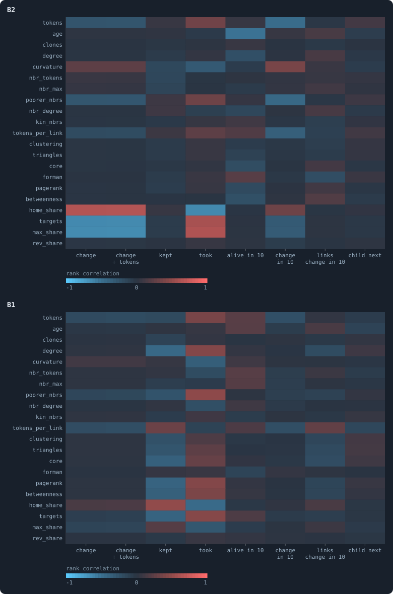
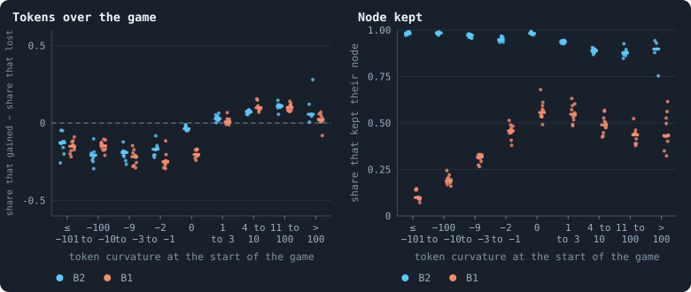
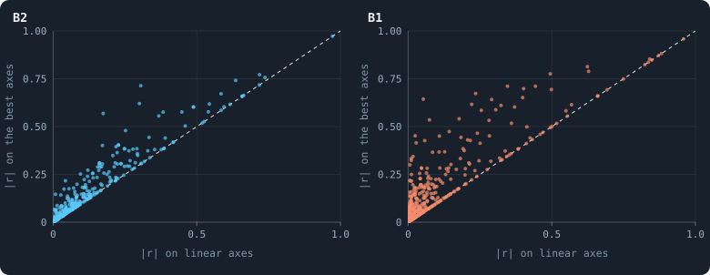
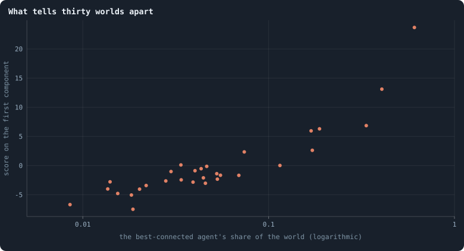

# What goes with what

> [!question] Questions of this appendix
> - Which quantities move together in these worlds: for an agent from one game
>   to the next, for a whole world over time, and between one world and
>   another?
> - Does an agent's token curvature say how its tokens will change?
> - Which relations show only on logarithmic axes?
> - Which correlations are findings, and which are true by definition?

This appendix is an atlas rather than an experiment. Nothing in it was
predicted. It is a search: every quantity the notebook measures for an agent
against every other, on every combination of linear and logarithmic axes, in
twenty worlds; and every statistic the lab records for a whole world against
every other. A search of this size finds hundreds of correlations, and most of
them say nothing. Two quantities computed from the same numbers correlate by
definition. Two that both drift over a run correlate whether or not they have
anything to do with each other. And with a million rows, a correlation of 0.01
is "significant" without meaning anything. So every number below comes with
the guards against these three: pairs made from the same numbers are set
apart, a world's statistics are compared by their *changes* rather than their
levels, and a correlation counts only if every one of ten worlds agrees on
its sign.

## The agents

**The rows.** For every 20th game from iteration 1,000 to 2,000, one row for
every agent alive at the start of the game, in the ten B2 worlds of
Experiment 16 and the first ten B1 worlds of the baseline set: 1,690,320
rows from B2 and 634,832 from B1. A node keeps its number when another agent takes it, so what is
measured after the game (its change of tokens, ten games later) is of the
node, held by whoever holds it then.

**The quantities.**

| quantity | what it is |
|---|---|
| `tokens` | the tokens it held at the start of the game |
| `age` | iterations since it was born |
| `clones` | agents carrying its brain, itself included |
| `degree` | its connections |
| `curvature` | [token curvature](token-curvature.md): the sum over its neighbours of their tokens minus its own |
| `nbr_tokens`, `nbr_max` | its neighbours' mean tokens, its richest neighbour's |
| `poorer_nbrs` | the share of its neighbours holding fewer tokens than it |
| `nbr_degree` | its neighbours' mean connections |
| `kin_nbrs` | the share of its neighbours carrying its brain |
| `tokens_per_link` | its tokens divided by its connections |
| `clustering`, `triangles` | the share of its neighbours' pairs that are linked; the triangles it belongs to |
| `core` | its k-core number: the largest k such that it lies in a part of the network where everyone has at least k connections |
| `forman` | the network's own curvature at it: Forman–Ricci, 4 − deg(*u*) − deg(*v*) + 3 × the triangles on each link, averaged over its links |
| `pagerank`, `betweenness` | PageRank; betweenness, from 64 sampled sources |
| `home_share`, `targets`, `max_share`, `rev_share` | of its stakes in the game: the share on its own node, the neighbours staked on, the largest stake on a neighbour as a share of its tokens, the share marked revolutionary |
| `change`, `rel_change` | its node's change of tokens over the game; divided by the tokens it held |
| `kept`, `took` | it kept its own node; the nodes it took from others |
| `alive_10`, `change_10`, `degree_change_10` | ten iterations later: its node still exists; its change of tokens; its change of connections |
| `child_next` | it had a child in the next reproduction phase |

**The axes.** For every pair, Pearson's correlation with each quantity on a
linear axis or a logarithmic one: the logarithm of a positive quantity,
log(1 + *x*) of a count that can be zero, and sign(*x*) log(1 + |*x*|) of a
signed one, so that a peak and a valley of the same depth sit at the same
distance from zero. Shares and yes-or-no stay linear. And the rank
correlation (Spearman's), which no monotone change of axes can alter. Each
correlation is taken in each world and the median of the ten is reported.

<!-- figure atlas/before_after -->

**What comes before, and what follows.** Each cell is the rank correlation (Spearman's) between a quantity known at the start of a game (rows) and what then happened (columns), the median over ten worlds. Red: the more of the one, the more of the other; blue: the more of the one, the less of the other. The quantities are those of the table in the text.

> [!example]- How to make this figure
> **Runs.** The ten B2 worlds of Experiment 16, `B2-10000-s001` … `-s010`, and the first ten worlds of B1's baseline set, `B1-10000-s001` … `-s010` (Experiment 2): 10,000 tokens each, every game recorded with every agent's stakes.
>
> **Data.** From the runs' recorded frames.
>
> 1. For every 20th game from iteration 1,000 to 2,000, one row per agent alive at the start of the game, from the frames after the reproduction phase and after the game, of the next iteration's reproduction and of ten iterations later: the 29 quantities of the table in the text (`python3 research/atlas/correlations.py extract <run> --from 1000 --to 2000 --step 20`).
> 2. In each world, rank every column (ties share their mean rank) and take Pearson's correlation of the ranks for every pair (`python3 research/atlas/correlations.py analyse --runs <runs> --label <B2|B1>`).
> 3. Take the median over the ten worlds.
>
> **To make it again:** `python3 book_figures.py atlas`.
<!-- /figure -->

Two kinds of relation fill the strongest cells, and neither is news. Some
are mechanics. An agent that stakes away from home moves tokens off its own
node, so its node's change goes with its share staked at home (+0.60 in B2).
An agent that takes nodes is one that staked on others. Others are
regression to the mean: an agent's change of tokens contains minus the
tokens it held, so the rich "lose" by construction. The fair measure is how
well its wealth now predicts its wealth ten games later. The rank
correlation is 0.78 in B1 (0.74 to 0.83) and 0.41 in B2 (0.38 to 0.48), where
its connections now predict its connections then at 0.92 in both. **Wealth is
sticky in B1 and churns in B2.**

**The two rule sets put wealth in different places.** Of the 374 pairs not
made from the same numbers, 30 have opposite signs in B2 and B1, every world
of each agreeing and both at least 0.1 from zero. The largest of them concern
where the tokens sit (rank correlations, B2 against B1):

| | B2 | B1 |
|---|---|---|
| tokens and connections | −0.18 | +0.56 |
| tokens and PageRank | −0.14 | +0.65 |
| tokens and betweenness | −0.23 | +0.51 |
| tokens and k-core | −0.17 | +0.40 |
| tokens and age | −0.17 | +0.36 |
| tokens and the largest stake on a neighbour | +0.42 | −0.45 |
| the largest stake and the nodes taken | +0.64 | −0.29 |
| age and still alive ten iterations later | −0.52 | +0.22 |

In B1 the rich are the well-connected, the central and the old: the even
split ([Where the tokens flow](where-the-tokens-flow.md)) pours tokens into whoever
has most neighbours, and nothing ages. They spread their stakes, and the
nodes they take come from spreading. In B2 wealth has come loose from the
network. Its links are capped at eight, its agents die at a hundred, and
they go all-in. The well-connected are, if anything, a little poorer, the
rich go all-in, and only there does going all-in take nodes. The age limit
shows as plainly as a rule can: in B2 the old are the ones about to die.

**In B2, nothing here says who will lose its node.** In B1 an agent's node is
kept by agents that stake at home (+0.47) and lost by the well-connected
(−0.43 on a logarithmic axis for connections). In B2 the strongest of all 21
quantities known before the game predicts keeping one's node at 0.16. As far
as anything measured here can tell, losing one's node in B2 is a lottery.
Having a child next is hardly predictable in either world (at most 0.18).

## Token curvature and token change

<!-- figure atlas/curvature -->

**Tokens run downhill.** One dot per world, the bar the median of ten. Token curvature is the sum, over an agent's neighbours, of their tokens minus its own (the note *Token curvature*): below zero an agent is a peak, above zero a valley. Left: of the agents in a class, the share whose node held more tokens after the game than before, minus the share whose node held fewer; most hold the same. Right: the share of agents that kept their own node. A class with fewer than 50 agents in a world has no dot for it.

> [!example]- How to make this figure
> **Runs.** The ten B2 worlds of Experiment 16, `B2-10000-s001` … `-s010`, and the first ten worlds of B1's baseline set, `B1-10000-s001` … `-s010` (Experiment 2): 10,000 tokens each, every game recorded with every agent's stakes.
>
> **Data.** From the runs' recorded frames.
>
> 1. For every 20th game from iteration 1,000 to 2,000, one row per agent alive at the start of the game, from the frames after the reproduction phase and after the game, of the next iteration's reproduction and of ten iterations later: the 29 quantities of the table in the text (`python3 research/atlas/correlations.py extract <run> --from 1000 --to 2000 --step 20`).
> 2. Sort the rows by curvature into the classes on the axis; in each, count the agents whose node gained tokens over the game and those whose node lost, and those that kept their own node.
>
> **To make it again:** `python3 book_figures.py atlas`.
<!-- /figure -->

Heat flows from hot to cold in proportion to the difference: a node's
temperature changes by its curvature, the sum of its neighbours'
temperatures minus its own (the note [*Token curvature*](token-curvature.md)).
An even split of every agent's stake over itself and its neighbours would
move tokens the same way, by the curvature divided by connections plus one
([Physical inspiration](physical-inspiration.md)). Both worlds do run downhill. Peaks
lose and valleys gain: among the agents more than ten tokens richer than
their neighbourhood, 13% to 21% more lost than gained, and among those 4 to
100 tokens poorer, 7% to 11% more gained than lost. Most agents' tokens did
not change in a game at all. The regression slope of the change on the
curvature divided by connections plus one is 0.20 in B2 (0.10 to 0.26) and
0.21 in B1 (0.00 to 0.71), where the even split would make it 1: tokens run
downhill at about a fifth of the pace of heat, with a correlation near 0.3.

**They run downhill by different roads.** Among agents that kept their node,
curvature still predicts the change in B2 (0.28), and does not in B1 (−0.01).
In B1 the flow downhill is nodes changing hands: a peak keeps its node in only
10% of games, an agent level with its neighbours in 56%. Those peaks are the
rich nomads of [Gliders, and who helps whom](gliders-and-who-helps-whom.md), which move
their wealth on and leave their node behind. In B2 nearly every agent keeps
its node (88% to 98%), and the tokens move as stakes that fail. Over ten
games the slope shows plainly in B2: curvature predicts the change at 0.44 on
logarithmic axes.

## What the logarithm reveals

<!-- figure atlas/logarithm -->

**What the logarithm reveals.** One dot per pair of quantities that are not made from the same numbers. Across, Pearson's correlation on linear axes; up, on whichever axes give the strongest: linear or logarithmic on either. Dots far above the dashed diagonal are relations a linear plot hides: power laws, and quantities whose few large values swamp the rest.

> [!example]- How to make this figure
> **Runs.** The ten B2 worlds of Experiment 16, `B2-10000-s001` … `-s010`, and the first ten worlds of B1's baseline set, `B1-10000-s001` … `-s010` (Experiment 2): 10,000 tokens each, every game recorded with every agent's stakes.
>
> **Data.** From the runs' recorded frames.
>
> 1. For every 20th game from iteration 1,000 to 2,000, one row per agent alive at the start of the game, from the frames after the reproduction phase and after the game, of the next iteration's reproduction and of ten iterations later: the 29 quantities of the table in the text (`python3 research/atlas/correlations.py extract <run> --from 1000 --to 2000 --step 20`).
> 2. For every pair, Pearson's r with each quantity on a linear axis or a logarithmic one: the logarithm of a positive quantity, log(1 + x) of a count, sign(x) log(1 + |x|) of a signed one; shares and yes-or-no stay linear. The median over ten worlds for each choice of axes.
> 3. Leave out the pairs made from the same numbers (tokens and tokens per link, say).
>
> **To make it again:** `python3 book_figures.py atlas`.
<!-- /figure -->

In B1 the logarithm matters. Tokens, connections and betweenness span orders
of magnitude there, and a few large values swamp a linear correlation. Wealth
and the number of neighbours staked on correlate at 0.23 on linear axes and
0.67 on logarithmic ones. Wealth and PageRank go from 0.29 to 0.64, and age
and tokens per link from 0.06 to 0.43. Token curvature and the neighbours'
connections show nothing on linear axes (0.05) and 0.64 on logarithmic ones:
an agent among well-connected neighbours lives in a valley, because
well-connected agents are rich. In B2 the logarithm reveals almost nothing.
Its links are capped at eight and most agents hold one to three tokens, so
there is little range for a power law to hide in. Only tokens per link
against betweenness and PageRank gain much (−0.17 to −0.57, −0.30 to
−0.62).

## A whole world over time

The lab records 95 statistics of a world after every game. Correlated as
levels, nearly everything correlates with everything, because a world drifts.
Correlated as changes from one game to the next, the drift is gone, and what
remains is which statistics move *together*. Most strong pairs are synonyms:
three measures of inequality, two of the flow, a fitted exponent and its fit.
Grouped by what they measure, the couplings *between* groups that held with
the same sign in every one of ten worlds are the findings
(`research/atlas/world_series.py`; groups in `research/atlas/groups.py`).

**In B1, the dead's estate levels the world.** In games in which more of the
dead's tokens are scattered over the survivors, the Gini coefficient falls
(−0.78 between the changes, from −0.65 to −0.83 in the ten worlds), the top
tenth holds less (−0.76), more agents gain (+0.74) and the median holding
rises (+0.65). A world that splits feeds the rest: when pieces break off, the
tokens of their agents are scattered (+0.75).

**In B2, hoarding goes with inequality.** In games in which agents keep more
of their tokens at home, inequality rises (+0.43) and fewer agents gain
(−0.46). And when the share of agents with many connections falls off more
steeply, with fewer hubs (a larger exponent γ of the degree distribution), the
network has fewer bridges (−0.65), a smaller risk of being cut apart (−0.70)
and a larger core (+0.65).

## Between worlds

Thirty worlds of B1 at 100,000 tokens (Experiment 10), each described by the
means of its statistics over iterations 500 to 1,500. Thirty pairs of numbers
make a correlation above 0.36 unlikely by chance, and dozens of pairs reach
0.95 and more: the largest hub, the richest agent, assortativity, the core,
the flows and the dimension all move together from world to world. That many
correlations that strong mean fewer things than there are statistics.

<!-- figure atlas/worlds -->

**What tells thirty worlds apart.** One dot per world of Experiment 10 (B1 at 100,000 tokens). Each world is described by the means of 79 statistics over iterations 500 to 1,500, each standardised over the thirty worlds; the first principal component of those descriptions holds 47% of their variance. Across, how many of the other agents the best-connected agent is linked to.

> [!example]- How to make this figure
> **Runs.** The thirty runs of Experiment 10, `B1-100000-s001` … `-s030`.
>
> **Data.** From each run's statistics after every game (`stats.jsonl`).
>
> 1. Average every statistic a run records after the game over iterations 500 to 1,500 (`python3 research/atlas/world_series.py --runs <runs> --label E10 --from 500 --to 1500`).
> 2. Standardise each over the thirty worlds and take the principal components (a singular value decomposition of the worlds-by-statistics table).
> 3. The best-connected agent's share: its connections divided by the agents, both averaged over the same iterations.
>
> **To make it again:** `python3 book_figures.py atlas`.
<!-- /figure -->

**Nearly half of what tells the thirty worlds apart is one number.** Of the
variance of their 79 standardised statistics, the first principal component
holds 47%, and ordering the worlds along it orders them by their
best-connected agent's share of the world, from 1% to 61%. The second
component (18%) is how clustering and triangles grow with an agent's
connections; the third (16%) is the population. The seven "star" worlds of
[Worlds of 100,000 tokens](worlds-of-100000-tokens.md) are the far end of the first:
a world is first of all a world with or without a star.

## What it means

- **The heat equation is a fifth true.** Tokens do run downhill along the
  curvature, in both rule sets, at about a fifth of the pace an even split
  would set, through nodes changing hands in B1 and through failed stakes in
  B2.
- **Where wealth sits is a property of the rules.** B1 ties it to the network
  (the rich are the connected and the old) and keeps it there (0.78 over ten
  games); B2 cuts it loose (the connected are slightly poorer) and lets it
  churn (0.41).
- **In B2, losing one's node is close to a lottery** as far as anything an
  agent is or does can tell. Selection can only act on traits that change the
  odds, and none of these does by much. That is one more reason, besides the
  ones of [Why evolution stops](why-evolution-stops.md), for evolution in B2 to be
  slow.
- **A world is first of all a world with or without a star.** Half of the
  differences between thirty worlds of the same rules are the size of their
  largest hub, decided early and by chance.
- **For a world over time, the dead's estate levels it (B1) and hoarding
  unlevels it (B2).**

The search is in `research/atlas/`: `correlations.py` builds the agents'
tables and correlates them, `report.py` prints the strongest, the revealed,
the predictors and the reversals, and `world_series.py` does the same for
whole worlds; the tables are in `GraphOfLifeRuns/.pilots/atlas/`.

<!-- turns -->
---

← [What a simulation costs](what-a-simulation-costs.md) · [Methods and statistics](../README.md#methods-and-statistics) · [Every simulation: what was run, and what was measured](every-simulation.md) →

> [!info]- Pages that link here (3)
> [Where tokens go](where-tokens-go.md) · [Every world side by side](every-world-side-by-side.md) · [Every simulation: what was run, and what was measured](every-simulation.md)
<!-- /turns -->
