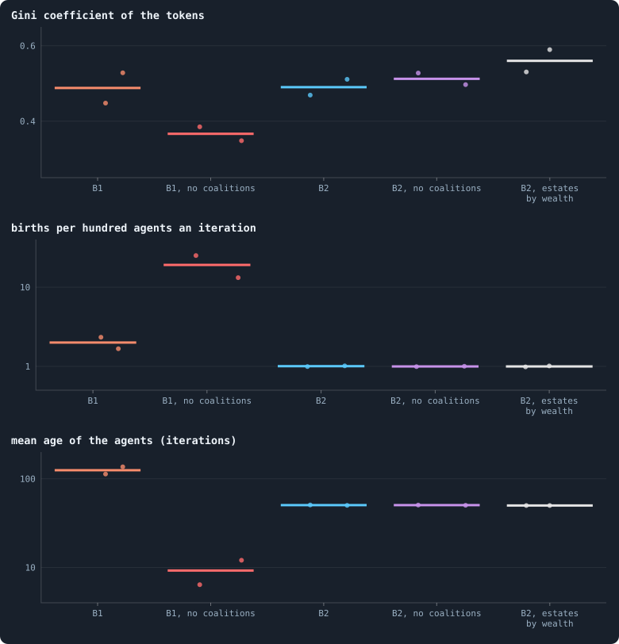
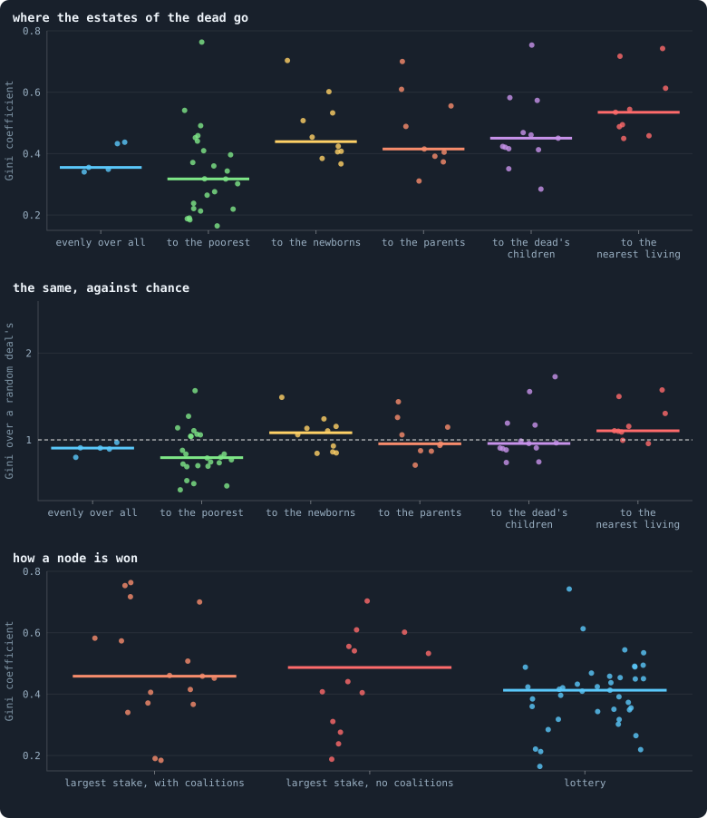
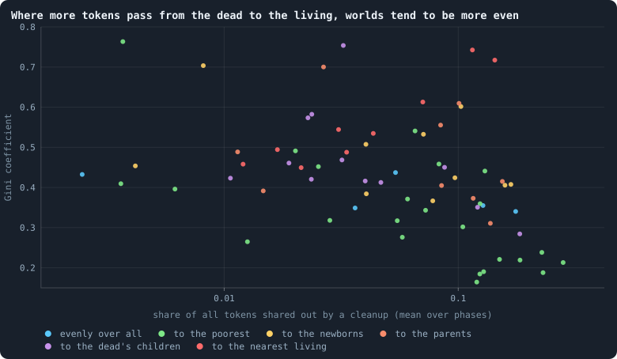

# What keeps wealth spread?

> [!question] Questions of this page
> - Without [coalitions](rules-in-detail.md#how-a-coalition-takes-a-node "A node taken by stakers who each marked part of their stake revolutionary and together staked more than the largest single stake.") of small stakers to unseat the largest, would the rich
>   take everything?
> - What does keep a world's [tokens](the-world.md#agents-and-tokens "The one thing of value in a world: every agent holds a whole number of them, and their total never changes.") spread out, and what pools them?
> - How unequal are the worlds, against what chance alone would deal out?

## In short

The notebook once guessed that coalitions keep wealth from pooling: small
stakers that join to outweigh the largest. They do not. In B1 without
coalitions, the tokens were held *more* evenly, not less: a Gini coefficient of
0.35 and 0.38 against 0.45 and 0.53. Without them, B1 became a world of
mayflies, where 13 to 25 [agents](the-world.md#agents-and-tokens "One member of a world: it lives on a node of the network, holds tokens and has a brain that takes all its decisions.") in a hundred are born every [iteration](one-iteration.md "One step of a world's time: a phase of reproduction, then a phase of the game."). In B2,
and in the 31 worlds of round 3 whose [game](one-iteration.md#phase-2-the-game "The second phase of an iteration: every agent stakes all its tokens on its own node and its neighbours', and every node goes to someone.") had coalitions to switch, they
changed nothing. What sets how unequal a world is, more than anything else
drawn in round 3, is where the tokens of the dead go. Worlds that pass them to
the poorest have a median Gini of 0.32; worlds that let them flow to the
nearest living, 0.53. And the more of a world's tokens pass from the dead to
the living, the more even the world tends to be. Most worlds are about as
unequal as a random deal of their tokens would be.

## The question

A world is a few thousand agents holding a fixed number of tokens between
them. How unevenly they hold them is summed up by the
[Gini coefficient](measuring-tokens.md#the-gini-coefficient): 0 if every agent
held the same, near 1 if one held almost everything. B1's worlds of 100,000
tokens settle near 0.47, and their richest tenth hold about 42% of the tokens
([Where do the tokens go?](b1-lives-and-wealth.md#how-unequal-is-a-world-and-who-stays-rich)).

Nothing in the rules caps a fortune. In every game each agent stakes all it
holds on its own node and its [neighbours](the-world.md#the-network "An agent joined to another by a connection.")', and whoever stakes most on a node
takes it ([How the game is played](how-the-game-is-played.md)). A rich agent
can outstake its poorer neighbours everywhere at once. So why does wealth not
pool in a few hands?

Four things could hold it back:

1. **The game spreads tokens like heat.** An agent that stakes on all its
   neighbours sends its tokens out along every [connection](the-world.md#the-network "A link between two agents of the network: they are neighbours, and can stake on each other's nodes."), and receives theirs.
   Played over and over, this leaves each agent holding tokens in proportion to
   its connections plus one, as heat settles in a body
   ([Rich agents are connected agents](b1-lives-and-wealth.md#rich-agents-are-connected-agents)).
   Wealth is then as unequal as connections are.
2. **Coalitions.** In B1, small stakers on a node can join to outweigh the
   largest one, and in every game they win about a third of all nodes
   ([Revolutions, handover and gifts](the-switches-the-world-was-built-with.md#what-the-switches-did-to-the-world)).
   A rich agent cannot hold a node against a crowd.
3. **Death and birth.** Agents die and newborns start small. The faster a
   world turns over, the less time a fortune has to grow.
4. **The share-out.** The tokens of an agent that dies are handed on. In B1
   every survivor has the same chance at each token of an estate, rich or
   poor, which works like a basic income
   ([The tokens of the dead](b1-lives-and-wealth.md#the-tokens-of-the-dead),
   [The estate of the dead](measuring-lives.md#the-estate-of-the-dead)).

This page was planned as an experiment on the second: B1 with coalitions
switched off, against B1. It can now be answered from worlds already played.
The [pilots](runs-and-records.md#pilot-worlds "A world made by hand to see whether an idea is worth an experiment, without a thesis or many seeds.") of batch S switched coalitions off in B1 and in B2. Round 3 of the
screen of random worlds drew the game, its coalitions and the share-out of
estates at random, among everything else
([A screen of random worlds](a-screen-of-random-worlds.md)).

## Without coalitions

The pilot worlds of batch S are B1 and B2 at 10,000 tokens, two [seeds](rules-in-detail.md#seeds-and-the-random-stream "The number that fixes every random choice of a run: the same settings and the same seed make the same world.") each,
played with and without coalitions to iteration 1,000. A node then always goes
to its largest staker. The figure reads each over iterations 500 to 1,000.

<!-- figure wealthspread/coalitions -->

**Without coalitions, B1 grows more even, not less.** One dot per world (seeds 1 and 2), its median over iterations 500 to 1,000; the short bar is the middle of the two. Top: the Gini coefficient of the tokens (0 if every agent held the same, near 1 if one held all). Middle and bottom, on logarithmic axes: how many agents are born in an iteration, per hundred living, and how old the average agent is. "No coalitions": `allow_revolutions` off, so a node always goes to its largest staker. "Estates by wealth": the tokens of the dead shared out in proportion to what each survivor holds.

> [!example]- How to make this figure
> **Runs.** the pilot worlds of batch S ([Revolutions, handover and gifts](the-switches-the-world-was-built-with.md)): B1 and B2 at 10,000 tokens, each with and without coalitions (`allow_revolutions` off), and B2 with the estates of the dead shared out by wealth (`redistribution` `by_tokens`), seeds 1 and 2, played to iteration 1,000
>
> **Data.** From each pilot world's series, `GraphOfLifeRuns/.pilots/S/<world>-s<seed>/series.jsonl`, one row an iteration after its game (`gini`, `births`, `nodes`, `meanAge`).
>
> 1. Keep each world's rows from iteration 500 to 1,000.
> 2. Births per hundred: 100 · births / agents, row by row. Take the median of each quantity.
> 3. One dot per world; the bar is the middle of a pair.
>
> **To make it again:** `python3 book_figures.py wealthspread`.
<!-- /figure -->

**In B1, coalitions do not spread wealth: they slow the world down.** Without
them, B1's Gini coefficient fell from 0.45 and 0.53 to 0.38 and 0.35. Its
world changed in kind. With coalitions, B1 is calm and old: 1.7 to 2.3 agents
in a hundred are born in an iteration, and the average agent is 113 to 136
iterations old. Without them, 13 to 25 in a hundred are born every iteration,
and the average agent is 6 to 12 iterations old. The page on the switches
found more: nodes change hands more often without coalitions, and no agent is
joined to more than 1% of the others, where with coalitions one agent was
joined to 9 to 32% of them
([What the switches did to the world](the-switches-the-world-was-built-with.md#what-the-switches-did-to-the-world)).

So the guess had the cause the wrong way round. Coalitions do let a crowd beat
the largest stake on one node. But the world they make is a calm one, of old
agents and large [hubs](measuring-networks.md#stars-and-hubs "An agent joined to far more agents than most; a star is a world held together by a single hub."), and since tokens follow connections, a hub's
connections hold a fortune. Without coalitions, the world turns over about ten
times faster, no hub forms, and nothing lives long enough to grow rich. Which
of these does the levelling, the turnover or the missing hubs, the two pilot
worlds cannot say.

**In B2, coalitions do nothing.** B2's game gives a defender a head start, and
its agents die at 100 ([B1 and B2](b1-and-b2.md)). Coalitions won about one
node in 300 a game, and switching them off left the Gini coefficient where it
was: 0.50 and 0.53, against 0.51 and 0.47. Births, ages and the world's size
did not move.

**Sharing estates by wealth pools wealth.** In B2 with the tokens of the dead
handed out in proportion to what each survivor already holds, the Gini
coefficient rose to 0.53 and 0.59. The richest inherit most, so every death
concentrates the world a little more.

Two seeds a condition are few: these differences are indicative, not
established ([How many seeds an experiment needs](statistics.md#how-many-seeds-an-experiment-needs)).
Round 3 has many more worlds.

## A hundred rule sets

Round 3 drew every [setting](settings.md "One number or switch of a run's rules, fixed before it starts.") of each world at random
([A screen of random worlds](a-screen-of-random-worlds.md)). Seventy of
Experiment 40's worlds lived to the end of their 3,000 iterations. Their game
was drawn as either the largest stake, with or without coalitions, or a
lottery in which each staker wins a node with a chance in proportion to its
stake. The estates of their dead went one of six ways: evenly over all, to the
poorest first, to this iteration's newborns, to their parents, to the dead
agent's own children, or to the nearest living agents, step by step through
the network. The figure sorts the seventy worlds by both.

<!-- figure wealthspread/rules -->

**In round 3, the share-out of estates sets inequality; coalitions do not.** Each dot is one of the 70 worlds of Experiment 40 that lived to the end of its run: the Gini coefficient of its tokens, averaged from iteration 100 to the end. The short bar is the median of a column. Top: the worlds by where their rule sends the tokens of agents that die. Middle: the same Gini coefficient over the Gini of the same tokens dealt out at random over the same agents (each holding at least one), so that a world of paupers, which cannot be very unequal, is not called even for that alone; on the dashed line a world is as unequal as chance would make it. Bottom: the worlds' Gini by how their game gives a node away: to the largest stake, with or without coalitions of smaller stakers that can outweigh it, or by a lottery weighted by the stakes (where coalitions are not drawn). Every other setting of each world was drawn at random too, so each column mixes many kinds of world.

> [!example]- How to make this figure
> **Runs.** the worlds of round 3 of the screen of random worlds that lived to the end of their 3,000 iterations (Experiment 40: 30,000 tokens, every setting drawn at random)
>
> **Data.** From each world's averages over iterations 100 to the end, `research/screen/health.json` (from the screen's readings, `research/screen/measures.py`), and each run's own statistics, `GraphOfLifeRuns/<run>/stats.jsonl` (`redistributed`, `tokens`).
>
> 1. Read each living world's average Gini coefficient from `health.json` (`averages.gini`), and its Gini over a random deal's (`averages.gini_random`: each iteration's Gini over (m − 1)/(2m − 1), m the mean holding, the Gini of a random deal that leaves every agent at least one token).
> 2. Group the worlds by their drawn `redistribution`, and by `contest` and `allow_revolutions`.
> 3. One dot per world; the bar is the median.
>
> **To make it again:** `python3 book_figures.py wealthspread`.
<!-- /figure -->

**Where the estates go matters most.** The worlds that hand estates to the
poorest first have a median Gini coefficient of 0.32 (24 worlds), and those
that spread them evenly 0.36 (5). Estates to the parents give 0.42 (9), to the
newborns 0.44 (10), to the dead agent's children 0.45 (13), and to the nearest
living 0.53 (9). Were the Gini coefficients shuffled at random among the
worlds, differences this large among the six would turn up about once in ten
thousand shuffles. That holds even after allowing for every other setting
tested the same way (a false discovery rate of 0.002;
[How a setting is tested](how-the-drawn-settings-shape-a-world.md#how-a-setting-is-tested)).
Estates kept near the dead, in the family or the neighbourhood, keep wealth in
places. Estates spread over everyone level it.

**Coalitions do nothing here either.** Among the 31 worlds that play for the
largest stake, the 17 with coalitions have a median of 0.46 and the 14 without
0.49. Differences as large come up in nine shuffles in ten. A lottery for nodes
may make worlds a little more even, 0.41 in its 39 worlds against 0.46, but a
difference that large comes up in about one shuffle in seventeen, and after
allowing for every setting tested the false discovery rate is 0.36: a hint,
not an effect.

**Mending a death keeps wealth together.** The 42 worlds that mend the
neighbourhood of every agent that dies, so that no death can split the
network, have a median of 0.45; the 28 that do not, 0.37. Here too the hint is
weak (a false discovery rate of 0.36), but it points the same way as what
follows.

**Against chance.** A world of paupers cannot be very unequal: if the average
agent holds two tokens and every living agent holds at least one, no agent can
hold much. So the middle chart divides each world's Gini coefficient by the
Gini of the same tokens dealt out at random over the same agents, every agent
at least one. A world on the dashed line is exactly as unequal as chance. The
median world is at 0.96: about as unequal as a random deal. The share-out
keeps its order: estates to the poorest 0.80, evenly 0.91, to the parents 0.95,
to the children 0.96, to the newborns 1.08 and to the nearest living 1.10 (a
false discovery rate of 0.06). Coalitions still do nothing.

## How much passes from the dead to the living

If estates level a world, a world in which more tokens change hands at death
should be more even. Each [cleanup](one-iteration.md#cleanup "The end of every phase: only the largest connected piece of the network lives on, and the tokens of the dead are shared out.") hands on the tokens of every agent that
died: culled, cut off from the largest piece of the network, or dead of old
age (an agent that starved holds nothing). The figure sets the share of all
tokens a cleanup hands on against each world's inequality.

<!-- figure wealthspread/shared -->

**Where more tokens pass from the dead to the living, worlds tend to be more even.** Each dot is a world of Experiment 40 that lived, coloured by its share-out rule. Across, on a logarithmic axis: the share of all the world's tokens that a cleanup hands on from the dead to the living, averaged over every phase from iteration 100 to the end; it counts the estates of every agent that died, culled or starved (the starved hold nothing). Up: the world's Gini coefficient, averaged over the same stretch.

> [!example]- How to make this figure
> **Runs.** the worlds of round 3 of the screen of random worlds that lived to the end of their 3,000 iterations (Experiment 40: 30,000 tokens, every setting drawn at random)
>
> **Data.** From each world's averages over iterations 100 to the end, `research/screen/health.json` (from the screen's readings, `research/screen/measures.py`), and each run's own statistics, `GraphOfLifeRuns/<run>/stats.jsonl` (`redistributed`, `tokens`).
>
> 1. For every phase from iteration 100 on: `redistributed` over `tokens` (the cleanup's handed-on tokens over all of them). Average over the phases.
> 2. Plot against the world's average Gini coefficient; colour by `redistribution`.
>
> **To make it again:** `python3 book_figures.py wealthspread`.
<!-- /figure -->

The share ranges from a quarter of a percent to more than a quarter of all
tokens a phase, with a median of 5.9%. The worlds that hand on more are more even: the rank correlation is
−0.48 over the seventy worlds, and −0.50 among the 48 worlds whose rule spreads
an estate widely (evenly, to the poorest, to the newborns or to the parents).
Against chance, the correlation is −0.48 too.

This explains the hint about mending. A world that mends its deaths seldom
culls anything: it hands on a median of 3.4% of its tokens a phase, against
10.9% in a world that does not. Fewer estates pass through the share-out, and
its wealth stays where it is. The culls the health of a world counts against it
([Which worlds are healthy?](which-worlds-are-healthy.md)) are also its
largest leveller: over the seventy worlds, the share of tokens culled in a
game and the Gini coefficient go together at −0.45.

The worlds with more agents are more even as well (−0.68). Some of that is the
arithmetic of paupers: at 30,000 tokens, more agents means fewer tokens each,
and the Gini coefficient of a poor world is held down by its floor of one
token. The chart against chance takes that out, and the share-out's order
stays.

These are correlations across worlds that differ in many settings at once, not
experiments. A world in which many agents die differs in other ways too. But
B1 without coalitions points the same way: the world that turns over about
ten times faster is the more even one.

## What keeps wealth spread, then?

- **Not coalitions.** They decide how B1 lives more than how evenly it holds
  its tokens, and where they change inequality at all, in B1, the world with
  them is the less even one.
- **The game leaves a world about as unequal as chance.** Tokens follow
  connections, so wealth is as unequal as the network's connections are, and
  in round 3 the median world lands near a random deal.
- **What happens at death moves it from there.** The more of a world's tokens
  pass from the dead to the living, and the more widely they are spread, the
  more even the world. Estates kept in the family or the neighbourhood, or
  shared by wealth, keep wealth together.

For open-ended evolution this gives a lever without a number in it. The
author's picture of a world that might keep evolving asks for wealth that is
neither too even nor held by a few
([What would count as open-ended evolution](measuring-evolution.md#what-would-count-as-open-ended-evolution),
[Which worlds are healthy?](which-worlds-are-healthy.md)). The share-out rule
moves a world along that line on its own: from the poorest first, the most
even, to the nearest living, the least. It is structural: it says where an
estate goes, not how much of it. And worlds that cull less are less even, so
health's criterion of few culls and its criterion of not too even ask for the
same thing.

## What we learned

- **Coalitions do not keep wealth spread.** B1 without them is more even
  (Gini 0.35 and 0.38, against 0.45 and 0.53), because it becomes a world of
  mayflies; B2 and round 3's 31 largest-stake worlds do not change.
- **The share-out of estates sets inequality more than any other setting
  drawn in round 3:** a median Gini of 0.32 with estates to the poorest, 0.53
  with estates to the nearest living (70 worlds, chance about 1 in 10,000).
- **The more tokens pass from the dead to the living, the more even a world**
  (rank correlation −0.48). Mending deaths and culling little keep wealth
  together.
- **Most worlds are as unequal as chance:** the median world's Gini is 0.96 of
  a random deal's.

## Where to go next

- [Where do the tokens go?](b1-lives-and-wealth.md#how-unequal-is-a-world-and-who-stays-rich): B1's inequality, and
  why tokens follow connections.
- [The estate of the dead](measuring-lives.md#the-estate-of-the-dead): every rule for handing on an estate,
  and how each levels or pools.
- [Revolutions, handover and gifts](the-switches-the-world-was-built-with.md):
  everything else that switching coalitions off does to a world.
- [How the drawn settings shape a world](how-the-drawn-settings-shape-a-world.md):
  every setting of round 3, tested the same way.

## How this was made

To draw the figures again: `python3 book_figures.py wealthspread`
(`book_chapters/wealthspread.py`). It reads:

- the pilot worlds of batch S, `GraphOfLifeRuns/.pilots/S/`: `S6-B1`,
  `S7-B1norev`, `S0-B2`, `S1-norev` and `S5-bytokens`, seeds 1 and 2, B1 or B2
  at 10,000 tokens, played to iteration 1,000
  ([The pilots of batch S](the-switches-the-world-was-built-with.md#the-pilots-of-batch-s));
- the worlds of Experiment 40 that lived to the end of their run, through
  their averages from iteration 100 on in `research/screen/health.json`, and
  their own statistics, `stats.jsonl`, for what each cleanup handed on;
- the permutation tests of `research/screen/effects.py`
  (`research/screen/effects.json`), which compare the worlds drawn with each
  value of a setting, among the worlds where the setting could matter. The
  eight draws of Experiments 41 and 42 are played twice each, so their
  settings are not independent draws and they are left out here, as there.

## How our view changed

- **9 November 2026.** From 3 October 2026 this page was planned as an
  experiment: B1 without coalitions against B1's own worlds, asking whether
  wealth would pool without them. Experiment 4 had expected wealth to pool
  because agents defend their own nodes, and coalitions looked like what held
  it back. Written from worlds already played, the answer is the other way
  round: without coalitions B1 is more even.
