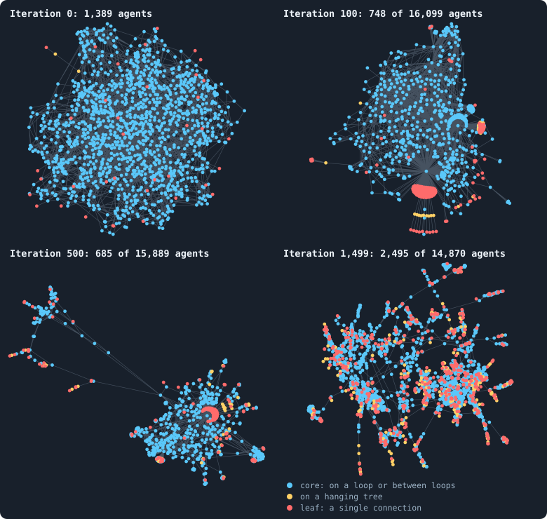
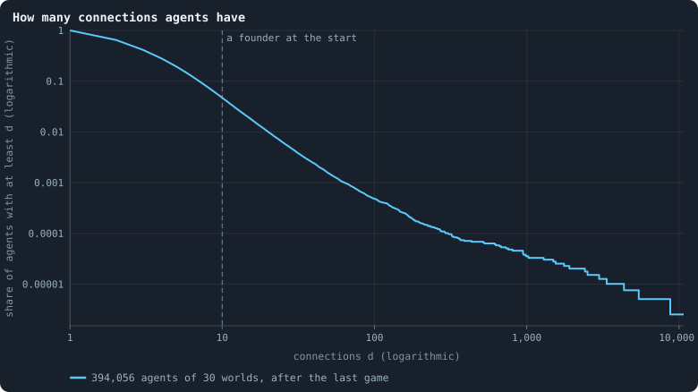
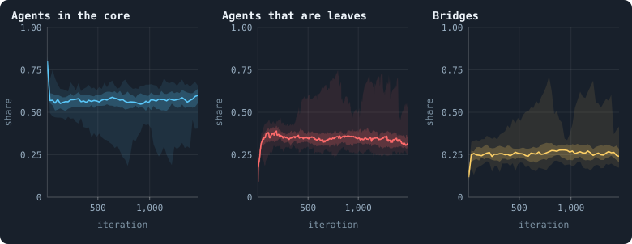
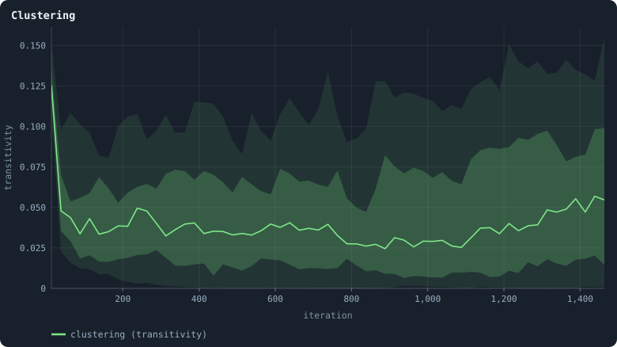
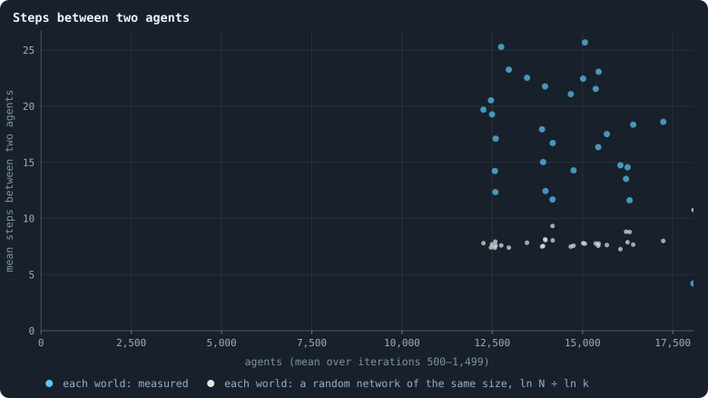

# What shape does the network take?

The founders start on a small-world ring ([The world: tokens, agents and a network](the-world.md)). From
then on the agents themselves make and lose every connection: a child is
joined to some of its parent's candidates, a parent may hand connections to
it, and every connection that carries no tokens in a game is cut at its end
([One iteration, step by step](one-iteration.md)). Nothing in the rules aims at any shape.
So what shape comes out?

> [!question] Questions of this page
> - What happens to the founders' ring?
> - How many connections does an agent have, and how unequally are they
>   spread?
> - Is the network a tree, a web, or something in between?
> - How far apart are two agents?

The worlds are the thirty of 100,000 tokens of [Thirty worlds](a-worlds-life.md#thirty-worlds);
the thirty of 10,000 tokens this page was first written from are given
beside them.

<!-- runs E10 -->
> [!info]- The runs behind this page
> **30 runs.** Every condition below is run once for every seed (1 to 30), for 1,500 iterations — or until its world dies out. Every setting is that of the baseline **B1** (the algorithm exactly as a new run is offered it) unless the condition changes it.
>
> - **baseline** — changes nothing: B1 as it is; 100,000 tokens. Runs `B1-100000-s001` … `B1-100000-s030`.
>
> To make these runs again: `python3 gol_lab.py run E10`, or ▶ in the Research Notebook tab of a computer running `gol_server.py`. Each run writes its settings, seed and engine version beside its frames, in `GraphOfLifeRuns/<run>/meta.json` and `provenance.json`.

> [!info]- Every setting of these runs
> | setting | baseline | what it is |
> |---|---|---|
> | [`total_tokens`](settings.md#total_tokens) | 100,000 | The number of tokens in the world, *T*. It never changes during a run. |
> | [`n_nodes`](settings.md#n_nodes) | 0 | How many founders the world starts with. 0 means one founder per hundred tokens: *n* = ⌊*T* / 100⌋. |
> | [`k_neighbors`](settings.md#k_neighbors) | 0 | How many neighbours each founder starts with in the ring. 0 means *k* = max(⌊*n* / 100⌋, 5); an odd *k* is wired as *k* − 1. |
> | [`rewire_p`](settings.md#rewire_p) | 0.2 | In the starting ring, the probability that a connection is moved to a founder chosen at random (Watts–Strogatz). |
> | [`hidden_layers`](settings.md#hidden_layers) | 50, 45, 40, 35, 30 | The widths of the brain's hidden layers, in order from input to output. |
> | [`brain_kind`](settings.md#brain_kind) | float16 | How weights are stored: `float` (64-bit), `float16` (16-bit, computed in 64-bit) or `binary` (−1, 0, +1). |
> | [`brain_bits`](settings.md#brain_bits) | 16 | Only for binary brains: how many input rows encode one number. Unused by float and float16 brains. |
> | [`message_amount`](settings.md#message_amount) | 30 | How many numbers one message holds. Each agent sends one message to itself and one to each neighbour, every phase. |
> | [`random_input_amount`](settings.md#random_input_amount) | 5 | How many random numbers, drawn uniformly from −2 to 2, a brain reads per neighbour, every time it looks. |
> | [`exchange_messages`](settings.md#exchange_messages) | on | Whether agents send and read messages at all. |
> | [`message_prepass`](settings.md#message_prepass) | on | Whether every phase begins with an extra look in which agents only write messages, so the look that acts reads messages written this phase. |
> | [`allow_handover`](settings.md#allow_handover) | on | Whether a parent may move some of its own connections to its newborn child. |
> | [`allow_revolutions`](settings.md#allow_revolutions) | on | Whether a coalition of smaller stakers can take a node from its largest staker (see the note *How a coalition takes a node*). |
> | [`allow_gifting`](settings.md#allow_gifting) | off | Whether agents may give tokens to neighbours during reproduction. Off in both baselines; on in a few pilots, in Experiment 24 and in half the worlds of the screen. |
> | [`random_decisions`](settings.md#random_decisions) | off | The control: every number a brain would produce is replaced by a random draw from the standard normal distribution. |
> | [`prune_after`](settings.md#prune_after) | blotto | After which phase connections that carried no tokens are cut: `blotto` (the game), `reproduction`, or `both`. |
> | [`inactive_window`](settings.md#inactive_window) | phase | How long a connection may go unused: `phase` means it must carry tokens in the phase being judged; `iteration` allows the two last phases. |
> | [`redistribution`](settings.md#redistribution) | uniform | How the tokens of removed agents are shared: `uniform` gives every survivor the same chance at each token; `by_tokens` weights by what a survivor holds; `poorest` raises the poorest to one common level first; `newborns` gives them to this iteration's children, `parents` to their parents, once per child (both `uniform` in an iteration without births); `children` leaves each dead agent's estate to its own living children (`uniform` where there are none). |
> | [`tokens_created_per_phase`](settings.md#tokens_created_per_phase) | 0 | Tokens added to the world at every cleanup. 0 keeps the supply fixed. |
> | [`mutate_on_replication`](settings.md#mutate_on_replication) | off | Whether a brain changes only when it is copied — into a newborn, or into a node its owner has just won — instead of also after every game, wherever it sits. |
> | [`incumbency`](settings.md#incumbency) | 1.0 | How many times over an agent's stake on its own node counts when the game decides who takes the node. 1 is the old rule. |
> | [`birth_links`](settings.md#birth_links) | 0 | How many of its parent's neighbours a newborn is joined to, drawn at random, besides its parent itself; 0 leaves every link to the brain's choice. |
> | [`mend_on_death`](settings.md#mend_on_death) | off | Whether the neighbours of an agent that dies are joined up where its death would leave them in separate pieces. |
> | [`prune_needs`](settings.md#prune_needs) | 0 | How many neighbours the two ends of an unused connection must share for it to be cut; 0 cuts every unused connection. |
> | [`valence`](settings.md#valence) | 0 | The most connections an agent's brain may choose to hold (0 = no limit). An agent at its limit cannot have a child. |
> | [`keep_home`](settings.md#keep_home) | 0.0 | The share of an agent's tokens — rounded up, never less than one — that stays on its own node whatever its brain says; a parent also keeps one. 0 is the old rule. |
> | [`max_age`](settings.md#max_age) | 0 | The age at which an agent dies (0 = never); its tokens are shared out like those of any other dead agent. |
> | [`buy_life`](settings.md#buy_life) | off | Whether an agent that has reached max_age may live on by paying one token an iteration into the estate of the dead — never its last, so one with a single token left dies. Needs max_age. |
> | [`min_child`](settings.md#min_child) | 1 | The fewest tokens a child can be born with; a parent that would give less has no child. |
> | [`child_floor`](settings.md#child_floor) | fixed | The least a child may start with: min_child alone (fixed), or also the median holding of its parent's neighbours (neighbours), so that a world grows only as rich as it is. |
> | [`mix_at_birth`](settings.md#mix_at_birth) | off | Whether a newborn's brain is its parent's mixed with a mate's — one of the parent's neighbours, drawn at random — each hidden unit whole from one or the other by an even chance, before it mutates; off, a newborn has a copy of its parent's brain. |
> | [`mix_mates`](settings.md#mix_mates) | any | Under mix_at_birth, who may be the mate: any neighbour of the parent, or only parents — a neighbour with a living child of its own (with none, the newborn's brain is a copy). |
> | [`self_message`](settings.md#self_message) | own | What an agent writes to itself, which each neighbour reads: what its own column says (own), or the largest, number by number, of what it writes to anyone (largest), so that news one column marks reaches every neighbour. |
> | [`link_search`](settings.md#link_search) | off | Whether an agent may reach beyond its neighbours to propose a link: off; jump, a walk as many steps long as the tokens it spends in one iteration, with a link proposed where it ends; walk, a scout that goes one step further in every iteration it pays for; or reach, a jump whose steps are free, as many as the tokens it holds would pay for. A paid step costs one token, paid to the agent it enters, and never the last. |
> | [`link_steering`](settings.md#link_steering) | random | Which way each step of a search goes: to a neighbour drawn at random, or to the one the searcher would most like a link with (looking). |
> | [`link_consent`](settings.md#link_consent) | mutual | Who has to agree to a link a search proposes: both ends (mutual), or only the one who proposes (forced). Nobody at its valence gets a new link either way. |
> | [`proto`](settings.md#proto) | none | Rules first played in the pilots' prototype, by name: came_from and helped_by (an input row each), contest = lottery, pool by genotype or family, kin_sense, tag_rate, mate_pays, grow, unit_token, link_token. Empty in every run but those that ask for one; only the prototype's world plays them (see the settings note). |
> | [`mutation_probability`](settings.md#mutation_probability) | 0.2 | The probability that a brain changes when it is copied to a child, and again, for every brain, after every game. |
> | [`mutation_noise_std`](settings.md#mutation_noise_std) | 0.2 | How large a change to one weight is: a normal draw with standard deviation this times 1/√(fan-in) of its layer. |
> | [`mutation_sparsity`](settings.md#mutation_sparsity) | 0.1 | The share of a brain's numbers a change touches; also the probability, for each weight matrix and bias vector, of a rarer reset that redraws that share of it. |
> | [`extinction_threshold`](settings.md#extinction_threshold) | 20 | A run stops, as extinct, when an iteration ends (after its game) with this many agents or fewer. |
> | seeds | 1 to 30 | one run per seed |
> | iterations | 1,500 | how far each run goes, unless its world dies first |
>
> A value in **bold** differs from the baseline B1.
<!-- /runs -->

## One world, four moments

<!-- figure shape/worlds -->

**One world at four moments.** The world with seed 1 after the games of iterations 0, 100, 500 and 1,499. Every agent alive is a dot, every connection a line (at iteration 0, every one of its 1,389 agents; at iteration 100, the 748 of its 16,099 agents within 2 steps of agent 415, the oldest, 100 iterations old — a piece, since a world this large is a tangle when drawn whole; at iteration 500, the 685 of its 15,889 agents within 10 steps of agent 424, the oldest, 500 iterations old — a piece, since a world this large is a tangle when drawn whole; at iteration 1,499, the 2,495 of its 14,870 agents within 25 steps of agent 660,973, the oldest, 806 iterations old — a piece, since a world this large is a tangle when drawn whole). Blue: agents in the core, which is what is left when agents with one connection or none are removed again and again until none remains ([Core, trees and leaves](core-trees-leaves.md)); yellow: the rest of the hanging trees; red: leaves, agents with a single connection. Where a dot is drawn means nothing in itself: a layout (networkx's ForceAtlas2, seed 1) pulls joined agents together and pushes the rest apart.

> [!example]- How to make this figure
> **Runs.** `B1-100000-s001`, one of the 30 baseline runs.
>
> **Data.** From each run's frames, `GraphOfLifeRuns/<run>/frames/`, read with `gol_store.read_frame(run, index)`; frame `2·t` is iteration *t* after reproduction and frame `2·t + 1` after the game.
>
> 1. Read frames `1`, `201`, `1001` and `2999` (iterations 0, 100, 500 and 1,499, after the game): `ids` and `edges`.
> 2. Peel: remove every agent with one connection or none, again and again, until none is left; the agents never removed are the core. Leaves are agents with exactly one connection.
> 3. In a world of more than 2,500 agents, keep the agents within r steps of the oldest agent, for the largest r that keeps at most 2,500 (`book_chapters.society.shown`).
> 4. Lay the graph out with `networkx.forceatlas2_layout(G, max_iter=200, seed=1)`.
>
> **To make it again:** `python3 book_figures.py shape`.
<!-- /figure -->

The pictures colour every agent by its place in the network
([Core, trees and leaves](core-trees-leaves.md)): blue for the
**core**, where every agent lies on a [loop](loops.md "A path through the network that comes back to where it started without using a connection twice.") or on a path between loops; red
for **leaves**, agents with a single connection; yellow for the agents in
between, on trees that hang off the core.

After the first game, the founders and their first children (1,389 agents)
still form one web — 97% of them in the core, the founders' ring with its
shortcuts. A hundred iterations later the world has 16,099 agents, too many
to draw: the picture holds the 748 within two steps of its oldest agent, and
the world has changed character — dense knots of core, joined by thin
strands, with leaves bunched at their ends. At iterations 500 and 1,499 it
looks the same in kind: more than half of all agents in the core (58% and
64% of the whole world), about a third or less leaves (36% and 29%).

## Connections per agent

<!-- figure shape/degree -->

**How many connections agents have.** Of all agents alive after the last game of the 30 worlds, the share that have at least d connections, for every d. At the start a founder had 10 on average (the grey line) — every one of them exactly that many before the ring's rewiring ([The starting ring](starting-ring.md)).

> [!example]- How to make this figure
> **Runs.** The 30 baseline runs `B1-100000-s001` … `B1-100000-s030`: the baseline B1 at 100,000 tokens, seeds 1 to 30, 1,500 iterations each (every setting is listed in [Thirty worlds](a-worlds-life.md#thirty-worlds)). They are made with `python3 gol_lab.py run E10`.
>
> **Data.** From each run's frames, `GraphOfLifeRuns/<run>/frames/`, read with `gol_store.read_frame(run, index)`; frame `2·t` is iteration *t* after reproduction and frame `2·t + 1` after the game.
>
> 1. Count every agent's connections in the last frame's `edges`; pool the 30 runs.
> 2. For d = 1, 2, …, the share of agents with at least d.
>
> **To make it again:** `python3 book_figures.py shape`.
<!-- /figure -->

The figure is a complementary cumulative distribution on logarithmic axes
([Degree](degree.md), [Logarithmic axes](logarithmic-axes.md)):
for every *d*, the share of agents with at least *d* connections. After the
last game of the thirty worlds, 35% of all agents have exactly one
connection and 23% two; the mean is 3.5. But 4.7% have ten or more, and the
curve reaches out to an agent with 10,735 — the centre of a [star](stars-and-hubs.md "An agent joined to far more agents than most; a star is a world held together by a single hub.")
([The largest and the smallest](the-largest-and-the-smallest.md)). Every founder started
with ten. (At 10,000 tokens: 37% and 23%, a mean of 3.2, 4% with ten or
more, the largest 1,399; the founders started with four.)

So the network is very unequal in connections: most agents have one or two,
a few are **hubs** joined to hundreds. The curve bends downward on the
log–log axes rather than running straight, so it is not a clean [power law](power-law-fit.md "A quantity whose frequency falls as a power of its size: few huge values, many small ones.").

## Core, leaves and bridges

<!-- figure shape/structure -->

**Core, leaves and bridges.** Three shares, after every game of the 30 baseline worlds. Left: the share of agents in the core ([Core, trees and leaves](core-trees-leaves.md)), measured every 25 iterations. Middle: the share of agents with exactly one connection, after every game. Right: the share of connections that are bridges ([Bridges](bridges.md)), every 25 iterations. In each, the line is the median of the worlds at each iteration, the darker band holds the middle half of them (from the 25th to the 75th percentile) and the paler band nine in ten (5th to 95th).

> [!example]- How to make this figure
> **Runs.** The 30 baseline runs `B1-100000-s001` … `B1-100000-s030`: the baseline B1 at 100,000 tokens, seeds 1 to 30, 1,500 iterations each (every setting is listed in [Thirty worlds](a-worlds-life.md#thirty-worlds)). They are made with `python3 gol_lab.py run E10`.
>
> **Data.** From each run's `GraphOfLifeRuns/<run>/stats.jsonl`, which holds one row per recorded phase: `phase` 1 is the world just after reproduction, `phase` 2 just after the game, and every statistic is a field of the row (see [What a run records](frames-and-stats.md)).
>
> 1. Take the rows with `phase` = 2 and the statistics `coreShare`, `leaves/nodes` and `bridges/edges` (`a/b` is the row's `a` divided by its `b`).
> 2. For `leaves/nodes`, make the band as for every other band ([Bands](bands.md)): cut the 1,500 iterations into 600 stretches of 2.5 and take each world's mean in each stretch.
> 3. For `coreShare` and `bridges/edges`, which are measured every 25 iterations, use stretches of 25.
>
> **To make it again:** `python3 book_figures.py shape`.
<!-- /figure -->

Three shares settle within the first hundred or so iterations and then hold
([Bridges](bridges.md)):

- **The core** holds 97% of the agents after the first game and settles
  near 57% (the [median](median-and-quantiles.md "The middle value: half of the numbers lie below it and half above.") world over iterations 500 to 1,499; between 19% and
  64% across the thirty worlds; 54% at 10,000 tokens).
- **Leaves** rise from 3% to about 35% of all agents (36%).
- **Bridges** — connections on no loop, whose cut would split the world —
  rise from 1% to about 26% of all connections (31%).

All three are counted after the game, when the connections that carried
nothing have just been cut. Counted at the start of a game, as
[The core of a world](the-core-of-a-world.md) does, the core holds 60% of the
agents and the leaves 32%.

The worlds at the far ends of these ranges are the stars: in the world with
[seed](random-numbers.md "The number that fixes every random choice of a run: the same settings and the same seed make the same world.") 28, whose largest hub is joined to more than half of all agents, only
19% of the agents are in the core, 72% are leaves, and 72% of the
connections are bridges.

## Clustering

<!-- figure shape/clustering -->

**Clustering.** Three times the number of triangles divided by the number of connected triples ([Clustering](clustering.md)), every 25 iterations. The founders' ring starts at 0.34 in the median world. The line is the median of the worlds at each iteration, the darker band holds the middle half of them (from the 25th to the 75th percentile) and the paler band nine in ten (5th to 95th).

> [!example]- How to make this figure
> **Runs.** The 30 baseline runs `B1-100000-s001` … `B1-100000-s030`: the baseline B1 at 100,000 tokens, seeds 1 to 30, 1,500 iterations each (every setting is listed in [Thirty worlds](a-worlds-life.md#thirty-worlds)). They are made with `python3 gol_lab.py run E10`.
>
> **Data.** From each run's `GraphOfLifeRuns/<run>/stats.jsonl`, which holds one row per recorded phase: `phase` 1 is the world just after reproduction, `phase` 2 just after the game, and every statistic is a field of the row (see [What a run records](frames-and-stats.md)).
>
> 1. Take the rows with `phase` = 2 and the statistic `transitivity`.
> 2. Bands as above, in stretches of 25.
>
> **To make it again:** `python3 book_figures.py shape`.
<!-- /figure -->

The founders' ring is clustered: about a third of the pairs of neighbours of
a founder are neighbours themselves (0.34; [Clustering](clustering.md)).
Within the first game that halves (0.17), and in a settled world it is 0.039
(between 0.002 and 0.114 across the thirty worlds) — half of the 0.075 of the
worlds of 10,000 tokens. That is low — but still more than a hundred times
what a random network of the same size would have (about 0.0002). There are triangles, and they are not there by chance: a child joined
both to its parent and to one of its parent's neighbours closes a triangle
the moment it is born.

## How far apart are two agents?

<!-- figure shape/distance -->

**Steps between two agents.** For each world (blue): its mean number of agents and the mean number of steps along connections from one agent to another, both averaged over iterations 500–1,499. Grey: the rough distance in a random network with the same number of agents N and connections per agent k, ln N / ln k.

> [!example]- How to make this figure
> **Runs.** The 30 baseline runs `B1-100000-s001` … `B1-100000-s030`: the baseline B1 at 100,000 tokens, seeds 1 to 30, 1,500 iterations each (every setting is listed in [Thirty worlds](a-worlds-life.md#thirty-worlds)). They are made with `python3 gol_lab.py run E10`.
>
> **Data.** From each run's `GraphOfLifeRuns/<run>/stats.jsonl`, which holds one row per recorded phase: `phase` 1 is the world just after reproduction, `phase` 2 just after the game, and every statistic is a field of the row (see [What a run records](frames-and-stats.md)).
>
> 1. Average `nodes`, `meanDegree` and `meanPathLength` over the rows with `phase` = 2 and 500 ≤ `iteration` ≤ 1,499 (`meanPathLength` is measured every 25 iterations, from breadth-first searches out of 8 to 16 evenly spread agents; [Path length](path-length.md)).
> 2. Plot one dot per run, and ln N / ln k for the same run.
>
> **To make it again:** `python3 book_figures.py shape`.
<!-- /figure -->

Two agents of a settled world are a median 17.7 steps apart
([Path length](path-length.md)), against about 7.8 in a random
network of the same number of agents and connections — 2.3 times as far,
where the worlds of 10,000 tokens were 1.6 times as far (9.8 steps against 6).
The worlds are stretched out: news, and tokens, take about eighteen games to
cross them. Among these thirty, the worlds with more agents are not longer:
across the worlds, from 12,300 to 18,100 agents, the
[correlation](correlation.md) between size and distance is −0.35,
and −0.18 without the seven stars, which are both large and short — every
agent of a star is two steps from every other through its centre (the
shortest, seed 28, 4.2 steps). Distances range from 12 to 26 steps among the
others, for reasons other than size.

## What was expected

Before the runs of 10,000 tokens, as Experiment 5:

<!-- runs E05 -->
> [!info]- The runs behind this page
> These are the runs of Experiment 2; nothing new was run for this page.
>
> **30 runs.** Every condition below is run once for every seed (1 to 30), for 3,000 iterations — or until its world dies out. Every setting is that of the baseline **B1** (the algorithm exactly as a new run is offered it) unless the condition changes it.
>
> - **baseline** — changes nothing: B1 as it is; 10,000 tokens. Runs `B1-10000-s001` … `B1-10000-s030`.
>
> To make these runs again: `python3 gol_lab.py run E02`, or ▶ in the Research Notebook tab of a computer running `gol_server.py`. Each run writes its settings, seed and engine version beside its frames, in `GraphOfLifeRuns/<run>/meta.json` and `provenance.json`.

> [!info]- Every setting of these runs
> | setting | baseline | what it is |
> |---|---|---|
> | [`total_tokens`](settings.md#total_tokens) | 10,000 | The number of tokens in the world, *T*. It never changes during a run. |
> | [`n_nodes`](settings.md#n_nodes) | 0 | How many founders the world starts with. 0 means one founder per hundred tokens: *n* = ⌊*T* / 100⌋. |
> | [`k_neighbors`](settings.md#k_neighbors) | 0 | How many neighbours each founder starts with in the ring. 0 means *k* = max(⌊*n* / 100⌋, 5); an odd *k* is wired as *k* − 1. |
> | [`rewire_p`](settings.md#rewire_p) | 0.2 | In the starting ring, the probability that a connection is moved to a founder chosen at random (Watts–Strogatz). |
> | [`hidden_layers`](settings.md#hidden_layers) | 50, 45, 40, 35, 30 | The widths of the brain's hidden layers, in order from input to output. |
> | [`brain_kind`](settings.md#brain_kind) | float16 | How weights are stored: `float` (64-bit), `float16` (16-bit, computed in 64-bit) or `binary` (−1, 0, +1). |
> | [`brain_bits`](settings.md#brain_bits) | 16 | Only for binary brains: how many input rows encode one number. Unused by float and float16 brains. |
> | [`message_amount`](settings.md#message_amount) | 30 | How many numbers one message holds. Each agent sends one message to itself and one to each neighbour, every phase. |
> | [`random_input_amount`](settings.md#random_input_amount) | 5 | How many random numbers, drawn uniformly from −2 to 2, a brain reads per neighbour, every time it looks. |
> | [`exchange_messages`](settings.md#exchange_messages) | on | Whether agents send and read messages at all. |
> | [`message_prepass`](settings.md#message_prepass) | on | Whether every phase begins with an extra look in which agents only write messages, so the look that acts reads messages written this phase. |
> | [`allow_handover`](settings.md#allow_handover) | on | Whether a parent may move some of its own connections to its newborn child. |
> | [`allow_revolutions`](settings.md#allow_revolutions) | on | Whether a coalition of smaller stakers can take a node from its largest staker (see the note *How a coalition takes a node*). |
> | [`allow_gifting`](settings.md#allow_gifting) | off | Whether agents may give tokens to neighbours during reproduction. Off in both baselines; on in a few pilots, in Experiment 24 and in half the worlds of the screen. |
> | [`random_decisions`](settings.md#random_decisions) | off | The control: every number a brain would produce is replaced by a random draw from the standard normal distribution. |
> | [`prune_after`](settings.md#prune_after) | blotto | After which phase connections that carried no tokens are cut: `blotto` (the game), `reproduction`, or `both`. |
> | [`inactive_window`](settings.md#inactive_window) | phase | How long a connection may go unused: `phase` means it must carry tokens in the phase being judged; `iteration` allows the two last phases. |
> | [`redistribution`](settings.md#redistribution) | uniform | How the tokens of removed agents are shared: `uniform` gives every survivor the same chance at each token; `by_tokens` weights by what a survivor holds; `poorest` raises the poorest to one common level first; `newborns` gives them to this iteration's children, `parents` to their parents, once per child (both `uniform` in an iteration without births); `children` leaves each dead agent's estate to its own living children (`uniform` where there are none). |
> | [`tokens_created_per_phase`](settings.md#tokens_created_per_phase) | 0 | Tokens added to the world at every cleanup. 0 keeps the supply fixed. |
> | [`mutate_on_replication`](settings.md#mutate_on_replication) | off | Whether a brain changes only when it is copied — into a newborn, or into a node its owner has just won — instead of also after every game, wherever it sits. |
> | [`incumbency`](settings.md#incumbency) | 1.0 | How many times over an agent's stake on its own node counts when the game decides who takes the node. 1 is the old rule. |
> | [`birth_links`](settings.md#birth_links) | 0 | How many of its parent's neighbours a newborn is joined to, drawn at random, besides its parent itself; 0 leaves every link to the brain's choice. |
> | [`mend_on_death`](settings.md#mend_on_death) | off | Whether the neighbours of an agent that dies are joined up where its death would leave them in separate pieces. |
> | [`prune_needs`](settings.md#prune_needs) | 0 | How many neighbours the two ends of an unused connection must share for it to be cut; 0 cuts every unused connection. |
> | [`valence`](settings.md#valence) | 0 | The most connections an agent's brain may choose to hold (0 = no limit). An agent at its limit cannot have a child. |
> | [`keep_home`](settings.md#keep_home) | 0.0 | The share of an agent's tokens — rounded up, never less than one — that stays on its own node whatever its brain says; a parent also keeps one. 0 is the old rule. |
> | [`max_age`](settings.md#max_age) | 0 | The age at which an agent dies (0 = never); its tokens are shared out like those of any other dead agent. |
> | [`buy_life`](settings.md#buy_life) | off | Whether an agent that has reached max_age may live on by paying one token an iteration into the estate of the dead — never its last, so one with a single token left dies. Needs max_age. |
> | [`min_child`](settings.md#min_child) | 1 | The fewest tokens a child can be born with; a parent that would give less has no child. |
> | [`child_floor`](settings.md#child_floor) | fixed | The least a child may start with: min_child alone (fixed), or also the median holding of its parent's neighbours (neighbours), so that a world grows only as rich as it is. |
> | [`mix_at_birth`](settings.md#mix_at_birth) | off | Whether a newborn's brain is its parent's mixed with a mate's — one of the parent's neighbours, drawn at random — each hidden unit whole from one or the other by an even chance, before it mutates; off, a newborn has a copy of its parent's brain. |
> | [`mix_mates`](settings.md#mix_mates) | any | Under mix_at_birth, who may be the mate: any neighbour of the parent, or only parents — a neighbour with a living child of its own (with none, the newborn's brain is a copy). |
> | [`self_message`](settings.md#self_message) | own | What an agent writes to itself, which each neighbour reads: what its own column says (own), or the largest, number by number, of what it writes to anyone (largest), so that news one column marks reaches every neighbour. |
> | [`link_search`](settings.md#link_search) | off | Whether an agent may reach beyond its neighbours to propose a link: off; jump, a walk as many steps long as the tokens it spends in one iteration, with a link proposed where it ends; walk, a scout that goes one step further in every iteration it pays for; or reach, a jump whose steps are free, as many as the tokens it holds would pay for. A paid step costs one token, paid to the agent it enters, and never the last. |
> | [`link_steering`](settings.md#link_steering) | random | Which way each step of a search goes: to a neighbour drawn at random, or to the one the searcher would most like a link with (looking). |
> | [`link_consent`](settings.md#link_consent) | mutual | Who has to agree to a link a search proposes: both ends (mutual), or only the one who proposes (forced). Nobody at its valence gets a new link either way. |
> | [`proto`](settings.md#proto) | none | Rules first played in the pilots' prototype, by name: came_from and helped_by (an input row each), contest = lottery, pool by genotype or family, kin_sense, tag_rate, mate_pays, grow, unit_token, link_token. Empty in every run but those that ask for one; only the prototype's world plays them (see the settings note). |
> | [`mutation_probability`](settings.md#mutation_probability) | 0.2 | The probability that a brain changes when it is copied to a child, and again, for every brain, after every game. |
> | [`mutation_noise_std`](settings.md#mutation_noise_std) | 0.2 | How large a change to one weight is: a normal draw with standard deviation this times 1/√(fan-in) of its layer. |
> | [`mutation_sparsity`](settings.md#mutation_sparsity) | 0.1 | The share of a brain's numbers a change touches; also the probability, for each weight matrix and bias vector, of a rarer reset that redraws that share of it. |
> | [`extinction_threshold`](settings.md#extinction_threshold) | 20 | A run stops, as extinct, when an iteration ends (after its game) with this many agents or fewer. |
> | seeds | 1 to 30 | one run per seed |
> | iterations | 3,000 | how far each run goes, unless its world dies first |
>
> A value in **bold** differs from the baseline B1.
<!-- /runs -->

<!-- thesis E05 -->
> [!quote] The thesis of Experiment 5, written down before any of its runs existed
> **The claim.** The small-world ring the founders start on is gone within a hundred iterations, and what replaces it is thin and tree-like: more than a fifth of all connections are bridges — connections on no loop — clustering stays below 0.1, and less than half of all agents sit in the core where every agent is on some loop.
>
> **Why it would be so.** A new connection can only be made at birth, between a newborn and its parent's neighbourhood, and any connection that carries no tokens in a game is cut at its end — a new one included. Nothing ever joins distant parts of the world, so the long-range shortcuts of the starting ring are a budget that is only spent. Children hang off their parents like leaves off a branch.
>
> **It holds if:** From iteration 100 on, the median share of connections that are bridges is above 0.2, the median clustering is below 0.1, and the median core share is below 0.5, across the thirty runs.
>
> **It fails if:** The graph keeps or rebuilds loops: bridges below a tenth of connections, or clustering above 0.2, or a core holding most agents. Then something in the rules closes loops, and the picture of a world as a tree of families is wrong.
<!-- /thesis -->

The thesis was checked, as planned, from iteration 100 on. It holds in three
of its four clauses: the ring is gone almost at once; more than a fifth of
all connections are bridges (a median of 32%, more than a fifth in every one
of the 26 worlds); and clustering stays below 0.1 (a median of 0.077; above
0.2 in no world). It fails in the fourth: the core holds about half of all
agents (a median of 53%, less than half in only 6 of the 26 worlds), not
less. Over the [settled life](settled-life.md "A world from iteration 500 to its end, after its youth, where it is measured."), from iteration 500 on, the numbers are almost
the same: 31%, 0.075 and 54%. So the thesis is **refuted**, narrowly, on its
last clause.

**At 100,000 tokens**, checked the same way from iteration 100 on, it is
refuted again on the same clause, more clearly. Bridges are a median 26% of
all connections, more than a fifth in every one of the thirty worlds;
clustering is 0.043, above 0.1 in one world and above 0.2 in none; but the
core holds a median 57% of all agents, less than half in only 5 of the 30.
A larger world is, if anything, more of a web.

## What this means

A world is **part tree, part web**: a core of loops holding more than half
the agents, with trees hanging off it — the leaves alone are a third of all
agents — long enough that a token needs about eighteen games to cross it,
and fragile, with a quarter of all connections bridges. At a tenth of the
size it was half tree and half web, and ten games across.

For anything larger than an agent that might evolve — groups of agents that
hold together while their members change (P3 in
[What this notebook is about](what-this-notebook-is-about.md)) — the core is where it can live:
the only part of the world where a group is joined by more than one path, so
that losing one connection does not cut it in two.

The measurements of the [baseline](b1-and-b2.md "The stated rules an experiment starts from and changes one thing of: B1 or B2.") found the mechanism behind this shape, and measured it against a
sharper null. A child is joined to part of its parent's neighbourhood, so the
world grows only locally, by copying: that gives hubs whose connections grow
with their connections, a triangle for nearly every connection a hub gains,
and clustering that falls as one over the number of connections — a
**hierarchy of stars**, with leaves hanging on hubs
([Power laws, real and apparent](power-laws-real-and-apparent.md),
[How properties scale together](how-properties-scale-together.md)). Against a random network
with exactly the same number of connections at every agent, the world is four
and a half times as long (twice at 10,000 tokens), and its [spectral gap](spectral-gap.md "How hard a network is to cut into two halves, and how fast a walker on it forgets where it began.") —
which says how hard a network is to cut into two large parts — is a
thirty-third of the random network's: the world has bottlenecks
([The geometry of a world](the-geometry-of-a-world.md)). And it breaks, when it breaks,
along its poorest regions ([How a world breaks](how-a-world-breaks.md)).

To make every figure of this page: `python3 book_figures.py shape`.

<!-- turns -->
---

[The shape and health of the network](../README.md#the-shape-and-health-of-the-network) · [The core of a world](the-core-of-a-world.md) →

> [!info]- Pages that link here (15)
> [What B1 is, and what stood in its way](what-the-baseline-world-is.md) · [The life of a B1 world](a-worlds-life.md) · [How much does the seed decide?](how-much-does-the-seed-decide.md) · [How births build the network](how-agents-have-children.md) · [How unequal is a world, and who stays rich](where-do-the-tokens-go.md) · [The core of a world](the-core-of-a-world.md) · [How a world breaks](how-a-world-breaks.md) · [Degree](degree.md) · [Stars and hubs](stars-and-hubs.md) · [Clustering](clustering.md) · [Path length](path-length.md) · [Core, trees and leaves](core-trees-leaves.md) · [Bridges](bridges.md) · [One world, many colours](one-world-many-colours.md) · [Every simulation: what was run, and what was measured](every-simulation.md)
<!-- /turns -->
