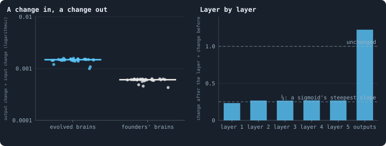
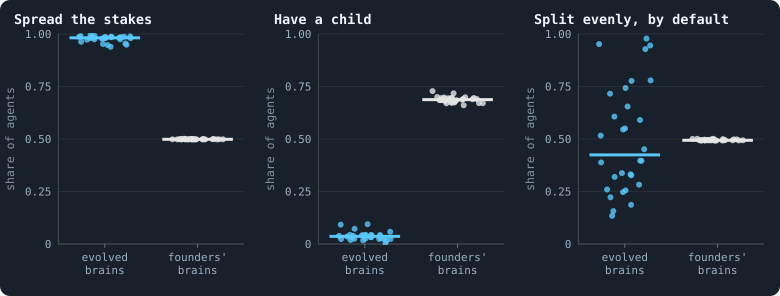
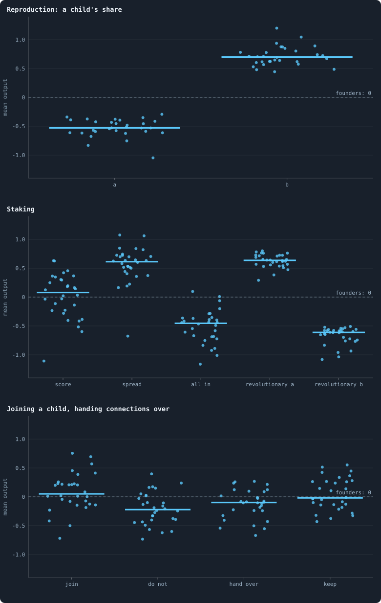
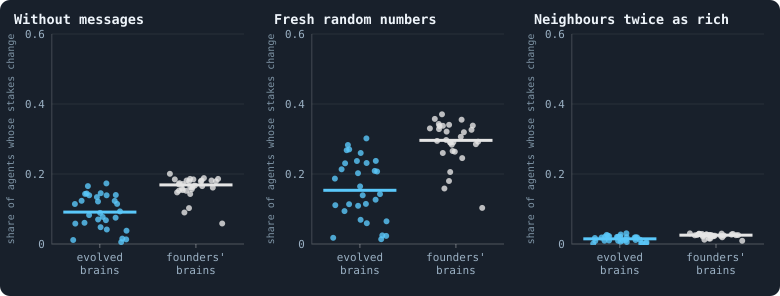
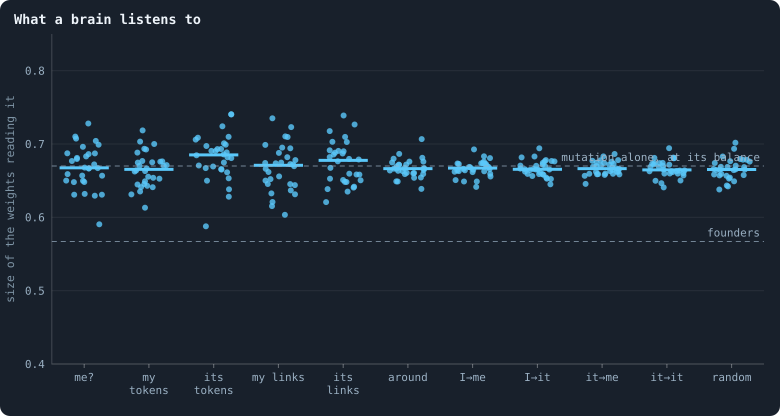
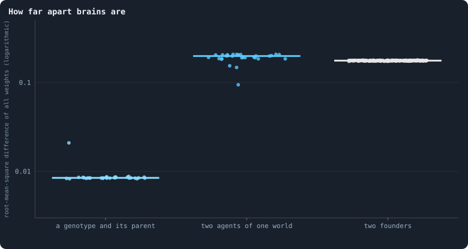

# What the brains are like

> [!question] Questions of this page
> - Does what a brain sees reach what it does?
> - Which decisions did evolution change, and in which direction?
> - Which of its inputs does a brain listen to — its own wealth, its
>   [neighbour](the-world.md#the-network "An agent joined to another by a connection.")'s, the [messages](messages.md "Numbers an agent writes to itself and to each neighbour every phase, which their brains read."), or the noise?
> - How different are the brains of one world from each other?

## In short

Every [agent](the-world.md#agents-and-tokens "One member of a world: it lives on a node of the network, holds tokens and has a brain that takes all its decisions.") decides with a brain of 15,795 numbers, and we tested the brains
of thirty [B1](b1-and-b2.md "The first baseline: the algorithm exactly as a new run is offered it.") worlds at the end of their runs. They are nearly blind: a change
in what a brain sees reaches what it does about a thousand times smaller.
Selection still changed them, the same way in every world: no children, the
stake spread, every [token](the-world.md#agents-and-tokens "The one thing of value in a world: every agent holds a whole number of them, and their total never changes.") marked revolutionary. But it changed only these
constant tendencies, which do not depend on the situation. The rest of a brain
drifts freely, so two brains of one world are about as far apart as two drawn
at random.

## How a brain is examined

An agent's brain is a small neural network that takes all its decisions
([The brain](the-brain.md)). It is 15,795 numbers, and by the end of a run
they have been copied, changed and selected for 1,500 [iterations](one-iteration.md "One step of a world's time: a phase of reproduction, then a phase of the game."). What has
that made of them? Do the brains react to what they see? What did selection
change, and what did it leave alone?

A brain cannot be read like a text: its numbers mean nothing one by one. But
what it *does* can be tested, the way a physiologist tests a nerve. Give it an
input and measure the response. Then change the input, and measure again.

Exactly: we take each of the thirty worlds as its last [game](one-iteration.md#phase-2-the-game "The second phase of an iteration: every agent stakes all its tokens on its own node and its neighbours', and every node goes to someone.") left it. We
rebuild every agent's view exactly as the [engine](the-lab.md "The program that runs an experiment's plan as runs, each on a frozen copy of the engine, the code that plays a world.") does: one column of 154
inputs per [candidate](one-iteration.md#phase-1-reproduction "An agent itself and each of its neighbours, the ones its brain looks at when it decides.") ([What a brain sees](brain-inputs.md)). Then we run the
agent's own brain on it. After that, we change the inputs, or the brain, and
run it again.

The comparison that matters most is a **fresh [founder](starting-ring.md "One of the agents a world starts with, each holding the same tokens, on a ring with a few shortcuts.")'s brain**, given exactly
the same inputs. Its weights are drawn as for the founders of a world: normal,
with standard deviation 1/√*k*. Here *k* is the number of inputs of the layer,
its fan-in. Its biases are 0. A founder's brain shows what the architecture
does before any selection. Whatever the evolved brains do differently, 1,500
iterations of copying, changing and conquering did.

The worlds are the thirty B1 worlds of 100,000 tokens of
[Thirty worlds](a-worlds-life.md#thirty-worlds). This page was first written
from thirty worlds of 10,000 tokens; where those differ, both are given.

## Does a brain see what it is shown?

Picture five people in a row, each repeating what they hear at a quarter of
the loudness. A shout at one end arrives at the other as a whisper, a
thousandth as loud. A brain of B1 is such a row: what it sees passes through
five hidden layers before it decides.

To measure this, move every input a little, and see how much the outputs move.
The ratio of the two is the brain's **gain**: the root-mean-square change of
the outputs over the root-mean-square change of the inputs. The root mean
square of a set of changes is their typical size: the square root of the mean
of their squares. A gain of 1 passes every change on at its own size. A gain
of 0 ignores the inputs entirely.

<!-- figure minds/gain -->

**How much of what a brain sees reaches what it does.** Left: for 300 agents of each world, every one of the 154 inputs of each of its columns moved by a small random amount (normal, standard deviation 0.1), and the root-mean-square change of the 45 outputs divided by that of the inputs — the brain's gain; one dot per world, the median of its agents, for the agents' own brains (blue) and for a fresh founder's brain — weights drawn as for the founders of a world, normal with standard deviation 1/√(fan-in), biases 0 — given exactly the same inputs (grey). Right: the same ratio layer by layer for the evolved brains, the median over worlds: each of the five hidden layers ends in a sigmoid, the last is linear.

> [!example]- How to make this figure
> **Runs.** The 30 baseline worlds that lived to the end.
>
> **Data.** From the final checkpoint of each run, `GraphOfLifeRuns/<run>/checkpoint.npz`, read with `gol_store.load_checkpoint(run, config)`: the world after its last iteration, every living agent's brain and every message in flight.
>
> 1. For every agent of the world with at least one token, its inputs exactly as the engine builds them for a look at its candidates (`World._precompute_features` and `World._inputs`), and its brain's outputs (`Brain.forward`); the decisions follow by the engine's own rules (`_apportion` for the stakes, `_share_of_first` for a child's share).
> 2. Draw ε, normal with standard deviation 0.1, the shape of the input matrix X; the gain is RMS(forward(X + ε) − forward(X)) / RMS(ε). The same after each layer for the layer-by-layer ratios (`book_chapters.inner.gain`).
>
> **To make it again:** `python3 book_figures.py minds`.
<!-- /figure -->

The gain of an evolved brain is **0.0015** (the thirty worlds: 0.0010 to
0.0016; the same at 10,000 tokens). So a change of 1 in every input moves the
outputs by about a seven-hundredth. A founder's brain passes on even less,
0.0006.

The right panel shows where the signal goes. Each of the five hidden layers
passes a change on at about a quarter of its size (0.23 to 0.27). Only the
last layer, which is linear, passes it on whole, even a little enlarged
(1.23). Five quarters multiply to (¼)⁵ ≈ 0.001.

This is not an accident of these worlds; it is built into the brain. Every
hidden layer ends in a sigmoid, an S-shaped squashing whose slope is at most
¼. And the founders' weights are scaled to keep the sums the same size from
layer to layer, not to make them larger. A five-layer sigmoid network started
that way is close to blind. Deep learning met this problem when its networks
first grew deep, and called it the **vanishing gradient**
([How a signal fades through layers](the-brain.md#how-a-signal-fades-through-layers)).

After 1,500 iterations the gain is 2.4 times a founder's; whether selection
or mutation alone raised it, these brains cannot tell. But a gain of a
thousandth raised 2.4 times is still a thousandth.

So what does a nearly blind brain compute? Its biases and the average activity
of its layers set it. It computes almost the same thing for every candidate,
in every situation. The rest of the page shows what that means for its
decisions.

## What evolution changed

Give an evolved brain and a founder's brain the same inputs, and compare what
they decide. The figure shows three decisions: whether to spread the stake,
whether to have a child, and whether the rules end up splitting the stake
evenly.

<!-- figure minds/decisions -->

**What evolution changed.** One dot per world: of its agents with a token or more at the end, the share whose brain would spread its stakes rather than go all in; the share that would have a child (a share of its tokens of at least one token); and the share whose every stake score is zero or below, so that the rules split its tokens evenly over all its candidates. Blue: the agents' own brains; grey: a fresh founder's brain — weights drawn as for the founders of a world, normal with standard deviation 1/√(fan-in), biases 0 — given exactly the same inputs.

> [!example]- How to make this figure
> **Runs.** The 30 baseline worlds that lived to the end.
>
> **Data.** From the final checkpoint of each run, `GraphOfLifeRuns/<run>/checkpoint.npz`, read with `gol_store.load_checkpoint(run, config)`: the world after its last iteration, every living agent's brain and every message in flight.
>
> 1. For every agent of the world with at least one token, its inputs exactly as the engine builds them for a look at its candidates (`World._precompute_features` and `World._inputs`), and its brain's outputs (`Brain.forward`); the decisions follow by the engine's own rules (`_apportion` for the stakes, `_share_of_first` for a child's share).
> 2. Spread: the mean of the two BLOTTO_MODE outputs over the columns, first larger than second. Child: ⌊f(ā, b̄) · tokens⌋ ≥ 1 with ā, b̄ the REPRO_FRACTION outputs averaged over the columns. Even by default: every BLOTTO score ≤ 0 (`book_chapters.inner.probe`).
>
> **To make it again:** `python3 book_figures.py minds`.
<!-- /figure -->

The two kinds of brain decide very differently:

- **Children.** A founder's brain would have a child in 69% of cases. An
  evolved brain would in **3.6%** (the worlds: 0.5% to 9%; 2.6% at 10,000
  tokens). That fits the 3.5 births per hundred agents in each reproduction
  phase of [Births, deaths and ages](births-deaths-and-ages.md). Selection has
  all but abolished reproduction.
- **Spreading the stake.** A founder's brain spreads its tokens over its
  candidates half the time, and goes all in on one the other half. An evolved
  brain spreads in **98%** of cases. That fits the 98% of
  [How the game is played](how-the-game-is-played.md).
- **Splitting evenly.** In the [median](median-and-quantiles.md "The middle value: half of the numbers lie below it and half above.") world, **42%** of agents give every
  candidate a score of zero or below. The rules then split their tokens
  exactly evenly
  ([Splitting tokens into whole numbers](largest-remainder.md)). This is not
  something selection made: founders' brains, on the same inputs, do so in 49%
  of cases. The worlds differ enormously here, from 13% to 98% (58% in the
  median world of 10,000 tokens, from 3% to 97%). In a world where it is 98%,
  almost every stake is the [even split](even-split.md "What the rules do when a brain scores no candidate above zero: the stake is spread evenly."), decided by the rules and not by the
  brain.

The outputs behind these decisions show where selection pushed. Each decision
of a brain is read from a pair of outputs, or from one
([The brain](the-brain.md)). A founder's brain averages 0 on every one of
them.

<!-- figure minds/outputs -->

**Where selection pushed.** One dot per world: the mean, over its agents and their columns, of each of the brain's outputs that make decisions ([The brain](the-brain.md)). A founder's brain averages 0 on every one of them (the dashed line). A child's share is f(a, b), the share of the positive part of a in the positive parts of a and b ([The share function](share-function.md)): a below 0 and b above it means no child. Likewise for the revolutionary part of a stake; spread or all in follows whichever of its two outputs is larger.

> [!example]- How to make this figure
> **Runs.** The 30 baseline worlds that lived to the end.
>
> **Data.** From the final checkpoint of each run, `GraphOfLifeRuns/<run>/checkpoint.npz`, read with `gol_store.load_checkpoint(run, config)`: the world after its last iteration, every living agent's brain and every message in flight.
>
> 1. For every agent of the world with at least one token, its inputs exactly as the engine builds them for a look at its candidates (`World._precompute_features` and `World._inputs`), and its brain's outputs (`Brain.forward`); the decisions follow by the engine's own rules (`_apportion` for the stakes, `_share_of_first` for a child's share).
> 2. For each agent, the mean over its columns of output rows 0–14 (`World.heads`: REPRO_FRACTION 0–1, LINK 2–3, LINK_MODE 4–5, BLOTTO 6, BLOTTO_MODE 7–8, REV_FRACTION 9–10, HANDOVER 11–12, HANDOVER_MODE 13–14); then the mean over agents.
>
> **To make it again:** `python3 book_figures.py minds`.
<!-- /figure -->

In the evolved worlds:

- The two outputs of **a child's share**, *a* and *b*, sit at −0.53 and +0.70.
  The share function *f*(*a*, *b*) gives 0 whenever *a* is negative and *b*
  positive ([The share function](share-function.md)), so there is no child.
  Every one of the thirty worlds has *a* below 0 and *b* above it.
- **Spread** beats **all in**, +0.61 against −0.45.
- The **revolutionary share** is the part of a stake that may join smaller
  stakes against a node's largest staker
  ([How a coalition takes a node](revolution.md)). Its two outputs sit at
  +0.64 and −0.61. The first is above 0 and the second below it in every
  world. So nearly every staked token is marked revolutionary: 97%
  ([How the game is played](how-the-game-is-played.md)).
- The outputs for joining a child to a candidate, and for handing it
  [connections](the-world.md#the-network "A link between two agents of the network: they are neighbours, and can stake on each other's nodes."), lean towards joining and keeping in most worlds. But many
  worlds lean the other way. These outputs are used only when a child is born,
  which is now rare, so selection on them is weak.

The **stake score** is the one output that could say *this* candidate rather
than *that* one. It sits near zero: +0.08 in the median world, and from −1.1
to +0.6 across the worlds. With a gain of a thousandth, it is nearly the same
for every candidate. So a brain whose scores are positive also splits its
stake nearly evenly.

So selection acted, and it acted the same way in every world. But it acted on
**constants**: have no children, spread the stake, make every token
revolutionary. None of these depends on the situation. They are a strategy,
not a behaviour.

## What changes a decision

If brains react so little, how often does anything they see change what they
do? Take the stakes, the decision every agent makes in every game. Change one
thing about what the brain reads, and see whether its stakes change at all.

<!-- figure minds/sensitivity -->

**What changes a decision.** One dot per world: the share of its agents whose stakes would differ at all if one thing about their inputs were different — every message they read set to 0; the five random numbers of every column drawn again; or every neighbour's tokens, as the agent sees them, doubled. Blue: the agents' own brains; grey: a fresh founder's brain — weights drawn as for the founders of a world, normal with standard deviation 1/√(fan-in), biases 0 — given exactly the same inputs.

> [!example]- How to make this figure
> **Runs.** The 30 baseline worlds that lived to the end.
>
> **Data.** From the final checkpoint of each run, `GraphOfLifeRuns/<run>/checkpoint.npz`, read with `gol_store.load_checkpoint(run, config)`: the world after its last iteration, every living agent's brain and every message in flight.
>
> 1. For every agent of the world with at least one token, its inputs exactly as the engine builds them for a look at its candidates (`World._precompute_features` and `World._inputs`), and its brain's outputs (`Brain.forward`); the decisions follow by the engine's own rules (`_apportion` for the stakes, `_share_of_first` for a child's share).
> 2. Change the inputs — rows 29–148 set to 0; rows 149–153 drawn again, uniform on (−2, 2); row 2 of every neighbour's column replaced by ln(1 + 2·(e^x − 1)) — and decide again; count the agents whose shares of stake differ in any candidate.
>
> **To make it again:** `python3 book_figures.py minds`.
<!-- /figure -->

- **Every message set to 0.** The stakes of 9.1% of agents change (the
  founders' brains: 17%).
- **The five random numbers of every column drawn again.** The stakes of 15%
  change (30%).
- **Every neighbour twice as rich**, as the agent sees it. The stakes of
  **1.5%** change (2.5%).

In the worlds of 10,000 tokens, the three were 6.7%, 11% and 1.0%.

Two things stand out. First, evolved brains are *less* sensitive than
founders' brains, although their gain is larger. Their habits make them so. A
founder's brain goes all in half the time, on whichever candidate scores
highest. With scores this close, almost any change can make another candidate
the highest. An evolved brain spreads its stake, and a spread changes only
when the rounding of a token tips. And in the median world 42% of the evolved
agents (58% at 10,000 tokens) give every candidate a score of zero or below.
Their even split cannot change at all, unless a score is pushed above zero.

Second, the random numbers change more stakes than a doubling of the
neighbours' wealth. The brain reads tokens on a logarithmic scale, so a
doubling moves one input by ln 2 ≈ 0.7. Five fresh numbers drawn from −2 to 2
move the inputs further than that. And a brain that weighs all its inputs
alike cannot tell information from noise.

## What a brain listens to

Does a brain weigh all its inputs alike? Its first layer can tell. Each input
is read by a column of 50 weights, one for each unit of the first layer. The
length of that column says how loudly the input speaks to the rest of the
brain. It is the square root of the sum of its squared weights.

<!-- figure minds/listen -->

**What a brain listens to.** For each group of the brain's inputs ([What a brain sees](brain-inputs.md)) — whether the candidate is the agent itself; the agent's and the candidate's tokens and connections; the summaries of both neighbourhoods (around); the four messages, from writer to reader (I→me is what the agent wrote to itself, it→me what the candidate wrote to it, and so on); and the random numbers — the size of the first layer's weights that read it: for each input, the length of its column of 50 weights, averaged over the inputs of the group and the agents of the world; one dot per world. Lower dashed line: the same for founders' brains. Upper: what the changes of [How a brain changes](mutation.md) alone would bring every weight to, whatever it reads — its jitters adding variance, its resets drawing weights back — at the balance of the two.

> [!example]- How to make this figure
> **Runs.** The 30 baseline worlds that lived to the end.
>
> **Data.** From the final checkpoint of each run, `GraphOfLifeRuns/<run>/checkpoint.npz`, read with `gol_store.load_checkpoint(run, config)`: the world after its last iteration, every living agent's brain and every message in flight.
>
> 1. Read the first weight matrix W0 (agents × 50 × 154) from the checkpoint; for each input the norm of its column; average within each group of inputs and over agents.
> 2. Mutation alone: each change jitters a weight with probability 0.1 by a normal amount of variance 0.2²/k and redraws it with probability 0.1 · 0.1 from variance 1/k; the variance v at balance satisfies v = 0.99 (v + 0.004/k) + 0.01/k, so v = 1.396/k: √1.396 = 1.18 times a founder's.
>
> **To make it again:** `python3 book_figures.py minds`.
<!-- /figure -->

Every group of inputs is read by weights of the same size, about **0.67**.
That holds for the agent's own tokens, for the candidate's connections, for
the messages, and for the five random numbers. Founders' brains read every
input with 0.57, since 50 weights of standard deviation 1/√154 have a length
of √(50/154) = 0.57.

The 0.67 is not a choice of selection either: mutation alone sets it. Think of
a bath with the tap running and the plug a little loose. The water settles at
the level where what runs in equals what drains out. Each change of a brain
adds a little variance to its weights: that is the jitter. And now and then it
draws a weight afresh from the founders' distribution: that is the reset
([How a brain changes](mutation.md)). The jitter runs in, and the reset
drains.

Exactly: write *v* for the variance of a weight in a layer of fan-in *k*. A
founder's weight has *v* = 1/*k*. One change jitters a weight with probability
0.1, by a normal amount of variance 0.2²/*k*. On average that adds 0.004/*k*,
0.4% of the founders' variance. The change also redraws one weight in a
hundred, on average, from the founders' distribution. That takes away 1% of
the excess over the founders' variance. So after one change, 99 weights in 100
keep what the jitter left them, and 1 in 100 has the variance 1/*k* again. The
level stops moving when the two balance:

$$
v = 0.99\,\bigl(v + 0.004/k\bigr) + 0.01/k, \qquad \text{so} \qquad v = 1.396/k .
$$

In words: the variance settles at 1.40 times the founders'. Then the column of
50 weights has a length of √1.40 × 0.57 = 0.67, for every input alike. So the
first layer of an evolved brain is what mutation makes of any matrix. Nothing
of selection is visible in it.

## How far apart the brains are

How different are the brains of one world? Measure the difference between two
brains as the root mean square of the differences of all their 15,795 numbers.

<!-- figure minds/apart -->

**How far apart brains are.** The difference between two brains: the root mean square of the differences of all their 15,795 numbers (weights and biases). Left: a genotype and its parent genotype, where both are alive at the end of a world — one change apart; one dot per world, the median of its pairs. Middle: two agents drawn at random from one world; one dot per world, the median of 3,000 pairs. Right: two fresh founders' brains, one dot per pair (200 pairs).

> [!example]- How to make this figure
> **Runs.** The 30 baseline worlds that lived to the end.
>
> **Data.** From the final checkpoint of each run, `GraphOfLifeRuns/<run>/checkpoint.npz`, read with `gol_store.load_checkpoint(run, config)`: the world after its last iteration, every living agent's brain and every message in flight.
>
> 1. Concatenate every weight matrix and bias vector of a brain into one vector of 15,795 numbers; the difference of two brains is the root mean square of the difference of their vectors (`book_chapters.inner.weights`).
>
> **To make it again:** `python3 book_figures.py minds`.
<!-- /figure -->

- A [genotype](genotype.md "The identity of a brain: a number that a copy keeps and a change replaces, and that remembers the genotype it came from.") and its parent are **0.0085** apart: one change.
- Two agents drawn at random from one world are **0.20** apart (the worlds:
  0.09 to 0.21).
- Two founders, drawn independently, are 0.18 apart (0.176): less than two
  brains of one world.

The last two numbers fit together. Mutation has spread every number out to
√1.40 times the founders' spread ([above](#what-a-brain-listens-to)). Two
brains drawn independently with that spread would be √1.40 × 0.176 = 0.21
apart. In the worlds of 10,000 tokens, two agents of one world were 0.18
apart. In a smaller world, two agents share an ancestor more recently
([Worlds of 100,000 tokens](how-does-a-worlds-size-follow-its-tokens.md#worlds-of-100000-tokens)).

So in their numbers, the brains of one world are nearly as different from each
other as brains drawn independently. Yet they agree on every decision that
matters: no children, spread, revolutionary. The gain shows how both can be
true. Nearly all of a brain's numbers barely touch what it does, so selection
cannot hold them, and they drift. Selection holds only the numbers that set
the brain's constant tendencies: the biases, and the weights that turn the
layers' average activity into outputs. In the language of molecular evolution,
most of a brain is **neutral** (Kimura 1968): it changes freely because
nothing depends on it.

## When the brains were given sight

If blindness is built into the brain, the remedy is in the architecture too.
Three changes would each give a brain a gain near 1
([How a signal fades through layers](the-brain.md#how-a-signal-fades-through-layers)). They are fewer
layers, a squashing with a steeper slope, and larger starting weights.

The first of these was tried on the way to [B2](b1-and-b2.md "The second baseline: B1 with the rules that keep its network from breaking and its agents from staking or breeding themselves to death.").
[Brains that see, and worlds that break](a-world-that-cannot-break.md#brains-that-see-and-worlds-that-break)
gave the brains one hidden layer of 16 units. That gives a founder a gain of
about 0.2. And the worlds broke. At 5,000 tokens, four of ten worlds died out,
and eight of ten when brains also change only when copied. None of the ten B1
worlds did. So sight needed a world that cannot break, and B2 is that world.

How long does evolution go on, with blind brains and with seeing ones? In B1,
not long. Its blind brains beat their founders by iteration 50. After that, no
[era](eras-and-contests.md "Brains of a world at two moments, its eras, played against each other: do the later ones win?") beats the one before
([How to tell a world that keeps evolving](how-to-tell-a-world-that-keeps-evolving.md)).
In B2, whose brains see, contests of 20 iterations at first showed the same:
no gain after a few hundred iterations. Contests as long as an agent's life,
100 iterations, show more. The brains of iteration 2,000 beat those of
iteration 500 in all ten B2 worlds of Experiment 16. In three worlds played on
further, the gains went on, more and more slowly, to about iteration 5,000
([Why evolution stops](how-to-tell-a-world-that-keeps-evolving.md#why-evolution-stops)).
What runs out there is the search, not the game: a strategy written by hand
took half of one evolved world
([Strategies written by hand](strategies-written-by-hand.md)).

The other remedies await a page still to come, *How big should a brain be?*

## What we learned

- **The brains are nearly blind.** A brain's outputs move by a thousandth of a
  change in its inputs. What an agent does is set by its brain's constant
  tendencies, almost regardless of its situation, its neighbours, or what they
  say to it.
- **Evolution has worked, on constants.** Every world was pushed the same way:
  reproduction nearly abolished, stakes spread, every token revolutionary.
  These are the strategies a world of nearly identical agents converges to.
  They are a point in a space of a few dimensions, and once that point is
  found, there is nowhere further to go.
- **This is the first obstacle to [open-ended evolution](open-ended-test.md "Evolution that keeps producing new things without end, not only up to a plateau.").** Novelty that keeps
  coming needs behaviour that depends on circumstances. A brain that reacts to
  who its neighbour is can find a new way to treat a new kind of neighbour.
  That creates a new niche for someone else. A brain that cannot see has only
  its constants to vary.
  [What the measurements say about open-ended evolution](what-the-baseline-world-is.md#what-the-measurements-say-about-open-ended-evolution)
  lists the obstacles. This one comes first, because it limits all the others.
- **The remedy is in the architecture, but it is not enough alone.** Brains
  with one hidden layer see, and under B1's other rules they broke the worlds.
  In B2, built not to break, seeing brains go on evolving, more and more
  slowly. [Do the brains matter?](do-the-brains-matter.md) replaces the brains
  by chance. Read in the light of this page, it says that B1's brains do
  matter, but as constants.

## Where to go next

- [What agents say to each other](what-agents-say-to-each-other.md): why the
  messages of a nearly blind brain are names, not news.
- [How a signal fades through layers](the-brain.md#how-a-signal-fades-through-layers): why a deep network
  of sigmoids is nearly blind, and the usual remedies.
- [Brains that see, and worlds that break](a-world-that-cannot-break.md#brains-that-see-and-worlds-that-break):
  what happened when the brains were given sight.
- [Does evolution keep going?](how-to-tell-a-world-that-keeps-evolving.md):
  how long evolution goes on, with blind brains and with seeing ones.

## How this was made

Every figure of this page reads the final checkpoint of each of the thirty
runs of Experiment 10, listed below. A checkpoint holds the world after its
last iteration: every living agent's brain, and every message in flight.
`python3 book_figures.py minds` draws every figure. Each figure says, folded
beneath it, which runs it reads and how.

The numbers given for worlds of 10,000 tokens come from the thirty runs of
Experiment 2, `B1-10000-s001` … `-s030`, made with
`python3 gol_lab.py run E02`. When this page was first written, the 26 of them
that lived to the end of their 3,000 iterations were read the same way.

<!-- runs E10 -->
> [!info]- The runs behind this page
> **30 runs.** Every condition below is run once for every seed (1 to 30), for 1,500 iterations — or until its world dies out. Every setting is that of the baseline **B1** (the algorithm exactly as a new run is offered it) unless the condition changes it.
>
> - **baseline** — changes nothing: B1 as it is; 100,000 tokens. Runs `B1-100000-s001` … `B1-100000-s030`.
>
> To make these runs again: `python3 gol_lab.py run E10`, or ▶ in the Research Notebook tab of a computer running `gol_server.py`. Each run writes its settings, seed and engine version beside its frames, in `GraphOfLifeRuns/<run>/meta.json` and `provenance.json`.

> [!info]- Every setting of these runs
> | setting | baseline | what it is |
> |---|---|---|
> | [`total_tokens`](settings.md#total_tokens) | 100,000 | The number of tokens in the world, *T*. It never changes during a run. |
> | [`n_nodes`](settings.md#n_nodes) | 0 | How many founders the world starts with. 0 means one founder per hundred tokens: *n* = ⌊*T* / 100⌋. |
> | [`k_neighbors`](settings.md#k_neighbors) | 0 | How many neighbours each founder starts with in the ring. 0 means *k* = max(⌊*n* / 100⌋, 5); an odd *k* is wired as *k* − 1. |
> | [`rewire_p`](settings.md#rewire_p) | 0.2 | In the starting ring, the probability that a connection is moved to a founder chosen at random (Watts–Strogatz). |
> | [`hidden_layers`](settings.md#hidden_layers) | 50, 45, 40, 35, 30 | The widths of the brain's hidden layers, in order from input to output. |
> | [`hidden_activation`](settings.md#hidden_activation) | sigmoid | The curve each hidden unit applies to its sum: `sigmoid`, which passes on at most a quarter of a change, so that deep brains barely respond to what they see, or `tanh`, the same S-shape centred on zero, through which a change still passes in several layers. |
> | [`brain_kind`](settings.md#brain_kind) | float16 | How weights are stored: `float` (64-bit), `float16` (16-bit, computed in 64-bit) or `binary` (−1, 0, +1). |
> | [`brain_bits`](settings.md#brain_bits) | 16 | Only for binary brains: how many input rows encode one number. Unused by float and float16 brains. |
> | [`message_amount`](settings.md#message_amount) | 30 | How many numbers one message holds. Each agent sends one message to itself and one to each neighbour, every phase. |
> | [`random_input_amount`](settings.md#random_input_amount) | 5 | How many random numbers, drawn uniformly from −2 to 2, a brain reads per neighbour, every time it looks. |
> | [`exchange_messages`](settings.md#exchange_messages) | on | Whether agents send and read messages at all. |
> | [`message_prepass`](settings.md#message_prepass) | on | Whether every phase begins with an extra look in which agents only write messages, so the look that acts reads messages written this phase. |
> | [`allow_handover`](settings.md#allow_handover) | on | Whether a parent may move some of its own connections to its newborn child. |
> | [`allow_revolutions`](settings.md#allow_revolutions) | on | Whether a coalition of smaller stakers can take a node from its largest staker (see the note *How a coalition takes a node*). |
> | [`contest`](settings.md#contest) | largest | Who takes a contested node: the `largest` stake as the game weighs it, or a staker drawn by `lottery` with a chance in proportion to its stake (needs revolutions off). |
> | [`allow_gifting`](settings.md#allow_gifting) | off | Whether agents may give tokens to neighbours during reproduction. Off in both baselines; on in a few pilots, in Experiment 24 and in half the worlds of the screen. |
> | [`random_decisions`](settings.md#random_decisions) | off | The control: every number a brain would produce is replaced by a random draw from the standard normal distribution. |
> | [`prune_after`](settings.md#prune_after) | blotto | After which phase connections that carried no tokens are cut: `blotto` (the game), `reproduction`, or `both`. |
> | [`inactive_window`](settings.md#inactive_window) | phase | How long a connection may go unused: `phase` means it must carry tokens in the phase being judged; `iteration` allows the two last phases. |
> | [`redistribution`](settings.md#redistribution) | uniform | How the tokens of removed agents are shared: `uniform` gives every survivor the same chance at each token; `by_tokens` weights by what a survivor holds; `poorest` raises the poorest to one common level first; `newborns` gives them to this iteration's children, `parents` to their parents, once per child (both `uniform` in an iteration without births); `children` leaves each dead agent's estate to its own living children (`uniform` where there are none); `local` lets each estate flow through the network to the nearest living agents, split evenly at every step. |
> | [`tokens_created_per_phase`](settings.md#tokens_created_per_phase) | 0 | Tokens added to the world at every cleanup. 0 keeps the supply fixed. |
> | [`mutate_on_replication`](settings.md#mutate_on_replication) | off | Whether a brain changes only when it is copied — into a newborn, or into a node its owner has just won — instead of also after every game, wherever it sits. |
> | [`incumbency`](settings.md#incumbency) | 1.0 | How many times over an agent's stake on its own node counts when the game decides who takes the node. 1 is the old rule. |
> | [`birth_links`](settings.md#birth_links) | 0 | How many of its parent's neighbours a newborn is joined to, drawn at random, besides its parent itself; 0 leaves every link to the brain's choice. |
> | [`mend_on_death`](settings.md#mend_on_death) | off | Whether the neighbours of an agent that dies are joined up where its death would leave them in separate pieces. |
> | [`prune_needs`](settings.md#prune_needs) | 0 | How many neighbours the two ends of an unused connection must share for it to be cut; 0 cuts every unused connection. |
> | [`valence`](settings.md#valence) | 0 | The most connections an agent's brain may choose to hold (0 = no limit). An agent at its limit cannot have a child. |
> | [`link_token`](settings.md#link_token) | off | Whether every link holds one token: its maker pays for it, a lapsing link gives it back to one of its ends, and a link of a dead agent to the end that lives on, so the links can never outnumber the tokens. |
> | [`link_upkeep`](settings.md#link_upkeep) | off | Whether an agent may pay a token an iteration to keep a link, each brain deciding for each neighbour: `paid_or_used` keeps a link that was paid for or used, `paid_only` only one that was paid for; `off`, only use keeps a link. |
> | [`upkeep_to`](settings.md#upkeep_to) | end | Where a link's upkeep goes: to the link's other end (`end`), or into the estate of the dead (`estate`), shared out by the world's redistribution rule. |
> | [`keep_home`](settings.md#keep_home) | 0.0 | The share of an agent's tokens — rounded up, never less than one — that stays on its own node whatever its brain says; a parent also keeps one. 0 is the old rule. |
> | [`max_age`](settings.md#max_age) | 0 | The age at which an agent dies (0 = never); its tokens are shared out like those of any other dead agent. |
> | [`buy_life`](settings.md#buy_life) | off | Whether an agent that has reached max_age may live on by paying one token an iteration into the estate of the dead — never its last, so one with a single token left dies. Needs max_age. |
> | [`min_child`](settings.md#min_child) | 1 | The fewest tokens a child can be born with; a parent that would give less has no child. |
> | [`child_floor`](settings.md#child_floor) | fixed | The least a child may start with: min_child alone (fixed), or also the median holding of its parent's neighbours (neighbours), so that a world grows only as rich as it is. |
> | [`mix_at_birth`](settings.md#mix_at_birth) | off | Whether a newborn's brain is its parent's mixed with a mate's — one of the parent's neighbours, drawn at random — each hidden unit whole from one or the other by an even chance, before it mutates; off, a newborn has a copy of its parent's brain. |
> | [`mix_mates`](settings.md#mix_mates) | any | Under mix_at_birth, who may be the mate: any neighbour of the parent, or only parents — a neighbour with a living child of its own (with none, the newborn's brain is a copy). |
> | [`mate_pays`](settings.md#mate_pays) | off | Under mix_at_birth, whether the mate pays the child as many tokens as the parent gave it, as far as it can and never its last. |
> | [`self_message`](settings.md#self_message) | own | What an agent writes to itself, which each neighbour reads: what its own column says (own), or the largest, number by number, of what it writes to anyone (largest), so that news one column marks reaches every neighbour. |
> | [`link_search`](settings.md#link_search) | off | Whether an agent may reach beyond its neighbours to propose a link: off; jump, a walk as many steps long as the tokens it spends in one iteration, with a link proposed where it ends; walk, a scout that goes one step further in every iteration it pays for; or reach, a jump whose steps are free, as many as the tokens it holds would pay for. A paid step costs one token, paid to the agent it enters, and never the last. |
> | [`link_steering`](settings.md#link_steering) | random | Which way each step of a search goes: to a neighbour drawn at random, or to the one the searcher would most like a link with (looking). |
> | [`link_consent`](settings.md#link_consent) | mutual | Who has to agree to a link a search proposes: both ends (mutual), or only the one who proposes (forced). Nobody at its valence gets a new link either way. |
> | [`proto`](settings.md#proto) | none | Rules first played in the pilots' prototype, by name: came_from and helped_by (an input row each), contest = lottery, pool by genotype or family, kin_sense, tag_rate, mate_pays, grow, unit_token, link_token. Empty in every run but those that ask for one; only the prototype's world plays them (see the settings note). |
> | [`mutation_probability`](settings.md#mutation_probability) | 0.2 | The probability that a brain changes when it is copied to a child, and again, for every brain, after every game. |
> | [`mutation_noise_std`](settings.md#mutation_noise_std) | 0.2 | How large a change to one weight is: a normal draw with standard deviation this times 1/√(fan-in) of its layer. |
> | [`mutation_sparsity`](settings.md#mutation_sparsity) | 0.1 | The share of a brain's numbers a change touches; also the probability, for each weight matrix and bias vector, of a rarer reset that redraws that share of it. |
> | [`extinction_threshold`](settings.md#extinction_threshold) | 20 | A run stops, as extinct, when an iteration ends (after its game) with this many agents or fewer. |
> | seeds | 1 to 30 | one run per seed |
> | iterations | 1,500 | how far each run goes, unless its world dies first |
>
> A value in **bold** differs from the baseline B1.
<!-- /runs -->

## How our view changed

- **14 October 2026.** The page listed splitting evenly among the decisions in
  which evolved brains and founders' brains differ. On 11 October it was read
  again from the worlds of 100,000 tokens. Yet one paragraph still said that
  more than half of the evolved agents score every candidate at zero or below.
  That was the 58% of the worlds of 10,000 tokens. In the median world of
  100,000 tokens it is 42%. Founders' brains given the same inputs do it in
  49% of cases, so selection did not make the even split.
- **14 October 2026.** From 9 October, this page said that the remedy for
  blind brains is in the architecture, and that a page trying it should come
  early. Fewer layers were tried first: one hidden layer of 16 gave the brains
  sight, and the worlds broke
  ([Brains that see, and worlds that break](a-world-that-cannot-break.md#brains-that-see-and-worlds-that-break)).
  Sight needed a world that cannot break, and B2 was built to be one. A note
  added that day said that seeing brains, in worlds that cannot break, stop
  improving within a few hundred iterations too. It proposed that the limit
  lies in the game rather than in the brain, a reading Experiment 16 was to
  test.
- **15 October 2026.** Both halves of that reading were corrected. Contests
  as long as an agent's life showed that evolution in B2 had not stopped.
  The brains of iteration 2,000 beat those of 500 in all ten worlds of
  Experiment 16. And a strategy written by hand took half of one evolved
  world, so the game has better play left. What runs out is the search
  ([Why evolution stops](how-to-tell-a-world-that-keeps-evolving.md#why-evolution-stops)).
  This page took both in on 23 October 2026.

<!-- turns -->
---

← [Genotypes and lineages](genotypes-and-lineages.md) · [Brains, and how alike agents are](../README.md#brains-and-how-alike-agents-are) · [What agents say to each other](what-agents-say-to-each-other.md) →

> [!info]- Pages that link here (26)
> [What this notebook is about](what-this-notebook-is-about.md) · [One iteration, step by step](one-iteration.md) · [The brain](the-brain.md) · [Every setting](settings.md) · [The share function f(a, b)](share-function.md) · [What a brain sees](brain-inputs.md) · [What a brain says](brain-outputs.md) · [How a brain changes](mutation.md) · [What B1 is, and what stood in its way](what-the-baseline-world-is.md) · [The life of a B1 world](a-worlds-life.md) · [Building B2: a world that cannot break](a-world-that-cannot-break.md) · [How the game is played: what agents stake, and who wins the nodes](how-the-game-is-played.md) · [The even split](even-split.md) · [Where tokens flow](where-the-tokens-flow.md) · [Physical inspiration](physical-inspiration.md) · [Worlds of many sizes](how-does-a-worlds-size-follow-its-tokens.md) · [How alike the agents are](how-alike-the-agents-are.md) · [Genotypes and lineages](genotypes-and-lineages.md) · [What agents say to each other](what-agents-say-to-each-other.md) · [Do the brains matter?](do-the-brains-matter.md) · [How different are the agents?](how-different-are-the-agents.md) · [Does evolution keep going?](how-to-tell-a-world-that-keeps-evolving.md) · [A hundred thousand iterations](a-hundred-thousand-iterations.md) · [Do agents cooperate? Help, kin and partners](do-agents-cooperate.md) · [Gliders, and who helps whom](gliders-and-who-helps-whom.md) · [Brains mixed at birth, units that cost, an eye for raids on kin](mixed-brains-costly-units.md)
<!-- /turns -->
