# What the switches did in pilots (indicative)

> [!question] Questions of this page
> - Most experiments threw the notebook's rules into B2 one at a time. What does a rule do when other rules are thrown in with it?
> - The notebook has thrown its switches into B2 one at a time. What does each do when several are thrown together?
> - The engine of Graph of Life came with switches of its own. Does any of them keep evolution going?
> - Mixing [brains](the-brain.md "The neural network each agent decides with: inputs about itself and its neighbours, outputs that become its decisions.") at birth made B2's worlds smaller, richer and more diverse. Does it still, whatever else the rules say?
> - When an [agent](the-world.md#agents-and-tokens "One member of a world: it lives on a node of the network, holds tokens and has a brain that takes all its decisions.") dies, its [tokens](the-world.md#agents-and-tokens "The one thing of value in a world: every agent holds a whole number of them, and their total never changes.") go back to the world. Does it matter who gets them?
> - If an agent can reach past its [neighbours](the-world.md#the-network "An agent joined to another by a connection.") and propose a link to someone it does not know, does it?
> - If a newborn's brain is mixed from its parent's and a neighbour's, the way sexual reproduction mixes genes, does evolution find more?

## In short

Pilot worlds tried the engine's switches in October 2026, alone and in company.
Read them as indicative, not as effects: they are two seeds a condition, mostly
1,000 [iterations](one-iteration.md "One step of a world's time: a phase of reproduction, then a phase of the game."), on B2. The exceptions are few. Batches U and V played sixteen
worlds of one seed each. Batches Q and R played 2,000 iterations. Batch V and a
few other conditions played B1. What still bears on the question is this. What
a rule does alone is often not what it does in company. Rules that reshape the
network, or set a world's size, do so in any company. Judged a lifetime long,
later brains beat earlier ones in nearly every B2 world, whatever the switches:
they change only how fast. And no combination made a world that is both healthy
and rich.

It gathers what were 7 pages of their own, one section each:

- [Rules in company](#rules-in-company): Most experiments threw one rule at a time into B2.
- [Eight switches at once, and how sixteen worlds can test them](#eight-switches-at-once-and-how-sixteen-worlds-can-test-them): Most experiments threw one switch at a time into B2, the baseline whose network cannot break.
- [Revolutions, handover and gifts: the switches the world was built with](#revolutions-handover-and-gifts-the-switches-the-world-was-built-with): The engine of Graph of Life came with three switches of its own.
- [Brains mixed at birth, with every other rule](#brains-mixed-at-birth-with-every-other-rule): Mixing a newborn's brain from its parent's and a neighbour's makes B2's worlds rich, because agents put off having children.
- [Who inherits?](#who-inherits): When an agent dies, the [cleanup](one-iteration.md#cleanup "The end of every phase: only the largest connected piece of the network lives on, and the tokens of the dead are shared out.") shares its tokens out among the survivors: until now evenly, every survivor with the same chance at every token.
- [Links to strangers](#links-to-strangers): Agents of B2 were given a way to look for a stranger and propose a link.
- [Brains mixed at birth, units that cost, an eye for raids on kin](#brains-mixed-at-birth-units-that-cost-an-eye-for-raids-on-kin): Three changes to B2 were tried in pilot worlds, each aimed at a different part of how evolution works.

## Rules in company

Most experiments threw one rule at a time into B2. Six pilot batches threw
them in together: four paired one rule with each of the others, and two threw
eight in at once. What a rule does alone is often not what it does in
company, because rules act together about as strongly as alone. Rules of rare
events change almost nothing anywhere. Rules that reshape the network, or set
a world's size, do so in any company. Evolution went on in 174 of 198 worlds
on B2, and no combination started it again on B1. And no combination reached
the author's picture: every rule that keeps a world a space pays for it in
some other way.

### Why rules in company

A doctor who knows what each of two medicines does still does not know what
the two do together. One can weaken the other, or make it dangerous. Rules are
the same. A rule thrown into B2 alone shows what it does to B2, and only to
B2.

Most of the notebook's experiments asked exactly that: what one rule does to
B2. In October 2026 the author asked for the rules in combination, and six
pilot batches answered:

| batch | what it plays | page |
|---|---|---|
| Y | brains mixed at birth, with each other rule in turn | [Brains mixed at birth, with every other rule](what-the-switches-did-in-pilots.md#brains-mixed-at-birth-with-every-other-rule) |
| W | no revolutions, with each other rule in turn | [Revolutions, with every other rule](what-the-switches-did-in-pilots.md#revolutions-with-every-other-rule) |
| X | handover, with each other rule in turn | [Handover, with every other rule](what-the-switches-did-in-pilots.md#handover-with-every-other-rule) |
| T | gifts, with each other rule in turn | [Gifts, with every other rule](what-the-switches-did-in-pilots.md#gifts-with-every-other-rule) |
| U | eight rules at once, in sixteen worlds on B2 | [Eight switches at once](what-the-switches-did-in-pilots.md#eight-switches-at-once-and-how-sixteen-worlds-can-test-them) |
| V | the same eight rules, in sixteen worlds on B1 | [Eight switches at once](what-the-switches-did-in-pilots.md#eight-switches-at-once-and-how-sixteen-worlds-can-test-them) |

Every world is a pilot of 10,000 tokens, played for 1,000 iterations. The four
batches of pairs have two seeds each, and the two of eight switches one. Every
world was read the same way at iteration 1,000. This page gathers what they
say together.

### Alone is not in company

The plainest lesson is a warning. **What a rule does alone in B2 is often not
what it does among other rules.**

- **Mixing's riches.** Alone, brains mixed at birth take a third to a half of
  B2's agents out of poverty. Paired with one other rule, the riches survive
  sixteen of 23 companions
  ([Brains mixed at birth, with every other rule](what-the-switches-did-in-pilots.md#brains-mixed-at-birth-with-every-other-rule)).
  Among the sixteen worlds of batch U, with four rules on in most, they all
  but vanish ([Eight switches at once](what-the-switches-did-in-pilots.md#eight-switches-at-once-and-how-sixteen-worlds-can-test-them)). There
  mixing takes only 0.07 off the share of the poor, on average.
- **What undoes them.** The estate paid to the newborns or the parents undoes
  them, because it pays for births. So does handover, with 48 and 32 more
  poor agents in every hundred
  ([Handover, with every other rule](what-the-switches-did-in-pilots.md#handover-with-every-other-rule)).
  Gifts undo them a little: 11 and 17 more
  ([Gifts, with every other rule](what-the-switches-did-in-pilots.md#gifts-with-every-other-rule)).
- **What they need.** Without revolutions, mixed worlds grow, and grow poor
  ([Revolutions, with every other rule](what-the-switches-did-in-pilots.md#revolutions-with-every-other-rule)).
- **Gifts' speed.** Alone, gifts made B2's brains of 1,000 beat those of 500
  more clearly than in B2 itself. With another rule as well, they did no more
  than B2 does
  ([Gifts, with every other rule](what-the-switches-did-in-pilots.md#gifts-with-every-other-rule)).
- **Three more.** Links that hold a token take 0.29 and 0.33 off B2's share
  of the poor alone, and 0.06 among the sixteen. Every unused link lapsing
  halves its fall in [dimension](measuring-space.md#three-ways-to-measure-a-networks-dimension "How fast the number of agents within a distance grows with the distance: as its square in a plane, its cube in space."). And no revolutions on B1 does not do in
  company what it does alone.

Why? Because rules act together. Batch U can measure the effects of two rules
acting jointly, in chains of pairs it reads in sums of four. These chains are
as large as most single rules' effects
([Eight switches at once](what-the-switches-did-in-pilots.md#eight-switches-at-once-and-how-sixteen-worlds-can-test-them)). A rule measured alone
tells what it does in B2. To know what it does in general, it has to be met
in company.

### Three kinds of rules

**Rules of rare events are details.** Revolutions win about one node in three
hundred a [game](one-iteration.md#phase-2-the-game "The second phase of an iteration: every agent stakes all its tokens on its own node and its neighbours', and every node goes to someone.") in B2: a median of 0.24 per hundred agents an iteration. Gifts
move one to four thousandths of the tokens a game. Switching either changes
almost nothing, whatever else the rules are. Over their 24 and 21 companions,
the median change in the share of the poor is +0.002 for both. The exceptions
are the worlds where these events are common, or count. In mixed worlds,
small and rich, revolutions are five to ten times as common, and hold the
world small.

**Rules that reshape the network do so everywhere.** Handover costs two marks
of the health bar with nearly every companion. It thins the network into trees
on single links, and unfolds it a little
([Handover, with every other rule](what-the-switches-did-in-pilots.md#handover-with-every-other-rule)).
Every unused link lapsing makes worlds rich, small and about two-dimensional,
and costs marks too ([Eight switches at once](what-the-switches-did-in-pilots.md#eight-switches-at-once-and-how-sixteen-worlds-can-test-them),
[What folds a world](how-many-dimensions-does-a-world-have.md#what-folds-a-world)).

**Rules that set a world's size set it in any company.**

- The estate of the dead paid to the newborns or the parents fills a world.
  It adds about 1,000 agents among the sixteen on B2, and 1,400 on B1. It makes
  the world poorer and its agents more alike, on both baselines, alone and in
  company ([Who inherits?](what-the-switches-did-in-pilots.md#who-inherits),
  [Eight switches at once](what-the-switches-did-in-pilots.md#eight-switches-at-once-and-how-sixteen-worlds-can-test-them)).
- Links that hold a token shrink it.
- Who mates sets it too. With only parents as mates, all ten mixed worlds of
  Experiment 19 settled at about 2,000 agents
  ([Mixed at birth, with parents as mates](building-b2-and-the-search-for-a-healthy-rich-world.md#who-may-be-a-mate)).

A world's size is set by how eagerly its agents breed, as
[What holds a world's size](building-b2-and-the-search-for-a-healthy-rich-world.md#what-holds-a-worlds-size) found. These are the
rules that change that.

### Does evolution go on? (rules in company)
Play the brains of iteration 1,000 against those of 500, over an agent's
lifetime. **The later brains win in 174 of the 198 worlds** of the five
batches on B2. The medians differ by batch:

- 0.69 with mixing;
- 0.64 without revolutions, and with gifts;
- 0.60 among the sixteen of batch U;
- 0.57 with handover;
- against 0.68 for B2's ten worlds alone.

It goes slowest with no old age, with the estate to the newborns, and with the
last token kept at home. It goes fastest with brain units that hold a token,
and with brains that grow. No combination stopped it outright, and none made
it run away.

**On B1, no combination starts it again.** Among the sixteen worlds of batch
V, the later brains won in six of the fourteen that lived, with a median of
0.46. That is as in B1 itself. Its brains of 1,000 held a median of 0.49
against those of 500
([How to tell a world that keeps evolving](how-to-tell-a-world-that-keeps-evolving.md)).
No switch moved that beyond the wide spread of the chains of pairs. Not even
two of B2's own rules did: brains that change only when copied, and parents
that keep their links ([Eight switches at once](what-the-switches-did-in-pilots.md#eight-switches-at-once-and-how-sixteen-worlds-can-test-them)).

### Nearer the author's picture?

The author's picture is a world with four things at once
([Healthy and rich](building-b2-and-the-search-for-a-healthy-rich-world.md#healthy-and-rich)):

- it is a space of about three dimensions;
- no single loss can cut its network;
- its agents are many-sided;
- and its tokens are not held too evenly, almost everyone holding the same
  few.

None of these combinations is all of that. The best of the sixteen on B2 has
no revolutions, no random inputs, links that hold a token and mixing. It
meets every mark of the health bar, with a quarter of its agents poor and a
diversity score of 0.68. But its network is folded. A typical agent reaches
half the world in 1.19 times the steps its [random twin](measuring-space.md#the-random-twin-is-a-world-a-space "A network with the same agents and as many links each, wired at random: what a world would be if it were no space at all.") needs. That is as in
nearly every B2 world
([What folds a world](how-many-dimensions-does-a-world-have.md#what-folds-a-world)).

Read together at iteration 1,000, 161 of the 466 worlds measured then are
spaces: at least half again as wide as their random twins
(`research/atlas/census.py`). All but eleven have one of five rules. Each rule
pays for the room in its own coin. The table gives the medians of the worlds
that are spaces:

| rule | worlds that are spaces | agents with 3 tokens or fewer | Gini of the tokens | diversity score | marks (of 7) | dimension |
|---|---|---|---|---|---|---|
| the estate of the dead paid to births | 33 | 90% | 0.45 | 0.37 | 7 | 3.5 |
| no old age | 22 | 93% | 0.58 | 0.27 | 7 | 3.4 |
| handover | 25 | 79% | 0.60 | 0.53 | 4 | 3.8 |
| every unused link lapsing | 26 | 7% | 0.25 | 0.42 | 4 | 2.2 |
| deaths not mended, as in B1 | 44 | 51% | 0.39 | 0.66 | 4 | 2.6 |

To read it, take B2's own lines at iteration 1,000
([What makes a world interesting](measuring-health.md#the-lines-we-compare-with)).
B2's median world has a diversity score of 0.53. Its most even world has a
Gini of 0.49, and its ten worlds read 0.49 to 0.56. A random exchange of
tokens would leave 0.33 to 0.42 at two to four tokens per agent.

- **The estate paid to births, and no old age**, fill a world with the poor.
  Their tokens are not held evenly: 0.45 and 0.58, more than a random
  exchange leaves. What they miss is diversity: 0.37 and 0.27.
- **Handover's** tokens are no more even than B2's (0.60), and its diversity
  is that of B2's median world (0.53). It misses marks: its network hangs on
  single links.
- **Every unused link lapsing** leaves a world rich. But its tokens are held
  evenly, 0.25, where a random exchange would leave 0.46 at its seven tokens
  per agent. It is also about two-dimensional, and short of marks.
- **Deaths not mended** leave the agents diverse (0.66), but their tokens
  fairly even (0.39), and the network easily cut.

So room costs evenness where links lapse or deaths are not mended. Elsewhere
it costs diversity, or marks.

**Four mixed worlds come nearer.** Of the eleven others, four are mixed at
birth, each in one seed:

- with a slower change of brains;
- with the estate to the poorest;
- with an input that tells where a stake came from;
- and with no random inputs.

Each is 1.5 to 2.4 times as wide as its twin, and meets every mark at about
three dimensions. About half of its agents hold three tokens or fewer. Their
Ginis are 0.55 to 0.60, no more even than B2's. Their diversity scores are
0.48 to 0.63: two above B2's median world (0.57 and 0.63), and two a little
below it (0.48 and 0.52).

**But they seem to be passing through.**

- In their second seeds, two of the four rules grew a world of 3,500 agents,
  four in five of them poor. One grew a world of 290, rich and folded (1.15).
  Only the input of where a stake came from gave nearly the same world twice.
  Its two seeds read 1.52 and 1.49, with about half of the agents poor in
  both.
- Played on to 10,000 iterations, two of the four worlds drifted out of the
  picture
  ([The candidates, played on](building-b2-and-the-search-for-a-healthy-rich-world.md#the-candidates-played-on-and-played-again)). With the estate
  to the poorest, the world grew to 2,300 agents, 69% of them poor. Its
  diversity score fell to 0.28, though it stayed the widest of the long runs
  (1.79). With no random inputs, it shrank to 370 agents, rich and folded
  (1.26). It kept its diversity (0.63).
- The came-from world's second seed shrank too, to 720 agents and 1.24. Its
  first seed, and the world with a slower change of brains, have not been
  played on.

At 10,000 iterations it is the small rich worlds that grew even
([The candidates, played on](building-b2-and-the-search-for-a-healthy-rich-world.md#the-candidates-played-on-and-played-again)). The other seed
without random inputs was one already at 1,000: 291 agents, 34 tokens per
agent and a Gini of 0.39.

### What we learned (rules in company)
- **Measure rules in company.** A rule's effect alone is one corner of a
  table. Many rules change sign or size among others.
- **Mixing is the rule to build on, with care.** At iteration 1,000 its rise
  in diversity holds with nearly every companion. Its riches hold only where
  nothing pays for births, nothing passes links on, and revolutions are left
  on.
- **The rules that matter most are the rules of birth**: who pays for it, who
  may breed, who mates. They set a world's size and its riches. Through who
  dies with how many links, they set its geometry too.
- **Room has a price.** Every rule that keeps a world a space pays for the
  room in diversity, in evenness, in a flat network or in cuts. And the mixed
  worlds that were spaces, healthy and half rich at iteration 1,000, did not
  stay so.
- **What is still missing** is a pull on births, which
  [What holds a world's size](building-b2-and-the-search-for-a-healthy-rich-world.md#what-holds-a-worlds-size) asked for. Births
  should pay more when few are born, and less when many are. When Experiment
  19 took mixing's free mate away, every world lived to 20,000 iterations, at
  about 2,000 agents. But six in ten of their agents were poor.

### How this was made (rules in company)
Every world on this page is a pilot, kept in `GraphOfLifeRuns/.pilots`. No
experiment of the lab stands behind it, so the page has no box of runs. The
pages of each batch say how its worlds were made and read.

The census of spaces is `python3 research/atlas/census.py`. It reads every
world measured at iteration 1,000 in the atlas
(`GraphOfLifeRuns/.pilots/atlas/at1000.json` and `space_at1000.json`). It
counts each world once, where two batches hold it under two names. It prints
the medians of the table and the eleven worlds of no such rule. Its Gini and
diversity columns were added on 24 October 2026; the other columns read as
they did on 18 October.

## Eight switches at once, and how sixteen worlds can test them

Most experiments threw one switch at a time into B2, the baseline whose
network cannot break. Batch U threw eight together in sixteen worlds,
chosen by a **fractional factorial design** so that each switch's effect can
still be read. Whatever else is on, every unused link lapsing makes a world
rich and small, and the estate to the newborns makes it large and poor. But
pairs of switches act together strongly, so what a switch does alone is
often not what it does among others. The later brains still beat the
earlier ones in fifteen of the sixteen worlds. On B1, in batch V, few
switches stood out, and none made evolution go on better than in B1 itself.

### Eight switches at once

Most experiments on B2 threw one switch into it and compared the world with
B2 itself. [B1 and B2: the two baselines](b1-and-b2.md) says what B2 is,
and [Building B2: a world that cannot break](building-b2-and-the-search-for-a-healthy-rich-world.md#building-b2-a-world-that-cannot-break)
how it was made. That tells what a switch does *in B2*. It cannot tell whether the switch
does the same once other switches are thrown as well: whether the effects
add up.

On 16 October 2026 the author asked for the existing settings tested in
combination. One answer plays each pair of rules in full, a square of four
worlds for every pair
([One switch beside every other rule](what-the-switches-did-in-pilots.md#one-switch-beside-every-other-rule)).
This page throws eight switches at once. Every combination of eight switches
would be 2⁸ = 256 worlds. A **fractional factorial design** plays sixteen of
them. It chooses them so that each switch is on in eight and off in eight.
And every pair of switches meets in all four ways equally often. The next
section shows how that works.

### Many switches in few worlds: fractional factorial designs

How can sixteen worlds say what each of eight switches does? The trick is
easiest to see with four switches in eight worlds. The same trick then fits
eight switches into sixteen.

#### Four switches in eight worlds

Take four switches, A, B, C and D. Write each as −1 when it is off and +1
when it is on. All their combinations would be 2⁴ = 16 worlds; play only
eight. Let A, B and C take all eight of their combinations, and set D by
multiplying them: D = A·B·C. So D is on where the product of the other
three is +1.

The last column below is made up, to show the arithmetic. It is the share of
a world's agents holding three tokens or fewer, in a world without noise.
There A adds 20 points, B takes 10 off, C adds 4 and D does nothing. And A
and B act together: A adds 26 points where B is on, but only 14 where B is
off.

| world | A | B | C | D = A·B·C | agents with 3 tokens or fewer (made up) |
|---|---|---|---|---|---|
| 1 | − | − | − | − | 56% |
| 2 | + | − | − | + | 70% |
| 3 | − | + | − | + | 40% |
| 4 | + | + | − | − | 66% |
| 5 | − | − | + | + | 60% |
| 6 | + | − | + | − | 74% |
| 7 | − | + | + | − | 44% |
| 8 | + | + | + | + | 70% |

**Balance.** Every switch is on in four worlds and off in four. Every pair
of switches meets in all four ways, on–on, on–off, off–on and off–off, in
two worlds each. Take A and D: both are off in worlds 1 and 7, and both on
in 2 and 8. A is on and D off in 4 and 6; A is off and D on in 3 and 5.

**A main effect.** A switch's **main effect** is the mean over the worlds
where it is on, minus the mean over those where it is off. A is on in worlds
2, 4, 6 and 8, which hold 70% of their agents at three tokens or fewer on
average. It is off in worlds 1, 3, 5 and 7, which hold 50%. So A's main
effect is 20 points, just what was put in. Within each group of four, B, C
and D are each on twice and off twice, so their own effects cancel. Read the
same way, B's main effect is −10 points, C's is +4 and D's is 0.

**A pair.** Two switches **act together** when the effect of one depends on
whether the other is on. A's effect is 26 points with B on and 14 with B
off. The pair's effect is half the difference: 6 points. The worlds show it
in the column A·B. It is +1 in worlds 1, 4, 5 and 8, which average 63%, and
−1 in the other four, which average 57%. The difference is 6 again.

**What cannot be told apart.** Now multiply C by D. That column too is +1 in
worlds 1, 4, 5 and 8, the same as A·B. It must be: C·D = C·(A·B·C) = A·B,
since C·C = 1. So the eight worlds cannot say whether the 6 points come from
A with B, or from C with D. The two pairs are **aliases**, and their column
measures the sum AB + CD. Eight worlds give seven independent differences:
the four main effects, and three such sums, AB + CD, AC + BD and AD + BC.

**Why a main effect is safe.** A's column is the same as B·C·D. So a main
effect shares its column with three switches acting together, but never with
a pair. Designs like this assume that three switches together add little, so
a main effect is read clean of every pair. Such a design is said to be of
**resolution IV**. Had D been set to A·B instead, its column would be the
pair's. Then D's effect could not be told from A and B acting together.

#### Sixteen worlds for eight switches

The same trick, one size up. Take four switches, A, B, C and D, in all
sixteen combinations, and set the other four by multiplying:

$$E = BCD, \quad F = ACD, \quad G = ABC, \quad H = ABD.$$

In words: E is on where the product of B, C and D is +1, and so on. Take
the world where A, B and C are on and D off. There G = (+1)(+1)(+1) = +1 is
on, H = (+1)(+1)(−1) = −1 off, and so on. It is the world with A, B, C and G
on, a row of the tables below. Every switch is then on in eight of the sixteen
worlds and off in the other eight. And every *pair* of switches is on–on,
on–off, off–on and off–off in four worlds each: the design is balanced.

#### Reading an effect

Take any measure *y* of a world. A switch's main effect on *y* is the mean
of *y* over the eight worlds with it on, minus the mean over the other
eight:

$$\text{effect}(A) = \bar y_{A=+1} - \bar y_{A=-1}.$$

The first mean is over the eight worlds with A on, the second over the eight
with A off. Because the design is balanced, every other switch is on in half
of each eight. Their effects cancel out of the difference, *if the effects
add up*.

#### What cannot be told apart

Sixteen worlds give fifteen independent differences. But eight switches have
eight main effects, twenty-eight pairs and more besides, so some must share
a difference. A pair's effect is read as in the small example. It is half
the difference between A's effect with B on and A's effect with B off. The
worlds give it as the mean of *y* where A·B = +1, minus the mean where
A·B = −1.

In this design the column A·B is the same as C·G, D·H and E·F. Multiply out
the definitions: C·G = C·ABC = AB, since C·C = 1. So one difference measures
the four pairs together, a **chain** of aliases:

| chain | the pairs it adds up |
|---|---|
| AB | AB + CG + DH + EF |
| AC | AC + BG + DF + EH |
| AD | AD + BH + CF + EG |
| BC | BC + AG + DE + FH |
| BD | BD + AH + CE + FG |
| CD | CD + AF + BE + GH |
| ABCD | AE + BF + CH + DG |

Eight main effects and these seven chains are the fifteen differences. A
main effect shares its column only with triples of switches (A = BCG = …).
So the design is of resolution IV: no main effect is confused with a pair.
If a chain is large, some pair in it acts together. Which one, the sixteen
worlds cannot say.

#### How large is large?

Each world is played once, with one seed. How far can a difference of
means between two groups of eight move by chance alone? Worlds that differ
*only* in their seed tell. If one world's measure varies with the seed by a
standard deviation σ, a difference of two means of eight varies by

$$\sigma \sqrt{1/8 + 1/8} = \sigma / 2.$$

In words: a mean of eight worlds wobbles by σ/√8, and the difference of two
such means by √2 times as much, which is σ/2. An effect several times σ/2 is
not the seed. ([How sure can we be?](statistics.md#how-sure-can-we-be-the-bootstrap-permutation-tests-the-wilson-interval-and-how-many-seeds) says more about how sure
a difference is.)

The chains give a second check. If every pair added nothing, the seven
chains would scatter like chance too. On B2 this page takes its yardstick
from ten worlds that differ only in their seed. On B1 it takes it from the
chains ([The same eight switches on B1](#the-same-eight-switches-on-b1)).

### The sixteen worlds

The eight switches of batch U, each one the notebook has played alone in B2
before:

| | switch | the setting | alone in |
|---|---|---|---|
| A | gifts | [`allow_gifting`](settings.md#allow_gifting), with unused links cut after reproduction once unused for an iteration | batch S ([The switches the world was built with](what-the-switches-did-in-pilots.md#revolutions-handover-and-gifts-the-switches-the-world-was-built-with)) |
| B | no revolutions | [`allow_revolutions`](settings.md#allow_revolutions) off | batch S ([The switches the world was built with](what-the-switches-did-in-pilots.md#revolutions-handover-and-gifts-the-switches-the-world-was-built-with)) |
| C | every unused link lapses | [`prune_needs`](settings.md#prune_needs) = 0 | batch S ([The switches the world was built with](what-the-switches-did-in-pilots.md#revolutions-handover-and-gifts-the-switches-the-world-was-built-with)) |
| D | no random inputs | [`random_input_amount`](settings.md#random_input_amount) = 0 | Experiment 16 ([Why evolution stops](how-to-tell-a-world-that-keeps-evolving.md#why-evolution-stops)) |
| E | estates to the newborns | [`redistribution`](settings.md#redistribution) = `newborns` | [Who inherits?](what-the-switches-did-in-pilots.md#who-inherits) |
| F | links hold a token | a link costs a token to keep, with no cap on links | batch P ([Rules without numbers](rules-without-numbers.md)) |
| G | brains mixed at birth | a newborn's brain mixed from its parent's and a neighbour's | [Brains mixed at birth, units that cost, an eye for raids on kin](what-the-switches-did-in-pilots.md#brains-mixed-at-birth-units-that-cost-an-eye-for-raids-on-kin) |
| H | handover | [`allow_handover`](settings.md#allow_handover): a parent may pass links to its newborn | batch T's control (`T/handover`) |

Two of them need a word. With **gifts**, an agent may hand tokens to its
neighbours during reproduction
([Three switches, and two more](what-the-switches-did-in-pilots.md#three-switches-and-two-more)).
A link is then cut only once it has gone unused for a whole iteration, so a
gift can keep it alive.
**Random inputs** are five random numbers that a brain reads, fresh every
time, for each candidate it looks at. Without them it reads none.

A, B, C and D are on and off in all sixteen combinations. E, F, G and H are
set from them: E = BCD, F = ACD, G = ABC and H = ABD. Each world is B2 at 10,000 tokens, seed 1, played for
1,000 iterations (pilot batch U). Each is read at iteration 1,000 as
[Healthy and rich](building-b2-and-the-search-for-a-healthy-rich-world.md#healthy-and-rich) reads every world. The world with
no switch on is B2's own world of seed 1, game for game.

For each world, the table gives its number of agents, and the share of them
holding three tokens or fewer: the poor. Since 19 October 2026 that share
only stands in for what the author's picture asks, tokens not held too
evenly ([Too even, not too poor](building-b2-and-the-search-for-a-healthy-rich-world.md#too-even-not-too-poor-healthy-and-rich)).
Then comes its diversity score: how much its agents differ, from 0
to 1. Then the marks of the health bar it meets, of seven; its
dimension; and its links per agent. The rows run from the
richest world to the poorest.

| switches on | agents | agents with 3 tokens or fewer | diversity score | marks (of 7) | dimension | links per agent |
|---|---|---|---|---|---|---|
| C, D, G, H | 931 | 1% | 0.61 | 5 | 2.31 | 3.7 |
| B, C, F, H | 1,128 | 2% | 0.10 | 4 | 1.97 | 3.4 |
| A, B, C, G | 1,023 | 2% | 0.49 | 4 | 1.73 | 3.6 |
| C, E, F, G | 1,279 | 13% | 0.63 | 4 | 2.43 | 3.1 |
| B, C, D, E | 1,502 | 17% | 0.52 | 3 | 2.23 | 3.3 |
| A, C, D, F | 1,334 | 17% | 0.36 | 2 | 2.14 | 3.0 |
| B, D, F, G | 652 | 25% | 0.68 | 7 | 3.67 | 5.4 |
| A, C, E, H | 1,470 | 28% | 0.46 | 3 | 2.45 | 2.7 |
| all eight | 1,408 | 54% | 0.81 | 3 | 2.14 | 3.4 |
| A, F, G, H | 1,456 | 61% | 0.72 | 4 | 3.68 | 3.2 |
| none (B2) | 3,598 | 77% | 0.51 | 6 | 4.39 | 5.5 |
| A, B, D, H | 3,031 | 80% | 0.53 | 4 | 3.95 | 3.7 |
| A, B, E, F | 1,945 | 85% | 0.24 | 7 | 3.46 | 5.3 |
| D, E, F, H | 2,906 | 88% | 0.42 | 3 | 2.39 | 2.5 |
| B, E, G, H | 5,196 | 91% | 0.49 | 4 | 3.40 | 3.1 |
| A, D, E, G | 5,313 | 93% | 0.39 | 7 | 2.86 | 4.6 |

### What each switch does

<!-- figure eightswitches/effects -->
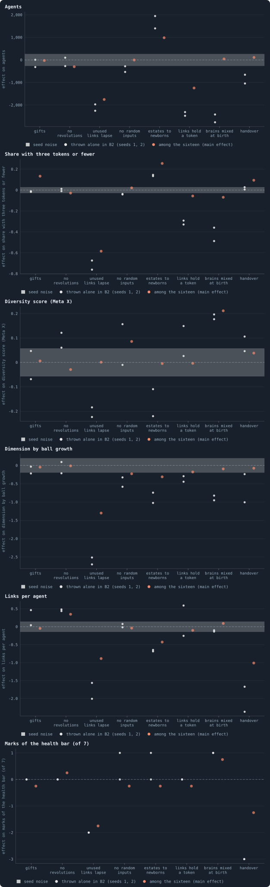

**What each switch does, among the sixteen and alone.** Orange: each switch's main effect among the sixteen worlds of batch U — the mean of the eight worlds with it on, minus the mean of the eight with it off — at iteration 1,000. Grey: the same switch thrown alone in B2, the world with it minus its twin without it, seeds 1 and 2. The grey band round zero is the seed's own noise: one standard deviation of the measure over the lab's ten B2 worlds, twice the noise of a main effect.

> [!example]- How to make this figure
> **Runs.** Batch U's sixteen pilot worlds (`GraphOfLifeRuns/.pilots/U/`): B2 at 10,000 tokens, seed 1, 1,000 iterations, with each of eight switches on in eight of them (`research/oee/pilots/make_jobs_TU.py`); each switch alone in B2, seeds 1 and 2, from the batch or lab experiment that made it; and the lab's ten B2 worlds (Experiment 16) for the seed's own noise.
>
> **Data.** From each world's checkpoint at iteration 1,000, or the lab's whole world kept then (`research/atlas/at.py --at 1000`, `GraphOfLifeRuns/.pilots/atlas/at1000.json`).
>
> 1. Read each world as `research/atlas/profile.py` reads every world.
> 2. A switch's main effect: the mean of the eight worlds with it on, minus the mean of the eight with it off.
> 3. Thrown alone: the world with the switch minus its twin without it, each seed.
> 4. The seed noise: the standard deviation of the lab's ten B2 worlds at iteration 1,000.
>
> **To make it again:** `python3 book_figures.py eightswitches`.
<!-- /figure -->

A switch's main effect is the mean of the eight worlds with it on minus the
mean of the eight with it off. How large is large? The lab's ten B2
worlds at iteration 1,000 differ only in their seed. Their spread, one
standard deviation, is the grey band, twice the noise of a main effect. The
seed moves the share of poor agents by 0.03, the diversity score by 0.06,
the dimension by 0.2 and the agents by 270. It never moves the marks: all
ten B2 worlds meet six.

- **Every unused link lapsing (C) is the strongest switch.** It takes 1,750
  agents off a world, and 0.58 off the share of agents holding three tokens
  or fewer. It takes 1.3 off the dimension, 0.9 links off each agent and
  1.75 marks off the health bar. Seven of the eight worlds with it hold less than a third
  of their agents at three tokens or fewer. Seven of the eight without it
  hold more than three fifths.
- **The estate to the newborns (E) fills a world**: 980 agents more, and
  0.26 more of them poor.
- **Links that hold a token (F) shrink it**, by 1,240 agents.
- **Mixing (G) raises diversity the most**, by 0.21: almost four times the
  seed's spread of 0.06. It also adds 0.75 marks.
- **Handover (H) costs links and health**: a link per agent and 1.25 marks.
- **Gifts (A) make worlds poorer**: 0.13 more of their agents hold three
  tokens or fewer. No revolutions (B) leave a world a third of a link
  richer per agent. No random inputs (D) raise diversity by 0.09, just above
  the seed's spread.

### Alone and together

The grey dots of the same figure are the switches thrown alone into B2, two
seeds each. For several switches the two disagree:

- **Mixing** alone takes about 2,600 agents off B2's world, and 0.36 to
  0.49 off its share of poor agents. Among the sixteen, it takes 40 agents *on* and 0.07 off. Its rise in
  diversity is the same alone (0.18 and 0.20) as among the sixteen (0.21).
  So, nearly, is its gain in marks: one alone, 0.75 among the sixteen.
- **Links that hold a token** alone take 0.29 and 0.33 off B2's share of
  the poor; among the sixteen, 0.06.
- **Every unused link lapsing** alone takes 2.5 and 2.7 off the dimension;
  among the sixteen, 1.3.
- **The estate to the newborns** alone adds 0.13 and 0.15 to the share of
  the poor; among the sixteen, twice that.
- **Handover** alone costs three marks and 1.7 and 2.4 links per agent, and
  takes 660 and 1,040 agents off the world. Among the sixteen it costs 1.25
  marks and a link, and no agents.

A switch does on average among the sixteen what it does alone in B2 only if
no pair of switches acts together. Here pairs do:

<!-- figure eightswitches/pairs -->
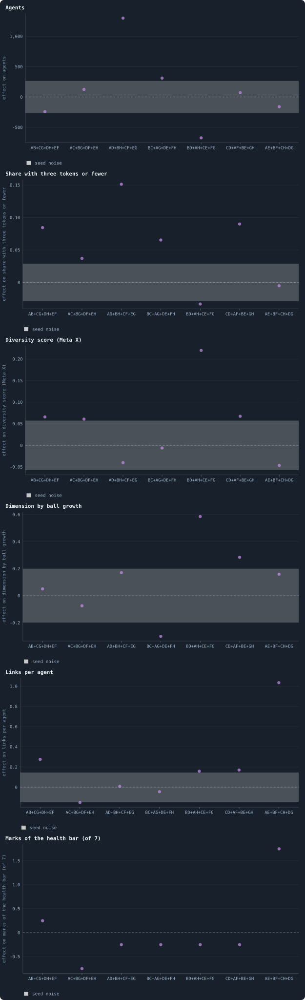

**Switches that act together.** The seven chains of pairs of batch U (book/notes/fractional-factorial.md): for each, the mean of the eight worlds where the product of the pair's two switches is +1, minus the mean of the other eight — the sum of the four pairs' effects that one chain cannot tell apart. The grey band: the seed's own noise, as in the figure above.

> [!example]- How to make this figure
> **Runs.** Batch U's sixteen pilot worlds (`GraphOfLifeRuns/.pilots/U/`): B2 at 10,000 tokens, seed 1, 1,000 iterations, with each of eight switches on in eight of them (`research/oee/pilots/make_jobs_TU.py`); each switch alone in B2, seeds 1 and 2, from the batch or lab experiment that made it; and the lab's ten B2 worlds (Experiment 16) for the seed's own noise.
>
> **Data.** From each world's checkpoint at iteration 1,000, or the lab's whole world kept then (`research/atlas/at.py --at 1000`, `GraphOfLifeRuns/.pilots/atlas/at1000.json`).
>
> 1. Read each world as `research/atlas/profile.py` reads every world.
> 2. A chain's effect: the mean of the eight worlds where the product of a pair's switches is +1, minus the mean of the other eight.
>
> **To make it again:** `python3 book_figures.py eightswitches`.
<!-- /figure -->

Each chain adds up four pairs the sixteen worlds cannot tell apart
([What cannot be told apart](#what-cannot-be-told-apart)). Three of them
stand far outside the seed's noise:
- the chain AD + BH + CF + EG adds 1,300 agents and 0.15 to the share of the
  poor;
- BD + AH + CE + FG adds 0.22 to the diversity and 0.59 to the dimension;
- AE + BF + CH + DG adds a link per agent and 1.75 marks.

Which pair in a chain does it, the design cannot say. But the worlds of
batch Y, each mixing with one other rule beside the rule alone, say it for
two of them:

- **Mixing with the estate to the newborns (EG).** B2 with the estate to the
  newborns holds 90% and 91% of its agents at three tokens or fewer. With
  mixing as well, 91% and 90%. Mixing takes nothing off, where alone it
  takes 0.36 to 0.49. Among the sixteen, likewise, mixing takes 0.22 off the
  share of the poor in the worlds whose estate is shared evenly. It adds
  0.08 in those whose estate goes to the newborns. That is the rise of the
  chain AD + BH + CF + EG. Yet A with D, B with H, or C with F could hide in
  the same difference.
- **Mixing with lapsing links (CG).** With every unused link lapsing, 1% and
  9% are poor; with mixing as well, 6% and 4%. A world already rich is not
  made richer.

So mixing's riches mostly vanish among the sixteen, where most worlds have
four switches on. [Brains mixed at birth, with every other rule](what-the-switches-did-in-pilots.md#brains-mixed-at-birth-with-every-other-rule) found them
surviving sixteen of 23 other rules one at a time. But of the eight mixed
worlds here, four hold the estate to the newborns, which cancels them. Four
hold the lapse, which leaves nothing to add, and two hold both. Of the other
two, one has handover, which cancels mixing's riches too
([Handover, with every other rule](what-the-switches-did-in-pilots.md#handover-with-every-other-rule)):
61% of its agents are poor.

Only one mixed world has none of the three. It has B, D, F and G on: no
revolutions, no random inputs, links that hold a token, and mixing. It
meets the author's picture better than any of the sixteen. It meets all
seven marks at a dimension of 3.7. A quarter of its 652 agents hold three
tokens or fewer, and its diversity score is 0.68. Its tokens are not too
even either: their [Gini coefficient](measuring-tokens.md#measuring-inequality-the-gini-coefficient-the-richest-tenth-entropy-and-mobility) is 0.53, within
the 0.49 to 0.56 of B2's ten worlds at iteration 1,000
(`GraphOfLifeRuns/.pilots/atlas/at1000.json`).

But it is one world of one seed, and its network is folded. A typical agent
reaches half the world in 1.19 times the steps its random twin needs
([What folds a world](how-many-dimensions-does-a-world-have.md#what-folds-a-world)).
Played on to 10,000 iterations as a candidate world
([The candidates, played on](building-b2-and-the-search-for-a-healthy-rich-world.md#the-candidates-played-on)),
it fell back on a single mark. One agent came to be joined to more than 5%
of the others. It was still rich and diverse: 4% of its 399 agents held
three tokens or fewer, at a diversity score of 0.66.

### Does evolution go on? (eight switches at once)
Do the brains of these worlds still get better? To tell, each world's brains
of iteration 1,000 are played against its brains of iteration 500
([Eras, contests and invasions](measuring-evolution.md#eras-contests-and-invasions-does-a-world-keep-getting-better)). Every agent gets a
brain of one era or the other. Then the world plays on for 100 iterations, a
lifetime of B2 ([A contest a lifetime long](measuring-evolution.md#a-contest-a-lifetime-long)).
If the later brains then hold more than half of the world, they are better.

<!-- figure eightswitches/evolution -->
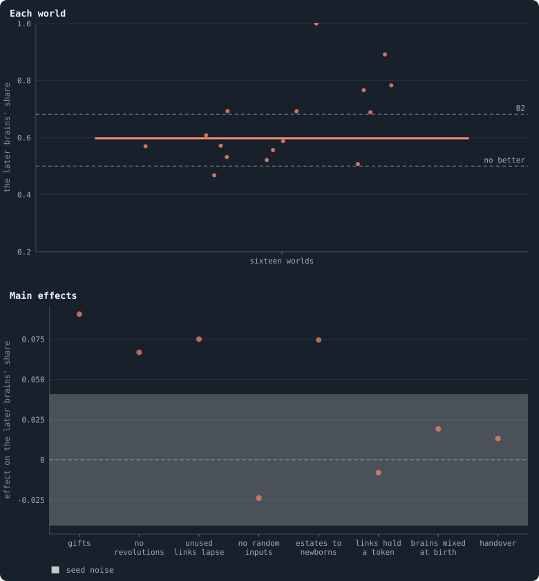

**Do the brains of 1,000 beat those of 500?** Above: each world of batch U, the share of a contested world its brains of iteration 1,000 hold after 100 iterations against those of 500, the mean of two contests, one in each era's world; the dashed line marked B2 is the median of the lab's ten B2 worlds, played the same way. Below: each switch's main effect on that share; the grey band is the spread of the ten B2 worlds (one standard deviation), twice the noise of a main effect.

> [!example]- How to make this figure
> **Runs.** Batch U's sixteen pilot worlds (`GraphOfLifeRuns/.pilots/U/`): B2 at 10,000 tokens, seed 1, 1,000 iterations, with each of eight switches on in eight of them (`research/oee/pilots/make_jobs_TU.py`); each switch alone in B2, seeds 1 and 2, from the batch or lab experiment that made it; and the lab's ten B2 worlds (Experiment 16) for the seed's own noise.
>
> **Data.** From `GraphOfLifeRuns/.pilots/batch_TUV_T100.json` and, for B2, `long_steps.json` (`research/oee/checks/rejudge.py`).
>
> 1. Seat the brains of the two eras on alternate agents of each era's world and play 100 iterations.
> 2. Count the agents the later era's brains hold, as a share of all.
> 3. A switch's main effect: the mean of the eight worlds with it on, minus the other eight.
>
> **To make it again:** `python3 book_figures.py eightswitches`.
<!-- /figure -->

The brains of 1,000 hold more than half of a contested world in fifteen of
the sixteen worlds. They hold from 0.47, with C, D, G and H on, to 1.0 with
all eight on. There the later brains took the whole world in both
eras' worlds. The median is 0.60, below B2's own 0.69. The lab's ten
B2 worlds give a median of 0.68, with a spread of 0.04. Gifts, no
revolutions, lapsing links and the estate to the newborns each speed
evolution a little. They add 0.07 to 0.09, about twice the spread of B2's
worlds. The other four switches do nothing a
contest can tell. Pairs act together here too: three chains add 0.11 to
0.14.

### The same eight switches on B1

B1 is the world that can break
([The switches the world was built with](what-the-switches-did-in-pilots.md#revolutions-handover-and-gifts-the-switches-the-world-was-built-with)).
Its revolutions take most of the nodes that change hands, a parent may pass
links to its newborn, and pieces cut off are culled. Batch V, whose worlds
were read on 18 October 2026, plays the same design on it. Its sixteen
worlds hold 10,000 tokens each, with seed 1, for 1,000 iterations. As on
B2, the world with no switch on is B1's own world of seed 1.

Its eight switches are ones that mean something there. So three letters
stand for other switches than in batch U:

| | on B1, in batch V | on B2, in batch U |
|---|---|---|
| A | gifts | gifts |
| B | no revolutions | no revolutions |
| C | no handover | every unused link lapses |
| D | no random inputs | no random inputs |
| E | estates to the newborns | estates to the newborns |
| F | brains that change only when copied (B2's rule) | links hold a token |
| G | brains mixed at birth | brains mixed at birth |
| H | links that hold a token | handover |

| switches on | agents | agents with 3 tokens or fewer | diversity score | marks (of 7) | dimension | links per agent |
|---|---|---|---|---|---|---|
| none (B1) | 871 | 2% | 0.72 | 3 | 2.56 | 2.7 |
| A, B, D, H | 264 | 9% | 0.67 | 2 | 1.65 | 2.2 |
| B, C, F, H | 501 | 11% | 0.69 | 3 | 2.28 | 3.3 |
| A, B, C, G | 1,374 | 21% | 0.56 | 4 | 2.25 | 6.8 |
| C, D, G, H | 336 | 25% | 0.88 | 3 | 2.75 | 4.9 |
| D, E, F, H | 1,560 | 36% | 0.31 | 3 | 2.49 | 2.3 |
| B, D, F, G | 1,140 | 37% | 0.66 | 2 | 2.19 | 2.7 |
| B, E, G, H | 1,718 | 40% | 0.35 | 3 | 2.35 | 2.4 |
| all eight | 1,567 | 44% | 0.60 | 4 | 2.66 | 3.2 |
| C, E, F, G | 2,584 | 57% | 0.68 | 3 | 2.14 | 3.2 |
| A, B, E, F | 3,619 | 72% | 0.20 | 3 | 2.43 | 2.9 |
| A, C, D, F | 2,933 | 75% | 0.62 | 4 | 3.02 | 9.6 |
| A, C, E, H | 1,841 | 82% | 0.26 | 1 | 4.32 | 2.5 |
| A, D, E, G | 4,413 | 84% | 0.35 | 6 | 2.44 | 3.7 |
| A, F, G, H | died out by iteration 341, after at most 398 agents | | | | | |
| B, C, D, E | died out after iteration 781, after 3,483 agents | | | | | |

**Two worlds died out**, and they are each other's mirror: every switch on
in one is off in the other. That has a use. Every switch still has seven
living worlds with it and seven without, so a main effect is still the
difference of two means of seven. And it has a cost a student should know.
With a world and its mirror gone, one combination of the eight main effects
can no longer be told apart from the rest. No fit can recover it. Every
living world agrees with the dead world A, F, G, H in exactly four of the
eight switches. So the effects of A, F, G and H together, set against those
of B, C, D and E, never show in the fourteen.

#### What each switch does on B1

<!-- figure eightswitches/b1effects -->
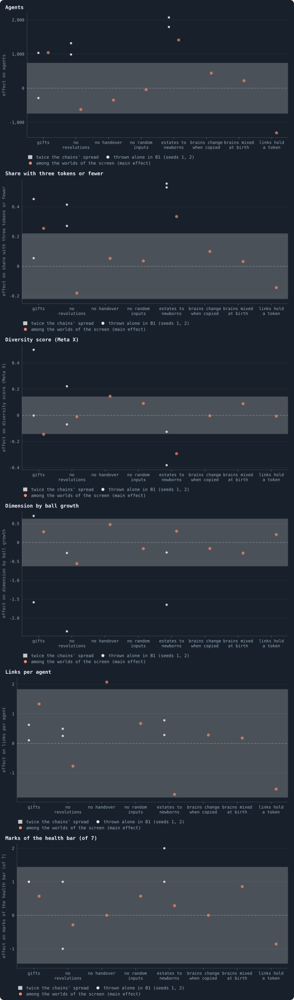

**The same eight switches on B1.** Orange: each switch's main effect among the worlds of batch V that lived to iteration 1,000 (14 of 16; V-AFGH-s1 and V-BCDE-s1 died out, and are each other's mirror, so every switch keeps seven worlds on and seven off): the mean of the seven with it on, minus the mean of the seven with it off. Grey dots: the switch thrown alone in B1, the world with it minus its twin without it, seeds 1 and 2, where the notebook has them. The grey band round zero is twice the spread of the seven chains of pairs, read the same way: what a main effect would scatter by if pairs of switches did not act together.

> [!example]- How to make this figure
> **Runs.** Batch V's sixteen pilot worlds (`GraphOfLifeRuns/.pilots/V/`): B1 at 10,000 tokens, seed 1, 1,000 iterations, with each of eight switches on in eight of them (`research/oee/pilots/make_jobs_TU.py`): gifts, no revolutions, no handover, no random inputs, estates to the newborns, brains that change only when copied, brains mixed at birth, links that hold a token; and the switches the notebook has played alone in B1, seeds 1 and 2 (batches S, T and R).
>
> **Data.** From each world's checkpoint at iteration 1,000 (`research/atlas/at.py --at 1000`, `GraphOfLifeRuns/.pilots/atlas/at1000.json`).
>
> 1. Read each world as `research/atlas/profile.py` reads every world; leave out the worlds with fewer than 20 agents.
> 2. A switch's main effect: the mean of the worlds with it on, minus the mean of those with it off.
> 3. The band: twice the root mean square of the seven chains of pairs, read the same way.
> 4. Thrown alone: the world with the switch minus its twin without it, each seed.
>
> **To make it again:** `python3 book_figures.py eightswitches`.
<!-- /figure -->

B1's worlds are far less alike than B2's: the two seeds of B1 itself differ
in diversity by 0.34. So the spread of B2's ten worlds is no yardstick here.
The design gives one of its own: the seven chains of pairs. If no pair
acted together, they would scatter as the main effects do
([How large is large?](#how-large-is-large)). The grey band is twice their
spread. Against it, few switches stand out:

- **The estate to the newborns moves B1 as it moves B2.** It adds 1,410
  agents and 0.33 to the share at three tokens or fewer, and takes 0.29 off
  the diversity score. It does the same when thrown alone in B1
  ([Who inherits?](what-the-switches-did-in-pilots.md#who-inherits)).
- **Without handover, a world keeps more links**: two more per agent. That
  is the other side of what handover did in B2
  ([Handover, with every other rule](what-the-switches-did-in-pilots.md#handover-with-every-other-rule)).
- **Gifts make B1 larger and poorer**: 1,040 more agents, 0.25 more of them
  poor. Links that hold a token make it smaller, by 1,310 agents.
- **No revolutions does not do in company what it did alone.** Thrown alone,
  B1 without revolutions became a world of mayflies. It was larger by 990
  and 1,320 agents, and poorer: 0.27 and 0.41 more at three tokens or
  fewer. Among the fourteen its effect is within the chains' spread, and if
  anything the other way: 620 agents fewer, 0.18 fewer poor.

#### Evolution on B1

<!-- figure eightswitches/b1evolution -->
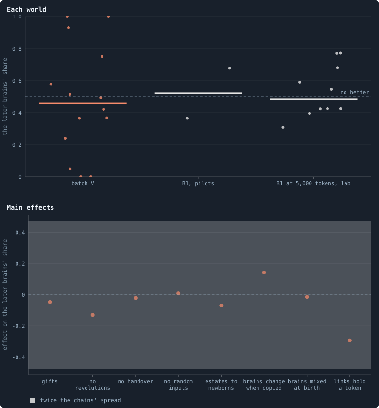

**On B1: do the brains of 1,000 beat those of 500?** Above, in orange: each world of batch V that lived, the share of a contested world its brains of iteration 1,000 hold after 100 iterations against those of 500, the mean of two contests, one in each era's world; in grey, B1 itself played the same way — two pilot worlds of 10,000 tokens, and the lab's ten worlds of 5,000. Below: each switch's main effect on that share, seven worlds with it against seven without; the grey band is twice the spread of the seven chains of pairs.

> [!example]- How to make this figure
> **Runs.** Batch V's sixteen pilot worlds (`GraphOfLifeRuns/.pilots/V/`): B1 at 10,000 tokens, seed 1, 1,000 iterations, with each of eight switches on in eight of them (`research/oee/pilots/make_jobs_TU.py`): gifts, no revolutions, no handover, no random inputs, estates to the newborns, brains that change only when copied, brains mixed at birth, links that hold a token. For B1 itself: the pilots `GraphOfLifeRuns/.pilots/L/B1-long-s1` and `-s2` (10,000 tokens), and the lab's ten B1 worlds of 5,000 tokens (Experiment 12, `B1-5000-s001` … `-s010`).
>
> **Data.** From `GraphOfLifeRuns/.pilots/batch_TUV_T100.json`, `batch_TUVWX4_T100.json`, `batch_TUVWX5_T100.json` and `rejudge_T100.json` (`research/oee/checks/rejudge.py`).
>
> 1. Seat the brains of the two eras on alternate agents of each era's world and play 100 iterations.
> 2. Count the agents the later era's brains hold, as a share of all.
> 3. A switch's main effect: the mean of the worlds with it on, minus those with it off.
>
> **To make it again:** `python3 book_figures.py eightswitches`.
<!-- /figure -->

**Evolution goes on no better than in B1 itself.** In the same contests of
100 iterations, the later brains hold more than half of the world in six of
the fourteen worlds that lived. Their median is 0.46. That is as in B1
itself. Its ten lab worlds of 5,000 tokens gave a median of 0.49
([The verdict of Experiment 12](how-to-tell-a-world-that-keeps-evolving.md#the-verdict-of-experiment-12)).
Its two pilots of 10,000 tokens gave 0.37 and 0.68.

But the fourteen scatter far more. In two worlds the brains of 500 took the
whole world in both eras' worlds. One of them is the world with all eight
switches on, where on B2 the brains of 1,000 had taken it all. In two others
the later brains took the whole world. No
switch moves the share beyond the spread of the chains of pairs. The largest
effect, of links that hold a token (−0.29), is within it. Two of the eight
are B2's own rules, no handover and brains that change only when copied.
Neither moves it beyond the chains either (−0.02 and +0.14).

### What we learned (eight switches at once)
- **Sixteen worlds can test eight switches.** In a fractional factorial
  design each main effect is a difference of two means of eight, clean of
  every pair. Pairs can be read only in chains of four, which the worlds
  cannot tell apart.
- **A switch measured alone tells what it does in B2, not what it does.**
  Among combinations, mixing's riches and the riches of links that hold a
  token mostly vanish, and the lapse's fall in dimension halves. Pairs of
  switches act together often and strongly.
- **Three effects hold whatever else is on.** Every unused link lapsing
  makes worlds rich, small and low in dimension, and costs marks. The estate
  to the newborns makes them large and poor. Mixing makes the agents differ
  more.
- **One of the sixteen meets the author's picture better than any.** It is
  B, D, F and G, the one mixed world with no rule that cancels mixing's
  riches. It is one world of one seed, folded, and at 10,000 iterations it
  had lost a mark.
- **Evolution goes on** in fifteen of the sixteen worlds, in most of them
  more slowly than in B2 itself; four switches speed it a little.
- **On B1** few switches stand out against the spread of the chains of
  pairs. The estate to the newborns makes a world larger, poorer and more
  alike, as on B2. No handover keeps more links. No revolutions, which alone
  made B1 a world of mayflies, does not in company. Two of the sixteen
  worlds died out. And no switch makes B1's evolution go on better. The
  later brains won in six of the fourteen worlds that lived, about as often
  as in B1 itself.

### How this was made (eight switches at once)
Every world on this page is a pilot, made with `research/oee/pilots/run.py`
in the engine's own code (`--proto engine=true`) and kept in
`GraphOfLifeRuns/.pilots` ([Pilot worlds](runs-and-records.md#pilot-worlds)). No experiment
of the lab stands behind it, so the page has no box of runs. Every figure
says, folded beneath it, which worlds it reads and how. The numbers it
quotes are in `book/results/eightswitches.json`.

#### The pilots of batch U

- **The worlds**: sixteen, in `GraphOfLifeRuns/.pilots/U/`, each named for
  the switches it has on (`U-ABDH-s1`; `U-none-s1` is B2 itself). Each is
  B2 at 10,000 tokens, seed 1, played for 1,000 iterations, with a whole
  world every 100 (`--ckpt 100`) and the health rows every 50.
- **The design**: `research/oee/pilots/make_jobs_TU.py` writes the job list
  `jobs_U.txt` from its `u_design()`, with the settings of the table below.
  Like every job list of the pilots, it is kept on the machine that ran
  them.
- **Each world at iteration 1,000**: `research/atlas/at.py --at 1000`, into
  `GraphOfLifeRuns/.pilots/atlas/at1000.json`, each world read as
  `research/atlas/profile.py` reads every world.
- **The seed's noise**: the lab's ten B2 worlds of Experiment 16,
  `B2-10000-s001` to `-s010`, read the same way.
- **Contests a lifetime long**: `research/oee/checks/rejudge.py`, 100
  iterations, once in each era's world, into
  `GraphOfLifeRuns/.pilots/batch_TUV_T100.json`.
- **The figures**: `python3 book_figures.py eightswitches`
  (`book_chapters/screens.py`).

#### The pilots of batch V

- **The worlds**: sixteen, in `GraphOfLifeRuns/.pilots/V/`, made the same
  way on B1 at 10,000 tokens, seed 1, 1,000 iterations (`jobs_V.txt`).
- **The worlds that died out**: the analysis leaves out every world with
  fewer than 20 agents at iteration 1,000, `V-AFGH-s1` and `V-BCDE-s1`.
- **Contests a lifetime long**: as for batch U, in
  `GraphOfLifeRuns/.pilots/batch_TUV_T100.json`, `batch_TUVWX4_T100.json`,
  `batch_TUVWX5_T100.json` and `rejudge_T100.json`. B1 itself: the pilots
  `GraphOfLifeRuns/.pilots/L/B1-long-s1` and `-s2`, and the lab's ten B1
  worlds of 5,000 tokens (Experiment 12).
- **The switches alone in B1**: the pilots of batches S, T and R, seeds 1
  and 2.

#### What each switch sets

A switch that is on adds these settings to its baseline. The pilots'
prototype keys go with `--proto`.

| | batch U, on B2 | batch V, on B1 |
|---|---|---|
| A | `allow_gifting=true prune_after=reproduction inactive_window=iteration` | the same |
| B | `allow_revolutions=false` | `allow_revolutions=false` |
| C | `prune_needs=0` | `allow_handover=false` |
| D | `random_input_amount=0` | `random_input_amount=0` |
| E | `redistribution=newborns` | `redistribution=newborns` |
| F | `valence=0`, and the prototype's `link_token=true` | `mutate_on_replication=true` |
| G | the prototype's `mix=true` | the prototype's `mix=true` |
| H | `allow_handover=true` | the prototype's `link_token=true` |

## Revolutions, handover and gifts: the switches the world was built with

The engine of Graph of Life came with three switches of its own.
Revolutions let small stakers unite against the largest, handover lets a
parent pass links to its child, and gifts let an agent pay a neighbour. In B1
revolutions win most of the nodes that change hands, and decide whether a
world is old and calm or young and turbulent. In B2, alone or beside each of
some twenty other rules, revolutions and gifts are details, except where
brains are mixed at birth. Handover thins B2's network into trees with nearly
every rule. Judged a lifetime long, evolution goes on in nearly every B2
world whatever the switches: they change only how fast.

### The switches the world was built with

The rules made for B2 have been judged by one test: does a world keep
beating its own past
([Does evolution keep going?](how-to-tell-a-world-that-keeps-evolving.md))?
The switches the engine was built with were never judged that way. Some were
set for other reasons. Handover was taken out of B2 because it breaks the
network ([Building B2: a world that cannot break](building-b2-and-the-search-for-a-healthy-rich-world.md#building-b2-a-world-that-cannot-break)).
Revolutions are to be turned off in a page still to be written, *What keeps
wealth spread?*, for what they do to wealth. And gifts had been off in every
run of the notebook. The author asked whether these switches had been tested
for open-ended evolution. They had not, and each has a reason it might
matter. So a batch of pilot worlds, batch S, threw them into B1 and B2.

#### Three switches, and two more

**Revolutions.** Think of a hill that goes to the largest army marching on
it. Smaller armies can band together against that army, each swearing part
of its troops to the band. If the sworn troops together outnumber the largest
army, the band takes the hill.

In the game a node goes to whoever staked the most on it, and a revolution is
such a band. A staker may mark part of its stake on a node as revolutionary.
If the marked parts of the smaller stakers together exceed the largest single
stake, they take the node ([How a coalition takes a node](rules-in-detail.md#how-a-coalition-takes-a-node)).
With the switch off ([`allow_revolutions`](settings.md#allow_revolutions)),
every node goes to whoever staked the most on it.

Revolutions are the one form of collective action the original game has. A
rule that rewards standing together is the kind of rule
[Why evolution stops](how-to-tell-a-world-that-keeps-evolving.md#why-evolution-stops)
said evolution needs. Both B1 and B2 have had revolutions on all along.

**Handover.** A parent may move some of its own links to its newborn child
([`allow_handover`](settings.md#allow_handover)). B1 has it; B2 was built
without it. Batch S left it as each baseline has it.
[Handover, with every other rule](#handover-with-every-other-rule) plays it
in B2.

**Gifts.** With gifts ([`allow_gifting`](settings.md#allow_gifting)), an
agent may hand tokens to its neighbours during reproduction, as a gift rather
than a stake. It gives from what its child left it: the tokens it keeps after
a birth. A gift is a real transfer, and it crosses a [connection](the-world.md#the-network "A link between two agents of the network: they are neighbours, and can stake on each other's nodes."), so it keeps
that connection alive. These are gifts an agent chooses to make. They are not
the failed stakes that
[Gliders, and who helps whom](cooperation-help-and-gliders.md#gliders-and-who-helps-whom) calls gifts,
which end up with a node's holder.

The author built gifts to make the upkeep of a link a decision. In the
original algorithm a connection that carried no tokens lapsed, so an agent
could keep a neighbour only by staking on it. With gifts, the accounting is
done after reproduction, over a whole iteration (`prune_after = reproduction`,
`inactive_window = iteration`, the form's default until 2026-10-02). So an
agent sees which of its connections are about to lapse, and can pay to keep
them.

B2 made upkeep a rule instead: an unused link lapses only if its two ends
share two other neighbours (`prune_needs = 2`). That rule has a number in it.
Gifts with every unused link lapsing (`prune_needs = 0`) would put the
network's shape in the brains' hands. That is the kind of replacement for a
number that [Rules without numbers](rules-without-numbers.md) looks for.

**Two more.** The pilots of batch S also tried **every unused link lapsing**
without gifts, as in the original algorithm (`prune_needs = 0` alone). And
they tried **sharing the estate by wealth** (`redistribution = by_tokens`).
It gives the tokens of the dead to the survivors in proportion to what they
hold. So every round of deaths concentrates wealth instead of spreading it,
and a world of rich and poor plays a different game.

#### The worlds of batch S

The worlds are pilots in the engine's own code (`--proto engine=true`; see
[Pilot worlds](runs-and-records.md#pilot-worlds)), two seeds of each kind. Each holds 10,000
tokens and runs for 1,000 iterations, and a whole world is kept every 100
iterations. With two seeds a kind, what they show is indicative, not an
effect ([How many seeds an experiment needs](statistics.md#how-many-seeds-an-experiment-needs)). The two
baselines differ in their brains. B1's, of five hidden layers, barely see
what is around them. B2's, of one hidden layer of 16 units, are brains that
see ([B1 and B2: the two baselines](b1-and-b2.md)).

| world | what it changes |
|---|---|
| B1 | the baseline: brains of five layers, revolutions on |
| B1, no revolutions | `allow_revolutions = false` |
| B2 | a world that cannot break ([Building B2: a world that cannot break](building-b2-and-the-search-for-a-healthy-rich-world.md#building-b2-a-world-that-cannot-break)), revolutions on |
| B2, no revolutions | `allow_revolutions = false` |
| B2 with gifts | `allow_gifting`, `prune_after = reproduction`, `inactive_window = iteration` |
| B2 with gifts, every unused link lapsing | the same, and `prune_needs = 0` |
| B2, every unused link lapsing | `prune_needs = 0` alone |
| B2, estates by wealth | `redistribution = by_tokens` |

B2's pilot of seed 1 is the same world as the lab's run `B2-10000-s001` of
[Experiment 16](how-to-tell-a-world-that-keeps-evolving.md#why-evolution-stops),
agent for agent and token for token. So the pilots in the engine's code
reproduce the lab exactly.

#### What the switches did to the world

The two figures below read each world over iterations 500 to 1,000. The
first shows how a world lives: the nodes taken, the births, the ages and the
number of agents. The second holds each world's network against the health
bar, the marks a healthy network must meet.

<!-- figure switches/life -->
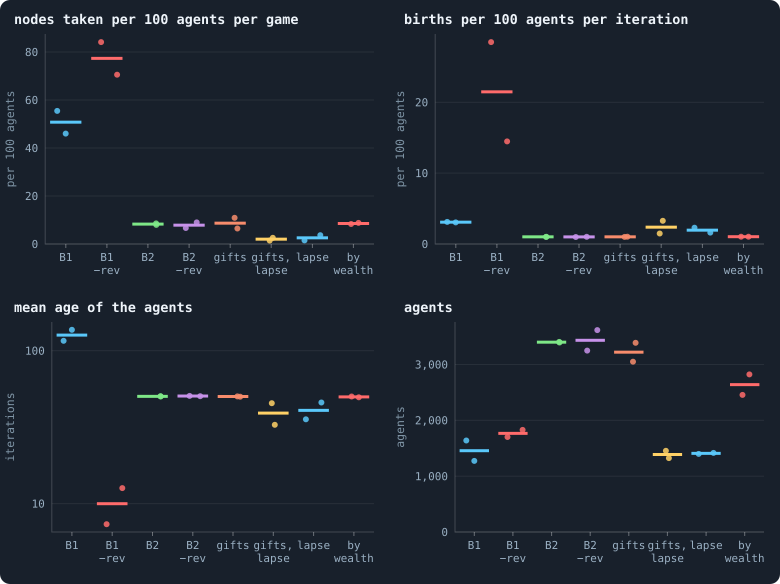

**How each switch changes a world's life.** One dot per world, the mean or median over iterations 500 to 1,000; the bar is the median of the two. Labels as in the figure below.

> [!example]- How to make this figure
> **Runs.** Pilot worlds of `research/oee/pilots/run.py` in the engine's own code (`--proto engine=true`), kept in `GraphOfLifeRuns/.pilots/S`, two seeds each (`-s1`, `-s2`), at 10,000 tokens for 1,000 iterations with a whole world every 100 (`--ckpt 100`): B1 (`S6-B1`, the settings of the study of the baseline), B1 without revolutions (`S7-B1norev`), B2 (`S0-B2`: `--set hidden_layers=16 message_amount=8 message_prepass=false allow_handover=false mutate_on_replication=true incumbency=1.5 birth_links=2 mend_on_death=true prune_needs=2 valence=8 keep_home=0.3 max_age=100 min_child=10`), B2 without revolutions (`S1-norev`), B2 with gifts (`S2-gifts`: `allow_gifting=true prune_after=reproduction inactive_window=iteration`), the same with every unused link lapsing (`S3-giftslapse`: also `prune_needs=0`), B2 with every unused link lapsing (`S4-lapse`) and B2 with estates shared by wealth (`S5-bytokens`: `redistribution=by_tokens`). The jobs are listed in `research/oee/pilots/jobs_S.txt`.
>
> **Data.** From each world's `series.jsonl`.
>
> 1. Of the rows from iteration 500 to 1,000: the nodes taken (`conquests`) and the births per 100 agents, averaged; the mean age (`meanAge`), averaged; the agents (`nodes`), median.
>
> **To make it again:** `python3 book_figures.py switches`.
<!-- /figure -->

<!-- figure switches/bar -->
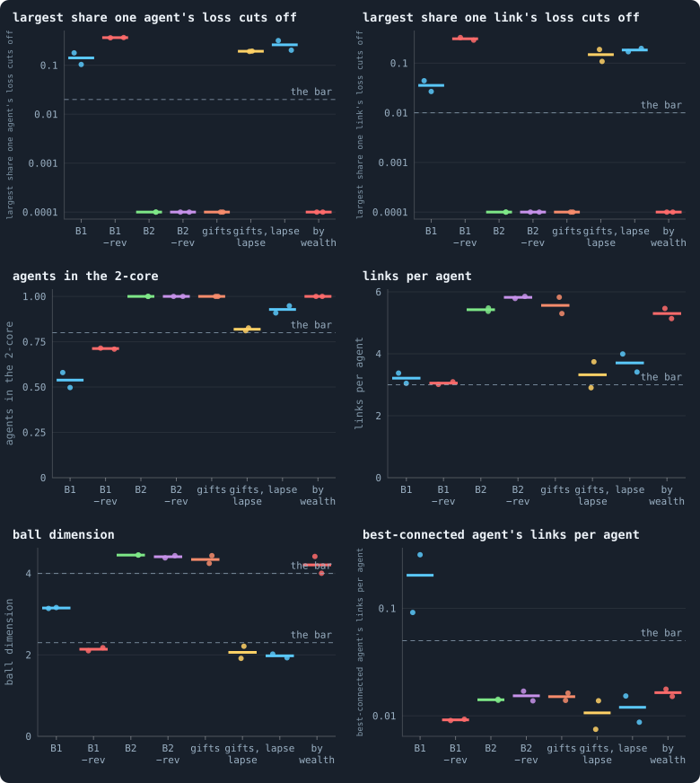

**Each switch against the health bar.** One dot per world, at its median over iterations 500 to 1,000; the bar is the median of the two; dashed lines are the health bar of [How to tell a world that keeps evolving](how-to-tell-a-world-that-keeps-evolving.md). *−rev*: no revolutions; *gifts, lapse*: gifts, and every unused link lapses; *lapse*: every unused link lapses; *by wealth*: estates shared by wealth. Cut shares and the best-connected agent's share are drawn on logarithmic axes, a cut of nothing at 0.0001.

> [!example]- How to make this figure
> **Runs.** Pilot worlds of `research/oee/pilots/run.py` in the engine's own code (`--proto engine=true`), kept in `GraphOfLifeRuns/.pilots/S`, two seeds each (`-s1`, `-s2`), at 10,000 tokens for 1,000 iterations with a whole world every 100 (`--ckpt 100`): B1 (`S6-B1`, the settings of the study of the baseline), B1 without revolutions (`S7-B1norev`), B2 (`S0-B2`: `--set hidden_layers=16 message_amount=8 message_prepass=false allow_handover=false mutate_on_replication=true incumbency=1.5 birth_links=2 mend_on_death=true prune_needs=2 valence=8 keep_home=0.3 max_age=100 min_child=10`), B2 without revolutions (`S1-norev`), B2 with gifts (`S2-gifts`: `allow_gifting=true prune_after=reproduction inactive_window=iteration`), the same with every unused link lapsing (`S3-giftslapse`: also `prune_needs=0`), B2 with every unused link lapsing (`S4-lapse`) and B2 with estates shared by wealth (`S5-bytokens`: `redistribution=by_tokens`). The jobs are listed in `research/oee/pilots/jobs_S.txt`.
>
> **Data.** From each world's `series.jsonl`.
>
> 1. Of the rows from iteration 500 to 1,000 that measured the network (every 10th), take the median of the worst share of the others one agent's loss cuts off (`nodeCutRisk`), the same for one link (`cutRisk`), the 2-core (`coreShare`), links per agent (`meanDegree`), the ball dimension and the best-connected agent's share (`maxDegreeShare`).
>
> **To make it again:** `python3 book_figures.py switches`.
<!-- /figure -->

**Revolutions shape B1 and do nothing to B2.** In B1 a revolution is common.
In every game, revolutions took 28 to 39 nodes per hundred agents, most of
the 46 to 55 that changed hands. The world they make is calm and old. The
average agent was 116 to 137 iterations old, and 3 agents in a hundred were
born in an iteration. The network grew [stars](measuring-networks.md#stars-and-hubs "An agent joined to far more agents than most; a star is a world held together by a single hub."): one agent was joined to 9 to
32% of the others.

Take revolutions away, and B1 becomes a world of mayflies. Nodes changed
hands 71 to 84 times per hundred agents a game. Between 14 and 28 agents in a
hundred were born in every iteration, and the average agent was 7 to 13
iterations old. Its network had no stars: no agent was joined to more than 1%
of the others. But it was stretched and fragile. Its ball dimension was 2.1 to
2.2, and a single agent's loss would cut off 36 to 37% of the world.

In B2, revolutions won about one node in three hundred a game over the
thousand iterations. From iteration 500 on they won one in 400 to 1,000. B2
with and without them were the same world in every measure.

**Gifts changed nothing that the network shows,** as long as B2's rule for
lapsing links held. Under that rule a link lapses only if its ends share two
neighbours. Then links seldom lapse, and a gift has little to save.

**Links that must be used break the network, gifts or no gifts.** With every
unused link lapsing, as in the original algorithm, B2's world held 1,300 to
1,450 agents instead of 3,400. One to three agents in a hundred were cut off
in every iteration. Its ball dimension was about 2, and one agent's loss could
cut off a fifth of it. Gifts did not change that: the brains did not pay to
keep the links that mattered.

**Estates shared by wealth** made the world smaller, 2,450 and 2,800 agents
against 3,400, and otherwise left it as it was.

#### Does any switch keep evolution going?

How can one tell whether evolution goes on? Play a world against its own
past. Take the brains of one world at two moments, two eras. Give every agent
a brain drawn from one era or the other, switch mutation off, and play on
under the world's own rules. If the later brains end up holding more than
half of the world, they are better
([Eras and contests: does a world keep getting better?](measuring-evolution.md#eras-contests-and-invasions-does-a-world-keep-getting-better)).
The first contests here lasted 20 iterations, and from them each era gets a
rating, the founders' at 0.

<!-- figure switches/elo -->
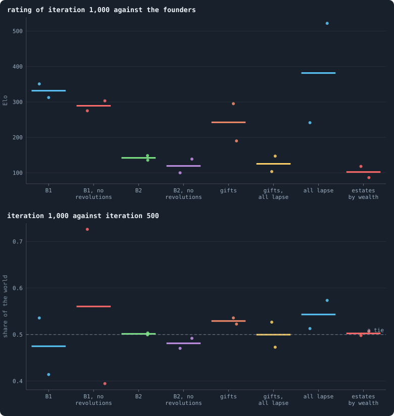

**Does any switch keep evolution going?** One dot per world. Top: the rating of the brains of iteration 1,000 against the founders'. Bottom: their share of a world contested with the brains of iteration 500 of the same world.

> [!example]- How to make this figure
> **Runs.** Pilot worlds of `research/oee/pilots/run.py` in the engine's own code (`--proto engine=true`), kept in `GraphOfLifeRuns/.pilots/S`, two seeds each (`-s1`, `-s2`), at 10,000 tokens for 1,000 iterations with a whole world every 100 (`--ckpt 100`): B1 (`S6-B1`, the settings of the study of the baseline), B1 without revolutions (`S7-B1norev`), B2 (`S0-B2`: `--set hidden_layers=16 message_amount=8 message_prepass=false allow_handover=false mutate_on_replication=true incumbency=1.5 birth_links=2 mend_on_death=true prune_needs=2 valence=8 keep_home=0.3 max_age=100 min_child=10`), B2 without revolutions (`S1-norev`), B2 with gifts (`S2-gifts`: `allow_gifting=true prune_after=reproduction inactive_window=iteration`), the same with every unused link lapsing (`S3-giftslapse`: also `prune_needs=0`), B2 with every unused link lapsing (`S4-lapse`) and B2 with estates shared by wealth (`S5-bytokens`: `redistribution=by_tokens`). The jobs are listed in `research/oee/pilots/jobs_S.txt`.
>
> **Data.** From each world's checkpoints, `ckpt_<iteration>.npz`.
>
> 1. For every pair of the eras 0, 100, 200, 500 and 1,000 play four contests, two in each era's world: every agent gets a brain drawn at random from one era or the other, mutation is switched off, and 20 iterations are played under the world's own rules (`research/oee/pilots/tourney.py --T 20 --reps 2`).
> 2. Fit one rating per era (Bradley–Terry, `research/oee/pilots/elo.py`), the founders at 0.
>
> **To make it again:** `python3 book_figures.py switches`.
<!-- /figure -->

**In contests of 20 iterations, no switch kept B2 evolving.** In every
variant of B2, the brains of iteration 1,000 held between 0.47 and 0.57 of a
world contested with those of iteration 500. B2 itself held 0.50 in both
worlds.

**Some switches give evolution more to learn at first.** With gifts, the
brains of iteration 100 rated +263 and +157 against the founders, against
+102 and +85 in B2. With every unused link lapsing they rated +520 and +256.
In a world whose links break, the founders' careless play is costly, so the
first improvements are large.

**A lifetime long, evolution in B2 goes on.** An agent of B2 lives at most
100 iterations, and a contest of 20 misses what pays off over such a life. In
Experiment 16's B2 worlds, contests of 20 iterations had the brains of
iteration 2,000 tied with those of 500. In contests of 100 iterations the
later brains won (0.73)
([Would we notice if it went on?](how-to-tell-a-world-that-keeps-evolving.md#would-we-notice-if-it-went-on)).
So the worlds of batch S were played again, in contests of 100 iterations,
once in each era's world. Eras played against themselves that way hold 0.44
to 0.58: that is how far a tie can stray. The brains of iteration 1,000 held these
shares against those of 500, in the two seeds:

| world | iteration 1,000 against 500, a lifetime long |
|---|---|
| B2 | 0.69 and 0.67 |
| B2 without revolutions | 0.76 and 0.61 |
| B2 with gifts | 0.87 and 0.83 |
| B2 with every unused link lapsing | 0.65 and 0.53 |
| B2 with estates shared by wealth | 0.65 and 0.62 |
| B2 with gifts and every unused link lapsing | 0.25 and 0.62, in worlds whose networks were breaking |
| B1 | 0.37 and 0.68 |
| B1 without revolutions | 0.35 and 0.16 |

So in B2 and nearly all its variants, evolution went on between iterations
500 and 1,000. The switches do not change that. They change only how fast it
goes, and it went fastest with gifts.

#### In B1: how long evolution goes on

**In contests of 20 iterations, revolutions decide how long B1 evolves.**
With revolutions, B1's brains rated about +350 at iteration 100 and changed
little after. The brains of iteration 1,000 held 0.54 and 0.41 against those
of iteration 500. Without revolutions, evolution went on longer. In the world
of seed 1, the brains of iteration 1,000 beat those of 500 in all four
contests (0.73). They beat those of 200 in all four too (0.82). In the world
of seed 2 they improved until iteration 500, to +383, and then fell back
(0.40).

Why would a world without revolutions evolve for longer? B1 without
revolutions is a world of mayflies, with 15 to 28 times as many births per
agent as B2. And in B1 every brain changes after every game. So a thousand of
its iterations hold many more generations than a thousand of B2's. Its
contests are noisy too: single contests between its eras ended anywhere from
0.09 to 1.00.

**A world of 3,000 iterations.** A third world without revolutions, of seed
3, ran for 3,000 iterations, to see whether its evolution stops later or not
at all. It stopped later, and then the world itself nearly died. In contests
of 20 iterations its brains improved until iteration 500. The brains of
iteration 500 beat those of 0, 100 and 200 in eleven of twelve contests. Then
they lost ground. Iteration 1,000 held 0.32 against iteration 500, and
iteration 1,500 held 0.11. Meanwhile the world shrank. It held about a
thousand agents from iteration 1,000 to 1,750, and a few dozen after 2,000.
At its smallest it held 13, and 44 at iteration 3,000. A lab run would have
counted it as extinct. Contests played in its later eras' worlds often ended
with fewer than 50 agents, so their scores say nothing.

**A lifetime long, single worlds of B1 tell another story.** In the table
above, played in contests of 100 iterations, B1's later brains lost in three
of its four worlds. With revolutions they held 0.37 and 0.68; without them,
0.35 and 0.16. So the world of seed 1 without revolutions, which short contests saw
still improving at iteration 1,000, lost a lifetime long. And the world of
seed 2 with revolutions, which short contests saw stopped, won. B1's single
worlds are noisy, and the two lengths of contest disagree about them.

### Revolutions, with every other rule

Alone, revolutions shape B1 and do nothing to B2
([What the switches did to the world](#what-the-switches-did-to-the-world)).
But B2 itself is one world among many the notebook now plays, and each of its
other rules can be changed too. Are there rules with which revolutions
matter, where in B2 itself they do not?

#### One switch beside every other rule

What a switch does alone in B2 need not be what it does once other rules are
thrown too. On 16 October 2026 the author asked for the switches in
combination. The plainest way to ask is a square of four worlds:

| | without the other rule | with the other rule |
|---|---|---|
| **without the switch** | B2 | B2 with the other rule |
| **with the switch** | B2 with the switch | B2 with both |

The bottom row minus the top row is what the switch does. In the left column
that is the switch alone; in the right, the switch in the other rule's
company. If the two differences agree, the switch does the same whatever its
company.

A batch of pilots plays the fourth corner, B2 with both, for each other rule
in turn, two seeds each. The other three corners already exist, seed for
seed, from batch S, from earlier batches or from the lab. So each pair of
rules is played in full, but only in pairs. That is not the
fractional factorial design of
[Eight switches at once](what-the-switches-did-in-pilots.md#eight-switches-at-once-and-how-sixteen-worlds-can-test-them), which throws eight
switches together in sixteen worlds
([Many switches in few worlds](what-the-switches-did-in-pilots.md#many-switches-in-few-worlds-fractional-factorial-designs)).

Three batches did this for the switches of this page:

- **batch W**: B2 without revolutions, beside each of 24 other rules;
- **batch X**: B2 with handover, beside each of 23;
- **batch T**: B2 with gifts, beside each of 21, and B1 with gifts, with
  revolutions and without.

The other rules are the switches the notebook's pilots and lab experiments
have tried with B2, and batch S's other ways of deciding a node:

- where the estate of the dead goes: by wealth, to the poorest, to the
  newborns or to the parents ([Who inherits?](what-the-switches-did-in-pilots.md#who-inherits));
- links that hold a token, brains mixed at birth, and inputs that say who
  helped an agent or where it came from;
- handover, no random inputs, no old age, children of any size, and half, or
  all but the last token, kept at home;
- brains that grow or whose units each hold a token, brains that change more
  slowly or faster, and every unused link lapsing;
- a lottery, sides pooled by genotype or by family, and a sense of kin or of
  family ([Other contests: a lottery, and alliances](another-game.md)).

Every world holds 10,000 tokens and is played for 1,000 iterations in the
engine's own code, as in batch S. Each corner is read at iteration 1,000, the
same moment in each, as [Healthy and rich](building-b2-and-the-search-for-a-healthy-rich-world.md#healthy-and-rich) reads every
world. Four of its numbers matter here. One is the share of agents holding
three tokens or fewer, the poor. The others are the diversity score, the
marks of the health bar a world meets, and its number of agents. And each
world's brains of iteration 1,000 are played against those of 500 a lifetime
long, in contests of 100 iterations. The lab's ten B2 worlds, played the same
way, have a median of 0.68.

For revolutions, batch W plays B2 without revolutions beside each other rule.
Each of its worlds completes a square whose other corners are B2, B2 without
revolutions, and B2 with the other rule alone. Batch S's other ways of
deciding a node had only ever been played without revolutions. For them
batch W plays the missing corner instead: the same rule *with* revolutions.

#### What turning revolutions off changes

<!-- figure norevcombos/changes -->
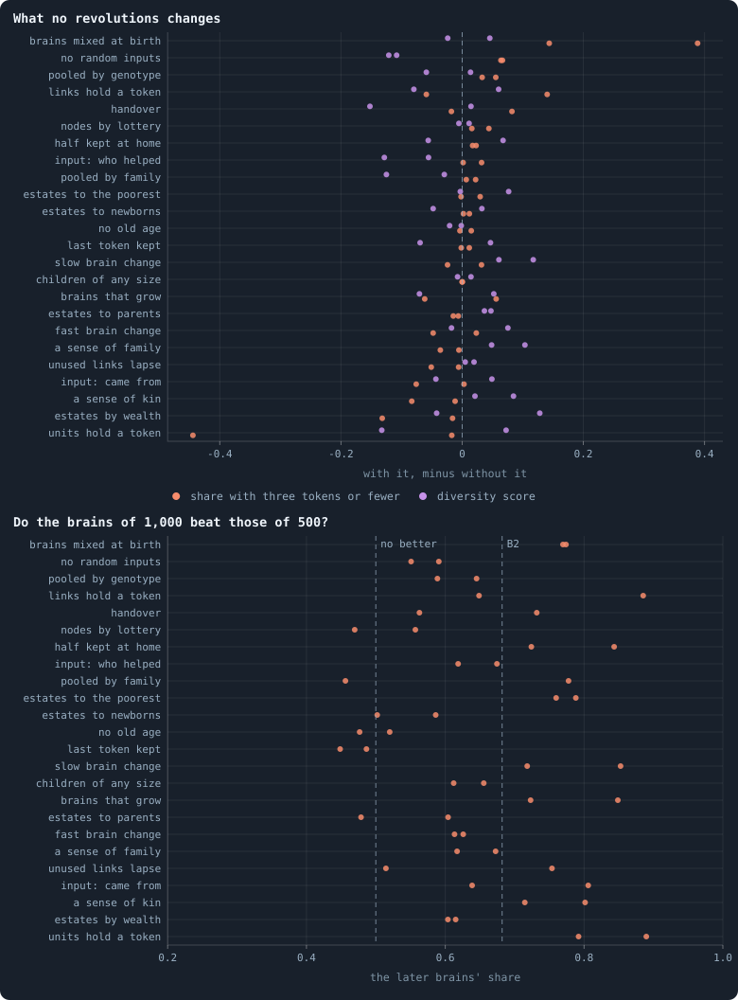

**Each rule, with no revolutions and without.** Each row is one other rule. First: what adding no revolutions to a world of B2 with that rule changes (batch W), at iteration 1,000 — in orange, the share of the agents holding three tokens or fewer; in violet, the diversity score; a dot for each seed, 1 and 2. Last: the share of a contested world the brains of 1,000 of the world with both rules hold after 100 iterations against those of 500, the mean of two contests, a dot for each seed; the dashed line marked B2 is the median of the lab's ten B2 worlds, played the same way.

> [!example]- How to make this figure
> **Runs.** Batch W's pilot worlds (B2 at 10,000 tokens, no revolutions and one other rule, seeds 1 and 2, `GraphOfLifeRuns/.pilots/W/`) and their controls: the same rule alone, from the batch or lab experiment that made it.
>
> **Data.** From each world's checkpoint at iteration 1,000 (`research/atlas/at.py --at 1000`, `GraphOfLifeRuns/.pilots/atlas/at1000.json`) and the contests in `GraphOfLifeRuns/.pilots/batch_TUV_T100.json` and `rejudge_T100.json`.
>
> 1. Read each world as `research/atlas/profile.py` reads every world.
> 2. Subtract the world with the rule alone from the world with both, seed by seed.
> 3. Seat the brains of the two eras on alternate agents of each era's world, play 100 iterations, and count the agents the later brains hold.
>
> **To make it again:** `python3 book_figures.py norevcombos`.
<!-- /figure -->

**For most rules, nothing.** Over the 24 rules and two seeds, the share of
agents holding three tokens or fewer changes by a median of +0.002. The
diversity score changes by +0.008, and the marks of the health bar hardly
move. Revolutions are rare in most of these worlds. They take a median of
0.24 nodes per hundred agents an iteration, in the worlds that have them. Of
the nodes that change hands, they take a median of 3.7 in a hundred. Nine
worlds in ten stay below 0.8 and 7.4.

**With brains mixed at birth, revolutions keep a world small and rich.**
Mixed worlds are small, and in them revolutions are five to ten times as
common as in B2. They take 1.0 and 1.4 nodes per hundred agents an
iteration, seven or eight in a hundred of the nodes that change hands.
Without revolutions, the two mixed worlds held 1,410 and 360 more agents at
iteration 1,000. And 39 and 14 more of every hundred held three tokens or
fewer.

Revolutions are as common in other small worlds, where links or brain units
hold a token: 0.75 to 1.35 per hundred agents. But there, without them, the
worlds did not change one way. With units that hold a token, one world grew
much richer without revolutions: 44 fewer of every hundred held three tokens
or fewer. The other stayed as it was. With links that hold a token, one grew
a little richer and the other poorer.

**Without random inputs, a little poorer and less diverse.** In both seeds,
six and seven more of every hundred agents held three tokens or fewer. The
diversity scores were lower by 0.11 and 0.12.

**Evolution goes on without revolutions.** In lifetime contests, the brains
of 1,000 take more than half of a contested world from those of 500 in 42 of
the 48 worlds. Their median is 0.64, against 0.68 in B2's ten worlds. Six
worlds held a half or less. Both worlds with the last token kept at home did
(0.45 and 0.49). So did one seed each with no old age (0.48) and with the
estate to the parents (0.48). And so did one seed each with nodes by lottery
(0.47) and with sides pooled by family (0.46). The fastest are the worlds
with units that hold a token (0.79 and 0.89) and with half kept at home (0.72
and 0.84). So are those with slow brain change and with brains that grow
(0.72 and 0.85 each).

### Handover, with every other rule

With **handover** ([`allow_handover`](settings.md#allow_handover)), a
parent moves some of its links to its newborn. A parent that hands over all
but one hangs on that one. B1 has it. B2 was built without it. In the worlds
of [Building B2: a world that cannot break](building-b2-and-the-search-for-a-healthy-rich-world.md#building-b2-a-world-that-cannot-break),
handover left 40% of the agents in trees outside the core. And one link's
loss could cut off 4% of a world.

Batch X plays B2 with handover beside each of 23 other rules. They are the
switches of
[Revolutions, with every other rule](#revolutions-with-every-other-rule), and
batch S's other ways of deciding a node. Each world completes a square, as in
[One switch beside every other rule](#one-switch-beside-every-other-rule).
Its other corners are B2, B2 with handover alone, and B2 with the other rule
alone.

#### What handover changes

<!-- figure handovercombos/changes -->
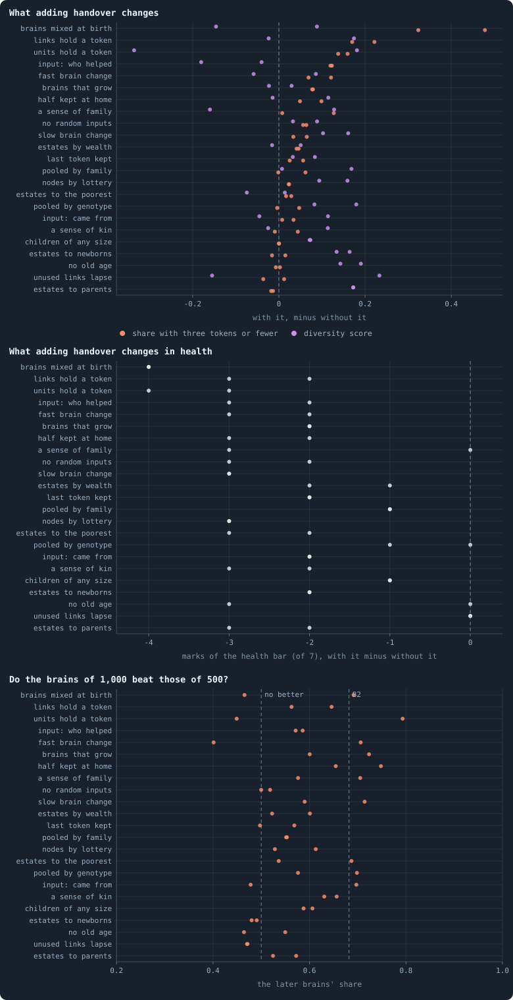

**Each rule, with handover and without.** Each row is one other rule. First: what adding handover to a world of B2 with that rule changes (batch X), at iteration 1,000 — in orange, the share of the agents holding three tokens or fewer; in violet, the diversity score; a dot for each seed, 1 and 2. Then: what it changes in the marks of the health bar the world meets. Last: the share of a contested world the brains of 1,000 of the world with both rules hold after 100 iterations against those of 500, the mean of two contests, a dot for each seed; the dashed line marked B2 is the median of the lab's ten B2 worlds, played the same way.

> [!example]- How to make this figure
> **Runs.** Batch X's pilot worlds (B2 at 10,000 tokens, handover and one other rule, seeds 1 and 2, `GraphOfLifeRuns/.pilots/X/`) and their controls: the same rule alone, from the batch or lab experiment that made it.
>
> **Data.** From each world's checkpoint at iteration 1,000 (`research/atlas/at.py --at 1000`, `GraphOfLifeRuns/.pilots/atlas/at1000.json`) and the contests in `GraphOfLifeRuns/.pilots/batch_TUV_T100.json` and `rejudge_T100.json`.
>
> 1. Read each world as `research/atlas/profile.py` reads every world.
> 2. Subtract the world with the rule alone from the world with both, seed by seed.
> 3. Seat the brains of the two eras on alternate agents of each era's world, play 100 iterations, and count the agents the later brains hold.
>
> **To make it again:** `python3 book_figures.py handovercombos`.
<!-- /figure -->

**It costs health with nearly every rule.** Handover costs two marks of the
health bar at the median, and up to four; in five of the 46 worlds, none.
The marks it costs are the network's. With handover, 38 of the 46 worlds
have less than 0.8 of their agents in the [2-core](measuring-networks.md#core-trees-and-leaves "What is left of a network when agents with one connection or none are peeled away again and again: the agents on loops or between them."). In 42 of the 46, a link's
loss would cut off more than 1% of the world. In 36, an agent's loss would
cut off more than 2%. Without handover, none, two and three do. A parent that gives
its links away thins the network into trees, with 1.8 links fewer per agent
at the median. And trees hang on single links.

**It makes worlds a little poorer, and a little more diverse.** The share of
agents holding three tokens or fewer rises by 0.04 at the median, and the
diversity score by 0.08.

**It cancels the riches of mixing.** B2 with brains mixed at birth holds 28%
and 40% of its agents at three tokens or fewer at iteration 1,000. With
handover as well, 48 and 32 more of every hundred are that poor. Handover is
one of the rules that
[Brains mixed at birth, with every other rule](what-the-switches-did-in-pilots.md#brains-mixed-at-birth-with-every-other-rule)
found to cancel mixing's riches. It costs riches too where links or brain
units hold a token: 14 to 22 more of every hundred are poor.

**It unfolds a world a little.** When an agent of B2 dies, its former
neighbours, grouped by the links among them, are joined up in a ring round
the gap. A parent that passes its links on does not gather them till it
dies. So the dying leave rings of 3.7 groups fewer
([What folds a world](how-many-dimensions-does-a-world-have.md#what-folds-a-world)).
A typical agent is then further from everyone than in B2. The typical
distance, over the random twin's, rises by 0.24 at the median, in 41 of 46
worlds. The room is bought with the trees and [bridges](measuring-networks.md#bridges-cut-risk-loops-and-the-core-how-a-network-can-be-cut "A connection that lies on no loop: cut it and the network falls into two pieces.") above: room and
resilience pull apart, as What folds a world found.

**Evolution goes on, more slowly.** In lifetime contests, the brains of
1,000 take more than half of a contested world from those of 500 in 35 of
the 46 worlds. Their median is 0.57. That is below B2's 0.68, and below the
0.64 of the worlds without revolutions
([What turning revolutions off changes](#what-turning-revolutions-off-changes)).
It is as with handover alone (0.60 and 0.60). Evolution is slowest where
every unused link lapses (0.47 and 0.47) and with the estate to the newborns
(0.48 and 0.49). It is slow, too, in one seed each with faster brain change
(0.40), units that hold a token (0.45) and mixing (0.47). It is fastest with
half kept at home (0.65 and 0.75) and with brains that grow (0.60 and 0.72).

### Gifts, with every other rule

With **gifts** ([`allow_gifting`](settings.md#allow_gifting)), an agent may
hand some of what its child left it to its neighbours. It gives in the
reproduction phase ([Three switches, and two more](#three-switches-and-two-more)).
Here, as in batch S, unused links are cut after reproduction once unused for
an iteration, so that a gift can keep a link alive. In B2 alone, gifts
changed nothing the network shows
([What the switches did to the world](#what-the-switches-did-to-the-world)).

Batch T plays B2 with gifts beside each of 21 other rules. Each world
completes a square whose other corners are B2, B2 with gifts alone, and B2
with the other rule alone. Batch T also plays B1 with gifts, with revolutions
and without.

#### How much is given

In nine worlds of seed 1, the games were recorded over 200 iterations from
iteration 1,000 (`research/oee/checks/gifts.py`).

**Gifts are small.** In a game, 0.12% to 0.35% of the world's tokens change
hands as gifts, given by 0.16% to 0.52% of the agents. The exceptions are
the worlds where the estate of the dead goes to the newborns or the parents.
There, 1.2% and 1.6% of the tokens are given, by 1.1% and 1.6% of the agents.
A gift is 1.2 to 2.2 tokens on average.

**Gifts run downhill, and are seldom returned.** Of all gifts, 64% to 87% go
from the richer of the two agents to the poorer. They go to an agent of the
giver's own genotype no more often than to anyone else. That is 10% to 35% of
gift tokens, against 11% to 34% by chance. And they come back less often than
chance would have them. Within ten games 3% to 41% of gifts are answered,
against 10% to 65% by chance. Two thirds to nine tenths of gift tokens go
along links that carried no stake in the game before. A gift may be keeping
those links alive.

#### What gifts change

<!-- figure giftcombos/changes -->
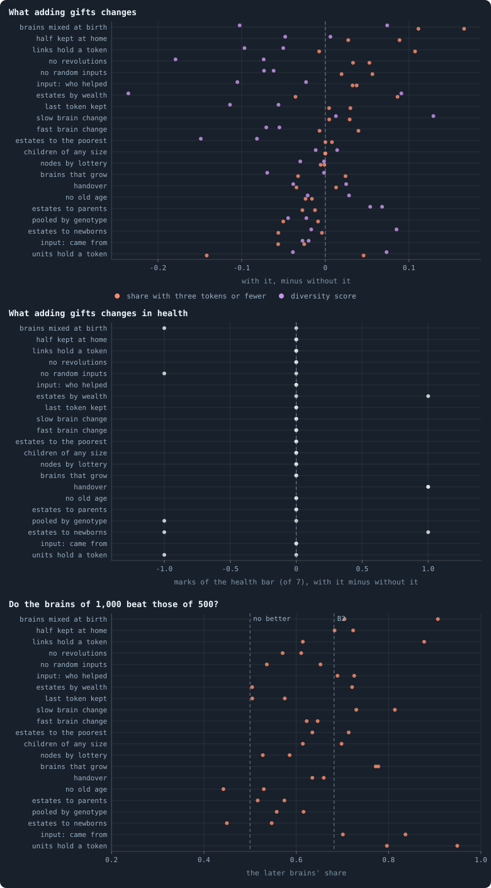

**Each rule, with gifts and without.** Each row is one other rule. First: what adding gifts to a world of B2 with that rule changes (batch T), at iteration 1,000 — in orange, the share of the agents holding three tokens or fewer; in violet, the diversity score; a dot for each seed, 1 and 2. Then: what it changes in the marks of the health bar the world meets. Last: the share of a contested world the brains of 1,000 of the world with both rules hold after 100 iterations against those of 500, the mean of two contests, a dot for each seed; the dashed line marked B2 is the median of the lab's ten B2 worlds, played the same way.

> [!example]- How to make this figure
> **Runs.** Batch T's pilot worlds (B2 at 10,000 tokens, gifts and one other rule, seeds 1 and 2, `GraphOfLifeRuns/.pilots/T/`) and their controls: the same rule alone, from the batch or lab experiment that made it.
>
> **Data.** From each world's checkpoint at iteration 1,000 (`research/atlas/at.py --at 1000`, `GraphOfLifeRuns/.pilots/atlas/at1000.json`) and the contests in `GraphOfLifeRuns/.pilots/batch_TUV_T100.json` and `rejudge_T100.json`.
>
> 1. Read each world as `research/atlas/profile.py` reads every world.
> 2. Subtract the world with the rule alone from the world with both, seed by seed.
> 3. Seat the brains of the two eras on alternate agents of each era's world, play 100 iterations, and count the agents the later brains hold.
>
> **To make it again:** `python3 book_figures.py giftcombos`.
<!-- /figure -->

**For most rules, nothing much.** Over the 21 rules and two seeds, the share
of agents holding three tokens or fewer changes by a median of +0.002. The
diversity score changes by −0.03. At the median no mark of the health bar
changes, and a world holds about a hundred agents more.

**With brains mixed at birth, gifts cost riches.** There 11 and 17 more of
every hundred agents hold three tokens or fewer, and the worlds hold 710 and
540 agents more. Each gift from a rich agent to a poor one spreads a little
of what makes a mixed world rich back out.

**Diversity falls a little with several rules.** It falls most with the
estate to the poorest (by 0.08 and 0.15) and with no revolutions (0.18 and
0.07). It falls, too, with the last token kept at home (0.11 and 0.06). And
where gifts meet handover, they add a mark of the health bar in both seeds.
A gift keeps alive some of the links handover thins.

**Evolution goes on, but the speed gifts gave B2 does not carry over.**
Alone, gifts made B2's brains of 1,000 beat those of 500 more clearly than in
B2 itself ([Does any switch keep evolution going?](#does-any-switch-keep-evolution-going)).
With another rule as well, the later brains take more than half of a
contested world in 40 of the 42 worlds. But their median is 0.64: as in B2
(0.68), not as with gifts alone. They are fastest with units that hold a
token (0.95 and 0.80) and with mixing (0.91 and 0.70). They are slowest with
no old age (0.44 and 0.53) and with the estate to the newborns (0.55 and
0.45).

#### Gifts on B1

**On B1, gifts fill a world without revolutions.** B1 without revolutions is
already a world of mayflies
([What the switches did to the world](#what-the-switches-did-to-the-world)).
With gifts as well it held 4,500 and 5,900 agents at iteration 1,000, instead
of 2,200 and 1,800. And 90% and 94% of them held three tokens or fewer,
instead of 43% and 32%. With revolutions, gifts went one way in one seed and
the other way in the other. The world grew from 871 to 1,906 agents in one,
and shrank from 795 to 507 in the other. In lifetime contests the later brains took 0.64
and 0.46 with gifts and revolutions, and 0.89 and 0.08 with gifts and no
revolutions.

### What we learned (revolutions)
- **In B2, evolution goes on whatever the switches; they change only how
  fast.** A lifetime long, the brains of iteration 1,000 beat those of 500 in
  B2 and nearly all its variants of batch S. In company they win in 42 of 48
  worlds without revolutions, 40 of 42 with gifts and 35 of 46 with handover.
  Evolution does not need revolutions. Gifts alone sped it up, but not in
  company, and handover slows it, to a median of 0.57 against B2's 0.68. No
  switch the world was built with stops evolution in B2. Whether any makes it
  go on without end, worlds of 1,000 iterations cannot tell.
- **Revolutions matter where they are common.** In B1 they are most of the
  fighting, and they decide whether a world is old and calm, with stars, or
  young and turbulent. In B2's kind of world they are a detail, with one
  exception: they keep brains mixed at birth from filling their world. That
  fits [Eight switches at once](what-the-switches-did-in-pilots.md#eight-switches-at-once-and-how-sixteen-worlds-can-test-them), where no
  revolutions moved the share of poor agents by only 0.03 on average over
  sixteen worlds. How often revolutions happen is not how much they matter.
  In one world where every unused link lapses, they won 96 of every hundred
  nodes that changed hands. Without them that world changed hardly at all. In
  the mixed worlds they won seven or eight in a hundred, and without them the
  worlds grew poor.
- **In B1, short contests saw evolution last longer without revolutions, but
  not without end.** With revolutions, B1's brains stopped improving by
  iteration 200 in both worlds. Without them, the worlds of seeds 2 and 3
  improved until iteration 500 and then lost ground. The world of seed 1 was
  still improving at iteration 1,000, where its run ended. The turbulent world
  in which evolution lasts longer can also die, as the world of 3,000
  iterations nearly did. Contests a lifetime long do not bear the lead out
  world by world.
- **Handover trades resilience for room.** Whatever else the rules are, it
  thins the network into trees hanging on single links. With fewer links to
  gather, the dying fold the world less. It is no friend of riches: it
  cancels mixing's, and those of links and units that hold a token.
- **Gifts are a detail in B2's kind of world.** They move a few thousandths
  of the tokens a game, mostly to the poorer. Like revolutions and unlike
  handover, they change little whatever else the rules are. Where births are
  cheap, gifts feed them. With the estate paying for births they are given
  seven to nine times as much as in the median world. And in B1 without
  revolutions they fill the world with the poor.
- **Gifts do not make the network a decision.** The author built gifts so
  that an agent could pay to keep a connection it values. With every unused
  link lapsing, the brains did not pay for the links that held their world
  together. The network broke as it does without gifts. So links that cost,
  the rule [Rules without numbers](rules-without-numbers.md) proposed, do not
  replace B2's rule for lapsing links, at least not as gifts stand.

### How this was made (revolutions)
Every world on this page is a pilot, made with `research/oee/pilots/run.py`
in the engine's own code (`--proto engine=true`) and kept in
`GraphOfLifeRuns/.pilots` ([Pilot worlds](runs-and-records.md#pilot-worlds)). No experiment of
the lab stands behind it, so the page has no box of runs. Every figure says,
folded beneath it, which worlds it reads and how. The command lines that made
the worlds, and what each check found, are in `research/oee/pilots/LOG.md`.

#### The pilots of batch S

- **The worlds**: `S6-B1`, `S7-B1norev`, `S0-B2`, `S1-norev`, `S2-gifts`,
  `S3-giftslapse`, `S4-lapse` and `S5-bytokens`, in
  `GraphOfLifeRuns/.pilots/S`. Each has seeds 1 and 2 (`-s1`, `-s2`), 10,000
  tokens and 1,000 iterations, with a whole world every 100 (`--ckpt 100`).
  The jobs are listed in `research/oee/pilots/jobs_S.txt`. Like every job
  list of the pilots, it is kept on the machine that ran them, not in the
  repository.
- **The world of 3,000 iterations**: `GraphOfLifeRuns/.pilots/L/B1norev-long-s3`.
- **Contests of 20 iterations**: `research/oee/pilots/tourney.py --T 20
  --reps 2`, on the eras 0, 100, 200, 500 and 1,000, with one rating per era
  fitted by `research/oee/pilots/elo.py`.
- **Contests a lifetime long**: `research/oee/checks/rejudge.py`, 100
  iterations, once in each era's world, seed 17
  (`GraphOfLifeRuns/.pilots/rejudge_T100.json`).
- **The figures**: `python3 book_figures.py switches`.

#### The pilots of batches W, X and T

- **The worlds**: B2 at 10,000 tokens (and in batch T also B1), seeds 1 and
  2, 1,000 iterations, a whole world every 100. They are kept in
  `GraphOfLifeRuns/.pilots/W`, `X` and `T`. `research/oee/pilots/make_jobs_TU.py`
  writes their job lists, `jobs_W.txt`, `jobs_X.txt` and `jobs_T.txt`.
- **Each world at iteration 1,000**: `research/atlas/at.py --at 1000`, into
  `GraphOfLifeRuns/.pilots/atlas/at1000.json`, each world read as
  `research/atlas/profile.py` reads every world.
- **Contests a lifetime long**: `research/oee/checks/rejudge.py`, into
  `GraphOfLifeRuns/.pilots/batch_*_T100.json`.
- **The gifts recorded**: `research/oee/checks/gifts.py`, over 200 iterations
  from iteration 1,000, in `GraphOfLifeRuns/.pilots/frames_T_gifts-*_1000.json`.
- **The figures**: `python3 book_figures.py norevcombos`, `handovercombos` and
  `giftcombos`.

## Brains mixed at birth, with every other rule

Mixing a newborn's brain from its parent's and a neighbour's makes B2's
worlds rich, because agents put off having children. Batch Y played mixing
together with 23 other rules, one at a time. With sixteen of them, mixing
keeps its riches. Seven cancel them, mostly rules that pay for births or make
them cheap, so that the world fills up again. Mixing raises how much the
agents differ with nearly every rule. And the later brains beat the earlier
ones in 42 of the 46 worlds, fastest where the agents stay rich. The richest
combinations are also the smallest worlds, and small mixed worlds are the
ones that die out.

### Mixing, with the other rules

Of every rule the notebook has tried, one came closest to the author's
picture of a world that might keep evolving
([Healthy and rich](building-b2-and-the-search-for-a-healthy-rich-world.md#healthy-and-rich)). It is mixing a newborn's brain
from its parent's and a neighbour's.
[Mixed at birth: ten long worlds](building-b2-and-the-search-for-a-healthy-rich-world.md#brains-mixed-at-birth-in-long-worlds) found
out why it makes a world rich. Agents put off having children, so the world
never fills up to the point where hardly anyone can afford one. The author
asked for mixing to be tested together with the other rules. This page does
that, for 23 of them at once.

### The worlds (brains mixed at birth)
Batch Y plays B2 at 10,000 tokens with brains mixed at birth and one other
rule. Each world has seeds 1 and 2 and runs for 1,000 iterations, as pilot
worlds ([Pilot worlds](runs-and-records.md#pilot-worlds)). Each world is the fourth
corner of a two-by-two whose other three corners already existed:

| corner | the worlds |
|---|---|
| B2 | the lab's Experiment 16 worlds, seeds 1 and 2 |
| B2 with mixing | the lab's Experiment 17 worlds, seeds 1 and 2 |
| B2 with the other rule | the batch or lab experiment that made it: batches P, Q, R, S, T and W, Experiments 9, 15 and 16 |
| B2 with both | batch Y |

The other rules are every switch of the notebook's pilots and lab experiments
with B2:
- who inherits the estate ([Who inherits?](what-the-switches-did-in-pilots.md#who-inherits));
- links that hold a token;
- inputs that say who helped, or where an agent came from;
- handover, no random inputs, no old age, and children of any size;
- how much is kept at home;
- brains that grow, or whose units hold a token;
- a slower or faster change of brains;
- unused links that lapse;
- and the five other ways of deciding a node that batch S tried.

Every corner is read at iteration 1,000, the same moment in each, as
[Healthy and rich](building-b2-and-the-search-for-a-healthy-rich-world.md#healthy-and-rich) reads every world
(`research/atlas/at.py`).

### Riches

<!-- figure mixcombos/riches -->
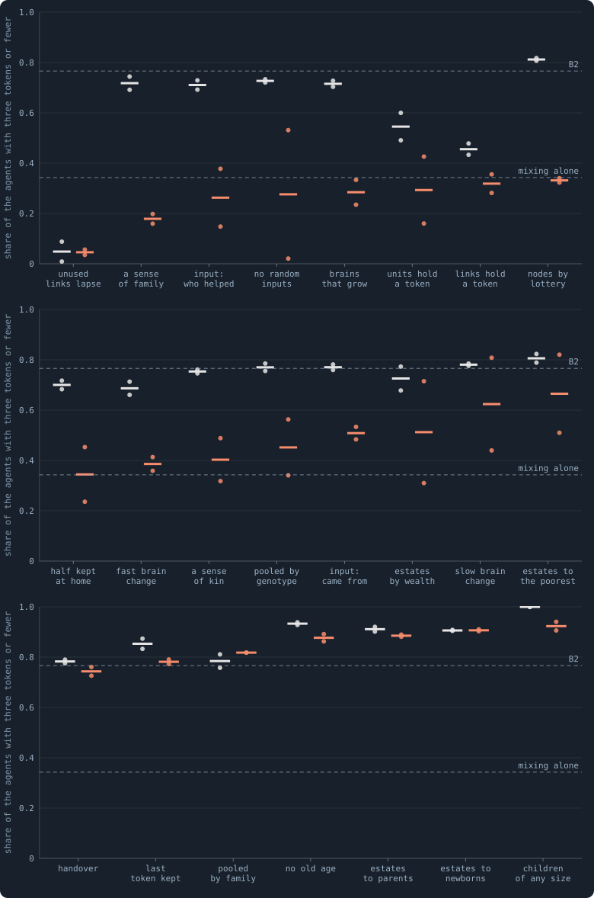

**Agents holding three tokens or fewer.** Each grey dot is a world of B2 with one other rule, each orange dot the same rule with brains mixed at birth as well (batch Y), seeds 1 and 2, read at iteration 1,000; the short bars are the means. The dashed lines are B2 itself and B2 with mixing alone, the means of the same seeds. The rules are in the order of the orange means.

> [!example]- How to make this figure
> **Runs.** Batch Y's 46 pilot worlds (B2 at 10,000 tokens, brains mixed at birth and one other rule, seeds 1 and 2, `GraphOfLifeRuns/.pilots/Y/`) and their controls: the same rule alone, from the batch or lab experiment that made it, and, of the same seeds, B2 itself (Experiment 16's lab worlds) and B2 with brains mixed at birth alone (Experiment 17's lab worlds).
>
> **Data.** From each world's checkpoint at iteration 1,000, or the lab's whole world kept then (`research/atlas/at.py --at 1000`, `GraphOfLifeRuns/.pilots/atlas/at1000.json`).
>
> 1. Read each world as `research/atlas/profile.py` reads every world.
> 2. Rank its four spreads among [Healthy and rich](building-b2-and-the-search-for-a-healthy-rich-world.md#healthy-and-rich)'s worlds; the diversity score is the mean.
>
> **To make it again:** `python3 book_figures.py mixcombos`.
<!-- /figure -->
**With sixteen of the rules, mixing keeps its riches.** The orange dots sit
far below the grey ones, near or below B2 with mixing alone. With some rules
it does more than alone:
- with a sense of family, 18% of the agents hold three tokens or fewer;
- with an input saying who helped, 26%;
- without random inputs, 28% (one world at 2%);
- with brains that grow, 28%;
- with units that hold a token, 30%.

With mixing alone it is 34%. With three of the sixteen, one seed of the two
stayed nearly as poor as without mixing. They are estates by wealth, estates
to the poorest, and a slower change of brains.

**Seven rules cancel it:**
- the estate of the dead to the newborns, or to the parents;
- children of any size;
- no old age;
- handover;
- only the last token kept at home;
- and stakes pooled by family.

Their worlds are as poor with mixing as
without: 73% to 94% of the agents hold three tokens or fewer.

[Mixed at birth: ten long worlds](building-b2-and-the-search-for-a-healthy-rich-world.md#brains-mixed-at-birth-in-long-worlds) says
why for most of them. Mixing makes a world rich by making its agents slow to
have children. Three of these rules pay for a birth or make it cheap. An
estate lands on the newborns or on their parents, or a child is had for any
number of tokens. Then the world fills up again. Without old age nobody needs
replacing at all, and the world fills with the old. Why handover, the last
token kept and stakes pooled by family cancel mixing too, this batch does not
show.

### How much the agents differ

<!-- figure mixcombos/diversity -->
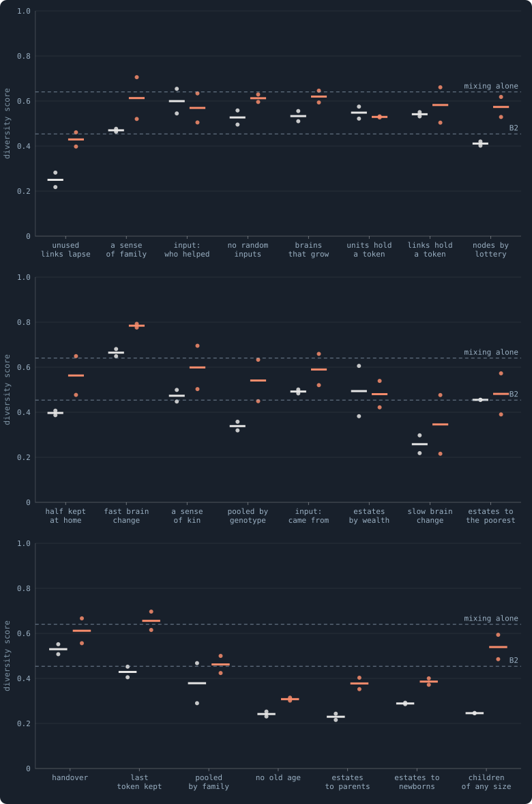

**How much the agents differ.** Each grey dot is a world of B2 with one other rule, each orange dot the same rule with brains mixed at birth as well (batch Y), seeds 1 and 2, read at iteration 1,000; the short bars are the means. The dashed lines are B2 itself and B2 with mixing alone, the means of the same seeds. The rules are in the order of the orange means.

> [!example]- How to make this figure
> **Runs.** Batch Y's 46 pilot worlds (B2 at 10,000 tokens, brains mixed at birth and one other rule, seeds 1 and 2, `GraphOfLifeRuns/.pilots/Y/`) and their controls: the same rule alone, from the batch or lab experiment that made it, and, of the same seeds, B2 itself (Experiment 16's lab worlds) and B2 with brains mixed at birth alone (Experiment 17's lab worlds).
>
> **Data.** From each world's checkpoint at iteration 1,000, or the lab's whole world kept then (`research/atlas/at.py --at 1000`, `GraphOfLifeRuns/.pilots/atlas/at1000.json`).
>
> 1. Read each world as `research/atlas/profile.py` reads every world.
> 2. Rank its four spreads among [Healthy and rich](building-b2-and-the-search-for-a-healthy-rich-world.md#healthy-and-rich)'s worlds; the diversity score is the mean.
>
> **To make it again:** `python3 book_figures.py mixcombos`.
<!-- /figure -->
Mixing raises the diversity score with nearly every rule, even with most of
those that cancel its riches. With children of any size it rises from 0.25 to
0.54, and with only the last token kept from 0.43 to 0.66. Part of that is
built in. The score counts genotypes, and every mixed birth makes a new set of
weights, so a mixed world always has more genotypes per agent. But tokens,
links and ages spread wider too where the world is rich.

The most diverse worlds of the batch are these:
- mixing with a faster change of brains (0.78 and 0.79), more than all but a
  few worlds built on B2's rules;
- mixing with a sense of kin or family (0.70, 0.71);
- mixing with an input saying where an agent came from (0.66);
- and mixing alone (0.70, 0.58).

### Healthy?

Nearly every world meets six or seven marks of the health bar, as B2's and
the mixed worlds do. The exceptions are the rules that broke the network
before mixing came. With every unused link lapsing, worlds meet four or five
marks; with handover, three.

The marks hide a risk. [Mixed at birth: ten long worlds](building-b2-and-the-search-for-a-healthy-rich-world.md#brains-mixed-at-birth-in-long-worlds)
found it, and
[Five mixed worlds, fifty thousand iterations](building-b2-and-the-search-for-a-healthy-rich-world.md#five-mixed-worlds-fifty-thousand-iterations)
saw it end in death: a mixed world's size drifts. Several of the richest
combinations are small at 1,000 iterations. A world has 270 agents with a
sense of family, and 291 without random inputs. It has 325 with units that
hold a token, and 366 with brains that grow. And small mixed worlds are the ones that die out.

### Does evolution go on? (brains mixed at birth)
<!-- figure mixcombos/evolution -->
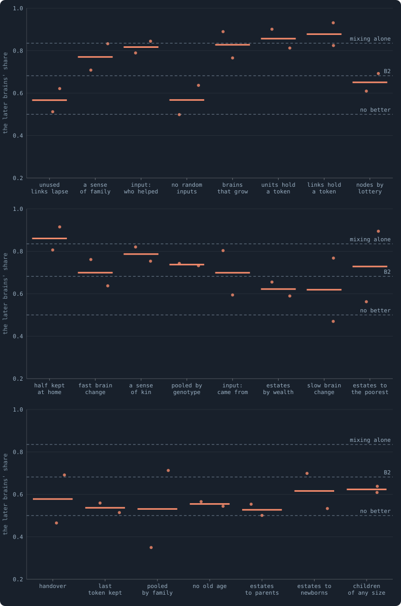

**Do the brains of 1,000 beat those of 500?** Each dot is a world of batch Y: the share of a contested world its brains of iteration 1,000 hold after 100 iterations against those of 500, the mean of two contests, one in each era's world; the bars are the medians, the rules in the order of the figures above. The dashed lines are the medians of B2's ten lab worlds and of the ten mixed worlds of Experiment 17, played the same way.

> [!example]- How to make this figure
> **Runs.** Batch Y's pilot worlds (`GraphOfLifeRuns/.pilots/Y/`); B2: Experiment 16's ten runs; mixing alone: the ten mixed worlds of Experiment 17.
>
> **Data.** From `GraphOfLifeRuns/.pilots/batch_TUV_T100.json`, `rejudge_T100.json`, `long_steps.json` and `e17_T100.json` (`research/oee/checks/rejudge.py`).
>
> 1. Seat the brains of the two eras on alternate agents of each era's world and play 100 iterations.
> 2. Count the agents the later era's brains hold, as a share of all.
>
> **To make it again:** `python3 book_figures.py mixcombos`.
<!-- /figure -->
With almost every rule, yes. In 42 of the 46 worlds, the brains of iteration
1,000 took more than half of a contested world from those of 500. The
contests last an agent's lifetime
([A contest a lifetime long](measuring-evolution.md#a-contest-a-lifetime-long)).
The median world took 69%, where B2's take 68% and those of mixing alone 84%.
The steps are largest with links that hold a token (93%), half kept at home
(91%) and units that hold a token (90%). Next come the estate to the poorest
and brains that grow (89% each).

Four worlds' later brains were no better. They came from stakes pooled by
family (35%), handover and a slower change of brains (47% each), and no
random inputs (50%). Two of them are rules that cancel mixing's riches. The
other two are worlds that stayed poorer than mixing leaves most worlds, with
81% and 53% of their agents at three tokens or fewer. Mixing does not stop
evolution, whatever else the rules say; it speeds it most where the agents
stay rich.

### What we learned (brains mixed at birth)
- **Mixing's riches are robust, but not to rules that pay for births.** With
  sixteen rules of twenty-three the worlds stay rich. Of the seven that cancel
  it, four bring children back. They pay for them, make them cheap, or take
  away the deaths they replace.
- **Evolution goes on with nearly every combination**, fastest where the
  agents stay rich.
- **The richest combinations are also the smallest.** Riches are size where
  the tokens are fixed
  ([Mixed at birth: ten long worlds](building-b2-and-the-search-for-a-healthy-rich-world.md#brains-mixed-at-birth-in-long-worlds)), and
  a small mixed world is a fragile one. None of these combinations was played
  long enough to say whether it holds its size. Experiment 18's five worlds of
  mixing alone did not.
- **Candidates.** Some worlds of the batch come closest to the author's
  picture, by riches and diversity together. They are mixing with:
  - a faster change of brains;
  - a sense of kin or of family;
  - an input saying who helped, or where an agent came from;
  - nodes decided by lottery.

  Those that meet every mark join the candidates of
  [Healthy and rich](building-b2-and-the-search-for-a-healthy-rich-world.md#healthy-and-rich) (`research/oee/candidates.md`).

### How this was made (brains mixed at birth)
Every world of batch Y is a pilot, kept in `GraphOfLifeRuns/.pilots`. No
experiment of the lab stands behind it, so the page has no box of runs. Each
corner was read at iteration 1,000 with `research/atlas/at.py`. Every figure
says, folded beneath it, which worlds it reads and how. The setting is
[`mix_at_birth`](settings.md#mix_at_birth).

## Who inherits?

When an agent dies, the cleanup shares its tokens out among the survivors:
until now evenly, every survivor with the same chance at every token. Four
other rules were played in pilot worlds of B2 and B1. Given to the poorest,
the estate changes little in B2, and keeps B1's poorest alive. Given to the
newborns or to the parents, it pays for births. B2's worlds grow by half and
grow poorer, and B1 becomes a world of infants. And in B2 evolution stops. Kept
in the family, it changes little in B2, and there evolution goes on at least
as fast as in B2 itself.

### Where the tokens of the dead go

An agent dies of age in B2. In B1 it dies when it loses its node, or when the
piece of the world it is on is cut off. Either way its tokens do not vanish:
the cleanup pools them and shares them out among the survivors. Until now
every world of this notebook shared them out **evenly**: every survivor had
the same chance at every token
([`redistribution`](settings.md#redistribution) = `uniform`;
[The share-out](b1-lives-and-wealth.md#the-share-out)). The author asked for
other ways, and each has a reading of its own:

- **to the poorest**: a safety net. The pool raises the poorest survivors to
  one common level, as far as it reaches, like water poured on an uneven
  floor;
- **to the newborns**: an inheritance for the young. The pool is shared
  evenly among the children born that iteration;
- **to the parents**: a reward for having children. The pool is shared among
  the agents that had a child that iteration, once per child;
- **to the dead agent's own children**: the estate stays in the family. Each
  dead agent's tokens go to its own living children, evenly. An estate that
  finds no living child is shared out evenly among everyone, as before
  (`redistribution` = `children`). This fourth rule followed on 17 October
  2026.

None of them has a number of its own. In an iteration without a birth, the
newborns' and the parents' rules share the pool out evenly, as before.

### The worlds (who inherits)
Each rule was played in pilot worlds of 10,000 tokens for 2,000 iterations,
two seeds each (batch R; [Pilot worlds](runs-and-records.md#pilot-worlds)). They were
played on both of the notebook's baselines. One is B2, the world that cannot
break, with Experiment 16's settings. The other is B1, where worlds break and
cut-off pieces are culled. The controls are the same settings and seeds with
the estate shared evenly ([How this was made](#how-this-was-made-who-inherits)). The
worlds of the fourth rule are the blue lines and dots below.

### B2: bigger and poorer, or no change

<!-- figure inherit/life_B2 -->
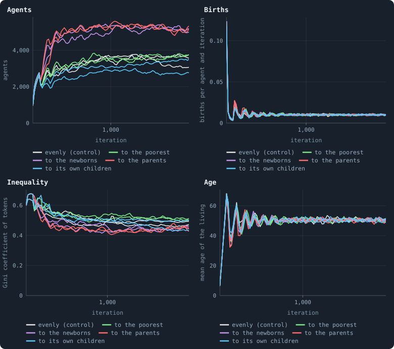

**B2 worlds, by who inherits.** B2 worlds of 10,000 tokens, two seeds of each rule, through 2,000 iterations (means over blocks of 20 iterations). Grey: the estate shared evenly, the control; green: to the poorest; violet: to the children born that iteration; red: to their parents; blue (added later): each estate to the dead agent's own living children.

> [!example]- How to make this figure
> **Runs.** Pilot worlds of 10,000 tokens, two seeds each: B2's settings (as in Experiment 16) and B1's, with `redistribution` = `poorest`, `newborns`, `parents` or `children` (`GraphOfLifeRuns/.pilots/R/`); the controls are the same settings and seeds with the estate shared evenly, `P/B2-s1`, `-s2` and the first 2,000 iterations of `L/B1-long-s1`, `-s2`.
>
> **Data.** From each world's `series.jsonl`, one row per iteration.
>
> 1. Read agents, births, the Gini coefficient and mean age every iteration.
> 2. Average over blocks of 20 iterations and draw a line per world.
>
> **To make it again:** `python3 book_figures.py inherit`.
<!-- /figure -->
**To the poorest, nothing much changes.** The worlds hold 3,600 to 3,700
agents, as B2's do. Four agents in five still hold three tokens or fewer, and
the median agent holds one. The pool is small. In B2 the dead leave about
seventy tokens an iteration among 3,600 agents. Raising the poorest by that
much lifts a few of them by a token.

**To the newborns or to the parents, the worlds grow by half**, all four of
them, to 5,100 to 5,300 agents. And they grow poorer: nine agents in ten hold
three tokens or fewer. Both rules put the estate where a birth can follow
from it. A newborn starts with the 10 tokens its parent gave, and its share
of the estate on top. So it can often afford a child of its own at once. And
a parent's reward makes the next child sooner.

Births pass on, and the world fills until hardly anyone can afford a child.
It fills to more agents than B2's, because the tokens that would have
scattered evenly go to the very agents that will breed.

### B1: younger, or a world of infants

<!-- figure inherit/life_B1 -->
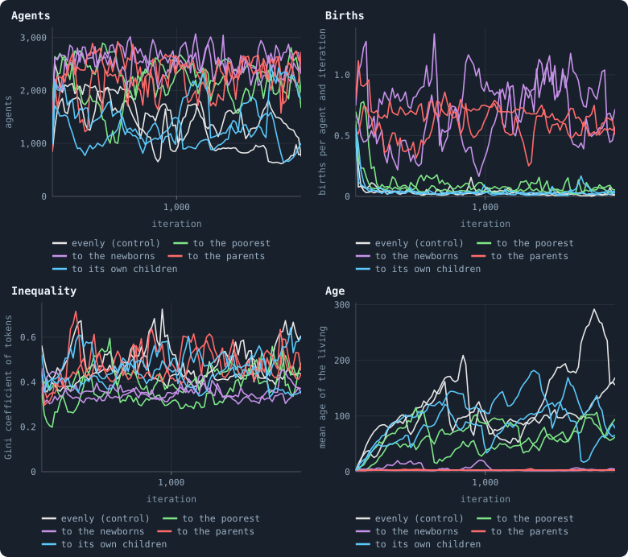

**B1 worlds, by who inherits.** B1 worlds of 10,000 tokens, two seeds of each rule, through 2,000 iterations (means over blocks of 20 iterations). Grey: the estate shared evenly, the control; green: to the poorest; violet: to the children born that iteration; red: to their parents; blue (added later): each estate to the dead agent's own living children.

> [!example]- How to make this figure
> **Runs.** Pilot worlds of 10,000 tokens, two seeds each: B2's settings (as in Experiment 16) and B1's, with `redistribution` = `poorest`, `newborns`, `parents` or `children` (`GraphOfLifeRuns/.pilots/R/`); the controls are the same settings and seeds with the estate shared evenly, `P/B2-s1`, `-s2` and the first 2,000 iterations of `L/B1-long-s1`, `-s2`.
>
> **Data.** From each world's `series.jsonl`, one row per iteration.
>
> 1. Read agents, births, the Gini coefficient and mean age every iteration.
> 2. Average over blocks of 20 iterations and draw a line per world.
>
> **To make it again:** `python3 book_figures.py inherit`.
<!-- /figure -->
B1 is a different world. Nobody dies of age: an agent lives until it loses
its node, or its piece is cut off. Its controls hold 800 to 1,400 agents,
with a mean age of 120 to 210 iterations, and about two births per hundred
agents an iteration.

**To the poorest, B1's worlds grow larger and younger.** They hold 2,100 to
2,300 agents, with a mean age of 74 to 76, and four to seven births per
hundred agents an iteration. The poorest are the agents about to starve.
Raised, they live on, and the world holds more of them.

**To the newborns or the parents, B1 becomes a world of infants.** Fifty-five
to eighty-five agents in a hundred are born *every iteration*, and the living
are three iterations old on average. Where nothing caps a life, the estate
that pays for a birth sets off the next birth at once. And the newborns die
almost as fast as they come.

### Does evolution go on? (who inherits)
<!-- figure inherit/contests -->
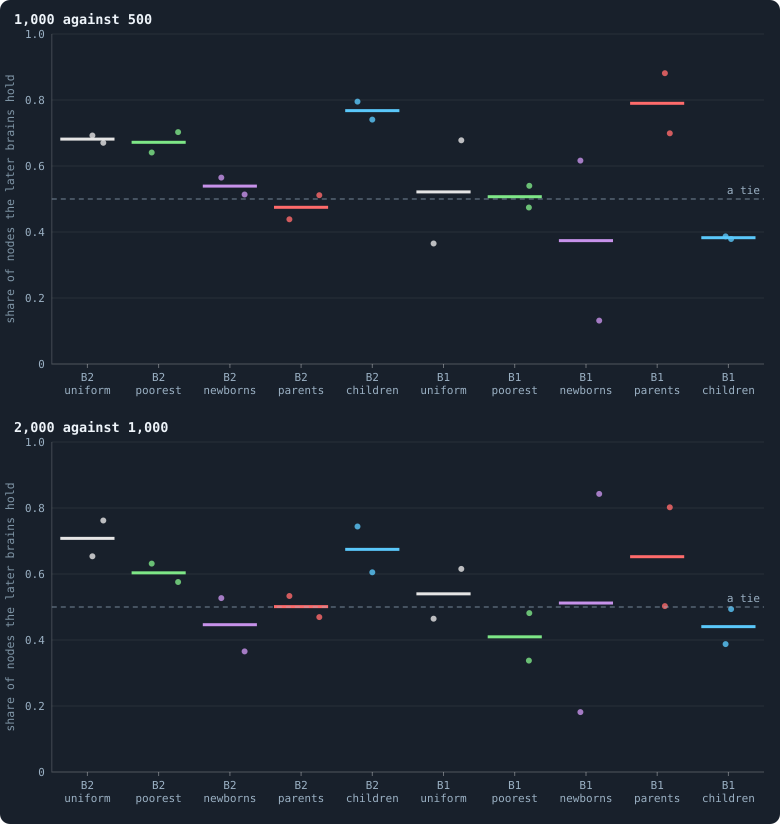

**Does evolution go on?** Lifetime contests (T = 100 iterations): the brains of a later moment against those of an earlier one, half and half on the same world, once in each moment's world; the share of nodes the later brains hold at the end, averaged over the two. Above a half, the later brains are better. Each dot is a world.

> [!example]- How to make this figure
> **Runs.** Pilot worlds of 10,000 tokens, two seeds each: B2's settings (as in Experiment 16) and B1's, with `redistribution` = `poorest`, `newborns`, `parents` or `children` (`GraphOfLifeRuns/.pilots/R/`); the controls are the same settings and seeds with the estate shared evenly, `P/B2-s1`, `-s2` and the first 2,000 iterations of `L/B1-long-s1`, `-s2`.
>
> **Data.** From `GraphOfLifeRuns/.pilots/batch_R_T100.json` and `batch_P_T100.json` (`research/oee/checks/rejudge.py --T 100`).
>
> 1. Load both moments' checkpoints; give half the agents of one world the brains of each moment.
> 2. Play 100 iterations; count the nodes each side holds.
> 3. Do it again in the other moment's world and average.
>
> **To make it again:** `python3 book_figures.py inherit`.
<!-- /figure -->
The contests are a lifetime long: 100 iterations
([A contest a lifetime long](measuring-evolution.md#a-contest-a-lifetime-long)).
The brains of a later moment play those of an earlier one, once in each
moment's world.

- **B2 with the estate to the poorest evolves as B2 does.** The brains of
  1,000 iterations take 64% and 70% of a contested world from those of 500.
  Those of 2,000 take 63% and 58% from those of 1,000. The control gives 69%
  and 67%, then 65% and 76%.
- **B2 with the estate to the newborns or to the parents stops evolving.** The
  later brains take 37% to 57%: no better, at both steps, in all four worlds.
- **B1's worlds tie or swing**, with the estate shared any way: from 13% to
  88%, for one world and one step. B1 stops learning after its first hundred
  iterations
  ([Does evolution keep going?](how-to-tell-a-world-that-keeps-evolving.md)),
  and a contest of a stopped world is a coin toss.

Why should evolution stop in B2 when the estate goes to the newborns or the
parents? Here is one reading. In those worlds, what an agent's line gets
depends on when it was born, on whose estate fell to it. That counts as much
as what its brain does, so the brains that spread are not the better ones.
The fourth rule is a test of this reading
([To the dead agent's own children](#to-the-dead-agents-own-children)).

### Healthy, and diverse?

Here is each world at iteration 2,000, read as
[Healthy and rich](building-b2-and-the-search-for-a-healthy-rich-world.md#healthy-and-rich) reads every world:

| world | agents | marks of the health bar (of 7) | dimension | agents with 3 tokens or fewer | diversity score |
|---|---|---|---|---|---|
| B2, the control (lab, seeds 1, 2) | 3,546; 3,064 | 6; 6 | 4.54; 4.35 | 78%; 70% | 0.53; 0.48 |
| B2, to the poorest | 3,753; 3,728 | 6; 7 | 4.42; 3.95 | 80%; 82% | 0.45; 0.46 |
| B2, to the newborns | 5,179; 5,029 | 7; 7 | 3.90; 3.85 | 91%; 91% | 0.26; 0.28 |
| B2, to the parents | 5,317; 5,228 | 7; 7 | 3.40; 3.76 | 91%; 92% | 0.19; 0.21 |
| B2, to its own children | 2,748; 3,541 | 6; 6 | 4.32; 4.64 | 64%; 77% | 0.55; 0.51 |
| B1, the control (`L/B1-long`, seeds 1, 2) | 711; 778 | 3; 3 | 2.74; 2.70 | 6%; 19% | 0.83; 0.88 |
| B1, to the poorest | 1,775; 1,726 | 3; 3 | 2.39; 3.28 | 71%; 52% | 0.38; 0.64 |
| B1, to the newborns | 2,631; 2,236 | 2; 4 | 2.00; 2.11 | 57%; 40% | 0.37; 0.20 |
| B1, to the parents | 2,761; 2,351 | 5; 4 | 3.31; 3.20 | 65%; 58% | 0.55; 0.60 |
| B1, to its own children | 2,047; 1,112 | 4; 5 | 2.35; 3.01 | 44%; 35% | 0.76; 0.85 |

Take the B2 worlds whose estate goes to the newborns or the parents. They
meet every mark, at a dimension well under 4, although they hold more than
5,000 agents.
And their agents are alike in tokens, links and ages. Their diversity scores
are 0.19 to 0.28, against 0.48 and 0.53 for B2 itself, and nine in ten of
them are poor. A healthy network is not a world that keeps evolving.

### To the dead agent's own children

The fourth rule keeps each estate in the family. A dead agent's tokens go to
its own living children, evenly. Only an estate that finds no living child is
shared out among everyone. Two seeds of each baseline were played as the
others were, to 2,000 iterations.

**In B2 it changes little.** Over iterations 1,500 to 2,000 the two worlds
hold 2,700 and 3,400 agents, where the controls hold 3,650 and 3,200. They
have a birth per hundred agents an iteration, as every B2 world does, and
about as much inequality. At 2,000, 64% and 77% of their agents hold three
tokens or fewer (78% and 70% in the controls). And they meet the same six
marks of seven, failing the dimension as B2 does.

The estates to the newborns and to the parents filled the world because they
reach agents the moment they breed. A dead agent's children are of every
age, and the estate comes to them whether or not they breed. Their parents
are 26 iterations old at a birth, in the median, as in B2. Where the estate
goes to the newborns or the parents, parents are two or three iterations old
([A world through its life](how-many-dimensions-does-a-world-have.md#a-world-through-its-life)).

**In B1 the worlds grow larger and younger, less than with the safety net.**
Over iterations 1,500 to 2,000 they hold 1,800 and 1,300 agents, where the
controls hold 1,370 and 790. They have 4.7 and 2.8 births per hundred agents
an iteration, against 2.0 and 1.5 in the controls. Their mean age is 74 and
113 iterations, against 119 and 214. Like the controls they swing, one world between 570
and 2,700 agents. At 2,000 they are poorer than the controls: 44% and 35% of
their agents hold three tokens or fewer, against 6% and 19%. They are about
as diverse, and they meet four and five marks of seven, where the controls
meet three.

**In B2 evolution goes on, at least as fast as in B2 itself.** In lifetime
contests the brains of 1,000 take 80% and 74% of a contested world from those
of 500. The brains of 2,000 take 74% and 61% from those of 1,000. The control
gives 69% and 67%, then 65% and 76%: the blue dots of the contests figure.

Here the estate passes down an agent's own line, to heirs of every age,
whenever one of the line dies. It does not go to whoever has just been born,
or has just had a child, whatever its line. That is the difference the
reading above points to. Where the estate pays for a birth as it happens,
what a line gets depends on when it was born, and evolution stops. Where it
passes down a line over a life, evolution goes on.

**In B1 the later brains lose**, at 38% and 39%, then 49% and 39%, as B1's
other worlds tie or swing.

### What we learned (who inherits)
- **Who inherits sets how many agents a world holds.** Some estates land
  where a birth can follow from them, on the newborns or the parents. They
  fill a world to more agents than an even share does. It grows B2's worlds by half,
  and makes B1's a world of infants. The safety net does little in B2, whose
  dead are poor, and keeps B1's poorest alive.
- **More agents is not more life.** The bigger worlds are poorer and more
  alike, and in B2 they stop evolving. None of the first three rules brings a
  world nearer to the author's picture than the even share does.
- **An estate kept in the family changes little.** B2's worlds stay near B2's
  size and poverty, and keep evolving at least as fast. B1's grow larger,
  poorer and younger than its controls.
- **With mixing, too.** Batch M combines each rule with brains mixed at birth
  ([Mixed at birth: ten long worlds](building-b2-and-the-search-for-a-healthy-rich-world.md#brains-mixed-at-birth-in-long-worlds)). It
  asks whether one of them holds a mixed world's drifting size. The estates to
  the newborns and to the parents fill those worlds as well: past 5,000
  agents in the first seeds played.

### How this was made (who inherits)
Every world on this page is a pilot of batch R, kept in
`GraphOfLifeRuns/.pilots`. No experiment of the lab stands behind it, so the
page has no box of runs. The worlds of the fourth rule are
`R/B2-children-s1`, `-s2`, `R/B1-children-s1` and `-s2`. The controls are,
for B2, the pilot worlds `P/B2-s1` and `-s2`, which replay the lab's
Experiment 16 worlds game for game. For B1 they are the first 2,000
iterations of the long runs `L/B1-long-s1` and `-s2`. The table reads every
world from one file (`research/atlas/at.py --at 2000`). Every figure says,
folded beneath it, which worlds it reads and how. The setting is
[`redistribution`](settings.md#redistribution).

## Links to strangers

Agents of B2 were given a way to look for a stranger and propose a link.
It was a paid jump, a paid scout that walks step by step, or a free reach. When a
search costs tokens, hardly anyone pays for it; when it is free, agents reach
all the time. But the strangers they find are near, two or three steps away.
So the network grows denser where it already is, and its dimension does not
change. Every searching world is smaller and a little richer than B2, and its
brains evolve faster, whether its agents search or not.

### A way out of the neighbourhood

In every world of the notebook so far, an agent could only link to agents it
was already near. At birth those are its parent and its parent's neighbours.
When it chose links of its own, they were the neighbours of its neighbours. A
world built that way grows like a crystal, outward from where it began.

The author asked for a way out: an agent that can go looking for a stranger.
It might jump or walk step by step, at random or looking where it is going.
And it might propose a link, or force one.

### What was built (links to strangers)
Three settings of the engine do it, all off unless a run turns them on
([`link_search`](settings.md#link_search),
[`link_steering`](settings.md#link_steering),
[`link_consent`](settings.md#link_consent)). After a reproduction phase, an
agent's brain says how many of its tokens it spends on a search:

| search | what the agent does |
|---|---|
| **jump** | a walk as many steps long as the tokens it spends, all in one iteration; a link is proposed where the walk ends, if it ends at a stranger |
| **walk** | a scout that goes one step further in every iteration the agent pays for, and proposes where it stands when that is a stranger |
| **reach** | a jump whose steps are free, as many as the tokens it holds would pay for |

A paid step costs one token, paid to the agent the step enters; nobody pays
its last token. Each step goes to a neighbour drawn at random. Or, when the
search is **looking**, it goes to the neighbour the searcher would most like a
link with. A proposal becomes a link if both ends agree (**mutual**), or if
the proposer alone wants it (**forced**). Either way, nobody at its valence
of eight links gets a new one.

### The worlds (links to strangers)
Batch K plays B2 at 10,000 tokens with every search, every steering and every
consent: twelve kinds of world. Each has seeds 1 and 2 and runs for 1,000
iterations, as pilot worlds ([Pilot worlds](runs-and-records.md#pilot-worlds)). The
control is B2 itself with the same seeds: the lab's Experiment 16 worlds
again, game for game. From each world's checkpoint at iteration 1,000, fifty
more games were played and recorded, and every proposal in them was counted
([How this was made](#how-this-was-made-links-to-strangers)).

### Do they search?

<!-- figure strangers/use -->
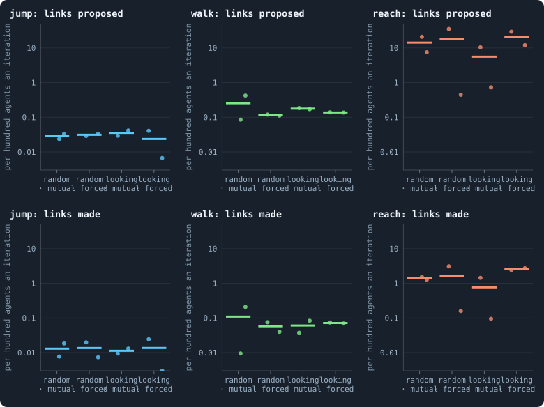

**How much the agents search.** Each dot is a world, read over 50 games played on from its checkpoint at iteration 1,000: above, the links its agents proposed to strangers; below, those that were made; per hundred agents an iteration, on a logarithmic axis (a world with none is drawn at the bottom). Jump: a walk as many steps long as the tokens an agent spends on it; walk: a scout one step further each iteration it is paid for; reach: as many free steps as the tokens held would pay. Each column of a panel is a steering (random, or looking for the best liked) and a consent (both ends agree, or only the one who proposes).

> [!example]- How to make this figure
> **Runs.** Batch K's 24 pilot worlds — B2 at 10,000 tokens with `link_search` = jump, walk or reach, `link_steering` = random or looking and `link_consent` = mutual or forced, seeds 1 and 2, 1,000 iterations (`GraphOfLifeRuns/.pilots/K/`, `research/oee/pilots/make_jobs_TU.py`) — and B2 itself with the same seeds (`P/B2-s1`, `-s2`).
>
> **Data.** From `GraphOfLifeRuns/.pilots/k_links.json` (`research/oee/checks/k_links.py`).
>
> 1. Play each world on for 50 games from its checkpoint at 1,000, recording them in the lab's form.
> 2. Count the proposals in each reproduction phase and those that made a link, per agent that faced the phase.
>
> **To make it again:** `python3 book_figures.py strangers`.
<!-- /figure -->
**When a search costs tokens, hardly anyone pays for it.** In the worlds with
a jump, 0.01 to 0.04 proposals were made per hundred agents an iteration.
With a walk it was 0.1 to 0.4: in a world of 3,000 agents, one proposal every
few iterations.

**When it is free, they reach all the time**: up to 35 proposals per hundred
agents an iteration, and 0.1 to 3 new links. Most proposals fail: only 7% to
36% of the reach worlds' proposals become links. The other end says no, or is
already at its valence. How a search steers, and whether a link needs both
ends' consent, matters less than the seed of the world.

**And the strangers are near.** The median proposal, in every world, goes to
an agent two or three steps away: a neighbour's neighbour, or one step
beyond. No proposal in any world went twenty steps or more. A search walks
the network as it is. And a short walk on a network where every agent has
five or six links rarely leaves the neighbourhood.

### What it does to a world

<!-- figure strangers/network -->
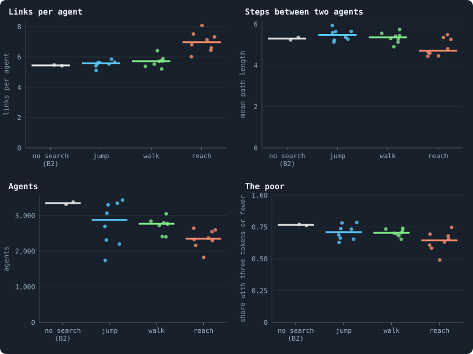

**What a search does to a world.** Each dot is a world: grey, B2 itself; the others, the eight worlds of each search (two steerings, two consents, two seeds). Links per agent and the mean path length are means of the network measures every 50 iterations from 500 to 1,000; agents too; the poor are the share of the agents holding three tokens or fewer at 1,000.

> [!example]- How to make this figure
> **Runs.** Batch K's 24 pilot worlds — B2 at 10,000 tokens with `link_search` = jump, walk or reach, `link_steering` = random or looking and `link_consent` = mutual or forced, seeds 1 and 2, 1,000 iterations (`GraphOfLifeRuns/.pilots/K/`, `research/oee/pilots/make_jobs_TU.py`) — and B2 itself with the same seeds (`P/B2-s1`, `-s2`).
>
> **Data.** From each world's `series.jsonl` and its checkpoint at 1,000 (`GraphOfLifeRuns/.pilots/k_links.json`).
>
> 1. Average the network rows of iterations 500 to 1,000.
> 2. Count the agents with three tokens or fewer in the checkpoint at 1,000.
>
> **To make it again:** `python3 book_figures.py strangers`.
<!-- /figure -->
- **More links and shorter paths, with the free reach.** Its worlds hold 6.0
  to 8.1 links per agent, against B2's 5.4 to 5.5. Two agents are 4.4 to 5.5
  steps apart, against 5.2 to 5.4. The paid searches leave both as they were.
- **The dimension does not change.** It stays at 3.8 to 4.6 in every
  searching world, B2's own range. Links to friends of friends make the
  network denser where it already is, not wider.
- **Smaller worlds, a little richer.** Every kind of searching world holds
  fewer agents than B2's. The median is about 2,900 with a jump, 2,800 with a
  walk and 2,350 with the reach, against 3,350. And fewer of them are poor: 49%
  to 79% hold three tokens or fewer, against 76% and 77%.

The worlds of the paid searches shrink, although their agents hardly propose
anything. Two things could do it. Their brains have two more outputs to set.
And a walk that ends where its agent proposes nothing has still paid every
step, a token to each agent it entered. So a paid search moves tokens about
even when it makes no link. This batch does not tell which.

### Does evolution go on? (links to strangers)
<!-- figure strangers/evolution -->
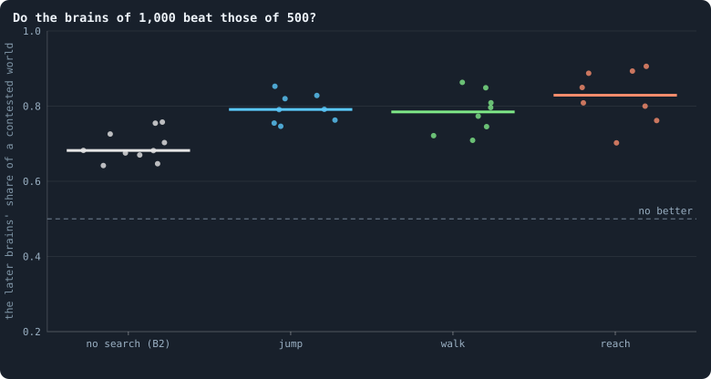

**Do the brains of 1,000 beat those of 500?** Each dot is a world: the share of a world its brains of iteration 1,000 hold after 100 iterations against those of 500, the mean of two contests, one in each era's world. B2: Experiment 16's ten worlds.

> [!example]- How to make this figure
> **Runs.** Batch K's 24 pilot worlds — B2 at 10,000 tokens with `link_search` = jump, walk or reach, `link_steering` = random or looking and `link_consent` = mutual or forced, seeds 1 and 2, 1,000 iterations (`GraphOfLifeRuns/.pilots/K/`, `research/oee/pilots/make_jobs_TU.py`) — and B2 itself with the same seeds (`P/B2-s1`, `-s2`). B2: Experiment 16's ten runs.
>
> **Data.** From `GraphOfLifeRuns/.pilots/batch_K_T100.json` and `long_steps.json`.
>
> 1. Seat the brains of the two eras on alternate agents of each era's world and play 100 iterations (`research/oee/checks/rejudge.py`).
> 2. Count the agents the later era's brains hold, as a share of all.
>
> **To make it again:** `python3 book_figures.py strangers`.
<!-- /figure -->
**Yes, and faster than in B2.** In every one of the 24 worlds, the brains of
iteration 1,000 took more than half of a contested world from those of 500.
Over an agent's lifetime, they took 70% to 91%
([A contest a lifetime long](measuring-evolution.md#a-contest-a-lifetime-long)).
B2's took 68%, in the median of its ten lab worlds. The median world with a
jump took 79%, with a walk 78%, and with the reach 83%.

And it hardly matters how much the agents searched. The worlds of the paid
searches, whose agents almost never propose a link, evolve as fast as those
of the free one. What every searching world has is a smaller size, and two
more outputs for its brains to set. The mixed worlds of
[Mixed at birth: ten long worlds](building-b2-and-the-search-for-a-healthy-rich-world.md#does-evolution-go-on-brains-mixed-at-birth),
smaller still, took 84%. Do smaller worlds evolve faster? Or does a contest
in a smaller world give a later brain more room to win? This batch cannot
say.

### What we learned (links to strangers)
- **Given a way to reach strangers, agents reach their neighbours'
  neighbours.** Nothing in the game rewards a far link over a near one. And a
  search that walks the network finds what is near.
- **A paid search is not worth its tokens**, to these brains, at this length
  of evolution. The free one is used, and changes the network locally.
- **Every searching world evolves faster than B2**, whether its agents search
  or not. What they share is a smaller world, and more for a brain to set.
- **Locality survives.** The notebook's other aim is a network that behaves
  like space
  ([Is a world a space?](how-many-dimensions-does-a-world-have.md)). For it,
  far links would be the danger: a few shortcuts make a world small and its
  dimension high. Searching agents do not make them, and their worlds keep
  B2's dimension. A search could go further than a walk from home, to an
  agent drawn from the whole world, say. That would test whether the game
  itself keeps space local. No setting offers one yet.

### How this was made (links to strangers)
Every world on this page is a pilot of batch K, kept in
`GraphOfLifeRuns/.pilots`. No experiment of the lab stands behind it, so the
page has no box of runs. The control worlds are the pilots `P/B2-s1` and
`-s2`, which replay the lab's Experiment 16 worlds game for game. The
proposals of the fifty recorded games were
counted with `research/oee/checks/k_links.py`. Every figure says, folded
beneath it, which worlds it reads and how.

## Brains mixed at birth, units that cost, an eye for raids on kin

Three changes to B2 were tried in pilot worlds, each aimed at a different
part of how evolution works. Brains mixed at birth made the worlds small and
combative, and in one of two worlds gave the largest steps of evolution yet.
Units that each hold a token shrank brains to one or two units. Yet their
evolution was stronger than with free units, from 500 to 1,000 iterations. An
input for raids on one's own kind changed nothing. And a world where every
link holds a token and nobody dies of age froze: little is born, little dies,
and little evolves.

### Three changes to how evolution works

[Why evolution stops](how-to-tell-a-world-that-keeps-evolving.md#why-evolution-stops)
asked why evolution slows down in these worlds. The lifetime contests of
[The switches the world was built with](what-the-switches-did-in-pilots.md#revolutions-handover-and-gifts-the-switches-the-world-was-built-with)
showed that in B2's family of worlds it does not quite stop. The brains of
1,000 iterations still beat those of 500 two times out of three. This page
tries three more changes, each aimed at a different part of how evolution
works:

- **how variation is made**: brains mixed at birth;
- **what a brain costs**: every active unit holds a token;
- **what an agent can see**: an input for raids on its own kind.

### What was built (brains mixed at birth)
Every world is B2 at 10,000 tokens, with Experiment 16's settings, played for
2,000 iterations. Each has two seeds, as pilot worlds
([Pilot worlds](runs-and-records.md#pilot-worlds)):

| switch | what it does | compared with |
|---|---|---|
| `mix` | A newborn's brain is mixed from its parent's and a mate's — a neighbour of the parent, drawn at random. Each hidden unit (its incoming weights, its bias and its outgoing weights together) and each output bias comes from one or the other, with an even chance. The mixture is a new genotype, then mutated as any copy is. | B2 |
| `took_kin` | One more input per neighbour: did it, in the last game, take a node held by an agent of my genotype? | B2 |
| `unit_token` | Brains that can grow (up to 32 hidden units, switched on and off by mutation), where every active unit holds one of its agent's tokens. A unit switched on is paid for, one switched off pays its token back, and what an agent cannot pay for stays off. | the same growable brains with units free |
| `link_token`, no old age | Every link holds a token, paid by whoever makes it; no cap on links (valence 0) and no age limit. | — |

Each is judged by **lifetime contests**, as
[The switches the world was built with](what-the-switches-did-in-pilots.md#revolutions-handover-and-gifts-the-switches-the-world-was-built-with)
judged the switches. The brains of a later moment play those of an earlier
one, half and half on the same world. They play for 100 iterations
([A contest a lifetime long](measuring-evolution.md#a-contest-a-lifetime-long)).
Each pair plays once in each moment's world.
If the later brains hold more than half of the nodes at the end, evolution
went somewhere between the two moments.

<!-- figure ideas/contests -->
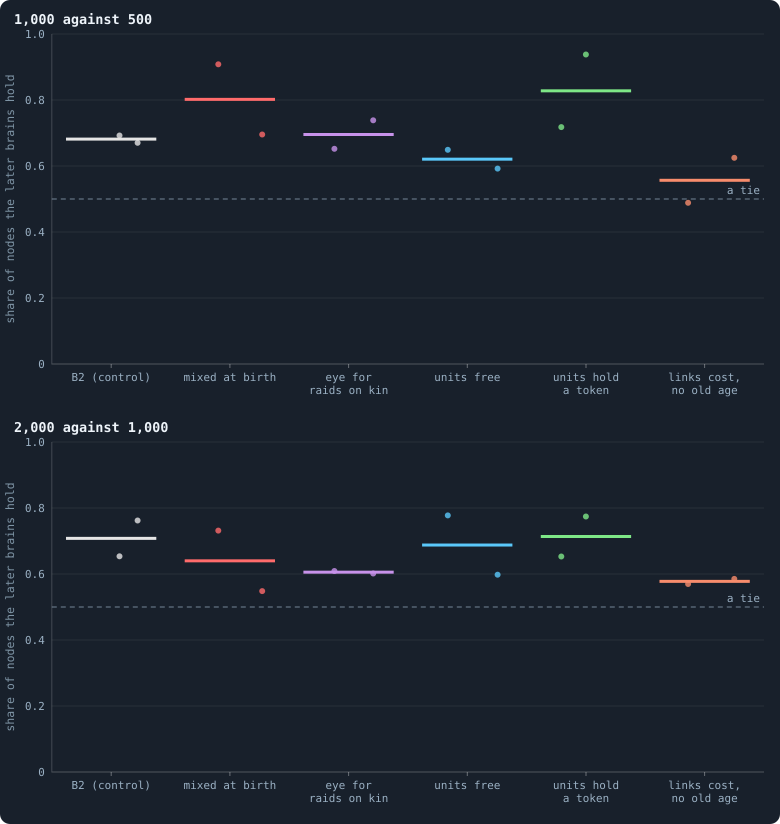

**Does evolution go on?** Lifetime contests (T = 100 iterations): the brains of a later moment against those of an earlier one, half and half on the same world, in each moment's world; the share of nodes the later brains hold, averaged over the two. Above a half the later brains are better. Each dot is a world.

> [!example]- How to make this figure
> **Runs.** Pilot worlds of 10,000 tokens with B2's settings, two seeds each, 2,000 iterations (`GraphOfLifeRuns/.pilots/Q/`, `research/oee/pilots/jobs_Q.txt`): `mix`, `took_kin`, growable brains (`brain_kind = grow`, up to 32 units) with units free and with `unit_token`, and `link_token` with `valence = 0` and `max_age = 0`; the control is batch P's B2 worlds of the same settings and seeds.
>
> **Data.** From `GraphOfLifeRuns/.pilots/batch_Q_T100.json`, `batch_P_T100.json` (`research/oee/checks/rejudge.py --T 100`).
>
> 1. Play each pair of moments for 100 iterations in each moment's world; average.
>
> **To make it again:** `python3 book_figures.py ideas`.
<!-- /figure -->

### Brains mixed at birth

Mixing changes the worlds first. They are a quarter of B2's size: 750–980
agents, against 3,200–3,650. Their conquest is twice B2's: 10–13 nodes taken
per 100 agents a game, against about 6. And more of what is taken goes round.
Over fifty games, the circulating share of the takeovers' flow is 0.63–0.64,
against 0.49–0.51 for its sign-flip null
([Gliders, and who helps whom](cooperation-help-and-gliders.md#gliders-and-who-helps-whom)). B2 has
0.39–0.42, against 0.34–0.35.

And evolution goes on, in one world strongly. In the first world, the brains
of 1,000 hold nine tenths of the nodes against those of 500 (0.91). Those of
2,000 hold three quarters against those of 1,000 (0.73): the largest steps of
any pilot world so far. The second world moves like B2: 0.70, then 0.55,
where B2 gives 0.67–0.69, then 0.65–0.76.

Why would mixing help? A mixed child inherits whole units from two unrelated
brains. So a unit that does something useful can spread through the
population without carrying the rest of the brain it arose in. And two useful
units that arose in different lineages can meet in one child. That is the
classical argument for sex. Here it is a hypothesis: two seeds, small and
combative worlds, and no test yet of which of these does the work.

### Units that hold a token

Where units are free, brains grow. Over 2,000 iterations the mean number of
active units rose from 4 to 5.6 in one world, and to 9.8 in the other. The
second is far above the **neutral shadow**: a unit that mutates like the
others but does nothing. The shadow shows where the count would drift if
selection did not care, and it is 3.9 there. So in a world where it costs
nothing, a larger brain is selected for.

<!-- figure ideas/units -->
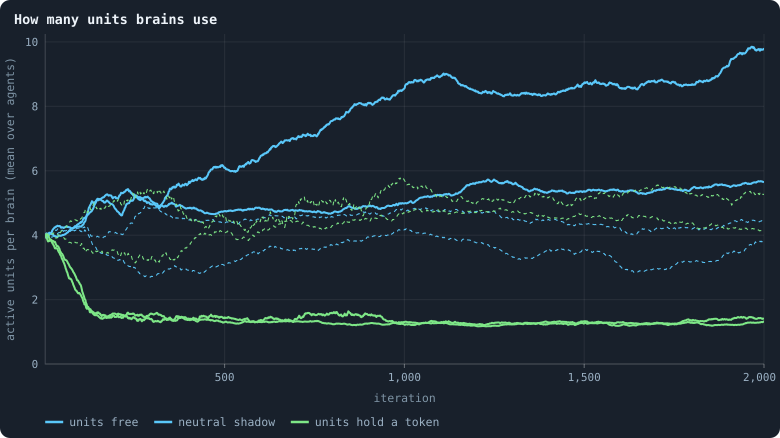

**How many units brains use.** Growable brains of up to 32 hidden units, where switching a unit on is free (blue) and where every active unit holds one of its agent's tokens (green). The dashed lines are each world's neutral shadow: the same count for a unit that mutates but does nothing, which is where the number would sit if selection did not care.

> [!example]- How to make this figure
> **Runs.** Pilot worlds of 10,000 tokens with B2's settings, two seeds each, 2,000 iterations (`GraphOfLifeRuns/.pilots/Q/`, `research/oee/pilots/jobs_Q.txt`): `mix`, `took_kin`, growable brains (`brain_kind = grow`, up to 32 units) with units free and with `unit_token`, and `link_token` with `valence = 0` and `max_age = 0`; the control is batch P's B2 worlds of the same settings and seeds.
>
> **Data.** From each world's `series.jsonl` (`activeMean`, `shadowMean`).
>
> 1. Read the mean number of active units, and of the shadow's, every 50 iterations.
>
> **To make it again:** `python3 book_figures.py ideas`.
<!-- /figure -->
Where every unit holds a token, brains shrink: from 4 units to about 1.3
within 200 iterations. And they stay there, far below their shadow (4.1 and
5.3). A unit is worth less than the token it holds. The worlds are smaller,
with 1,150–1,440 agents. And yet from 500 to 1,000 their evolution is
stronger than that of the same brains with free units. The brains of 1,000
hold 0.72 and 0.94 of the nodes against those of 500, where free units give
0.59 and 0.65. From 1,000 to 2,000 the two are alike, and like B2: 0.65 and
0.77, against 0.60 and 0.78.

A brain of one or two units is a very small target for mutation: almost
every change touches something that matters. That may be why selection keeps
finding improvements. It is a guess to test, not a finding.

### An eye for raids on kin

The input changed nothing that was measured. The worlds are B2's size, with
3,540–3,560 agents. Evolution goes on at B2's pace: 0.65–0.74 from 500 to
1,000, and 0.60–0.61 from 1,000 to 2,000, against 0.67–0.69 and 0.65–0.76.
And help between neighbours stays at B2's level. Like the inputs of
[Gliders, and who helps whom](cooperation-help-and-gliders.md#gliders-and-who-helps-whom), it tells an
agent something its rules give it no reason to act on.

### Links that hold a token, and nobody dies of age

With a token in every link and no age limit, the worlds froze. After the
first few hundred iterations, births and deaths nearly stopped. There were
some 250–300 births in the next 1,700 iterations, in worlds of 1,600–1,900
agents. At 2,000 iterations the mean age is about 1,600. Conquest almost
stopped, at 0.1–0.6 nodes taken per 100 agents a game. And the contests are
near a tie or a little above: 0.49–0.63, the mean of each pair of moments.
The only way a brain can spread is to take a node.

The network is fine: one piece, nothing cut off, 6.1–6.9 links per agent.
But little happens in it. With the age limit, the same rule keeps a world as
whole and resilient as B2's, whose evolution goes on more strongly. There the brains of
1,000 hold 0.83 and 0.93 of the nodes against those of 500
([Rules without numbers](rules-without-numbers.md)).

### What we learned (brains mixed at birth)
- **Three changes gave the largest steps of evolution yet.**
  - Mixing brains at birth, in one of two worlds, at every step.
  - Making units cost a token, in both worlds, from 500 to 1,000.
  - Making links hold a token, in both worlds, at both steps
    ([Rules without numbers](rules-without-numbers.md)).

  All three change how variation is made, or what structure costs. They
  change what a mutation can reach, and what a unit or a link has to earn. None changes what agents see. None is yet
  shown to keep evolution going longer than B2 does.
- **A cost turns size into a choice.** Free units grow beyond their neutral
  drift; units that cost a token shrink to almost nothing. Neither rule needs
  a number for the size of a brain.
- **Information alone changes nothing**, here as in
  [Gliders, and who helps whom](cooperation-help-and-gliders.md#gliders-and-who-helps-whom). An input is
  only as useful as the rules make acting on it.
- **A world without death freezes**, even with a network that holds together: turnover is
  what selection works on.
- Two seeds each are pilots. Mixing and costly units are candidates for an
  experiment of ten worlds, run longer, beside B2.

### How this was made (brains mixed at birth)
Every world on this page is a pilot, made with `research/oee/pilots` from the
job list `jobs_Q.txt` and kept in `GraphOfLifeRuns/.pilots`. No experiment of
the lab stands behind it, so the page has no box of runs. Every figure says,
folded beneath it, which worlds it reads and how.

A first count of the contests of the mixed worlds was wrong, before this page
was written. Mixed worlds came out the other way: later brains *lost*. The
cause was in how a contest tells the two sides apart. It labels each brain by
a number: the earlier moment's below a million, the later one's above. A
brain copied without change keeps its parent's number, so children belong to
their parent's side. But a mixed brain is a new genotype and draws a fresh
number, which in these worlds is always below a million. So every child born
during a contest was counted for the *earlier* side, whoever its parent was.
The contest, `tourney.contest`, now follows a new brain's ancestry back to
the brain it was copied from. All of the mixed worlds were judged again. No
other contest was touched: without mutation, mixing is the only way a new
number appears during one.

## Where to go next

- [Healthy and rich](building-b2-and-the-search-for-a-healthy-rich-world.md#healthy-and-rich): the author's picture, and the worlds
  read against it.
- [What holds a world's size](building-b2-and-the-search-for-a-healthy-rich-world.md#what-holds-a-worlds-size): why the rules of
  birth set a world's size.
- [The candidates, played on and played again](building-b2-and-the-search-for-a-healthy-rich-world.md#the-candidates-played-on-and-played-again):
  the best of the sixteen and the other candidate worlds at 10,000
  iterations.
- [Does evolution keep going?](how-to-tell-a-world-that-keeps-evolving.md):
  the yardstick these switches are judged by, and why a contest must last a
  life.
- [Mixed at birth: ten long worlds](building-b2-and-the-search-for-a-healthy-rich-world.md#brains-mixed-at-birth-in-long-worlds): why
  mixing makes a world rich, and what became of its worlds over 50,000
  iterations.
- [The estate of the dead](measuring-lives.md#the-estate-of-the-dead): the rules for the estate, exactly.
- [Who dies, and why](building-b2-and-the-search-for-a-healthy-rich-world.md#who-dies-and-why): the
  deaths that make the estate in B2.
- [Room and riches for the steadiest world](building-b2-and-the-search-for-a-healthy-rich-world.md#room-and-riches-for-the-steadiest-world):
  the estates played again, in the search for a healthy world.
- [Every setting](settings.md#link_search): the three settings of the search,
  exactly.
- [Is a world a space? Dimension, and what folds it](how-many-dimensions-does-a-world-have.md):
  why far links would fold a world.
- [How a brain changes](rules-in-detail.md#how-a-brain-changes): what a mutation does to a brain.
- [What the brains are like](what-the-brains-are-like.md): what evolved
  brains do.

## How our view changed

- *Rules in company*:
  - **19 October 2026.** From 18 October, this page read the census by the
    share of agents with three tokens or fewer. That share stood in for the
    author's picture, and the page said that three rules pay for their room
    with poverty. On 19 October the author made the picture precise: the worry
    is a world whose tokens are held too evenly
    ([Healthy and rich](building-b2-and-the-search-for-a-healthy-rich-world.md#healthy-and-rich)). Read with the Gini, the spaces
    of births, no old age and handover are not even: 0.45, 0.58 and 0.60. What
    they miss is diversity, or marks. The even spaces are the rich ones: 0.25
    where links lapse, and 0.39 where deaths are not mended. A box said so from
    19 October; the page now says it in its text.
- *Eight switches at once, and how sixteen worlds can test them*:
  - **17 October 2026.** Diversity scores had been percentiles among all the
    worlds read so far, so they moved a little whenever worlds were added.
    Since that day they are ranked among a frozen set of worlds
    ([Two halves](building-b2-and-the-search-for-a-healthy-rich-world.md#two-halves)). Two numbers of this page
    moved by 0.01. No random inputs had raised diversity by 0.08, now 0.09;
    mixing alone by 0.17 and 0.19, now 0.18 and 0.20.
  - **24 October 2026.** Since 18 October this page said that pairs of
    switches act together more on B1 than on B2. The chains of pairs do not
    show that. Their root mean square is smaller on B1 for the agents (370
    against 580) and the diversity score (0.07 against 0.10). Yet B1's chains
    also carry its larger seed noise. It is larger for the share of the poor
    (0.11 against 0.08) and links per agent (0.92 against 0.42). It is about
    the same for dimension and marks (`book/results/eightswitches.json`). The
    chains stay the yardstick for the page's other reason: B1's worlds differ
    far more by seed than B2's
    ([What each switch does on B1](#what-each-switch-does-on-b1)).
- *Revolutions, handover and gifts: the switches the world was built with*:
  - **15 October 2026.** As first written that morning, this page said that
    without revolutions B1's brains went on improving. They did so to iteration
    500 in one world, and to 1,000 or beyond in the other. It called that the
    only lead of its kind so far. The same day a third world, played to 3,000
    iterations, improved until iteration 500, then lost ground and nearly died
    out. So evolution lasts longer in B1 without revolutions, but not without
    end, and the lead was withdrawn
    ([In B1: how long evolution goes on](#in-b1-how-long-evolution-goes-on)).
  - **15 October 2026.** As first written, this page said that no switch keeps
    evolution going in B2. In every variant, the brains of iteration 1,000 held
    0.47 to 0.57 against those of 500. Its contests lasted 20 iterations, too
    short for what pays off over a life of 100
    ([Would we notice if it went on?](how-to-tell-a-world-that-keeps-evolving.md#would-we-notice-if-it-went-on)).
    That night the contests were played again a lifetime long. In B2 and
    nearly all its variants, evolution went on between iterations 500 and
    1,000. The switches change only how fast
    ([Does any switch keep evolution going?](#does-any-switch-keep-evolution-going)).
  - **24 October 2026.** When the lifetime contests came in, on 15 October,
    this page said that in B1 the short contests had been right. World by world
    they were not. The world of seed 1 without revolutions held 0.73 against
    iteration 500 in contests of 20 iterations, and 0.35 a lifetime long. The
    world of seed 2 with revolutions held 0.41 and 0.68. So the lead that B1
    evolves longer without revolutions rests on contests of 20 iterations alone
    (`book/results/switches.json`; `GraphOfLifeRuns/.pilots/rejudge_T100.json`;
    [In B1: how long evolution goes on](#in-b1-how-long-evolution-goes-on)).
- *Brains mixed at birth, with every other rule*:
  - **17 October 2026.** Diversity scores had been ranked among all the worlds
    read so far, so they moved a little whenever worlds were added. Since that
    day they are ranked among a frozen set of worlds
    ([Two halves](building-b2-and-the-search-for-a-healthy-rich-world.md#two-halves)), so that they stay put. Three
    diversity figures of this page moved by 0.01. The figures also gained the
    second seed of every rule alone that had only one before: batch W's worlds
    with revolutions, and handover alone.
- *Who inherits?*:
  - **17 October 2026.** The row of B1 with the estate to the parents first
    showed seed 2 as it was at iteration 1,600. It was read while the world was
    still running. It gave 2,429 agents, 5 marks, a dimension of 4.57, 66% poor and a
    diversity score of 0.55. At 2,000 the world holds 2,351 agents and meets 4
    marks, at a dimension of 3.20, with 58% poor and a score of 0.60. Since
    then the table reads every world from one file. Three diversity scores
    moved by 0.01, as the set of worlds that ranks them
    ([Healthy and rich](building-b2-and-the-search-for-a-healthy-rich-world.md#healthy-and-rich)) had grown. One share had been
    rounded the wrong way: 70.496% is 70%, not 71%. Nothing the page concludes
    changed.
- *Brains mixed at birth, units that cost, an eye for raids on kin*:
  - **24 October 2026.** From 23 October, this page called the worlds whose
    links hold a token, with the age limit, a healthy world, and linked the
    words to the six criteria of the screen of random worlds. Their dimension
    of 4.1 to 4.2 is above the screen's 4, as B2's own 4.4 is
    ([Links that hold a token](rules-without-numbers.md#links-that-hold-a-token)).
    They are as whole and resilient as B2's worlds, but not healthy in the
    screen's sense.
- **11 November 2026.** Seven pages on what the switches did in pilot worlds
  became this page's sections, and it moved to the Archive. Its title says what
  its numbers are: indicative, from two seeds a condition. Round 3 draws the
  settings these pilots tried at random. The pages are kept so that every pilot
  here can be read and played again. Nothing was cut.

<!-- turns -->
---

[Building B2, the healthy and rich search, and the pilots](../README.md#building-b2-the-healthy-and-rich-search-and-the-pilots) · [Building B2, and the search for a healthy, rich world](building-b2-and-the-search-for-a-healthy-rich-world.md) →

**Also about:** [Changing the rules](../README.md#changing-the-rules), [Brains, and how alike agents are](../README.md#brains-and-how-alike-agents-are).

> [!info]- Pages that link here (21)
> [What this notebook is about](what-this-notebook-is-about.md) · [Questioning the mechanics](questioning-the-mechanics.md) · [Every setting](settings.md) · [Glossary](glossary.md) · [The rules in detail](rules-in-detail.md) · [Measuring lives: births, deaths, ages and estates](measuring-lives.md) · [What keeps wealth spread?](what-keeps-wealth-spread.md) · [Physical inspiration](physical-inspiration.md) · [Is a world a space? Dimension, and what folds it](how-many-dimensions-does-a-world-have.md) · [Measuring space: dimension and the random twin](measuring-space.md) · [Does evolution keep going?](how-to-tell-a-world-that-keeps-evolving.md) · [Other contests: a lottery, and alliances](another-game.md) · [Rules without numbers](rules-without-numbers.md) · [Measuring health: criteria, the health bar and diversity](measuring-health.md) · [How runs are made, recorded and costed](runs-and-records.md) · [Every simulation: what was run, and what was measured](every-simulation.md) · [What B1 is, and what stood in its way](what-the-baseline-world-is.md) · [B1: the game and its flows](b1-the-game-and-its-flows.md) · [B1: brains, lineages and messages](b1-brains-lineages-and-messages.md) · [Building B2, and the search for a healthy, rich world](building-b2-and-the-search-for-a-healthy-rich-world.md) · [Cooperation, help and gliders (side study)](cooperation-help-and-gliders.md)
<!-- /turns -->
