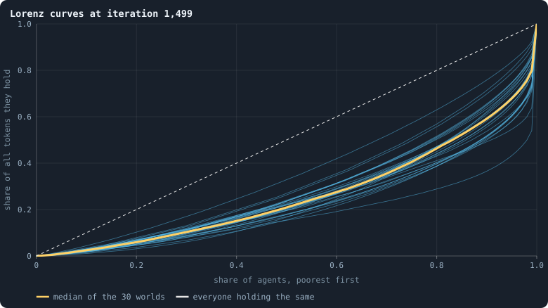
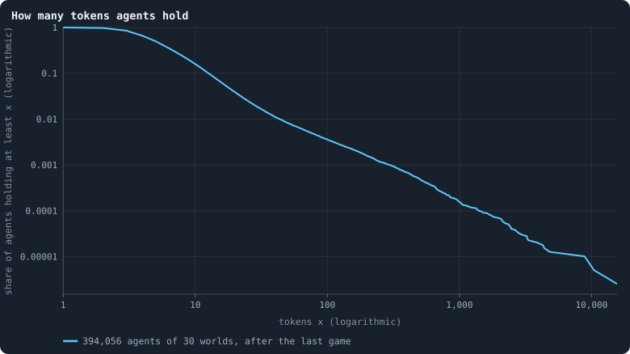
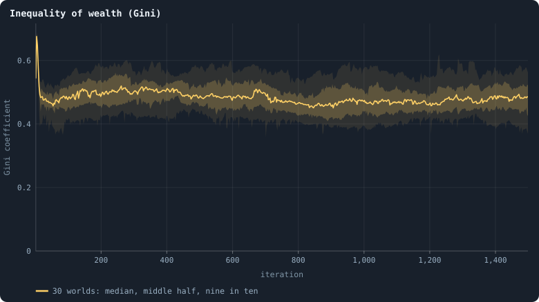
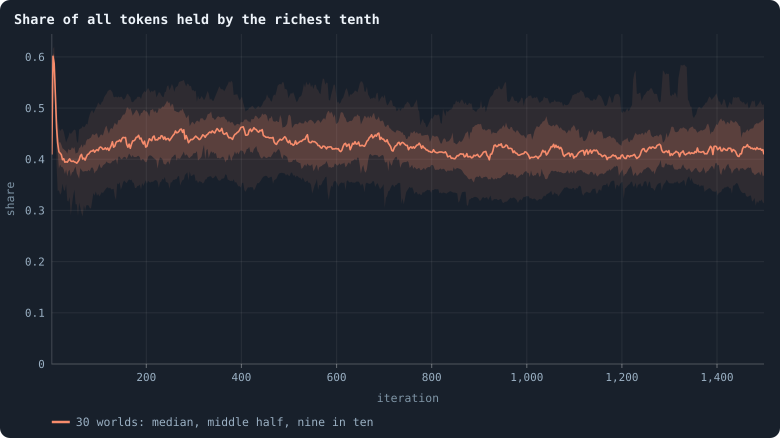
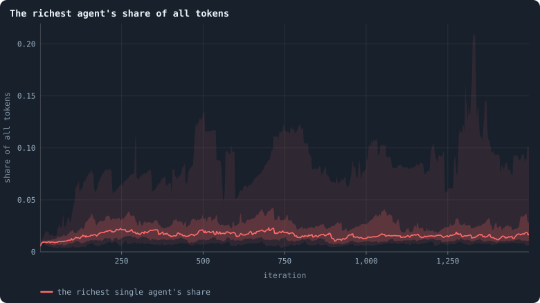
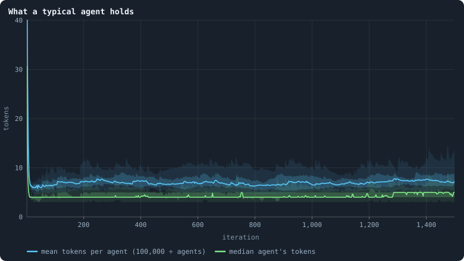
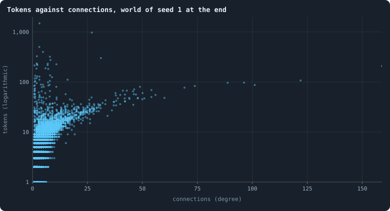
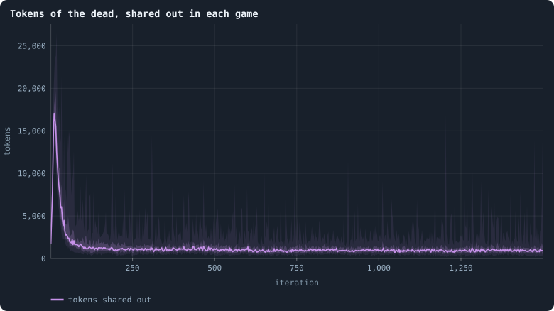

# How unequal is a world, and who stays rich

> [!question] Questions of this page
> - The [founders](starting-ring.md "One of the agents a world starts with, each holding the same tokens, on a ring with a few shortcuts.") start equal: who holds the [tokens](the-world.md#agents-and-tokens "The one thing of value in a world: every agent holds a whole number of them, and their total never changes.") later? How unequal does a
>   world become, and does inequality keep growing, or does it settle?
> - Are the rich [agents](the-world.md#agents-and-tokens "One member of a world: it lives on a node of the network, holds tokens and has a brain that takes all its decisions.") special in some way we can see?
> - How evenly are tokens, [connections](the-world.md#the-network "A link between two agents of the network: they are neighbours, and can stake on each other's nodes.") and [genotypes](genotype.md "The identity of a brain: a number that a copy keeps and a change replaces, and that remembers the genotype it came from.") spread over the agents?
>   How many genotypes are there, in effect?
> - Do entropy and the Gini coefficient say the same thing?
> - If an agent is rich now, how likely is it to be rich ten, a hundred, two
>   hundred [games](one-iteration.md#phase-2-the-game "The second phase of an iteration: every agent stakes all its tokens on its own node and its neighbours', and every node goes to someone.") later? What becomes of the very richest?

## In short

The founders of a world start equal, but the first births end that, and from
then on a world is moderately unequal. Its Gini coefficient stays near 0.47,
and the richest tenth of its agents hold about 42% of its tokens.
Experiment 4's thesis, that wealth pools because agents defend their own
nodes, was refuted: they stake only about 30% of their tokens at home. Tokens
follow connections instead: the game moves them like a random walk, which
leaves each agent tokens in proportion to its connections plus one. Measured
with entropy, the tokens are as even as if half the agents held them in equal
shares. And who is rich keeps changing: the order of wealth is half forgotten
in fifty to a hundred games.

## Where do the tokens go?

Tokens are the only thing of value in a world, and the only thing conserved:
their total never changes. The founders start exactly equal, with a hundred
tokens each. Who holds the tokens later? How unequal does a world become, and
does it stay that way?

This section reads the thirty worlds of the first [baseline](b1-and-b2.md "The stated rules an experiment starts from and changes one thing of: B1 or B2."), [B1](b1-and-b2.md "The first baseline: the algorithm exactly as a new run is offered it."), at 100,000
tokens ([Thirty worlds](a-worlds-life.md#thirty-worlds)). The thirty worlds
of 10,000 tokens it was first written from are given beside them.

### Measuring inequality

How do we measure inequality? Sort a world's agents from poorest to richest.
Then draw, for every share *x* of the agents counted from the poorest, the
share of all tokens they hold. That is the **Lorenz curve** (Lorenz 1905). If
everyone holds the same, it is the diagonal; the more unequal the world, the
further it sags below. The **Gini coefficient** (Gini 1912) turns the sag into
one number, between 0 (everyone the same) and almost 1 (one agent holds
everything):

For *n* agents with tokens sorted from smallest, *x*₍₁₎ ≤ … ≤ *x*₍ₙ₎, it is

$$
G = \frac{\sum_{i=1}^{n} (2i - n - 1)\, x_{(i)}}{n \sum_{i=1}^{n} x_{(i)}} ,
$$

which equals 1 minus twice the area under the Lorenz curve. A Gini of 0.5 has
a concrete meaning: two agents picked at random differ, on average, by as much
as the average agent holds.
[The Gini coefficient and the Lorenz curve](gini-coefficient.md) shows why,
and works an example by hand.

A plainer measure reads a single point of the curve: the share of all tokens
held by the **richest tenth** of the agents. If everyone held the same, it
would be 10% ([The richest tenth's share](gini-coefficient.md#the-richest-tenths-share)).

### What was expected

Why should wealth pool at all? In every game, each agent stakes all its tokens
on its own node and on its [neighbours](the-world.md#the-network "An agent joined to another by a connection.")' nodes. A node goes to whoever stakes
most on it, and the winner takes every token staked there. So a big agent
should find it easier to grow bigger, as in any contest where the winner takes
all. Staking on your own node also looked like the safe stake: it is the one
stake never lost to someone else's [brain](the-brain.md "The neural network each agent decides with: inputs about itself and its neighbours, outputs that become its decisions."). The tokens of the dead, shared out at
random, would pull the other way, but only a little. Before the runs of 10,000
tokens, Experiment 4 wrote this down as its thesis:

<!-- thesis E04 -->
> [!quote] The thesis of Experiment 4, written down before any of its runs existed
> **The claim.** Tokens pool. The founders start exactly equal, and within a hundred iterations the richest tenth of agents hold more than 40% of all tokens, with a Gini coefficient above 0.5 — and it stays that way. Most of what an agent stakes in the game it stakes on its own node.
>
> **Why it would be so.** A node goes to whoever stakes most on it, and the winner takes everything staked there, so being big makes it easier to become bigger. Staking on your own node is the one stake that is never lost to someone else's brain. The shared-out tokens of the dead pull the other way, but only a little.
>
> **It holds if:** From iteration 100 on, the median Gini across the thirty runs is above 0.5 and the richest tenth hold more than 40% of the tokens, and the median share of tokens staked at home is above one half.
>
> **It fails if:** Wealth stays close to even (Gini below 0.3), or concentrates and then evens out again, or agents stake most of their tokens on their neighbours. Then the game is not a winner-takes-all contest, and what keeps wealth spread out is worth its own chapter.
<!-- /thesis -->

The thesis was tested in the thirty worlds of 10,000 tokens, and again in the
thirty of 100,000 ([Was the thesis right?](#was-the-thesis-right)). First,
here is what the large worlds did, with the small ones beside them.

### The Lorenz curves of the worlds

<!-- figure tokens/lorenz -->

**Lorenz curves at iteration 1,499.** For each of the 30 worlds (thin blue lines), after its last game: the poorest share x of its agents holds the share y of all tokens. The yellow line is the median over the worlds at each x; the dashed diagonal is a world where everyone holds the same. The further a curve sags below the diagonal, the more unequal the world ([How worlds are measured](how-worlds-are-measured.md), and the diagram there).

> [!example]- How to make this figure
> **Runs.** The 30 baseline runs `B1-100000-s001` … `B1-100000-s030`: the baseline B1 at 100,000 tokens, seeds 1 to 30, 1,500 iterations each (every setting is listed in [Thirty worlds](a-worlds-life.md#thirty-worlds)). They are made with `python3 gol_lab.py run E10`.
>
> **Data.** From each run's frames, `GraphOfLifeRuns/<run>/frames/`, read with `gol_store.read_frame(run, index)`; frame `2·t` is iteration *t* after reproduction and frame `2·t + 1` after the game.
>
> 1. Read each run's last frame (iteration 1,499, `phase` 2) and its `tokens`.
> 2. Sort the tokens from smallest to largest; the curve passes through the points (i / n, (t₁ + … + tᵢ) / T) for i = 0 … n.
> 3. Interpolate each curve at x = 0, 0.01, …, 1 and take the median there.
>
> **To make it again:** `python3 book_figures.py tokens`.
<!-- /figure -->

After the last game of the thirty worlds, in the [median](median-and-quantiles.md "The middle value: half of the numbers lie below it and half above.") world the poorest half
of the agents hold 21% of all tokens. The poorest 80% hold 46%, so the richest
fifth hold 54%; and the richest tenth hold 41%. The worlds' curves lie close
together, and close to those of the worlds of 10,000 tokens (23%, 49% and
39%).

### How many tokens an agent holds

<!-- figure tokens/distribution -->

**How many tokens agents hold.** Of all agents alive after the last game of the 30 worlds, the share that hold at least x tokens, for every x. Both axes are logarithmic: a straight falling line here would be a power law.

> [!example]- How to make this figure
> **Runs.** The 30 baseline runs `B1-100000-s001` … `B1-100000-s030`: the baseline B1 at 100,000 tokens, seeds 1 to 30, 1,500 iterations each (every setting is listed in [Thirty worlds](a-worlds-life.md#thirty-worlds)). They are made with `python3 gol_lab.py run E10`.
>
> **Data.** From each run's frames, `GraphOfLifeRuns/<run>/frames/`, read with `gol_store.read_frame(run, index)`; frame `2·t` is iteration *t* after reproduction and frame `2·t + 1` after the game.
>
> 1. Pool the `tokens` of the last frame of every run.
> 2. For every value x that occurs, the share of agents with at least x.
>
> **To make it again:** `python3 book_figures.py tokens`.
<!-- /figure -->

Of the 394,056 agents alive at the end, the median agent holds 5 tokens, and
62% hold 5 or fewer. Only 2.6% hold exactly one, and 0.4% hold 100 or more;
the richest agent of all held 15,603 tokens. The mean is 7.6.

On logarithmic axes the curve bends down over the first ten or twenty tokens.
Then it falls almost straight, over two powers of ten, to the richest agents.
At 10,000 tokens it kept bending and showed no straight stretch; with ten
times the agents there is room for a long tail. Whether it is a [power law](power-law-fit.md "A quantity whose frequency falls as a power of its size: few huge values, many small ones.") is
the question of
[Power laws, real and apparent](power-laws-real-and-apparent.md).

### Inequality over time

<!-- figure tokens/gini -->

**Inequality of wealth (Gini).** After every game. The line is the median of the worlds at each iteration, the darker band holds the middle half of them (from the 25th to the 75th percentile) and the paler band nine in ten (5th to 95th).

> [!example]- How to make this figure
> **Runs.** The 30 baseline runs `B1-100000-s001` … `B1-100000-s030`: the baseline B1 at 100,000 tokens, seeds 1 to 30, 1,500 iterations each (every setting is listed in [Thirty worlds](a-worlds-life.md#thirty-worlds)). They are made with `python3 gol_lab.py run E10`.
>
> **Data.** From each run's `GraphOfLifeRuns/<run>/stats.jsonl`, which holds one row per recorded phase: `phase` 1 is the world just after reproduction, `phase` 2 just after the game, and every statistic is a field of the row (see [What a run records](frames-and-stats.md)).
>
> 1. Take every run's rows with `phase` = 2 and the statistic `gini` ([What a run records](frames-and-stats.md)).
> 2. Cut the 1,500 iterations into 600 stretches of 2.5 and take each world's mean in each stretch.
> 3. In each stretch, take the median, the 25th and 75th and the 5th and 95th percentiles of those means over the worlds that still have a value there (a world that died has none after its death).
>
> **To make it again:** `python3 book_figures.py tokens`.
<!-- /figure -->

The founders are equal, but the first reproduction phase ends that: a child
gets only part of its parent's tokens. Over the first five [iterations](one-iteration.md "One step of a world's time: a phase of reproduction, then a phase of the game.") the
median world's Gini is already 0.59, higher than it will be again. It falls
back within a few more (at 10,000 tokens it was 0.48 from the start). Over the
[settled life](median-and-quantiles.md#the-settled-life-of-a-world "A world from iteration 500 to its end, after its youth, where it is measured."), iterations 500 to 1,499, the median world's average is 0.47
(0.49 at 10,000 tokens). The thirty worlds lie between 0.40 and 0.55.
Inequality appears at once. After its first jolt, it neither grows nor
shrinks.

<!-- figure tokens/rich-tenth -->

**Share of all tokens held by the richest tenth.** After every game. The line is the median of the worlds at each iteration, the darker band holds the middle half of them (from the 25th to the 75th percentile) and the paler band nine in ten (5th to 95th).

> [!example]- How to make this figure
> **Runs.** The 30 baseline runs `B1-100000-s001` … `B1-100000-s030`: the baseline B1 at 100,000 tokens, seeds 1 to 30, 1,500 iterations each (every setting is listed in [Thirty worlds](a-worlds-life.md#thirty-worlds)). They are made with `python3 gol_lab.py run E10`.
>
> **Data.** From each run's `GraphOfLifeRuns/<run>/stats.jsonl`, which holds one row per recorded phase: `phase` 1 is the world just after reproduction, `phase` 2 just after the game, and every statistic is a field of the row (see [What a run records](frames-and-stats.md)).
>
> 1. Take every run's rows with `phase` = 2 and the statistic `topDecileShare` ([What a run records](frames-and-stats.md)).
> 2. Cut the 1,500 iterations into 600 stretches of 2.5 and take each world's mean in each stretch.
> 3. In each stretch, take the median, the 25th and 75th and the 5th and 95th percentiles of those means over the worlds that still have a value there (a world that died has none after its death).
>
> **To make it again:** `python3 book_figures.py tokens`.
<!-- /figure -->

<!-- figure tokens/richest -->

**The richest agent's share of all tokens.** After every game, the tokens of the richest agent divided by all 100,000. The line is the median of the worlds at each iteration, the darker band holds the middle half of them (from the 25th to the 75th percentile) and the paler band nine in ten (5th to 95th).

> [!example]- How to make this figure
> **Runs.** The 30 baseline runs `B1-100000-s001` … `B1-100000-s030`: the baseline B1 at 100,000 tokens, seeds 1 to 30, 1,500 iterations each (every setting is listed in [Thirty worlds](a-worlds-life.md#thirty-worlds)). They are made with `python3 gol_lab.py run E10`.
>
> **Data.** From each run's `GraphOfLifeRuns/<run>/stats.jsonl`, which holds one row per recorded phase: `phase` 1 is the world just after reproduction, `phase` 2 just after the game, and every statistic is a field of the row (see [What a run records](frames-and-stats.md)).
>
> 1. Take the rows with `phase` = 2; divide `maxTokens` by 100,000.
> 2. Cut the 1,500 iterations into 600 stretches of 2.5 and take each world's mean in each stretch.
> 3. In each stretch, take the median, the 25th and 75th and the 5th and 95th percentiles of those means over the worlds that still have a value there (a world that died has none after its death).
>
> **To make it again:** `python3 book_figures.py tokens`.
<!-- /figure -->

The richest tenth hold on average 42% of all tokens over the settled life
(33% to 50% between worlds; 44% at 10,000 tokens). The single richest agent
holds about 2%, some 2,100 tokens, and from 1% to 13% between worlds. At
10,000 tokens it held about 690 tokens over the same iterations, 7% of all
([Worlds of 100,000 tokens](how-does-a-worlds-size-follow-its-tokens.md#worlds-of-100000-tokens)).
Over the small worlds' longer settled life, to iteration 2,999, it held 820.
So in a world ten times larger, the richest agent holds three times as many
tokens, and about a third of the share.
[The largest and the smallest](the-largest-and-the-smallest.md) follows the
richest.

<!-- figure tokens/typical -->

**What a typical agent holds.** After every game: the mean number of tokens per agent, which is 100,000 divided by the number of agents (blue), and the median agent's tokens (green). The median lies below the mean because a few agents hold a lot. The line is the median of the worlds at each iteration, the darker band holds the middle half of them (from the 25th to the 75th percentile) and the paler band nine in ten (5th to 95th).

> [!example]- How to make this figure
> **Runs.** The 30 baseline runs `B1-100000-s001` … `B1-100000-s030`: the baseline B1 at 100,000 tokens, seeds 1 to 30, 1,500 iterations each (every setting is listed in [Thirty worlds](a-worlds-life.md#thirty-worlds)). They are made with `python3 gol_lab.py run E10`.
>
> **Data.** From each run's `GraphOfLifeRuns/<run>/stats.jsonl`, which holds one row per recorded phase: `phase` 1 is the world just after reproduction, `phase` 2 just after the game, and every statistic is a field of the row (see [What a run records](frames-and-stats.md)).
>
> 1. Take the rows with `phase` = 2 and the statistics `meanTokens` and `medianTokens`.
> 2. Cut the 1,500 iterations into 600 stretches of 2.5 and take each world's mean in each stretch.
> 3. In each stretch, take the median, the 25th and 75th and the 5th and 95th percentiles of those means over the worlds that still have a value there (a world that died has none after its death).
>
> **To make it again:** `python3 book_figures.py tokens`.
<!-- /figure -->

The mean number of tokens per agent is 100,000 divided by the number of
agents: about 7 in the median world over its settled life. The median agent
holds about 4.5. At 10,000 tokens they were 9 and 5: those worlds held a few
fewer agents per token. The median lies below the mean because a few agents
hold a lot.

### Rich agents are connected agents

<!-- figure tokens/tokens-degree -->

**Tokens against connections, world of seed 1 at the end.** Each dot is one of the 14,870 agents alive after the last game of the world with seed 1: how many connections it has (spread sideways a little so that agents with the same number do not hide each other) and how many tokens it holds.

> [!example]- How to make this figure
> **Runs.** `B1-100000-s001`.
>
> **Data.** From each run's frames, `GraphOfLifeRuns/<run>/frames/`, read with `gol_store.read_frame(run, index)`; frame `2·t` is iteration *t* after reproduction and frame `2·t + 1` after the game.
>
> 1. Read the last frame (iteration 1,499, `phase` 2); count each agent's connections in `edges`.
> 2. Plot `tokens` against that count, one dot per agent.
>
> **To make it again:** `python3 book_figures.py tokens`.
<!-- /figure -->

In the world with [seed](random-numbers.md "The number that fixes every random choice of a run: the same settings and the same seed make the same world.") 1 at the end, agents with more connections hold more
tokens. The median agent with one connection holds 3 tokens, with four 6, with
nine 11, with thirteen 16, with twenty 23.5. (The correlation between the
number of connections and the logarithm of the tokens is 0.59.) The game
explains the direction of this. An agent gets every token staked on its node,
and an agent with more neighbours can be staked on by more of them. Whether
connections make agents rich, or rich agents attract connections, this figure
cannot say.

The measurements of the baseline found the law behind it. Agents spread their
stakes nearly evenly over their own node and their neighbours'
([Where the tokens flow](where-the-tokens-flow.md)). Stakes spread that way
move tokens like a random walk. Such a walk comes to rest when every agent
holds tokens in proportion to its connections **plus one**. The median agent
of every class of connections holds close to that resting share
([How properties scale together](how-properties-scale-together.md)). So, in
the main, connections make agents rich. And a rich agent with few connections
drains back to its share within a few games
([Gains and losses](gains-and-losses.md)).

### The tokens of the dead

<!-- figure tokens/shared-out -->

**Tokens of the dead, shared out in each game.** In the cleanup of every game, the tokens of the agents removed — those cut off from the largest piece; agents that starved hold none — which are shared out at random among the survivors. The line is the median of the worlds at each iteration, the darker band holds the middle half of them (from the 25th to the 75th percentile) and the paler band nine in ten (5th to 95th).

> [!example]- How to make this figure
> **Runs.** The 30 baseline runs `B1-100000-s001` … `B1-100000-s030`: the baseline B1 at 100,000 tokens, seeds 1 to 30, 1,500 iterations each (every setting is listed in [Thirty worlds](a-worlds-life.md#thirty-worlds)). They are made with `python3 gol_lab.py run E10`.
>
> **Data.** From each run's `GraphOfLifeRuns/<run>/stats.jsonl`, which holds one row per recorded phase: `phase` 1 is the world just after reproduction, `phase` 2 just after the game, and every statistic is a field of the row (see [What a run records](frames-and-stats.md)).
>
> 1. Take the rows with `phase` = 2 and the statistic `redistributed`.
> 2. Cut the 1,500 iterations into 600 stretches of 2.5 and take each world's mean in each stretch.
> 3. In each stretch, take the median, the 25th and 75th and the 5th and 95th percentiles of those means over the worlds that still have a value there (a world that died has none after its death).
>
> **To make it again:** `python3 book_figures.py tokens`.
<!-- /figure -->

When agents are cut off, their tokens are shared out among the survivors. In
the median settled world, that is about 1,300 tokens per game: 1.3% of all
tokens (1.1% at 10,000 tokens). They are handed out at random, one token at a
time, and every survivor has the same chance at each token, rich or poor.
[The estate of the dead](estate.md) shows how that levels a world, and what
other ways of sharing the tokens out would do.

### Was the thesis right?

Checked from iteration 100 on, as planned, the thesis failed in the worlds of
10,000 tokens, of which 26 lived to the end:

- the median world's average Gini was 0.496, just below the 0.5 asked for (10
  of the 26 worlds were above it);
- the richest tenth held 44% (23 of 26 worlds above 40%), so that part holds;
- agents put a median 30% of their stakes on their own node, in no world more
  than 34%: far from the half the thesis expected.

So the thesis is refuted, and refuted mostly in its explanation. Wealth pools
moderately and stays steady, but not because agents defend their own nodes.

**At 100,000 tokens**, checked the same way from iteration 100 on, the thesis
is refuted again, on the same two counts. The median world's average Gini is
0.485 (7 of the 30 worlds above 0.5). The richest tenth hold 43% (26 of 30
above 40%), so that part holds again. And agents put a median 29% of what they
stake on their own node, in no world more than 42%.
[How the game is played](how-the-game-is-played.md) looks at how the game is
played instead.

## How even is a world?

The Gini coefficient measures how unequally tokens are held. This section
measures the same thing with a second tool, **entropy**. Then it uses that
tool on two things a Gini cannot measure at all, because they are not
amounts. How are the agents spread over the numbers of connections, and over
the genotypes? It reads the same thirty worlds of 100,000 tokens, with the
thirty of 10,000 tokens beside them where they differ.

### Entropy in one example

Take a world of four agents, A, B, C and D, holding 4, 2, 1 and 1 of its 8
tokens. Pick one token at random. Whose is it? You may ask yes-or-no
questions, and you ask them well. *Is it A's?* Yes half the time, after one
question. *Is it B's?* Yes a quarter of the time, after two. *Is it C's?* Yes
or no, it settles C and D after three. On average you need

$$
\tfrac12 \cdot 1 + \tfrac14 \cdot 2 + \tfrac18 \cdot 3 + \tfrac18 \cdot 3 = 1.75
$$

questions. That number is the **entropy** of the shares (½, ¼, ⅛, ⅛):

$$
H = -\sum_i p_i \log_2 p_i = 1.75 \text{ bits.}
$$

With four equal shares you would need two questions every time: log₂ 4 = 2,
the most four agents allow. With everything in one hand you would need none.
Two readings of *H* follow ([Entropy and evenness](gini-coefficient.md#entropy-and-evenness)):

- the **evenness** *J* = *H* / log₂ *n* runs from 0 (one holds everything) to
  1 (all hold the same). Here it is 1.75/2 = 0.875;
- the **effective number** 2^*H* is how many agents, holding equal shares,
  would leave you exactly as uncertain: here 2^1.75 ≈ 3.4 agents.
  ([Effective numbers](effective-number.md) compares it with other ways of
  counting kinds.)

The same arithmetic works for anything that falls into categories. For the
connections, the categories are the numbers of connections an agent can have:
1, 2, 3, and so on. Then *pᵢ* is the share of agents with exactly *i*. For the
genotypes, the categories are the genotypes, and *pᵢ* is the share of agents
carrying genotype *i*. The question becomes: *pick an agent at random. How
many connections does it have? Which genotype does it carry?*

### Three things spread over the agents

<!-- figure entropy/evenness -->

**How even a world is, in three respects.** Evenness after every game of the 30 baseline worlds, from 0 (everything in one hand) to 1 (as even as it can be; [Entropy and evenness](gini-coefficient.md#entropy-and-evenness)). Left: of the tokens over the agents (`tokenEvenness`). Middle: of the agents over the numbers of connections that occur (`degreeEvenness`). Right: of the agents over the genotypes they carry — the entropy of the genotypes' shares divided by log₂ of the number of agents, measured every 25 iterations. In each, the line is the median of the worlds at each iteration, the darker band holds the middle half of them (from the 25th to the 75th percentile) and the paler band nine in ten (5th to 95th).

> [!example]- How to make this figure
> **Runs.** The 30 baseline runs `B1-100000-s001` … `B1-100000-s030`: the baseline B1 at 100,000 tokens, seeds 1 to 30, 1,500 iterations each (every setting is listed in [Thirty worlds](a-worlds-life.md#thirty-worlds)). They are made with `python3 gol_lab.py run E10`.
>
> **Data.** From each run's `GraphOfLifeRuns/<run>/stats.jsonl`, which holds one row per recorded phase: `phase` 1 is the world just after reproduction, `phase` 2 just after the game, and every statistic is a field of the row (see [What a run records](frames-and-stats.md)); for genotypes, each run's frames, read every 25 iterations by `book_figures.sample_pass` (frame `2·t` after the reproduction phase of iteration *t*, frame `2·t + 1` after its game; `gol_store.read_frame(run, index)`).
>
> 1. Take `tokenEvenness` and `degreeEvenness` of the rows with `phase` = 2.
> 2. For genotypes: in the frame after the game of every 25th iteration, count the agents per genotype (`brain_ids`), turn the counts into shares pᵢ, and compute H = −Σ pᵢ log₂ pᵢ; divide by log₂ of the number of agents.
> 3. Cut the 1,500 iterations into 600 stretches of 2.5 and take each world's mean in each stretch.
> 4. In each stretch, take the median, the 25th and 75th and the 5th and 95th percentiles of those means over the worlds that still have a value there (a world that died has none after its death).
>
> **To make it again:** `python3 book_figures.py entropy`.
<!-- /figure -->

The founders hold equal shares: a token evenness of exactly 1. The first
reproduction phase ends that, and after the first game the median world is at
0.96. Then it falls, and settles a little lower. Over the settled life the
median world's **token evenness** is 0.91, and the thirty worlds lie between
0.84 and 0.95 (0.88 at 10,000 tokens). In bits, the median world has a token
entropy of 12.6 bits. That is some 12.6 questions to find a token's owner
among about 14,000 agents, where perfect equality would need 13.8.

The **[degree](degree.md "The number of an agent's connections: how many neighbours it has.") evenness** is far lower: 0.47 (0.27 to 0.54; 0.59 at 10,000
tokens). Agents are piled onto a few numbers of connections: 35% have exactly
one, 23% exactly two
([What shape does the network take?](what-shape-does-the-network-take.md)).
Meanwhile the [hubs](stars-and-hubs.md "An agent joined to far more agents than most; a star is a world held together by a single hub.") make the list of numbers that occur long, and longer in a
larger world. Read this one with care. Its ceiling is log₂ of the number of
*distinct* degrees in the world. So a single new hub of an unusual size raises
the ceiling and lowers the evenness, without anything else changing.

The **genotype evenness** is high, about 0.9, and steady. The agents are
spread over many genotypes, none of which holds much of the world for long.
But high diversity is not the same as novelty. A genotype lasts about two
iterations ([Genotypes and lineages](genotypes-and-lineages.md)). The variety
is churn: new numbers made by small changes, and lost as fast as they are
made. Entropy counts how many kinds there are *now*. It cannot say whether
any of them is new in a way that matters. Measures of [open-ended evolution](open-ended-test.md "Evolution that keeps producing new things without end, not only up to a plateau.")
have to look across time
([What the measurements say about open-ended evolution](what-the-baseline-world-is.md#what-the-measurements-say-about-open-ended-evolution)).
[How to tell a world that keeps evolving](how-to-tell-a-world-that-keeps-evolving.md)
builds one, playing the brains of different [eras](eras-and-contests.md "Brains of a world at two moments, its eras, played against each other: do the later ones win?") against each other.

### Effective numbers

<!-- figure entropy/effective -->

**Effective numbers, as a share of the agents.** One dot per world; the bar is the median. Left: 2^H of the tokens — the number of agents that, holding equal shares, would make the tokens as even as they are — divided by the number of agents. Middle: the number of different genotypes among the living, per agent. Right: 2^H of the genotypes — how many equally common genotypes would be as diverse as the ones there are — per agent. The dots are spread sideways only so that they do not hide each other.

> [!example]- How to make this figure
> **Runs.** The 30 baseline runs `B1-100000-s001` … `B1-100000-s030`: the baseline B1 at 100,000 tokens, seeds 1 to 30, 1,500 iterations each (every setting is listed in [Thirty worlds](a-worlds-life.md#thirty-worlds)). They are made with `python3 gol_lab.py run E10`.
>
> **Data.** From each run's `GraphOfLifeRuns/<run>/stats.jsonl`, which holds one row per recorded phase: `phase` 1 is the world just after reproduction, `phase` 2 just after the game, and every statistic is a field of the row (see [What a run records](frames-and-stats.md)); for genotypes, each run's frames, read every 25 iterations by `book_figures.sample_pass` (frame `2·t` after the reproduction phase of iteration *t*, frame `2·t + 1` after its game; `gol_store.read_frame(run, index)`).
>
> 1. Tokens: for each row with `phase` = 2 and 500 ≤ `iteration` ≤ 1,499, compute 2^`tokenEntropy` / `nodes`, and average over the rows.
> 2. Genotypes: in the frames after the game of every 25th iteration from 500 on, the number of distinct `brain_ids` per agent, and 2^H per agent with H the entropy of the genotypes' shares; average over the frames.
> 3. One dot per run, a bar at the median.
>
> **To make it again:** `python3 book_figures.py entropy`.
<!-- /figure -->

Effective numbers are the easiest way to read an entropy, because they are in
the units of the things counted. Per agent, over the settled life:

- **Token holders.** The tokens are as even as if 47% of the agents held them
  in equal shares (the worlds: 24% to 64%). In a world of 14,000 agents, that
  is some 6,700 equal holders.
- **Distinct genotypes.** There are 0.63 genotypes per agent, as
  [Genotypes and lineages](genotypes-and-lineages.md) found. This is the
  tightest number in the whole notebook so far. The thirty worlds lie between
  0.61 and 0.66, a standard deviation of 0.012, and the worlds of 10,000
  tokens had the same 0.63. Whatever their seed, their history and their
  size, the worlds keep almost exactly five genotypes for every eight agents.
- **Effective genotypes.** Weighted by how many agents carry them, the
  genotypes are worth 0.45 per agent (0.22 to 0.51; 0.49 at 10,000 tokens).
  That is fewer than the distinct count, because some genotypes are carried by
  many agents and most by one.

The gap between the second and the third is a difference ecologists draw
(Hill 1973; Jost 2006). **Richness** is how many kinds there are;
**diversity** is how many equally common kinds would be as varied. A world
could have many genotypes and still be dominated by one; this one is not.

Why is the distinct count so tight? Something in the rules must set it. Every
brain may change after every game (with probability 0.2,
[How a brain changes](mutation.md)), which makes a new genotype. And in every
game about half the nodes take a copy of a winner's brain
([How the game is played](how-the-game-is-played.md)), which makes genotypes
common again. A balance between a fixed rate of making and a fixed rate of
copying gives a fixed ratio, whatever the brains do. So if a change of the
rules moves the ratio, the change has altered how often brains are changed or
copied. The [pilots](pilot-worlds.md "A world made by hand to see whether an idea is worth an experiment, without a thesis or many seeds.") of
[How fast should brains change?](how-fast-should-brains-change.md) show it.
As the probability of a change rose from 0.05 to 0.8, the ratio rose from
0.32 to 0.98. [Questioning the mechanics](questioning-the-mechanics.md) comes
back to where the new genotypes are made.

### Two measures of the same inequality

<!-- figure entropy/gini-evenness -->

**Two measures of the same inequality.** One dot per world and look: every 25th iteration from 500 on of the 30 worlds (1,200 dots). Across the dots the two measures move against each other — the correlation is -0.72 — but not along one curve: the same Gini comes with different evenness, because the two weigh the poor and the rich differently.

> [!example]- How to make this figure
> **Runs.** The 30 baseline runs `B1-100000-s001` … `B1-100000-s030`: the baseline B1 at 100,000 tokens, seeds 1 to 30, 1,500 iterations each (every setting is listed in [Thirty worlds](a-worlds-life.md#thirty-worlds)). They are made with `python3 gol_lab.py run E10`.
>
> **Data.** From each run's `GraphOfLifeRuns/<run>/stats.jsonl`, which holds one row per recorded phase: `phase` 1 is the world just after reproduction, `phase` 2 just after the game, and every statistic is a field of the row (see [What a run records](frames-and-stats.md)).
>
> 1. Take the rows with `phase` = 2 and `iteration` a multiple of 25 from 500 on.
> 2. Plot `tokenEvenness` against `gini`, one dot per row.
>
> **To make it again:** `python3 book_figures.py entropy`.
<!-- /figure -->

Across 1,200 looks at the 30 worlds, the Gini coefficient and the token
evenness move against each other. Their correlation is −0.72 (−0.90 at
10,000 tokens). They should, since both measure inequality. But they do not
lie on one curve: the same Gini comes with token evenness that differs by
several hundredths. They weigh inequality differently, and the difference can
be stated exactly. Move a small amount of tokens from a richer agent *j* to a
poorer agent *i*:

- the **Gini** falls in proportion to how far apart *i* and *j* are **in
  rank**. That is how many agents hold more than *i* and less than *j*;
- the **entropy** rises in proportion to log₂(τⱼ / τᵢ), how many **times**
  richer *j* is than *i*.

Pass a small amount from an agent with 2 tokens to one with 1. Pass the same
amount from one with 20 to one with 10. Both raise the entropy alike: in both,
the giver holds twice what the taker holds. But the second lowers the Gini far
more. Many agents hold between 10 and 20 tokens, and nobody holds between 1
and 2. (With whole tokens, one token passed from 2 to 1 would only swap the
two holdings and change neither measure. What is compared here is how strongly
each measure answers a small transfer.)

Entropy listens more to the poor; the Gini to the spread of the whole ladder.
Take a world in which a few agents dominate and the rest are equally poor, and
a world in which wealth falls off smoothly. They can have the same Gini and
different evenness.

## Do the rich stay rich?

A world's Gini coefficient hardly moves over its settled life. But an
unchanging inequality can hide two very different worlds. In one, the same
agents are rich game after game. In the other, wealth is as unequal at every
moment, but who holds it keeps changing. This section follows single agents
through time to tell which world Graph of Life is. Economists call this
question **mobility** ([Mobility](mobility.md)).

### How the order of wealth is remembered

Line up the agents of a world by their tokens, the poorest first. Do it again
some games later, for the agents still alive. If the order is the same, the
rich stayed rich. Spearman's **rank correlation** ρ measures how alike the two
orders are, from 1 (exactly the same) through 0 (unrelated).

<!-- figure rich/memory -->

**How long wealth lasts.** Left: the agents alive after the game of an iteration t, and the same agents k games later, if they are still alive: Spearman's rank correlation of their tokens then and later ([Correlation](correlation.md)) — 1 if every agent kept its place in the order of wealth, 0 if the later order has nothing to do with the earlier. Right: the share of the agents still alive k games later. For each world, the mean over 8 moments t = 500, 600, …, 1,200 (leaving out, for the correlation, the few moments after which fewer than three of the agents were alive); the line is the median of the 30 worlds, the darker band the middle half of them and the paler band nine in ten.

> [!example]- How to make this figure
> **Runs.** The 30 baseline worlds that lived to the end (`B1-100000-s001` … `-s030`, [Thirty worlds](a-worlds-life.md#thirty-worlds); `python3 gol_lab.py run E10`).
>
> **Data.** From each run's frames, `GraphOfLifeRuns/<run>/frames/`, read with `gol_store.read_frame(run, index)`; frame `2·t` is iteration *t* after reproduction and frame `2·t + 1` after the game.
>
> 1. For t = 500, 600, …, 1,200 and k = 1, 2, 5, 10, 20, 50, 100, 200: read frames 2·t + 1 and 2·(t + k) + 1; the agents (`ids`) in both, and their `tokens` in each.
> 2. Spearman's ρ: the correlation of the ranks of the two token counts (ties share their mean rank); alive: agents in both over agents in the first.
> 3. Mean over t for each world; median and quantiles over worlds.
>
> **To make it again:** `python3 book_figures.py rich`.
<!-- /figure -->

After one game, ρ = **0.86**. After 10 games it is 0.77; after 50, 0.57;
after 100, 0.46; after 200, 0.33: almost exactly as at 10,000 tokens.
Meanwhile the agents themselves die, a little faster than in the small worlds.
Of them, 84% are still alive after 10 games, 50% after 50, 30% after 100 and
10% after 200. At 10,000 tokens it was 87%, 58%, 36% and 16%.

The order of wealth is forgotten slowly, and in a particular way. Picture a
process that forgets a fixed fraction every game. Its ρ would fall like 0.86,
0.86², 0.86³, …: to 0.22 after 10 games, and to nothing after 50. In the
worlds, instead, **ρ falls by about 0.1 every time the lag doubles**. It
falls by 0.07 from 10 to 20 games, 0.11 from 50 to 100 and 0.13 from 100 to
200. That is how memory fades when it is held by many things that last for
very different times. Here the likely holders are the connections. An agent's
tokens follow its number of connections plus one
([How properties scale together](how-properties-scale-together.md)). And a
hub's connections outlast many games, while those of a leaf, an agent with a
single connection, change all the time.

### A two-game rhythm

The left panel of the figure above has a small surprise at its start. After
**two** games the order is *closer* to the first than after one: ρ = 0.88
against 0.86. The richest show it too
([The fate of the richest](#the-fate-of-the-richest)). Of the richest
hundredth, 76% are still in the richest tenth two games later, but only 73%
one game later.

The brains move tokens almost as an [even split](even-split.md "What the rules do when a brain scores no candidate above zero: the stake is spread evenly.") would
([Where the tokens flow](where-the-tokens-flow.md)). Each agent stakes the
same share on itself and on each of its neighbours. Take a hub with *k*
neighbours that have no other connections. The hub keeps 1/(*k* + 1) of its
tokens and gives each leaf as much. Each leaf keeps half of its tokens and
gives the hub half. After one game,

$$
\tau_h' = \frac{\tau_h}{k + 1} + \frac{k}{2}\,\tau_l, \qquad
\tau_l' = \frac{\tau_h}{k + 1} + \frac{1}{2}\,\tau_l .
$$

The total τ_h + *k* τ_l does not change. The world is at rest when the hub
holds (*k* + 1) shares and each leaf 2. Any departure from rest is
multiplied, game by game, by one factor, the second eigenvalue of this map:

$$
\lambda = \frac{1}{k + 1} - \frac{1}{2} .
$$

It is **negative** for every hub with two neighbours or more: −0.17 for
*k* = 2, −0.4 for *k* = 9. A negative factor flips the sign of the departure
every game. A hub above its resting share falls below it in the next game. It
comes back above it in the one after, each time by less than half as much.
Tokens slosh between hubs and leaves, and the order of wealth swings with a
period of two games. The even split is the step of a diffusion
([Physical inspiration](physical-inspiration.md)), and this rhythm is its
overshoot on the star-shaped parts of the network.

### Moving up and down

<!-- figure rich/moves -->

**From one fifth to another, ten games later.** All agents alive after the game of t = 500, 600, …, 1,200 in the 30 worlds, sorted into fifths of the world by their tokens (ranks, ties shared), and where each one was ten games later: in which fifth, or dead. Each row adds up to 1; a cell's colour is the share of its row.

> [!example]- How to make this figure
> **Runs.** The 30 baseline worlds that lived to the end (`B1-100000-s001` … `-s030`, [Thirty worlds](a-worlds-life.md#thirty-worlds); `python3 gol_lab.py run E10`).
>
> **Data.** From each run's frames, `GraphOfLifeRuns/<run>/frames/`, read with `gol_store.read_frame(run, index)`; frame `2·t` is iteration *t* after reproduction and frame `2·t + 1` after the game.
>
> 1. As in the figure above, with k = 10: each agent's fifth is ⌈rank / n · 5⌉ among the n agents of its frame.
> 2. Count the agents in every pair of fifths, and those not in the later frame as dead; divide each row by its total.
>
> **To make it again:** `python3 book_figures.py rich`.
<!-- /figure -->

Ten games on, where are the agents of each fifth of the order of wealth?

- Of the **richest fifth**, 68% are still in it, 12% have fallen one fifth,
  and 12% are dead.
- Of the **middle fifths**, 37% to 44% are where they were, and most of the
  others are one fifth up or down.
- Of the **poorest fifth**, 34% are still in it, 24% have risen one fifth,
  and **29% are dead**. Poverty is where agents die.
  [How a world breaks](how-a-world-breaks.md) shows why: a region too poor to
  keep its connections in use is cut off whole.

Among those still alive, the **Shorrocks index** of the moves is **0.59**
(0.57 at 10,000 tokens). It runs from 0, for a world in which nobody changes
place, to 1, for one that forgets the order completely in ten games
([Mobility](mobility.md)). The top is the stickiest part of the order: an
agent at the top has the most connections to hold it there.

### The fate of the richest

<!-- figure rich/richest -->

**The fate of the richest.** The agents in the richest hundredth of their world after the game of t = 500, 600, …, 1,200 (36,656 in all, pooled over the 30 worlds), followed k games on. Left: the share of them still in the richest tenth of their world, and the share dead. Right: for those alive, their tokens then divided by their tokens at t — the median in each world, and the median of the worlds.

> [!example]- How to make this figure
> **Runs.** The 30 baseline worlds that lived to the end (`B1-100000-s001` … `-s030`, [Thirty worlds](a-worlds-life.md#thirty-worlds); `python3 gol_lab.py run E10`).
>
> **Data.** From each run's frames, `GraphOfLifeRuns/<run>/frames/`, read with `gol_store.read_frame(run, index)`; frame `2·t` is iteration *t* after reproduction and frame `2·t + 1` after the game.
>
> 1. As in the first figure: the richest hundredth are the agents with tokens at or above the 99th percentile of their frame; the richest tenth later, at or above the 90th.
>
> **To make it again:** `python3 book_figures.py rich`.
<!-- /figure -->

Follow the richest hundredth of a world: 36,656 agents over all the moments
and worlds. One game later, 73% are still in the richest tenth and 4% are
dead. Ten games later, 56% and 25%; a hundred games later, 19% and 70%. The
survivors keep almost all they had for ten games (87% in the median). Then
they lose it steadily: a hundred games later they hold a quarter of what they
held.

So the very richest **die faster** at first than agents in general: 25%
within ten games, against 16% of all agents. That is odd. Nearly half of the
richest are hubs with ten connections or more, and a hub is safe. Which of
them die?

<!-- figure rich/fragile -->

**Which of the richest die.** The agents alive after the game of t = 500, 600, …, 1,200 in the 30 worlds, in classes of their connections at t: the share no longer alive ten games later, for the richest hundredth of their world (red) and for every agent (grey). Pooled over moments and worlds: 7,069 of the richest and 1,367,720 in all with 1, 3,674 of the richest and 818,555 in all with 2, 8,721 of the richest and 1,223,956 in all with 3–9, 11,114 of the richest and 148,486 in all with 10–49, 6,078 of the richest and 6,405 in all with 50+ connections.

> [!example]- How to make this figure
> **Runs.** The 30 baseline worlds that lived to the end (`B1-100000-s001` … `-s030`, [Thirty worlds](a-worlds-life.md#thirty-worlds); `python3 gol_lab.py run E10`).
>
> **Data.** From each run's frames, `GraphOfLifeRuns/<run>/frames/`, read with `gol_store.read_frame(run, index)`; frame `2·t` is iteration *t* after reproduction and frame `2·t + 1` after the game.
>
> 1. For t = 500, 600, …, 1,200: read frames 2·t + 1 and 2·(t + 10) + 1; each agent's connections at t from `edges`; the richest hundredth as above.
> 2. Per class of connections, the agents of the first frame missing from the second, over all agents of the class (`book_chapters.dynamics.fragile`).
>
> **To make it again:** `python3 book_figures.py rich`.
<!-- /figure -->

Not the hubs. Among the richest with ten connections or more, 7% to 9% die
within ten games, as many as among other agents with that many connections.
The excess is all among the **rich with few connections**. Of the richest
agents with a single connection, **54%** are dead ten games later, against 18%
of all agents with a single connection. With two connections it is 44%
against 17%.

Wealth on a dead end does not last. An agent with one connection hangs on it.
If that connection is cut, or the piece it leads to is cut off from the rest
of the world, the agent dies. It dies holding its tokens. The rules then deal
those tokens out among all survivors
([Births and the four ways to die](births-and-deaths.md)). A rich leaf is a
large pile of tokens on a single thread. When the thread breaks, its wealth
returns to everyone at once. Concentrated wealth that is not also
connectedness is taxed away in this manner, a little at a time.

## What we learned

- **Inequality comes at once, and then holds still.** The first births end
  the founders' equality. Over the settled life the Gini coefficient stays
  near 0.47, and the richest tenth hold about 42%. Worlds of 10,000 tokens
  are much the same.
- **Experiment 4's thesis was refuted at both sizes, mostly in its reason.**
  Wealth pools, but only moderately, and agents stake about 30% of their
  tokens at home, not most of them.
- **Tokens follow connections, like a diffusion.** The game, as the brains
  play it, is close to a random walk of tokens. It comes to rest with each
  agent holding tokens in proportion to its connections plus one. On hubs
  and leaves it overshoots, in a two-game rhythm.
- **A world is moderately even, and stays so.** Tokens behave as if shared
  equally among half the agents; genotypes as if each were carried by two.
  Neither drifts over the settled life.
- **One number is set by the rules.** Five genotypes for every eight agents,
  in every world: a balance of making and copying brains. That variety is
  churn, not novelty.
- **The rich stay rich for a while, and then they don't.** The order of
  wealth is half forgotten in fifty to a hundred games and mostly forgotten in
  200. It is remembered as long as the connections that carry it.
- **Wealth without connections is fragile.** The richest agents on dead ends
  die three times as often as other agents on dead ends. Wealth is safe only
  where the network is thick.
- **For open-ended evolution, this world rewards position, not strategy.**
  The rich are those that the walk's resting state favours, not those that
  played well. A [lineage](genotype.md#families "A line of descent: the agents whose genotypes go back to one ancestor.") cannot bank an advantage as tokens for long: wealth
  drains back towards the resting share of its connections within tens of
  games. Selection can only act on what persists: connections, and the brains
  that sit on them.

## Where to go next

- [Gains and losses](gains-and-losses.md): who gains and who loses in one
  game, and how a rich agent with few connections drains back.
- [Where the tokens flow](where-the-tokens-flow.md): where each staked token
  goes, and the random walk that sets every agent's resting share.
- [How the game is played](how-the-game-is-played.md): what the brains do in
  the game, if not defend their own nodes.
- [The estate of the dead](estate.md): who gets the tokens of the dead, under
  each rule the notebook tried.

## How this was made

Every figure of this page reads the thirty runs of Experiment 10, listed
below. They are worlds of the baseline B1 at 100,000 tokens, seeds 1 to 30,
run for 1,500 iterations each. The command `python3 gol_lab.py run E10` makes
them. From the runs, three commands draw the figures:

- `python3 book_figures.py tokens` those of
  [Where do the tokens go?](#where-do-the-tokens-go);
- `python3 book_figures.py entropy` those of
  [How even is a world?](#how-even-is-a-world);
- `python3 book_figures.py rich` those of
  [Do the rich stay rich?](#do-the-rich-stay-rich).

Each figure says, folded beneath it, which runs it reads and how.

The thesis of Experiment 4 was first checked in the thirty worlds of 10,000
tokens of Experiment 2, listed last. There the command
`python3 gol_lab.py analyse E04` checks it. In the worlds of 100,000 tokens,
`python3 book_figures.py tokens` checks it again.

### The runs of Experiment 10

<!-- runs E10 -->
> [!info]- The runs behind this page
> **30 runs.** Every condition below is run once for every seed (1 to 30), for 1,500 iterations — or until its world dies out. Every setting is that of the baseline **B1** (the algorithm exactly as a new run is offered it) unless the condition changes it.
>
> - **baseline** — changes nothing: B1 as it is; 100,000 tokens. Runs `B1-100000-s001` … `B1-100000-s030`.
>
> To make these runs again: `python3 gol_lab.py run E10`, or ▶ in the Research Notebook tab of a computer running `gol_server.py`. Each run writes its settings, seed and engine version beside its frames, in `GraphOfLifeRuns/<run>/meta.json` and `provenance.json`.

> [!info]- Every setting of these runs
> | setting | baseline | what it is |
> |---|---|---|
> | [`total_tokens`](settings.md#total_tokens) | 100,000 | The number of tokens in the world, *T*. It never changes during a run. |
> | [`n_nodes`](settings.md#n_nodes) | 0 | How many founders the world starts with. 0 means one founder per hundred tokens: *n* = ⌊*T* / 100⌋. |
> | [`k_neighbors`](settings.md#k_neighbors) | 0 | How many neighbours each founder starts with in the ring. 0 means *k* = max(⌊*n* / 100⌋, 5); an odd *k* is wired as *k* − 1. |
> | [`rewire_p`](settings.md#rewire_p) | 0.2 | In the starting ring, the probability that a connection is moved to a founder chosen at random (Watts–Strogatz). |
> | [`hidden_layers`](settings.md#hidden_layers) | 50, 45, 40, 35, 30 | The widths of the brain's hidden layers, in order from input to output. |
> | [`brain_kind`](settings.md#brain_kind) | float16 | How weights are stored: `float` (64-bit), `float16` (16-bit, computed in 64-bit) or `binary` (−1, 0, +1). |
> | [`brain_bits`](settings.md#brain_bits) | 16 | Only for binary brains: how many input rows encode one number. Unused by float and float16 brains. |
> | [`message_amount`](settings.md#message_amount) | 30 | How many numbers one message holds. Each agent sends one message to itself and one to each neighbour, every phase. |
> | [`random_input_amount`](settings.md#random_input_amount) | 5 | How many random numbers, drawn uniformly from −2 to 2, a brain reads per neighbour, every time it looks. |
> | [`exchange_messages`](settings.md#exchange_messages) | on | Whether agents send and read messages at all. |
> | [`message_prepass`](settings.md#message_prepass) | on | Whether every phase begins with an extra look in which agents only write messages, so the look that acts reads messages written this phase. |
> | [`allow_handover`](settings.md#allow_handover) | on | Whether a parent may move some of its own connections to its newborn child. |
> | [`allow_revolutions`](settings.md#allow_revolutions) | on | Whether a coalition of smaller stakers can take a node from its largest staker (see the note *How a coalition takes a node*). |
> | [`allow_gifting`](settings.md#allow_gifting) | off | Whether agents may give tokens to neighbours during reproduction. Off in both baselines; on in a few pilots, in Experiment 24 and in half the worlds of the screen. |
> | [`random_decisions`](settings.md#random_decisions) | off | The control: every number a brain would produce is replaced by a random draw from the standard normal distribution. |
> | [`prune_after`](settings.md#prune_after) | blotto | After which phase connections that carried no tokens are cut: `blotto` (the game), `reproduction`, or `both`. |
> | [`inactive_window`](settings.md#inactive_window) | phase | How long a connection may go unused: `phase` means it must carry tokens in the phase being judged; `iteration` allows the two last phases. |
> | [`redistribution`](settings.md#redistribution) | uniform | How the tokens of removed agents are shared: `uniform` gives every survivor the same chance at each token; `by_tokens` weights by what a survivor holds; `poorest` raises the poorest to one common level first; `newborns` gives them to this iteration's children, `parents` to their parents, once per child (both `uniform` in an iteration without births); `children` leaves each dead agent's estate to its own living children (`uniform` where there are none). |
> | [`tokens_created_per_phase`](settings.md#tokens_created_per_phase) | 0 | Tokens added to the world at every cleanup. 0 keeps the supply fixed. |
> | [`mutate_on_replication`](settings.md#mutate_on_replication) | off | Whether a brain changes only when it is copied — into a newborn, or into a node its owner has just won — instead of also after every game, wherever it sits. |
> | [`incumbency`](settings.md#incumbency) | 1.0 | How many times over an agent's stake on its own node counts when the game decides who takes the node. 1 is the old rule. |
> | [`birth_links`](settings.md#birth_links) | 0 | How many of its parent's neighbours a newborn is joined to, drawn at random, besides its parent itself; 0 leaves every link to the brain's choice. |
> | [`mend_on_death`](settings.md#mend_on_death) | off | Whether the neighbours of an agent that dies are joined up where its death would leave them in separate pieces. |
> | [`prune_needs`](settings.md#prune_needs) | 0 | How many neighbours the two ends of an unused connection must share for it to be cut; 0 cuts every unused connection. |
> | [`valence`](settings.md#valence) | 0 | The most connections an agent's brain may choose to hold (0 = no limit). An agent at its limit cannot have a child. |
> | [`keep_home`](settings.md#keep_home) | 0.0 | The share of an agent's tokens — rounded up, never less than one — that stays on its own node whatever its brain says; a parent also keeps one. 0 is the old rule. |
> | [`max_age`](settings.md#max_age) | 0 | The age at which an agent dies (0 = never); its tokens are shared out like those of any other dead agent. |
> | [`buy_life`](settings.md#buy_life) | off | Whether an agent that has reached max_age may live on by paying one token an iteration into the estate of the dead — never its last, so one with a single token left dies. Needs max_age. |
> | [`min_child`](settings.md#min_child) | 1 | The fewest tokens a child can be born with; a parent that would give less has no child. |
> | [`child_floor`](settings.md#child_floor) | fixed | The least a child may start with: min_child alone (fixed), or also the median holding of its parent's neighbours (neighbours), so that a world grows only as rich as it is. |
> | [`mix_at_birth`](settings.md#mix_at_birth) | off | Whether a newborn's brain is its parent's mixed with a mate's — one of the parent's neighbours, drawn at random — each hidden unit whole from one or the other by an even chance, before it mutates; off, a newborn has a copy of its parent's brain. |
> | [`mix_mates`](settings.md#mix_mates) | any | Under mix_at_birth, who may be the mate: any neighbour of the parent, or only parents — a neighbour with a living child of its own (with none, the newborn's brain is a copy). |
> | [`self_message`](settings.md#self_message) | own | What an agent writes to itself, which each neighbour reads: what its own column says (own), or the largest, number by number, of what it writes to anyone (largest), so that news one column marks reaches every neighbour. |
> | [`link_search`](settings.md#link_search) | off | Whether an agent may reach beyond its neighbours to propose a link: off; jump, a walk as many steps long as the tokens it spends in one iteration, with a link proposed where it ends; walk, a scout that goes one step further in every iteration it pays for; or reach, a jump whose steps are free, as many as the tokens it holds would pay for. A paid step costs one token, paid to the agent it enters, and never the last. |
> | [`link_steering`](settings.md#link_steering) | random | Which way each step of a search goes: to a neighbour drawn at random, or to the one the searcher would most like a link with (looking). |
> | [`link_consent`](settings.md#link_consent) | mutual | Who has to agree to a link a search proposes: both ends (mutual), or only the one who proposes (forced). Nobody at its valence gets a new link either way. |
> | [`proto`](settings.md#proto) | none | Rules first played in the pilots' prototype, by name: came_from and helped_by (an input row each), contest = lottery, pool by genotype or family, kin_sense, tag_rate, mate_pays, grow, unit_token, link_token. Empty in every run but those that ask for one; only the prototype's world plays them (see the settings note). |
> | [`mutation_probability`](settings.md#mutation_probability) | 0.2 | The probability that a brain changes when it is copied to a child, and again, for every brain, after every game. |
> | [`mutation_noise_std`](settings.md#mutation_noise_std) | 0.2 | How large a change to one weight is: a normal draw with standard deviation this times 1/√(fan-in) of its layer. |
> | [`mutation_sparsity`](settings.md#mutation_sparsity) | 0.1 | The share of a brain's numbers a change touches; also the probability, for each weight matrix and bias vector, of a rarer reset that redraws that share of it. |
> | [`extinction_threshold`](settings.md#extinction_threshold) | 20 | A run stops, as extinct, when an iteration ends (after its game) with this many agents or fewer. |
> | seeds | 1 to 30 | one run per seed |
> | iterations | 1,500 | how far each run goes, unless its world dies first |
>
> A value in **bold** differs from the baseline B1.
<!-- /runs -->

### The runs of Experiment 4

The thirty worlds of 10,000 tokens, on which the thesis of Experiment 4 was
first tested. Four of them died out before iteration 3,000:

<!-- runs E04 -->
> [!info]- The runs behind this page
> These are the runs of Experiment 2; nothing new was run for this page.
>
> **30 runs.** Every condition below is run once for every seed (1 to 30), for 3,000 iterations — or until its world dies out. Every setting is that of the baseline **B1** (the algorithm exactly as a new run is offered it) unless the condition changes it.
>
> - **baseline** — changes nothing: B1 as it is; 10,000 tokens. Runs `B1-10000-s001` … `B1-10000-s030`.
>
> To make these runs again: `python3 gol_lab.py run E02`, or ▶ in the Research Notebook tab of a computer running `gol_server.py`. Each run writes its settings, seed and engine version beside its frames, in `GraphOfLifeRuns/<run>/meta.json` and `provenance.json`.

> [!info]- Every setting of these runs
> | setting | baseline | what it is |
> |---|---|---|
> | [`total_tokens`](settings.md#total_tokens) | 10,000 | The number of tokens in the world, *T*. It never changes during a run. |
> | [`n_nodes`](settings.md#n_nodes) | 0 | How many founders the world starts with. 0 means one founder per hundred tokens: *n* = ⌊*T* / 100⌋. |
> | [`k_neighbors`](settings.md#k_neighbors) | 0 | How many neighbours each founder starts with in the ring. 0 means *k* = max(⌊*n* / 100⌋, 5); an odd *k* is wired as *k* − 1. |
> | [`rewire_p`](settings.md#rewire_p) | 0.2 | In the starting ring, the probability that a connection is moved to a founder chosen at random (Watts–Strogatz). |
> | [`hidden_layers`](settings.md#hidden_layers) | 50, 45, 40, 35, 30 | The widths of the brain's hidden layers, in order from input to output. |
> | [`brain_kind`](settings.md#brain_kind) | float16 | How weights are stored: `float` (64-bit), `float16` (16-bit, computed in 64-bit) or `binary` (−1, 0, +1). |
> | [`brain_bits`](settings.md#brain_bits) | 16 | Only for binary brains: how many input rows encode one number. Unused by float and float16 brains. |
> | [`message_amount`](settings.md#message_amount) | 30 | How many numbers one message holds. Each agent sends one message to itself and one to each neighbour, every phase. |
> | [`random_input_amount`](settings.md#random_input_amount) | 5 | How many random numbers, drawn uniformly from −2 to 2, a brain reads per neighbour, every time it looks. |
> | [`exchange_messages`](settings.md#exchange_messages) | on | Whether agents send and read messages at all. |
> | [`message_prepass`](settings.md#message_prepass) | on | Whether every phase begins with an extra look in which agents only write messages, so the look that acts reads messages written this phase. |
> | [`allow_handover`](settings.md#allow_handover) | on | Whether a parent may move some of its own connections to its newborn child. |
> | [`allow_revolutions`](settings.md#allow_revolutions) | on | Whether a coalition of smaller stakers can take a node from its largest staker (see the note *How a coalition takes a node*). |
> | [`allow_gifting`](settings.md#allow_gifting) | off | Whether agents may give tokens to neighbours during reproduction. Off in both baselines; on in a few pilots, in Experiment 24 and in half the worlds of the screen. |
> | [`random_decisions`](settings.md#random_decisions) | off | The control: every number a brain would produce is replaced by a random draw from the standard normal distribution. |
> | [`prune_after`](settings.md#prune_after) | blotto | After which phase connections that carried no tokens are cut: `blotto` (the game), `reproduction`, or `both`. |
> | [`inactive_window`](settings.md#inactive_window) | phase | How long a connection may go unused: `phase` means it must carry tokens in the phase being judged; `iteration` allows the two last phases. |
> | [`redistribution`](settings.md#redistribution) | uniform | How the tokens of removed agents are shared: `uniform` gives every survivor the same chance at each token; `by_tokens` weights by what a survivor holds; `poorest` raises the poorest to one common level first; `newborns` gives them to this iteration's children, `parents` to their parents, once per child (both `uniform` in an iteration without births); `children` leaves each dead agent's estate to its own living children (`uniform` where there are none). |
> | [`tokens_created_per_phase`](settings.md#tokens_created_per_phase) | 0 | Tokens added to the world at every cleanup. 0 keeps the supply fixed. |
> | [`mutate_on_replication`](settings.md#mutate_on_replication) | off | Whether a brain changes only when it is copied — into a newborn, or into a node its owner has just won — instead of also after every game, wherever it sits. |
> | [`incumbency`](settings.md#incumbency) | 1.0 | How many times over an agent's stake on its own node counts when the game decides who takes the node. 1 is the old rule. |
> | [`birth_links`](settings.md#birth_links) | 0 | How many of its parent's neighbours a newborn is joined to, drawn at random, besides its parent itself; 0 leaves every link to the brain's choice. |
> | [`mend_on_death`](settings.md#mend_on_death) | off | Whether the neighbours of an agent that dies are joined up where its death would leave them in separate pieces. |
> | [`prune_needs`](settings.md#prune_needs) | 0 | How many neighbours the two ends of an unused connection must share for it to be cut; 0 cuts every unused connection. |
> | [`valence`](settings.md#valence) | 0 | The most connections an agent's brain may choose to hold (0 = no limit). An agent at its limit cannot have a child. |
> | [`keep_home`](settings.md#keep_home) | 0.0 | The share of an agent's tokens — rounded up, never less than one — that stays on its own node whatever its brain says; a parent also keeps one. 0 is the old rule. |
> | [`max_age`](settings.md#max_age) | 0 | The age at which an agent dies (0 = never); its tokens are shared out like those of any other dead agent. |
> | [`buy_life`](settings.md#buy_life) | off | Whether an agent that has reached max_age may live on by paying one token an iteration into the estate of the dead — never its last, so one with a single token left dies. Needs max_age. |
> | [`min_child`](settings.md#min_child) | 1 | The fewest tokens a child can be born with; a parent that would give less has no child. |
> | [`child_floor`](settings.md#child_floor) | fixed | The least a child may start with: min_child alone (fixed), or also the median holding of its parent's neighbours (neighbours), so that a world grows only as rich as it is. |
> | [`mix_at_birth`](settings.md#mix_at_birth) | off | Whether a newborn's brain is its parent's mixed with a mate's — one of the parent's neighbours, drawn at random — each hidden unit whole from one or the other by an even chance, before it mutates; off, a newborn has a copy of its parent's brain. |
> | [`mix_mates`](settings.md#mix_mates) | any | Under mix_at_birth, who may be the mate: any neighbour of the parent, or only parents — a neighbour with a living child of its own (with none, the newborn's brain is a copy). |
> | [`self_message`](settings.md#self_message) | own | What an agent writes to itself, which each neighbour reads: what its own column says (own), or the largest, number by number, of what it writes to anyone (largest), so that news one column marks reaches every neighbour. |
> | [`link_search`](settings.md#link_search) | off | Whether an agent may reach beyond its neighbours to propose a link: off; jump, a walk as many steps long as the tokens it spends in one iteration, with a link proposed where it ends; walk, a scout that goes one step further in every iteration it pays for; or reach, a jump whose steps are free, as many as the tokens it holds would pay for. A paid step costs one token, paid to the agent it enters, and never the last. |
> | [`link_steering`](settings.md#link_steering) | random | Which way each step of a search goes: to a neighbour drawn at random, or to the one the searcher would most like a link with (looking). |
> | [`link_consent`](settings.md#link_consent) | mutual | Who has to agree to a link a search proposes: both ends (mutual), or only the one who proposes (forced). Nobody at its valence gets a new link either way. |
> | [`proto`](settings.md#proto) | none | Rules first played in the pilots' prototype, by name: came_from and helped_by (an input row each), contest = lottery, pool by genotype or family, kin_sense, tag_rate, mate_pays, grow, unit_token, link_token. Empty in every run but those that ask for one; only the prototype's world plays them (see the settings note). |
> | [`mutation_probability`](settings.md#mutation_probability) | 0.2 | The probability that a brain changes when it is copied to a child, and again, for every brain, after every game. |
> | [`mutation_noise_std`](settings.md#mutation_noise_std) | 0.2 | How large a change to one weight is: a normal draw with standard deviation this times 1/√(fan-in) of its layer. |
> | [`mutation_sparsity`](settings.md#mutation_sparsity) | 0.1 | The share of a brain's numbers a change touches; also the probability, for each weight matrix and bias vector, of a rarer reset that redraws that share of it. |
> | [`extinction_threshold`](settings.md#extinction_threshold) | 20 | A run stops, as extinct, when an iteration ends (after its game) with this many agents or fewer. |
> | seeds | 1 to 30 | one run per seed |
> | iterations | 3,000 | how far each run goes, unless its world dies first |
>
> A value in **bold** differs from the baseline B1.
<!-- /runs -->

## How our view changed

- **11 October 2026.** The three parts of this page were first written from
  the thirty worlds of 10,000 tokens. On this day they were rewritten from the
  thirty of 100,000 tokens, with the small worlds' numbers beside the new
  ones where they differ. One claim changed with the size of a world.
  [How many tokens an agent holds](#how-many-tokens-an-agent-holds) had said
  that the curve falls faster and faster. It had no straight stretch "of the
  kind a power law would make". In the large worlds it falls almost straight
  over two powers of ten.
- **14 October 2026.** A pass through the whole notebook checked every
  statement against the numbers it rested on, and corrected these:
  - The richest agent had been compared over different stretches of time.
    The page said that at 10,000 tokens it held 8%, about 820 tokens. So a
    world ten times larger had a richest agent with two and a half times the
    tokens, and a quarter of the share. Over the same iterations it is three
    times the tokens and a third of the share. The page also said the small
    worlds held a few more agents per token; they held a few fewer.
  - [Effective numbers](#effective-numbers) read 0.63 genotypes per agent as
    two genotypes for every three agents. It is five for every eight.
  - [Two measures of the same inequality](#two-measures-of-the-same-inequality)
    took one token passed from an agent with 2 to one with 1. It said that
    this counts for a lot in entropy and for little in the Gini. With whole
    tokens it only swaps the two holdings, so the comparison is now made with
    small amounts.
  - The page said that a change of the rules that moved the 0.63 would be "a
    sign the change reached the brains". The pilots of
    [How fast should brains change?](how-fast-should-brains-change.md) showed
    that it measures how often brains are changed or copied.
  - [How the order of wealth is remembered](#how-the-order-of-wealth-is-remembered)
    said that the worlds lose "a tenth of ρ" every time the lag doubles. It
    said they forget half the order in about 50 games. In fact ρ falls by
    about 0.1, not by a tenth of itself, and half the order is forgotten in
    fifty to a hundred games. [A two-game rhythm](#a-two-game-rhythm) said
    that a hub's swing shrinks "each time by a little less"; it shrinks to
    less than half.

<!-- turns -->
---

[Wealth: who holds the tokens](../README.md#wealth-who-holds-the-tokens) · [Gains and losses: who gains, who loses, and the share-out](gains-and-losses.md) →

> [!info]- Pages that link here (21)
> [The ideas this builds on](the-ideas-this-builds-on.md) · [Questioning the mechanics](questioning-the-mechanics.md) · [What B1 is, and what stood in its way](what-the-baseline-world-is.md) · [The life of a B1 world](a-worlds-life.md) · [Births, deaths and ages](births-deaths-and-ages.md) · [How births build the network](how-agents-have-children.md) · [The estate of the dead](estate.md) · [Gains and losses: who gains, who loses, and the share-out](gains-and-losses.md) · [Measuring inequality: the Gini coefficient, the richest tenth, entropy](gini-coefficient.md) · [Where tokens go](where-tokens-go.md) · [How the game is played: what agents stake, and who wins the nodes](how-the-game-is-played.md) · [The even split](even-split.md) · [Where tokens flow](where-the-tokens-flow.md) · [The shape of the network](what-shape-does-the-network-take.md) · [Physical inspiration](physical-inspiration.md) · [Worlds of many sizes](how-does-a-worlds-size-follow-its-tokens.md) · [How alike the agents are](how-alike-the-agents-are.md) · [Genotypes, families and the common ancestor](genotype.md) · [Every simulation: what was run, and what was measured](every-simulation.md) · [Two numbers together: correlation, a fitted line and logarithmic axes](correlation.md) · [Mobility](mobility.md)
<!-- /turns -->
