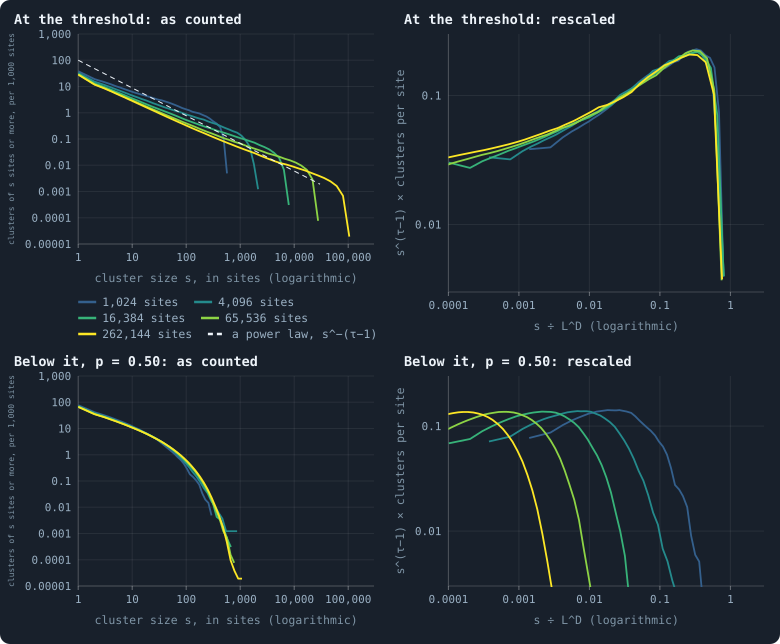
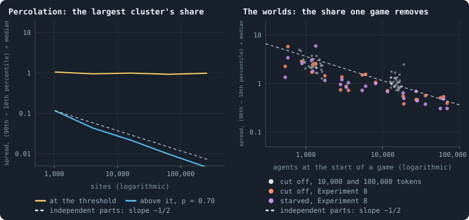
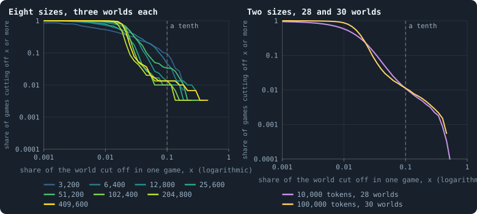
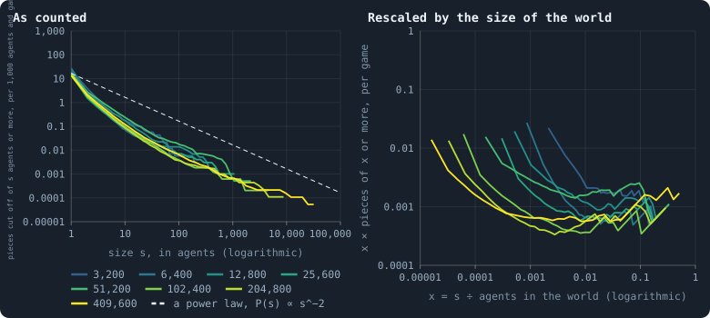
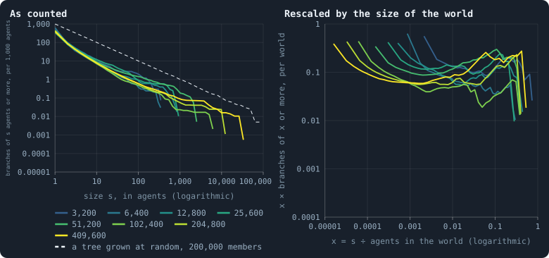
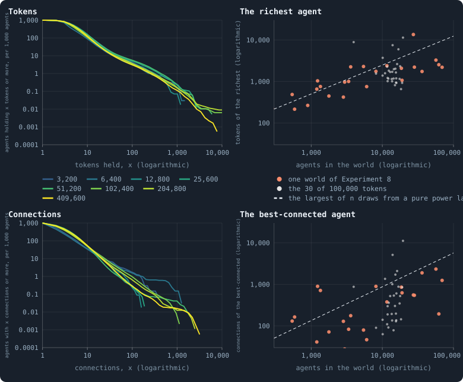
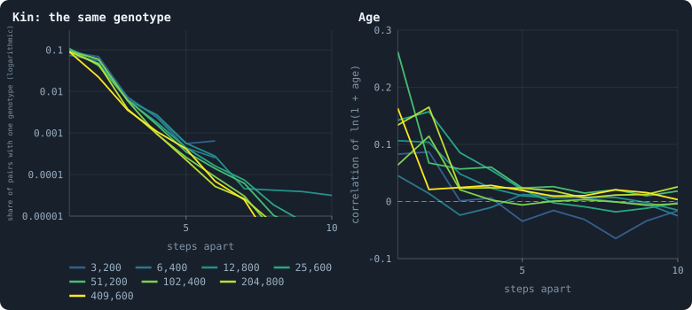

# Which properties have no scale?

> [!question] Questions of this page
> - What does it mean that a quantity has no scale, and how can one see it?
> - What is a data collapse, and what does one look like in a system known to
>   have no scale?
> - Which quantities of a world keep a size of their own as worlds grow, and
>   which grow with the world?
> - Does one [game](one-iteration.md#phase-2-the-game "The second phase of an iteration: every agent stakes all its tokens on its own node and its neighbours', and every node goes to someone.") cut off the same share of a world at every size?
> - What would a world without a scale mean for the physics the notebook hopes
>   for, and for evolution?

## In short

A quantity has no scale when it has no typical size of its own: measured in
worlds of many sizes and divided by the right power of the size, its
distributions fall onto one curve, a data collapse. Percolation on a lattice
shows what such a collapse looks like, and what its failure looks like. In
the worlds of the first [baseline](b1-and-b2.md "The stated rules an experiment starts from and changes one thing of: B1 or B2."), most things keep a size of their own:
likeness fades within a step or two, the richest hold a few thousand [tokens](the-world.md#agents-and-tokens "The one thing of value in a world: every agent holds a whole number of them, and their total never changes."),
and the small pieces a game cuts off average out as worlds grow. Two things
have no scale but the world's: the branches that hang from the network by a
single [connection](the-world.md#the-network "A link between two agents of the network: they are neighbours, and can stake on each other's nodes."), and the big cuts in which they fall away, both following
P(*s*) ∝ *s*^−2 up to the size of the world. So about one game in ninety cuts
off a tenth of a world or more, at 10,000 tokens as at 100,000.

## A size of its own, or none

Photograph a rocky coast from a plane, again from a cliff, and again kneeling
by a rock pool. Without a boat or a person in the picture, you cannot tell
the three apart. Bays have smaller bays along them, and those have smaller
ones still. A coastline has no scale (Mandelbrot 1967). Now photograph a
crowd. You know at once how far away you stood, because people come in one
size, give or take a little. Heights have a scale.

A quantity of a world has a **scale of its own** when its values gather
around a typical size, in [agents](the-world.md#agents-and-tokens "One member of a world: it lives on a node of the network, holds tokens and has a brain that takes all its decisions."), tokens or steps, that does not depend on
how big the world is. It has **no scale** when values of every size turn up,
from the smallest to the size of the world itself.

### Measured at many sizes

A world is finite. So even a quantity with no scale of its own meets one
limit: the world. The question is therefore asked by growing the world.
Measure the same quantity in worlds of many sizes, and draw its distribution
for each size: for every value *x*, how many values are at least *x* (the
CCDF of [Power laws, real and apparent](power-laws-real-and-apparent.md#what-a-power-law-is-and-why-it-is-hard-to-see)).
As the worlds grow, one of three things happens.

1. **The curves lie on top of each other.** The quantity has a size of its
   own, and the size of the world does not matter to it, as heights are the
   same in a village and in a city.
2. **The curves move out with the world, in step.** Divide every value by the
   right power of the world's size, and they lie on top of each other again.
   The quantity's only scale is the world.
3. **The curves agree for small values, and their ends move out with the
   world.** The quantity follows a power law, which has no scale, until the
   edge of the world cuts it off. This is the mark of a critical system.

### Data collapse

Laying the curves of many sizes on one another by rescaling them is called a
**data collapse**. The method behind it is **finite-size scaling** (Fisher
and Barber 1972; Privman 1990). Let *N* be the size of a world, its number of
agents. Case 2 says that

$$
P_N(X \ge x) = F\!\left(\frac{x}{N^{a}}\right)
$$

for one and the same function *F* at every size. The exponent *a* says how
the quantity grows with the world. With *a* = 0 it does not grow at all: that
is case 1. With *a* = 1 it grows in proportion, as a fixed share of the
world. Case 3 says that

$$
P_N(X \ge s) = s^{-\alpha}\, G\!\left(\frac{s}{N^{a}}\right) :
$$

a power law of exponent α up to a cutoff that grows as *N*^*a*. Multiply
every curve by *s*^α, divide *s* by *N*^*a*, and the curves collapse.

Exponents chosen to make the curves collapse as well as possible would make
almost anything collapse a little. So this page uses the exponents that a
theory names, or ones found another way, and then looks.

## What a collapse looks like

Take a square grid of *L* × *L* sites, and fill each site with probability
*p*, independently, like a forest planted at random. Filled sites side by
side form **clusters**, as a fire spreads from tree to touching tree. When
*p* is small, the clusters are small, of a typical size. When *p* is large,
one cluster spans the grid. In between, at *p* = 0.5927… (Newman and Ziff
2000), the grid is at its **critical point**, and clusters of every size
appear. This is **percolation**, the textbook system without a scale
(Stauffer and Aharony 1994). In two [dimensions](ball-dimension-and-curvature.md "How fast the number of agents within a distance grows with the distance: as its square in a plane, its cube in space.") its exponents are known
exactly. The number of clusters of *s* sites falls as *s*^−τ with
τ = 187/91 ≈ 2.055, and the largest cluster grows as *L*^*D* with
*D* = 91/48 ≈ 1.896, its fractal dimension. In sites, *N* = *L*², that is
*N*^0.948.

<!-- figure noscale/control -->

**What a collapse looks like, and what its failure looks like.** Site percolation on square lattices of side L = 32 to 512, from 1,024 to 262,144 sites: every site filled with probability p, and neighbouring filled sites joined into clusters. Top: at the threshold p = 0.592746, where clusters have no scale; bottom: below it, at p = 0.50. Left: for every cluster size s, how many clusters of s sites or more a lattice holds, per 1,000 sites; one line per size of lattice, from blue-green (the smallest) to yellow (the largest). Right: the same lines rescaled with the exponents known for two dimensions — s divided by L^D, D = 91/48 ≈ 1.896, and the clusters per site multiplied by s^(τ−1), τ = 187/91 ≈ 2.055. Dashed: a power law of the exponent τ − 1, for comparison.

> [!example]- How to make this figure
> **Runs.** No runs: site percolation on square lattices, drawn by this page's code (`book_chapters.noscale.percolation`) — 200 lattices of each side 32, 64, 128, 256 and 512, every site occupied with probability p, independently, by numpy's generator seeded 1 for the threshold p = 0.592746, 2 for p = 0.50 and 3 for p = 0.70.
>
> **Data.** From the lattices themselves.
>
> 1. Label the clusters of each lattice: filled sites side by side, across or down, belong to one cluster; the edges of a lattice are open (`book_chapters.noscale.lattice_clusters`).
> 2. For each side L, pool the clusters of its 200 lattices; for every s, the clusters of s sites or more, divided by the 200 · L² sites.
> 3. Rescaled: s ÷ L^D on the x axis, and the clusters per site times s^(τ−1) on the y axis.
> 4. The fits of the text, as for the worlds: a straight line through the logarithm of each lattice's largest cluster against that of its sites (`gol_analysis.power_fit`), and the maximum-likelihood exponent of the cluster sizes of the largest lattices (`book_chapters.noscale.tail_fit`).
>
> **To make it again:** `python3 book_figures.py noscale`.
<!-- /figure -->

At the threshold (top), the curves of the five grids agree for small
clusters, and their ends move out as the grid grows. Rescaled with the known
exponents, they fall onto one curve (top right). Below the threshold, at
*p* = 0.50 (bottom), clusters have a size of their own. The curves agree as
they are, and fall steeply beyond a hundred sites or so; only their last
points reach a little further on larger grids, as the largest of more
clusters would. The same rescaling throws them apart.

Two fits the worlds will get are tried here first, where the answers are
known. Each grid's largest cluster, against the grid's sites, grows as
*N*^0.938 (95% interval 0.926 to 0.951) at the threshold: the exact 0.948.
Below it, it grows as *N*^0.30, and ever more slowly. The exponent of the
cluster sizes, fitted by maximum likelihood on the largest grids alone
(Clauset, Shalizi and Newman 2009), comes out at 1.85 against the exact
2.055. Just before its cutoff the curve bends up (the hump in the top right
panel), and that flattens a tail fitted at one size. So a tail exponent
fitted at one size is a rough guide; the comparison of sizes is the test.

### Does it average out?

A second mark tells a critical system from an ordinary one. Picture a share
made of many independent parts, such as the share of heads in many coin
tosses. The more parts there are, the more their ups and downs cancel, and
the less the share varies: its spread falls as one over the square root of
the number of parts. That is the law of large numbers, which
[Worlds of many sizes](how-does-a-worlds-size-follow-its-tokens.md#big-worlds-do-not-average-out)
explains step by step. A critical system breaks it.

<!-- figure noscale/spread -->

**Does it average out?** How widely a share varies, relative to its middle: the 90th percentile minus the 10th, divided by the median. Left: the share of a lattice held by its largest cluster, over the 200 lattices of each size, at the threshold of percolation (yellow) and above it, at p = 0.70 (blue). Right: for every world, over the games of its settled life, the share of the agents at the start of a game that the game cut off (orange) and that starved in it (violet), in the worlds of Experiment 8 over iterations 500 to 599; small grey dots, the share cut off in the worlds of 10,000 and 100,000 tokens, over iterations 500 to 1,499. Dashed: what a sum of independent parts does — its spread falls as one over the square root of its size — drawn through the smallest lattices above the threshold (left) and through the worlds of 3,200 tokens (right).

> [!example]- How to make this figure
> **Runs.** The 24 baseline runs of Experiment 8 from 3,200 tokens up, `B1-3200-s001` … `B1-409600-s003`: B1 at 3,200, 6,400, 12,800, 25,600, 51,200, 102,400, 204,800 and 409,600 tokens, seeds 1 to 3, 600 iterations each, every one alive at the end (every setting is listed in [Worlds of many sizes](how-does-a-worlds-size-follow-its-tokens.md)). They are made with `python3 gol_lab.py run E08`. The 28 baseline runs of Experiment 2 that lived past iteration 1,499 (`B1-10000-s001` … `-s030`: B1 at 10,000 tokens, 3,000 iterations each, [The life of a B1 world](a-worlds-life.md)) and the 30 of Experiment 10 (`B1-100000-s001` … `-s030`: B1 at 100,000 tokens, 1,500 iterations each, [Worlds of many sizes](how-does-a-worlds-size-follow-its-tokens.md)). They are made with `python3 gol_lab.py run E02` and `python3 gol_lab.py run E10`. And the lattices of the figure above.
>
> **Data.** From each run's `GraphOfLifeRuns/<run>/stats.jsonl`, which holds one row per recorded phase: `phase` 1 is the world just after reproduction, `phase` 2 just after the game, and every statistic is a field of the row (see [What a run records](frames-and-stats.md)).
>
> 1. For each world, the rows with `phase` = 2 in its stretch: `orphaned` / `nodes_before` and `starved` / `nodes_before`, one value per game; their 10th, 50th and 90th percentiles; x is the mean of `nodes_before`.
> 2. For each lattice, its largest cluster divided by its sites; the percentiles over the 200 lattices of each size.
> 3. The slopes in the text: least squares through log spread against log agents, the interval from resampling the worlds within each size (`gol_analysis.power_fit`).
>
> **To make it again:** `python3 book_figures.py noscale`.
<!-- /figure -->

Here the spread of a share is how far apart its 90th and 10th percentiles
lie, divided by its [median](median-and-quantiles.md "The middle value: half of the numbers lie below it and half above."). At the threshold, the share of a grid held by its
largest cluster does not average out. Its spread is 1.06 on grids of 1,024
sites and 0.99 on grids of 262,144. Above the threshold, at *p* = 0.70, one
cluster holds about 69% of every grid, and its share averages out as the law
of large numbers says: its spread falls from 0.12 to 0.005.

## The worlds

Experiment 8 ran the baseline [B1](b1-and-b2.md "The first baseline: the algorithm exactly as a new run is offered it.") at ten sizes, three [seeds](random-numbers.md "The number that fixes every random choice of a run: the same settings and the same seed make the same world.") each, for 600
[iterations](one-iteration.md "One step of a world's time: a phase of reproduction, then a phase of the game.") ([Worlds of many sizes](how-does-a-worlds-size-follow-its-tokens.md)).
Its eight sizes from 3,200 tokens up all lived to the end. They hold from
about 470 agents to about 63,000, a range of 130. This page reads them over
their [settled life](median-and-quantiles.md#the-settled-life-of-a-world "A world from iteration 500 to its end, after its youth, where it is measured."), iterations 500 to 599. Three worlds a size show only what
is large, so a difference between sizes found in them is **indicative**
([How many seeds an experiment needs](bootstrap.md#how-many-seeds-an-experiment-needs)).
Where thirty are needed, two other sets of baseline worlds stand side by
side: the 28 worlds of 10,000 tokens of Experiment 2 that lived past
iteration 1,499, and the 30 worlds of 100,000 tokens of Experiment 10, both
read over iterations 500 to 1,499. Those hold about 1,300 and 15,000 agents.

## The share one game cuts off

[Worlds of many sizes](how-does-a-worlds-size-follow-its-tokens.md#big-worlds-do-not-average-out)
found that the mean game cuts off about 2% of a world's agents at every size,
and the worst a third to a half. Whether the whole distribution is the same
at every size it left open. Here it is compared, game by game.

### Small cuts average out

The right panel of the figure above puts the worlds beside the grids. The
share a game cuts off does average out, like the share of a grid above its
threshold, and unlike the critical one. In the worlds of Experiment 8 its
spread falls with slope −0.44 (95% interval −0.50 to −0.38). It is 4.9 in the
median world of 3,200 tokens and 0.51 at 409,600, where the middle 80% of
games cut off between 1.7% and 2.8% of the world. Between the 28 worlds of
10,000 tokens and the 30 of 100,000, the spread falls from 2.6 to 1.1
(p = 0.0001). That is a slope of −0.34: a smaller drop than independent parts
would make, but a clear one. The agents that starve in a game average out in
the same way, with slope −0.44 (−0.54 to −0.35).

So the bulk of what a game cuts off is made of many small pieces, falling off
here and there, independently. Together they come to about 2% of a world: the
median game of a world cuts off 1.2% of it at 10,000 tokens and 1.7% at
100,000. The bigger the world, the closer each game comes to its typical
share.

### Big cuts keep their share

<!-- figure noscale/cuts -->

**Small cuts average out, big cuts keep their share.** For every share x of a world, the share of games that cut off at least that share of the agents alive at their start; both axes logarithmic. Left: the worlds of Experiment 8, the three of each size pooled, over the games of iterations 500 to 599, one line per size from blue-green (3,200 tokens) to yellow (409,600). Right: the worlds of 10,000 and of 100,000 tokens, pooled, over iterations 500 to 1,499. The dashed line marks a tenth of a world.

> [!example]- How to make this figure
> **Runs.** The 24 baseline runs of Experiment 8 from 3,200 tokens up, `B1-3200-s001` … `B1-409600-s003`: B1 at 3,200, 6,400, 12,800, 25,600, 51,200, 102,400, 204,800 and 409,600 tokens, seeds 1 to 3, 600 iterations each, every one alive at the end (every setting is listed in [Worlds of many sizes](how-does-a-worlds-size-follow-its-tokens.md)). They are made with `python3 gol_lab.py run E08`. The 28 baseline runs of Experiment 2 that lived past iteration 1,499 (`B1-10000-s001` … `-s030`: B1 at 10,000 tokens, 3,000 iterations each, [The life of a B1 world](a-worlds-life.md)) and the 30 of Experiment 10 (`B1-100000-s001` … `-s030`: B1 at 100,000 tokens, 1,500 iterations each, [Worlds of many sizes](how-does-a-worlds-size-follow-its-tokens.md)). They are made with `python3 gol_lab.py run E02` and `python3 gol_lab.py run E10`.
>
> **Data.** From each run's `GraphOfLifeRuns/<run>/stats.jsonl`, which holds one row per recorded phase: `phase` 1 is the world just after reproduction, `phase` 2 just after the game, and every statistic is a field of the row (see [What a run records](frames-and-stats.md)).
>
> 1. Take `orphaned` / `nodes_before` of every row with `phase` = 2 in the stretch, and pool the worlds of each size.
> 2. For every x, the share of those games with a value of x or more.
>
> **To make it again:** `python3 book_figures.py noscale`.
<!-- /figure -->

Now look at the right end of the curves. As worlds grow, the curves steepen
in the middle, as the spread says. Their tails do not move. In the 28
worlds of 10,000 tokens, **1.10%** of games cut off a tenth of the world or
more. In the 30 of 100,000 tokens, **1.12%**: a difference of 0.01
percentage points (95% interval −0.23 to +0.28; p = 0.94). The 99th
percentile is 10.5% of the world at both sizes. The worst game of a world cut
off 41% of it, on average, at 10,000 tokens, and 44% at 100,000 (p = 0.22).
The eight sizes of Experiment 8 say the same, more roughly. From 12,800 tokens
up, 1.0% to 3.3% of their games cut off a tenth or more, and the worst cut off
26% to 47%, with no trend.

So the share one game cuts off is not one distribution that keeps its shape.
It is two. A **drizzle** of small pieces has a scale of its own, and averages
out. Rare **landslides** have no scale but the world's: a big world loses a
tenth of itself as often as a small one does. The claim this page started
from, that the whole distribution is the same at every size, holds for its
tail and not for its body.

## What the cuts are made of

A game does not cut off one piece of a world. Every connection across which
nobody staked is cut, the agents left without tokens are removed, and the
[cleanup](one-iteration.md#cleanup "The end of every phase: only the largest connected piece of the network lives on, and the tokens of the dead are shared out.") keeps only the largest connected piece that remains. Everything else
dies, often hundreds of pieces at once
([How a world breaks](how-a-world-breaks.md)). The runs do not record the
pieces, but their frames hold everything needed to find them again: the world
as the game began, what every agent staked, and which connections were cut.
Rebuilt so, the pieces of each of the 5,400 games read add up exactly to the
run's own count of agents cut off.

### Pieces of every size

<!-- figure noscale/pieces -->

**The pieces one game cuts off.** Every piece the cull removed in the games of iterations 500 to 599 of the worlds of Experiment 8 — the connected pieces of the network, other than the largest, left when the game's unused connections are cut and the agents with no tokens removed. Left: for every size s, how many pieces of s agents or more a game cut off, per 1,000 agents at its start; one line per size of world, the three worlds of a size pooled, from blue-green (3,200 tokens) to yellow (409,600). Dashed: the law P(s) ∝ s^−2, for comparison. Right: the same lines with s as a share x of the agents of the world, and the number of pieces of that share or more one game cuts off, times x.

> [!example]- How to make this figure
> **Runs.** The 24 baseline runs of Experiment 8 from 3,200 tokens up, `B1-3200-s001` … `B1-409600-s003`: B1 at 3,200, 6,400, 12,800, 25,600, 51,200, 102,400, 204,800 and 409,600 tokens, seeds 1 to 3, 600 iterations each, every one alive at the end (every setting is listed in [Worlds of many sizes](how-does-a-worlds-size-follow-its-tokens.md)). They are made with `python3 gol_lab.py run E08`.
>
> **Data.** From each run's frames, `GraphOfLifeRuns/<run>/frames/`, read with `gol_store.read_frame(run, index)`; frame `2·t` is iteration *t* after reproduction and frame `2·t + 1` after the game.
>
> 1. For every game, read frame 2·t (the world after reproduction) and frame 2·t + 1 (after the game). A node on which no agent staked a token in the game's `allocations` starves; take it away, and every connection in the game's `pruned_edges`.
> 2. The connected pieces of what is left; all but the largest are the pieces cut off. In every game read, they add up to the run's own count (`cleanup.orphaned`) (`book_chapters.noscale.cut_pieces`).
> 3. For each size, pool the pieces of its three worlds; for every s, the pieces of s or more divided by the agents at the start of all the games, times 1,000.
> 4. Rescaled: x = s ÷ the mean number of agents of the size; on the y axis, s times the count per agent, which is x times the count per game (or per world).
>
> **To make it again:** `python3 book_figures.py noscale`.
<!-- /figure -->

A game cuts off one to three pieces for every hundred agents of a world, with
no trend in size, and 82% to 90% of them are single agents. That part has a
scale of its own: an agent or two. In the median game the largest piece is
small, 0.07% to 0.34% of the world, size by size, though in agents it grows
with the world, as *N*^0.70 (0.63 to 0.77). And the pieces do not stop at any
size short of the world. At every size, some game cut off a single piece of a
sixth to nearly half of the world. In the games that cut off a tenth of the
world or more, the largest piece held 81% to 93% of all the agents cut off,
size by size from 12,800 tokens up, and 84% in the 43 such games read at
100,000 tokens. A landslide is one region falling away.

The right panel shows why landslides come at the same rate at every size.
There every size is a share *x* of the world, and the count is turned into the
number of pieces of a share *x* or more that one game cuts off, times *x*.
Read at *x* = 0.1, a curve's height is a tenth of the number of pieces of a
tenth of the world or more per game. For pieces from about a hundredth of the
world up, the curves of all sizes fall together, near 0.001. So a piece of a
tenth of the world or more falls away in about one game in a hundred at every
size: in 1.0% to 3.0% of the games read from 12,800 tokens up, and in 1.0% of
the 3,000 games read in the thirty worlds of 100,000 tokens. That is the rate
of the big cuts above.

Why does a power law with γ = 2 give that? A game cuts off about 0.015 *N*
pieces in a world of *N* agents. If a piece is *s* agents or more with a
chance proportional to *s*^−(γ−1), the number of pieces of a share *x* of the
world or more in one game is proportional to *N* · (*xN*)^−(γ−1). That grows
with the world as *N*^(2−γ). Only γ = 2 keeps it level. A steeper law would
make landslides rarer in big worlds, a flatter one commoner. The pieces sit
at that border, and the two sets of about thirty worlds pin them there. Take
each landslide as one piece: then a rate that stays the same, within its
interval, over a twelvefold range of worlds puts 2 − γ between −0.10 and
+0.09. Fitted at each size by maximum likelihood, the tails of the pieces
give γ between 1.9 and 2.3, as rough as the fit on the grids was.

### What hangs behind a bridge

Where do pieces of every size come from? Before a game, a world is held
together in places by single connections, its bridges
([Bridges](bridges.md)). Behind each lies a **branch**: the smaller of the two
parts that cutting the bridge would separate. A branch is a piece waiting to
fall.

<!-- figure noscale/branches -->

**What hangs behind a bridge.** Every bridge of the network after the games of iterations 509, 519, … 599 of the worlds of Experiment 8, and the smaller of the two pieces it holds together: the branch behind it, which cutting it would cut off ([Cut risk](bridges.md#cut-risk)). Left: for every size s, how many branches of s agents or more a world has, per 1,000 agents; one line per size of world, from blue-green (3,200 tokens) to yellow (409,600). Dashed: the same for a tree grown by joining each newcomer to a member drawn at random, 200,000 members, per 1,000 members — exactly 1,000/s. Right: the worlds' lines with s as a share x of the agents of the world, and the number of branches of that share or more a world has, times x.

> [!example]- How to make this figure
> **Runs.** The 24 baseline runs of Experiment 8 from 3,200 tokens up, `B1-3200-s001` … `B1-409600-s003`: B1 at 3,200, 6,400, 12,800, 25,600, 51,200, 102,400, 204,800 and 409,600 tokens, seeds 1 to 3, 600 iterations each, every one alive at the end (every setting is listed in [Worlds of many sizes](how-does-a-worlds-size-follow-its-tokens.md)). They are made with `python3 gol_lab.py run E08`.
>
> **Data.** From each run's frames, `GraphOfLifeRuns/<run>/frames/`, read with `gol_store.read_frame(run, index)`; frame `2·t` is iteration *t* after reproduction and frame `2·t + 1` after the game.
>
> 1. Read frames 2·t + 1 for t = 509, 519, … 599: `ids` and `edges`.
> 2. Every bridge, and the agents behind it on each side (`GraphOfLifeSimple.bridge_splits`); the branch is the smaller side.
> 3. For each size, pool the branches of its three worlds' ten looks; for every s, the branches of s or more divided by the agents of all the looks, times 1,000.
> 4. The tree: member i joins a member drawn at random from 0 … i − 1, by numpy's generator seeded 4; for every link, the smaller side (`book_chapters.noscale.random_tree_branches`).
> 5. Rescaled: x = s ÷ the mean number of agents of the size; on the y axis, s times the count per agent, which is x times the count per game (or per world).
>
> **To make it again:** `python3 book_figures.py noscale`.
<!-- /figure -->

A world has 0.34 to 0.63 bridges per agent, and 75% to 88% of them hold a
single leaf. Above that, the branches follow a power law. The number of
branches of *s* agents or more falls about tenfold for every tenfold in *s*,
as for a law with γ = 2, all the way to the size of the world. Rescaled, the
curves of all sizes fall together from about a thousandth of the world up.
Read at *x* = 0.1, they say how many bridges hold a tenth of the world or
more: between 0.3 and 3 in the mean look, size by size, with no trend. Such
branches come nested, one inside another. In 13% to 63% of looks there is at
least one (47% in the thirty worlds of 100,000 tokens), and a look that has
one has, on average, two to eight. So the largest branch, the cut risk of
[Bridges](bridges.md#cut-risk), is a share of the world at every size: 1.5%
to 19% of it in the median look, size by size, with no trend.

A law with γ = 2 has a simple origin. Grow a tree by joining every newcomer
to a member drawn at random. The share of its links with *s* members or more
behind them is then 1/*s*: exactly γ = 2. We checked it on such a tree of
200,000 members, drawn by this page's code: 0.500 at *s* = 2, 0.0101 at
*s* = 100, 0.000100 at *s* = 10,000. A world grows its hanging trees in much
that way: every child is born joined to agents already there, beside its
parent ([How births build the network](how-agents-have-children.md#how-agents-have-children)). Above about
ten agents, the worlds' branches fall at about the tree's rate, from fewer of
them, since a world has fewer bridges and more of them hold a single leaf.
That the worlds inherit the law from the way they grow is our hypothesis, not
yet a test.

## Tokens and connections

Tokens and connections are the two quantities of an agent whose tails look
most like power laws
([Power laws, real and apparent](power-laws-real-and-apparent.md)). Do their
ends move out as worlds grow, as a critical system's would?

<!-- figure noscale/riches -->

**Tokens and connections at every size.** Left: for every x, how many agents of every 1,000 hold x tokens or more (top) or have x connections or more (bottom), in the worlds of Experiment 8 after the games of iterations 509, 519, … 599, the three worlds of a size pooled; one line per size, from blue-green (3,200 tokens) to yellow (409,600). Right: for every world, the median over those ten looks of the most tokens one agent held (top) and of the most connections (bottom), against the agents of the world: orange, the worlds of Experiment 8; grey, the 30 worlds of Experiment 10, over their last 100 games. Dashed: how the largest of n values would grow if they were drawn from the power law fitted to the tail of the smallest worlds — as n^(1/(γ−1)) — drawn through the smallest worlds.

> [!example]- How to make this figure
> **Runs.** The 24 baseline runs of Experiment 8 from 3,200 tokens up, `B1-3200-s001` … `B1-409600-s003`: B1 at 3,200, 6,400, 12,800, 25,600, 51,200, 102,400, 204,800 and 409,600 tokens, seeds 1 to 3, 600 iterations each, every one alive at the end (every setting is listed in [Worlds of many sizes](how-does-a-worlds-size-follow-its-tokens.md)). They are made with `python3 gol_lab.py run E08`. For the numbers at 100,000 tokens, the 30 runs of Experiment 10 (`B1-100000-s001` … `-s030`, `python3 gol_lab.py run E10`), over their last 100 games, iterations 1,400 to 1,499.
>
> **Data.** From each run's frames, `GraphOfLifeRuns/<run>/frames/`, read with `gol_store.read_frame(run, index)`; frame `2·t` is iteration *t* after reproduction and frame `2·t + 1` after the game.
>
> 1. Read frames 2·t + 1 for the ten looks: `tokens`, and every agent's connections counted from `edges`.
> 2. Left: pool each size's looks; for every x, the agents with x or more divided by all agents, times 1,000.
> 3. Right: the largest value of each look, and its median over the looks of each world.
> 4. The tail exponent γ: the maximum-likelihood fit of [Power laws, real and apparent](power-laws-real-and-apparent.md#fitting-a-power-law-properly), done on the pooled values of the smallest worlds (`book_chapters.noscale.tail_fit`).
>
> **To make it again:** `python3 book_figures.py noscale`.
<!-- /figure -->

**Tokens keep a scale of their own, or nearly.** Per agent, the curves of all
eight sizes lie on one another, from the median agent's four or five tokens
out to about a thousand. Beyond that, larger worlds reach a little further,
as more draws from the same distribution would. The richest agent of a world
holds 224 tokens in the median look at 3,200 tokens, and more as worlds grow,
but ever more slowly: 2,080, 2,214 and 2,536 tokens at 102,400, 204,800 and
409,600. Over all sizes it grows as *N*^0.48 (0.37 to 0.61), as
[The largest and the smallest](the-largest-and-the-smallest.md#the-largest-by-the-size-of-a-world)
found, but with a bend downward whose interval stays below zero; over the
three largest sizes, as *N*^0.12 (−0.09 to 0.59). The largest of *N* values
drawn from the power law of the tail would grow as *N*^0.7. The thirty worlds
of 100,000 tokens agree: their richest agent holds 1,565 tokens in the median
world, and between 1,149 and 2,214 in the middle half of them. A few go far
beyond, most of them stars, worlds held together by a single hub: in one,
the richest holds 11,406. Something holds the rich to a few thousand tokens.
[How a rich agent drains back](gains-and-losses.md#how-a-rich-agent-drains-back)
suggests what: an agent far above its resting share, about 1.7 tokens for
each of its [candidates](one-iteration.md#phase-1-reproduction "An agent itself and each of its neighbours, the ones its brain looks at when it decides."), loses the excess within a few games, so a fortune
does not last long enough to grow with the world.

**Connections keep a scale in their body, and none we can read in their
hubs.** The curves agree up to about 30 connections. Beyond that, they scatter
from world to world: in some worlds one hub holds hundreds or thousands of
agents, in others none ([Stars and hubs](stars-and-hubs.md)). The
best-connected agent of the median world holds from 72 to 1,246 connections,
size by size, with no law that three worlds a size can show. In the thirty
worlds of 100,000 tokens alone it ranges from 63 to 11,181.

## How far likeness reaches

[Like next to like](like-next-to-like.md) measured how far likeness reaches in
the worlds of 10,000 and 100,000 tokens: one or two steps. At a critical
point, the reach would grow with the system, without end. Here is the same
measurement at every size.

<!-- figure noscale/alike -->

**How far likeness reaches, at every size.** For pairs of agents r steps apart in the worlds of Experiment 8: left, the share of the pairs whose two agents carry the same genotype (logarithmic); right, the correlation of their ages, as ln(1 + age). Pairs from breadth-first searches out of 150 agents drawn at random, after the games of iterations 500, 549 and 599, the three worlds of a size pooled; one line per size, from blue-green (3,200 tokens) to yellow (409,600).

> [!example]- How to make this figure
> **Runs.** The 24 baseline runs of Experiment 8 from 3,200 tokens up, `B1-3200-s001` … `B1-409600-s003`: B1 at 3,200, 6,400, 12,800, 25,600, 51,200, 102,400, 204,800 and 409,600 tokens, seeds 1 to 3, 600 iterations each, every one alive at the end (every setting is listed in [Worlds of many sizes](how-does-a-worlds-size-follow-its-tokens.md)). They are made with `python3 gol_lab.py run E08`.
>
> **Data.** From each run's frames, `GraphOfLifeRuns/<run>/frames/`, read with `gol_store.read_frame(run, index)`; frame `2·t` is iteration *t* after reproduction and frame `2·t + 1` after the game.
>
> 1. Read frames 2·t + 1 for t = 500, 549 and 599; draw 150 agents at random (numpy's generator seeded 62, once per run) and search out from each to 10 steps.
> 2. Every agent reached at r steps makes a pair with the agent searched from. Kin: the share of the pairs at r that carry the same `brain_ids`. Age: Pearson's correlation over the pairs at r of ln(1 + `ages`), standardised within each frame, as in [Like next to like](like-next-to-like.md#the-correlation-function) (`book_chapters.noscale.likeness_at`).
> 3. Pool the sums of each size's three worlds and three moments.
>
> **To make it again:** `python3 book_figures.py noscale`.
<!-- /figure -->

Two [neighbours](the-world.md#the-network "An agent joined to another by a connection.") carry the same [genotype](genotype.md "The identity of a brain: a number that a copy keeps and a change replaces, and that remembers the genotype it came from.") in 7% to 11% of pairs at every size,
two agents two steps apart in 2% to 7%, three steps apart in under 1%. From
two steps to three, kinship falls about tenfold, and then about threefold
with every further step. Meanwhile the chance that any two agents of a world
share a genotype falls nearly two hundredfold, from 1.1% at 3,200 tokens to
0.006% at 409,600: the curves of kinship stay where they are while their
background drops away. Age is alike over two steps and gone by four or five,
at every size. Likeness has a scale of its own, a step or two, in a world of
470 agents and in one of 63,000.

## The answer, property by property

| property | as worlds grow from 470 to 63,000 agents | a scale of its own? |
|---|---|---|
| the share a game starves | averages out: spread slope −0.44 | yes: single agents |
| the share a game cuts off, its bulk | averages out: spread slope −0.44 | yes: an agent or two |
| games that cut off a tenth or more | 1.10% and 1.12% of games at 10,000 and 100,000 tokens | **no**: a share of the world |
| the pieces a game cuts off | P(*s*) ∝ *s*^−2 up to half a world | **no** |
| the branches behind bridges | P(*s*) ∝ *s*^−2; the largest a share of the world | **no** |
| tokens | one curve; the richest grow ever more slowly, to about 2,500 | yes: a few thousand tokens |
| connections | one curve up to 30; hubs differ from world to world | yes, in the body |
| likeness of kin and of age | fades within a step or two at every size | yes: a step or two |
| distances, and the agents within them | grow as powers: a space of about 3.3 dimensions | **no** |

The last row comes from
[Worlds of many sizes](how-does-a-worlds-size-follow-its-tokens.md#distances-grow-like-a-power)
and [Is a world a space?](how-many-dimensions-does-a-world-have.md#the-rulers-on-the-worlds).

How sure is each row? **Established**, in about thirty worlds at each of two
sizes: the bulk of what a game cuts off averages out, and the games that cut
off a tenth or more keep their rate. **Indicative**, in three worlds at each of
eight sizes: the slopes of the spread, the collapse of the pieces and the
branches, the slowing of the richest, and the reach of likeness at every
size. They agree with the results of the two sets of about thirty wherever
the two meet. **Untested**: that the branches owe their law to the way trees
grow.

## What it means

For the physics the notebook hopes for
([Physical inspiration](physical-inspiration.md#no-scale-at-all)), the answer
is mixed, and sharper than before. Three things in a world have no scale but
the world's: its space, the branches that hang from it, and the landslides in
which branches fall away. None of them is the scale-free state of a critical
point. At a critical point, likeness reaches as far as the system is wide.
Here it fades within a step or two at every size. The landslides have no
scale only because one rule reaches across the whole world: the cull kills
everything outside the largest piece, so a branch that falls away dies,
whatever its size and however far away it lies. And the branches may have no
scale for the plainest of reasons, if our hypothesis is right: they grow like
a tree grown at random, which has none either. The planned page *Local rules
only*, which lets a piece that separates live on, is the test that remains:
with the cull made local, is anything left without a scale?

For [open-ended evolution](open-ended-test.md), a world ten times the size is
not ten times as safe. About one game in ninety cuts off a tenth of a world or
more, whatever its size, and with it every line of descent that lived only
there. Size buys a steadier drizzle, not fewer landslides. If those landslides
were splits rather than deaths, the piece cut off living on as a world of its
own, they would be what starts new species in nature: a population divided by
a barrier, each part evolving on its own (Mayr 1963). The largest losses of a
world would become a source of new lines. That is a proposal for an
experiment, not a finding.

## What we learned

- **A data collapse tells a quantity with a scale of its own from one
  without.** On percolation, the largest cluster grows as *N*^0.938 against
  the exact 0.948; a tail exponent fitted at one size is only a rough guide.
- **The share a game cuts off is two things.** Its bulk, many small pieces,
  averages out as worlds grow. Its tail does not: games that cut off a tenth of
  a world or more are 1.10% of games at 10,000 tokens and 1.12% at 100,000, in
  28 and 30 worlds.
- **Pieces and branches have no scale.** Both follow P(*s*) ∝ *s*^−2 up to a
  share of the whole world. γ = 2 is exactly the law at which a world loses
  big pieces at the same rate whatever its size, and the law of a tree grown at
  random.
- **Tokens, connections and likeness keep a scale of their own.** The richest
  agent grows ever more slowly, to about 2,500 tokens; kin and age are alike
  for a step or two, at 470 agents and at 63,000.
- **Nothing here is critical.** What has no scale has it from the cull, which
  reaches across the whole world, and perhaps from the way trees grow.

## Where to go next

- [How a world breaks](how-a-world-breaks.md): what severs a region when a
  landslide comes, and why poverty does it.
- [Worlds of many sizes](how-does-a-worlds-size-follow-its-tokens.md): the
  experiment whose worlds this page reads, and how a world's size follows its
  tokens.
- [Power laws, real and apparent](power-laws-real-and-apparent.md): how a
  power law is fitted, and the tails of tokens and connections at 100,000
  tokens.
- [Physical inspiration](physical-inspiration.md): the physics behind the
  question, and what a world without a scale would mean.

## How this was made

Every figure and number of this page comes from the command
`python3 book_figures.py noscale`, which writes the numbers to
`book/results/noscale.json`; each figure says, folded beneath it, which runs
it reads and how. The share each game cut off and starved is read from the
runs' recorded statistics. The pieces a game cut off, the branches behind
bridges, the tokens and connections, and the likeness at a distance are read
from the frames, once per run, by `noscale_pass` in `book_chapters/noscale.py`,
and kept in `GraphOfLifeRuns/.book/<run>.noscale.json`. Each run is read over
its last 100 games: iterations 500 to 599 for Experiment 8, and 1,400 to
1,499 for the numbers from Experiment 10. The percolation grids and the random
tree are drawn by the same file, every random choice from a fixed seed, so the
same command makes the same figures.

No simulation was run for this page. It reads three experiments: the 24
worlds of Experiment 8 from 3,200 tokens up (its worlds of 800 and 1,600
tokens did not live, and its second condition is not read); the 28 worlds of
Experiment 2 that lived past iteration 1,499; and the 30 worlds of
Experiment 10.

### The runs of Experiment 8

<!-- runs E08 -->
> [!info]- The runs behind this page
> **42 runs.** Every condition below is run once for every seed (1 to 3) and every number of tokens it lists, for 600 iterations — or until its world dies out. Every setting is that of the baseline **B1** (the algorithm exactly as a new run is offered it) unless the condition changes it.
>
> - **baseline** — changes nothing: B1 as it is; 800, 1,600, 3,200, 6,400, 12,800, 25,600, 51,200, 102,400, 204,800, 409,600 tokens. Runs `B1-800-s001` … `B1-409600-s003`.
> - **stopped only when empty** — changes `extinction_threshold` = 0; 800, 1,600, 3,200, 6,400 tokens. Runs `B1-800-57b358-s001` … `B1-6400-57b358-s003`.
>
> To make these runs again: `python3 gol_lab.py run E08`, or ▶ in the Research Notebook tab of a computer running `gol_server.py`. Each run writes its settings, seed and engine version beside its frames, in `GraphOfLifeRuns/<run>/meta.json` and `provenance.json`.

> [!info]- Every setting of these runs
> | setting | baseline | stopped only when empty | what it is |
> |---|---|---|---|
> | [`total_tokens`](settings.md#total_tokens) | 800, 1,600, 3,200, 6,400, 12,800, 25,600, 51,200, 102,400, 204,800, 409,600 | 800, 1,600, 3,200, 6,400 | The number of tokens in the world, *T*. It never changes during a run. |
> | [`n_nodes`](settings.md#n_nodes) | 0 | 0 | How many founders the world starts with. 0 means one founder per hundred tokens: *n* = ⌊*T* / 100⌋. |
> | [`k_neighbors`](settings.md#k_neighbors) | 0 | 0 | How many neighbours each founder starts with in the ring. 0 means *k* = max(⌊*n* / 100⌋, 5); an odd *k* is wired as *k* − 1. |
> | [`rewire_p`](settings.md#rewire_p) | 0.2 | 0.2 | In the starting ring, the probability that a connection is moved to a founder chosen at random (Watts–Strogatz). |
> | [`hidden_layers`](settings.md#hidden_layers) | 50, 45, 40, 35, 30 | 50, 45, 40, 35, 30 | The widths of the brain's hidden layers, in order from input to output. |
> | [`hidden_activation`](settings.md#hidden_activation) | sigmoid | sigmoid | The curve each hidden unit applies to its sum: `sigmoid`, which passes on at most a quarter of a change, so that deep brains barely respond to what they see, or `tanh`, the same S-shape centred on zero, through which a change still passes in several layers. |
> | [`brain_kind`](settings.md#brain_kind) | float16 | float16 | How weights are stored: `float` (64-bit), `float16` (16-bit, computed in 64-bit) or `binary` (−1, 0, +1). |
> | [`brain_bits`](settings.md#brain_bits) | 16 | 16 | Only for binary brains: how many input rows encode one number. Unused by float and float16 brains. |
> | [`message_amount`](settings.md#message_amount) | 30 | 30 | How many numbers one message holds. Each agent sends one message to itself and one to each neighbour, every phase. |
> | [`random_input_amount`](settings.md#random_input_amount) | 5 | 5 | How many random numbers, drawn uniformly from −2 to 2, a brain reads per neighbour, every time it looks. |
> | [`exchange_messages`](settings.md#exchange_messages) | on | on | Whether agents send and read messages at all. |
> | [`message_prepass`](settings.md#message_prepass) | on | on | Whether every phase begins with an extra look in which agents only write messages, so the look that acts reads messages written this phase. |
> | [`allow_handover`](settings.md#allow_handover) | on | on | Whether a parent may move some of its own connections to its newborn child. |
> | [`allow_revolutions`](settings.md#allow_revolutions) | on | on | Whether a coalition of smaller stakers can take a node from its largest staker (see the note *How a coalition takes a node*). |
> | [`contest`](settings.md#contest) | largest | largest | Who takes a contested node: the `largest` stake as the game weighs it, or a staker drawn by `lottery` with a chance in proportion to its stake (needs revolutions off). |
> | [`allocation`](settings.md#allocation) | full | full | How the game's stakes are placed: all at once (`full`), or a token at a time in rounds with the game as it stands in view, the poorest done first (`weakest_first`) or the richest starting alone (`strongest_first`), as the original engine played. |
> | [`allow_gifting`](settings.md#allow_gifting) | off | off | Whether agents may give tokens to neighbours during reproduction. Off in both baselines; on in a few pilots, in Experiment 24 and in half the worlds of the screen. |
> | [`random_decisions`](settings.md#random_decisions) | off | off | The control: every number a brain would produce is replaced by a random draw from the standard normal distribution. |
> | [`prune_after`](settings.md#prune_after) | blotto | blotto | After which phase connections that carried no tokens are cut: `blotto` (the game), `reproduction`, or `both`. |
> | [`inactive_window`](settings.md#inactive_window) | phase | phase | How long a connection may go unused: `phase` means it must carry tokens in the phase being judged; `iteration` allows the two last phases. |
> | [`redistribution`](settings.md#redistribution) | uniform | uniform | How the tokens of removed agents are shared: `uniform` gives every survivor the same chance at each token; `by_tokens` weights by what a survivor holds; `poorest` raises the poorest to one common level first; `newborns` gives them to this iteration's children, `parents` to their parents, once per child (both `uniform` in an iteration without births); `children` leaves each dead agent's estate to its own living children (`uniform` where there are none); `local` lets each estate flow through the network to the nearest living agents, split evenly at every step. |
> | [`tokens_created_per_phase`](settings.md#tokens_created_per_phase) | 0 | 0 | Tokens added to the world at every cleanup. 0 keeps the supply fixed. |
> | [`mutate_on_replication`](settings.md#mutate_on_replication) | off | off | Whether a brain changes only when it is copied — into a newborn, or into a node its owner has just won — instead of also after every game, wherever it sits. |
> | [`incumbency`](settings.md#incumbency) | 1.0 | 1.0 | How many times over an agent's stake on its own node counts when the game decides who takes the node. 1 is the old rule. |
> | [`birth_links`](settings.md#birth_links) | 0 | 0 | How many of its parent's neighbours a newborn is joined to, drawn at random, besides its parent itself; 0 leaves every link to the brain's choice. |
> | [`mend_on_death`](settings.md#mend_on_death) | off | off | Whether the neighbours of an agent that dies are joined up where its death would leave them in separate pieces. |
> | [`prune_needs`](settings.md#prune_needs) | 0 | 0 | How many neighbours the two ends of an unused connection must share for it to be cut; 0 cuts every unused connection. |
> | [`valence`](settings.md#valence) | 0 | 0 | The most connections an agent's brain may choose to hold (0 = no limit). An agent at its limit cannot have a child. |
> | [`link_token`](settings.md#link_token) | off | off | Whether every link holds one token: its maker pays for it, a lapsing link gives it back to one of its ends, and a link of a dead agent to the end that lives on, so the links can never outnumber the tokens. |
> | [`link_upkeep`](settings.md#link_upkeep) | off | off | Whether an agent may pay a token an iteration to keep a link, each brain deciding for each neighbour: `paid_or_used` keeps a link that was paid for or used, `paid_only` only one that was paid for; `off`, only use keeps a link. |
> | [`upkeep_to`](settings.md#upkeep_to) | end | end | Where a link's upkeep goes: to the link's other end (`end`), or into the estate of the dead (`estate`), shared out by the world's redistribution rule. |
> | [`keep_home`](settings.md#keep_home) | 0.0 | 0.0 | The share of an agent's tokens — rounded up, never less than one — that stays on its own node whatever its brain says; a parent also keeps one. 0 is the old rule. |
> | [`max_age`](settings.md#max_age) | 0 | 0 | The age at which an agent dies (0 = never); its tokens are shared out like those of any other dead agent. |
> | [`buy_life`](settings.md#buy_life) | off | off | Whether an agent that has reached max_age may live on by paying one token an iteration into the estate of the dead — never its last, so one with a single token left dies. Needs max_age. |
> | [`min_child`](settings.md#min_child) | 1 | 1 | The fewest tokens a child can be born with; a parent that would give less has no child. |
> | [`child_floor`](settings.md#child_floor) | fixed | fixed | The least a child may start with: min_child alone (fixed), or also the median holding of its parent's neighbours (neighbours), so that a world grows only as rich as it is. |
> | [`mix_at_birth`](settings.md#mix_at_birth) | off | off | Whether a newborn's brain is its parent's mixed with a mate's — one of the parent's neighbours, drawn at random — each hidden unit whole from one or the other by an even chance, before it mutates; off, a newborn has a copy of its parent's brain. |
> | [`mix_mates`](settings.md#mix_mates) | any | any | Under mix_at_birth, who may be the mate: any neighbour of the parent, or only parents — a neighbour with a living child of its own (with none, the newborn's brain is a copy). |
> | [`mate_pays`](settings.md#mate_pays) | off | off | Under mix_at_birth, whether the mate pays the child as many tokens as the parent gave it, as far as it can and never its last. |
> | [`self_message`](settings.md#self_message) | own | own | What an agent writes to itself, which each neighbour reads: what its own column says (own), or the largest, number by number, of what it writes to anyone (largest), so that news one column marks reaches every neighbour. |
> | [`link_search`](settings.md#link_search) | off | off | Whether an agent may reach beyond its neighbours to propose a link: off; jump, a walk as many steps long as the tokens it spends in one iteration, with a link proposed where it ends; walk, a scout that goes one step further in every iteration it pays for; or reach, a jump whose steps are free, as many as the tokens it holds would pay for. A paid step costs one token, paid to the agent it enters, and never the last. |
> | [`link_steering`](settings.md#link_steering) | random | random | Which way each step of a search goes: to a neighbour drawn at random, or to the one the searcher would most like a link with (looking). |
> | [`link_consent`](settings.md#link_consent) | mutual | mutual | Who has to agree to a link a search proposes: both ends (mutual), or only the one who proposes (forced). Nobody at its valence gets a new link either way. |
> | [`proto`](settings.md#proto) | none | none | Rules first played in the pilots' prototype, by name: came_from and helped_by (an input row each), contest = lottery, pool by genotype or family, kin_sense, tag_rate, mate_pays, grow, unit_token, link_token. Empty in every run but those that ask for one; only the prototype's world plays them (see the settings note). |
> | [`mutation_probability`](settings.md#mutation_probability) | 0.2 | 0.2 | The probability that a brain changes when it is copied to a child, and again, for every brain, after every game. |
> | [`mutation_noise_std`](settings.md#mutation_noise_std) | 0.2 | 0.2 | How large a change to one weight is: a normal draw with standard deviation this times 1/√(fan-in) of its layer. |
> | [`mutation_sparsity`](settings.md#mutation_sparsity) | 0.1 | 0.1 | The share of a brain's numbers a change touches; also the probability, for each weight matrix and bias vector, of a rarer reset that redraws that share of it. |
> | [`extinction_threshold`](settings.md#extinction_threshold) | 20 | **0** | A run stops, as extinct, when an iteration ends (after its game) with this many agents or fewer. |
> | seeds | 1 to 3 | 1 to 3 | one run per seed |
> | iterations | 600 | 600 | how far each run goes, unless its world dies first |
>
> A value in **bold** differs from the baseline B1.
<!-- /runs -->

### The runs of Experiment 2

<!-- runs E02 -->
> [!info]- The runs behind this page
> **30 runs.** Every condition below is run once for every seed (1 to 30), for 3,000 iterations — or until its world dies out. Every setting is that of the baseline **B1** (the algorithm exactly as a new run is offered it) unless the condition changes it.
>
> - **baseline** — changes nothing: B1 as it is; 10,000 tokens. Runs `B1-10000-s001` … `B1-10000-s030`.
>
> To make these runs again: `python3 gol_lab.py run E02`, or ▶ in the Research Notebook tab of a computer running `gol_server.py`. Each run writes its settings, seed and engine version beside its frames, in `GraphOfLifeRuns/<run>/meta.json` and `provenance.json`.

> [!info]- Every setting of these runs
> | setting | baseline | what it is |
> |---|---|---|
> | [`total_tokens`](settings.md#total_tokens) | 10,000 | The number of tokens in the world, *T*. It never changes during a run. |
> | [`n_nodes`](settings.md#n_nodes) | 0 | How many founders the world starts with. 0 means one founder per hundred tokens: *n* = ⌊*T* / 100⌋. |
> | [`k_neighbors`](settings.md#k_neighbors) | 0 | How many neighbours each founder starts with in the ring. 0 means *k* = max(⌊*n* / 100⌋, 5); an odd *k* is wired as *k* − 1. |
> | [`rewire_p`](settings.md#rewire_p) | 0.2 | In the starting ring, the probability that a connection is moved to a founder chosen at random (Watts–Strogatz). |
> | [`hidden_layers`](settings.md#hidden_layers) | 50, 45, 40, 35, 30 | The widths of the brain's hidden layers, in order from input to output. |
> | [`hidden_activation`](settings.md#hidden_activation) | sigmoid | The curve each hidden unit applies to its sum: `sigmoid`, which passes on at most a quarter of a change, so that deep brains barely respond to what they see, or `tanh`, the same S-shape centred on zero, through which a change still passes in several layers. |
> | [`brain_kind`](settings.md#brain_kind) | float16 | How weights are stored: `float` (64-bit), `float16` (16-bit, computed in 64-bit) or `binary` (−1, 0, +1). |
> | [`brain_bits`](settings.md#brain_bits) | 16 | Only for binary brains: how many input rows encode one number. Unused by float and float16 brains. |
> | [`message_amount`](settings.md#message_amount) | 30 | How many numbers one message holds. Each agent sends one message to itself and one to each neighbour, every phase. |
> | [`random_input_amount`](settings.md#random_input_amount) | 5 | How many random numbers, drawn uniformly from −2 to 2, a brain reads per neighbour, every time it looks. |
> | [`exchange_messages`](settings.md#exchange_messages) | on | Whether agents send and read messages at all. |
> | [`message_prepass`](settings.md#message_prepass) | on | Whether every phase begins with an extra look in which agents only write messages, so the look that acts reads messages written this phase. |
> | [`allow_handover`](settings.md#allow_handover) | on | Whether a parent may move some of its own connections to its newborn child. |
> | [`allow_revolutions`](settings.md#allow_revolutions) | on | Whether a coalition of smaller stakers can take a node from its largest staker (see the note *How a coalition takes a node*). |
> | [`contest`](settings.md#contest) | largest | Who takes a contested node: the `largest` stake as the game weighs it, or a staker drawn by `lottery` with a chance in proportion to its stake (needs revolutions off). |
> | [`allocation`](settings.md#allocation) | full | How the game's stakes are placed: all at once (`full`), or a token at a time in rounds with the game as it stands in view, the poorest done first (`weakest_first`) or the richest starting alone (`strongest_first`), as the original engine played. |
> | [`allow_gifting`](settings.md#allow_gifting) | off | Whether agents may give tokens to neighbours during reproduction. Off in both baselines; on in a few pilots, in Experiment 24 and in half the worlds of the screen. |
> | [`random_decisions`](settings.md#random_decisions) | off | The control: every number a brain would produce is replaced by a random draw from the standard normal distribution. |
> | [`prune_after`](settings.md#prune_after) | blotto | After which phase connections that carried no tokens are cut: `blotto` (the game), `reproduction`, or `both`. |
> | [`inactive_window`](settings.md#inactive_window) | phase | How long a connection may go unused: `phase` means it must carry tokens in the phase being judged; `iteration` allows the two last phases. |
> | [`redistribution`](settings.md#redistribution) | uniform | How the tokens of removed agents are shared: `uniform` gives every survivor the same chance at each token; `by_tokens` weights by what a survivor holds; `poorest` raises the poorest to one common level first; `newborns` gives them to this iteration's children, `parents` to their parents, once per child (both `uniform` in an iteration without births); `children` leaves each dead agent's estate to its own living children (`uniform` where there are none); `local` lets each estate flow through the network to the nearest living agents, split evenly at every step. |
> | [`tokens_created_per_phase`](settings.md#tokens_created_per_phase) | 0 | Tokens added to the world at every cleanup. 0 keeps the supply fixed. |
> | [`mutate_on_replication`](settings.md#mutate_on_replication) | off | Whether a brain changes only when it is copied — into a newborn, or into a node its owner has just won — instead of also after every game, wherever it sits. |
> | [`incumbency`](settings.md#incumbency) | 1.0 | How many times over an agent's stake on its own node counts when the game decides who takes the node. 1 is the old rule. |
> | [`birth_links`](settings.md#birth_links) | 0 | How many of its parent's neighbours a newborn is joined to, drawn at random, besides its parent itself; 0 leaves every link to the brain's choice. |
> | [`mend_on_death`](settings.md#mend_on_death) | off | Whether the neighbours of an agent that dies are joined up where its death would leave them in separate pieces. |
> | [`prune_needs`](settings.md#prune_needs) | 0 | How many neighbours the two ends of an unused connection must share for it to be cut; 0 cuts every unused connection. |
> | [`valence`](settings.md#valence) | 0 | The most connections an agent's brain may choose to hold (0 = no limit). An agent at its limit cannot have a child. |
> | [`link_token`](settings.md#link_token) | off | Whether every link holds one token: its maker pays for it, a lapsing link gives it back to one of its ends, and a link of a dead agent to the end that lives on, so the links can never outnumber the tokens. |
> | [`link_upkeep`](settings.md#link_upkeep) | off | Whether an agent may pay a token an iteration to keep a link, each brain deciding for each neighbour: `paid_or_used` keeps a link that was paid for or used, `paid_only` only one that was paid for; `off`, only use keeps a link. |
> | [`upkeep_to`](settings.md#upkeep_to) | end | Where a link's upkeep goes: to the link's other end (`end`), or into the estate of the dead (`estate`), shared out by the world's redistribution rule. |
> | [`keep_home`](settings.md#keep_home) | 0.0 | The share of an agent's tokens — rounded up, never less than one — that stays on its own node whatever its brain says; a parent also keeps one. 0 is the old rule. |
> | [`max_age`](settings.md#max_age) | 0 | The age at which an agent dies (0 = never); its tokens are shared out like those of any other dead agent. |
> | [`buy_life`](settings.md#buy_life) | off | Whether an agent that has reached max_age may live on by paying one token an iteration into the estate of the dead — never its last, so one with a single token left dies. Needs max_age. |
> | [`min_child`](settings.md#min_child) | 1 | The fewest tokens a child can be born with; a parent that would give less has no child. |
> | [`child_floor`](settings.md#child_floor) | fixed | The least a child may start with: min_child alone (fixed), or also the median holding of its parent's neighbours (neighbours), so that a world grows only as rich as it is. |
> | [`mix_at_birth`](settings.md#mix_at_birth) | off | Whether a newborn's brain is its parent's mixed with a mate's — one of the parent's neighbours, drawn at random — each hidden unit whole from one or the other by an even chance, before it mutates; off, a newborn has a copy of its parent's brain. |
> | [`mix_mates`](settings.md#mix_mates) | any | Under mix_at_birth, who may be the mate: any neighbour of the parent, or only parents — a neighbour with a living child of its own (with none, the newborn's brain is a copy). |
> | [`mate_pays`](settings.md#mate_pays) | off | Under mix_at_birth, whether the mate pays the child as many tokens as the parent gave it, as far as it can and never its last. |
> | [`self_message`](settings.md#self_message) | own | What an agent writes to itself, which each neighbour reads: what its own column says (own), or the largest, number by number, of what it writes to anyone (largest), so that news one column marks reaches every neighbour. |
> | [`link_search`](settings.md#link_search) | off | Whether an agent may reach beyond its neighbours to propose a link: off; jump, a walk as many steps long as the tokens it spends in one iteration, with a link proposed where it ends; walk, a scout that goes one step further in every iteration it pays for; or reach, a jump whose steps are free, as many as the tokens it holds would pay for. A paid step costs one token, paid to the agent it enters, and never the last. |
> | [`link_steering`](settings.md#link_steering) | random | Which way each step of a search goes: to a neighbour drawn at random, or to the one the searcher would most like a link with (looking). |
> | [`link_consent`](settings.md#link_consent) | mutual | Who has to agree to a link a search proposes: both ends (mutual), or only the one who proposes (forced). Nobody at its valence gets a new link either way. |
> | [`proto`](settings.md#proto) | none | Rules first played in the pilots' prototype, by name: came_from and helped_by (an input row each), contest = lottery, pool by genotype or family, kin_sense, tag_rate, mate_pays, grow, unit_token, link_token. Empty in every run but those that ask for one; only the prototype's world plays them (see the settings note). |
> | [`mutation_probability`](settings.md#mutation_probability) | 0.2 | The probability that a brain changes when it is copied to a child, and again, for every brain, after every game. |
> | [`mutation_noise_std`](settings.md#mutation_noise_std) | 0.2 | How large a change to one weight is: a normal draw with standard deviation this times 1/√(fan-in) of its layer. |
> | [`mutation_sparsity`](settings.md#mutation_sparsity) | 0.1 | The share of a brain's numbers a change touches; also the probability, for each weight matrix and bias vector, of a rarer reset that redraws that share of it. |
> | [`extinction_threshold`](settings.md#extinction_threshold) | 20 | A run stops, as extinct, when an iteration ends (after its game) with this many agents or fewer. |
> | seeds | 1 to 30 | one run per seed |
> | iterations | 3,000 | how far each run goes, unless its world dies first |
>
> A value in **bold** differs from the baseline B1.
<!-- /runs -->

### The runs of Experiment 10

<!-- runs E10 -->
> [!info]- The runs behind this page
> **30 runs.** Every condition below is run once for every seed (1 to 30), for 1,500 iterations — or until its world dies out. Every setting is that of the baseline **B1** (the algorithm exactly as a new run is offered it) unless the condition changes it.
>
> - **baseline** — changes nothing: B1 as it is; 100,000 tokens. Runs `B1-100000-s001` … `B1-100000-s030`.
>
> To make these runs again: `python3 gol_lab.py run E10`, or ▶ in the Research Notebook tab of a computer running `gol_server.py`. Each run writes its settings, seed and engine version beside its frames, in `GraphOfLifeRuns/<run>/meta.json` and `provenance.json`.

> [!info]- Every setting of these runs
> | setting | baseline | what it is |
> |---|---|---|
> | [`total_tokens`](settings.md#total_tokens) | 100,000 | The number of tokens in the world, *T*. It never changes during a run. |
> | [`n_nodes`](settings.md#n_nodes) | 0 | How many founders the world starts with. 0 means one founder per hundred tokens: *n* = ⌊*T* / 100⌋. |
> | [`k_neighbors`](settings.md#k_neighbors) | 0 | How many neighbours each founder starts with in the ring. 0 means *k* = max(⌊*n* / 100⌋, 5); an odd *k* is wired as *k* − 1. |
> | [`rewire_p`](settings.md#rewire_p) | 0.2 | In the starting ring, the probability that a connection is moved to a founder chosen at random (Watts–Strogatz). |
> | [`hidden_layers`](settings.md#hidden_layers) | 50, 45, 40, 35, 30 | The widths of the brain's hidden layers, in order from input to output. |
> | [`hidden_activation`](settings.md#hidden_activation) | sigmoid | The curve each hidden unit applies to its sum: `sigmoid`, which passes on at most a quarter of a change, so that deep brains barely respond to what they see, or `tanh`, the same S-shape centred on zero, through which a change still passes in several layers. |
> | [`brain_kind`](settings.md#brain_kind) | float16 | How weights are stored: `float` (64-bit), `float16` (16-bit, computed in 64-bit) or `binary` (−1, 0, +1). |
> | [`brain_bits`](settings.md#brain_bits) | 16 | Only for binary brains: how many input rows encode one number. Unused by float and float16 brains. |
> | [`message_amount`](settings.md#message_amount) | 30 | How many numbers one message holds. Each agent sends one message to itself and one to each neighbour, every phase. |
> | [`random_input_amount`](settings.md#random_input_amount) | 5 | How many random numbers, drawn uniformly from −2 to 2, a brain reads per neighbour, every time it looks. |
> | [`exchange_messages`](settings.md#exchange_messages) | on | Whether agents send and read messages at all. |
> | [`message_prepass`](settings.md#message_prepass) | on | Whether every phase begins with an extra look in which agents only write messages, so the look that acts reads messages written this phase. |
> | [`allow_handover`](settings.md#allow_handover) | on | Whether a parent may move some of its own connections to its newborn child. |
> | [`allow_revolutions`](settings.md#allow_revolutions) | on | Whether a coalition of smaller stakers can take a node from its largest staker (see the note *How a coalition takes a node*). |
> | [`contest`](settings.md#contest) | largest | Who takes a contested node: the `largest` stake as the game weighs it, or a staker drawn by `lottery` with a chance in proportion to its stake (needs revolutions off). |
> | [`allocation`](settings.md#allocation) | full | How the game's stakes are placed: all at once (`full`), or a token at a time in rounds with the game as it stands in view, the poorest done first (`weakest_first`) or the richest starting alone (`strongest_first`), as the original engine played. |
> | [`allow_gifting`](settings.md#allow_gifting) | off | Whether agents may give tokens to neighbours during reproduction. Off in both baselines; on in a few pilots, in Experiment 24 and in half the worlds of the screen. |
> | [`random_decisions`](settings.md#random_decisions) | off | The control: every number a brain would produce is replaced by a random draw from the standard normal distribution. |
> | [`prune_after`](settings.md#prune_after) | blotto | After which phase connections that carried no tokens are cut: `blotto` (the game), `reproduction`, or `both`. |
> | [`inactive_window`](settings.md#inactive_window) | phase | How long a connection may go unused: `phase` means it must carry tokens in the phase being judged; `iteration` allows the two last phases. |
> | [`redistribution`](settings.md#redistribution) | uniform | How the tokens of removed agents are shared: `uniform` gives every survivor the same chance at each token; `by_tokens` weights by what a survivor holds; `poorest` raises the poorest to one common level first; `newborns` gives them to this iteration's children, `parents` to their parents, once per child (both `uniform` in an iteration without births); `children` leaves each dead agent's estate to its own living children (`uniform` where there are none); `local` lets each estate flow through the network to the nearest living agents, split evenly at every step. |
> | [`tokens_created_per_phase`](settings.md#tokens_created_per_phase) | 0 | Tokens added to the world at every cleanup. 0 keeps the supply fixed. |
> | [`mutate_on_replication`](settings.md#mutate_on_replication) | off | Whether a brain changes only when it is copied — into a newborn, or into a node its owner has just won — instead of also after every game, wherever it sits. |
> | [`incumbency`](settings.md#incumbency) | 1.0 | How many times over an agent's stake on its own node counts when the game decides who takes the node. 1 is the old rule. |
> | [`birth_links`](settings.md#birth_links) | 0 | How many of its parent's neighbours a newborn is joined to, drawn at random, besides its parent itself; 0 leaves every link to the brain's choice. |
> | [`mend_on_death`](settings.md#mend_on_death) | off | Whether the neighbours of an agent that dies are joined up where its death would leave them in separate pieces. |
> | [`prune_needs`](settings.md#prune_needs) | 0 | How many neighbours the two ends of an unused connection must share for it to be cut; 0 cuts every unused connection. |
> | [`valence`](settings.md#valence) | 0 | The most connections an agent's brain may choose to hold (0 = no limit). An agent at its limit cannot have a child. |
> | [`link_token`](settings.md#link_token) | off | Whether every link holds one token: its maker pays for it, a lapsing link gives it back to one of its ends, and a link of a dead agent to the end that lives on, so the links can never outnumber the tokens. |
> | [`link_upkeep`](settings.md#link_upkeep) | off | Whether an agent may pay a token an iteration to keep a link, each brain deciding for each neighbour: `paid_or_used` keeps a link that was paid for or used, `paid_only` only one that was paid for; `off`, only use keeps a link. |
> | [`upkeep_to`](settings.md#upkeep_to) | end | Where a link's upkeep goes: to the link's other end (`end`), or into the estate of the dead (`estate`), shared out by the world's redistribution rule. |
> | [`keep_home`](settings.md#keep_home) | 0.0 | The share of an agent's tokens — rounded up, never less than one — that stays on its own node whatever its brain says; a parent also keeps one. 0 is the old rule. |
> | [`max_age`](settings.md#max_age) | 0 | The age at which an agent dies (0 = never); its tokens are shared out like those of any other dead agent. |
> | [`buy_life`](settings.md#buy_life) | off | Whether an agent that has reached max_age may live on by paying one token an iteration into the estate of the dead — never its last, so one with a single token left dies. Needs max_age. |
> | [`min_child`](settings.md#min_child) | 1 | The fewest tokens a child can be born with; a parent that would give less has no child. |
> | [`child_floor`](settings.md#child_floor) | fixed | The least a child may start with: min_child alone (fixed), or also the median holding of its parent's neighbours (neighbours), so that a world grows only as rich as it is. |
> | [`mix_at_birth`](settings.md#mix_at_birth) | off | Whether a newborn's brain is its parent's mixed with a mate's — one of the parent's neighbours, drawn at random — each hidden unit whole from one or the other by an even chance, before it mutates; off, a newborn has a copy of its parent's brain. |
> | [`mix_mates`](settings.md#mix_mates) | any | Under mix_at_birth, who may be the mate: any neighbour of the parent, or only parents — a neighbour with a living child of its own (with none, the newborn's brain is a copy). |
> | [`mate_pays`](settings.md#mate_pays) | off | Under mix_at_birth, whether the mate pays the child as many tokens as the parent gave it, as far as it can and never its last. |
> | [`self_message`](settings.md#self_message) | own | What an agent writes to itself, which each neighbour reads: what its own column says (own), or the largest, number by number, of what it writes to anyone (largest), so that news one column marks reaches every neighbour. |
> | [`link_search`](settings.md#link_search) | off | Whether an agent may reach beyond its neighbours to propose a link: off; jump, a walk as many steps long as the tokens it spends in one iteration, with a link proposed where it ends; walk, a scout that goes one step further in every iteration it pays for; or reach, a jump whose steps are free, as many as the tokens it holds would pay for. A paid step costs one token, paid to the agent it enters, and never the last. |
> | [`link_steering`](settings.md#link_steering) | random | Which way each step of a search goes: to a neighbour drawn at random, or to the one the searcher would most like a link with (looking). |
> | [`link_consent`](settings.md#link_consent) | mutual | Who has to agree to a link a search proposes: both ends (mutual), or only the one who proposes (forced). Nobody at its valence gets a new link either way. |
> | [`proto`](settings.md#proto) | none | Rules first played in the pilots' prototype, by name: came_from and helped_by (an input row each), contest = lottery, pool by genotype or family, kin_sense, tag_rate, mate_pays, grow, unit_token, link_token. Empty in every run but those that ask for one; only the prototype's world plays them (see the settings note). |
> | [`mutation_probability`](settings.md#mutation_probability) | 0.2 | The probability that a brain changes when it is copied to a child, and again, for every brain, after every game. |
> | [`mutation_noise_std`](settings.md#mutation_noise_std) | 0.2 | How large a change to one weight is: a normal draw with standard deviation this times 1/√(fan-in) of its layer. |
> | [`mutation_sparsity`](settings.md#mutation_sparsity) | 0.1 | The share of a brain's numbers a change touches; also the probability, for each weight matrix and bias vector, of a rarer reset that redraws that share of it. |
> | [`extinction_threshold`](settings.md#extinction_threshold) | 20 | A run stops, as extinct, when an iteration ends (after its game) with this many agents or fewer. |
> | seeds | 1 to 30 | one run per seed |
> | iterations | 1,500 | how far each run goes, unless its world dies first |
>
> A value in **bold** differs from the baseline B1.
<!-- /runs -->

## How our view changed

- **9 November 2026.** When this page was planned, on 9 October, it started
  from the claim of [Physical inspiration](physical-inspiration.md#how-our-view-changed)
  that the share of a world one game cuts off has the same distribution at
  every size. Compared game by game, that holds for the big cuts, a tenth of a
  world or more, and not for the small ones, which average out.

## References

- Clauset, A., Shalizi, C. R. and Newman, M. E. J. (2009). Power-law
  distributions in empirical data. *SIAM Review* 51, 661–703.
- Fisher, M. E. and Barber, M. N. (1972). Scaling theory for finite-size
  effects in the critical region. *Physical Review Letters* 28, 1516–1519.
- Mandelbrot, B. (1967). How long is the coast of Britain? Statistical
  self-similarity and fractional dimension. *Science* 156, 636–638.
- Mayr, E. (1963). *Animal Species and Evolution*. Harvard University Press.
- Newman, M. E. J. and Ziff, R. M. (2000). Efficient Monte Carlo algorithm
  and high-precision results for percolation. *Physical Review Letters* 85,
  4104–4107.
- Privman, V., editor (1990). *Finite Size Scaling and Numerical Simulation of
  Statistical Systems*. World Scientific.
- Stauffer, D. and Aharony, A. (1994). *Introduction to Percolation Theory*,
  second edition. Taylor & Francis.
