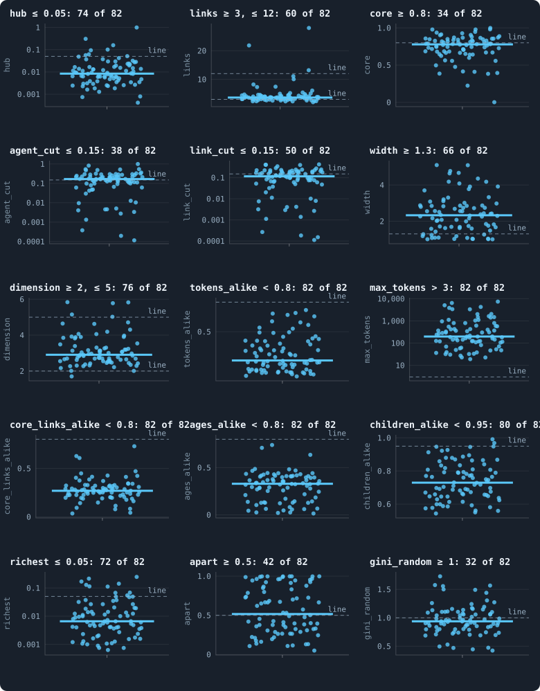

# Which worlds are healthy? A proposed order

> [!question] Questions of this page
> - What could "healthy" mean for a world we hope will keep evolving?
> - How can criteria that say only yes or no put a hundred worlds in order?
> - Which worlds of round 3 are the most healthy, and which the least?

## In short

The author asked for the worlds drawn at random in order, from the most healthy
to the least, by a definition of health they can check. This page proposes
one. It keeps the author's five criteria (decentralised, resilient, almost
three-dimensional, diverse, not too even), adds the sixth the author asked for
on 8 November 2026 (a world may lose leaves, but not whole branches at once),
and reads each of their lines as how much of what it asks a world has: a world
with 76% of its [agents](the-world.md#agents-and-tokens "One member of a world: it lives on a node of the network, holds tokens and has a brain that takes all its decisions.") in its [2-core](bridges.md#core-trees-and-leaves "What is left of a network when agents with one connection or none are peeled away again and again: the agents on loops or between them.") has 0.95 of the 80% the line asks. A
world's health is the sum of its six criteria, from 0 to 6. Of the hundred
worlds of round 3, 82 lived to the end of their run, and one meets every line:
[seed](random-numbers.md "The number that fixes every random choice of a run: the same settings and the same seed make the same world.") 3092. The [median](median-and-quantiles.md "The middle value: half of the numbers lie below it and half above.") living world scores 4.6. What most worlds lack is the
sixth criterion: the median world has a piece of more than 15% of its network
cut off and removed at once about six times every hundred [iterations](one-iteration.md "One step of a world's time: a phase of reproduction, then a phase of the game."). Worlds
that mend their dead lose far fewer. The order is a proposal for the author to
check against the worlds themselves: every name in it opens its world in the
viewer.

## Why an order, and not a verdict

The [criteria](what-makes-a-world-interesting.md) of the screen say yes or no.
A world meets a line or it does not, and it is healthy when it meets them all.
That is clear, but it throws away most of what we measured: a world with 79%
of its agents in its 2-core fails the line of 80% just as a world with 20%
does.

So the author asked for something else (7 November 2026): an **order** of the
worlds, from the most healthy to the least, made by a definition of health
they can check. They look at worlds near the top and near the bottom, in the
viewer, and say where the order is wrong. Then we change the definition, not
the order by hand, and look again. This page is the first proposal.

The order holds the hundred worlds of round 3 of
[A screen of random worlds](a-screen-of-random-worlds.md), and only those:
Experiment 40's 84, drawn from the [settings](settings.md "One number or switch of a run's rules, fixed before it starts.") the author chose on 24 October
2026, and the eight draws of Experiments 41 and 42, each played twice, a [token](the-world.md#agents-and-tokens "The one thing of value in a world: every agent holds a whole number of them, and their total never changes.")
at a time. Round 1 drew from an older list of settings, round 2 was never
played, and neither is in the order (the author, 8 November 2026). Every run's
name begins with "[B1](b1-and-b2.md "The first baseline: the algorithm exactly as a new run is offered it.")" only because a drawn world's settings are kept as changes
from B1's rules; its seed says which world it is (3001 to 3100 for Experiment
40, 4001 to 4008 for the draws played a token at a time). There is
no [baseline](b1-and-b2.md "The stated rules an experiment starts from and changes one thing of: B1 or B2.") any more. B1 and [B2](b1-and-b2.md "The second baseline: B1 with the rules that keep its network from breaking and its agents from staking or breeding themselves to death.") were where we learned to measure, and a world
is no longer judged against them.

## What healthy could mean

We want worlds in which evolution could go on for a very long time. We would
call such a world healthy if, beyond living,

1. **no one rules it:** no agent holds a large share of the links, or of the
   tokens;
2. **it holds together:** losing one agent or one link does not cut off a
   large part of it;
3. **it has room:** it is spread out like a space of a few [dimensions](ball-dimension-and-curvature.md "How fast the number of agents within a distance grows with the distance: as its square in a plane, its cube in space."), and not
   folded into a small world where everyone is a few steps from everyone;
4. **its agents differ:** in their tokens, their links, their ages, and in
   what they do in the same situation;
5. **it is not too even:** its tokens are not shared out more evenly than
   chance would share them;
6. **it loses leaves, not branches:** agents are cut off and removed all the
   time, but never a large part of the world at once.

These are the author's own criteria: decentralised, resilient, almost
three-dimensional, diverse and not too even, and the sixth, no big culls,
which the author added on 8 November 2026. This page proposes a few changes
to their lines, each with its reason, [below](#what-the-proposal-changes), and
a way to measure the sixth, in [Leaves or branches](#leaves-or-branches).

A world should also *last*: one that keeps falling to the edge of [extinction](extinction.md "A world's end before its last iteration: it has dropped to its threshold of agents or fewer.")
is not well, even if it lives to the end. We looked for that, as the fewest
agents a world had in 5% of its iterations. But no world that lived through
its run came below a few hundred agents, so a line for it would order nothing
yet, and the proposal leaves it out.

## A line, read as a share of what it asks

Each criterion is made of lines. Take the line "at least 80% of the agents in
the 2-core". A world with 76% of its agents in its 2-core misses it, but it
has most of what the line asks: 76 of the 80, or **0.95**. A world with 20% has
0.25. A world with 85% meets the line and scores **1**: more than enough counts
as enough.

A line that asks for *at most* some amount is read the other way round. The
line "no agent linked to more than 5% of the others" is met to 0.05 / 0.30 =
**0.17** by a world whose best-linked agent reaches 30% of the others: that
agent is six times over the line.

Some quantities do not count from zero. A world's width counts from its [random
twin](random-twin.md "A network with the same agents and as many links each, wired at random: what a world would be if it were no space at all.")'s, which is 1. Links per agent count from a tree's two, since a network in
one piece with two links an agent has no [loop](bridges.md#loops "A path through the network that comes back to where it started without using a connection twice.") at all. The largest holding
counts from one token. And how alike the agents are counts from "all alike",
1, so that what is measured is the share of agents unlike the commonest. In
each case the line is read as the share of the way from that floor to the
line.

A criterion is met as far as its weakest line, because it is met only when all
its lines are. A world's **health** is the sum of its six criteria's scores,
from 0 to 6: one point for each criterion met, part of a point for each one
nearly met. A world that died has no health. The dead come last in the order,
the longest-lived first.

**An example.** The world of seed 3077 lived through its 3,000 iterations
with a median of about 8,000 agents. No agent rules it: its best-linked agent
reaches 0.6% of the others, and its richest holds 0.2% of the tokens. It holds
together: 94% of its agents sit in the 2-core, and no single agent's loss cuts
off more than 0.13% of it. Its agents act differently (a same-position share of
0.96), and its tokens are a little less even than a random deal (a [Gini](gini-coefficient.md "How unequally tokens are held: 0 if every agent holds as many, near 1 if one holds nearly all.") of
0.44, 1.04 times a random deal's). It loses agents all the time, 4% of its
network in an average phase, but only as leaves: the largest piece it ever lost
at once was 0.3% of it. So five criteria are met in full: five points.

But it is folded. Its typical distance is only 1.07 times its random twin's,
against the 1.3 the width line asks: it has (1.07 − 1) / (1.3 − 1) = 0.25 of
what that line asks. Its criterion *almost three-dimensional* scores 0.25, its
weakest line's share, and its health is **5.25** of 6. It is the 14th of the
82 living worlds. Were a world only as healthy as its weakest criterion, it
would be the 25th.

## What the proposal changes

The author's lines are kept, but for two, and a few are added:

<!-- table healthorder/changes -->
| what the proposal changes | why |
|---|---|
| adds: tokens of the richest agent, as a share of all tokens (at most 0.1) | no ruler: as the hub line asks that no agent hold too many of the links, this asks it of tokens; a world unequal everywhere is healthy, one agent holding the world's fortune is not (the author, 2026-11-08: at most 10%) |
| adds: same-position share: of two agents in the same situation, how often they act measurably differently (at least 0.5) | the author's own number for very different behaviours surviving (2026-10-24), with its line at half: two agents more often act differently than alike |
| adds: Gini of the tokens, over the Gini of tokens dealt out at random at the same mean holding (at least 1) | with no baseline, chance draws the line: a world more even than a random deal has something flattening it; tokens dealt out at random, one at least, at a mean of m an agent have a Gini of (m - 1) / (2m - 1), so the line moves with the world's own riches (0.40 at 3 tokens an agent, 0.46 at 7, 0.47 at 10) |
| adds: big culls: pieces of more than 15% of the network culled at once, every hundred iterations (at most 1) | the author's sixth criterion (2026-11-08): leaves culled everywhere are no harm, a whole branch culled every few iterations is; a piece is big past the author's bar for what one loss may cut off (15%), and a world may lose one about once every hundred iterations |
| drops: genotypes_alike | a genotype is renewed by every mutation, so how many agents share one says how seldom brains mutate, not how differently agents act; the same-position share measures that (in round 3 no world came near the line: at most 26% of a world's agents shared a genotype) |
| drops: gini | drawn at B2's most even world of Experiment 16, a baseline the screen no longer compares with; the proposal's line for not too even is drawn by chance instead |
<!-- /table -->

**A line drawn by chance.** The author's line for *not too even* was the Gini
of B2's most even world, 0.46. With no baseline, chance can draw it instead.
Deal a world's tokens out to its agents completely at random, every agent
getting at least one, and see how unequal the result is. The most random way
to share whole tokens with a given mean has each agent's holding fall off
geometrically (one token is the most common holding, two the next, and so
on), and its Gini is (*m* − 1) / (2*m* − 1) for a mean of *m* tokens an agent:
0.40 at three tokens an agent, 0.46 at seven, 0.47 at ten. A world more even
than this has something flattening it. A world less even has agents that hold
on to what they win. So the line asks that a world's Gini be at least the Gini
of a random deal of its own tokens.

**The author's two new numbers.** On 24 October 2026 the author asked for two
numbers of health and chose to see them on every world of round 3 before
drawing their lines
([Two numbers reported, not judged](what-makes-a-world-interesting.md#two-numbers-reported-not-judged)).
Round 3 has run:
- the [same-position share](what-makes-a-world-interesting.md#the-same-position-share),
  for very different behaviours living side by side, gets a line at a half:
  two agents in the same situation more often act differently than alike. It
  is easy to meet for [brains](the-brain.md "The neural network each agent decides with: inputs about itself and its neighbours, outputs that become its decisions.") that read no random numbers, and hard for brains
  that read many
  ([How the drawn settings shape a world](how-the-drawn-settings-shape-a-world.md#what-decides-how-healthy-a-living-world-grows)).
- the [half-cut exponent](what-makes-a-world-interesting.md#the-half-cut-exponent),
  for a world that on the largest scale looks like a space, gets no line yet.
  We first drew one from what a lattice gives: halving a body of *d*
  dimensions cuts *N*^((*d* − 1)/*d*) of its links, so 1/2 is a plane's and
  2/3 three dimensions'. But a network as sparse as our worlds halves more
  cheaply than a lattice, by how sparse it is as much as by its dimension.
  Random networks of known shape show it, each of 4,000 agents put at random
  in a square or a cube and joined to those nearest:

<!-- table healthorder/calibration -->
| random network in | links an agent | agents in its largest piece | links cut to halve it | half-cut exponent | a lattice's |
|---|---|---|---|---|---|
| a plane | 2.9 | 92 | 5 | 0.36 | 0.50 |
| a plane | 4.8 | 3,622 | 23 | 0.38 | 0.50 |
| a plane | 7.7 | 3,986 | 68 | 0.51 | 0.50 |
| a cube | 2.9 | 1,785 | 9 | 0.29 | 0.67 |
| a cube | 4.7 | 3,833 | 105 | 0.56 | 0.67 |
| a cube | 7.4 | 3,991 | 251 | 0.67 | 0.67 |
<!-- /table -->

At about five links an agent, a random network in a cube reads 0.56 and one in
a plane 0.38; only at about eight links do they reach a lattice's values. At
three links both nearly fall apart. Round 3's living worlds have a median of
3.6 links an agent, and their exponents follow their links (a [correlation](correlation.md "Whether two quantities go up and down together, from −1 to 1.") of
0.67) and their dimension by balls (0.91). So a fixed line at 1/2 would call a
sparse world of three dimensions thin. The fair test compares each world with
a random network of its own size and density in a cube: a world as hard to
halve as that twin is three-dimensional on the largest scale. That is a step
for the author to approve
([For the author to check](#for-the-author-to-check)).

## Leaves or branches

The author, on 8 November 2026: "Some simulations have huge parts culled all
the time. If everywhere a little bit is culled, like leaves, I think it is not
bad. But if every few iterations a whole branch, maybe 40% of the network, it
is quite bad." This is the sixth criterion, and this section says how it is
measured.

**What culled means.** At the end of every phase the [engine](the-lab.md "The program that runs an experiment's plan as runs, each on a frozen copy of the engine, the code that plays a world.") removes the agents
that starved, those left with no token. Then it keeps the largest piece of the
network and removes every agent no longer joined to it: these are the *culled*
("Culled" in the viewer's statistics). A culled agent may hold many tokens; it
is removed only because it lost its way to the rest. Under the setting
*mend_on_death* a dying agent's [neighbours](the-world.md#the-network "An agent joined to another by a connection.") are joined up again, so no death
cuts the world apart, and only links that lapse can.

**Reading the pieces again.** A run records how many agents starved and how
many were culled in each phase, but not which, nor in how many pieces. So the
pieces are read again from the recorded [frames](frames-and-stats.md "A whole world as a run records it after one phase: every agent, its tokens and connections."). The network as a phase left it,
just before its [cleanup](one-iteration.md#cleanup "The end of every phase: only the largest connected piece of the network lives on, and the tokens of the dead are shared out."), is the frame before, changed as the phase's record
says: the newborns and their links, the links handed over to them, the links a
search made, the links that lapsed. Which of the removed starved is read from
what they held: in a [game](one-iteration.md#phase-2-the-game "The second phase of an iteration: every agent stakes all its tokens on its own node and its neighbours', and every node goes to someone."), an agent holds what was staked on it; in
reproduction, what it had, less its child, its gifts, its mates' dues and its
upkeep. The culled agents, grouped by their links, are the pieces culled, and
the largest one counts.

**Where the record leaves it open.** Under two settings, what a few agents held
is not recorded to the token. When links hold a token (*link_token*), a link
that lapses gives its token to one of its two ends, drawn at random. And a
searcher that walks the network pays a token to each agent it steps on. An
agent at its last token there may have been paid one and been culled, or not
and starved. The counts of the starved and the culled settle most of them, and
the rest are counted as culled, so a world is judged, if anything, too
harshly. Counting only the agents surely culled leaves the same 21 worlds
meeting the line. In every phase whose holdings are all settled, the pieces add
up to the run's own count of the culled, and no phase of any world
contradicted what the run recorded.

**The line.** A piece is *big* when it is more than 15% of the network: the
author's own bar for what a single loss may cut off, in the criterion
*resilient*. The line asks that a world lose a big piece at most once every
hundred iterations, and it is read as the other lines are: a world that loses
six every hundred iterations has a sixth of what the line asks.

<!-- figure healthorder/culls -->

**Leaves or branches: what the worlds lose at once.** Each dot is a living world. Across, how much of its network an average phase culls (cuts off from the largest piece and removes), every piece counted, from leaves culled one by one to whole branches; up, how often a single piece of more than 15% of the network was culled at once, every 100 iterations (iterations 100 to the end of the run). Agents that starved are not counted. A world far to the right and low loses much, but in small pieces; a world high up loses whole branches. The dashed line is the criterion's line.

> [!example]- How to make this figure
> **Runs.** every world of round 3 of the screen of random worlds (Experiments 40, 41 and 42: 100 worlds of 30,000 tokens, played for 3,000 iterations)
>
> **Data.** From every phase of every living world's recorded frames, read by `research/screen/culls.py` into `GraphOfLifeRuns/.pilots/screen/culls/<run>.json`, and scored by `research/screen/health.py` into `research/screen/health.json`.
>
> 1. Rebuild the network as each phase left it, just before its cleanup: the frame before, changed as the phase's record says (newborns and their links, links handed over, searches, lapsed links).
> 2. Of the agents the cleanup removed, tell those that starved from those culled: an agent linked to a survivor, or that held nothing (in a game nothing staked on it; in reproduction what it had, less its child, its gifts, its mates' dues and its upkeep), starved; the run's counts of the starved and the culled settle the agents the record leaves open, and any still open count as culled.
> 3. Group the culled by their links (under mend_on_death, by the piece of the network they were cut off in): the pieces culled; the largest counts.
> 4. Across: the share of the network culled in all, averaged over the phases. Up: how many phases culled a piece of more than 15%, every 100 iterations.
>
> **To make it again:** `python3 book_figures.py healthorder`.
<!-- /figure -->

**Leaves and branches can be told apart.** Seed 3090 culls 7.6% of its network
in an average phase, nearly as much as the median world's 8%, but the largest
piece it ever lost at once was 0.8% of it: leaves only. Seeds 3077, 3064 and
3049 are the same. Seed 3014 culls 16% of its network in an average phase, and
a piece of more than 15% in 38 of every hundred iterations: once, more than
half of its 14,000 agents were culled in a single phase, the largest piece
between 35% and 56% of the network. Still, most worlds that lose much lose it
in big pieces too: the share a world culls in all and its big culls go
together (a rank correlation of 0.90).

**Most worlds lose branches.** Only 11 of the 82 living worlds never lost a
big piece after iteration 100, and 21 meet the line. The median world loses
about six every hundred iterations, a quarter of the worlds more than 17, and
the worst, seed 4004 played strongest first, 44: nearly one every other
iteration. 62 worlds lost a piece of more than 40% at least once. Seed 3026,
second in the order without the sixth criterion, loses a piece of more than 15%
about six times every hundred iterations. Twice in its run it lost more than 40%: once,
all 18 links that joined a piece of 42% of its network to the rest lapsed in a
single game.

**Mending is what spares a world.** Of the 44 living worlds that mend their
dead, the median loses 2.4 big pieces every hundred iterations, and 18 meet the
line; of the 38 that do not, the median loses 16, and 3 meet it. Without
mending, an agent that starves takes with it every branch that hung on it
alone. With mending, only the links that lapse after a game can cut a branch
off, and nine in ten of the big pieces the mending worlds lose are lost in a
game.

**Where the line is drawn decides much.** How many of the 82 living worlds
would meet the criterion for other sizes of a big piece, and other numbers
allowed every hundred iterations:

<!-- table healthorder/culls -->
| a big piece is more than | at most 0.5 every 100 iterations | at most 1 every 100 iterations | at most 2 every 100 iterations | at most 5 every 100 iterations |
|---|---|---|---|---|
| 5% | 14 | 17 | 19 | 23 |
| 15% (the line) | 19 | 21 | 25 | 39 |
| 25% | 22 | 26 | 34 | 53 |
| 40% | 47 | 65 | 76 | 80 |
<!-- /table -->

Were a big piece more than 40%, the author's example, 65 worlds would meet the
line, and the sixth criterion would hardly move the order: seeds 3026 and 3023,
the first two after seed 3092 in the order without the sixth criterion, lost a
piece of more than 40% twice and never in their runs. At 15% the criterion asks that a world keep
in practice the resilience its own criterion asks of a single loss. That choice
is the author's ([For the author to check](#for-the-author-to-check)).

## The order

<!-- figure healthorder/order -->

**The living worlds, most healthy first.** Each of the 82 worlds that lived to the end of its run is a row, ranked by its health, the sum of its criteria's scores; each criterion is a column, coloured by how much of what it asks the world has, from none (dark) to all of it (bright yellow): a criterion is met as far as its weakest line. A world named "w" or "s" is one of the eight draws played a token at a time, weakest first or strongest first. The 18 worlds that died are not shown: they come last in the order.

> [!example]- How to make this figure
> **Runs.** every world of round 3 of the screen of random worlds (Experiments 40, 41 and 42: 100 worlds of 30,000 tokens, played for 3,000 iterations)
>
> **Data.** From the screen's readings of every world, `GraphOfLifeRuns/.pilots/screen/worlds/<run>.json` (research/screen/measures.py: every iteration's statistics, every 25th iteration's frame, every kept world), scored by `research/screen/health.py` into `research/screen/health.json`.
>
> 1. Average every number of a world over iterations 100 to the end of its run (the judge's averages, `research/screen/measures.py`).
> 2. For each line, the share of what it asks that the world has, counted from the line's floor (`progress` in `health.py`), at most 1.
> 3. Each criterion: its weakest line's share. Health: the sum over the criteria.
> 4. Rank the living worlds by health, ties by their weakest criterion.
>
> **To make it again:** `python3 book_figures.py healthorder`.
<!-- /figure -->

In the heat map each row is a living world, the healthiest at the top, and
each column a criterion, bright where the world has all of what it asks. The
table gives every number. In it, a world named with a "w" or an "s" is one of
the eight draws played a token at a time, weakest first or strongest first. Each world's name opens it in the viewer,
on a computer that holds the runs. The column *rank by the author's lines*
says where the world would stand if its lines were the author's alone, and the
next, where it would stand if the weakest criterion decided.

One world meets every line, seed 3092, and six more meet five of the six
criteria in full. A quarter of the living worlds score less than 4.15, and a
quarter more than 5.04. By the author's lines alone (the five criteria as the
author drew them, without the sixth), six would meet every criterion: seed
3092, and seeds 3016, 3026, 3023, 3062 and 3051.

<!-- table healthorder/order -->
| rank | world | round | health (of 6) | rank by the author's lines | rank if the weakest criterion decides | decentralised | resilient | almost 3-D | diverse | not too even | no big culls | agents | first half → second | weakest line |
|---|---|---|---|---|---|---|---|---|---|---|---|---|---|---|
| 1 | [s3092](run:B1-30000-7fc03f-s3092) | round 3 | 6.00 | 1 | 1 | 1.00 | 1.00 | 1.00 | 1.00 | 1.00 | 1.00 | 6,314 | 6.00 → 6.00 | none |
| 2 | [s3045](run:B1-30000-f6d23f-s3045) | round 3 | 5.89 | 14 | 2 | 1.00 | 1.00 | 0.89 | 1.00 | 1.00 | 1.00 | 1,401 | 6.00 → 5.45 | width (0.89) |
| 3 | [s3016](run:B1-30000-b23381-s3016) | round 3 | 5.78 | 3 | 6 | 0.78 | 1.00 | 1.00 | 1.00 | 1.00 | 1.00 | 1,192 | 5.40 → 5.70 | richest (0.78) |
| 4 | [s3018](run:B1-30000-af1e28-s3018) | round 3 | 5.74 | 24 | 3 | 1.00 | 0.86 | 1.00 | 1.00 | 0.88 | 1.00 | 2,930 | 5.58 → 5.73 | core (0.86) |
| 5 | [s3080](run:B1-30000-625bc7-s3080) | round 3 | 5.70 | 16 | 5 | 1.00 | 0.83 | 1.00 | 1.00 | 0.96 | 0.91 | 2,002 | 5.78 → 5.62 | core (0.83) |
| 6 | [s3019](run:B1-30000-b1209a-s3019) | round 3 | 5.61 | 21 | 4 | 1.00 | 0.92 | 0.94 | 0.84 | 0.91 | 1.00 | 3,040 | 5.55 → 5.58 | apart (0.84) |
| 7 | [s3049](run:B1-30000-c51eb8-s3049) | round 3 | 5.58 | 32 | 10 | 1.00 | 0.99 | 0.60 | 1.00 | 1.00 | 1.00 | 5,213 | 5.64 → 5.52 | width (0.60) |
| 8 | [s3054](run:B1-30000-d9254e-s3054) | round 3 | 5.55 | 19 | 7 | 1.00 | 0.80 | 1.00 | 0.75 | 1.00 | 1.00 | 3,323 | 5.56 → 5.54 | apart (0.75) |
| 9 | [s3064](run:B1-30000-a6a7ec-s3064) | round 3 | 5.55 | 34 | 11 | 1.00 | 0.97 | 0.58 | 1.00 | 0.99 | 1.00 | 5,346 | 5.50 → 5.59 | width (0.58) |
| 10 | [s3004](run:B1-30000-7d5208-s3004) | round 3 | 5.54 | 12 | 9 | 1.00 | 1.00 | 1.00 | 0.65 | 0.89 | 1.00 | 1,612 | 5.50 → 5.40 | apart (0.65) |
| 11 | [s3032](run:B1-30000-22865f-s3032) | round 3 | 5.34 | 31 | 8 | 1.00 | 0.91 | 1.00 | 1.00 | 0.74 | 0.69 | 7,294 | 5.62 → 5.17 | big_culls (0.69) |
| 12 | [s3042](run:B1-30000-b82ad0-s3042) | round 3 | 5.32 | 25 | 13 | 1.00 | 1.00 | 1.00 | 1.00 | 0.91 | 0.41 | 11,458 | 5.21 → 5.56 | big_culls (0.41) |
| 13 | [s3008](run:B1-30000-e19f2d-s3008) | round 3 | 5.30 | 10 | 18 | 1.00 | 0.98 | 1.00 | 1.00 | 1.00 | 0.33 | 2,113 | 5.25 → 5.36 | big_culls (0.33) |
| 14 | [s3077](run:B1-30000-d6eabf-s3077) | round 3 | 5.25 | 53 | 25 | 1.00 | 1.00 | 0.25 | 1.00 | 1.00 | 1.00 | 7,999 | 5.22 → 5.27 | width (0.25) |
| 15 | [s3026](run:B1-30000-d6955f-s3026) | round 3 | 5.16 | 5 | 38 | 1.00 | 1.00 | 1.00 | 1.00 | 1.00 | 0.16 | 1,957 | 5.16 → 5.16 | big_culls (0.16) |
| 16 | [s3058](run:B1-30000-4108dd-s3058) | round 3 | 5.16 | 9 | 14 | 0.98 | 1.00 | 1.00 | 0.77 | 1.00 | 0.41 | 1,197 | 5.05 → 5.14 | big_culls (0.41) |
| 17 | [s3023](run:B1-30000-b0f6e3-s3023) | round 3 | 5.10 | 2 | 48 | 1.00 | 1.00 | 1.00 | 1.00 | 1.00 | 0.10 | 1,609 | 5.11 → 5.10 | big_culls (0.10) |
| 18 | [s3021](run:B1-30000-4aff7d-s3021) | round 3 | 5.06 | 13 | 42 | 1.00 | 0.93 | 1.00 | 1.00 | 1.00 | 0.13 | 1,648 | 5.06 → 5.07 | big_culls (0.13) |
| 19 | [s4002 w](run:B1-30000-5379e2-s4002) | round 3, weakest first | 5.06 | 7 | 57 | 1.00 | 1.00 | 1.00 | 1.00 | 1.00 | 0.06 | 5,258 | 5.05 → 5.07 | big_culls (0.06) |
| 20 | [s3022](run:B1-30000-298337-s3022) | round 3 | 5.05 | 15 | 30 | 1.00 | 0.92 | 1.00 | 0.95 | 0.97 | 0.21 | 5,443 | 5.05 → 5.06 | big_culls (0.21) |
| 21 | [s4008 w](run:B1-30000-1cfaa4-s4008) | round 3, weakest first | 5.05 | 8 | 58 | 1.00 | 0.99 | 1.00 | 1.00 | 1.00 | 0.06 | 5,205 | 4.97 → 5.07 | big_culls (0.06) |
| 22 | [s3024](run:B1-30000-f05874-s3024) | round 3 | 5.03 | 17 | 32 | 1.00 | 0.83 | 1.00 | 1.00 | 1.00 | 0.20 | 4,580 | 5.06 → 5.01 | big_culls (0.20) |
| 23 | [s3071](run:B1-30000-605c0d-s3071) | round 3 | 5.02 | 52 | 12 | 0.53 | 0.70 | 1.00 | 1.00 | 1.00 | 0.78 | 6,215 | 4.91 → 5.22 | hub (0.53) |
| 24 | [s3084](run:B1-30000-ad76aa-s3084) | round 3 | 5.01 | 63 | 43 | 0.89 | 1.00 | 0.12 | 1.00 | 1.00 | 1.00 | 1,424 | 4.84 → 5.18 | width (0.12) |
| 25 | [s3062](run:B1-30000-def151-s3062) | round 3 | 4.94 | 6 | 59 | 0.88 | 1.00 | 1.00 | 1.00 | 1.00 | 0.06 | 2,364 | 4.97 → 4.81 | big_culls (0.06) |
| 26 | [s3057](run:B1-30000-38aee9-s3057) | round 3 | 4.91 | 18 | 49 | 1.00 | 0.89 | 1.00 | 1.00 | 0.93 | 0.09 | 5,038 | 4.85 → 4.99 | big_culls (0.09) |
| 27 | [s3006](run:B1-30000-023c0a-s3006) | round 3 | 4.87 | 37 | 24 | 1.00 | 0.85 | 1.00 | 1.00 | 0.77 | 0.25 | 6,907 | 4.83 → 4.93 | big_culls (0.25) |
| 28 | [s3051](run:B1-30000-b5a76a-s3051) | round 3 | 4.86 | 4 | 19 | 1.00 | 1.00 | 1.00 | 0.53 | 1.00 | 0.33 | 976 | 5.15 → 4.74 | big_culls (0.33) |
| 29 | [s3043](run:B1-30000-02ed17-s3043) | round 3 | 4.85 | 30 | 21 | 1.00 | 0.93 | 0.81 | 0.28 | 0.84 | 1.00 | 2,515 | 4.81 → 4.90 | apart (0.28) |
| 30 | [s3046](run:B1-30000-27bd64-s3046) | round 3 | 4.82 | 23 | 50 | 1.00 | 1.00 | 1.00 | 1.00 | 0.74 | 0.08 | 2,492 | 4.73 → 4.82 | big_culls (0.08) |
| 31 | [s3095](run:B1-30000-3e5856-s3095) | round 3 | 4.82 | 59 | 45 | 0.70 | 1.00 | 0.12 | 1.00 | 1.00 | 1.00 | 3,517 | 4.48 → 5.14 | width (0.12) |
| 32 | [s4008 s](run:B1-30000-645972-s4008) | round 3, strongest first | 4.78 | 27 | 65 | 1.00 | 0.73 | 1.00 | 1.00 | 1.00 | 0.05 | 5,380 | 4.78 → 4.78 | big_culls (0.05) |
| 33 | [s3033](run:B1-30000-631e49-s3033) | round 3 | 4.77 | 60 | 16 | 0.47 | 0.96 | 0.33 | 1.00 | 1.00 | 1.00 | 1,792 | 4.57 → 5.32 | width (0.33) |
| 34 | [s3055](run:B1-30000-cca771-s3055) | round 3 | 4.75 | 26 | 66 | 1.00 | 0.83 | 1.00 | 1.00 | 0.87 | 0.05 | 2,552 | 4.69 → 4.82 | big_culls (0.05) |
| 35 | [s3065](run:B1-30000-ba3afe-s3065) | round 3 | 4.75 | 50 | 22 | 1.00 | 1.00 | 0.26 | 0.53 | 0.96 | 1.00 | 2,122 | 4.68 → 4.82 | width (0.26) |
| 36 | [s4002 s](run:B1-30000-192733-s4002) | round 3, strongest first | 4.74 | 29 | 70 | 1.00 | 0.71 | 1.00 | 1.00 | 0.99 | 0.04 | 5,624 | 4.78 → 4.70 | big_culls (0.04) |
| 37 | [s3030](run:B1-30000-90fc91-s3030) | round 3 | 4.71 | 73 | 56 | 1.00 | 1.00 | 0.06 | 0.65 | 1.00 | 1.00 | 20,395 | 4.77 → 4.65 | width (0.06) |
| 38 | [s3047](run:B1-30000-10c9f1-s3047) | round 3 | 4.68 | 11 | 46 | 1.00 | 0.95 | 1.00 | 0.62 | 1.00 | 0.11 | 3,638 | 4.58 → 4.81 | big_culls (0.11) |
| 39 | [s4006 s](run:B1-30000-8526cf-s4006) | round 3, strongest first | 4.68 | 33 | 34 | 1.00 | 0.88 | 1.00 | 0.83 | 0.80 | 0.17 | 7,166 | 4.70 → 4.64 | big_culls (0.17) |
| 40 | [s4003 w](run:B1-30000-9efb1d-s4003) | round 3, weakest first | 4.66 | 39 | 76 | 1.00 | 0.70 | 1.00 | 1.00 | 0.94 | 0.03 | 10,306 | 4.79 → 4.57 | big_culls (0.03) |
| 41 | [s4003 s](run:B1-30000-fffc7d-s4003) | round 3, strongest first | 4.65 | 35 | 72 | 1.00 | 0.70 | 1.00 | 1.00 | 0.92 | 0.03 | 8,936 | 4.72 → 4.59 | big_culls (0.03) |
| 42 | [s3090](run:B1-30000-05ba40-s3090) | round 3 | 4.60 | 62 | 54 | 1.00 | 1.00 | 0.07 | 0.53 | 1.00 | 1.00 | 1,537 | 4.68 → 4.45 | width (0.07) |
| 43 | [s3052](run:B1-30000-0d058a-s3052) | round 3 | 4.55 | 43 | 41 | 0.89 | 0.81 | 1.00 | 0.91 | 0.80 | 0.15 | 7,558 | 4.32 → 4.48 | big_culls (0.15) |
| 44 | [s3066](run:B1-30000-dfd51b-s3066) | round 3 | 4.52 | 74 | 81 | 0.50 | 1.00 | 0.02 | 1.00 | 1.00 | 1.00 | 10,027 | 4.49 → 4.55 | width (0.02) |
| 45 | [s4005 s](run:B1-30000-6f6c09-s4005) | round 3, strongest first | 4.49 | 47 | 47 | 1.00 | 0.70 | 1.00 | 1.00 | 0.69 | 0.11 | 3,930 | 4.56 → 4.43 | big_culls (0.11) |
| 46 | [s3041](run:B1-30000-965f1e-s3041) | round 3 | 4.49 | 72 | 15 | 0.37 | 0.46 | 1.00 | 0.79 | 0.87 | 1.00 | 4,434 | 4.23 → 4.70 | links_min (0.37) |
| 47 | [s3087](run:B1-30000-363694-s3087) | round 3 | 4.49 | 20 | 63 | 1.00 | 0.98 | 1.00 | 0.53 | 0.94 | 0.05 | 10,456 | 4.47 → 4.38 | big_culls (0.05) |
| 48 | [s3001](run:B1-30000-68cda7-s3001) | round 3 | 4.46 | 49 | 55 | 1.00 | 0.91 | 1.00 | 0.75 | 0.72 | 0.07 | 17,728 | 4.48 → 4.18 | big_culls (0.07) |
| 49 | [s4004 s](run:B1-30000-2bac4d-s4004) | round 3, strongest first | 4.43 | 40 | 80 | 1.00 | 0.61 | 1.00 | 1.00 | 0.80 | 0.02 | 1,244 | 4.43 → 4.43 | big_culls (0.02) |
| 50 | [s4004 w](run:B1-30000-17ac6e-s4004) | round 3, weakest first | 4.42 | 41 | 78 | 1.00 | 0.55 | 1.00 | 1.00 | 0.85 | 0.02 | 1,101 | 4.43 → 4.42 | big_culls (0.02) |
| 51 | [s3094](run:B1-30000-4ac946-s3094) | round 3 | 4.42 | 77 | 75 | 0.38 | 1.00 | 0.03 | 1.00 | 1.00 | 1.00 | 11,200 | 4.42 → 4.41 | width (0.03) |
| 52 | [s3050](run:B1-30000-ebe08c-s3050) | round 3 | 4.40 | 51 | 40 | 0.49 | 0.76 | 1.00 | 1.00 | 1.00 | 0.15 | 2,980 | 4.28 → 4.55 | big_culls (0.15) |
| 53 | [s3005](run:B1-30000-c18a1f-s3005) | round 3 | 4.33 | 45 | 28 | 0.97 | 0.59 | 1.00 | 0.70 | 0.85 | 0.23 | 4,119 | 4.24 → 4.42 | big_culls (0.23) |
| 54 | [s3091](run:B1-30000-42d88d-s3091) | round 3 | 4.24 | 42 | 73 | 1.00 | 0.56 | 1.00 | 0.80 | 0.85 | 0.03 | 2,288 | 4.20 → 4.28 | big_culls (0.03) |
| 55 | [s3082](run:B1-30000-1141ea-s3082) | round 3 | 4.23 | 61 | 35 | 0.59 | 0.50 | 1.00 | 1.00 | 0.97 | 0.17 | 3,294 | 4.34 → 4.12 | big_culls (0.17) |
| 56 | [s3059](run:B1-30000-2ec87a-s3059) | round 3 | 4.22 | 66 | 23 | 0.77 | 0.49 | 1.00 | 1.00 | 0.70 | 0.25 | 4,240 | 4.20 → 4.24 | big_culls (0.25) |
| 57 | [s4007 s](run:B1-30000-a8a2d2-s4007) | round 3, strongest first | 4.22 | 58 | 61 | 1.00 | 0.69 | 1.00 | 1.00 | 0.47 | 0.05 | 6,827 | 4.25 → 4.18 | big_culls (0.05) |
| 58 | [s4007 w](run:B1-30000-04d3eb-s4007) | round 3, weakest first | 4.21 | 57 | 67 | 1.00 | 0.72 | 1.00 | 1.00 | 0.45 | 0.04 | 6,536 | 4.13 → 4.29 | big_culls (0.04) |
| 59 | [s3063](run:B1-30000-924e70-s3063) | round 3 | 4.20 | 48 | 69 | 1.00 | 0.89 | 1.00 | 0.58 | 0.69 | 0.04 | 14,998 | 4.37 → 4.03 | big_culls (0.04) |
| 60 | [s3078](run:B1-30000-dd27b6-s3078) | round 3 | 4.17 | 28 | 60 | 1.00 | 0.67 | 1.00 | 0.45 | 1.00 | 0.06 | 1,646 | 4.14 → 4.16 | big_culls (0.06) |
| 61 | [s3067](run:B1-30000-4bee8e-s3067) | round 3 | 4.16 | 44 | 39 | 0.92 | 0.70 | 1.00 | 0.39 | 1.00 | 0.15 | 15,925 | 4.35 → 3.90 | big_culls (0.15) |
| 62 | [s3093](run:B1-30000-26a341-s3093) | round 3 | 4.15 | 36 | 27 | 0.99 | 0.53 | 1.00 | 0.23 | 1.00 | 0.40 | 3,432 | 4.26 → 4.05 | apart (0.23) |
| 63 | [s3056](run:B1-30000-43985b-s3056) | round 3 | 4.01 | 56 | 17 | 0.71 | 0.53 | 1.00 | 0.33 | 0.90 | 0.54 | 3,560 | 4.12 → 3.91 | apart (0.33) |
| 64 | [s3072](run:B1-30000-f05562-s3072) | round 3 | 4.01 | 54 | 36 | 1.00 | 0.84 | 1.00 | 0.26 | 0.75 | 0.16 | 20,226 | 3.95 → 4.07 | big_culls (0.16) |
| 65 | [s3061](run:B1-30000-00e3c8-s3061) | round 3 | 4.00 | 22 | 64 | 1.00 | 0.88 | 1.00 | 0.22 | 0.86 | 0.05 | 3,193 | 3.96 → 4.05 | big_culls (0.05) |
| 66 | [s3070](run:B1-30000-a4d3a0-s3070) | round 3 | 4.00 | 69 | 52 | 0.66 | 0.31 | 1.00 | 1.00 | 0.95 | 0.08 | 8,160 | 4.01 → 4.00 | big_culls (0.08) |
| 67 | [s3014](run:B1-30000-7d129f-s3014) | round 3 | 3.97 | 46 | 77 | 1.00 | 0.76 | 1.00 | 0.44 | 0.75 | 0.03 | 11,026 | 3.92 → 4.04 | big_culls (0.03) |
| 68 | [s3040](run:B1-30000-36d076-s3040) | round 3 | 3.97 | 71 | 33 | 0.31 | 0.70 | 1.00 | 0.98 | 0.79 | 0.18 | 4,090 | 4.01 → 3.84 | big_culls (0.18) |
| 69 | [s3013](run:B1-30000-7f7cd5-s3013) | round 3 | 3.90 | 55 | 51 | 1.00 | 0.41 | 1.00 | 0.49 | 0.91 | 0.08 | 11,011 | 3.98 → 3.81 | big_culls (0.08) |
| 70 | [s3012](run:B1-30000-02fa53-s3012) | round 3 | 3.88 | 65 | 31 | 0.95 | 0.32 | 0.70 | 0.72 | 0.99 | 0.20 | 2,522 | 3.86 → 3.91 | big_culls (0.20) |
| 71 | [s3044](run:B1-30000-63827e-s3044) | round 3 | 3.88 | 64 | 71 | 1.00 | 0.52 | 1.00 | 0.85 | 0.47 | 0.04 | 3,543 | 3.90 → 3.86 | big_culls (0.04) |
| 72 | [s3028](run:B1-30000-2eef58-s3028) | round 3 | 3.60 | 67 | 53 | 0.56 | 0.59 | 1.00 | 0.58 | 0.80 | 0.08 | 5,865 | 3.68 → 3.50 | big_culls (0.08) |
| 73 | [s3083](run:B1-30000-0d7e0c-s3083) | round 3 | 3.58 | 75 | 20 | 0.30 | 0.29 | 1.00 | 0.79 | 0.91 | 0.29 | 4,148 | 3.51 → 3.66 | agent_cut (0.29) |
| 74 | [s3007](run:B1-30000-8119cd-s3007) | round 3 | 3.57 | 38 | 62 | 0.59 | 0.51 | 1.00 | 0.43 | 1.00 | 0.05 | 2,768 | 3.48 → 3.70 | big_culls (0.05) |
| 75 | [s3085](run:B1-30000-801b34-s3085) | round 3 | 3.49 | 70 | 79 | 0.85 | 0.47 | 1.00 | 0.61 | 0.53 | 0.02 | 4,259 | 3.52 → 3.47 | big_culls (0.02) |
| 76 | [s3098](run:B1-30000-794ae8-s3098) | round 3 | 3.42 | 68 | 26 | 0.61 | 0.48 | 1.00 | 0.27 | 0.84 | 0.23 | 4,796 | 3.37 → 3.47 | big_culls (0.23) |
| 77 | [s3037](run:B1-30000-845393-s3037) | round 3 | 3.22 | 76 | 44 | 0.47 | 0.28 | 1.00 | 0.66 | 0.70 | 0.12 | 10,156 | 3.61 → 2.77 | big_culls (0.12) |
| 78 | [s3099](run:B1-30000-1ab8a0-s3099) | round 3 | 2.90 | 79 | 29 | 0.28 | 0.28 | 1.00 | 0.22 | 0.88 | 0.25 | 21,743 | 2.92 → 2.90 | apart (0.22) |
| 79 | [s3076](run:B1-30000-66c764-s3076) | round 3 | 2.78 | 80 | 74 | 0.70 | 0.46 | 1.00 | 0.17 | 0.42 | 0.03 | 4,636 | 2.76 → 2.81 | big_culls (0.03) |
| 80 | [s3038](run:B1-30000-1ad8a9-s3038) | round 3 | 2.69 | 78 | 68 | 0.31 | 0.28 | 1.00 | 0.35 | 0.71 | 0.04 | 6,400 | 2.59 → 2.79 | big_culls (0.04) |
| 81 | [s3089](run:B1-30000-77ad6a-s3089) | round 3 | 2.21 | 81 | 37 | 0.16 | 0.18 | 0.31 | 0.75 | 0.50 | 0.31 | 5,620 | 2.45 → 2.18 | hub (0.16) |
| 82 | [s3020](run:B1-30000-511930-s3020) | round 3 | 2.12 | 82 | 82 | 0.01 | 0.00 | 0.01 | 0.10 | 1.00 | 1.00 | 9,388 | 2.14 → 2.09 | core (0.00) |
<!-- /table -->

The worlds that died, longest-lived first:

<!-- table healthorder/dead -->
| world | round | died at iteration |
|---|---|---|
| [s3069](run:B1-30000-033fbf-s3069) | round 3 | 2,442 |
| [s3100](run:B1-30000-13bb83-s3100) | round 3 | 1,815 |
| [s4006 w](run:B1-30000-673ef1-s4006) | round 3, weakest first | 1,445 |
| [s3096](run:B1-30000-76ca8e-s3096) | round 3 | 1,030 |
| [s3009](run:B1-30000-f1b401-s3009) | round 3 | 920 |
| [s3086](run:B1-30000-1393f4-s3086) | round 3 | 719 |
| [s4001 s](run:B1-30000-ec8a95-s4001) | round 3, strongest first | 387 |
| [s4005 w](run:B1-30000-a6c23a-s4005) | round 3, weakest first | 230 |
| [s3015](run:B1-30000-f05b17-s3015) | round 3 | 214 |
| [s3079](run:B1-30000-afe35f-s3079) | round 3 | 210 |
| [s3010](run:B1-30000-30d3da-s3010) | round 3 | 202 |
| [s3081](run:B1-30000-378f0a-s3081) | round 3 | 167 |
| [s4001 w](run:B1-30000-1da684-s4001) | round 3, weakest first | 144 |
| [s3031](run:B1-30000-caf1c5-s3031) | round 3 | 142 |
| [s3036](run:B1-30000-1d8c54-s3036) | round 3 | 115 |
| [s3017](run:B1-30000-44f693-s3017) | round 3 | 94 |
| [s3027](run:B1-30000-be02ce-s3027) | round 3 | 26 |
| [s3074](run:B1-30000-165142-s3074) | round 3 | 12 |
<!-- /table -->

## What the order shows

**One world meets every line.** Seed 3092 plays the lottery, looks for new
partners by a free reach through the network, passes a dead agent's tokens to
its nearest living neighbours, and keeps a link only while it is paid for or
used. It does not mend its dead. It lost a piece of more than 15% twice in its
run, and the largest was 37% of it. All ten worlds after it mend their dead,
and seven of them play the lottery
([How the drawn settings shape a world](how-the-drawn-settings-shape-a-world.md)).

**Big culls are what most worlds suffer.** Only 21 of the 82 living worlds
meet the sixth criterion, and it is the line a world falls furthest short of in
54 of them. Next come the width line (in 12 worlds), a world folded into a small
world, and the same-position share (in 7), agents that act alike. Resilience is
as rare as the sixth criterion (20 worlds meet it, against 50 decentralised, 65
almost three-dimensional, 41 diverse and 32 not too even), but most worlds miss
it only a little.

**The sixth criterion moves worlds more than the proposal's other changes.**
Its order and the order by the author's lines alone have a rank correlation of
0.75; without the sixth criterion, the proposal's order and the author's have
one of 0.89. The worlds that move furthest move for a reason that can be named:
- up, where a folded world loses only leaves: seed 3077 from 53rd to 14th,
  3084 from 63rd to 24th, 3030 from 73rd to 37th, 3095 from 59th to 31st, all
  of which never lost a big piece;
- down, where a world loses big pieces often and its agents act alike: seed
  3061 from 22nd to 65th (22 big pieces every hundred iterations, and a
  same-position share of 0.11), 3078 from 28th to 60th, 3047 from 11th to 38th;
- down, where one agent holds a large share of the tokens too: seed 3007 from
  38th to 74th (17% of all the tokens, and 20 big pieces every hundred
  iterations).

The worlds at the top of the proposal's order without its sixth criterion
fall, but not far: seed 3026 from 2nd to 15th, 3023 from 3rd to 17th, seed 4002 played weakest first
from 4th to 19th, and 3062 from 10th to 25th. Each lost a big piece between 6
and 17 times every hundred iterations.

**At the bottom are the [stars](stars-and-hubs.md "An agent joined to far more agents than most; a star is a world held together by a single hub.") and the worlds that one loss breaks.** In the
last two places are seeds 3020 and 3089, where one agent is linked to 99.5% and
31% of the others. Above them come worlds whose agents act alike, that single
losses cut apart, and that lose whole branches again and again.

## Healthier or sicker with time?

<!-- figure healthorder/halves -->

**Healthier or sicker with time?** Each dot is a living world: its health scored over the first half of its run (iterations 100 to the middle) and over the second (the middle to the end). Above the dashed diagonal a world grew healthier; below it, sicker.

> [!example]- How to make this figure
> **Runs.** every world of round 3 of the screen of random worlds (Experiments 40, 41 and 42: 100 worlds of 30,000 tokens, played for 3,000 iterations)
>
> **Data.** From the screen's readings of every world, `GraphOfLifeRuns/.pilots/screen/worlds/<run>.json` (research/screen/measures.py: every iteration's statistics, every 25th iteration's frame, every kept world), scored by `research/screen/health.py` into `research/screen/health.json`.
>
> 1. Score each half of every living world's run as the whole is scored.
>
> **To make it again:** `python3 book_figures.py healthorder`.
<!-- /figure -->

Health does not drift over a run. From the first half of their run to the
second, 35 worlds grew healthier by more than 0.05, 30 grew sicker, and 17
stayed as they were; the median change is nil. The largest falls are seed 3037
(from 3.61 to 2.77) and seed 3045 (6.00 to 5.45); the largest rises, seed 3033
(4.57 to 5.32) and seed 3095 (4.48 to 5.14).

## Every line against the worlds

<!-- figure healthorder/lines -->

**Every line of the proposal, against the living worlds.** One chart a measure: each dot is a living world's average of it, from iteration 100 to the end of its run, and each dashed line is a line drawn on it; the short bar is the median. The title says which side passes and how many of the living worlds meet every line on the chart. The dots are spread sideways only so that they do not hide each other.

> [!example]- How to make this figure
> **Runs.** every world of round 3 of the screen of random worlds (Experiments 40, 41 and 42: 100 worlds of 30,000 tokens, played for 3,000 iterations)
>
> **Data.** From the screen's readings of every world, `GraphOfLifeRuns/.pilots/screen/worlds/<run>.json` (research/screen/measures.py: every iteration's statistics, every 25th iteration's frame, every kept world), scored by `research/screen/health.py` into `research/screen/health.json`.
>
> 1. Read each living world's averages from `health.json`.
> 2. One dot per world and measure; each line's value as a guide.
>
> **To make it again:** `python3 book_figures.py healthorder`.
<!-- /figure -->

Four of the author's lines are met by every living world: how alike the
tokens are, the largest holding, how alike the 2-core's links are, and how
alike the ages are. They cost no world anything and order nothing here, but
they would catch a world of paupers, or one where everyone is the same age.
The lines that order the worlds most are the big culls (met by 21 of the 82),
the random deal's Gini (32), the 2-core and the agent cut (34 and 38), and the
same-position share (42).

## For the author to check

The order is a proposal, and the author corrects it. The quickest way:
1. Open the worlds near the top of the order and the living worlds near its
   bottom in the viewer (each name in the table opens its world), and look at
   them late in their run.
2. Note the worlds that are out of place: one you would call healthy that
   sits low, or a sick world that sits high.
3. The table says, for every world, which criterion and which line put it
   where it is. So a world out of place points at a line to move, or at a
   criterion that counts for too much or too little.

The tables sort by any column: click its head.

The author answered the first questions on 8 November 2026. The criteria add
up, as here, rather than the weakest deciding (the order would change much: a
rank correlation of 0.54 between the two, since the sixth criterion is so
often the weakest). The proposal's changes stay, with the richest agent's line
at 10%. And a sixth criterion was asked for: no big culls.

Two questions the order cannot answer by itself:
- **How big is a big piece, and how often may a world lose one?** Here a
  piece is big past 15% of the network, and a world may lose one once every
  hundred iterations. The table in [Leaves or branches](#leaves-or-branches)
  shows how many worlds would meet the line for other choices: from 14 to 80
  of the 82.
- **Should the half-cut exponent be read against a twin in space?** Each world
  would be compared with a random network of its own size and density in a
  cube, and called three-dimensional on the largest scale if it is as hard to
  halve. That takes a few minutes of computing a world, and needs no world
  played again.

## What we learned

- **Lines that say yes or no can make an order.** The author's lines, each
  read as the share of what it asks, put round 3's 82 living worlds in order.
- **One of round 3's hundred worlds meets every line,** seed 3092.
- **Most worlds lose whole branches, again and again.** In the median world a
  piece of more than 15% of the network is culled at once about six times
  every hundred iterations, and only 21 worlds lose one at most once.
- **Leaves and branches can be told apart** by reading every phase's pieces
  again from what the run recorded: a world may lose much, but only as leaves.
- **Mending the dead spares a world its branches:** the worlds that mend lose
  a big piece about a seventh as often as those that do not.
- **Health does not drift** over a run: as many worlds grow healthier as
  sicker.
- **The half-cut exponent reads how sparse a world is as much as its
  dimension.** A fair line for it needs a twin in space of the world's own
  density.

## Where to go next

- [How the drawn settings shape a world](how-the-drawn-settings-shape-a-world.md):
  which settings make a world healthy, and which kill it.
- [Candidates for open-ended evolution](candidates-for-open-ended-evolution.md):
  the same worlds read for what evolution needs: heredity, selection and
  change.
- [What makes a world interesting](what-makes-a-world-interesting.md): the
  author's criteria and lines this order starts from.
- [A screen of random worlds](a-screen-of-random-worlds.md): how the worlds
  were drawn, and what became of them.

## How this was made

The worlds are the runs of Experiments 40, 41 and 42, listed with every
setting on the page [A screen of random worlds](a-screen-of-random-worlds.md).
Nothing is played again: every number is read from what the worlds recorded,
by the screen's judge (`research/screen/measures.py`), and kept, one file a
world, in `GraphOfLifeRuns/.pilots/screen/worlds/`. The averages run from
iteration 100 to the end of each run, 3,000 iterations.

The pieces culled are read by `research/screen/culls.py`, from every phase of
every living world's recorded frames: `before_cleanup` rebuilds the network as
a phase left it, `holdings` reads what each agent held, and `pieces` tells the
starved from the culled and groups the culled. `python3 research/screen/culls.py
E41 E42 E40 --jobs 3` keeps one file a world in
`GraphOfLifeRuns/.pilots/screen/culls/`; it reads every frame, and took about
three hours on three processes.

`research/screen/health.py` turns the averages into the order: `FLOOR` holds
where each line counts from, `PROPOSED` and `DROPPED` the changes with their
reasons, `BIG_CULL` the size of a big piece, `progress` reads a line as a share
and `score` a world as the sum of its criteria. `python3
research/screen/health.py E41 E42 E40` writes `research/screen/health.json`;
with `--read 3` it first makes, on three processes, any reading a world still
lacks. The figures and tables of this page are drawn from that file by
`python3 book_figures.py healthorder`.
