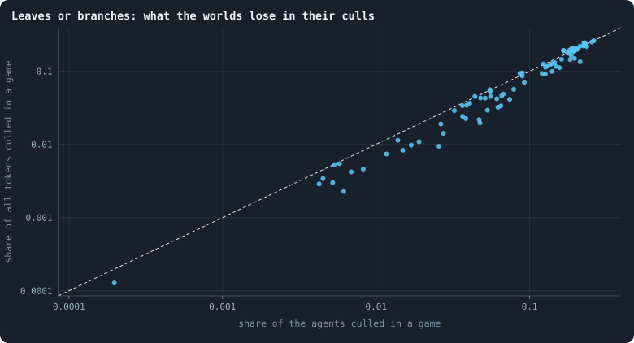
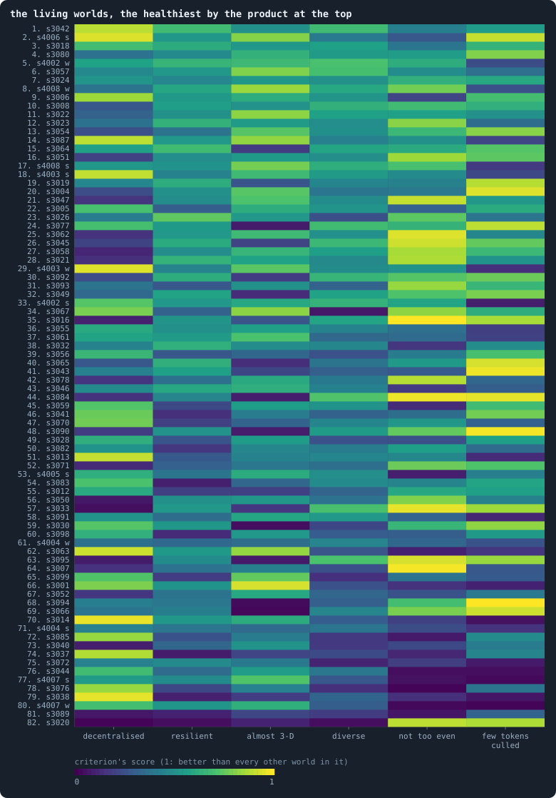
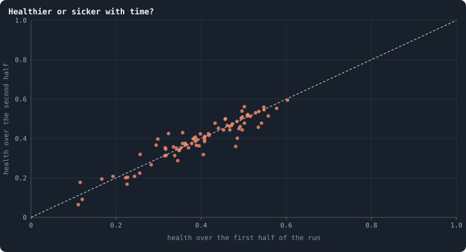
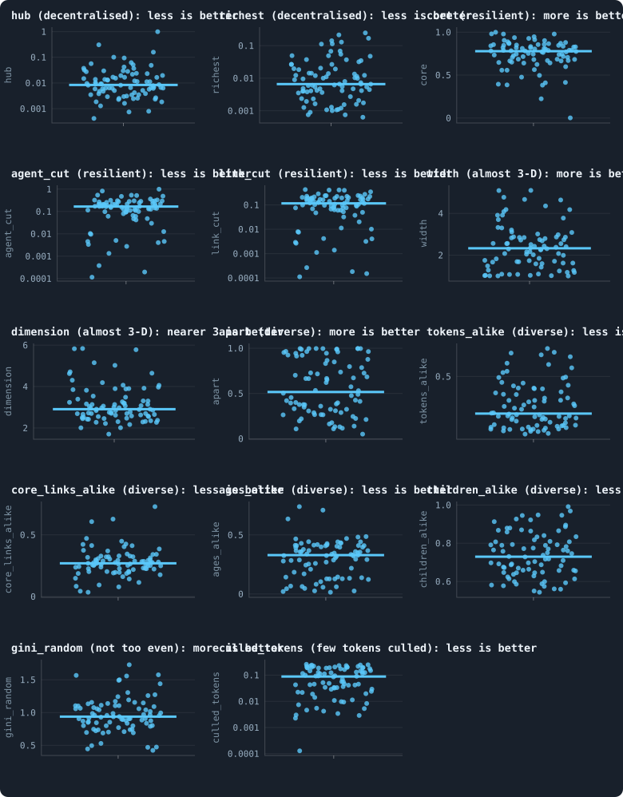

# Which worlds are healthy? Three orders

> [!question] Questions of this page
> - What could "healthy" mean for a world we hope will keep evolving?
> - How can measures in different units be put together into one order, and in how many ways?
> - Which worlds of round 3 are the healthiest, and which the least?

## In short

The author asked for the worlds drawn at random in order, from the most healthy
to the least, by a definition of health they can check. Health here is read
from six criteria: the author's five (decentralised, resilient, almost
three-dimensional, diverse, not too even) and a sixth the author added, few
[tokens](the-world.md#agents-and-tokens "The one thing of value in a world: every agent holds a whole number of them, and their total never changes.") culled. No criterion says yes or no. Each measure of a world is scored
by how many of round 3's 82 living worlds it does better than, so every
difference counts, and the criteria are put together in three ways, each an
order of its own: multiplied, added, or the worst of them. Two worlds are among
the first 13 of all three orders: [seed](random-numbers.md "The number that fixes every random choice of a run: the same settings and the same seed make the same world.") 3042, first by the product, and seed
4006 played strongest first. Seed 3077 shows how much the way of putting them
together matters: it is the first by the sum, the 12th by the product and the
63rd by its worst criterion, as it is folded into a small world. The candidates
for [open-ended evolution](open-ended-test.md "Evolution that keeps producing new things without end, not only up to a plateau.") are drawn from the first 13 of each order. Every name
in the orders opens its world in the viewer, for the author to check.

## Why an order, and not a verdict

The [criteria](what-makes-a-world-interesting.md) of the screen say yes or no.
A world meets a line or it does not, and it is healthy when it meets them all.
That is clear, but it throws away most of what we measured: a world with 79%
of its [agents](the-world.md#agents-and-tokens "One member of a world: it lives on a node of the network, holds tokens and has a brain that takes all its decisions.") in its [2-core](bridges.md#core-trees-and-leaves "What is left of a network when agents with one connection or none are peeled away again and again: the agents on loops or between them.") fails the line of 80% just as a world with 20%
does, and a world far past a line counts the same as one just past it.

So the author asked for something else (7 November 2026): an **order** of the
worlds, from the most healthy to the least, made by a definition of health
they can check. They look at worlds near the top and near the bottom, in the
viewer, and say where the order is wrong. Then we change the definition, not
the order by hand, and look again. The first definition read each line as the
share of what it asks, up to the line. The author found that the lines still
made it a yes or no past them (9 November 2026), and asked for something
else: "a continuous scoring ... always the bigger the better and always
positive", put together "by adding scores, multiplying scores, or just by the
worst score". This page is that definition.

The orders hold the hundred worlds of round 3 of
[A screen of random worlds](a-screen-of-random-worlds.md), and only those:
Experiment 40's 84, drawn from the [settings](settings.md "One number or switch of a run's rules, fixed before it starts.") the author chose on 24 October
2026, and the eight draws of Experiments 41 and 42, each played twice, a token
at a time. Round 1 drew from an older list of settings, round 2 was never
played, and neither is in the orders (the author, 8 November 2026). Every run's
name begins with "[B1](b1-and-b2.md "The first baseline: the algorithm exactly as a new run is offered it.")" only because a drawn world's settings are kept as changes
from B1's rules; its seed says which world it is (3001 to 3100 for Experiment
40, 4001 to 4008 for the draws played a token at a time). There is no [baseline](b1-and-b2.md "The stated rules an experiment starts from and changes one thing of: B1 or B2.")
any more. B1 and [B2](b1-and-b2.md "The second baseline: B1 with the rules that keep its network from breaking and its agents from staking or breeding themselves to death.") were where we learned to measure, and a world is no longer
judged against them.

## What healthy could mean

We want worlds in which evolution could go on for a very long time. We would
call such a world healthy if, beyond living,

1. **no one rules it:** no agent holds a large share of the links, or of the
   tokens;
2. **it holds together:** losing one agent or one link does not cut off a
   large part of it;
3. **it has room:** it is spread out like a space of a few [dimensions](ball-dimension-and-curvature.md "How fast the number of agents within a distance grows with the distance: as its square in a plane, its cube in space."), and not
   folded into a small world where everyone is a few steps from everyone;
4. **its agents differ:** in their tokens, their links, their ages, and in
   what they do in the same situation;
5. **it is not too even:** its tokens are not shared out more evenly than
   chance would share them;
6. **it loses leaves, not branches:** when agents are cut off from the rest,
   they are few and poor, not whole branches with all they hold.

These are the author's own criteria: decentralised, resilient, almost
three-dimensional, diverse and not too even, and the sixth, which the author
added on 8 November 2026.

## Every measure, a score from 0 to 1

Each criterion is read from a few measures, each averaged over a world's run
from [iteration](one-iteration.md "One step of a world's time: a phase of reproduction, then a phase of the game.") 100 to its end:

<!-- table healthorder/measures -->
| criterion | measure | better |
|---|---|---|
| decentralised | links of the best-linked agent, as a share of the others | less |
| decentralised | tokens of the richest agent, as a share of all tokens | less |
| resilient | share of the agents in the 2-core | more |
| resilient | most of the world one agent's loss cuts off | less |
| resilient | most of the world one link's loss cuts off | less |
| almost 3-D | typical distance, over the random twin's | more |
| almost 3-D | dimension, by how balls grow | nearer three |
| diverse | same-position share: of two agents in the same situation, how often they act measurably differently | more |
| diverse | share of the agents holding the most common number of tokens | less |
| diverse | share of the 2-core's agents with its most common number of links | less |
| diverse | share of the agents of the most common age | less |
| diverse | share of the agents making the more common choice, to have a child or not | less |
| not too even | Gini of the tokens, over the Gini of tokens dealt out at random at the same mean holding | more |
| few tokens culled | share of all tokens culled in a game, with the agents cut off from the largest piece | less |
<!-- /table -->

The measures are in different units: a share of the agents, a number of
dimensions, a ratio of distances. To put them together, each is read the same
way: **a world's score in a measure is the share of the round's living worlds
it does better than.** The world with the smallest [hub](stars-and-hubs.md "An agent joined to far more agents than most; a star is a world held together by a single hub.") of all scores 1 in the
hub; a world whose hub is smaller than 70% of the others' scores 0.7; the world
with the largest hub scores 1/82, the least any world scores. Worlds that tie
share their place. So every score is positive, a bigger one is always better,
and every difference counts, not only one past a line.

A criterion is the average of its measures' scores, taken as a geometric mean:
the measures multiplied, and the root taken. One poor measure then pulls a
criterion down more than one good measure lifts it, as it should: a world
where one agent is linked to nearly everyone is not decentralised, however
evenly its tokens are spread.

For *almost three-dimensional*, a world's dimension is better the nearer it is
to three, and as far off at two as at four and a half. Its width is better the
wider: the longer the typical path between two agents, against a random network
of the same size and links, the more the world is a space and the less a small
world.

**What is left out.** Four of the author's measures are not scored, each for
its reason:

<!-- table healthorder/dropped -->
| left out | why |
|---|---|
| links | links per agent asked for a range, 3 to 12, in which more is not better; what it stood for, loops and a world hard to cut, the 2-core and the two cuts measure directly |
| max_tokens | the largest holding is the richest agent's share of all tokens, counted the other way round, so the two would cancel; its line kept out a world of paupers, which no living world is |
| genotypes_alike | a genotype is renewed by every mutation, so how many agents share one says how seldom brains mutate, not how differently agents act; the same-position share measures that |
| gini | drawn at B2's most even world, a baseline the screen no longer compares with; the Gini over a random deal's at the same mean holding reads the same thing against chance |
<!-- /table -->

**The price.** A score says how a world stands among round 3's worlds, not
against a fixed mark. A world that loses 2% of its tokens in a [game](one-iteration.md#phase-2-the-game "The second phase of an iteration: every agent stakes all its tokens on its own node and its neighbours', and every node goes to someone.") scores
well here because most worlds of round 3 lose more; in a round of better worlds
it would score less. For an order of round 3, that is what is wanted. To
compare rounds, they are scored together.

## Few tokens culled

The author, on 8 November 2026: "Some simulations have huge parts culled all
the time. If everywhere a little bit is culled, like leaves, I think it is not
bad. But if every few iterations a whole branch, maybe 40% of the network, it
is quite bad." And on 9 November, how to measure it: "the average percentage
of tokens culled ... only in the game phase."

**What culled means.** At the end of every phase the [engine](the-lab.md "The program that runs an experiment's plan as runs, each on a frozen copy of the engine, the code that plays a world.") removes the agents
that starved, those left with no token. Then it keeps the largest piece of the
network and removes every agent no longer joined to it: these are the
*culled* ("Culled" in the viewer's statistics). A culled agent may hold many
tokens; it is removed only because it lost its way to the rest. What it held is
shared out among the living.

**Why tokens.** A leaf, an agent cut off alone at the edge, is mostly poor,
while a whole branch holds its share of the world's riches. So the share of
all tokens culled in a game counts a leaf for little and a branch for what it
held, with no line for what makes a piece big. The starved hold nothing, so
every token a game's [cleanup](one-iteration.md#cleanup "The end of every phase: only the largest connected piece of the network lives on, and the tokens of the dead are shared out.") shares out was a culled agent's, and each run
records it in its statistics. The measure is the share of all the world's
tokens culled in a game, averaged over the games from iteration 100 on. As an
average a game, it does not depend on how long a stretch is looked at.

<!-- figure healthorder/culls -->

**Leaves or branches: what the worlds lose in their culls.** Each dot is a living world, averaged over the games from iteration 100 to the end of its run. Across, the share of its agents a game culls (cuts off from the largest piece of the network and removes); up, the share of all the world's tokens those agents held. On the dashed diagonal the culled hold as much as the average agent does. Below it they hold less: leaves, poor agents cut off at the edge. On it and above, they are whole branches, with all they held. Agents that starved are not counted: they hold nothing.

> [!example]- How to make this figure
> **Runs.** every world of round 3 of the screen of random worlds (Experiments 40, 41 and 42: 100 worlds of 30,000 tokens, played for 3,000 iterations)
>
> **Data.** From each run's own statistics, `GraphOfLifeRuns/<run>/stats.jsonl` (the game phase's cleanup: `orphaned`, `redistributed`, `nodes`, `starved`), read by `research/screen/health.py` into `research/screen/health.json`.
>
> 1. For every game: the agents culled over the agents just before the cleanup (those left, the starved and the culled), and the tokens shared out by the cleanup over all the world's tokens (the starved hold none, so every token shared out was a culled agent's).
> 2. Average both over the games from iteration 100 to the end of the run.
>
> **To make it again:** `python3 book_figures.py healthorder`.
<!-- /figure -->

**What the worlds lose.** The [median](median-and-quantiles.md "The middle value: half of the numbers lie below it and half above.") world culls 8.9% of all its tokens in a
game, and 9% of its agents. Seed 3092 culls 2.3% of its tokens a game, seed
3042 5.6%, seed 3026 12%, and seed 3014 24%. Where little is culled it is
mostly poor agents: in seeds 3016 and 3090 the culled agents hold about 0.37
of an average agent's tokens. Where much is culled, the culled hold their
share or more: up to 1.17 times an average agent's, in seed 3087. Whole
branches, then, are what the worlds that cull most lose.

**Only the game.** As the author asked, the culls of the reproduction phase are
left out. They are many in some worlds: seed 3090 culls 14.5% of its agents in
an average reproduction phase, all as leaves (the largest piece it ever lost at
once was 0.8% of the network), and only 0.6% in a game.

**Mending is what spares a world.** Of Experiment 40's living worlds, those that
mend their dead (the setting *mend_on_death*: a dying agent's [neighbours](the-world.md#the-network "An agent joined to another by a connection.") are
joined up again, so that no death cuts the network apart) cull a median of 4%
of their tokens in a game, those that do not, 11% (a false discovery rate of
0.01; [How the drawn settings shape a world](how-the-drawn-settings-shape-a-world.md)).

## Three ways to put the criteria together

A world has six criteria, each a score from 0 to 1. They can be put together in
three ways, and each makes an order of its own:

- **multiplied:** a strong criterion makes up for a weak one, but only in
  part. A world needs to be fair in all six;
- **added:** a strong criterion makes up for a weak one in full. A world
  excellent in five can be poor in the sixth;
- **the worst:** nothing makes up for a weak criterion. A world is as healthy
  as its weakest criterion, as a body is as healthy as its sickest organ.

So that the three can be read side by side, each is shown on the criteria's
own scale, from 0 to 1, without changing its order: the product as the six
criteria's geometric average (the sixth root of their product), the sum as
their average, and the worst as it is.

**An example.** The world of seed 3077 lived through its 3,000 iterations with
a median of about 8,000 agents. It holds together better than nearly every
world: no single agent's loss cuts off more than 0.13% of it, and 94% of its
agents sit in the 2-core (resilient: 0.95). It culls very little, 0.5% of its
tokens in a game (0.90). Its agents act differently, and no agent rules it
(diverse 0.69, decentralised 0.70). But it is folded: its typical distance is
only 1.07 times its [random twin](random-twin.md "A network with the same agents and as many links each, wired at random: what a world would be if it were no space at all.")'s, and its dimension, 5.2, is far from three.
Its width beats only 10% of the worlds, its dimension 6%, and its criterion
*almost three-dimensional* scores 0.08. Added up, its six criteria make it
the **first** of the 82 worlds (an average of 0.66). Multiplied, its folding
costs it more: the **12th** (0.52). By its worst criterion, it is the **63rd**
(0.08).

The first 13 of each order:

<!-- table healthorder/first -->
| place | by the product | by the sum | by the worst criterion |
|---|---|---|---|
| 1 | [s3042](run:B1-30000-b82ad0-s3042) | [s3077](run:B1-30000-d6eabf-s3077) | [s3024](run:B1-30000-f05874-s3024) |
| 2 | [s4006 s](run:B1-30000-8526cf-s4006) | [s3084](run:B1-30000-ad76aa-s3084) | [s3042](run:B1-30000-b82ad0-s3042) |
| 3 | [s3018](run:B1-30000-af1e28-s3018) | [s3042](run:B1-30000-b82ad0-s3042) | [s3018](run:B1-30000-af1e28-s3018) |
| 4 | [s3080](run:B1-30000-625bc7-s3080) | [s4006 s](run:B1-30000-8526cf-s4006) | [s3080](run:B1-30000-625bc7-s3080) |
| 5 | [s3057](run:B1-30000-38aee9-s3057) | [s3016](run:B1-30000-b23381-s3016) | [s3057](run:B1-30000-38aee9-s3057) |
| 6 | [s4002 w](run:B1-30000-5379e2-s4002) | [s3095](run:B1-30000-3e5856-s3095) | [s3023](run:B1-30000-b0f6e3-s3023) |
| 7 | [s3008](run:B1-30000-e19f2d-s3008) | [s3066](run:B1-30000-dfd51b-s3066) | [s3022](run:B1-30000-298337-s3022) |
| 8 | [s3024](run:B1-30000-f05874-s3024) | [s3045](run:B1-30000-f6d23f-s3045) | [s3008](run:B1-30000-e19f2d-s3008) |
| 9 | [s3022](run:B1-30000-298337-s3022) | [s3058](run:B1-30000-4108dd-s3058) | [s4006 s](run:B1-30000-8526cf-s4006) |
| 10 | [s3051](run:B1-30000-b5a76a-s3051) | [s3051](run:B1-30000-b5a76a-s3051) | [s3019](run:B1-30000-b1209a-s3019) |
| 11 | [s4008 w](run:B1-30000-1cfaa4-s4008) | [s3087](run:B1-30000-363694-s3087) | [s4008 w](run:B1-30000-1cfaa4-s4008) |
| 12 | [s3077](run:B1-30000-d6eabf-s3077) | [s3004](run:B1-30000-7d5208-s3004) | [s4004 w](run:B1-30000-17ac6e-s4004) |
| 13 | [s3054](run:B1-30000-d9254e-s3054) | [s3030](run:B1-30000-90fc91-s3030) | [s3026](run:B1-30000-d6955f-s3026) |
<!-- /table -->

The three orders agree only in part. The order by the product and the order
by the sum have a rank [correlation](correlation.md "Whether two quantities go up and down together, from −1 to 1.") of 0.81, the product and the worst 0.74,
the sum and the worst only 0.33. Two worlds are among the first 13 of all
three: seeds 3042 and 4006 played strongest first. The candidates for
open-ended evolution are the worlds among the first 13 of any of the three
orders that the candidates' own rules do not rule out: 24 worlds
([Candidates for open-ended evolution](candidates-for-open-ended-evolution.md#the-shortlist)).

## The orders

<!-- figure healthorder/order -->

**The living worlds, healthiest first.** Each of the 82 worlds that lived to the end of its run is a row, in the order of its health by the product of its six criteria; each criterion is a column, coloured by the world's score in it, from dark (worse than nearly every world) to bright yellow (better than every other). A world named "w" or "s" is one of the eight draws played a token at a time, weakest first or strongest first. The 18 worlds that died are not shown: they come last in every order.

> [!example]- How to make this figure
> **Runs.** every world of round 3 of the screen of random worlds (Experiments 40, 41 and 42: 100 worlds of 30,000 tokens, played for 3,000 iterations)
>
> **Data.** From the screen's readings of every world, `GraphOfLifeRuns/.pilots/screen/worlds/<run>.json` (research/screen/measures.py: every iteration's statistics, every 25th iteration's frame, every kept world), and each run's own statistics for its culls, scored by `research/screen/health.py` into `research/screen/health.json`.
>
> 1. Average every measure of a world over iterations 100 to the end of its run (the judge's averages, `research/screen/measures.py`).
> 2. Score each measure by the share of the living worlds the world does better than (`shares` in `health.py`): the best 1, the worst 1/82, ties sharing their place.
> 3. Each criterion: the geometric mean of its measures' scores. Health: the six criteria multiplied (as their geometric average), added (as their average), or the worst of them.
> 4. Rank the living worlds by the product, ties by their weakest criterion.
>
> **To make it again:** `python3 book_figures.py healthorder`.
<!-- /figure -->

In the heat map each row is a living world, the healthiest by the product at
the top, and each column a criterion, bright where the world does better than
most. The table gives every number, sorted by the product; click a column's
head to sort it by the sum, the worst or any criterion. In it, a world named
with a "w" or an "s" is one of the eight draws played a token at a time,
weakest first or strongest first. Each world's name opens it in the viewer, on
a computer that holds the runs.

<!-- table healthorder/order -->
| rank by the product | world | round | by the product | by the sum | by the worst | rank by the sum | rank by the worst | decentralised | resilient | almost 3-D | diverse | not too even | few tokens culled | agents | first half → second | weakest criterion |
|---|---|---|---|---|---|---|---|---|---|---|---|---|---|---|---|---|
| 1 | [s3042](run:B1-30000-b82ad0-s3042) | round 3 | 0.620 | 0.640 | 0.427 | 3 | 2 | 0.90 | 0.78 | 0.51 | 0.68 | 0.43 | 0.55 | 11,458 | 0.616 → 0.610 | not too even (0.43) |
| 2 | [s4006 s](run:B1-30000-8526cf-s4006) | round 3, strongest first | 0.576 | 0.638 | 0.268 | 4 | 9 | 0.95 | 0.47 | 0.81 | 0.41 | 0.27 | 0.91 | 7,166 | 0.571 → 0.537 | not too even (0.27) |
| 3 | [s3018](run:B1-30000-af1e28-s3018) | round 3 | 0.560 | 0.569 | 0.390 | 18 | 3 | 0.69 | 0.59 | 0.53 | 0.57 | 0.39 | 0.65 | 2,930 | 0.539 → 0.556 | not too even (0.39) |
| 4 | [s3080](run:B1-30000-625bc7-s3080) | round 3 | 0.554 | 0.569 | 0.376 | 19 | 4 | 0.38 | 0.50 | 0.64 | 0.54 | 0.55 | 0.80 | 2,002 | 0.555 → 0.550 | decentralised (0.38) |
| 5 | [s3057](run:B1-30000-38aee9-s3057) | round 3 | 0.541 | 0.559 | 0.366 | 26 | 5 | 0.47 | 0.53 | 0.80 | 0.70 | 0.49 | 0.37 | 5,038 | 0.532 → 0.542 | few tokens culled (0.37) |
| 6 | [s4002 w](run:B1-30000-5379e2-s4002) | round 3, weakest first | 0.537 | 0.570 | 0.232 | 17 | 17 | 0.58 | 0.61 | 0.67 | 0.71 | 0.62 | 0.23 | 5,258 | 0.495 → 0.556 | few tokens culled (0.23) |
| 7 | [s3008](run:B1-30000-e19f2d-s3008) | round 3 | 0.534 | 0.557 | 0.269 | 28 | 8 | 0.27 | 0.61 | 0.51 | 0.64 | 0.68 | 0.63 | 2,113 | 0.505 → 0.548 | decentralised (0.27) |
| 8 | [s3024](run:B1-30000-f05874-s3024) | round 3 | 0.531 | 0.535 | 0.429 | 36 | 1 | 0.52 | 0.43 | 0.53 | 0.51 | 0.63 | 0.60 | 4,580 | 0.554 → 0.507 | resilient (0.43) |
| 9 | [s3022](run:B1-30000-298337-s3022) | round 3 | 0.529 | 0.551 | 0.310 | 30 | 7 | 0.31 | 0.53 | 0.82 | 0.57 | 0.57 | 0.50 | 5,443 | 0.511 → 0.522 | decentralised (0.31) |
| 10 | [s3051](run:B1-30000-b5a76a-s3051) | round 3 | 0.528 | 0.580 | 0.198 | 10 | 25 | 0.20 | 0.66 | 0.54 | 0.49 | 0.85 | 0.74 | 976 | 0.528 → 0.500 | decentralised (0.20) |
| 11 | [s4008 w](run:B1-30000-1cfaa4-s4008) | round 3, weakest first | 0.525 | 0.570 | 0.244 | 16 | 11 | 0.38 | 0.58 | 0.85 | 0.60 | 0.78 | 0.24 | 5,205 | 0.505 → 0.520 | few tokens culled (0.24) |
| 12 | [s3077](run:B1-30000-d6eabf-s3077) | round 3 | 0.524 | 0.661 | 0.077 | 1 | 63 | 0.70 | 0.95 | 0.08 | 0.69 | 0.65 | 0.90 | 7,999 | 0.532 → 0.534 | almost 3-D (0.08) |
| 13 | [s3054](run:B1-30000-d9254e-s3054) | round 3 | 0.523 | 0.564 | 0.241 | 25 | 14 | 0.24 | 0.43 | 0.73 | 0.50 | 0.67 | 0.82 | 3,323 | 0.545 → 0.496 | decentralised (0.24) |
| 14 | [s3087](run:B1-30000-363694-s3087) | round 3 | 0.521 | 0.578 | 0.207 | 11 | 22 | 0.90 | 0.60 | 0.83 | 0.43 | 0.50 | 0.21 | 10,456 | 0.504 → 0.519 | few tokens culled (0.21) |
| 15 | [s3006](run:B1-30000-023c0a-s3006) | round 3 | 0.520 | 0.566 | 0.207 | 24 | 21 | 0.85 | 0.50 | 0.62 | 0.52 | 0.21 | 0.70 | 6,907 | 0.521 → 0.525 | not too even (0.21) |
| 16 | [s3004](run:B1-30000-7d5208-s3004) | round 3 | 0.517 | 0.576 | 0.234 | 12 | 16 | 0.23 | 0.74 | 0.74 | 0.39 | 0.40 | 0.95 | 1,612 | 0.503 → 0.488 | decentralised (0.23) |
| 17 | [s3064](run:B1-30000-a6a7ec-s3064) | round 3 | 0.517 | 0.568 | 0.174 | 21 | 30 | 0.57 | 0.74 | 0.17 | 0.59 | 0.61 | 0.73 | 5,346 | 0.520 → 0.519 | almost 3-D (0.17) |
| 18 | [s3023](run:B1-30000-b0f6e3-s3023) | round 3 | 0.515 | 0.538 | 0.354 | 35 | 6 | 0.38 | 0.64 | 0.54 | 0.49 | 0.82 | 0.35 | 1,609 | 0.505 → 0.518 | few tokens culled (0.35) |
| 19 | [s3058](run:B1-30000-4108dd-s3058) | round 3 | 0.499 | 0.588 | 0.109 | 9 | 54 | 0.11 | 0.67 | 0.66 | 0.56 | 0.87 | 0.67 | 1,197 | 0.482 → 0.519 | decentralised (0.11) |
| 20 | [s3045](run:B1-30000-f6d23f-s3045) | round 3 | 0.497 | 0.592 | 0.200 | 8 | 24 | 0.20 | 0.79 | 0.20 | 0.67 | 0.93 | 0.76 | 1,401 | 0.516 → 0.467 | almost 3-D (0.20) |
| 21 | [s4008 s](run:B1-30000-645972-s4008) | round 3, strongest first | 0.496 | 0.549 | 0.171 | 32 | 32 | 0.52 | 0.48 | 0.79 | 0.63 | 0.71 | 0.17 | 5,380 | 0.531 → 0.451 | few tokens culled (0.17) |
| 22 | [s4003 s](run:B1-30000-fffc7d-s4003) | round 3, strongest first | 0.493 | 0.539 | 0.220 | 34 | 19 | 0.91 | 0.41 | 0.68 | 0.54 | 0.48 | 0.22 | 8,936 | 0.493 → 0.495 | few tokens culled (0.22) |
| 23 | [s3047](run:B1-30000-10c9f1-s3047) | round 3 | 0.493 | 0.559 | 0.154 | 27 | 35 | 0.15 | 0.56 | 0.72 | 0.49 | 0.91 | 0.52 | 3,638 | 0.497 → 0.474 | decentralised (0.15) |
| 24 | [s3019](run:B1-30000-b1209a-s3019) | round 3 | 0.491 | 0.528 | 0.258 | 37 | 10 | 0.46 | 0.67 | 0.26 | 0.46 | 0.44 | 0.89 | 3,040 | 0.480 → 0.479 | almost 3-D (0.26) |
| 25 | [s3092](run:B1-30000-7fc03f-s3092) | round 3 | 0.485 | 0.567 | 0.179 | 23 | 29 | 0.24 | 0.83 | 0.18 | 0.65 | 0.73 | 0.77 | 6,314 | 0.460 → 0.500 | almost 3-D (0.18) |
| 26 | [s3062](run:B1-30000-def151-s3062) | round 3 | 0.480 | 0.550 | 0.146 | 31 | 39 | 0.15 | 0.56 | 0.68 | 0.50 | 0.95 | 0.46 | 2,364 | 0.480 → 0.466 | decentralised (0.15) |
| 27 | [s3026](run:B1-30000-d6955f-s3026) | round 3 | 0.472 | 0.505 | 0.243 | 41 | 13 | 0.42 | 0.71 | 0.53 | 0.24 | 0.74 | 0.39 | 1,957 | 0.456 → 0.462 | diverse (0.24) |
| 28 | [s3049](run:B1-30000-c51eb8-s3049) | round 3 | 0.470 | 0.556 | 0.124 | 29 | 45 | 0.33 | 0.79 | 0.12 | 0.58 | 0.72 | 0.79 | 5,213 | 0.464 → 0.473 | almost 3-D (0.12) |
| 29 | [s3016](run:B1-30000-b23381-s3016) | round 3 | 0.468 | 0.608 | 0.094 | 5 | 57 | 0.09 | 0.84 | 0.26 | 0.58 | 1.00 | 0.87 | 1,192 | 0.434 → 0.452 | decentralised (0.09) |
| 30 | [s4003 w](run:B1-30000-9efb1d-s4003) | round 3, weakest first | 0.464 | 0.541 | 0.134 | 33 | 43 | 0.95 | 0.43 | 0.74 | 0.48 | 0.51 | 0.13 | 10,306 | 0.494 → 0.445 | few tokens culled (0.13) |
| 31 | [s3021](run:B1-30000-4aff7d-s3021) | round 3 | 0.463 | 0.527 | 0.137 | 38 | 42 | 0.14 | 0.59 | 0.57 | 0.47 | 0.88 | 0.51 | 1,648 | 0.460 → 0.439 | decentralised (0.14) |
| 32 | [s3005](run:B1-30000-c18a1f-s3005) | round 3 | 0.459 | 0.497 | 0.222 | 42 | 18 | 0.71 | 0.22 | 0.62 | 0.52 | 0.30 | 0.61 | 4,119 | 0.437 → 0.478 | resilient (0.22) |
| 33 | [s3084](run:B1-30000-ad76aa-s3084) | round 3 | 0.448 | 0.641 | 0.085 | 2 | 60 | 0.15 | 0.95 | 0.09 | 0.72 | 0.98 | 0.96 | 1,424 | 0.434 → 0.446 | almost 3-D (0.09) |
| 34 | [s3067](run:B1-30000-4bee8e-s3067) | round 3 | 0.437 | 0.572 | 0.069 | 15 | 67 | 0.79 | 0.30 | 0.82 | 0.07 | 0.83 | 0.62 | 15,925 | 0.481 → 0.399 | diverse (0.07) |
| 35 | [s3093](run:B1-30000-26a341-s3093) | round 3 | 0.437 | 0.484 | 0.207 | 43 | 23 | 0.38 | 0.21 | 0.51 | 0.31 | 0.84 | 0.66 | 3,432 | 0.436 → 0.420 | resilient (0.21) |
| 36 | [s4002 s](run:B1-30000-192733-s4002) | round 3, strongest first | 0.431 | 0.517 | 0.085 | 39 | 58 | 0.73 | 0.45 | 0.60 | 0.64 | 0.59 | 0.09 | 5,624 | 0.470 → 0.349 | few tokens culled (0.09) |
| 37 | [s3065](run:B1-30000-ba3afe-s3065) | round 3 | 0.419 | 0.509 | 0.132 | 40 | 44 | 0.27 | 0.79 | 0.13 | 0.38 | 0.54 | 0.94 | 2,122 | 0.424 → 0.424 | almost 3-D (0.13) |
| 38 | [s3090](run:B1-30000-05ba40-s3090) | round 3 | 0.415 | 0.567 | 0.082 | 22 | 62 | 0.18 | 0.85 | 0.08 | 0.55 | 0.76 | 0.99 | 1,537 | 0.436 → 0.350 | almost 3-D (0.08) |
| 39 | [s3043](run:B1-30000-02ed17-s3043) | round 3 | 0.414 | 0.478 | 0.214 | 44 | 20 | 0.43 | 0.66 | 0.21 | 0.30 | 0.28 | 0.98 | 2,515 | 0.417 → 0.396 | almost 3-D (0.21) |
| 40 | [s3061](run:B1-30000-00e3c8-s3061) | round 3 | 0.413 | 0.450 | 0.195 | 51 | 26 | 0.58 | 0.53 | 0.71 | 0.34 | 0.34 | 0.20 | 3,193 | 0.415 → 0.423 | few tokens culled (0.20) |
| 41 | [s3032](run:B1-30000-22865f-s3032) | round 3 | 0.408 | 0.440 | 0.159 | 53 | 33 | 0.44 | 0.61 | 0.48 | 0.46 | 0.16 | 0.49 | 7,294 | 0.407 → 0.405 | not too even (0.16) |
| 42 | [s3055](run:B1-30000-cca771-s3055) | round 3 | 0.403 | 0.431 | 0.183 | 56 | 28 | 0.61 | 0.42 | 0.57 | 0.44 | 0.37 | 0.18 | 2,552 | 0.406 → 0.405 | few tokens culled (0.18) |
| 43 | [s3071](run:B1-30000-605c0d-s3071) | round 3 | 0.395 | 0.461 | 0.119 | 46 | 48 | 0.12 | 0.40 | 0.40 | 0.36 | 0.77 | 0.72 | 6,215 | 0.376 → 0.393 | decentralised (0.12) |
| 44 | [s3078](run:B1-30000-dd27b6-s3078) | round 3 | 0.393 | 0.453 | 0.151 | 49 | 37 | 0.15 | 0.33 | 0.61 | 0.41 | 0.89 | 0.33 | 1,646 | 0.376 → 0.397 | decentralised (0.15) |
| 45 | [s3046](run:B1-30000-27bd64-s3046) | round 3 | 0.391 | 0.426 | 0.171 | 59 | 31 | 0.47 | 0.55 | 0.63 | 0.44 | 0.17 | 0.29 | 2,492 | 0.380 → 0.403 | not too even (0.17) |
| 46 | [s3030](run:B1-30000-90fc91-s3030) | round 3 | 0.390 | 0.575 | 0.042 | 13 | 73 | 0.73 | 0.98 | 0.04 | 0.21 | 0.66 | 0.83 | 20,395 | 0.413 → 0.392 | almost 3-D (0.04) |
| 47 | [s3041](run:B1-30000-965f1e-s3041) | round 3 | 0.383 | 0.457 | 0.116 | 47 | 50 | 0.77 | 0.12 | 0.41 | 0.31 | 0.35 | 0.78 | 4,434 | 0.341 → 0.429 | resilient (0.12) |
| 48 | [s3056](run:B1-30000-43985b-s3056) | round 3 | 0.380 | 0.425 | 0.190 | 60 | 27 | 0.66 | 0.19 | 0.33 | 0.25 | 0.41 | 0.71 | 3,560 | 0.386 → 0.369 | resilient (0.19) |
| 49 | [s3095](run:B1-30000-3e5856-s3095) | round 3 | 0.380 | 0.599 | 0.073 | 6 | 64 | 0.08 | 0.95 | 0.07 | 0.71 | 0.94 | 0.84 | 3,517 | 0.337 → 0.443 | almost 3-D (0.07) |
| 50 | [s3082](run:B1-30000-1141ea-s3082) | round 3 | 0.377 | 0.407 | 0.153 | 64 | 36 | 0.51 | 0.15 | 0.46 | 0.41 | 0.56 | 0.34 | 3,294 | 0.384 → 0.360 | resilient (0.15) |
| 51 | [s3028](run:B1-30000-2eef58-s3028) | round 3 | 0.374 | 0.411 | 0.235 | 63 | 15 | 0.63 | 0.24 | 0.55 | 0.25 | 0.24 | 0.56 | 5,865 | 0.350 → 0.375 | resilient (0.24) |
| 52 | [s3033](run:B1-30000-631e49-s3033) | round 3 | 0.372 | 0.569 | 0.042 | 20 | 74 | 0.04 | 0.69 | 0.16 | 0.70 | 0.96 | 0.85 | 1,792 | 0.335 → 0.448 | decentralised (0.04) |
| 53 | [s3094](run:B1-30000-4ac946-s3094) | round 3 | 0.372 | 0.575 | 0.030 | 14 | 77 | 0.43 | 1.00 | 0.03 | 0.30 | 0.70 | 1.00 | 11,200 | 0.376 → 0.368 | almost 3-D (0.03) |
| 54 | [s3059](run:B1-30000-2ec87a-s3059) | round 3 | 0.367 | 0.457 | 0.122 | 48 | 46 | 0.73 | 0.14 | 0.55 | 0.51 | 0.12 | 0.68 | 4,240 | 0.365 → 0.370 | not too even (0.12) |
| 55 | [s4005 s](run:B1-30000-6f6c09-s4005) | round 3, strongest first | 0.361 | 0.428 | 0.085 | 58 | 59 | 0.63 | 0.32 | 0.61 | 0.49 | 0.09 | 0.43 | 3,930 | 0.384 → 0.350 | not too even (0.09) |
| 56 | [s3066](run:B1-30000-dfd51b-s3066) | round 3 | 0.360 | 0.592 | 0.017 | 7 | 79 | 0.39 | 0.97 | 0.02 | 0.45 | 0.79 | 0.93 | 10,027 | 0.366 → 0.397 | almost 3-D (0.02) |
| 57 | [s3013](run:B1-30000-7f7cd5-s3013) | round 3 | 0.358 | 0.433 | 0.122 | 55 | 47 | 0.91 | 0.20 | 0.44 | 0.46 | 0.46 | 0.12 | 11,011 | 0.360 → 0.356 | few tokens culled (0.12) |
| 58 | [s3050](run:B1-30000-ebe08c-s3050) | round 3 | 0.354 | 0.441 | 0.065 | 52 | 68 | 0.06 | 0.44 | 0.52 | 0.37 | 0.80 | 0.44 | 2,980 | 0.329 → 0.348 | decentralised (0.06) |
| 59 | [s3070](run:B1-30000-a4d3a0-s3070) | round 3 | 0.353 | 0.414 | 0.109 | 62 | 53 | 0.78 | 0.11 | 0.32 | 0.45 | 0.52 | 0.30 | 8,160 | 0.353 → 0.352 | resilient (0.11) |
| 60 | [s3099](run:B1-30000-1ab8a0-s3099) | round 3 | 0.353 | 0.419 | 0.138 | 61 | 41 | 0.72 | 0.24 | 0.76 | 0.14 | 0.38 | 0.28 | 21,743 | 0.352 → 0.332 | diverse (0.14) |
| 61 | [s3098](run:B1-30000-794ae8-s3098) | round 3 | 0.348 | 0.400 | 0.116 | 65 | 49 | 0.63 | 0.12 | 0.53 | 0.29 | 0.29 | 0.54 | 4,796 | 0.353 → 0.350 | resilient (0.12) |
| 62 | [s3083](run:B1-30000-0d7e0c-s3083) | round 3 | 0.347 | 0.435 | 0.060 | 54 | 70 | 0.71 | 0.06 | 0.33 | 0.47 | 0.45 | 0.59 | 4,148 | 0.342 → 0.344 | resilient (0.06) |
| 63 | [s3063](run:B1-30000-924e70-s3063) | round 3 | 0.346 | 0.471 | 0.098 | 45 | 56 | 0.92 | 0.55 | 0.84 | 0.26 | 0.10 | 0.16 | 14,998 | 0.345 → 0.351 | not too even (0.10) |
| 64 | [s3091](run:B1-30000-42d88d-s3091) | round 3 | 0.340 | 0.390 | 0.110 | 68 | 52 | 0.52 | 0.27 | 0.59 | 0.53 | 0.32 | 0.11 | 2,288 | 0.334 → 0.325 | few tokens culled (0.11) |
| 65 | [s3012](run:B1-30000-02fa53-s3012) | round 3 | 0.334 | 0.399 | 0.112 | 66 | 51 | 0.61 | 0.11 | 0.19 | 0.32 | 0.60 | 0.57 | 2,522 | 0.329 → 0.337 | resilient (0.11) |
| 66 | [s3001](run:B1-30000-68cda7-s3001) | round 3 | 0.331 | 0.453 | 0.098 | 50 | 55 | 0.80 | 0.49 | 0.94 | 0.25 | 0.15 | 0.10 | 17,728 | 0.339 → 0.287 | few tokens culled (0.10) |
| 67 | [s4004 w](run:B1-30000-17ac6e-s4004) | round 3, weakest first | 0.327 | 0.334 | 0.244 | 72 | 12 | 0.37 | 0.24 | 0.36 | 0.45 | 0.33 | 0.26 | 1,101 | 0.331 → 0.320 | resilient (0.24) |
| 68 | [s3052](run:B1-30000-0d058a-s3052) | round 3 | 0.326 | 0.353 | 0.158 | 70 | 34 | 0.16 | 0.38 | 0.60 | 0.33 | 0.26 | 0.40 | 7,558 | 0.296 → 0.364 | decentralised (0.16) |
| 69 | [s3007](run:B1-30000-8119cd-s3007) | round 3 | 0.321 | 0.391 | 0.143 | 67 | 40 | 0.14 | 0.28 | 0.43 | 0.24 | 0.99 | 0.27 | 2,768 | 0.296 → 0.340 | decentralised (0.14) |
| 70 | [s3014](run:B1-30000-7d129f-s3014) | round 3 | 0.301 | 0.428 | 0.049 | 57 | 72 | 0.97 | 0.45 | 0.62 | 0.29 | 0.20 | 0.05 | 11,026 | 0.248 → 0.311 | few tokens culled (0.05) |
| 71 | [s4004 s](run:B1-30000-2bac4d-s4004) | round 3, strongest first | 0.287 | 0.305 | 0.146 | 78 | 38 | 0.44 | 0.29 | 0.34 | 0.39 | 0.23 | 0.15 | 1,244 | 0.298 → 0.298 | few tokens culled (0.15) |
| 72 | [s3085](run:B1-30000-801b34-s3085) | round 3 | 0.263 | 0.355 | 0.073 | 69 | 65 | 0.84 | 0.16 | 0.41 | 0.17 | 0.07 | 0.48 | 4,259 | 0.262 → 0.249 | not too even (0.07) |
| 73 | [s3040](run:B1-30000-36d076-s3040) | round 3 | 0.246 | 0.289 | 0.084 | 79 | 61 | 0.08 | 0.34 | 0.51 | 0.17 | 0.22 | 0.41 | 4,090 | 0.258 → 0.226 | decentralised (0.08) |
| 74 | [s3072](run:B1-30000-f05562-s3072) | round 3 | 0.222 | 0.283 | 0.073 | 81 | 66 | 0.44 | 0.50 | 0.41 | 0.10 | 0.18 | 0.07 | 20,226 | 0.227 → 0.206 | few tokens culled (0.07) |
| 75 | [s3037](run:B1-30000-845393-s3037) | round 3 | 0.208 | 0.320 | 0.039 | 77 | 75 | 0.88 | 0.04 | 0.21 | 0.23 | 0.11 | 0.45 | 10,156 | 0.215 → 0.183 | resilient (0.04) |
| 76 | [s3044](run:B1-30000-63827e-s3044) | round 3 | 0.194 | 0.328 | 0.037 | 75 | 76 | 0.69 | 0.27 | 0.55 | 0.40 | 0.04 | 0.04 | 3,543 | 0.213 → 0.193 | not too even (0.04) |
| 77 | [s4007 s](run:B1-30000-a8a2d2-s4007) | round 3, strongest first | 0.190 | 0.330 | 0.024 | 74 | 78 | 0.54 | 0.38 | 0.72 | 0.27 | 0.05 | 0.02 | 6,827 | 0.218 → 0.162 | few tokens culled (0.02) |
| 78 | [s3076](run:B1-30000-66c764-s3076) | round 3 | 0.177 | 0.323 | 0.012 | 76 | 82 | 0.84 | 0.13 | 0.44 | 0.14 | 0.01 | 0.38 | 4,636 | 0.179 → 0.192 | not too even (0.01) |
| 79 | [s3038](run:B1-30000-1ad8a9-s3038) | round 3 | 0.168 | 0.284 | 0.051 | 80 | 71 | 0.96 | 0.05 | 0.18 | 0.32 | 0.13 | 0.06 | 6,400 | 0.150 → 0.176 | resilient (0.05) |
| 80 | [s4007 w](run:B1-30000-04d3eb-s4007) | round 3, weakest first | 0.159 | 0.347 | 0.012 | 71 | 80 | 0.69 | 0.43 | 0.63 | 0.29 | 0.02 | 0.01 | 6,536 | 0.112 → 0.172 | few tokens culled (0.01) |
| 81 | [s3089](run:B1-30000-77ad6a-s3089) | round 3 | 0.124 | 0.152 | 0.061 | 82 | 69 | 0.06 | 0.08 | 0.21 | 0.18 | 0.06 | 0.32 | 5,620 | 0.113 → 0.088 | not too even (0.06) |
| 82 | [s3020](run:B1-30000-511930-s3020) | round 3 | 0.111 | 0.331 | 0.012 | 73 | 81 | 0.01 | 0.05 | 0.10 | 0.04 | 0.90 | 0.88 | 9,388 | 0.118 → 0.070 | decentralised (0.01) |
<!-- /table -->

The worlds that died, longest-lived first:

<!-- table healthorder/dead -->
| world | round | died at iteration |
|---|---|---|
| [s3069](run:B1-30000-033fbf-s3069) | round 3 | 2,442 |
| [s3100](run:B1-30000-13bb83-s3100) | round 3 | 1,815 |
| [s4006 w](run:B1-30000-673ef1-s4006) | round 3, weakest first | 1,445 |
| [s3096](run:B1-30000-76ca8e-s3096) | round 3 | 1,030 |
| [s3009](run:B1-30000-f1b401-s3009) | round 3 | 920 |
| [s3086](run:B1-30000-1393f4-s3086) | round 3 | 719 |
| [s4001 s](run:B1-30000-ec8a95-s4001) | round 3, strongest first | 387 |
| [s4005 w](run:B1-30000-a6c23a-s4005) | round 3, weakest first | 230 |
| [s3015](run:B1-30000-f05b17-s3015) | round 3 | 214 |
| [s3079](run:B1-30000-afe35f-s3079) | round 3 | 210 |
| [s3010](run:B1-30000-30d3da-s3010) | round 3 | 202 |
| [s3081](run:B1-30000-378f0a-s3081) | round 3 | 167 |
| [s4001 w](run:B1-30000-1da684-s4001) | round 3, weakest first | 144 |
| [s3031](run:B1-30000-caf1c5-s3031) | round 3 | 142 |
| [s3036](run:B1-30000-1d8c54-s3036) | round 3 | 115 |
| [s3017](run:B1-30000-44f693-s3017) | round 3 | 94 |
| [s3027](run:B1-30000-be02ce-s3027) | round 3 | 26 |
| [s3074](run:B1-30000-165142-s3074) | round 3 | 12 |
<!-- /table -->

## What the orders show

**The first by the product is seed 3042.** It is among the best in being
decentralised (0.90) and resilient (0.78), and no worse than middling in
anything: its weakest criterion, *not too even*, scores 0.43. It mends its
dead, plays the lottery, searches for partners by jumps, mixes [brains](the-brain.md "The neural network each agent decides with: inputs about itself and its neighbours, outputs that become its decisions.") at birth,
allows gifts and keeps a link only while it is paid for or used.

**The worst criterion differs from world to world.** It is *decentralised* in
19 worlds, *few tokens culled* in 19, *resilient* and *almost
three-dimensional* in 14 each, *not too even* in 13, and *diverse* in 3.

**The candidates mostly mend their dead.** Of the 24 candidates, 18 mend their
dead, against 44 of the 82 living worlds; 13 play the lottery, 13 allow gifts
and 13 put a token in every link.

**Seed 3092 meets every one of the author's lines, and stands near the middle.**
Its hub (2.7% of the others) and its richest agent (2.0% of the tokens) are
under the lines, but larger than in three worlds of four: decentralised 0.24.
Its width beats 22% of the worlds and its dimension, 4.3, only 15%: almost
three-dimensional 0.18. It is the 25th by the product, the 23rd by the sum and
the 29th by its worst criterion.

**At the bottom are the stars and the worlds too even.** The last by the
product is seed 3020, where one agent is linked to 99.5% of the others, and
before it seed 3089, where one is linked to 31%. Before them come seeds 4007
played weakest first, 3038, 3076 and 4007 played strongest first: their tokens
are among the most evenly spread of the round, and three of them cull about a
quarter of all their tokens in every game.

## Healthier or sicker with time?

<!-- figure healthorder/halves -->

**Healthier or sicker with time?** Each dot is a living world: its health by the product, scored over the first half of its run (iterations 100 to the middle) and over the second (the middle to the end), every half against every half of every world. Above the dashed diagonal a world grew healthier; below it, sicker.

> [!example]- How to make this figure
> **Runs.** every world of round 3 of the screen of random worlds (Experiments 40, 41 and 42: 100 worlds of 30,000 tokens, played for 3,000 iterations)
>
> **Data.** From the screen's readings of every world, `GraphOfLifeRuns/.pilots/screen/worlds/<run>.json` (research/screen/measures.py: every iteration's statistics, every 25th iteration's frame, every kept world), and each run's own statistics for its culls, scored by `research/screen/health.py` into `research/screen/health.json`.
>
> 1. Average every measure of each half of every living world's run.
> 2. Score all the halves together, as the whole runs are scored.
>
> **To make it again:** `python3 book_figures.py healthorder`.
<!-- /figure -->

Health does not drift over a run. Scored by the product, every half of every
run against every other, 17 worlds grew healthier from the first half of their
run to the second by more than 0.02, 24 grew sicker, and 41 stayed as they
were; the median change is nil.

## Every measure against the worlds

<!-- figure healthorder/measures -->

**Every measure, against the living worlds.** One chart a measure: each dot is a living world's average of it, from iteration 100 to the end of its run; the short bar is the median. The title says which criterion the measure belongs to and which way is better. A world's score in a measure is the share of the other worlds it does better than, so only the order of the dots counts. The dots are spread sideways only so that they do not hide each other.

> [!example]- How to make this figure
> **Runs.** every world of round 3 of the screen of random worlds (Experiments 40, 41 and 42: 100 worlds of 30,000 tokens, played for 3,000 iterations)
>
> **Data.** From the screen's readings of every world, `GraphOfLifeRuns/.pilots/screen/worlds/<run>.json` (research/screen/measures.py: every iteration's statistics, every 25th iteration's frame, every kept world), and each run's own statistics for its culls, scored by `research/screen/health.py` into `research/screen/health.json`.
>
> 1. Read each living world's averages from `health.json`.
> 2. One dot per world and measure.
>
> **To make it again:** `python3 book_figures.py healthorder`.
<!-- /figure -->

## The half-cut exponent

On 24 October 2026 the author asked for two numbers of health and chose to see
them on every world of round 3 first
([Two numbers reported, not judged](what-makes-a-world-interesting.md#two-numbers-reported-not-judged)).
The [same-position share](what-makes-a-world-interesting.md#the-same-position-share),
for very different behaviours living side by side, is one of the measures of
*diverse*. The [half-cut exponent](what-makes-a-world-interesting.md#the-half-cut-exponent),
for a world that on the largest scale looks like a space, is not one of the
measures of *almost three-dimensional*. Halving a body of *d* dimensions cuts
*N*^((*d* − 1)/*d*) of its links, so 1/2 is a plane's and 2/3 three
dimensions'. But a network as sparse as our worlds halves more cheaply than a
lattice, by how sparse it is as much as by its dimension. Random networks of
known shape show it, each of 4,000 agents put at random in a square or a cube
and joined to those nearest:

<!-- table healthorder/calibration -->
| random network in | links an agent | agents in its largest piece | links cut to halve it | half-cut exponent | a lattice's |
|---|---|---|---|---|---|
| a plane | 2.9 | 92 | 5 | 0.36 | 0.50 |
| a plane | 4.8 | 3,622 | 23 | 0.38 | 0.50 |
| a plane | 7.7 | 3,986 | 68 | 0.51 | 0.50 |
| a cube | 2.9 | 1,785 | 9 | 0.29 | 0.67 |
| a cube | 4.7 | 3,833 | 105 | 0.56 | 0.67 |
| a cube | 7.4 | 3,991 | 251 | 0.67 | 0.67 |
<!-- /table -->

At about five links an agent, a random network in a cube reads 0.56 and one in
a plane 0.38; only at about eight links do they reach a lattice's values. At
three links both nearly fall apart. Round 3's living worlds have a median of
3.6 links an agent, and their exponents follow their links (a correlation of
0.67) and their dimension by balls (0.91). So the exponent would score a world
for being dense as much as for having room. The fair test compares each world
with a random network of its own size and density in a cube: a world as hard
to halve as that twin is three-dimensional on the largest scale. That is a step
for the author to approve
([For the author to check](#for-the-author-to-check)).

## For the author to check

The orders are a proposal, and the author corrects them. The quickest way:
1. Open the first worlds of each order and the living worlds at the bottom in
   the viewer (each name in the table opens its world), and look at them late
   in their run.
2. Note the worlds that are out of place: one you would call healthy that
   sits low, or a sick world that sits high.
3. The table says, for every world, how it scores in each criterion and which
   is its weakest. So a world out of place points at a measure to change, or
   at a criterion that counts for too much or too little.

Two questions the orders cannot answer by themselves:
- **Should a world be scored against round 3, or against fixed marks?** Here a
  score is the share of the round's worlds a world beats. Fixed marks would
  keep a world's score when other rounds are added, but they need a mark for
  every measure, which is what the lines were.
- **Should the half-cut exponent be read against a twin in space?** Each world
  would be compared with a random network of its own size and density in a
  cube. That takes a few minutes of computing a world, and needs no world
  played again.

## What we learned

- **Measures in different units can be put together** by scoring each as the
  share of the worlds a world beats; then every difference counts, and the
  criteria can be added, multiplied or compared.
- **How the criteria are put together matters as much as the criteria.**
  Added, multiplied and the worst make three orders that agree only in part:
  a world folded into a small world can be the first by one and the 63rd by
  another.
- **Two worlds are among the first of all three orders,** seeds 3042 and 4006
  played strongest first.
- **The share of tokens culled tells leaves from branches** without a line for
  what makes a piece big: the worlds that cull little lose poor agents, those
  that cull much lose their share of the riches.
- **Mending the dead spares a world its culls,** and 18 of the 24 candidates
  mend.
- **Health does not drift** over a run.

## Where to go next

- [How the drawn settings shape a world](how-the-drawn-settings-shape-a-world.md):
  which settings make a world healthy, and which kill it.
- [Candidates for open-ended evolution](candidates-for-open-ended-evolution.md):
  the same worlds read for what evolution needs: heredity, selection and
  change.
- [What makes a world interesting](what-makes-a-world-interesting.md): the
  author's criteria and lines this order starts from.
- [A screen of random worlds](a-screen-of-random-worlds.md): how the worlds
  were drawn, and what became of them.

## How this was made

The worlds are the runs of Experiments 40, 41 and 42, listed with every
setting on the page [A screen of random worlds](a-screen-of-random-worlds.md).
Nothing is played again: every number is read from what the worlds recorded,
by the screen's judge (`research/screen/measures.py`), and kept, one file a
world, in `GraphOfLifeRuns/.pilots/screen/worlds/`; the culls come from each
run's own statistics. The averages run from iteration 100 to the end of each
run, 3,000 iterations.

`research/screen/health.py` turns the averages into the orders: `MEASURES`
holds each criterion's measures and which way is better, `DROPPED` the measures
left out with their reasons, `shares` scores a measure by the share of the
worlds a world beats, and `score` makes the criteria and the three orders.
`python3 research/screen/health.py E41 E42 E40` writes
`research/screen/health.json`; with `--read 3` it first makes, on three
processes, any reading a world still lacks. The figures and tables of this
page are drawn from that file by `python3 book_figures.py healthorder`.

An earlier version of the sixth criterion counted the pieces culled at once,
read again from every phase of every world's [frames](frames-and-stats.md "A whole world as a run records it after one phase: every agent, its tokens and connections."), and a piece was big past
a quarter of the network. It is in the notebook's history
(`research/screen/culls.py`, at commit a9621d7); the share of tokens culled
replaced it as simpler, read straight from what each run recorded.
