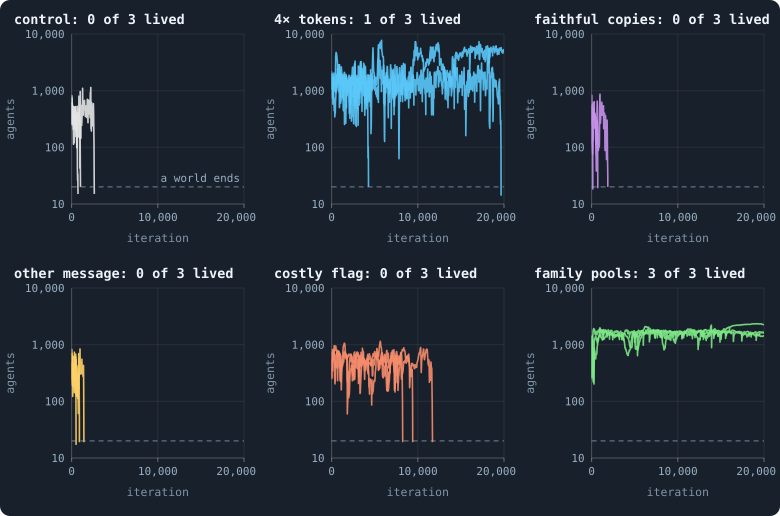
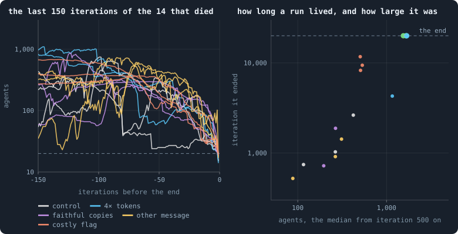
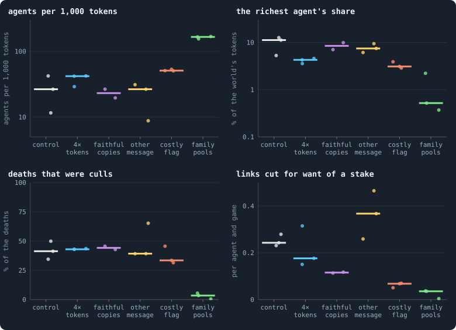

# Why does evolution level off?

> [!question] Questions of this page
> - Why have the worlds measured so far stopped getting better?
> - Is it the size of the population, copies that are not faithful, or the
>   [game](one-iteration.md#phase-2-the-game "The second phase of an iteration: every agent stakes all its tokens on its own node and its neighbours', and every node goes to someone.") itself?
> - Which one change to the rules lets evolution go on longer?

<!-- experiment E46 -->

## In short

The worlds measured so far got better for a while and then stopped: the
notebook's two longest worlds, of [B2](b1-and-b2.md "The second baseline: B1 with the rules that keep its network from breaking and its agents from staking or breeding themselves to death."), climbed for 20,000 to 25,000 [iterations](one-iteration.md "One step of a world's time: a phase of reproduction, then a phase of the game.")
and then only wandered ([Every era against three](every-era-against-three.md)).
Four causes could stop it, and each points to a different fix. Experiment 46
took the rules of one world of round 3, s3058, and played them at 10,000
[tokens](the-world.md#agents-and-tokens "The one thing of value in a world: every agent holds a whole number of them, and their total never changes.") once as they are and five more times with one thing changed, three
seeds each, for 20,000 iterations. Its thesis, written before any run: evolution
stops because of the game, not because of the population.

The thesis cannot be judged. All three control runs died out, at 744, 1,029
and 2,630 iterations, and by the thesis's own words a run that dies decides
nothing. In all, 14 of the 18 runs died. The three runs whose stakes are pooled
by family all lived, and so did one of the three with four times the tokens.
The worlds died in culls: a game cuts the links nobody staked a token on, and
every piece cut off from the largest one dies at once. The more [agents](the-world.md#agents-and-tokens "One member of a world: it lives on a node of the network, holds tokens and has a brain that takes all its decisions.") a world
held, the longer it lived. The family-pool worlds held six times as many agents
per token as the control, spread their tokens far more evenly, and almost never
cut a link. Experiment 47, whose contests were to find where each run levelled
off, was not played.

## The world

s3058 (`B1-30000-4108dd-s3058`) is 28th of the 82 worlds of round 3 that lived
by the evolution rank
([Candidates for open-ended evolution](candidates-for-open-ended-evolution.md)),
and is on health's shortlist. It is the best-ranked world for which every arm
changes something and whose runs fit in about four days on one worker:
- It plays with revolutions, so revolutionary tokens can be made to cost
  something. Nine of the rank's first ten do not.
- Its [brains](the-brain.md "The neural network each agent decides with: inputs about itself and its neighbours, outputs that become its decisions.") change with a probability of 0.2, so they can change less often.
  The 10th and 25th worlds change theirs with 0.1, the least round 3 drew.
- Two better-ranked worlds would take 142 and 515 worker-hours.

On its brain-copy tree, conquests make 80% of the copies, and the living meet
one ancestor 224 iterations back, against 2,356 in its shadow worlds of pure
luck.

## Four reasons it could stop

- **Drift.** In a small population chance decides which lines spread, and
  selection sees only large differences. Counted on the brain-copy tree, the
  [median](statistics.md#many-worlds-at-once-the-median-bands-the-settled-life-and-the-spread "The middle value: half of the numbers lie below it and half above.") world of round 3 has an effective population of about 100, against
  about 3,500 in its shadow worlds; s3058 has 70.
- **Unfaithful copies.** If a child's brain plays unlike its parent's, what
  selection found is lost again as fast as it is found. Round 3's worlds whose
  brains change more often copy them less faithfully: the median heredity is
  0.99 at a probability of 0.1, 0.97 at 0.2, 0.93 at 0.4 and 0.74 at 0.8.
- **Valleys.** Better play may need a crowd to start: a raider needed about a
  hundred of its kind together
  ([Can a strategy written by hand beat evolution?](strategies-written-by-hand.md)).
  A single new brain cannot cross the valley alone.
- **A narrow game.** A brain scores each [neighbour](the-world.md#the-network "An agent joined to another by a connection.") from that neighbour's
  column alone, so it cannot compare neighbours
  ([What a brain can compute](what-a-brain-can-compute.md)). And flagging a
  token as revolutionary costs nothing, so every brain can make the same
  free move. Once the few good moves are found, nothing is left to find.

## The arms

| Arm | The change | The cause it tests |
|---|---|---|
| Control | none | |
| 4 times the tokens | 40,000 tokens on 800 nodes, against 10,000 on 200 | drift: a population four times larger |
| Faithful copies | brains change half as often: `mutation_probability` 0.1, the least round 3 drew, against 0.2 | unfaithful copies |
| The other message to oneself | `self_message` = largest, against own | a narrow game: what a brain can tell its neighbours |
| Revolutionary tokens for the coalition alone | `revolt_tokens` = separate | a narrow game: the free flag |
| Stakes pooled by family | `pool` = family, a new family on one mutation in twenty (`tag_rate` 0.05, as in the [pilots](runs-and-records.md#pilot-worlds "A world made by hand to see whether an idea is worth an experiment, without a thesis or many seeds.")) | valleys: kin stake as one |

Every change is a setting the [engine](runs-and-records.md#the-lab-the-engine-and-pilots "The program that runs an experiment's plan as runs, each on a frozen copy of the engine, the code that plays a world.") already has, and none needs a number
tuned for it ([Every setting](settings.md)). The family-pool arm was to wait
for a second wave, until family pools were in the engine; they are now
([`pool`](settings.md#pool)), and a contest keeps each brain's family.

## How it is read

When the runs are done, their kept worlds play contests, as the eras of round 3
do ([Did the brains get better?](round-3-eras-against-each-other.md)), as
Experiment 47. In every run:

- **Steps:** the brains of 1,000 against those of 500, then 2,500 against
  1,000, 5,000 against 2,500, 10,000 against 5,000 and 20,000 against 10,000.
  Each step plays on both eras' worlds with three coins each, and its score
  is the mean of the six.
- **The noise:** 1,000, 5,000 and 20,000 each play themselves, four coins each.
  A step above 0.5 plus twice the spread of these twelve is a **step up**.
- **Where it levelled off:** the earliest of the eras 500, 1,000, 2,500, 5,000
  and 10,000 after which no step is a step up. A run whose last step, from
  10,000 to 20,000, is still a step up has not levelled off by 20,000.
- **Patches:** the last step is also played with each era's brains planted as
  one region of the world, not by coin, so that kin who stake as one start
  together ([A contest, step by step](measuring-evolution.md#a-contest-step-by-step)).

An arm levels off where the middle one of its three runs does.

<!-- thesis E46 -->
> [!quote] The thesis of Experiment 46, written down before any of its runs existed
> **The claim.** Evolution stops because of the game, not because of the population. Under the rules of round 3's world s3058 at 10,000 tokens, evolution has levelled off by 5,000 iterations. Four times the tokens, and brains that change half as often, level off no later than the control does. At least one of the three changes to the game, the other message to oneself, revolutionary tokens that count for the coalition alone, or stakes pooled by family, levels off later.
>
> **Why it would be so.** On round 3's brain-copy trees conquests make most copies (58% in the median world, 80% in s3058), and the living meet one ancestor far sooner than in shadow worlds of random parents: 224 iterations back in s3058, against 2,356 in its shadows. The effective population is small because winners sweep, not because the world is small (70 in s3058, against 743 in its shadows), so a world four times larger should sweep as fast. Children already play like their parents (heredity 0.96 in s3058 and in the median world), so brains that change less have little to save. Selection on what the brains do is strong almost everywhere, yet the behaviours do not follow it, and the line of descent moves less than mutation alone would move it in 79 of round 3's 82 worlds (Did evolution happen? Fourteen ways to find out): the brains are held where they are. Better play exists that a single new brain cannot reach: in young worlds of B2, strategies written by hand took over from evolved brains, but only with about a hundred of their kind starting together (Can a strategy written by hand beat evolution?). A brain scores each neighbour from that neighbour's column alone and cannot compare neighbours (What a brain can compute), and flagging a token as revolutionary costs nothing, so every brain can make the same free move. These are limits of the game. A change that lets a brain tell its neighbours about a third agent, gives the flag a price, or lets kin stake as one should leave more to be found.
>
> **It holds if:** All three, with every arm read as How it is read says, in Experiment 47's contests; an arm levels off where the middle one of its three runs does. (1) The control has levelled off by 5,000. (2) The arm with four times the tokens and the arm whose brains change half as often each level off no later than the control. (3) At least one of the arms with the other message to oneself, with revolutionary tokens for the coalition alone, and with stakes pooled by family levels off later than the control.
>
> **It fails if:** Any of these. (1) The control has not levelled off by 10,000: its step from 10,000 to 20,000 is still a step up. (2) The arm with four times the tokens, or the arm whose brains change half as often, levels off later than the control. (3) None of the three arms that change the game levels off later than the control. If the control levels off by 10,000 but not by 5,000, the thesis is undecided. A run that dies out, or whose kept worlds cannot be played, decides nothing; an arm with fewer than two runs left decides nothing.
<!-- /thesis -->

## What the eighteen runs did

<!-- figure leveloff/lives -->

**Which runs lived.** Every run of Experiment 46, one panel for each arm, one line for each of its three seeds: how many agents the world held after each game, on a logarithmic scale (each line marks every 25th iteration, and the last). A world ends when a game leaves it 20 agents or fewer (the dashed line). The arm of four times the tokens plays 40,000 tokens; all the others play 10,000.

> [!example]- How to make this figure
> **Runs.** The 18 runs of Experiment 46, three seeds (4601 to 4603) in each of its arms, for 20,000 iterations or until the world died out; 10,000 tokens, and 40,000 in the arm of four times the tokens (every setting is listed in [Why does evolution level off?](why-does-evolution-level-off.md)). They are made with `python3 gol_lab.py run E46`.
>
> **Data.** From each run's `GraphOfLifeRuns/<run>/stats.jsonl`, and its `meta.json` for where it ended.
>
> 1. Keep the rows after the game (`phase` 2).
> 2. Plot `nodes` against `iteration`, every 25th iteration and the last row.
>
> **To make it again:** `python3 book_figures.py leveloff`.
<!-- /figure -->

Fourteen of the eighteen runs died out. Every run of four arms died: the
control, faithful copies, the other message to oneself, and revolutionary
tokens for the coalition alone (the costly flag in the figures). The control's
three lived 744, 1,029 and 2,630 iterations. Two runs with four times the
tokens died too, one at 4,281 and one at 19,667, close to the end. All three
runs of family pools lived to 20,000, and so did one run with four times the
tokens.

The same rules had lived through round 3. There, s3058 played 30,000 tokens for
3,000 iterations and held about 1,260 agents. At 10,000 tokens its control runs
held a median of 116 to 422 agents, and none reached 3,000 iterations.

### How a world died

<!-- figure leveloff/ends -->

**How the worlds died.** Left: each line is one of the 14 runs that died, coloured by its arm: its agents after each game in its last 150 iterations, the end at 0, on a logarithmic scale; the dashed line is the 20 agents at which a world ends. The steps down are culls: a game cuts the links nobody staked a token on, and every piece of the network cut off from the largest one dies at once. Right: each dot is one run that lived past iteration 500, in its arm's colour: the median of its agents after each game from then on, and the iteration it ended, both on logarithmic scales. The larger dots on the line at 20,000 lived to the end; the three family-pool runs lie there under the run of four times the tokens that lived, and beside the one that died at 19,667.

> [!example]- How to make this figure
> **Runs and data.** As for the figure *Which runs lived* above.
>
> 1. Left: the rows after the game (`phase` 2) of the last 150 iterations of each run that died; `nodes` against the iteration minus the run's last one.
> 2. Right: for each run with rows from iteration 500 on, the median of `nodes` over them, against the run's last iteration (`meta.json`, `iteration`).
> 3. The rank correlation of the two over the runs that died: Spearman's rho.
>
> **To make it again:** `python3 book_figures.py leveloff`.
<!-- /figure -->

A world did not fade away. It held hundreds of agents until shortly before its
end. Between the last time a world held 200 agents, ten times the 20 at which
it ends, and its end passed a median of 40 iterations (19 to 87). It fell in
steps, and each step is a cull. After a game, every link on which neither end
staked a token is cut. Every piece of the network then cut off from the largest
one dies at once, and its tokens are shared out among the living
([When a world ends](rules-in-detail.md#when-a-world-ends)). Over their settled
lives, culls made 31% to 65% of the deaths in every arm but family pools. The
last game left 14 to 20 agents, and the richest of them held a median of 29% of
the world's tokens.

The larger a world, the longer it lived. Over the 13 runs that died after
iteration 500, the [rank correlation](statistics.md#rank-correlation "How alike two orders are: the correlation of the ranks, 1 when the orders agree and 0 when one says nothing of the other.") between a run's median number of agents
and the iteration it ended is 0.93 (right panel). Worlds of about 100 agents
lasted hundreds of iterations, worlds of about 500 several thousand. A world of
about 1,700 agents lived to 20,000, and another as large died at 19,667. More
agents bought time, not safety.

### What family pools changed

<!-- figure leveloff/spread -->

**What the arm of family pools does differently.** Each dot is one run of Experiment 46 that lived past iteration 500 (17 of the 18); each bar the median of its arm. All are read over the run's settled life, from iteration 500 to its end. Top left: the median of its agents per 1,000 tokens (logarithmic). Top right: the median share of all the world's tokens held by its richest agent (logarithmic). Bottom left: of all its deaths, the share that were culls, agents in a piece cut off from the largest piece of the network, against starving. Bottom right: the median of the links cut after a game because neither end staked a token on the other, per agent.

> [!example]- How to make this figure
> **Runs and data.** As for the figure *Which runs lived* above.
>
> 1. Keep the rows from iteration 500 on.
> 2. Agents per 1,000 tokens: the median over the rows after the game of 1,000 · `nodes` / the run's tokens; the richest agent's share: the same of `maxTokens`.
> 3. Culls: the sum of `orphaned` over every row (both phases) over the sum of `orphaned` and `starved`.
> 4. Links cut: the median over the rows after the game of `prunedEdges` / `nodes`.
>
> **To make it again:** `python3 book_figures.py leveloff`.
<!-- /figure -->

The family-pool runs differ from the rest in every reading:
- They held about 166 agents per 1,000 tokens, against 27 in the control and
  at most 53 in any other arm.
- Their richest agent held about 0.5% of the tokens, against 11% in the
  control. The [Gini coefficient](measuring-tokens.md#the-gini-coefficient-and-the-lorenz-curve "How unequally tokens are held: 0 if every agent holds as many, near 1 if one holds nearly all.") of their tokens was 0.33, against 0.61.
- Only 3% of their deaths were culls, against 41% in the control. They cut
  0.04 links per agent and game, against 0.24.
- Most of their agents died by starving, and often: 0.49 deaths per agent and
  iteration, against 0.22 in the control.

They are worlds of many poor agents with short lives, whose network almost
never breaks. Why pooling does that, these runs can only suggest. Under family
pools a stake on a relative's node counts for the owner's side, so a stake
defends kin. A link that carries a stake is not cut, and a network whose links
are not cut does not break. That reading is not tested here.

The costly flag also changed how long a world lived, if less. Its three runs
lived 8,251, 9,412 and 11,709 iterations, each more than three times as long as
the longest of the control's. They held twice the control's agents per token,
51 per 1,000, gave each agent about 7.5 links against 3.8, and cut 0.07 links
per agent and game.

## The verdict

**The thesis cannot be judged.** Every part of it compares an arm with the
control, and all three control runs died out. By its own words, a run that
dies out decides nothing, and an arm with fewer than two runs left decides
nothing. Only the arm of family pools has more than one run left.

Experiment 47 was not played. Its contests start from the worlds each run kept
at 500, 1,000, 2,500, 5,000, 10,000 and 20,000 iterations. Ten of the 18 runs
never reached 5,000, and 14 never reached 20,000, so most of its contests have
no world to start from.

## What we learned

- **A plan needs a world that lives at its size and for its length.** s3058
  was chosen because its rules had lived 3,000 iterations at 30,000 tokens.
  Whether they live at 10,000 tokens, or for 20,000 iterations, was never
  checked. They did not, and the experiment lost its control.
- **A world that lived through the screen may still die.** Round 3 judged its
  worlds after 3,000 iterations. Here a world's life grew with its number of
  agents, and even a world of about 1,700 agents died after 19,667 iterations.
  The longer a run is to last, the more agents it needs, or a rule that keeps
  its network whole.
- **Family pools kept every world alive.** The experiment did not set out to
  test that, so it is a finding after the fact. If the arm had nothing to do
  with which runs live, the three runs at 10,000 tokens that lived would all
  fall in one arm about once in 91 times: 5 of the 455 ways to choose three of
  the 15 runs.

## What it cost

The 18 runs took 33.4 worker-hours on one worker, from 12 November 2026, 17:07,
to 14 November, 02:33. The plan had reckoned about 34.

## Where to go next

- [Did the brains get better? Round 3's eras against each other](round-3-eras-against-each-other.md):
  Experiment 45, whether round 3's worlds levelled off, and when.
- [Did evolution happen? Fourteen ways to find out](did-evolution-happen.md):
  the tests this experiment draws on.
- [Candidates for open-ended evolution](candidates-for-open-ended-evolution.md):
  the evolution rank, and the brain trees of round 3.
- [A source and a sink](a-source-and-a-sink.md): an open economy, the next
  change to the game if no arm here moves the plateau.
- [A hundred thousand iterations](a-hundred-thousand-iterations.md): a run
  planned five times as long as these, which has to live that long.

## How this was made

The plans are `book/experiments/E46.json` and `E47.json`.
`research/screen/evolution_plans.py` wrote them on 12 November 2026 from the
evolution rank, `research/screen/evolution.json`. Nothing was played before
the plans were written. Experiment 47 can be played only once Experiment 46's
runs are done: its contests start from their kept worlds.

The figures of what the runs did read nothing but each run's statistics,
`GraphOfLifeRuns/<run>/stats.jsonl`, and its `meta.json`.
`python3 book_figures.py leveloff` draws them; the recipe folded under each
gives every step.

On 22 November 2026 one run lost part of its [frames](runs-and-records.md#what-a-run-records "A whole world as a run records it after one phase: every agent, its tokens and connections."). The external drive
dropped out while 17 of these runs were being moved to it. The copy of
`B1-10000-4819e3-s4602` (stakes pooled by family, seed 4602) had been checked,
but against what was still in memory, and its original removed. Its frames
26,769 to 39,999, from iteration 13,384 to the end, never reached the drive
and are empty. Its statistics, its kept worlds and its last checkpoint are whole, so
nothing on this page changes, and Experiment 47 could still be played. The
viewer cannot show that run past iteration 13,384.

<!-- runs E46 -->
> [!info]- The runs behind this page
> **18 runs.** Every condition below is run once for every seed (4601 to 4603), for 20,000 iterations — or until its world dies out. Every setting is that of the baseline **B1** (the algorithm exactly as a new run is offered it) unless the condition changes it ([At a glance](settings.md#at-a-glance)).
>
> - **control** — the settings of world 58 of [Experiment 40](a-screen-of-random-worlds.md#the-worlds-of-round-3) (seed 3058), as drawn but with `n_nodes` = 200; 10,000 tokens. Runs `B1-10000-122402-s4601` … `B1-10000-122402-s4603`.
> - **4 times the tokens** — the settings of world 58 of [Experiment 40](a-screen-of-random-worlds.md#the-worlds-of-round-3) (seed 3058), as drawn but with `n_nodes` = 800; 40,000 tokens. Runs `B1-40000-bbbccd-s4601` … `B1-40000-bbbccd-s4603`.
> - **faithful copies** — the settings of world 58 of [Experiment 40](a-screen-of-random-worlds.md#the-worlds-of-round-3) (seed 3058), as drawn but with `mutation_probability` = 0.1, `n_nodes` = 200; 10,000 tokens. Runs `B1-10000-0ff18b-s4601` … `B1-10000-0ff18b-s4603`.
> - **message to oneself: largest** — the settings of world 58 of [Experiment 40](a-screen-of-random-worlds.md#the-worlds-of-round-3) (seed 3058), as drawn but with `self_message` = largest, `n_nodes` = 200; 10,000 tokens. Runs `B1-10000-4034e2-s4601` … `B1-10000-4034e2-s4603`.
> - **revolutionary tokens for the coalition alone** — the settings of world 58 of [Experiment 40](a-screen-of-random-worlds.md#the-worlds-of-round-3) (seed 3058), as drawn but with `revolt_tokens` = separate, `n_nodes` = 200; 10,000 tokens. Runs `B1-10000-97e9c3-s4601` … `B1-10000-97e9c3-s4603`.
> - **stakes pooled by family** — the settings of world 58 of [Experiment 40](a-screen-of-random-worlds.md#the-worlds-of-round-3) (seed 3058), as drawn but with `pool` = family, `tag_rate` = 0.05, `n_nodes` = 200; 10,000 tokens. Runs `B1-10000-4819e3-s4601` … `B1-10000-4819e3-s4603`.
>
> To make these runs again: `python3 gol_lab.py run E46`, or ▶ in the Research Notebook tab of a computer running `gol_server.py`. Each run writes its settings, seed and engine version beside its frames, in `GraphOfLifeRuns/<run>/meta.json` and `provenance.json`.
<!-- /runs -->

<!-- runs E47 -->
> [!info]- The trials behind this page
> **864 trials**, contests: the world of one era, its agents given brains drawn by coin from two eras, every mutation off, and the later era's share of the agents counted at the end; each plays 100 iterations, from a world another run kept in its archive.
>
> - **each era against the one before** — 540 trials: worlds `B1-10000-0ff18b-s4601`, `B1-10000-0ff18b-s4602`, `B1-10000-0ff18b-s4603`, `B1-10000-122402-s4601`, `B1-10000-122402-s4602`, `B1-10000-122402-s4603`, `B1-10000-4034e2-s4601`, `B1-10000-4034e2-s4602`, `B1-10000-4034e2-s4603`, `B1-10000-4819e3-s4601`, `B1-10000-4819e3-s4602`, `B1-10000-4819e3-s4603`, `B1-10000-97e9c3-s4601`, `B1-10000-97e9c3-s4602`, `B1-10000-97e9c3-s4603`, `B1-40000-bbbccd-s4601`, `B1-40000-bbbccd-s4602`, `B1-40000-bbbccd-s4603`; eras 500, 1,000, 2,500, 5,000, 10,000, 20,000; coins 17, 18, 19.
> - **the last step, in patches** — 108 trials: worlds `B1-10000-0ff18b-s4601`, `B1-10000-0ff18b-s4602`, `B1-10000-0ff18b-s4603`, `B1-10000-122402-s4601`, `B1-10000-122402-s4602`, `B1-10000-122402-s4603`, `B1-10000-4034e2-s4601`, `B1-10000-4034e2-s4602`, `B1-10000-4034e2-s4603`, `B1-10000-4819e3-s4601`, `B1-10000-4819e3-s4602`, `B1-10000-4819e3-s4603`, `B1-10000-97e9c3-s4601`, `B1-10000-97e9c3-s4602`, `B1-10000-97e9c3-s4603`, `B1-40000-bbbccd-s4601`, `B1-40000-bbbccd-s4602`, `B1-40000-bbbccd-s4603`; eras 10,000, 20,000; coins 17, 18, 19.
> - **each against itself** — 216 trials: worlds `B1-10000-0ff18b-s4601`, `B1-10000-0ff18b-s4602`, `B1-10000-0ff18b-s4603`, `B1-10000-122402-s4601`, `B1-10000-122402-s4602`, `B1-10000-122402-s4603`, `B1-10000-4034e2-s4601`, `B1-10000-4034e2-s4602`, `B1-10000-4034e2-s4603`, `B1-10000-4819e3-s4601`, `B1-10000-4819e3-s4602`, `B1-10000-4819e3-s4603`, `B1-10000-97e9c3-s4601`, `B1-10000-97e9c3-s4602`, `B1-10000-97e9c3-s4603`, `B1-40000-bbbccd-s4601`, `B1-40000-bbbccd-s4602`, `B1-40000-bbbccd-s4603`; eras 1,000, 5,000, 20,000; coins 17, 18, 19, 20.
>
> To play these trials again: `python3 gol_lab.py run E47`. Each writes its settings and engine beside its result, in `GraphOfLifeRuns/<trial>/meta.json` and `result.json`.
<!-- /runs -->

<!-- turns -->
---

← [Every era against three](every-era-against-three.md) · [Does evolution keep going?](../README.md#does-evolution-keep-going) · [A source and a sink](a-source-and-a-sink.md) →

**Also about:** [Changing the rules](../README.md#changing-the-rules).

> [!info]- Pages that link here (3)
> [Did the brains get better? Round 3's eras against each other](round-3-eras-against-each-other.md) · [A hundred thousand iterations](a-hundred-thousand-iterations.md) · [Every simulation: what was run, and what was measured](every-simulation.md)
<!-- /turns -->
